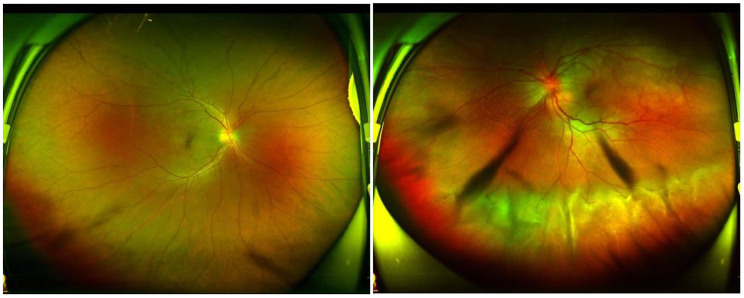
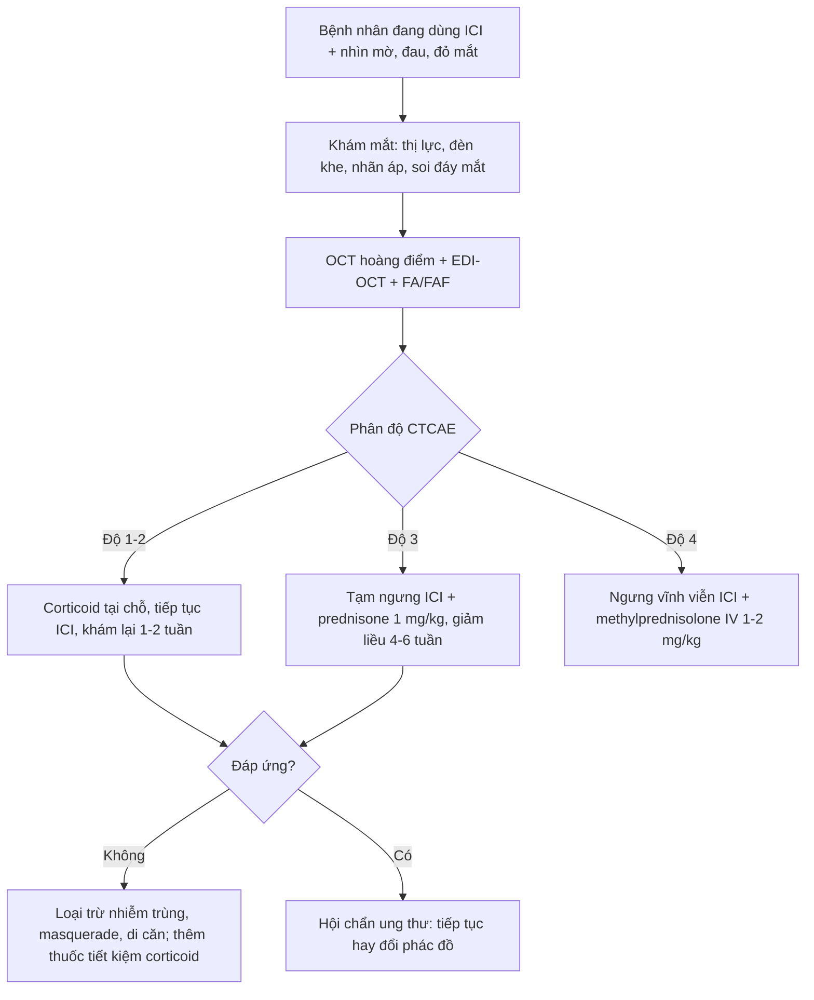
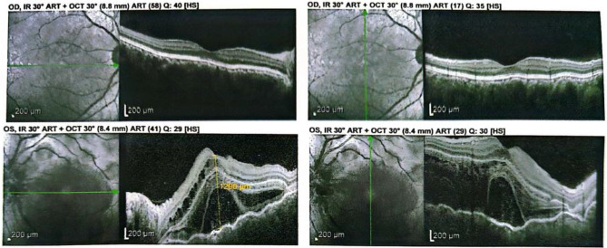
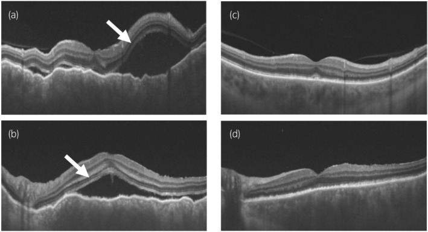

# 1437 — Viêm màng bồ đào do thuốc ức chế điểm kiểm miễn dịch (ICI uveitis) và thể giống VKH / Immune checkpoint inhibitor-associated uveitis and VKH-like syndrome

**Tags:** `pattern:viem-mang-bo-dao` `pattern:viem-toan-hac-mac` `pattern:bong-vong-mac-thanh-dich` `pattern:day-hac-mac` `pattern:sunset-glow` `pattern:viem-hac-mac-do-thuoc` `pattern:hai-ben` `pattern:viem-mang-bao-dau` `vung:mat` `vung:hac-mac` `vung:vong-mac` `vung:tien-phong` `vung:dia-thi` `protocol:OCT` `protocol:EDI-OCT` `protocol:FA` `protocol:FAF` `protocol:UBM` `protocol:B-scan` `protocol:MRI-so-nao` `score:CTCAE`
**Mức chắc chắn (certainty):** tổng hợp y văn (literature synthesis) — 1 tổng quan hệ thống 52 ca VKH-like (2025), 1 đoàn hệ pharmacovigilance 28 bệnh nhân/36 biến cố (2022), 1 đoàn hệ 71.931 + 71.931 bệnh nhân (TriNetX 2023), 1 tổng quan 290 ca báo cáo, 2 ca nguyên văn có ảnh, và guideline SITC 2021. Bằng chứng chủ yếu là **ca báo cáo và đoàn hệ hồi cứu**, không có RCT.

> **Vì sao bài này quan trọng:** bài **1436** vừa chốt **VKH tự phát** — bệnh của người **không có tiền sử can thiệp mắt, không có thuốc khởi phát**. Nhưng từ khi thuốc ức chế điểm kiểm miễn dịch (immune checkpoint inhibitor, ICI) trở thành nền tảng điều trị melanoma, một thể **giống hệt VKH** xuất hiện ở bệnh nhân ung thư. Câu hỏi lâm sàng không phải "có phải VKH không" mà là **"có được tiếp tục ICI không, và bằng chứng nào cho phép tiếp tục"** — vì ngưng thuốc có thể mất kiểm soát khối u, còn tiếp tục có thể mù.

## 1. Tổng quan bệnh học – cơ chế hình ảnh – vì sao "VKH-like"

- **Cơ chế miễn dịch:** ICI (kháng CTLA-4, PD-1, PD-L1) **gỡ bỏ phanh ức chế T-cell**, làm mất dung thứ ngoại vi. Ở người có **HLA-DR4**, dòng T-cell tự phản ứng nhận diện **kháng nguyên tế bào hắc tố (melanocyte antigens: Melan-A/MART-1, gp100, tyrosinase, TRP-1/2)**. Các kháng nguyên này có **đồng thời** ở:
  - **hắc mạc và mống mắt–thể mi** → viêm màng bồ đào;
  - **da** → vitiligo, poliosis;
  - **tai trong (stria vascularis)** → ù tai, giảm thính lực;
  - **màng não** → đau đầu, cứng gáy, pleocytosis dịch não tủy.
  Đây chính là lý do thể này **bắt chước VKH** chứ không chỉ là "viêm màng bồ đào trước đơn thuần".
- **Vì sao thường hai bên:** kháng nguyên là **hệ thống**, không phải tại chỗ; hắc mạc hai mắt cùng biểu hiện. Trong tổng quan hệ thống 52 ca, **73,1% có bằng chứng hai bên**; trong đoàn hệ Pháp, **80%** hai bên.
- **TẠI SAO có bong võng mạc thanh dịch (serous retinal detachment, SRD):** viêm hắc mạc làm **tăng tính thấm mao mạch hắc mạc** + **bơm biểu mô sắc tố (RPE) suy** → dịch tích **dưới võng mạc**. Trên OCT: **hắc mạc dày** + **khoang dịch dưới võng mạc không có màng co kéo**; trên FA: **đốm rò (pinpoint leaks) thì sớm + đọng thuốc thì muộn**.
- **TẠI SAO có "sunset glow fundus":** viêm hắc mạc mạn làm **mất sắc tố RPE** ở cực sau, lộ hắc mạc → đáy mắt màu **cam–hồng**, xuất hiện **nhiều tuần đến nhiều tháng** sau đợt cấp. Đây là dấu hiệu **muộn**, không có giá trị loại trừ lúc khởi phát.
- **Thời điểm khởi phát:** tổng quan 52 ca VKH-like: thời gian dùng ICI trước triệu chứng **22,2 ± 29,6 tuần** (rất rộng); đoàn hệ Pháp: **17 ± 19 tuần**. Có ca **sớm sau 2 tuần** và ca **muộn sau nhiều tháng**, kể cả sau khi ngưng thuốc. Vì vậy **không có "cửa sổ an toàn"** để loại trừ.
- **Tần suất định lượng:**
  - Viêm màng bồ đào trong thử nghiệm lâm sàng: **0,3–6%**; SITC ghi **< 1%–6%**. Toàn bộ biến cố mắt–hốc mắt **1–2,8%**.
  - Uveitis chiếm **46,2%** trong **290 ca báo cáo** biến cố mắt do ICI; một phân tích khác cho rằng uveitis chiếm **gần 70%** biến cố mắt.
  - Đoàn hệ TriNetX **71.931 bệnh nhân ICI** so với **71.931 bệnh nhân ung thư không ICI**: **HR 2,39 (95% CI 2,07–2,75)** cho viêm màng bồ đào mới, theo dõi tới **144 tháng**.
  - **Melanoma** chiếm **61,7–69,2%** ca; **nivolumab 42,5%**, **ipilimumab 40,0%** trong 290 ca; thể VKH-like: **PD-1 đơn thuần 63,5%**, **phối hợp CTLA-4 19,2%**.
- **Yếu tố nguy cơ:** melanoma, **HLA-DR4**, **tiền sử viêm màng bồ đào** (bùng phát **38,9%** ở người có viêm màng bồ đào trước; **51,1%** ở người có viêm trung gian/sau/toàn thể trước đó), phối hợp ICI, liều ipilimumab cao (nguy cơ biến cố nặng **gấp 3,10 lần**).

## 2. Mẫu hình + chẩn đoán phân biệt theo vị trí (Gamut)

- **Theo giải phẫu:**
  - **Viêm màng bồ đào trước (44%)**: đỏ mắt, đau, sợ ánh sáng, **tế bào và flare tiền phòng**, dính mống mắt sau. Đây là thể **hay bị bỏ qua nhất** vì bệnh nhân ung thư ít than đau mắt.
  - **Viêm trung gian**: tế bào dịch kính, "snowbanks", phù hoàng điểm dạng nang.
  - **Viêm màng bồ đào sau**: viêm hắc mạc, **SRD**, viêm mạch võng mạc, đĩa thị phù.
  - **Viêm toàn thể (panuveitis, 28–40,4%)**: thể nặng nhất, thường là **VKH-like**, có thể kèm triệu chứng toàn thân.
- **Theo bối cảnh ung thư:**
  - **Melanoma** → VKH-like, birdshot-like; nguy cơ cao nhất.
  - **Ung thư phổi** → biến cố thần kinh–mắt (nhược cơ, liệt dây) nhiều hơn uveitis.
  - **Ung thư thận/tế bào sáng** → ca VKH-like đã báo cáo, thường đáp ứng corticoid tại chỗ.
- **Gamut "viêm màng bồ đào hai bên ở bệnh nhân ung thư đang dùng ICI":** VKH-like do ICI, VKH tự phát, **viêm màng bồ đào giao cảm**, **birdshot**, **sarcoidosis**, **nhiễm trùng (lao, giang mai, CMV, HSV)**, **di căn hắc mạc**, **u lympho nội nhãn (masquerade)**, **MEKAR do ức chế MEK**, và **thuốc khác** (bisphosphonate, rifabutin, cidofovir).
- **Mnemonic "MELANIN":** **M**elanoma/ICI, **E**xtraocular signs (meningism, tinnitus, vitiligo), **L**ow vision bilateral, **A**nterior cells + **A**myloid? — không dùng mnemonic gượng; thay bằng **3 câu hỏi**: (1) hai bên không? (2) hắc mạc dày + SRD không? (3) có triệu chứng ngoài mắt (da–tai–màng não) không? Nếu **cả 3** → nghĩ **VKH-like**.

## 3. Bảng so sánh phân biệt (ma trận đối chiếu)

| Thực thể (entity) | Hình ảnh điển hình (OCT/FA/FAF) | Chốt vào (rule-in) | Chốt loại (rule-out) | Gợi ý xác nhận |
|---|---|---|---|---|
| **VKH-like do ICI** | **Hắc mạc dày hai bên** + **SRD**; FA: đốm rò + đọng thuốc; FAF: sunset glow muộn | **Đang/đã dùng ICI** + **hai bên** + hắc mạc dày + SRD; có thể kèm vitiligo, ù tai, đau đầu | Không có phơi nhiễm ICI; một bên đơn thuần + khối hắc mạc → nghĩ khác | Ngưng/giảm ICI thử + corticoid; đáp ứng nhanh ủng hộ |
| **VKH tự phát** | Giống hệt; **SFCT 940/898 µm** cấp → **347/447 µm** sau 1 tháng (bài 1436) | Tiêu chuẩn **Read 2001/SUN 2021**, **không** có thuốc khởi phát, **không** tiền sử chấn thương/mổ mắt | **Có ICI trong 6 tháng** → phải loại VKH-like trước | HLA-DR4 hỗ trợ nhưng **không phân biệt được**; hỏi kỹ thuốc |
| **Viêm màng bồ đào giao cảm** | Viêm toàn thể **hai bên**, u hạt; mắt kích thích có tiền sử chấn thương/mổ | **Tiền sử chấn thương xuyên thấu hoặc phẫu thuật nội nhãn** ở mắt kia; cửa sổ **5 ngày–nhiều thập kỷ** (kinh điển **14 ngày**) | Không có tiền sử can thiệp mắt → loại | Hỏi tiền sử mổ/chấn thương; sinh thiết hiếm cần |
| **Birdshot** | Đốm giảm sắc tố hình bầu dục **lan từ đĩa thị ra ngoại vi**; viêm mạch | **HLA-A29 dương**, người da trắng lớn tuổi, **không** triệu chứng toàn thân | Có SRD + hắc mạc dày + ICI → nghĩ VKH-like | HLA-A29, ICGA |
| **Sarcoidosis** | U hạt, **nốt quanh mạch máu**, dày hắc mạc; đĩa thị phù | **Hạch rốn phổi trên CT ngực**, ACE tăng, **BAL lympho** | Không tổn thương ngực + không tăng ACE → ít nghĩ | CT ngực, ACE, sinh thiết |
| **Nhiễm trùng (lao/giang mai/CMV/HSV)** | Viêm màng bồ đào trước hoặc sau, **dính mống mắt**, tổn thương võng mạc hoại tử | **PCR dịch tiền phòng/dịch kính dương**, huyết thanh học dương | Đáp ứng corticoid đơn thuần **không** loại trừ nhiễm trùng | PCR, QuantiFERON, VDRL/TPHA |
| **Di căn hắc mạc** | **Khối hắc mạc đặc**, hồi âm trung bình–cao, **không có SRD lan tỏa** | Tiền sử ung thư; tổn thương **một bên, khu trú**, lớn dần | Hai bên + hắc mạc dày lan tỏa → nghĩ VKH-like | Siêu âm B-scan, OCT, sinh thiết nếu cần |
| **U lympho nội nhãn (masquerade)** | Tế bào dịch kính **dạng "lepra"**, dày hắc mạc; **IL-10/IL-6 > 1** | **IL-10 dịch kính > 65 pg/mL**, tế bào dị hình | Đáp ứng corticoid nhanh + hai bên đối xứng → nghĩ VKH-like hơn | Chọc dịch kính: cytology, IL-10/IL-6 (bài 1435) |
| **MEKAR (ức chế MEK)** | **SRD hai bên nhiều ổ**, không viêm tiền phòng; **tự khỏi** | Bắt đầu **dabrafenib/trametinib**, xuất hiện **ngày–tuần** | Có tế bào tiền phòng + hắc mạc dày → nghĩ VKH-like | Ngừng/thử thuốc, theo dõi 2–4 tuần |

*Bệnh nhân nữ 52 tuổi, ung thư thực quản, sau 10 chu kỳ tislelizumab: mắt phải bình thường; mắt trái phù đĩa thị, bờ mờ, bong võng mạc xuất tiết phía dưới. Nguồn: Zhou Y, Lei X, Ma W, *BMC Ophthalmol* 2026 (PMC13112615), CC BY-NC-ND 4.0, nguyên bản.*

## 4. Protocol chụp + phân độ + xử trí

- **Trước điều trị:** không khuyến cáo tầm soát mắt thường quy cho mọi bệnh nhân ICI, nhưng **khám mắt nền** nên làm ở người **có tiền sử viêm màng bồ đào**, **melanoma**, hoặc **đang dùng phối hợp ICI**.
- **Khi có triệu chứng (nhìn mờ, đau, đỏ, sợ ánh sáng, ruồi bay):**
  1. **Thị lực, sinh hiển vi đèn khe** (tế bào/flare, dính mống mắt, KPs), **nhãn áp**.
  2. **Soi đáy mắt giãn đồng tử** + **OCT hoàng điểm** (SRD, phù hoàng điểm) + **EDI-OCT** (độ dày hắc mạc).
  3. **FA** nếu nghi viêm hắc mạc/viêm mạch; **FAF** tìm sunset glow; **UBM** nếu viêm trước/trung gian nặng; **B-scan** nếu môi trường đục.
  4. **Xét nghiệm:** CBC, ESR/CRP, ACE, lysozyme, **QuantiFERON**, **VDRL/TPHA**, **HLA-DR4/A29**, ANA; **CT ngực** nếu nghi sarcoid/lao.
  5. **MRI sọ–hốc mắt** nếu có dấu hiệu thần kinh–mắt; **chọc dịch não tủy** nếu đau đầu/cứng gáy — lưu ý **không có pleocytosis không loại trừ VKH-like do ICI** (ca tislelizumab).
  6. **Chọc dịch tiền phòng/dịch kính** (PCR, IL-10/IL-6) khi nghi nhiễm trùng hoặc masquerade.
- **Phân độ CTCAE v5.0 (viêm màng bồ đào):**

| Độ | Mô tả | Hướng xử trí |
|---|---|---|
| **1** | Không triệu chứng hoặc nhẹ; chỉ thấy tế bào tiền phòng | Corticoid tại chỗ; **tiếp tục ICI**; khám mắt theo dõi |
| **2** | Viêm màng bồ đào trước có triệu chứng, đáp ứng corticoid tại chỗ | Corticoid tại chỗ ± periocular; **cân nhắc giữ ICI**, khám lại 1–2 tuần |
| **3** | Viêm trung gian/sau/toàn thể, hoặc viêm trước nặng; hạn chế sinh hoạt | **Tạm ngưng ICI**; **prednisone 1 mg/kg/ngày**, giảm liều 4–6 tuần |
| **4** | Mù lòa mắt bị ảnh hưởng (thị lực ≤ 20/200) | **Ngưng vĩnh viễn ICI**; **methylprednisolone IV 1–2 mg/kg/ngày**; hội chẩn ung thư–mắt |

- **Điều trị cụ thể:** corticoid tại chỗ (prednisolone acetate 1%) + **liệt điều tiết** (cyclopentolate) chống dính; corticoid periocular khi viêm sau; **corticoid toàn thân** khi hai bên/nặng; **thuốc tiết kiệm corticoid** (methotrexate, mycophenolate, adalimumab) khi tái phát hoặc cần corticoid kéo dài.
- **Bằng chứng kết cục:** trong 52 ca VKH-like, **90,4%** cần corticoid toàn thân hoặc nội nhãn, **59,6%** ngưng ICI, **82,7%** hồi phục hoàn toàn/remission thị giác. Trong đoàn hệ Pháp, **50%** chỉ cần corticoid tại chỗ; **70%** là độ 3; **60%** ngưng ICI.
- **Dùng lại ICI (rechallenge):** quyết định **đa chuyên khoa**. Dữ liệu chung: sau khi dùng lại, **18%** tái phát biến cố miễn dịch cùng loại; riêng uveitis trong một loạt **0/2** tái phát, nhưng **ca tislelizumab tái phát rõ sau 2 lần truyền lại**. Vì vậy: **thể nhẹ kiểm soát bằng corticoid tại chỗ → có thể tiếp tục dưới giám sát**; **thể nặng/tái phát → đổi phác đồ ung thư hoặc ngưng vĩnh viễn**.

- **Theo dõi:** OCT + EDI-OCT mỗi **2–4 tuần** trong đợt cấp, sau đó **3 tháng/lần** trong năm đầu; FAF tìm sunset glow muộn; khám mắt ngay khi tái triệu chứng.

## 5. Biến thể bình thường và cạm bẫy

- **Cạm bẫy 1 — một bên không loại trừ:** **26,9%** ca VKH-like trong tổng quan hệ thống **không có bằng chứng hai bên** lúc chẩn đoán. Ca tislelizumab khởi phát **một mắt** (mắt trái) dù bệnh hệ thống. Vì vậy **khám mắt còn lại bắt buộc**, kể cả khi không triệu chứng.
- **Cạm bẫy 2 — "di căn hắc mạc" thay vì viêm:** khối di căn **đặc, khu trú, hồi âm trong**, thường **một bên**; VKH-like **dày hắc mạc lan tỏa hai bên + SRD**. Siêu âm B-scan và OCT phân biệt được trong đa số ca.
- **Cạm bẫy 3 — ngưng ICI quá tay:** **50%** ca trong đoàn hệ Pháp chỉ cần **corticoid tại chỗ**; ngưng ICI không cải thiện thị lực nhiều hơn mà có thể mất kiểm soát u. Quyết định phải dựa **độ CTCAE + đáp ứng điều trị**, không dựa "chẩn đoán VKH".
- **Cạm bẫy 4 — nhầm với VKH tự phát:** VKH tự phát cần loại trừ **chấn thương/mổ mắt** và **thuốc khởi phát**. Nếu bệnh nhân đang dùng ICI, **chẩn đoán mặc định là VKH-like do thuốc** cho tới khi chứng minh ngược.
- **Cạm bẫy 5 — dịch não tủy "bình thường":** ca tislelizumab có **dịch não tủy lympho ưu thế nhưng KHÔNG pleocytosis**, khác VKH kinh điển. Không có pleocytosis **không loại trừ** thể do thuốc.
- **Cạm bẫy 6 — MEKAR:** bệnh nhân melanoma có thể dùng **phối hợp BRAF/MEK**; MEKAR gây **SRD hai bên nhiều ổ, không viêm tiền phòng, tự khỏi trong 2–4 tuần**. Nhầm MEKAR với VKH-like dẫn tới dùng corticoid liều cao không cần thiết.
- **Cạm bẫy 7 — bỏ sót viêm màng bồ đào trước:** bệnh nhân ung thư thường **không phàn nàn đau mắt**; tế bào tiền phòng nhẹ có thể bị bỏ qua cho tới khi **dính mống mắt, glôcôm tân mạch**. Khám đèn khe là bắt buộc, không chỉ soi đáy mắt.

## 6. Tự lượng giá — Blind Quiz

**Ca 1 — Nữ 52 tuổi, ung thư thực quản, sau 10 chu kỳ tislelizumab (kháng PD-1) đột ngột nhìn mờ mắt trái. Nhìn ảnh đáy mắt, mô tả trước.**

- Gợi ý: mắt phải không triệu chứng; không chấn thương, không mổ mắt.
- Câu hỏi: (1) Bất thường chính ở mắt trái? (2) Ba chẩn đoán phân biệt? (3) Xét nghiệm nào chốt hướng?

<b>Bấm để hiện đáp án (findings + chẩn đoán)</b>

- **Dấu hiệu:** mắt phải bình thường; mắt trái **phù đĩa thị, bờ mờ**, **bong võng mạc xuất tiết phía dưới** (dịch dưới võng mạc lan tỏa).
- **Chẩn đoán:** **viêm màng bồ đào sau/toàn thể do ICI, thể VKH-like** — cơ chế: T-cell tự phản ứng với kháng nguyên tế bào hắc tố → viêm hắc mạc → SRD.
- **Phân biệt:** VKH tự phát (không có thuốc), di căn hắc mạc (khối đặc), nhiễm trùng (lao/giang mai/CMV).
- **Chốt hướng:** **OCT** (SRD + hắc mạc dày), **FA** (đốm rò), loại trừ nhiễm trùng bằng PCR/huyết thanh; **dịch não tủy có thể không pleocytosis**.
- Nguồn ảnh: Zhou Y, Lei X, Ma W, *BMC Ophthalmol* 2026 (PMC13112615), CC BY-NC-ND 4.0, nguyên bản.

**Ca 2 — Cùng bệnh nhân, OCT hoàng điểm lúc vào và sau điều trị.**

- Câu hỏi: Mô tả dịch dưới võng mạc trước điều trị. Sau corticoid, điều gì thay đổi — và điều gì **không** hồi phục?

<b>Bấm để hiện đáp án</b>

- **Trước:** mắt trái **phù hoàng điểm lan tỏa + nhiều khoang dịch dưới võng mạc**, có vách; mắt phải cấu trúc hoàng điểm bình thường.
- **Sau corticoid:** dịch dưới võng mạc **giảm rõ**; nhưng **bất thường vùng ellipsoid zone** có thể **tồn tại** — đây là dấu hiệu tổn thương tế bào cảm thụ đã xảy ra, giải thích vì sao **điều trị sớm** quan trọng.
- **Bài học:** OCT là công cụ **theo dõi đáp ứng**; SRD hồi phục nhanh nhưng **di chứng EZ** quyết định thị lực cuối.
- Nguồn ảnh: Zhou Y, Lei X, Ma W, *BMC Ophthalmol* 2026 (PMC13112615), CC BY-NC-ND 4.0, nguyên bản.

**Ca 3 — Nam 68 tuổi, ung thư thận di căn phổi, đang nivolumab (kháng PD-1). Nhìn mờ hai bên.**

- Câu hỏi: (1) Dấu hiệu trên OCT? (2) Vì sao có thể chỉ dùng corticoid tại chỗ? (3) Có được dùng lại nivolumab không?

<b>Bấm để hiện đáp án</b>

- **Dấu hiệu:** (a,b) **dịch dưới võng mạc hai bên** (mũi tên trắng) trước điều trị; (c,d) **hết dịch** sau corticoid tại chỗ.
- **Chẩn đoán:** **VKH-like do nivolumab**, **HLA-DR4 dương**; thể nhẹ–trung bình đáp ứng corticoid tại chỗ.
- **Vì sao tại chỗ đủ:** không có viêm tiền phòng nặng, SRD khu trú, đáp ứng nhanh; **50%** ca trong đoàn hệ Pháp chỉ cần corticoid tại chỗ.
- **Dùng lại:** bệnh nhân **tiếp tục nivolumab** và duy trì **đáp ứng một phần** của di căn phổi — cho thấy **không nhất thiết ngưng ICI vĩnh viễn** khi kiểm soát được bằng corticoid.
- Nguồn ảnh: Imai H và cs., *IJU Case Rep* 2025;8(1):36–40 (PMC11693107), CC BY 4.0.

## Bài liên quan chéo
- [1436 – Bệnh Vogt–Koyanagi–Harada (VKH tự phát)](../1436-benh-vogt-koyanagi-harada/lesson.md) (thể không do thuốc — tiêu chuẩn Read/SUN, SFCT, sunset glow)
- [1435 – Hội chứng masquerade: u lympho nội nhãn](../1435-hoi-chung-masquerade-u-lympho-noi-nhan/lesson.md) (IL-10/IL-6, tế bào dị hình)
- [487 – Nhiễm độc võng mạc do thuốc khác ngoài HCQ](../487-nhiem-doc-vong-mac-thuoc-khac-ngoai-hcq/lesson.md) (MEKAR, SRD hai bên tự khỏi)
- [1425 – Viêm nội nhãn sau tiêm nội nhãn](../1425-viem-noi-nhan-sau-tiem-noi-nhan/lesson.md)
- [1426 – Viêm nội nhãn tái phát không đáp ứng](../1426-viem-noi-nhan-tai-phat-khong-dap-ung/lesson.md)
- [442 – Glaucoma và OCT](../442-glaucoma-OCT/lesson.md) (biến chứng dính mống mắt/glôcôm)

## Ảnh
- `1437_ici-vkh_Fundus_PMC13112615-Fig1-CCBYNCND.jpg` — Zhou Y, Lei X, Ma W, *BMC Ophthalmol* 2026 (PMC13112615), **CC BY-NC-ND 4.0**, nguyên bản (không crop/ghép).
- `1437_ici-vkh_OCT_PMC13112615-Fig2-CCBYNCND.jpg` — Zhou Y, Lei X, Ma W, *BMC Ophthalmol* 2026 (PMC13112615), **CC BY-NC-ND 4.0**, nguyên bản.
- `1437_ici-vkh_OCT-bilateral_PMC11693107-Fig3-CCBY.jpg` — Imai H và cs., *IJU Case Rep* 2025 (PMC11693107), **CC BY 4.0**, nguyên bản.
- Chi tiết giấy phép từng ảnh: `images/CREDITS.md`.

> Không dùng để chẩn đoán độc lập khi chưa có người hướng dẫn.
