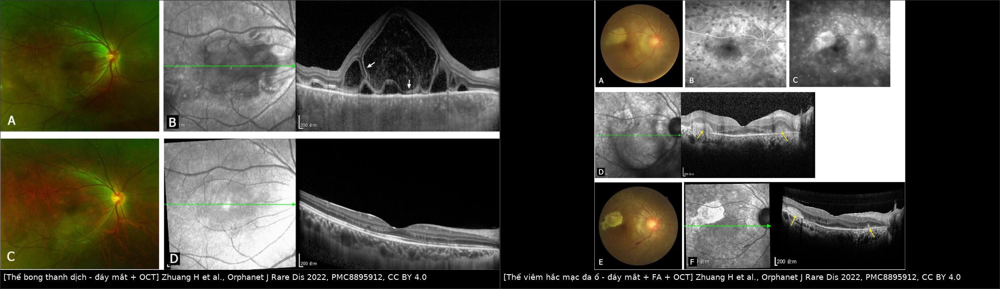
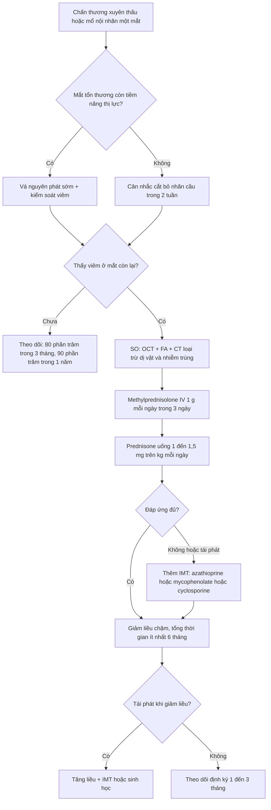
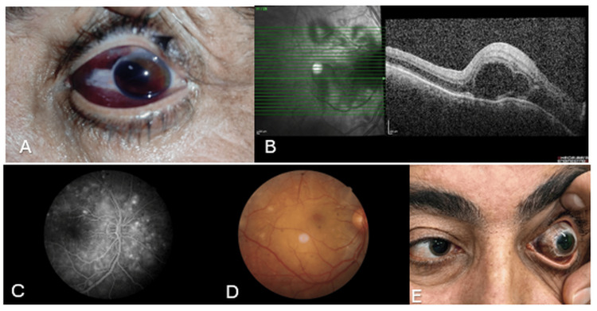
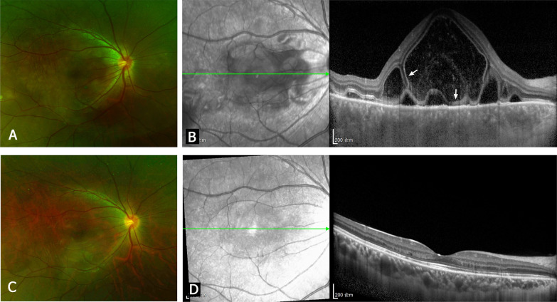
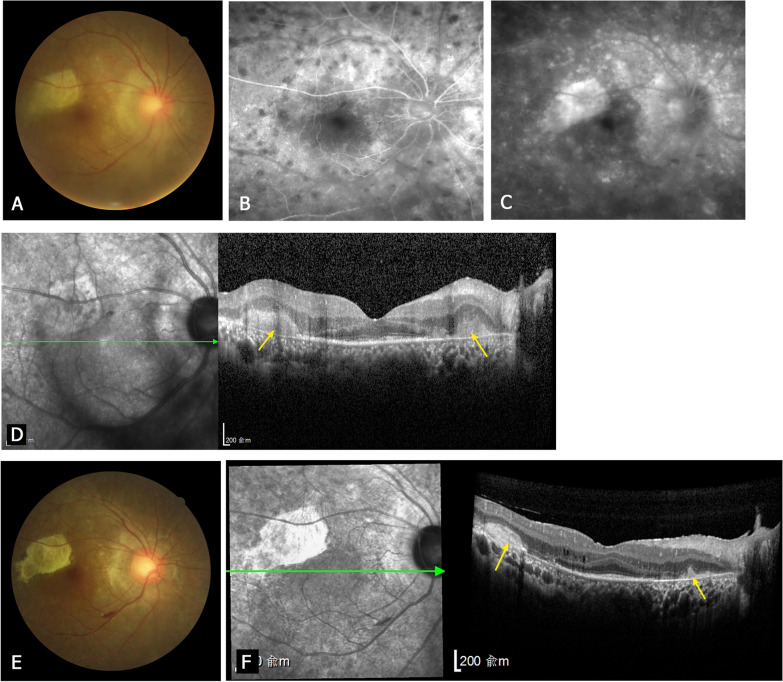
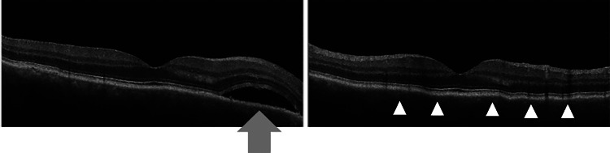

# 1438 — Viêm màng bồ đào giao cảm / Sympathetic ophthalmia (SO)

**Tags:** `pattern:viem-toan-hac-mac` `pattern:viem-mang-bo-dao` `pattern:u-hat` `pattern:bong-vong-mac-thanh-dich` `pattern:day-hac-mac` `pattern:dalen-fuchs` `pattern:hai-ben` `pattern:sau-chan-thuong` `pattern:sau-mo-noi-nhan` `vung:mat` `vung:hac-mac` `vung:vong-mac` `vung:tien-phong` `vung:dia-thi` `protocol:OCT` `protocol:EDI-OCT` `protocol:FA` `protocol:ICGA` `protocol:B-scan` `protocol:CT` `score:SUN-2005`
**Mức chắc chắn (certainty):** tổng hợp y văn (literature synthesis) — 1 tổng quan dịch tễ 340 bài (2025), 2 tổng quan cơ chế–điều trị (2022, 2012 FD Ophthalmic), 1 loạt 48 ca có phân loại OCT (2022), 1 phân tích gộp sau cắt dịch kính (2023), 1 phân tích gộp sau mổ nội nhãn (2024), 1 loạt 14 ca Ấn Độ (2018), 1 loạt 15 ca Đài Loan (2023), và 3 ca nguyên văn có ảnh. **Không có RCT** cho liều corticoid hay thời điểm cắt bỏ nhãn cầu — các khuyến cáo dựa trên đoàn hệ hồi cứu và ý kiến chuyên gia, đã ghi rõ.

> **Vì sao bài này quan trọng:** bài **1436** dạy VKH — bệnh viêm toàn hắc mạc **hai bên, không có tiền sử can thiệp mắt**. Nhưng khi bệnh nhân **có** chấn thương xuyên thấu hoặc mổ nội nhãn ở một mắt, mọi thứ đảo ngược: chẩn đoán là **viêm màng bồ đào giao cảm (sympathetic ophthalmia, SO)**, mắt đã tổn thương là **mắt kích thích (exciting/inciting eye)**, mắt còn lại là **mắt được giao cảm (sympathizing eye)** — và chính mắt "lành" mới là mắt quyết định thị lực. Đây là chẩn đoán **bỏ sót được nhưng điều trị được**, và là lý do duy nhất trong nhãn khoa để **cắt bỏ một nhãn cầu còn nhìn thấy** (khi mắt kia đe dọa mù). Bài này trả lời ba câu hỏi thực hành: **(1) khi nào nghi SO, (2) phân biệt với VKH/viêm do thấu kính/nhiễm trùng bằng gì, (3) theo dõi và điều trị bao lâu**.

## 1. Tổng quan bệnh học – cơ chế hình ảnh – vì sao "giao cảm"

- **Bệnh học:** SO là **viêm toàn màng bồ đào u hạt (granulomatous panuveitis) hai bên**, khởi phát sau **chấn thương xuyên thấu có sa u hắc mạc** hoặc **mổ nội nhãn** ở một mắt. Về mô bệnh: hắc mạc, thể mi và mống mắt **dày lan tỏa**, thấm nhiều **tế bào lympho, tế bào biểu mô (epithelioid) và tế bào khổng lồ**; **lớp choriocapillaris điển hình được "spare"** (dù có loạt thấy thâm nhiễm lympho khu trú khi kèm viêm nội nhãn). **Nốt Dalén–Fuchs** gặp ở **~30%** ca, nằm ngay **trong (nội) màng Bruch**, gồm lympho, histiocyte và tế bào RPE biến đổi.
- **TẠI SAO mắt bên kia bị viêm:** chấn thương/mổ làm **kháng nguyên võng mạc–hắc mạc** (retinal S-antigen, IRBP — interphotoreceptor retinoid-binding protein) thoát vào **mô lympho kết mạc**. Đây là "cửa sau" miễn dịch: tiền phòng có TGF-β ức chế miễn dịch, còn kết mạc thì không. Tế bào T được mẫn cảm rồi **homing về cả hai mắt** vì hai mắt chia sẻ cùng kháng nguyên → viêm **đối xứng nhưng không đồng thời**. Thực nghiệm: tiêm S-antigen vào **tiền phòng** chỉ gây phản ứng tại chỗ; tiêm vào **dưới kết mạc** mới gây bệnh ở mắt đối diện. → Hệ quả lâm sàng: **bảo tồn bao kết mạc và đóng kín vết thương sớm** không chỉ để cứu mắt tổn thương mà còn để **giảm phơi nhiễm kháng nguyên**.
- **TẠI SAO có bong võng mạc thanh dịch (serous retinal detachment, SRD):** viêm hắc mạc làm **tăng tính thấm mao mạch hắc mạc** + **bơm RPE suy** → dịch huyết thanh tích **dưới võng mạc cảm quang**. Trên OCT, dịch này **trong quang học** nên là **khoang giảm phản xạ (hyporeflective)**, không có màng co kéo; võng mạc ngoài bị đẩy lên nhưng **các dải ELM/EZ vẫn còn** ở phần lớn ca → yếu tố tiên lượng hồi phục.
- **TẠI SAO có "sunset glow" muộn:** viêm hắc mạc mạn làm **mất sắc tố RPE**, lộ hắc mạc → đáy mắt **cam–hồng**, xuất hiện sau nhiều tháng; đây là dấu hiệu **muộn**, không dùng để loại trừ lúc cấp.
- **TẠI SAO thời gian tiềm tàng dài:** cần thời gian mẫn cảm và khuếch đại tế bào T; vì vậy khoảng cách **5 ngày đến 66 năm**, nhưng **80% trong 3 tháng và 90% trong 1 năm**. Loạt 48 ca thể sau (posterior SO): **43,8% < 3 tháng; 22,9% 3–12 tháng; 33,3% > 1 năm**.
- **Dịch tễ định lượng (thay đổi theo thời đại):**
  - Sau **chấn thương xuyên thấu (open globe injury, OGI)**: **0,12%** (gộp 8 nghiên cứu/7.620 ca, 21 ca SO, 2023); **0,19%** (gộp 24 nghiên cứu, 2022) ≈ **33/100.000 người–năm**. Thế kỷ XIX–XX từng **0–16%** (Nội chiến Mỹ **14%**, chiến tranh Pháp–Phổ **50–56%**).
  - Sau **mổ nội nhãn**: **0,061%** (gộp 19 nghiên cứu, 2024) ≈ **9,24/100.000 người–năm**; **không khác** trước/sau kỷ nguyên vi phẫu 1975.
  - Sau **cắt dịch kính (pars plana vitrectomy)**: **0,016–0,13%** (Nhật 0,016%; Moorfields 0,04%; L V Prasad 0,038%; Gass 0,06%; Kilmartin 0,13%); **0/23.903** ca ở Anh 2017–2021. Nguy cơ **tăng theo số lần mổ**: 1 lần **0,008%**, 2 lần **0,084%**, 3 lần **0,158%**, 4 lần **1,028%**, 7 lần **6,667%**.
  - Sau **đục thể thủy tinh**: **0–0,23%**; sau **đốt thể mi bằng Nd:YAG**: **0,67–5,8%**; sau **proton beam** cho melanoma hắc mạc: **6,1/10.000** (3/4.867).
  - Quần thể chung: **0,03/100.000/năm** (Anh 1997–1998) → **0,007/100.000/năm** (TRICARE Mỹ 2017–2021); SO chiếm **1–2%** tổng số viêm màng bồ đào.
- **Điểm cực kỳ quan trọng về "phòng ngừa":** cắt bỏ nhãn cầu **không xóa hết nguy cơ** — sau cắt bỏ nhãn cầu vì OGI vẫn còn **0,3–0,9%** SO; và **không có bằng chứng** corticoid dự phòng ngăn được SO. Đã có SO **5 ngày** sau chấn thương, tức là **sớm hơn cả "cửa sổ 2 tuần"** kinh điển.

## 2. Mẫu hình + chẩn đoán phân biệt theo vị trí (Gamut)

- **Mẫu hình chốt:** **viêm toàn màng bồ đào u hạt HAI BÊN** + **tiền sử chấn thương xuyên thấu/mổ nội nhãn ở MỘT mắt** (kể cả đã nhiều năm). Hai mắt thường **không đối xứng**: mắt kích thích có thể teo/nhìn kém, mắt giao cảm mới là mắt đang mờ.
- **Theo tổn thương đáy mắt (phân loại thực dụng 2022):**
  - **Thể bong thanh dịch (SRD) — 85,4%**: nhiều túi dịch quanh đĩa thị/hoàng điểm, có thể lan thành bong lớn; OCT: **chiều cao SRD ở hõm hoàng điểm 528,8 ± 437,5 µm**; sau điều trị **92,7%** phục hồi dải võng mạc ngoài.
  - **Thể viêm hắc mạc đa ổ (multifocal choroiditis, MFC) — 14,6%**: nhiều ổ vàng–trắng từ cực sau ra ngoại vi (có ca **> 20 ổ**), luôn kèm viêm dịch kính nhẹ–trung bình; **thời gian tiềm tàng dài hơn** (p = 0,002) và **thị lực cuối xấu hơn** (p = 0,0001), **100% mất dải võng mạc ngoài + xơ hóa tăng phản xạ**.
- **Theo vị trí viêm:** thể **trước** (tế bào/flare tiền phòng, nốt Koeppe–Busacca, dính mống mắt sau), **trung gian** (tế bào dịch kính, snowbank), **sau** (SRD, viêm hắc mạc, viêm mạch, phù đĩa thị), **toàn thể** (phổ biến nhất khi đã rõ).
- **Gamut "viêm màng bồ đào u hạt hai bên sau can thiệp mắt":** SO · **VKH tự phát** (1436) · **VKH-like do ICI** (1437) · **viêm do thấu kính (phacoantigenic/lens-induced)** · **viêm nội nhãn nhiễm trùng** (1425/1426) · **dị vật nội nhãn tồn lưu/siderosis** · **u lympho nội nhãn (masquerade)** (1435/493) · **sarcoid/lao/giang mai** · **bong hắc mạc (uveal effusion)** · **CSCR do corticoid** (470).
- **Ba câu hỏi sàng lọc tại giường:** (1) **Có tiền sử chấn thương/mổ nội nhãn ở mắt kia không** (hỏi cả chấn thương thời thơ ấu)? (2) **Hai bên không, và có viêm hắc mạc thật không** (SRD/MFC + hắc mạc dày)? (3) **Có loại trừ được nhiễm trùng và dị vật không**? Nếu (1)+(2) và (3) đã loại trừ → **SO**.

## 3. Bảng so sánh phân biệt (ma trận đối chiếu)

| Thực thể (entity) | Hình ảnh điển hình (OCT/FA/B-scan) | Chốt vào (rule-in) | Chốt loại (rule-out) | Gợi ý xác nhận |
|---|---|---|---|---|
| **SO — thể SRD** | SRD vòm–nhiều túi, hắc mạc dày lan tỏa; FA **rò điểm (pinpoint) thì sớm + đọng thuốc thì muộn**; B-scan: dày hắc mạc + bong nông | **Tiền sử chấn thương/mổ nội nhãn một mắt** + **hai bên** + **SRD không màng co kéo**; hắc mạc dày | **Không có tiền sử can thiệp** → nghĩ VKH; **có mủ tiền phòng + đau nhiều + cấy (+) → viêm nội nhãn** | OCT + FA; loại trừ nhiễm; đáp ứng corticoid toàn thân |
| **SO — thể MFC** | Nhiều ổ vàng–trắng; OCT **tổn thương dưới RPE**, FA **giảm huỳnh quang sớm + nhuộm muộn**; sau điều trị **xơ hóa + mất dải ngoài** | **Tiền sử can thiệp** + **nhiều ổ hắc mạc** + viêm dịch kính; tiềm tàng **dài hơn thể SRD** | Không tiền sử + tổn thương một bên → nghĩ nhiễm/sarcoid/u | OCT qua ổ tổn thương, FA, ICGA |
| **VKH tự phát** | Giống hệt SO thể SRD; **SFCT 900–940 µm** cấp → **347–447 µm** sau 1 tháng; **BALAD** (nếp gấp hắc mạc), sunset glow | **Hai bên + hắc mạc dày + BALAD/HDD đối xứng**, **KHÔNG** tiền sử chấn thương/mổ | **Có tiền sử chấn thương/mổ nội nhãn → loại VKH** | Hỏi tiền sử kỹ; ICGA; tiêu chuẩn **Read 2001/SUN** |
| **VKH-like do ICI** | Như VKH; khởi phát **22,2 ± 29,6 tuần** sau thuốc; có thể vitiligo, ù tai | **Đang/đã dùng ICI** + hai bên + hắc mạc dày | Không phơi nhiễm thuốc → loại | Bệnh sử thuốc; HLA-DR4 không phân biệt được |
| **Viêm do thấu kính (phacoantigenic)** | Viêm u hạt **một bên** (thường), quanh thể thủy tinh/vỏ bao rách; **mủ tiền phòng vô khuẩn** | **Tiền sử vỡ bao thể thủy tinh/mổ đục thủy tinh** + tổn thương **khu trú quanh thể thủy tinh** | **Hai bên + tiền sử chấn thương mắt kia** → nghĩ SO; cấy âm không loại nhiễm | Soi đèn khe tìm vỏ bao; đáp ứng sau lấy vỏ/thể thủy tinh |
| **Viêm nội nhãn nhiễm trùng** | Mủ tiền phòng/dịch kính, **đau tăng nhanh vài giờ–vài ngày**, màng xơ dịch kính | **Đau + mủ + cấy/PCR (+)**; sau mổ **1–7 ngày** | **Không đau, không mủ, hai bên, tiềm tàng tuần–năm** → nghĩ SO | Cấy dịch kính/tiền phòng, PCR 16S |
| **Dị vật nội nhãn tồn lưu / siderosis** | Dị vật cản quang trên **CT 1 mm**; vòng sắc tố, đục thể thủy tinh, teo võng mạc tiến triển | **Tiền sử búa/đạn + CT thấy dị vật** + tổn thương một bên tiến triển | CT sạch + hai bên → ít nghĩ; **MRI chống chỉ định khi nghi dị vật kim loại** | CT hốc mắt không cản quang |
| **U lympho nội nhãn (masquerade)** | Thâm nhiễm dưới RPE/RPE, **OCT dày hắc mạc + IL-10/IL-6 dịch kính > 1**, **corticoid đỡ tạm rồi nặng lại** | **IL-10 dịch kính > 65 pg/mL** hoặc **IL-10/IL-6 > 1**; tế bào dị hình | Đáp ứng bền với corticoid + tiền sử chấn thương → SO | Sinh thiết dịch kính (492), IL-10/IL-6 |
| **Bong hắc mạc (uveal effusion)** | Bong hắc mạc **dày, trơn, không viêm**; FA **không rò**; siêu âm: hắc mạc dày | **Không tế bào viêm** + bong hắc mạc + siêu âm dày củng mạc | Có tế bào/flare + rò điểm → viêm | B-scan, OCT, loại trừ toàn thân |
| **Sarcoid/lao/giang mai** | U hạt quanh mạch, nốt mống mắt, dính sau; **hai bên** | **X-quang/CT ngực (+), IGRA/RPR/TPHA (+), ACE tăng** | Huyết thanh âm + không tổn thương toàn thân **không loại trừ tuyệt đối** | CT ngực, IGRA, huyết thanh, BAL |

*Trái: thể bong thanh dịch — đáy mắt thoáng mờ + OCT khoang dịch dưới võng mạc vòm cao, hắc mạc dày. Phải: thể viêm hắc mạc đa ổ — nhiều ổ vàng–trắng, FA giảm huỳnh quang sớm, OCT tổn thương dưới RPE và xơ hóa sau điều trị. Nguồn: Zhuang H et al., Orphanet J Rare Dis 2022 (PMC8895912), CC BY 4.0. Ảnh ghép letterbox, không crop.*

### Dấu hiệu "chốt" trên từng phương thức
- **OCT:** khoang **giảm phản xạ dưới võng mạc không có màng co kéo** + **hắc mạc dày**; đo chiều cao SRD tại hõm hoàng điểm (mm/µm). Sau điều trị, **sự phục hồi ELM/EZ** là dấu hiệu tiên lượng tốt (92,7% ca thể SRD).
- **FA:** **rò điểm ở lớp RPE thì sớm** rồi **đọng thuốc vào khoang dưới võng mạc thì muộn** — cùng cơ chế với VKH cấp; thể MFC có **đốm giảm huỳnh quang sớm** do nốt Dalén–Fuchs che hoặc do tắc choriocapillaris.
- **ICGA:** đốm giảm huỳnh quang hắc mạc (khu trú hoặc rải rác) — hữu ích khi FA không phân biệt được với CSCR.
- **B-scan:** hắc mạc dày lan tỏa + bong nông; dùng khi phương tiện đục (cataract, dính mống mắt sau, viêm dịch kính).

## 4. Protocol chụp + theo dõi + sơ đồ xử trí

- **Chẩn đoán là lâm sàng**, không có RADS riêng. Tiêu chuẩn tối thiểu (theo chuẩn hóa SUN): **(1) tiền sử chấn thương xuyên thấu hoặc mổ nội nhãn ở một mắt; (2) viêm màng bồ đào hai bên** (nếu mắt kích thích không quan sát được vì đã cắt bỏ/teo/đục giác mạc thì chỉ cần viêm ở mắt giao cảm); **(3) loại trừ nhiễm trùng, bệnh tự miễn toàn thân và hội chứng masquerade**. Mô bệnh của mắt kích thích chỉ là bằng chứng **bổ trợ**, không bắt buộc.
- **Bộ ảnh tối thiểu khi nghi SO:**
  - **OCT hoàng điểm (SD-OCT, axial 5–7 µm)**: 6 × 6 mm, 512 A-scan; đo **chiều cao SRD** và **độ dày hắc mạc** nếu có **EDI-OCT**.
  - **FA**: 5 mL fluorescein 10% IV; chụp thì sớm **30–60 giây** và muộn **5–10 phút** — tìm rò điểm + đọng thuốc.
  - **ICGA** (25 mg ICG, 790 nm): khi cần phân biệt với CSCR/bệnh hắc mạc khác.
  - **B-scan 10–20 MHz**: khi không nhìn được đáy mắt.
  - **CT hốc mắt 1 mm không cản quang**: **bắt buộc** khi có tiền sử chấn thương, để loại **dị vật nội nhãn** — **không MRI** nếu nghi dị vật kim loại.
  - **Xét nghiệm loại trừ:** IGRA/Quantiferon, RPR/TPHA, ACE, CT ngực khi gợi ý sarcoid/lao.
- **Điều trị (theo trình tự):**
  1. **Corticoid toàn thân liều cao:** **methylprednisolone IV 1 g/ngày × 3 ngày** (có thể kéo **5–7 ngày** theo đáp ứng), sau đó **prednisone uống 0,5–2 mg/kg/ngày** (loạt 48 ca dùng **1–1,5 mg/kg**), **giảm rất chậm, tổng thời gian ≥ 6 tháng**.
  2. **Thuốc ức chế miễn dịch (IMT)** thêm ngay từ đầu khi bệnh nặng/tái phát/không dung nạp corticoid: **azathioprine 1–4 mg/kg/ngày** (khởi tác dụng **4–12 tuần**), mycophenolate, cyclosporine, methotrexate; cyclophosphamide chỉ cho ca kháng trị.
  3. **Sinh học** cho ca kháng trị/không dung nạp: **adalimumab, infliximab** (đã dùng ở trẻ), **tocilizumab** cho phù hoàng điểm kháng trị.
  4. **Điều trị tại chỗ:** corticoid tiêm/depot (dexamethasone, fluocinolone) cho phù hoàng điểm tái phát; anti-VEGF nếu có **CNV**.
- **Cắt bỏ nhãn cầu (enucleation) — quyết định khó nhất:** chỉ đặt ra khi **mắt kích thích không còn tiềm năng thị lực** (teo nhãn, đau, mù hoàn toàn) và **nên làm trong 2 tuần** kể từ chấn thương (kinh điển), vì SO có thể xuất hiện **sớm nhất 5 ngày**. **Một khi mắt giao cảm đã viêm, cắt bỏ mắt kích thích KHÔNG còn tác dụng điều trị** — không được hứa "cắt mắt là khỏi". Tỉ lệ SO sau cắt bỏ nhãn cầu vì OGI vẫn **0,3–0,9%**, nên **không có "phòng ngừa tuyệt đối"**.

- **Theo dõi:** khám + OCT mỗi **1–2 tuần** giai đoạn đầu và mỗi **1–3 tháng** khi ổn định; theo dõi **nhãn áp, thể thủy tinh, phù hoàng điểm, CNV** (cataract và glaucoma do bệnh và do corticoid). Không ngừng thuốc đột ngột — **tái phát khi giảm liều đã gặp 3/14 ca** trong loạt Ấn Độ.

## 5. Biến thể bình thường và cạm bẫy

- **Cạm bẫy 1 — "đã 20 năm rồi, không thể liên quan":** khoảng tiềm tàng tới **66 năm**; loạt Mexico ghi **1–456 tháng**, Đài Loan **0,2–120 tháng**. Phải hỏi **chấn thương thời thơ ấu, mổ lác, mổ glaucoma, đốt thể mi, tiêm nội nhãn** — và cả **proton beam/plaque** cho melanoma hắc mạc.
- **Cạm bẫy 2 — SO không cần "vết thương xuyên thấu":** đã báo cáo sau **YAG laser, đốt thể mi, cyclocryotherapy, tiêm nội nhãn, thủng giác mạc do loét, thậm chí sau vết ong đốt/bỏng**. Vì vậy **không loại SO chỉ vì "không có vết rách"**.
- **Cạm bẫy 3 — bỏ sót thể MFC:** vì nhớ SO = "bong thanh dịch", nên nhiều ca **nhiều ổ vàng–trắng** bị gọi là sarcoid/nhiễm. Thể MFC **khởi phát muộn hơn và tiên lượng xấu hơn** — nhận ra sớm để điều trị tích cực hơn.
- **Cạm bẫy 4 — nhầm với VKH khi bệnh nhân quên tiền sử:** VKH **không có** tiền sử can thiệp; các dấu hiệu da–tai–màng não **không phân biệt được** (SO cũng có thể có pleocytosis). **Tiền sử là chốt**, không phải triệu chứng toàn thân.
- **Cạm bẫy 5 — cả hai mắt đều đã mổ:** chẩn đoán khó nhất; dựa vào **một mắt khởi phát trước rồi lan sang mắt kia**, loại trừ nhiễm trùng, và **đáp ứng với corticoid liều cao**.
- **Cạm bẫy 6 — "dịch mới = tăng corticoid":** nếu bệnh nhân **đang dùng corticoid** và xuất hiện bong vòm không viêm, phải loại **CSCR do corticoid** (470) trước khi tăng liều; ngược lại, trong SO thật, dịch mới thường đi kèm **tế bào/flare tăng**.
- **Cạm bẫy 7 — hứa hẹn sai về cắt bỏ nhãn cầu:** cắt bỏ **sau khi mắt kia đã viêm** không cải thiện bệnh; và cắt bỏ **không loại bỏ hoàn toàn** nguy cơ (0,3–0,9%).
- **Biến thể bình thường dễ nhầm:** **nếp gấp hắc mạc (choroidal folds)** và **bong hắc mạc nông** trên OCT có thể trông như "dày hắc mạc"; **drusen đĩa thị** giả "phù đĩa"; **phù hoàng điểm dạng nang** do corticoid. Luôn đọc **kèm FA** và so sánh **hai mắt**.

## 6. Tự lượng giá — Blind Quiz ngay trên trang tĩnh

**Ca 1 — Chấn thương đụng dập, mắt kia mờ sau 18 ngày**

- Gợi ý lâm sàng: nam 45 tuổi, chấn thương đụng dập mắt trái, rách củng mạc được vá nguyên phát; **ngày 18 sau mổ** mắt phải mờ.
- Câu hỏi: (a) Dấu hiệu trên ảnh A và B? (b) Ba chẩn đoán phân biệt? (c) Dấu hiệu nào chốt chẩn đoán?

<b>Bấm để hiện đáp án (findings + chẩn đoán)</b>

- Dấu hiệu: (A) mắt trái sau chấn thương — xuất huyết dưới kết mạc, tiền phòng nông, **máu tiền phòng độ 1**, đồng tử méo; (B) OCT mắt phải ngày 18 — **nhiều khoang dịch dưới võng mạc VÀ trong võng mạc**, có **vách ngăn**, đoạn ngoài tế bào cảm quang dài ra, **hắc mạc dày** và cấu trúc hắc mạc rối loạn; (C, D) FA — **nhiều điểm rò huỳnh quang** ở thì động–tĩnh mạch kèm **nốt Dalén–Fuchs**; (E) tuần 19 — **hắc tố kết mạc lan tỏa**.
- Chẩn đoán: **viêm màng bồ đào giao cảm (SO) khởi phát sớm sau rách củng mạc** — vì kháng nguyên võng mạc–hắc mạc thoát qua vết rách vào mô lympho kết mạc, gây viêm mắt đối diện chỉ sau **18 ngày** (SO sớm nhất đã ghi nhận **5 ngày**).
- Phân biệt: viêm nội nhãn nhiễm trùng (thường đau nhiều, mủ, cấy +), VKH (không tiền sử chấn thương), viêm do thấu kính (khu trú quanh thể thủy tinh).
- Nguồn ảnh: Bilmez Tan R, Batur M, Yildiz V, *Cureus* 2025 (PMC12520157), **CC BY 4.0**.

**Ca 2 — Nam 20 tuổi, nhìn mờ một mắt, không đau**

- Gợi ý lâm sàng: nam 20 tuổi, mắt phải nhìn mờ vài ngày, không đau; **mắt trái có tiền sử chấn thương xuyên thấu** (điều kiện bắt buộc để nghĩ đến bệnh giao cảm).
- Câu hỏi: (a) Mô tả OCT ở hàng trên? (b) Vì sao dịch nằm dưới võng mạc mà không phải trong võng mạc? (c) Điều trị và tiên lượng dựa trên dấu hiệu nào?

<b>Bấm để hiện đáp án (findings + chẩn đoán)</b>

- Dấu hiệu: hàng trên (A–B): đáy mắt mờ, **bong thanh dịch vòm cao** ở hoàng điểm, dịch **giảm phản xạ** dưới võng mạc, có **cấu trúc màng** trong dịch; hàng dưới (C–D): sau **9 tháng** điều trị, võng mạc **áp lại**, **dải ELM/EZ phục hồi**.
- Vì sao: viêm hắc mạc → tăng tính thấm mao mạch hắc mạc + bơm RPE suy → dịch huyết thanh tích **dưới võng mạc cảm quang** (khoang trong quang học = giảm phản xạ), chứ không phải phù nội bào võng mạc.
- Chẩn đoán: **SO thể bong thanh dịch** — tiền sử chấn thương/mổ nội nhãn ở mắt kia là chốt; **hắc mạc dày lan tỏa** hỗ trợ.
- Điều trị/tiên lượng: methylprednisolone IV rồi prednisone uống giảm chậm ≥ 6 tháng; **phục hồi dải võng mạc ngoài ở 92,7% ca thể SRD** là dấu hiệu tiên lượng tốt — nhưng phải theo dõi tái phát khi giảm liều.
- Nguồn ảnh: Zhuang H, Zhang R, Zhang T, Chang Q, Xu G, *Orphanet J Rare Dis* 2022 (PMC8895912), **CC BY 4.0**.

**Ca 3 — Nữ 44 tuổi, nhiều ổ vàng–trắng ở đáy mắt**

- Gợi ý lâm sàng: nữ 44 tuổi, mắt phải mờ dần 3 tuần; **mắt trái có tiền sử can thiệp nội nhãn** (chấn thương hoặc mổ — điều kiện để chẩn đoán SO); đáy mắt nhiều ổ vàng–trắng từ cực sau ra ngoại vi, viêm dịch kính nhẹ.
- Câu hỏi: (a) Phân loại thể bệnh? (b) Vì sao FA thì sớm lại **giảm** huỳnh quang? (c) Vì sao thể này tiên lượng xấu hơn thể bong thanh dịch?

<b>Bấm để hiện đáp án (findings + chẩn đoán)</b>

- Dấu hiệu: (A) nhiều ổ vàng–trắng; (B–C) FA **đốm giảm huỳnh quang thì sớm**, **nhuộm muộn** ở tổn thương; (D) OCT tổn thương **dưới RPE**; (E–F) sau điều trị: **xơ hóa tăng phản xạ** và **mất dải võng mạc ngoài** tại ổ tổn thương.
- Vì sao FA giảm sớm: **nốt Dalén–Fuchs/tế bào viêm che phủ** hoặc **tắc choriocapillaris** do viêm mô hắc mạc → vùng đó không tưới máu ở thì hắc mạc; thì muộn thuốc **nhuộm vào mô xơ viêm**.
- Chẩn đoán: **SO thể viêm hắc mạc đa ổ (MFC)** — 14,6% ca sau; tiềm tàng dài hơn và **thị lực cuối xấu hơn** thể SRD (p = 0,0001).
- Vì sao xấu: tổn thương ở **lớp RPE/võng mạc ngoài**, chữa xong để lại **xơ hóa và mất dải ngoài** (100% ca MFC trong loạt), nên không hồi phục thị lực như thể chỉ có dịch dưới võng mạc.
- Nguồn ảnh: Zhuang H et al., *Orphanet J Rare Dis* 2022 (PMC8895912), **CC BY 4.0**.

**Ca 4 — Đáp ứng với corticoid: OCT trước và sau**

- Gợi ý lâm sàng: nam 62 tuổi, tiền sử **thủng giác mạc do loét** được ghép giác mạc + màng ối, sau đó mắt còn lại mờ.
- Câu hỏi: Hai ảnh khác nhau ở điểm nào, và điều đó nói gì về cơ chế bệnh?

<b>Bấm để hiện đáp án (findings + chẩn đoán)</b>

- Dấu hiệu: ảnh trái — **bong thanh dịch** (mũi tên) với khoang giảm phản xạ dưới võng mạc; ảnh phải — sau prednisolone, **dịch tiêu biến**, võng mạc áp lại, các **dải tăng phản xạ** (đầu mũi tên trắng) là võng mạc ngoài/RPE đang hồi phục.
- Chẩn đoán: **SO sau nhiều lần mổ giác mạc** — chứng minh SO có thể xảy ra **không cần chấn thương xuyên thấu kinh điển**; đáp ứng nhanh với corticoid toàn thân là đặc trưng.
- Bài học: **không loại SO vì "chỉ mổ giác mạc"**; và **đáp ứng corticoid không đồng nghĩa khỏi** — ca này tái phát khi giảm liều và cần pulse lần hai.
- Nguồn ảnh: Taguchi K, Toshida H, Kimura S, Suto C, *Cureus* 2024 (PMC11676398), **CC BY 4.0**.

## Bài liên quan chéo

- [1436 — Bệnh Vogt–Koyanagi–Harada (VKH): thể "không tiền sử chấn thương" của cùng mô hình SRD + hắc mạc dày](../1436-benh-vogt-koyanagi-harada/lesson.md)
- [1437 — Viêm màng bồ đào do thuốc ức chế điểm kiểm miễn dịch & thể VKH-like](../1437-viem-mang-bo-dao-do-uc-che-diem-kiem-mien-dich/lesson.md)
- [1435 — Hội chứng masquerade: u lympho nội nhãn](../1435-hoi-chung-masquerade-u-lympho-noi-nhan/lesson.md) · [493 — U lympho nguyên phát hắc mạc](../493-u-lympho-nguyen-phat-hac-mac/lesson.md) · [492 — Sinh thiết hắc–võng mạc/dịch kính](../492-sinh-thiet-hac-vong-mac-dich-kinh/lesson.md)
- [1425 — Viêm nội nhãn sau tiêm nội nhãn](../1425-viem-noi-nhan-sau-tiem-noi-nhan/lesson.md) · [1426 — Viêm nội nhãn tái phát không đáp ứng](../1426-viem-noi-nhan-tai-phat-khong-dap-ung/lesson.md)
- [411 — Siêu âm nhãn cầu](../411-sieu-am-nhan-cau/lesson.md) · [412 — U trong nhãn cầu (dị vật/vôi hóa)](../412-u-trong-nhan-cau/lesson.md)
- [446 — Phù hoàng điểm viêm](../446-phu-hoang-diem-viem/lesson.md) · [445 — Bong võng mạc](../445-bong-vong-mac/lesson.md) · [470 — CSCR do corticosteroid](../470-cscr-do-corticosteroid-mat-thi-luc-khong-dau/lesson.md)

> **Disclaimer y tế:** bài này là học liệu tổng hợp, **không dùng để chẩn đoán độc lập**. SO là chẩn đoán lâm sàng cần bác sĩ nhãn khoa/viêm màng bồ đào; liều corticoid và IMT phải cá thể hóa, sàng lọc lao/viêm gan trước khi dùng sinh học.
