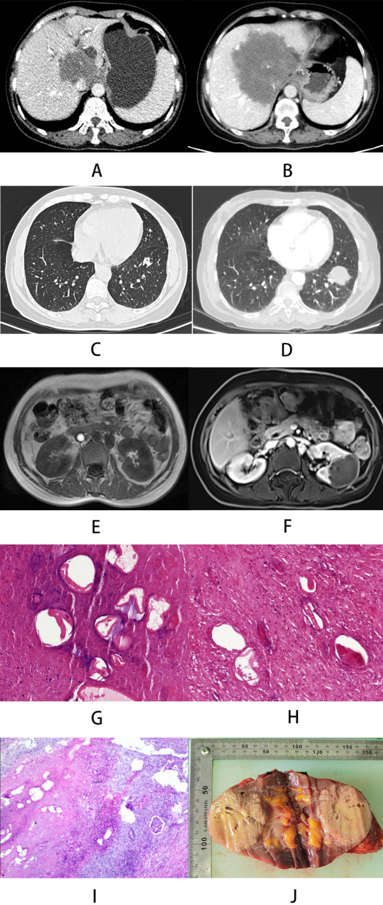
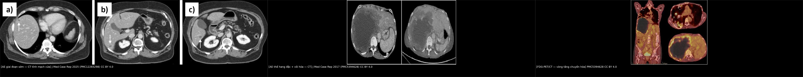
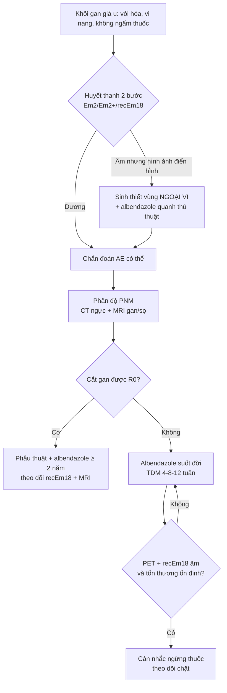
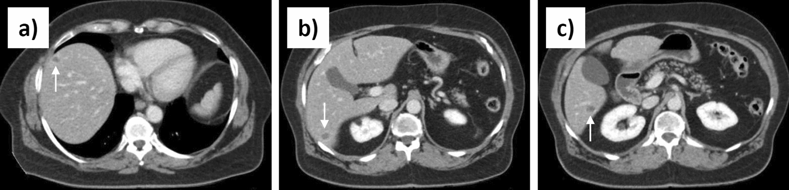
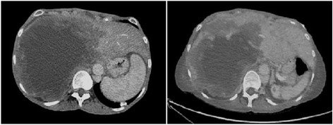
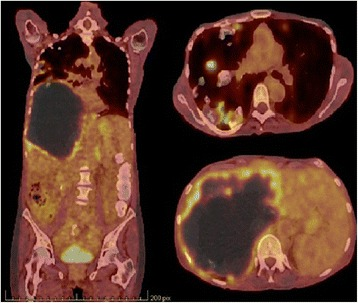

# 144 — Sán thể hang ở gan: khối giả u thâm nhiễm / Alveolar echinococcosis of the liver

**Tags:** `pattern:gia-u` `pattern:tieu-dang-nang` `vung:gan` `score:PNM` `protocol:CT-bung-co-can-quang` `protocol:MRI-gan` `incidentaloma:ton-thuong-gan`
**Mức chắc chắn (certainty):** tổng hợp y văn (literature synthesis) — bài tổng quan từ 1 review lâm sàng + 4 ca bệnh có ảnh gốc, mọi con số đều truy được về nguồn trong `sources.md`; các ngưỡng chưa đối chiếu toàn văn được ghi rõ "chưa rõ".

## 1. Tổng quan bệnh học – cơ chế hình ảnh

- **Tác nhân:** *Echinococcus multilocularis* (sán cáo — fox tapeworm). Vật chủ cuối là cáo/chó hoang/wolf; người là **vật chủ trung gian ngẫu nhiên**, nhiễm qua thức ăn/nước có trứng. Ấu trùng (metacestode) theo tĩnh mạch cửa/bạch mạch về **gan là cơ quan đích đầu tiên** ở gần như toàn bộ ca.
- **Vì sao gọi "thể hang" (alveolar):** khác hẳn nang sán dạng nang (cystic echinococcosis — CE), AE **không có vỏ xơ (pericyst)**, ấu trùng mọc thành vô số vi nang (alveoli) **xâm lấn theo khoảng kẽ như u**, phá hủy nhu mô, xâm lấn đường mật và mạch máu. Mô ký sinh + phản ứng xơ hóa của vật chủ + hoại tử trung tâm tạo thành một **khối giả u**.
- **Thời gian ủ bệnh 5–15 năm** (review PMC11163348) — gần như không triệu chứng giai đoạn đầu, nên phần lớn phát hiện **tình cờ** khi siêu âm vì lý do khác; khi có triệu chứng thường đã xâm lấn rốn gan/cơ hoành. Không điều trị, bệnh dẫn tới tử vong **trong vòng 10 năm** kể từ khi gan bị tổn thương (review PMC11163348).
- **TẠI SAO hình ảnh trông như vậy** (giải thích theo vật lý, không liệt kê tín hiệu):
  - **CT — không ngấm thuốc:** trung tâm tổn thương là hoại tử + xơ, **không có lòng mạch nuôi**; AE không tăng sinh mạch như HCC. Vì vậy khối **giảm đậm độ, không bắt thuốc ở thì động mạch và tĩnh mạch cửa**, chỉ có thể có **viền ngấm mỏng, không liên tục** do viêm quanh tổn thương. Ở tổn thương sớm, đậm độ trung bình đo được là **27,7 HU** (ca PMC12265298) — cao hơn nước (0–20 HU) — gợi ý thành phần dịch–hoại tử giàu protein (suy luận từ đậm độ, không phải kết quả mô học), nhưng vẫn thấp hơn nhu mô gan.
  - **Vôi hóa:** canxi hóa loạn dưỡng trong vùng hoại tử/xơ, thấy rõ nhất trên CT. **Tần suất vôi hóa trong AE gan chưa có con số thống nhất trong các nguồn đã đọc — chưa rõ, cần tra**; (con số 13,2% / 35% thường được trích là của **đoàn hệ sán xương–chậu**, không dùng cho AE gan — xem bài 302). Vôi hóa **không đồng nghĩa ký sinh đã chết**.
  - **MRI — T2 "sáng lẫn tối":** vi nang chứa dịch → **T2 rất sáng**; dải xơ/collagen → **T2 tối** (collagen ít proton linh động, T2 ngắn). Vì thế tổn thương có dạng **"chùm nho" vi nang sáng nằm trong nền xơ tối**, bờ không đều. T1 giảm tín hiệu. Sau tiêm, chỉ **viền mỏng/không liên tục** ngấm thuốc.
  - **FDG-PET:** tăng chuyển hóa nằm ở **vành viêm quanh tổn thương** (đại thực bào/lympho), không nằm trong nang — nên PET phản ánh **hoạt tính gián tiếp**, và **PET âm không chứng minh ký sinh đã chết** (review PMC13566459).

*Bảng A–B: tổn thương gan năm 2017 → 2020 xâm lấn hơn; C–D: nốt phổi to lên; E–F: MRI thận 2020 xuất hiện tổn thương chiếm chỗ; G–J: mô bệnh và đại thể. Nguồn: BMC Infect Dis 2023 (PMC10638689), Fig. 1 — CC BY 4.0.*

- **Ngưỡng định lượng dùng ngay trong bài:** ủ bệnh **5–15 năm**; Kodama type 2 **~40%**, type 3 **~46%** (review PMC11163348); albendazole **10–15 mg/kg/ngày** chia 2 lần (review PMC13566459); mebendazole **40–50 mg/kg/ngày** chia 3 lần (dự phòng khi không dung nạp albendazole); ngừng thuốc khi **ALT > 3× giới hạn bình thường** hoặc có **suy tủy** (review PMC13566459).

## 2. Mẫu hình + chẩn đoán phân biệt theo vị trí (gamut)

- **Theo hình thái Kodama (dựa trên MRI/CT) — 5 type:**
  - **Type 1:** chỉ gồm nhiều vi nang, không có thành phần đặc.
  - **Type 2:** vi nang + **thành phần đặc** (hay gặp nhất cùng type 3, ~40%).
  - **Type 3:** thành phần đặc + **nang lớn bờ không đều** (~46%).
  - **Type 4:** **đặc thuần** — dễ nhầm u gan đặc/ung thư.
  - **Type 5:** **nang lớn thuần** — dễ nhầm nang gan đơn thuần.
- **Theo vị trí (location):**
  - **Gan phải** (hay gặp nhất) → khối lớn, có thể vôi hóa.
  - **Rốn gan/đường mật** → vàng da, giãn đường mật trong gan; dễ nhầm cholangiocarcinoma.
  - **Tĩnh mạch gan/IVC** → huyết khối u lòng mạch, xâm lấn cơ hoành.
  - **Phổi** (hay gặp nhất trong di căn xa): nốt/khối, có thể **hang hóa**; y văn được ca bệnh trích dẫn ghi **7–20%** (PMC8255489).
  - **Não:** nang nhiều thùy + phù quanh nang, viền ngấm thuốc; được xem là **dấu hiệu giai đoạn cuối** (PMC8255489).
  - **Xương:** tiêu xương, ít vôi hóa — xem bài [302 – Nang sán xương & cột sống ở trẻ](../302-nang-san-xuong-cot-song-o-tre/lesson.md).
- **Gamut "khối gan có vôi hóa + không ngấm thuốc":** AE · CE (vôi hóa vỏ nang) · di căn niêm dịch (mucinous metastasis) · u máu xơ hóa/thoái triển · áp-xe xơ hóa · cholangiocarcinoma (thường **có** ngấm thuốc).

## 3. Bảng so sánh phân biệt (ma trận đối chiếu)

| Thực thể (entity) | Hình ảnh điển hình | Chốt vào (rule-in) | Chốt loại (rule-out) | Gợi ý xác nhận |
|---|---|---|---|---|
| **AE (sán thể hang)** | Khối thâm nhiễm bờ không đều, **vi nang T2 sáng trong nền xơ tối**, trung tâm **không ngấm**, vôi hóa rải rác, đậm độ sớm **~27,7 HU** | **Vi nang + vôi hóa + không ngấm trung tâm + bối cảnh dịch tễ (cáo/chó, vùng dịch tễ)** | Không có vi nang, ngấm mạnh thì động mạch, washout điển hình → nghĩ HCC/iCCA | ELISA Em2/Em2+/recEm18 → immunoblot; sinh thiết **ngoại vi** + albendazole quanh thủ thuật |
| **CE (nang sán dạng nang)** | Nang **có vỏ rõ**, vôi hóa vỏ, có thể có nang con ("bánh xe"), không xâm lấn | **Vỏ xơ rõ + vôi hóa vỏ + không xâm lấn mô kẽ** | Bờ mờ, xâm lấn, vi nang lan tỏa → AE | Siêu âm phân độ WHO CE 0–5; huyết thanh; **PAIR chỉ dành cho CE** |
| **iCCA (ung thư đường mật trong gan)** | Khối đặc, **ngấm thuốc thì muộn tiến triển**, hẹp/co kéo đường mật, teo thùy | **Ngấm thuốc tăng dần + xâm lấn đường mật + CA 19-9 tăng** | Không ngấm, vôi hóa trong lòng, vi nang → nghĩ AE | CE-MRI/MRCP, sinh thiết, hội chẩn |
| **Nang gan đơn thuần** | Nang nước đồng nhất, thành **< 1 mm**, **0–20 HU**, không vôi hóa | **Đồng nhất + thành mỏng + không vôi hóa + không ngấm** | Vôi hóa, vách, vi nang, đậm độ > 20 HU → không phải nang đơn thuần | Siêu âm; theo dõi |
| **Di căn niêm dịch** | Nang/đặc hỗn hợp, có thể vôi hóa, nhiều ổ, có ổ nguyên phát | **Nhiều tổn thương + ổ nguyên phát đã biết** | Đơn độc, vi nang lan tỏa → nghĩ AE | CT ngực/bụng, PET, mô bệnh |
| **Áp-xe gan xơ hóa** | Ổ dịch có vách, khí trong, viêm mô quanh | **Sốt + CRP cao + khí trong ổ** | Không sốt, tổn thương mạn tính vôi hóa → nghĩ AE | Chọc hút/dẫn lưu, cấy |

*Trái: 3 tổn thương giảm đậm độ nhỏ ở gan phải (mũi tên), giai đoạn sớm. Giữa: khối hang đặc lớn có vôi hóa. Phải: FDG-PET/CT — tăng chuyển hóa dạng vòng quanh tổn thương. Nguồn: *J Med Case Rep* 2025 (PMC12265298) và *J Med Case Rep* 2017 (PMC5394628), CC BY 4.0; ảnh ghép letterbox, không crop.*

## 4. Protocol chụp + hệ phân độ/điểm chuẩn hóa

- **Chuỗi hình ảnh tối thiểu:** siêu âm bụng (+ **CEUS** khi cần phân biệt với u máu) → **CT bụng 3 thì** (động mạch, tĩnh mạch cửa, muộn) + **CT ngực** → **MRI gan** (T1 in/opposed phase, T2, DWI/ADC, T1 sau tiêm thì muộn) và **MRCP** nếu vàng da/giãn đường mật → **FDG-PET/CT** khi cần đánh giá hoạt tính hoặc tìm di căn.
- **Đo và ghi:** kích thước 3 chiều (mm), số vi nang, **vị trí so với rốn gan/tĩnh mạch gan/IVC**, mức xâm lấn cơ hoành, có/không vôi hóa, có/không giãn đường mật.
- **Huyết thanh 2 bước:** ELISA với kháng nguyên tinh khiết/tái tổ hợp (**Em2, Em2+, recEm18**) → xác nhận bằng **immunoblot**. Độ nhạy cao trong bệnh gan; **tổn thương sớm có thể âm tính** (ca PMC12265298: IgG 11 U/mL, Em2+ âm).
- **Phân độ PNM (WHO-IWGE)** — thay cho TNM vì AE mọc như u:
  - **P** = khối ký sinh trong gan (P0–P4, theo số/vị trí thùy gan bị chiếm),
  - **N** = xâm lấn cơ quan lân cận/hạch (N0–N1),
  - **M** = di căn xa (M0–M1).
  - Ngưỡng mm chi tiết của từng bậc P1–P4 **chưa rõ — cần tra toàn văn WHO-IWGE** (các nguồn đã đọc chỉ mô tả cấu trúc PNM, không đưa bảng mm).
- **Định nghĩa ca bệnh (Brunetti/WHO):** *xác định* = mô bệnh học; *có thể* = hình ảnh điển hình + huyết thanh dương; *nghi ngờ* = hình ảnh gợi ý, huyết thanh âm.
- **Điều trị:** phẫu thuật cắt gan **+ albendazole 10–15 mg/kg/ngày chia 2 lần, uống cùng bữa nhiều mỡ** (tăng sinh khả dụng). Không mổ được → **albendazole suốt đời** (thuốc chỉ kìm ký sinh — parasitostatic, không diệt). Ghép gan chọn lọc khi tăng áp cửa/báng/xơ gan mật thứ phát. Can thiệp: **dẫn lưu chỉ để xử trí biến chứng** (nang lớn, áp-xe), ERCP khi tắc mật. **Không dùng PAIR để điều trị AE** — PAIR (chọc hút – bơm chất diệt – hút lại) là phác đồ của **CE**.
- **Theo dõi:** TDM **albendazole sulfoxide** lấy máu **4 giờ sau uống**, ở **tuần 4, 8, 12** rồi theo lịch; sau mổ chụp hình ảnh **3 tháng**, sau đó **mỗi năm đến 10 năm** (MRI là lựa chọn tốt nhất); theo dõi bằng **recEm18** — kháng thể giảm nhanh sau cắt triệt để. Ngừng thuốc khi **PET âm + recEm18 âm** (review PMC13566459).

## 5. Biến thể bình thường và cạm bẫy

- **Huyết thanh âm không loại trừ AE:** tổn thương sớm, nhỏ, được "cô lập" bởi vành hoại tử xơ có thể cho **IgG chỉ ở ngưỡng (11 U/mL)** và **Em2+ âm** (ca PMC12265298). Đừng vì huyết thanh âm mà bỏ chẩn đoán khi hình ảnh điển hình.
- **PET âm ≠ ký sinh đã chết:** PET chỉ đo phản ứng viêm quanh tổn thương; **PET âm = hoạt tính bị ức chế**, không phải đã khỏi (review PMC13566459).
- **Sinh thiết sai chỗ:** vùng **trung tâm hoại tử** thường không có mô ký sinh → âm giả; phải lấy **vùng ngoại vi** (nơi có vi nang và "spems"), và dùng **albendazole quanh thủ thuật** để giảm nguy cơ gieo rắc (ca PMC12265298).
- **Vôi hóa không phải "bất hoạt":** vôi hóa tồn tại lâu trong khi ký sinh còn sống; đánh giá hoạt tính phải phối hợp MRI (vi nang còn sáng) + PET + recEm18.
- **Hạch to/PET dương không chắc có ký sinh sống:** hạch giãn hoặc tăng FDG có thể chỉ là viêm; **không quyết định cắt nạo hạch chỉ vì PET** (review PMC12265298).
- **AE không tăng sinh mạch:** không có kiểu "ngấm mạnh thì động mạch + washout" của HCC — nếu thấy kiểu đó, nghĩ lại chẩn đoán.
- **Cạm bẫy chết người:** nhầm AE với **CE** rồi chọc hút/PAIR → nguy cơ **sốc phản vệ và gieo rắc** ký sinh. Trước mọi can thiệp nang gan "lạ", phải loại AE.

## 6. Tự lượng giá — Blind Quiz

**Ca 1 — Nữ 65 tuổi, không triệu chứng, siêu âm kiểm tra sức khỏe phát hiện 3 nốt nhỏ gan phải. Nhìn CT trước, mô tả.**

- Gợi ý lâm sàng: không sốt, không vàng da, không tiền sử ung thư; sống ở vùng có cáo.
- Câu hỏi: Đậm độ tổn thương so với nhu mô gan? Có ngấm thuốc không? 3 chẩn đoán phân biệt và bước xác nhận đầu tay?

<b>Bấm để hiện đáp án (findings + chẩn đoán)</b>

- **Dấu hiệu:** ba tổn thương **giảm đậm độ, bờ không đều**, ở phân thùy VIII và VI (mũi tên); đậm độ trung bình **27,7 HU**, **không ngấm thuốc**; không vôi hóa rõ ở giai đoạn này.
- **Chẩn đoán:** **AE giai đoạn sớm (initial stage)** — xác nhận bằng sinh thiết lần hai vùng ngoại vi + hóa mô miễn dịch **EM2G11** dương tính; huyết thanh ban đầu chỉ ở ngưỡng.
- **Vì sao khó:** tổn thương nhỏ, chưa vôi hóa, huyết thanh âm — hình ảnh rất dễ bị đọc là "nốt lành" hoặc di căn nhỏ.
- **Nguồn:** *J Med Case Rep* 2025 (PMC12265298), Fig. 2 — CC BY 4.0.

**Ca 2 — Nam, đau hạ sườn phải, CT bụng thấy khối lớn gan phải. Mô tả trước khi mở đáp án.**

- Gợi ý lâm sàng: gan to, không tiền sử ung thư; CT thấy khối **15 cm** bờ đa cung, có vôi hóa quanh tổn thương, xâm lấn rốn gan.
- Câu hỏi: Vì sao khối "giống ung thư" mà lại là ký sinh? Dấu hiệu nào giúp phân biệt với cholangiocarcinoma?

<b>Bấm để hiện đáp án</b>

- **Dấu hiệu:** khối **15 cm** dạng nang–đặc hỗn hợp, bờ **đa cung nhỏ**, **vôi hóa quanh tổn thương**, xâm lấn rốn gan gây giãn đường mật; phần đặc **không ngấm thuốc**.
- **Chẩn đoán:** **AE thể lan tỏa** (bệnh nhân còn nốt phổi vôi hóa tới **50 mm**, một số hang hóa) — bắt chước di căn ác tính.
- **Chốt phân biệt:** vôi hóa + vi nang + **không ngấm trung tâm** + bối cảnh dịch tễ; iCCA thường **ngấm thuốc tiến triển** và không có vi nang.
- **Nguồn:** *J Med Case Rep* 2017 (PMC5394628), Fig. 1 — CC BY 4.0.

**Ca 3 — Cùng bệnh nhân, FDG-PET/CT được chỉ định. Vòng sáng quanh tổn thương nói lên điều gì?**

- Câu hỏi: FDG tăng nằm ở đâu (trong nang hay quanh nang)? Nếu PET âm sau 2 năm điều trị thì kết luận được gì?

<b>Bấm để hiện đáp án</b>

- **Dấu hiệu:** **vòng tăng chuyển hóa mạnh quanh khối gan phải** (viêm quanh tổn thương), trong khi trung tâm hoại tử/vôi hóa không tăng; phổi có nhiều ổ tăng chuyển hóa.
- **Ý nghĩa:** FDG phản ánh **hoạt tính gián tiếp** qua phản ứng viêm; **PET âm = hoạt tính bị ức chế, KHÔNG phải ký sinh đã chết**.
- **Nguồn:** *J Med Case Rep* 2017 (PMC5394628), Fig. 3 — CC BY 4.0.

## Bài liên quan chéo

- [100 – Tổng quan hệ Bụng](../100-tong-quan-he-bung/lesson.md)
- [139 – Sán lá gan (fasciliasis) & nang sán gan](../139-san-la-gan/lesson.md)
- [106 – Xơ hóa đường mật do chất diệt đầu sán (caustic sclerosing cholangitis)](../106-xo-hoa-duong-mat-do-chat-diet-dau-san/lesson.md)
- [128 – Ký sinh trùng đường mật](../128-ky-sinh-trung-duong-mat/lesson.md)
- [121 – LI-RADS: khối gan & ngấm thuốc](../121-khoi-gan-LIRADS/lesson.md)
- [129 – IPNB & u nhầy đường mật](../129-IPNB-va-u-nhay-duong-mat/lesson.md)
- [173 – Ung thư đường mật trong gan trên nền Caroli](../173-ung-thu-duong-mat-trong-gan-caroli/lesson.md)
- [302 – Nang sán xương & cột sống ở trẻ](../302-nang-san-xuong-cot-song-o-tre/lesson.md)
- [030 – Đông đặc xẹp phổi](../030-dong-dac-xep-phoi/lesson.md) *(di căn phổi AE có thể hang hóa — đối chiếu mẫu hình hang)*

## Ảnh

- Tên file: `144_san-the-hang_<Modality>_<SourceID>.jpg`; nguồn + giấy phép từng ảnh ở `images/CREDITS.md`.
- Ảnh ghép `composite_144_AE-tien-trien.jpg` tạo bằng `tools/make_composite.py` (letterbox nền đen, **không crop/kéo giãn**).

> Không dùng để chẩn đoán độc lập khi chưa có người hướng dẫn.
