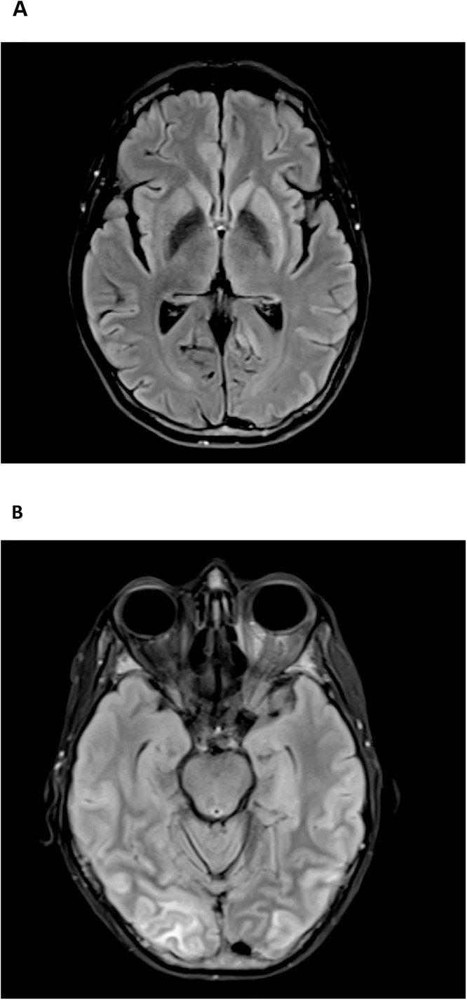
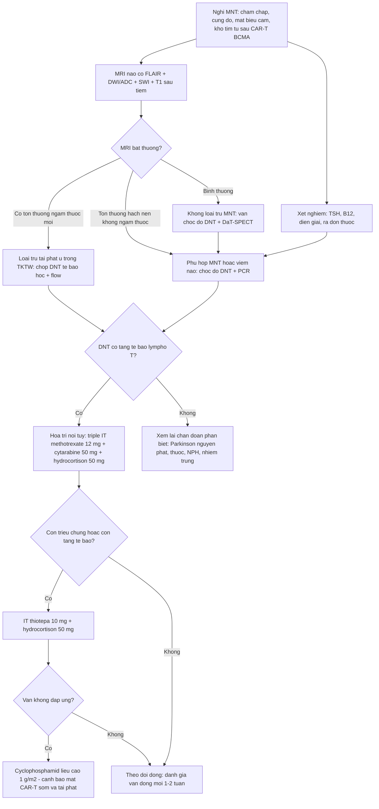
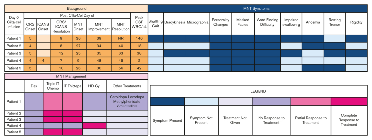
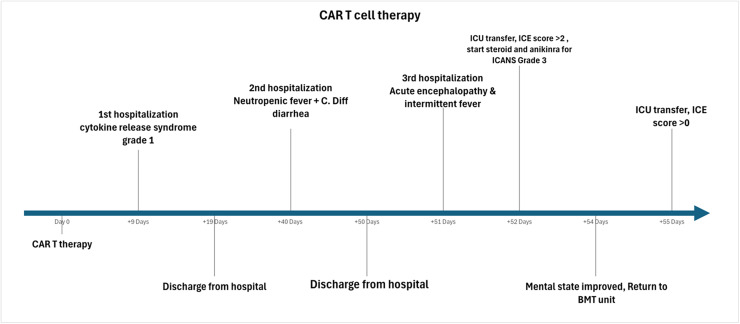

# 1440 — Parkinsonism muộn sau CAR-T nhắm BCMA (MNT) / *Movement and neurocognitive treatment-emergent adverse events*

**Tags:** `pattern:parkinson` `pattern:ton-thuong-hat-nen` `pattern:benh-nao-lan-toa` `vung:nao` `vung:hat-nen` `score:CTCAE` `protocol:MRI-DWI` `protocol:DaT-SPECT` `protocol:choc-DNT`

**Mức chắc chắn (certainty):** tổng hợp y văn (literature synthesis) — ghép **loạt 5 ca có số liệu định lượng của một trung tâm** (Kelly K và cs., *Blood Adv* 2025, **PMC12281119**, CC BY-NC-ND 4.0), **báo cáo ca tử vong có MRI + giải phẫu bệnh** (Khoudari H và cs., *Leuk Res Rep* 2026, **PMC12991952**, CC BY 4.0) với **ca nguyên văn đầu tiên mô tả cơ chế** (Van Oekelen O và cs., *Nat Med* 2021, **PMC8678323**). Tỉ lệ và mốc thời gian dưới đây là **số của từng nghiên cứu, ghi rõ nguồn**; chỗ chưa có dữ liệu thì ghi "chưa rõ — cần tra", không bịa.

> **Bài này trả lời 4 câu hỏi của buổi tái khám sau truyền CAR-T:**
> (1) **Bệnh nhân "chậm chạp, nói khó, mặt lạ" ở tuần 4–8 — ICANS muộn, tái phát u, hay MNT?** (2) **MRI bình thường có loại trừ MNT không?** (3) **DaT-SPECT và dịch não tủy đóng vai trò gì?** (4) **Tăng corticoid có ích không, và khi nào chuyển sang hóa trị nội tủy?**
> Đây là **phần MUỘN của cùng phổ độc thần kinh** đã học ở [1430 – ICANS](../1430-icans-doc-tinh-than-kinh-sau-car-t/lesson.md): ICANS là **bệnh não cấp ngày 3–6**; MNT là **hội chứng vận động – nhận thức bán cấp, thường tuần 4–8**, cơ chế **đích-trên-mô-lành (on-target, off-tumor)** chứ không phải bão cytokine.

## 1. Tổng quan bệnh học – cơ chế hình ảnh

### 1.1 Vì sao BCMA lại đánh vào hạch nền

- **BCMA (B-cell maturation antigen)** là đích của cilta-cel/ide-cel. Ngoài tương bào ác tính, **BCMA biểu hiện trên nơ-ron và tế bào hình sao ở hạch nền** người; dữ liệu phiên mã công khai xác nhận **RNA BCMA có trong nhân đuôi (caudate) của não người bình thường** (Van Oekelen 2021).
- Ca giải phẫu bệnh đầu tiên: **CAR-T tồn tại trong máu và dịch não tủy**, **thâm nhiễm lymphô bào ở hạch nền**, và **BCMA dương tính trên nơ-ron/tế bào hình sao** đúng vùng thâm nhiễm → đây là **độc tính đích-trên-mô-lành**, không phải nhiễm trùng cơ hội.
- Vì sao **hạch nền** là vùng tổn thương: mật độ mao mạch cao, hàng rào máu não tương đối "lỏng" ở thể vân, và tế bào CAR-T **xuyên qua hàng rào máu–dịch não tủy** rồi di chuyển theo khoang dịch quanh mạch (glymphatic) — dịch não tủy của bệnh nhân MNT có **tới 73% tế bào T là CAR-T** (phân tích 16 ca trong registry, Kelly 2025 dẫn lại).

### 1.2 Giải thích TẠI SAO hình ảnh như vậy (bắt buộc theo Argon)

- **T2/FLAIR tăng tín hiệu ở nhân đuôi – thể vân:** thâm nhiễm lymphô bào + phù quanh mạch làm **tăng nước tự do ngoại bào** → kéo dài T2 (và FLAIR vì FLAIR chỉ khác T2 ở việc xóa tín hiệu dịch não tủy tự do, còn nước trong mô vẫn sáng). Đây là **phù nội mô/mô kẽ**, không phải nhồi máu.
- **KHÔNG hạn chế khuếch tán:** nước còn ở **khoảng ngoại bào** nên ADC **không tụt** — khác nhồi máu cấp (nước chuyển **nội bào** → DWI sáng, ADC tối). Vì thế **DWI âm không loại trừ** và **DWI dương theo lãnh thổ mạch** mới là nhồi máu.
- **Thường KHÔNG ngấm thuốc:** tổn thương là thâm nhiễm tế bào quanh mạch, **rò rỉ hàng rào máu não mức thấp**, không đủ gadolinium thoát ra để thấy trên T1 sau tiêm; trường hợp tử vong có **ngấm màng não phản ứng (pachymeningitis)** — tức tổn thương lan tới màng não.
- **Vì sao MRI có thể hoàn toàn bình thường:** mức tăng nước chỉ vài phần trăm, **dưới ngưỡng tương phản của ảnh**, trong khi tổn thương mô học (thoi hóa hải mã, tăng sinh vi bào đệm, thâm nhiễm lymphô bào) chỉ thấy trên tiêu bản — **4/5 ca** trong loạt của Kelly có MRI bình thường.
- **Vì sao DaT-SPECT bất thường dù MRI bình thường:** ¹²³I-ioflupane gắn **chất vận chuyển dopamine (DAT) tiền synapse** ở thể vân; mất đầu tận cùng thần kinh dopaminergic **không tạo tín hiệu trên MRI** nhưng làm **giảm gắn thuốc ở thể vân (putamen trước, theo trình tự thoái hóa nigrostriatal)**. Đây là **thay đổi chức năng**, không phải tổn thương cấu trúc.

### 1.3 Ngưỡng định lượng nằm lòng

| Đại lượng | Con số | Nguồn |
|---|---|---|
| Parkinsonism sau **cilta-cel trong CARTITUDE-1** | **6%**; chỉ **1 bệnh nhân hồi phục hoàn toàn** | Kelly 2025 (dẫn CARTITUDE-1) |
| Parkinsonism trong **CARTITUDE-4** (bệnh nhân được điều trị sớm hơn) | **1%** | Kelly 2025 (dẫn CARTITUDE-4) |
| Parkinsonism với **cilta-cel thương mại** | **2%**, chỉ **1 ca cải thiện** | Kelly 2025 |
| Tỉ lệ tại **một trung tâm** (60 bệnh nhân liên tiếp) | **8%** (5/60) | Kelly 2025 |
| **Thời điểm khởi phát** — CARTITUDE-1 | trung vị **60 ngày** | Kelly 2025 |
| **Thời điểm khởi phát** — loạt 5 ca | trung vị **26 ngày** (khoảng **9–36**) | Kelly 2025 |
| **Thời gian kéo dài** — CARTITUDE-1 | trung vị **265 ngày** | Kelly 2025 |
| **Dịch não tủy** — tế bào | trung vị **42/µL** (khoảng **2–140**); **90%** là lymphô bào (89–95%), gần như toàn bộ là **tế bào T** | Kelly 2025 |
| **Dịch não tủy** — tỉ lệ CAR-T trong tế bào T | **73%** | Registry 16 ca, Kelly 2025 dẫn |
| **Đỉnh ALC sau truyền** (nhóm MNT) | **2,93 × 10⁹/L** (1,75–3,74) so với **1,45 × 10⁹/L** ở nhóm không MNT (**P = 0,2** — chưa đủ kết luận) | Kelly 2025 |
| **Đỉnh ALC** trong registry 16 ca | trung vị **9,5 × 10⁹/L** | Registry, Kelly 2025 dẫn |
| **Thời gian tới cải thiện đầu tiên** (sau hóa trị nội tủy) | trung vị **7 ngày** (3–39) | Kelly 2025 |
| **Thời gian hồi phục hoàn toàn** | trung vị **34 ngày** (13–40) | Kelly 2025 |
| **Tỉ lệ hồi phục hoàn toàn** với hóa trị nội tủy | **3/5 (60%)** | Kelly 2025 |

> **Yếu tố nguy cơ (CARTITUDE-1, Kelly 2025 dẫn):** **gánh nặng u cao**, **CRS độ ≥ 2 hoặc ICANS bất kỳ độ**, và **khuếch đại CAR-T mạnh**. Trong loạt 5 ca của Kelly, **không** thấy gánh nặng u cao hay liều CAR-T cao là đặc điểm chung — tức **không có bộ tiêu chuẩn tiên đoán đủ mạnh**, phải theo dõi lâm sàng.

## 2. Mẫu hình + chẩn đoán phân biệt theo vị trí (gamut)

- **Hạch nền có tăng tín hiệu T2/FLAIR (một hoặc hai bên):** **MNT do BCMA** · nhồi máu hạch nền (theo lãnh thổ, DWI dương) · viêm não (HSV, enterovirus, tự miễn) · ngộ độc CO/methanol · bệnh Wilson · thiếu máu – thiếu oxy · CJD (thể hạch nền) · **tái phát đa u tủy trong nhu mô não (hiếm)**.
- **Hạch nền + thân não, đối xứng:** **MNT thể nặng** · **PRES** · bệnh não Wernicke · hủy myelin thẩm thấu · ngộ độc thuốc (metronidazol) · bệnh não do fludarabine (hóa trị chuẩn bị).
- **Chất trắng lan tỏa:** **ICANS muộn** ([1430](../1430-icans-doc-tinh-than-kinh-sau-car-t/lesson.md)) · PRES · độc fludarabine · bệnh mạch máu nhỏ mạn (Fazekas).
- **Màng não:** **pachymeningitis phản ứng trong MNT nặng** (ca tử vong) · **di căn màng não do đa u tủy** · viêm màng não nhiễm trùng · ngấm màng sau hóa trị nội tủy.
- **MRI bình thường (nhóm ĐÔNG NHẤT):** **MNT** · **bệnh Parkinson nguyên phát** · **parkinson do thuốc** (metoclopramid, thuốc chống loạn thần, thuốc chống nôn) · **não úng thủy áp lực bình thường (NPH)** · suy giáp · thiếu vitamin B12 · trầm cảm/triệu chứng tâm thần.
- **Mnemonic "PARKINSON SAU CAR-T" — 6 nhóm phải loại trừ trước khi gọi MNT:** **P**RES · **A**cute stroke (nhồi máu) · **R**ecurrence u trong thần kinh trung ương · **K**ali/điện giải – **N**ội tiết (giáp, B12) · **I**nfection (viêm màng não, viêm não) · **S**edative/drug-induced.

## 3. Bảng so sánh phân biệt (ma trận đối chiếu)

| Thực thể (entity) | Hình ảnh điển hình | Chốt vào (rule-in) | Chốt loại (rule-out) | Gợi ý xác nhận |
|---|---|---|---|---|
| **MNT do BCMA (parkinsonism muộn)** | **Thường bình thường (4/5)**; nếu có: **T2/FLAIR tăng tín hiệu nhân đuôi – thể vân**, có thể **bất đối xứng**, lan thân não; **DaT giảm gắn thuốc ở thể vân** | **Khởi phát tuần 4–8 sau CAR-T BCMA + chậm chạp/cứng đờ/mất biểu cảm + khó tìm từ, mất khứu giác**; **dịch não tủy có tăng tế bào lymphô T** | MRI bình thường **không** loại trừ; **không sốt, không ổ nhiễm, không tế bào ác tính trong dịch não tủy** | Chấm vận động lâm sàng; **DaT-SPECT**; tế bào + flow cytometry dịch não tủy; đáp ứng hóa trị nội tủy |
| **ICANS muộn / ICANS kéo dài** | FLAIR chất trắng lan tỏa, phù, ngấm màng mềm thoáng qua; **hiếm khi khu trú hạch nền** | **Cửa sổ ngày 3–6 (điển hình) + ICE giảm + thất ngôn/viết sai + bão cytokine trước đó** | **Khởi phát sau ngày 30 không còn là ICANS điển hình**; MNT **không có đỉnh cytokine cấp** | ASTCT/ICE, EEG; đáp ứng corticoid (ICANS đáp ứng, MNT **không**) |
| **Tái phát/xâm lấn đa u tủy trong thần kinh trung ương** | Ngấm màng nội tủy/màng mềm dày, **nốt**, tổn thương nhu mô ngấm thuốc | **Tế bào ác tính trong dịch não tủy + tổn thương ngấm thuốc MỚI + tăng chuỗi nhẹ/điện di** | **Không ngấm thuốc, tế bào học âm** → không phải xâm lấn; nhưng phải lặp dịch não tủy | MRI toàn trục có cản quang; tế bào học + flow; PET/CT |
| **Bệnh Parkinson nguyên phát** | MRI bình thường; DaT **giảm gắn thuốc bất đối xứng**, thể vân sau trước | **Run khi nghỉ bất đối xứng + đáp ứng levodopa + tiến triển chậm nhiều năm** | **Khởi phát cấp sau truyền CAR-T, tiến triển trong vài tuần** → không phải Parkinson nguyên phát | Thử levodopa **không** dùng để chẩn đoán; theo dõi dọc |
| **Parkinson do thuốc** | MRI bình thường; **DaT BÌNH THƯỜNG** | **Bắt đầu sau khi thêm metoclopramid/kháng thần kinh/chống nôn; đối xứng; giảm khi ngừng thuốc** | **DaT bất thường** → không phải do thuốc; thuốc không giải thích được tiến triển | Rà đơn thuốc; ngừng thuốc nghi ngờ 4–8 tuần |
| **PRES** | Phù **vasogenic** chẩm–đỉnh, đối xứng, FLAIR sáng, **ADC cao** | **Tăng huyết áp + ức chế miễn dịch + nhìn mờ/co giật** | **Tổn thương hạch nền đơn thuần không có ưu thế chẩm–đỉnh** → không phải PRES | Đo huyết áp; MRI lặp sau 1–2 tuần (PRES thoái lui) |
| **NPH** | **Giãn não thất không tương xứng teo vỏ**, DESH, góc callosal nhỏ | **Tam chứng: rối loạn dáng đi "từ tính" + tiểu không kiểm soát + sa sút** | **Không giãn não thất** → loại NPH; MNT có thể có giãn nhẹ do teo | Thể tích não thất; nghiệm pháp dẫn lưu dịch não tủy |
| **Nhiễm trùng thần kinh trung ương** | Ngấm màng não, áp-xe viền ngấm, ổ dịch | **Sốt + cứng gáy + dịch não tủy: tế bào tăng/glucose giảm/protein cao + PCR/cấy dương** | **Không sốt, glucose bình thường, PCR âm** không loại trừ hoàn toàn (đã dùng kháng sinh) | Chọc dò **trước** khi tăng corticoid; PCR virus; cấy |

*(A) T2-FLAIR: tăng tín hiệu nhân đuôi và thể vân **trái > phải**, **không ngấm thuốc**. (B) Cùng bệnh nhân: phù vỏ–dưới vỏ vùng chẩm kiểu **PRES** — hai mẫu hình có thể **đồng thời**, nên không được dừng ở chẩn đoán PRES. Nguồn: Khoudari H và cs., *Leuk Res Rep* 2026, PMC12991952, Fig 2 — CC BY 4.0.*

## 4. Protocol chụp + hệ phân độ/điểm chuẩn hóa

### 4.1 Protocol hình ảnh và xét nghiệm khi nghi MNT

| Bước | Nội dung | Ngưỡng / thời điểm |
|---|---|---|
| **MRI sọ** | **T2-FLAIR + DWI/ADC + SWI + T1 trước/sau tiêm**, lát **≤ 3 mm** qua hạch nền; thêm chuỗi **toàn trục** nếu nghi di căn màng não | Ngay khi có triệu chứng vận động/nhận thức **mới**; **lặp lại sau 4–8 tuần** vì tổn thương có thể xuất hiện muộn |
| **DaT-SPECT (¹²³I-ioflupane)** | Đánh giá **gắn thuốc ở thể vân**, so sánh **phải/trái** và **đuôi/thể vân trước–sau** | Khi parkinson là triệu chứng trội; **DaT bất thường ủng hộ mất đầu tận cùng dopaminergic**, nhưng **không phân biệt được** MNT với Parkinson nguyên phát |
| **Chọc dò dịch não tủy** | Tế bào + công thức, protein, glucose, **flow cytometry tìm tế bào CAR-T**, tế bào học, PCR (HSV, CMV, EBV, JCV), cấy | Khi an toàn (không có khối/nguy cơ thoát vị); **làm TRƯỚC khi tăng corticoid** nếu có thể |
| **Xét nghiệm loại trừ** | TSH, vitamin B12, natri, canxi, chức năng gan/thận, amoniac, nồng độ thuốc an thần/chống nôn | Ngay từ đầu — **rẻ và loại trừ được nguyên nhân chữa được** |
| **Đánh giá vận động** | Thang **MDS-UPDRS phần III** hoặc khám định tính (chậm chạp, cứng đờ, dáng đi, chữ viết) mỗi lần khám | **Mỗi 1–2 tuần** trong 3 tháng đầu sau truyền CAR-T BCMA |

### 4.2 Phân độ (chưa có thang riêng cho MNT)

- **Chưa có thang độ riêng cho MNT** (chưa rõ — cần tra khi có đồng thuận mới). Thực hành hiện dùng **CTCAE v5 cho "parkinsonism"**: độ 1 = nhẹ, không cần điều trị; **độ 2 = vừa, hạn chế hoạt động công cụ**; **độ 3 = nặng, hạn chế tự chăm sóc**; **độ 4 = đe dọa tính mạng**.
- Nếu **đồng thời** có rối loạn tri giác/thất ngôn → chấm thêm **ASTCT ICANS** ([1430](../1430-icans-doc-tinh-than-kinh-sau-car-t/lesson.md)) và điều trị theo **mức nặng nhất**, nhưng **ghi rõ hai hội chứng** vì đáp ứng điều trị khác nhau.

### 4.3 Điều trị: cái gì hiệu quả, cái gì KHÔNG

| Can thiệp | Kết quả đã báo cáo | Ghi chú |
|---|---|---|
| **Corticoid toàn thân** (dexamethasone **20–40 mg/ngày**) | **Không hiệu quả** ở **5/5** ca của Kelly; registry: cải thiện ít nhất một phần **7/10** | Corticoid **không phải trục điều trị** của MNT (khác ICANS); tăng liều kéo dài chỉ thêm nguy cơ nhiễm trùng |
| **Hóa trị nội tủy "triple IT"** (methotrexate **12 mg** + cytarabine **50 mg** + hydrocortison **50 mg**) | **3/5 hồi phục hoàn toàn**; **4/4** ca có tăng tế bào dịch não tủy cải thiện ít nhất một phần | Hiệu quả gắn với **tăng tế bào lymphô trong dịch não tủy**; an toàn trong loạt này |
| **IT thiotepa 10 mg** + hydrocortison 50 mg | Dùng khi **cải thiện một phần** hoặc **còn tăng tế bào** sau triple IT | Lựa chọn của nhóm Chicago; **chưa có thử nghiệm đối chứng** |
| **Cyclophosphamid liều cao 1 g/m²** | Cải thiện nhanh ở **1/2** ca kháng hóa trị nội tủy; registry **3/5** | **Nguy cơ: diệt CAR-T sớm → tái phát bệnh sớm + giảm tế bào máu nặng** |
| **Levodopa/carbidopa, amantadine, methylphenidat** | **Không hiệu quả** (1 ca dùng phối hợp, không cải thiện) | **Không** dùng để chẩn đoán; không duy trì dài hạn như bệnh Parkinson |
| **IVIG** | **Không cải thiện triệu chứng** ở 3 ca dùng vì giảm IgG thứ phát; registry **2/4** cải thiện một phần | Chỉ định vì **giảm IgG**, không phải vì MNT — hạ IgG kéo dài là mặt **nhiễm trùng muộn** của cùng bệnh nhân, không phải điều trị MNT |

*Bảng 5 ca: **khởi phát MNT ngày 9–36**, **tế bào dịch não tủy 2–140/µL**, và đáp ứng với triple IT / IT thiotepa / HD-Cy. Cột "Peak CSF WBC" là mốc quyết định chọn hóa trị nội tủy. Nguồn: Kelly K và cs., *Blood Adv* 2025, PMC12281119, Fig 1 — CC BY-NC-ND 4.0 (nguyên bản, không chỉnh sửa).*

## 5. Biến thể bình thường và cạm bẫy

- **MRI bình thường là quy luật, không phải ngoại lệ:** **4/5** ca của Kelly có MRI bình thường; **MRI bình thường KHÔNG loại trừ MNT** và không được trì hoãn đánh giá dịch não tủy.
- **DaT bất thường không phải "dấu đặc hiệu của MNT":** Parkinson nguyên phát, MSA, PSP, DLB đều giảm gắn thuốc; **chỉ DaT BÌNH THƯỜNG** mới có giá trị **loại** nguyên nhân thoái hóa (gợi ý parkinson do thuốc).
- **Cạm bẫy thời gian:** khởi phát **sau ngày 30** thì **không còn là ICANS điển hình**; gọi "ICANS muộn" rồi **tăng corticoid** là sai hướng và **che nhiễm trùng** — trong khi corticoid **không có hiệu quả** với MNT.
- **Cạm bẫy "đã có PRES thì thôi":** ca tử vong có **đồng thời** phù kiểu PRES và tổn thương hạch nền; **sự hiện diện của PRES không giải thích được cứng đờ + chậm chạp tiến triển**.
- **Cạm bẫy "chỉ là trầm cảm" ở người trẻ:** **mất biểu cảm, mất khứu giác, khó tìm từ** xuất hiện theo cụm sau CAR-T là **hội chứng thần kinh**, không phải rối loạn khí sắc; bỏ sót dẫn tới **không chọc dò, không điều trị** trong giai đoạn hồi phục được.
- **Bẫy mặt cắt:** tổn thương hạch nền **bất đối xứng** trên một lát cắt dễ bị đọc là **nhồi máu nhân béo**; kiểm tra **DWI/ADC** (nhồi máu: hạn chế khuếch tán theo lãnh thổ) và **so sánh hai bên trên nhiều lát**.
- **Bẫy tái phát u:** đa u tủy **có thể xâm lấn thần kinh trung ương** và **bắt chước MNT**; mọi tổn thương **ngấm thuốc mới** hoặc **tế bào bất thường trong dịch não tủy** phải loại trừ tái phát trước khi quy cho độc tính.
- **Đừng quên nguyên nhân chữa được:** **suy giáp, thiếu B12, hạ natri, ngộ độc thuốc** — xét nghiệm rẻ, làm trước khi kết luận "MNT kháng trị".
- **Cảnh báo khi dùng HD-Cy:** có thể **diệt CAR-T toàn thân** → **tái phát sớm**; chỉ dùng như cứu cánh khi hóa trị nội tủy thất bại.

## 6. Tự lượng giá — Blind Quiz

**Ca 1 — Nữ 61 tuổi, đa u tủy 15 năm, ngày 50 sau truyền cilta-cel: lú lẫn rồi cứng đờ**

- Bối cảnh: sau đợt CRS độ 1 thoáng qua, bệnh nhân xuất hiện **lú lẫn tiến triển, cứng đờ, giảm biểu cảm** ở ngày 50.
- Câu hỏi: (a) Mô tả bất thường trên (A) và (B)? (b) Tổn thương (A) có hạn chế khuếch tán không, và vì sao? (c) Ba chẩn đoán phân biệt?

<b>Bấm để hiện đáp án (findings + chẩn đoán)</b>

- Dấu hiệu: (A) **tăng tín hiệu T2-FLAIR ở nhân đuôi và thể vân, trái > phải, không ngấm thuốc**; (B) **phù vỏ–dưới vỏ vùng chẩm hai bên kiểu PRES**.
- Chẩn đoán: **độc thần kinh muộn sau CAR-T BCMA, nằm trong phổ MNT** (bệnh cảnh trùng lặp với ICANS độ 4 muộn) — bệnh nhân **không đáp ứng điều trị miễn dịch phối hợp** và tử vong ngày 93; giải phẫu bệnh: **xơ hóa hải mã hai bên, tăng sinh vi bào đệm lan tỏa, thâm nhiễm vi bào đệm**.
- Vì sao **không hạn chế khuếch tán**: phù/thâm nhiễm lymphô bào làm tăng **nước ngoại bào** → T2/FLAIR sáng nhưng ADC **không tụt** (khác nhồi máu cấp).
- Phân biệt: **nhồi máu hạch nền** (DWI dương theo lãnh thổ), **viêm não/nhiễm trùng** (sốt, PCR dịch não tủy), **tái phát đa u tủy trong thần kinh trung ương** (ngấm thuốc, tế bào ác tính), và **PRES đơn thuần** (không giải thích cứng đờ tiến triển).
- Nguồn ảnh: Khoudari H và cs., *Leuk Res Rep* 2026, **PMC12991952**, Fig 2 — CC BY 4.0.

**Ca 2 — Cùng bệnh nhân: dòng thời gian 65 ngày sau truyền**

- Bối cảnh: bệnh nhân đa u tủy, theo dõi ngoại trú sau cilta-cel.
- Câu hỏi: (a) Biến cố thần kinh nặng xuất hiện ở ngày thứ mấy? (b) Đợt CRS ban đầu nặng hay nhẹ? (c) Vì sao **CRS nhẹ không loại trừ** độc thần kinh muộn?

<b>Bấm để hiện đáp án (findings + chẩn đoán)</b>

- Dấu hiệu: **CRS độ 1 ở ngày 9**, xuất viện; **nhập viện lần 2 ngày 40** vì giảm bạch cầu trung tính + tiêu chảy *C. difficile*; **nhập viện lần 3 ngày 51** với **bệnh não cấp + sốt từng cơn**; chuyển ICU **ngày 52** (ICE > 2, bắt đầu corticoid + anakinra); **ngày 65** vẫn ICU.
- Chẩn đoán: **độc thần kinh muộn (MNT/ICANS muộn)** khởi phát **sau ngày 50**, tức **ngoài cửa sổ ICANS điển hình**.
- Vì sao CRS nhẹ không loại trừ: cơ chế MNT là **đích-trên-mô-lành trên nơ-ron/tế bào hình sao hạch nền**, không phụ thuộc cường độ bão cytokine; đúng ra **CRS độ ≥ 2 và ICANS bất kỳ độ là yếu tố nguy cơ** nhưng **không phải điều kiện bắt buộc**.
- Nguồn ảnh: Khoudari H và cs., *Leuk Res Rep* 2026, **PMC12991952**, Fig 1 — CC BY 4.0.

**Ca 3 — Năm bệnh nhân, cùng một câu hỏi: dựa vào đâu để chọn điều trị?**

- Bối cảnh: loạt 5 bệnh nhân cilta-cel có parkinsonism tại một trung tâm.
- Câu hỏi: (a) Triệu chứng nào xuất hiện ở **100%** bệnh nhân? (b) Xét nghiệm nào phân tầng được đáp ứng điều trị? (c) Bệnh nhân **không cải thiện** khác biệt ở điểm nào?

<b>Bấm để hiện đáp án (findings + chẩn đoán)</b>

- Dấu hiệu: **thay đổi nhân cách (mất biểu cảm, mất hứng thú, giảm ý chí), khó tìm từ, mất biểu cảm mặt** ở **5/5 (100%)**; kèm dáng đi lê, chậm chạp, chữ nhỏ, **mất khứu giác**, run khi nghỉ, cứng đờ.
- Phân tầng: **tế bào trong dịch não tủy** — **4/4 ca có tăng tế bào lymphô đều cải thiện ít nhất một phần** với hóa trị nội tủy; **ca duy nhất không cải thiện là ca KHÔNG có tăng tế bào**.
- Điều trị: **corticoid không hiệu quả ở tất cả**; **triple IT** giúp **3/5 hồi phục hoàn toàn**; **IT thiotepa** dùng khi còn triệu chứng; **HD-Cy** cho ca kháng trị (có cải thiện nhanh nhưng nguy cơ tái phát do mất CAR-T).
- Nguồn ảnh: Kelly K và cs., *Blood Adv* 2025, **PMC12281119**, Fig 1 — CC BY-NC-ND 4.0 (nguyên bản).

## Bài liên quan chéo

- [1430 – ICANS: độc tính thần kinh CẤP sau CAR-T](../1430-icans-doc-tinh-than-kinh-sau-car-t/lesson.md): cửa sổ ngày 3–6, ICE/ASTCT, corticoid là trục.
- [1423 – Độc tính methotrexate nội tủy](../1423-doc-tinh-methotrexate-noi-tuy/lesson.md): tổn thương chất trắng do thuốc, không có bão cytokine.
- [211 – Đột quỵ não](../211-dot-quy-nao/lesson.md): hạn chế khuếch tán theo lãnh thổ mạch — chốt loại nhồi máu hạch nền.
- [1659 – Di căn màng não – nội tủy](../1659-di-can-mang-nao-noi-tuy/lesson.md): ngấm màng nội tủy muộn sau CAR-T.
- [206 – PML và IRIS](../206-pml-va-iris-uc-che-mien-dich/lesson.md): bệnh não chất trắng ở người suy giảm miễn dịch.

## Ảnh

- 3 ảnh: 2 ảnh từ bài **CC BY 4.0** (Khoudari 2026) và 1 ảnh từ bài **CC BY-NC-ND 4.0** (Kelly 2025) — **nguyên bản, không crop, không ghép**; nguồn và giấy phép từng file ở `images/CREDITS.md`.
- Không dựng ảnh ghép đối chiếu cho bài này vì bài CC BY-NC-ND **cấm tác phẩm phái sinh**.

> **Disclaimer y tế:** Bài học chỉ phục vụ đào tạo và tra cứu; không dùng để chẩn đoán hoặc điều trị độc lập khi chưa có người hướng dẫn và chưa đối chiếu bệnh cảnh cụ thể.
