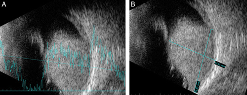
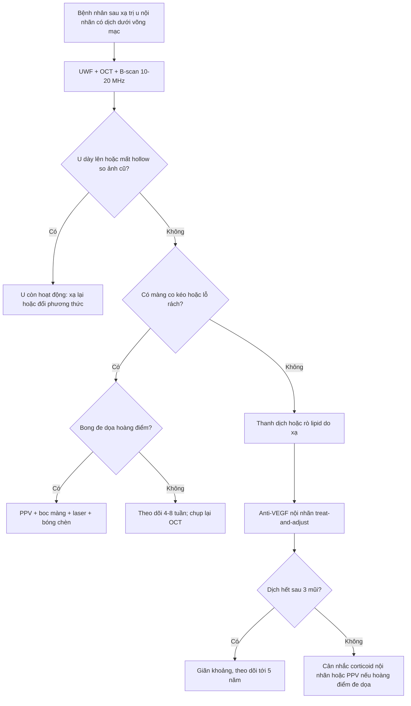
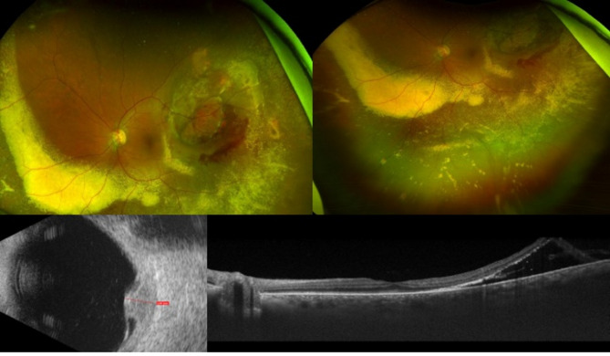
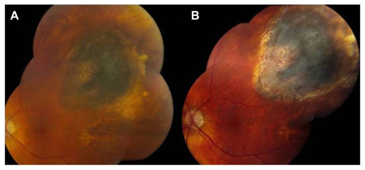

# 1441 — Bong võng mạc sau xạ trị u nội nhãn: thanh dịch do u, co kéo và lỗ rách của võng mạc đã xạ / Retinal detachment after intraocular tumour radiotherapy

**Tags:** `pattern:bong-vong-mac` `pattern:bong-thanh-dich` `pattern:co-keo` `pattern:xuat-tiet-cung` `pattern:phu-hoang-diem` `pattern:teo-vong-mac` `pattern:tai-phat-u` `vung:vong-mac` `vung:hoang-diem` `vung:mat` `protocol:OCT` `protocol:sieu-am-B-scan` `protocol:UWF` `protocol:plaque-do-lieu` `protocol:PPV`
**Mức chắc chắn (certainty):** tổng hợp y văn (literature synthesis) — đọc toàn văn một loạt **102 mắt** cắt dịch kính sau plaque I-125 (PMC3589122), một ca Ru-106 **80 Gy** có chuỗi ảnh đa phương thức (PMC12359946), một ca bong lỗ rách **che giấu u hắc mạc** (PMC10617836), cộng dữ liệu biến chứng xạ của loạt **20 mắt** retinoblastoma đặt plaque **45 Gy** đã tổng hợp ở bài **1419**. Phần **chọn bóng chèn và thời điểm mổ** là **suy luận (inference)** từ cơ chế + kết cục loạt, đã ghi rõ tại chỗ.

> **Vì sao bài này quan trọng:** sau khi u nội nhãn được xạ trị, **bong võng mạc (retinal detachment, RD) không phải một bệnh mà là bốn cơ chế khác nhau** — thanh dịch do u còn hoạt động, rò lipid do mạch xạ, co kéo ở bờ u, và lỗ rách do võng mạc teo. Bốn cơ chế này **trả lời bốn câu hỏi điều trị khác nhau** (xạ lại u / anti-VEGF / mổ dịch kính / theo dõi), nhưng trên siêu âm và đáy mắt đều là “dịch dưới võng mạc”. Đọc sai cơ chế dẫn tới **mổ khi u còn hoạt động** hoặc **chờ khi hoàng điểm đang bong**. Bài này là phần tiếp theo bắt buộc của **1409/1419**.

## 1. Tổng quan bệnh học – cơ chế hình ảnh – vì sao “dịch dưới võng mạc” có bốn nguồn gốc

### 1.1. Bốn cơ chế, một hình ảnh

- **Nguồn 1 — u còn hoạt động (exudative, u-related):** melanoma hắc mạc tiết **VEGF và cytokine viêm**, làm **vỡ hàng rào máu–võng mạc (blood–retinal barrier)** và tăng tính thấm mao mạch u → dịch huyết tương vào khoang dưới võng mạc. Trước điều trị, **bong thanh dịch gặp ở 50–100%** mắt u hắc mạc (dẫn trong PMC3589122). Đặc điểm: dịch **di chuyển theo tư thế (shifting fluid)**, **không có lỗ rách**, vòm dịch **phủ trên khối u**.
- **Nguồn 2 — rò lipid do mạch đã xạ (tumour-related lipid exudation, TRLE):** sau xạ, mạch u và mạch hắc mạc bị **viêm nội mô, huyết khối vi mạch, tăng tính thấm**; protein và **lipid** thoát qua **màng Bruch đã vỡ** và RPE vào khoang dưới võng mạc. Lipid **không được RPE tái hấp thu nhanh** như nước → đọng thành **xuất tiết cứng (hard exudates)** và dịch dai dẳng. Đây là lý do **“dịch + lipid” = rò mạn**, khác “dịch trong” = rò cấp.
- **Nguồn 3 — co kéo (tractional):** xạ gây **viêm mạch, thiếu máu, xơ hóa** ở bờ u và **giao diện dịch kính–võng mạc**; màng trước võng mạc co lại → bong **hình máng, nếp cố định (fixed folds)**, **không có lỗ**. Trong loạt 102 mắt phải cắt dịch kính sau plaque, **67 mắt (65,7%) có co kéo dịch kính–võng mạc** tại thời điểm mổ (PMC3589122).
- **Nguồn 4 — lỗ rách do võng mạc đã xạ (rhegmatogenous):** võng mạc trong vùng xạ **teo, mỏng, mất đàn hồi**; kèm co kéo và thoái hóa dạng lưới → **rách teo** hoặc **rách do co kéo**, rồi dịch lỏng vào khoang dưới võng mạc. Thể này **cần mổ**, không đáp ứng thuốc.

- **Vì sao thời gian T1/T2 không giúp phân biệt:** cả bốn thể đều là **dịch protein thấp–trung bình** trên MRI (T1 tối, T2 sáng); thứ phân biệt là **hình thái trên OCT/B-scan + có/không có lỗ rách + khối u có hoạt động hay không**. Đây là ví dụ của nguyên tắc: **cùng một đậm độ/tín hiệu, hình thái và bối cảnh mới quyết định tên gọi**.

### 1.2. Ngưỡng định lượng đã có (và chỗ còn trống)

| Tình huống | Con số | Ý nghĩa thực hành | Nguồn |
|---|---|---|---|
| Bong thanh dịch **trước** điều trị u hắc mạc | **50–100%** | Bong có sẵn từ trước xạ ≠ biến chứng xạ | PMC3589122 |
| TRLE sau plaque I-125 | **13%**, khởi phát trung bình **10 tháng** | Rò lipid là biến chứng **muộn**, không phải ngay sau tháo plaque | dẫn trong PMC12359946 (Mills) |
| TRLE trong nghiên cứu bệnh–chứng | **8%** | Yếu tố: **vỡ Bruch, u dày, u gần đĩa thị/hoàng điểm, bong thanh dịch trước xạ** | dẫn trong PMC12359946 (Mashayekhi) |
| Co kéo dịch kính–võng mạc ở mắt mổ sau plaque | **67/102 (65,7%)** | Co kéo là thành phần **thường gặp**, không phải ngoại lệ | PMC3589122 |
| Khoảng plaque → cắt dịch kính | **38,1 tháng** (3,8–178,6) | Bong do xạ thường **muộn**, trung bình hơn 3 năm | PMC3589122 |
| Bệnh võng mạc do xạ | **10–63%**, khởi phát trung bình **25,6 tháng** | Nền mạch máu quyết định cả phù và bong | dẫn trong PMC12359946 |
| Đục thể thủy tinh do xạ | **8–83% ở 5 năm** | Che đáy mắt → **buộc B-scan** | dẫn trong PMC12359946 |
| Bệnh thần kinh thị do xạ | **16%** | Giới hạn thị lực dù võng mạc gắn lại | dẫn trong PMC12359946 |
| Plaque I-125 **45 Gy** ở trẻ (retinoblastoma) | **Bong võng mạc 20%**, glôcôm tân mạch **5%**, giữ mắt **70%** | Trẻ có ngưỡng và biến chứng khác người lớn | PMC11901221 (bài 1419) |
| Cắt dịch kính sau plaque (102 mắt) | Thị lực **20/258 → 20/113** ở 12 tháng; **36,2% ≥ 20/50**; **9,8% < 5/200** | Mổ có ích nhưng **không phải “về 10/10”** | PMC3589122 |
| Sau cắt dịch kính | Mổ lại **6,86%**; bong thanh dịch tồn tại **2,94%**; glôcôm tân mạch **8,8%**; **0 mắt phải bỏ** | Bong do xạ **cứu được mắt**, nhưng NVG là đích theo dõi | PMC3589122 |

- **Chỗ còn trống:** **không có thử nghiệm ngẫu nhiên** so sánh “mổ sớm vs chờ” ở bong do xạ; ngưỡng thời gian **6 tháng quan sát trước khi mổ** là **khuyến cáo thực hành** nhằm loại trừ u còn hoạt động (PMC3589122), không phải bằng chứng cấp I.

### 1.3. Vì sao “bong do xạ” khác bong võng mạc thông thường

- **Mô đã xạ không lành như võng mạc bình thường:** mạch máu **giòn, dễ chảy máu**, biểu mô sắc tố **teo**, củng mạc **mỏng sau khi plaque ép** → **mỗi lần can thiệp đều khó hơn** và **nguy cơ tái bong/PVR cao hơn**.
- **U vẫn nằm đó:** mọi thao tác trong mắt có u đã xạ đều đặt câu hỏi **gieo tế bào u vào dịch kính**. Loạt 102 mắt **không có phát tán trong/ngoài nhãn và không tái phát** sau cắt dịch kính, nhưng **3 mắt có tế bào ác tính trong dịch kính** trên xét nghiệm tế bào (PMC3589122) — nghĩa là **nguy cơ có thật, dù thấp**, và cần **lấy mẫu dịch kính** khi mổ.
- **Thị lực phụ thuộc thời điểm, không phụ thuộc kỹ thuật:** tế bào quang thụ chết sau **vài tuần bong hoàng điểm**; vì vậy **bong đe dọa hoàng điểm** là chỉ định mổ, còn **bong ngoại vi không đe dọa** có thể theo dõi.

## 2. Mẫu hình + chẩn đoán phân biệt theo thời gian và theo “u còn sống hay không” (Gamut)

### 2.1. Gamut theo mốc thời gian sau xạ

- **Trước xạ:** bong thanh dịch do u (**50–100%**), có thể rất lớn, che toàn bộ đáy mắt.
- **0–3 tháng:** bong thanh dịch **có thể nặng lên thoáng qua** sau xạ (do phù/hoại tử u); đây là lúc **dễ nhầm là thất bại điều trị**.
- **3–12 tháng:** TRLE khởi phát (trung bình **10 tháng**), xuất tiết cứng, dịch dai dẳng; bắt đầu co kéo ở bờ u.
- **1–3 năm:** bong co kéo, màng trước võng mạc, bệnh võng mạc do xạ; thời điểm cắt dịch kính trung bình **38,1 tháng**.
- **> 3–5 năm:** teo võng mạc–hắc mạc, **rách teo → bong lỗ rách**, glôcôm tân mạch, đục thể thủy tinh; đồng thời **nguy cơ tái phát u** vẫn tồn tại.

### 2.2. Gamut theo hình thái — “4 chữ D”

- **D1 — Detachment, serous (thanh dịch):** dịch **trong**, di chuyển, **không lỗ**, phủ trên u; OCT: dịch dưới võng mạc **không có màng co kéo**, võng mạc **trơn**.
- **D2 — Deposition, lipid (lắng đọng lipid):** **xuất tiết cứng dạng vòng/cung** quanh u, dịch dai dẳng; OCT: **dịch + hạt tăng phản xạ trong võng mạc**; đây là dấu hiệu **rò mạn**.
- **D3 — Distortion, tractional (co kéo):** **nếp cố định**, màng trước võng mạc, dịch **nông**; OCT: **màng tăng phản xạ trên võng mạc + điểm dính**; B-scan: **dải hồi âm mảnh**.
- **D4 — Defect, rhegmatogenous (lỗ rách):** **lỗ thấy được** (thường ngoại vi, trong vùng xạ), dịch **lỏng**, có thể **PVR**; B-scan khi không thấy đáy mắt: **màng rung theo động tác mắt**, dày võng mạc.

### 2.3. Câu hỏi số 1 luôn là: “u còn hoạt động không?”

- **U hoạt động:** **dày lên** trên B-scan qua 3–6 tháng, **bờ không đều**, **mất “melanoma hollow”**, **tăng tín hiệu mạch trên FA/ICGA**, **dịch tăng song song với u**; xử trí là **kiểm soát u** (xạ lại/plaque thứ hai), không phải mổ dịch kính trước.
- **U đã kiểm soát:** **mỏng đi, phẳng, tăng hồi âm/bờ rõ**, **dịch giảm dần** dù có thể chậm; xử trí là **anti-VEGF/steroid** cho rò, **mổ** khi co kéo/lỗ rách.
- **Ca minh họa (PMC12359946):** u **phẳng < 1 mm** sau xạ lần 2 + aflibercept **mỗi 8 tuần** → **hết dịch và lipid hoàn toàn**, thị lực về **20/20** — chứng minh **dịch do rò có thể hết mà không cần mổ**.

## 3. Bảng so sánh phân biệt (ma trận đối chiếu)

| Thực thể (entity) | Hình ảnh/lâm sàng điển hình | Chốt vào (rule-in) | Chốt loại (rule-out) | Gợi ý xác nhận |
|---|---|---|---|---|
| **Bong thanh dịch do u hoạt động** | Dịch trong, di chuyển, phủ trên khối u; u **dày lên** theo thời gian | **Dịch + u tăng độ dày ≥ 0,5 mm qua 3–6 tháng**; mất hollow; tăng mạch trên FA/ICGA | **U mỏng/phẳng, dịch giảm** → không phải u hoạt động | B-scan 10–20 MHz đúng trục u; so ảnh cũ; FA/ICGA |
| **TRLE do xạ (rò lipid)** | **Xuất tiết cứng** quanh u, dịch dai dẳng, thị lực có thể còn tốt | **Lipid dưới võng mạc/võng mạc + tiền sử vỡ Bruch, u dày, bong trước xạ**; khởi phát quanh **10 tháng** | **Không có lipid, dịch tự hết** → bong thoáng qua sau xạ | OCT (hạt tăng phản xạ), ảnh màu; theo dõi 4–8 tuần |
| **Bong co kéo** | **Nếp cố định**, màng trước võng mạc, dịch nông; thường bờ u | **Màng tăng phản xạ + điểm dính trên OCT**, dịch **không di chuyển** | **Dịch di chuyển, không màng** → thanh dịch | OCT qua u và bờ u; B-scan động |
| **Bong lỗ rách do teo xạ** | Lỗ ngoại vi trong vùng xạ, dịch lỏng, PVR; thị lực giảm nhanh nếu vào hoàng điểm | **Thấy lỗ rách** (soi đáy mắt/indentation) hoặc **màng rung + lỗ trên B-scan** | **Không lỗ, vòm dịch trên u** → thanh dịch/co kéo | Soi đáy mắt 3 gương; B-scan; cân nhắc OCT ngoại vi |
| **Tràn dịch hắc mạc (choroidal effusion) sau xạ/viêm** | Bong **hắc mạc dạng vòm trơn**, có thể **hai bên**, kèm bong thanh dịch; tiền phòng nông | **Hắc mạc dày, vòm trơn, không ngấm thuốc**, có yếu tố viêm/giảm áp | **Khối hắc mạc đặc, ngấm thuốc** → u | B-scan (vòm trơn), MRI; đáp ứng corticoid |
| **Tái phát u “giả bong”** | Khối **đặc mới** dưới võng mạc, có thể kèm dịch; xuất huyết dịch kính | **Khối đặc tăng kích thước + hạt giống dịch kính**; ngấm thuốc MRI | **Chỉ dịch, không khối đặc** → biến chứng xạ | B-scan định kỳ; MRI hốc mắt; hội chẩn ung thư |
| **Bong lỗ rách + u hắc mạc cùng tồn tại (che giấu)** | Bong lỗ rách **che khối u** ở đáy; thường không có tiền sử u | **B-scan thấy khối vòm đặc dưới dịch**; A-scan hồi âm trung bình–cao; lỗ rách ngoại vi | Chỉ thấy lỗ rách, **không khối** → bong thông thường | **B-scan trước mọi ca bong lỗ rách** không rõ nguyên nhân |

*B-scan (A, B) của một nam **45 tuổi** vào viện vì bong võng mạc lỗ rách **một tháng**: đáy mắt có **bong dạng bọng phía dưới** + **rách móng ngựa ở 10 giờ**, và **dưới võng mạc bong** là khối **vòm đặc, hồi âm không đồng nhất** kích thước **12,15 mm dày × 15,05 mm đáy**, A-scan **hồi âm trung bình–cao**. Mô bệnh sau mổ: **melanoma hắc mạc thể tế bào biểu mô, 15 phân bào/mm²**. Bài học: **một lỗ rách không loại trừ u** — B-scan là bắt buộc trước khi cắt dịch kính. Nguồn: *Ann Med Surg* 2023 (PMC10617836) Fig. 2, **CC BY-NC-ND 4.0 — nguyên bản, không crop/ghép**.*

## 4. Protocol chụp – điều trị – theo dõi

### 4.1. Bộ ảnh tối thiểu mỗi lần khám

- **Ảnh đáy mắt siêu rộng (ultra-widefield, UWF)** màu ± tự huỳnh quang: ghi **ranh giới dịch, lipid, xuất huyết**; so với ảnh cũ **cùng góc**.
- **OCT hoàng điểm (SD-OCT)**: phân biệt **dịch dưới võng mạc (SRF) vs dịch trong võng mạc (IRF) vs màng co kéo**; đo **độ dày trung tâm (CST)**, tìm **đứt dải ellipsoid (EZ)** — yếu tố tiên lượng thị lực.
- **Siêu âm B-scan 10–20 MHz**: đo **độ dày u (mm), đường kính đáy, độ cao dịch, hồi âm trong u**, tìm **màng co kéo/lỗ rách** khi đáy mắt bị che. Đây là **chuẩn vàng theo dõi u** sau xạ.
- **A-scan**: **hồi âm trong u** (melanoma trung bình–cao; hemangioma cao; lymphoma thấp) — dùng khi chưa có chẩn đoán mô học.
- **FA/ICGA** khi nghi **u hoạt động** hoặc cần phân biệt **rò mạch**; **MRI hốc mắt** khi nghi **xâm lấn/xuyên củng mạc** hoặc khối không giải thích được.

### 4.2. Liều và lịch theo dõi (khung thực hành)

- **Liều đỉnh (apex dose)** là biến số chính: ca Ru-106 dùng **80 Gy đỉnh** (PMC12359946); plaque I-125 ở trẻ retinoblastoma dùng **45 Gy đỉnh** (PMC11901221). **Không có một con số “an toàn” chung** — nguy cơ phụ thuộc **thể tích võng mạc nhận liều**, khoảng cách tới hoàng điểm/đĩa thị, và **loại đồng vị**.
- **Lịch khám gợi ý:** **1 tháng, 3 tháng, 6 tháng** trong năm đầu; **mỗi 4–6 tháng** tới năm 5; **hằng năm** sau đó. Mỗi lần: **UWF + OCT + B-scan**; thêm **FA/ICGA** khi nghi tái phát.
- **Cảnh báo sớm:** **dịch tăng + lipid mới** = rò; **dịch tăng + u dày** = u hoạt động; **nếp cố định** = co kéo; **lỗ mới** = cần mổ.

### 4.3. Bậc thang điều trị

1. **Kiểm soát u trước:** nếu u còn hoạt động → **xạ lại/plaque lần hai** (ca Ru-106 nhận **80 Gy** lần hai, dung nạp củng mạc được đánh giá bởi xạ trị ung thư) hoặc chuyển phương thức (proton, enucleation nếu mất chức năng).
2. **Rò lipid/thanh dịch do xạ, u đã kiểm soát:** **anti-VEGF nội nhãn** (bevacizumab/aflibercept), **treat-and-adjust 4–8 tuần**; dẫn qua tổng quan: bevacizumab sau tháo plaque cho **hết bong 73%**, trung bình **4 tháng**; **triamcinolone nội nhãn** cho **thoái triển 69%** trong một nghiên cứu so sánh (dẫn trong PMC12359946). **Corticoid nội nhãn phải cân nhắc nguy cơ tăng nhãn áp/đục thể thủy tinh** (bài 1411).
3. **Bong đe dọa hoàng điểm hoặc co kéo/lỗ rách:** **cắt dịch kính (pars plana vitrectomy, PPV)** ± **bóc màng** ± **laser quanh u** ± **bóng chèn**. Nguyên tắc: **chờ u ổn định ít nhất 6 tháng** trước khi mổ (PMC3589122), trừ khi hoàng điểm đang bong.
4. **Bóng chèn:** **khí C3F8** cho bong đơn giản, kỳ vọng hồi phục nhanh; **dầu silicon** khi **PVR, bong tái phát, hoặc cần quan sát lâu** — nhưng dầu **che ảnh đáy mắt**, phải theo dõi u bằng **B-scan qua dầu**. *(Đây là suy luận từ cơ chế và kết cục loạt, không có thử nghiệm so sánh riêng ở mắt đã xạ.)*

### 4.4. Ngưỡng theo dõi sau mổ

- **Thị lực:** loạt 102 mắt cho **20/258 → 20/113 ở 12 tháng**, **36,2% đạt ≥ 20/50**, **9,8% < 5/200** — tư vấn trước mổ phải nói rõ **không phải ca nào cũng hồi phục**.
- **Nhãn áp:** **glôcôm tân mạch 8,8%** sau PPV ở mắt đã xạ → đo IOP mỗi lần khám, soi góc khi IOP tăng; **tân mạch cần anti-VEGF + PRP**.
- **Tái bong:** **mổ lại 6,86%**, **bong thanh dịch tồn tại 2,94%** → hẹn **OCT tháng 1–3–6–12** sau mổ, sau đó mỗi 6 tháng.

## 5. Biến thể bình thường và cạm bẫy

- **Cạm bẫy 1 — “dịch dưới võng mạc = tái phát u”:** dịch có thể **do rò lipid/mạch xạ** trong khi u **phẳng < 1 mm**; mổ/xạ lại lúc này là **can thiệp thừa**. Luôn so **độ dày u** và **hollow** trên B-scan.
- **Cạm bẫy 2 — “dịch tự hết = u đã khỏi”:** dịch có thể **giảm thoáng qua** rồi tăng lại do u hoạt động; theo dõi **tối thiểu 5 năm** vì biến chứng xạ và tái phát đều **muộn**.
- **Cạm bẫy 3 — mổ quá sớm khi u chưa ổn định:** nguy cơ **gieo tế bào u** (3/102 mắt có tế bào ác tính trong dịch kính) và **không phân biệt được dịch do u với dịch do xạ**; khuyến cáo **chờ ≥ 6 tháng** nếu hoàng điểm chưa bị đe dọa.
- **Cạm bẫy 4 — bỏ sót lỗ rách vì “đã có u”:** satisfaction of search; phải **soi toàn chu vi 360°** và **B-scan động** trước khi kết luận “chỉ bong thanh dịch”.
- **Cạm bẫy 5 — không thấy đáy mắt vì đục thể thủy tinh:** đục TTT do xạ **8–83% ở 5 năm**; **B-scan là bắt buộc** trước khi kết luận “theo dõi ổn định”.
- **Cạm bẫy 6 — củng mạc mỏng sau plaque:** đặt **đai/explants** hoặc khâu củng mạc ở vùng đã xạ có nguy cơ **thủng củng mạc**; ưu tiên **PPV + bóng chèn** hơn đai củng mạc ở vùng xạ. *(Suy luận từ cơ chế xạ — chưa có số liệu riêng.)*
- **Cạm bẫy 7 — dầu silicon che u:** sau PPV + dầu, **không đánh giá u bằng ảnh màu**; dùng **B-scan qua dầu** và **MRI** khi cần.

## 6. Tự lượng giá — Blind Quiz (mở trên Pages để tự đoán trước)

**Ca 1 — Nam 61 tuổi, theo dõi nốt hắc mạc 15 năm; nốt to lên 9 × 8,66 mm, dày 3,52 mm, có dịch dưới võng mạc. Ru-106 80 Gy đỉnh. Một tháng sau: bong thanh dịch phía dưới u + xuất huyết dưới võng mạc; 9 tháng sau dịch lan rộng, xuất tiết lipid nhiều, thị lực 20/40.**

- Câu hỏi: Đây là bong thanh dịch do u hay do rò lipid? Có bằng chứng u còn hoạt động không? Bước tiếp theo là mổ hay điều trị nội nhãn?

<b>Bấm để hiện đáp án</b>

- **Bong thanh dịch + rò lipid (TRLE), kèm u còn hoạt động:** B-scan cho thấy u **dày lên tới ~4 mm** và **vỡ màng Bruch** mới; dịch **lan xuống dưới** với **xuất tiết cứng** — dấu hiệu rò mạn.
- **Xử trí:** **xạ lại lần hai (80 Gy đỉnh)** vì u còn hoạt động, **aflibercept mỗi 8 tuần** sau tháo plaque; **không mổ dịch kính** vì dịch do rò và u chưa kiểm soát.
- **Kết cục:** 6 tháng sau xạ lần hai, u **phẳng < 1 mm**, **hết dịch và lipid**, thị lực **20/20**.
- Bài học: **dịch + lipid không đồng nghĩa phải mổ**; kiểm soát u + anti-VEGF có thể giải quyết.
- Nguồn ảnh: *BMC Ophthalmol* 2025 (PMC12359946) Fig. 3, **CC BY-NC-ND 4.0 — nguyên bản**.

**Ca 2 — Nam 59 tuổi, melanoma hắc mạc sau cực (12 × 8,5 × 2,6 mm) đặt plaque I-125. 88 tháng sau: thị lực giảm, bệnh võng mạc do xạ, bong thanh dịch khu trú ngay trên hoàng điểm; u đã teo còn 9 × 8,5 × 1 mm, không hoạt động.**

- Câu hỏi: Vì sao đây là chỉ định mổ? Cần làm gì để tránh gieo tế bào u? Kết quả mong đợi?

<b>Bấm để hiện đáp án</b>

- **Chỉ định mổ:** bong **đe dọa hoàng điểm** ở mắt u **đã ổn định 88 tháng** (teo, không hoạt động) — đúng nguyên tắc “chờ u ổn định rồi mới mổ”.
- **Chống gieo tế bào:** **lấy mẫu dịch kính** gửi tế bào học, **hạn chế thao tác vào u**, **laser quanh u**; loạt 102 mắt **không có phát tán** nhưng **3 mắt dương tính tế bào**.
- **Kết quả:** PPV + phaco/IOL + bóc màng + laser + triamcinolone → **3 tháng thị lực 20/25**, võng mạc **gắn**, không PVR; toàn loạt **36,2% đạt ≥ 20/50**, **6,86% phải mổ lại**.
- Nguồn ảnh: *Clin Ophthalmol* 2013 (PMC3589122) Fig. 7, **giấy phép phi thương mại, nguyên bản**.

**Ca 3 — Nam 45 tuổi, mờ mắt trái 1 tháng, thị lực 20/250, không tiền sử cận thị/chấn thương. Đáy mắt: bong dạng bọng phía dưới + rách móng ngựa 10 giờ; dưới võng mạc bong có khối vòm nhạt màu.**

- Câu hỏi: Có được kết luận “bong lỗ rách đơn thuần” và mổ ngay không? Cần thêm thông tin gì? Chẩn đoán mô học là gì?

<b>Bấm để hiện đáp án</b>

- **Không:** phải **B-scan trước mổ** — khối **vòm đặc, hồi âm không đồng nhất, 12,15 mm dày × 15,05 mm đáy**, A-scan **hồi âm trung bình–cao** → nghi **melanoma hắc mạc** dưới võng mạc bong.
- **Xử trí:** phaco/IOL + **PPV + endolaser + dầu silicon**; mô bệnh xác nhận **melanoma thể tế bào biểu mô, 15 phân bào/mm²**, có xâm lấn thể mi.
- **Bài học:** một **lỗ rách ngoại vi** không loại trừ u; bỏ B-scan có thể dẫn tới **mổ mà không biết u**, gieo tế bào và bỏ lỡ điều trị ung thư.
- Nguồn ảnh: *Ann Med Surg* 2023 (PMC10617836) Fig. 2, **CC BY-NC-ND 4.0 — nguyên bản**.

## Bài liên quan chéo
- [1419 – Bệnh võng mạc do xạ ở trẻ sau xạ trị u não/retinoblastoma](../1419-vong-mac-xa-tre-sau-xa-tri/lesson.md) (ngưỡng liều, OCT/OCTA, tái phát u)
- [1409 – Bệnh võng mạc do xạ sau xạ trị u nội nhãn/hốc mắt](../1409-benh-vong-mac-do-xa-sau-xa-tri/lesson.md) (người lớn, ngưỡng 45–55 Gy)
- [1418 – Phù hoàng điểm do xạ dai dẳng: chọn implant corticoid](../1418-phu-hoang-diem-xa-khang-anti-vegf/lesson.md) (khi kháng anti-VEGF)
- [1411 – Tăng nhãn áp do corticoid nội nhãn](../1411-tang-nhan-ap-do-corticoid-noi-nhan/lesson.md) (theo dõi IOP khi dùng corticoid)
- [445 – Bong võng mạc](../445-bong-vong-mac/lesson.md) (nguyên lý bong – lỗ rách – PVR)
- [1402 – Bong võng mạc sau viêm nội nhãn](../1402-bong-vong-mac-sau-viem-noi-nhan/lesson.md) (bong do viêm: lỗ hoại tử vs màng xơ)
- [1415 – Bong võng mạc muộn ở mắt ROP đã hồi phục](../1415-bong-vong-mac-muon-rop-da-hoi-phuc/lesson.md) (bong do teo võng mạc đã can thiệp)
- [412 – U trong nhãn cầu](../412-u-trong-nhan-cau/lesson.md) (chẩn đoán phân biệt khối trong nhãn cầu)

## Ảnh
- Tên file: `1441_bong-vong-mac-xa_<Modality>_<PMCID>.jpg`; nguồn + giấy phép từng ảnh ở `images/CREDITS.md`.
- Cả ba ảnh dùng **nguyên bản**, **không crop/ghép/đổi màu** (có ảnh CC BY-NC-ND).
- Ảnh không tải được (paywall/cấm tải) → dẫn link trong `sources.md`, không dùng ảnh license mơ hồ.

> Không dùng để chẩn đoán độc lập khi chưa có người hướng dẫn.
