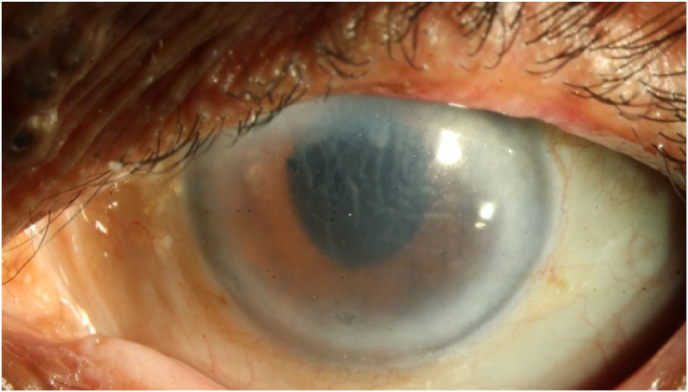
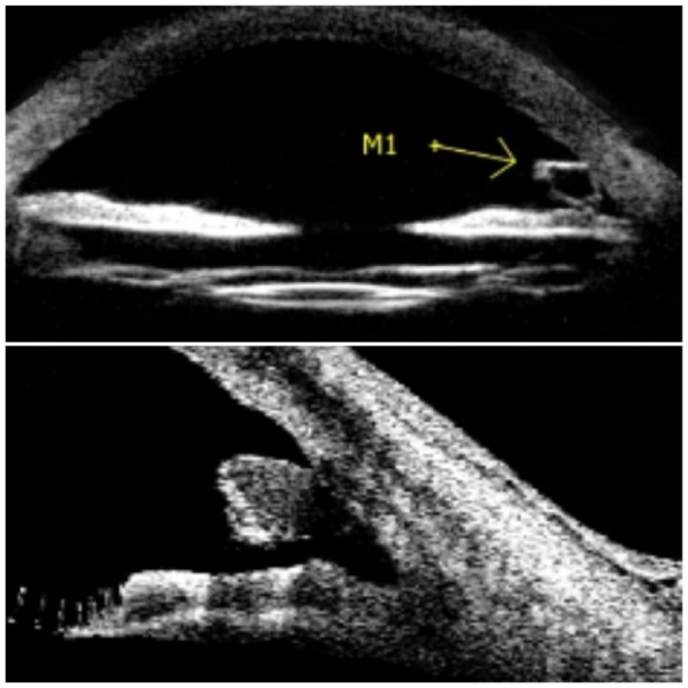
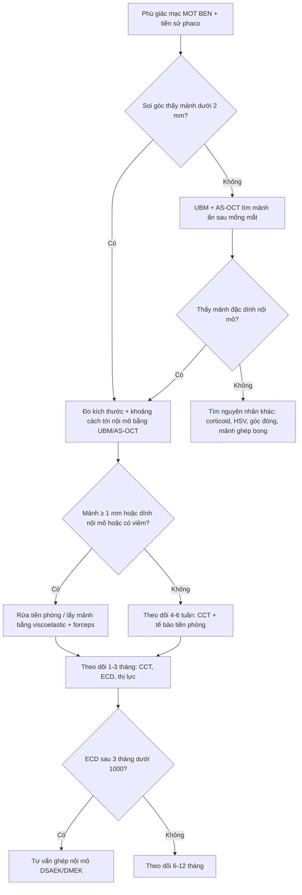
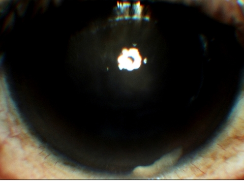
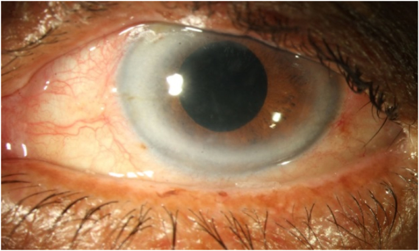
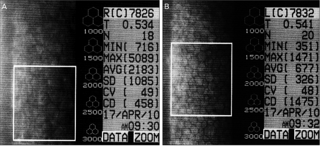

# 1442 — Mảnh thể thủy tinh còn sót trong tiền phòng / Retained lens fragment in the anterior chamber

**Tags:** `pattern:phu-giac-mac` `pattern:vat-the-tien-phong` `pattern:viem-tien-phong` `pattern:mat-mot-ben` `pattern:giam-thi-luc` `vung:mat` `vung:giac-mac` `vung:tien-phong` `vung:goc-tien-phong` `vung:the-thuy-tinh` `protocol:slit-lamp` `protocol:AS-OCT` `protocol:UBM` `protocol:specular-microscopy` `score:ECD` `score:CCT` `incidentaloma:manh-the-thuy-tinh`
**Mức chắc chắn (certainty):** tổng hợp y văn (literature synthesis) — 2 ca nguyên văn có ảnh và số liệu đầy đủ (1 ca **4 năm**, 1 ca **15 năm** sau phaco) + 1 ca thứ ba về **mảnh IOL gập** gây phù giác mạc muộn; toàn bộ là **ca báo cáo**, không có nghiên cứu đoàn hệ hay RCT cho thể **tiền phòng** (khác thể **hậu đoạn**, nơi đã có đoàn hệ lớn).

> **Vì sao bài này quan trọng:** mảnh thể thủy tinh sót ở tiền phòng là biến chứng của phẫu thuật được làm nhiều nhất trên thế giới, nhưng **xuất hiện muộn tới 4–15 năm** và **bắt chước đúng** ba bệnh cảnh khác nhau: **phù giác mạc giả thể thủy tinh (pseudophakic bullous keratopathy)**, **viêm màng bồ đào tái diễn**, và **viêm nội nhãn** (mảnh trắng ở góc dưới từng bị gọi là **mủ tiền phòng/hypopyon** — ca 2). Bệnh nhân vì thế được **điều trị corticoid kéo dài** hoặc **được tư vấn ghép giác mạc** trong khi nguyên nhân là một mảnh **1 mm** có thể lấy ra bằng **rửa tiền phòng**. Bài **1428** phủ mảnh **implant corticoid** (hình thanh, đúng 6 mm); bài này phủ **mảnh mô của chính mắt bệnh nhân** — khác hình thái, khác thời điểm, khác xử trí.

## 1. Tổng quan bệnh học – cơ chế hình ảnh

- **Vì sao mảnh thể thủy tinh TRẮNG và thấy được:** thể thủy tinh là cấu trúc **65% nước, 35% protein** (chủ yếu **crystallin**) — nồng độ protein cao nhất trong cơ thể, **chiết suất ~1,40** so với thủy dịch **~1,33**. Mảnh vụn giữ nguyên chiết suất cao → **tán xạ ánh sáng mạnh** ở khe sáng: một **đốm/vệt trắng đục**, không trong như mảnh vỏ mềm đã ngậm nước.
- **Vì sao mảnh có thể NẰM YÊN nhiều năm rồi mới gây bệnh:** khe hở giữa **mống mắt và bao sau/thể thủy tinh nhân tạo (IOL)** là một **ngách kín**; mảnh vụn bị mống mắt che hoặc nằm trong **túi bao (capsular bag)**, không tiếp xúc nội mô → **không triệu chứng**. Khi **đồng tử giãn/co theo ánh sáng**, khi **tư thế đầu thay đổi**, hoặc khi **dịch kính hóa lỏng** làm mất giá đỡ, mảnh **di chuyển ra tiền phòng** và **chìm xuống 6 giờ** (mảnh đặc nặng hơn thủy dịch).
- **Vì sao nằm ở góc dưới mà vẫn làm phù giác mạc LAN TỎA:** mảnh **dính vào nội mô** ở góc dưới, tạo **ổ viêm khu trú**; đại thực bào và cytokin khuếch tán trong thủy dịch → **phù lan tỏa** dù tổn thương cơ học chỉ vài mm². Đây là lý do **phù không tương xứng với kích thước mảnh** (ca 1: mảnh **0,96 × 0,75 mm** nhưng **CDVA 20/200**).
- **Hai cơ chế phá nội mô, phải kể cả hai:**
  1. **Cơ học:** mảnh **cọ xát** mặt sau giác mạc mỗi lần chớp/mắt chuyển động → **chết tế bào nội mô tại chỗ**. Nội mô **không tái sinh**; người trưởng thành có **ECD ≈ 2.200–2.500 tế bào/mm²** và mất **~0,6%/năm**; tế bào còn lại **to ra, mất hình lục giác** để bù.
  2. **Hóa–miễn dịch:** protein thể thủy tinh là **kháng nguyên "ẩn"** (sequestered antigen). Rò rỉ ra tiền phòng → **viêm do protein thể thủy tinh (phacoantigenic/phacolytic)**: đại thực bào ngấm protein, phản ứng **u hạt**, **tế bào + flare**, có thể tạo **giả mủ** — chính vì thế ca 2 từng bị chẩn đoán **hypopyon** ở tuyến trước.
- **Số liệu định lượng cốt lõi (lấy từ nguồn của bài):**
  - **Ca 1** (*AJO Case Rep* 2022, PMC8844397): nữ **65 tuổi**, phaco **4 năm** trước, mờ mắt **4 tháng**, **CDVA 20/200**, **IOP 14 mmHg**, **nếp Descemet**, đã được chẩn đoán **phù giác mạc giả thể thủy tinh** và **tư vấn ghép giác mạc lát mỏng**; **UBM + AS-OCT** phát hiện mảnh **0,96 × 0,75 mm ở 6 giờ, dính nội mô**; rửa tiền phòng → **giác mạc trong hoàn toàn sau 3 tháng**, **CDVA 20/40**. Soi nội mô **không làm được** vì giác mạc phù.
  - **Ca 2** (*Korean J Ophthalmol* 2011, PMC3039198): nam **60 tuổi**, phaco **15 năm** trước, **viêm tiền phòng tái diễn**, **VA 0,2** (mắt bên 0,9), **IOP 15/17 mmHg**, **flare độ 1, tế bào độ 2**, mảnh trắng ở góc dưới **bị đọc là mủ tiền phòng**; sau giãn đồng tử thấy thêm **mảnh trong bao trên**; lấy mảnh bằng **forceps + viscoelastic**; **2 tháng: VA 0,7** nhưng **ECD chỉ còn 458 tế bào/mm²** và **mất tính lục giác** — tức **mất ~80% dự trữ nội mô** (suy luận từ mốc 2.200–2.500 tế bào/mm²).
  - **Ca 3** (*Indian J Ophthalmol* 2009, PMC2683446): **65 tuổi**, phaco + IOL gập (Rayner Centerflex 570C +21D); **một haptic (tay đỡ) của IOL gãy** ở chỗ nối optic–haptic, IOL lệch phải đổi 10 ngày sau; **2 tuần sau** phù giác mạc, thấy **haptic sót ở góc tiền phòng dưới**, lấy ra → **phù hết hoàn toàn**. Bài học: "mảnh" không chỉ là nhân/cortex mà có thể là **mảnh vật liệu IOL** (suy luận: bờ nhẵn, ít tán xạ hơn nhân nên dễ bị đọc là "mảnh vỏ mềm").
  - **Mốc thời gian thực hành:** diễn tiến trong nguồn từ **4 tháng đến 15 năm** sau mổ; phù **hồi phục 1–3 tháng** sau khi lấy mảnh **nếu nội mô còn dự trữ**.

## 2. Mẫu hình + chẩn đoán phân biệt theo vị trí (Gamut)

**Mẫu hình chốt:** *mắt MỘT BÊN, đã phaco + IOL nhiều năm, **mờ mắt từ từ hoặc viêm tiền phòng tái diễn**, **giác mạc phù + nếp Descemet**, **IOP thường KHÔNG cao**, soi góc thấy **mảnh trắng bờ nham nhở, kích thước dưới 1–2 mm, ở 6 giờ**, dính nội mô và **không di động** khi nghiêng đầu.*

- **Gamut "vật trắng trong tiền phòng ở mắt giả thể thủy tinh":**
  - **Mảnh thể thủy tinh (nhân cứng)** — bờ **nham nhở, vỡ góc cạnh**, kích thước **0,5–2 mm**, ở **góc dưới**.
  - **Mảnh vỏ mềm (cortical material)** — trắng **xốp, mờ, rìa mỏng**, thường **tự tiêu** trong vài tuần.
  - **Vòng Soemmering** — **vòng liên tục** sau mống mắt, **trung tâm**, cố định.
  - **Implant dexamethasone lạc** — **thanh 6 × 0,46 mm**, hai đầu bo tròn ([bài 1428](../1428-phu-giac-mac-sau-implant-tien-phong/lesson.md)).
  - **Mủ tiền phòng thật (TASS/viêm nội nhãn)** — mủ **lắng thành lớp ngang**, di động theo tư thế, kèm **đau, IOP thay đổi, phản ứng mạnh**.
  - **Mảnh ghép nội mô bong (DSAEK/DMEK)** — **mảnh hình đĩa, mép cuộn**, sát nội mô, sau ghép.
  - **Giọt dầu silicon** — **hình cầu trong**, khúc xạ, không trắng đục.
  - **Canxi hóa IOL** — đốm trắng **trong thân IOL**, không di động, không ở góc.
- **Gamut "phù giác mạc MỘT BÊN ở mắt đã mổ" (theo thứ tự cần loại):** mảnh thể thủy tinh sót; **mất bù nội mô do mổ** (pseudophakic bullous keratopathy thật); **tăng nhãn áp do corticoid** ([bài 1411](../1411-tang-nhan-ap-do-corticoid-noi-nhan/lesson.md)); **viêm nội mô do HSV/CMV**; **góc đóng cấp**; **bong mảnh ghép nội mô**; **hội chứng UGH**; **dầu silicon tiền phòng** ([bài 1410](../1410-lay-dau-silicone-va-dau-ton-luu/lesson.md)).
- **Ba câu hỏi lâm sàng (thay mnemonic):** (1) Mổ **phaco cách đây bao lâu** (4 tháng hay 15 năm đều được)? (2) Phù có kèm **viêm tiền phòng tái diễn** và **IOP bình thường** không? (3) Có **mảnh < 2 mm bờ nham nhở ở 6 giờ**, **dính nội mô**, không di động? — "có" cả 3 → **mảnh thể thủy tinh sót** cho tới khi chứng minh ngược.

- Ảnh: mắt trái, phù mô đệm lan tỏa với **nếp Descemet**; bệnh nhân đã được chẩn đoán "phù giác mạc giả thể thủy tinh" và tư vấn ghép giác mạc **trước khi** chụp UBM/AS-OCT. Nguồn *Am J Ophthalmol Case Rep* 2022 (PMC8844397), **CC BY-NC-ND 4.0**, nguyên bản.

## 3. Bảng so sánh phân biệt (ma trận đối chiếu)

| Thực thể (entity) | Hình ảnh điển hình | Chốt vào (rule-in) | Chốt loại (rule-out) | Gợi ý xác nhận |
|---|---|---|---|---|
| **Mảnh thể thủy tinh (nhân) sót tiền phòng** | **Mảnh trắng đục bờ nham nhở, 0,5–2 mm**, ở **góc dưới (6 giờ)**, **dính nội mô**; UBM/AS-OCT thấy **cấu trúc đặc nằm sát mặt sau giác mạc** | **Tiền sử phaco nhiều năm** + **mảnh đặc, kích thước < 2 mm, đúng 6 giờ** + **phù giác mạc/viêm tiền phòng một bên, IOP bình thường** | **Không có tiền sử mổ nội nhãn**; mảnh **di động như mủ**, hoặc **thanh đều 6 mm** → loại | Đèn khe + **soi góc**; **UBM 35–50 MHz**; **AS-OCT** đo khoảng cách mảnh–nội mô |
| **Mảnh vỏ mềm (cortical)** | Trắng **xốp, mờ như bông**, rìa mỏng, thường **vài ngày–vài tuần sau mổ** | **Mới mổ < 1 tháng**, mảnh **mềm, tan dần** | **Mảnh đặc, tồn tại nhiều năm, bờ vỡ góc cạnh** → loại | Theo dõi 2–4 tuần; siêu âm sinh học nếu cần |
| **Vòng Soemmering** | **Vòng trắng liên tục** sau mống mắt, trung tâm, **cố định** | **Dạng vòng**, không ở góc, không di động | **Rời rạc, ở góc dưới** → loại | Giãn đồng tử + retroillumination |
| **Implant corticoid lạc** | **Thanh 6 × 0,46 mm**, hai đầu bo tròn, góc dưới, kèm phù vùng dưới | **Tiêm nội dịch kính ≤ 4 tuần**, **đúng kích thước 6 mm** | **Bờ nham nhở, kích thước < 2 mm** → loại | Đèn khe + **B-scan** loại implant trong dịch kính |
| **Mủ tiền phòng (TASS/viêm nội nhãn)** | **Lớp mủ lắng ngang**, đổi theo tư thế, tiền phòng đục | **Đau, 24–48 giờ sau mổ**, **phản ứng tiền phòng mạnh**, **giảm thị lực nhanh** | **Mảnh khu trú không di động, không đau, kéo dài nhiều năm** → loại | Cấy thủy dịch; **không chọc mù** khi nghi mảnh |
| **Phù giác mạc giả thể thủy tinh "thuần"** | Phù lan tỏa, **không có vật thể** trong tiền phòng | Mất nội mô do mổ, **không mảnh** | **Thấy mảnh ở 6 giờ trên UBM/AS-OCT** → loại | **UBM/AS-OCT trước khi đặt lịch ghép giác mạc** |
| **Mảnh ghép DSAEK/DMEK bong** | Mảnh **hình đĩa, mép cuộn**, sát nội mô | **Sau ghép nội mô**, hình đĩa | **Mảnh nhỏ bờ nham nhở** → loại | **AS-OCT** thấy mảnh ghép tách khỏi mặt sau giác mạc |
| **Giọt dầu silicon** | **Hình cầu trong**, khúc xạ, thường nổi **góc trên** | **Tiền sử bơm dầu**, mặt phân cách dầu–nước | **Mảnh trắng đục, lắng góc dưới** → loại | Đèn khe; soi đáy |

- **Ảnh then chốt:** UBM (trên) và AS-OCT (dưới) cho thấy **mảnh đặc nằm ở góc dưới, dính vào nội mô** — đây là bằng chứng quyết định, vì **soi góc bằng đèn khe bị che bởi arcus giác mạc dày** ở chính ca này.

- Ảnh: UBM **ABsolu (Quantel Medical)** và AS-OCT **Visante (Carl Zeiss)**; mũi tên M1 chỉ mảnh; mặt cắt dọc qua tiền phòng thấy mảnh **nằm sát mặt sau giác mạc**. Nguồn *Am J Ophthalmol Case Rep* 2022 (PMC8844397), **CC BY-NC-ND 4.0**, nguyên bản.

## 4. Protocol chụp + hệ phân độ/điểm chuẩn hóa

**Đánh giá ban đầu (làm trước mọi chẩn đoán hình ảnh):**
- **Đèn khe:** đếm **tế bào/flare**, tìm **nếp Descemet**, đo **CCT** bằng pachymetry, **giãn đồng tử** rồi soi **toàn bộ 360° góc tiền phòng**; ghi **vị trí theo giờ**, **kích thước (mm)**, **có dính nội mô hay không**, **có di động theo tư thế hay không**.
- **Đo IOP** ở mọi lần khám: thể tiền phòng thường **IOP bình thường** (ca 1: **14 mmHg**; ca 2: **15 mmHg**) — **IOP bình thường KHÔNG loại trừ**.

**Chẩn đoán hình ảnh (khi soi góc không thấy hoặc giác mạc đục):**
- **UBM (ultrasound biomicroscopy, 35–50 MHz):** đầu dò đặt trên **củng mạc/giác mạc**, xuyên qua **arcus, sẹo, mống mắt**; thấy mảnh **tăng hồi âm kèm bóng lửng** và đo được **khoảng cách mảnh–nội mô**. Ưu thế khi **giác mạc đục** (đúng ca 1).
- **AS-OCT (anterior segment OCT):** phân giải cao, **không tiếp xúc**, đo **CCT** và **vị trí mảnh** trong góc; hạn chế khi **arcus dày** hoặc **giác mạc phù nặng** (tín hiệu yếu).
- **B-scan (10 MHz):** chỉ để loại **mảnh/implant trong buồng dịch kính** và **bong võng mạc** — không dùng để đánh giá góc.
- **Soi nội mô (specular microscopy):** **chỉ đáng tin khi giác mạc còn trong**; ca 1 và ca 2 đều **không đo được lúc vào viện**. Đo **sau khi lấy mảnh và hết phù** để tiên lượng (ca 2: **458 tế bào/mm²**).
- **Không cần CT/MRI:** mảnh thể thủy tinh **không cản quang**, CT/MRI không có giá trị — đừng làm chậm xử trí.

**Ngưỡng định lượng dùng để quyết định:**
- **Kích thước:** mảnh **≥ 1 mm** hoặc **dính nội mô** → **lấy**; mảnh **vỏ mềm < 1 mm, không viêm, không dính** → theo dõi (kinh điển, không có thang riêng cho thể tiền phòng).
- **CCT:** bình thường **540 ± 30 µm**; **> 700 µm** = phù nặng, nguy cơ **bọng nước biểu mô**.
- **ECD:** **< 1.000 tế bào/mm²** sau khi hết viêm = **không còn dự trữ**, phù sẽ **không hồi phục hoàn toàn** dù đã lấy mảnh (ca 2 còn **458** — phù hết nhưng **giác mạc mỏng dự trữ**).
- **Không có hệ phân độ chính thức** cho mảnh thể thủy tinh tiền phòng; mô tả theo **3 trục**: *kích thước (mm) × vị trí (giờ/góc) × có dính nội mô hay không*.

- **Kỹ thuật lấy mảnh:** đường vào **rìa giác mạc**, bơm **viscoelastic** để **tách mảnh khỏi nội mô** (bảo vệ nội mô + mở khoang thao tác), lấy bằng **forceps thể thủy tinh** hoặc **I/A** (ca 1 chỉ cần **rửa tiền phòng**; ca 2 dùng **Healon 5 + forceps**). Không hút bằng kim nhỏ xuyên giác mạc trung tâm.
- **Sau mổ:** corticoid tại chỗ giảm liều, **cycloplegic** nếu còn viêm; hẹn **1 tuần, 1 tháng, 3 tháng**; đo **ECD** khi giác mạc đã trong.

## 5. Biến thể bình thường và cạm bẫy

- **Arcus giác mạc (arcus senilis) che mất góc:** đúng ca 1 — mảnh **không thấy** trên đèn khe và soi góc, và **không di động**. Bài học: **phù giác mạc không rõ nguyên nhân ở mắt giả thể thủy tinh = chỉ định UBM/AS-OCT**, không phải chỉnh liều corticoid.
- **"Mủ tiền phòng" giả:** mảnh trắng ở góc dưới bị đọc là **hypopyon** (ca 2) → nếu điều trị như viêm nội nhãn bằng kháng sinh/corticoid, **mảnh vẫn còn** và nội mô tiếp tục mất.
- **Nhãn "phù giác mạc giả thể thủy tinh" là chẩn đoán LOẠI TRỪ:** ca 1 đã được **tư vấn ghép giác mạc** trước khi chụp UBM. Ở mọi phù giác mạc một bên sau phaco, phải **loại mảnh thể thủy tinh, tăng nhãn áp do corticoid, và viêm nội mô** trước khi đặt lịch ghép.
- **IOP bình thường không loại trừ:** cả hai ca đều **14–15 mmHg**; thể tiền phòng **không** gây tăng nhãn áp như **phacolytic glaucoma** (thể tăng áp thường gặp khi **đục thể thủy tinh quá chín**, khác bệnh cảnh này).
- **Soi nội mô lúc giác mạc phù cho số sai:** đừng dùng ECD đo trong lúc phù để quyết định ghép — số **thấp giả** hoặc không đo được (cả 2 ca).
- **Mảnh có thể là vật liệu IOL, không phải nhân:** ca 3 (*Indian J Ophthalmol* 2009) là **mảnh IOL gập** — bờ **nhẵn, trong hơn**, khó thấy; hỏi lại **loại IOL đã cấy** và xem **mô tả mảnh trong biên bản mổ**.
- **Bẫy "thỏa mãn tìm kiếm":** thấy mảnh rồi dừng → bỏ sót **tăng nhãn áp do corticoid**, **bong võng mạc**, **phù hoàng điểm** cùng mắt.
- **Đừng chờ "mảnh tự tiêu":** mảnh **vỏ mềm** có thể tiêu; **nhân đặc** thì không — và mỗi tuần chờ là **mỗi tuần mất nội mô không hồi phục**.

## 6. Tự lượng giá — Blind Quiz ngay trên trang tĩnh

**Ca 1 — nữ 65 tuổi, mờ mắt trái 4 tháng, phaco 4 năm trước**

- **Bối cảnh:** mổ phaco + IOL đặt trong bao **4 năm** trước, không biến chứng. Nay **CDVA 20/200**, **IOP 14 mmHg**, giác mạc phù, **nếp Descemet**; đã được chẩn đoán "phù giác mạc giả thể thủy tinh" và **tư vấn ghép giác mạc**.
- **Câu hỏi:** (1) Vì sao soi nội mô và soi góc **không** cho chẩn đoán? (2) Ba chẩn đoán phân biệt? (3) Chọn **hai** thăm khám hình ảnh nào để tìm nguyên nhân, và vì sao **không** dùng CT?

<b>Bấm để hiện đáp án (findings + chẩn đoán)</b>

- **Dấu hiệu:** giác mạc phù lan tỏa với **nếp Descemet**; soi góc bị **arcus dày** che; soi nội mô **không thực hiện được**.
- **Chẩn đoán:** **mảnh thể thủy tinh 0,96 × 0,75 mm ở 6 giờ, dính nội mô**, phát hiện bằng **UBM + AS-OCT**; IOL **đúng trong bao** kèm **vòng Soemmering**.
- **Vì sao không CT:** mảnh thể thủy tinh **không cản quang, không có tín hiệu MRI** — CT/MRI chỉ làm chậm xử trí.
- **Xử trí:** **rửa tiền phòng (I/A)**; **3 tháng sau: giác mạc trong hoàn toàn, CDVA 20/40**.
- **Nguồn ảnh:** *Am J Ophthalmol Case Rep* 2022 (PMC8844397), **CC BY-NC-ND 4.0**, nguyên bản.

**Ca 2 — nam 60 tuổi, viêm tiền phòng tái diễn, phaco 15 năm trước**

- **Bối cảnh:** **VA 0,2** mắt phải, **IOP 15 mmHg**, **flare độ 1, tế bào độ 2**, phù giác mạc nặng; tuyến trước đã chẩn đoán **mủ tiền phòng** và điều trị corticoid toàn thân nhưng **nặng lên**.
- **Câu hỏi:** (1) Vì sao "mủ" này **không phải** mủ? (2) Dấu hiệu nào trên khám giúp đổi chẩn đoán? (3) Tiên lượng thị lực và nội mô?

<b>Bấm để hiện đáp án (findings + chẩn đoán)</b>

- **Dấu hiệu:** **mảnh trắng bờ nham nhở ở góc dưới**; **sau giãn đồng tử** còn thấy **mảnh thứ hai trong bao trên** — hai mảnh giải thích **viêm tái diễn**.
- **Chẩn đoán:** **mảnh thể thủy tinh còn sót** gây **viêm tiền phòng do protein thể thủy tinh** + **phù giác mạc**; "mủ" là **ngưng tụ protein/đại thực bào**, không phải mủ nhiễm khuẩn (không đau, không di động).
- **Xử trí:** lấy mảnh bằng **viscoelastic + forceps thể thủy tinh**; **1 tháng VA 0,4**, **2 tháng VA 0,7**; **ECD 458 tế bào/mm²**, **mất tính lục giác**.
- **Tiên lượng:** thị lực hồi phục nhưng **nội mô đã mất phần lớn dự trữ** — cần theo dõi dài hạn, tránh mọi tổn thương nội mô thêm (phaco mắt bên, corticoid kéo dài).
- **Nguồn ảnh:** *Korean J Ophthalmol* 2011 (PMC3039198), **CC BY-NC 3.0**, nguyên bản.

**Ca 3 — câu hỏi quyết định (không cần ảnh)**

- **Bối cảnh:** bệnh nhân đã **lấy mảnh 2 tháng**, giác mạc **còn phù nhẹ**, **CCT 640 µm**, **ECD 700 tế bào/mm²**, **CDVA 20/60**, không đau.
- **Câu hỏi:** Tiếp tục theo dõi hay **ghép nội mô**? Vì sao?

<b>Bấm để hiện đáp án</b>

- **Ghép nội mô (DSAEK/DMEK)** là hợp lý: **ECD 700 tế bào/mm²** nằm dưới ngưỡng **1.000** — nghĩa là **không còn dự trữ**; nội mô **không tái sinh**, nên chờ thêm **không tạo thêm tế bào**. Ca 2 là ví dụ ngược: **phù hết** nhưng **ECD 458** — vẫn phải theo dõi sát.
- **Phản biện:** nếu **CCT < 600 µm, giác mạc trong, ECD > 1.000**, có thể theo dõi thêm **3 tháng** vì phù sau viêm có thể hồi phục một phần.

**Ảnh minh họa thêm — hồi phục sau lấy mảnh**

- Ảnh: cùng mắt ca 1, **3 tháng** sau rửa tiền phòng; phù và nếp Descemet **hết hoàn toàn**. Nguồn *Am J Ophthalmol Case Rep* 2022 (PMC8844397), **CC BY-NC-ND 4.0**, nguyên bản.

**Ảnh minh họa thêm — dự trữ nội mô sau khi hết phù**

- Ảnh: **2 tháng** sau lấy mảnh (ca 2), **ECD 458 tế bào/mm²**, **mất tính lục giác**; mắt bên (B) để so sánh. Nguồn *Korean J Ophthalmol* 2011 (PMC3039198), **CC BY-NC 3.0**, nguyên bản.

## Bài liên quan chéo
- [1428 – Phù giác mạc mất bù sau implant corticoid lạc tiền phòng](../1428-phu-giac-mac-sau-implant-tien-phong/lesson.md) — **cùng gamut "vật trắng trong tiền phòng"**, khác hình thái (thanh 6 mm vs mảnh < 2 mm) và khác xử trí.
- [1411 – Tăng nhãn áp do corticoid nội nhãn](../1411-tang-nhan-ap-do-corticoid-noi-nhan/lesson.md) — biến cố **thường đi kèm** vì bệnh nhân hay được dùng corticoid kéo dài cho "viêm không rõ nguyên nhân".
- [1410 – Lấy dầu silicone và dầu tồn lưu](../1410-lay-dau-silicone-va-dau-ton-luu/lesson.md) — **vật liệu nội nhãn** khác gây phù giác mạc một bên.
- [420 – Vỡ sàn hốc mắt & hội chứng khoang](../420-vo-san-hoc-mat/lesson.md) — tiếp cận **chấn thương mắt** có phù/giảm thị lực cấp.
- [411 – Siêu âm nhãn cầu](../411-sieu-am-nhan-cau/lesson.md) — kỹ thuật **B-scan** dùng để loại mảnh trong buồng dịch kính.

## Ảnh
- `images/1442_manh-the-thuy-tinh_SlitLamp_PMC8844397-Fig1-CCBYNCND.jpg` — phù giác mạc + nếp Descemet, **CC BY-NC-ND 4.0**.
- `images/1442_manh-the-thuy-tinh_UBM-ASOCT_PMC8844397-Fig2-CCBYNCND.jpg` — UBM + AS-OCT, mảnh ở 6 giờ, **CC BY-NC-ND 4.0**.
- `images/1442_manh-the-thuy-tinh_SlitLamp_PMC8844397-Fig3-CCBYNCND.jpg` — hồi phục 3 tháng, **CC BY-NC-ND 4.0**.
- `images/1442_manh-the-thuy-tinh_SlitLamp_PMC3039198-Fig1-CCBYNC.jpg` — mảnh ở góc dưới, **CC BY-NC 3.0**.
- `images/1442_manh-the-thuy-tinh_Pachymetry_PMC3039198-Fig3-CCBYNC.jpg` — soi nội mô ECD 458, **CC BY-NC 3.0**.
- Chi tiết nguồn/giấy phép từng ảnh: `images/CREDITS.md`.

> Không dùng để chẩn đoán độc lập khi chưa có người hướng dẫn.
