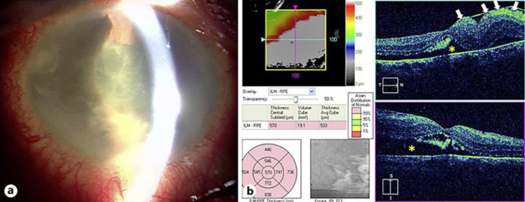
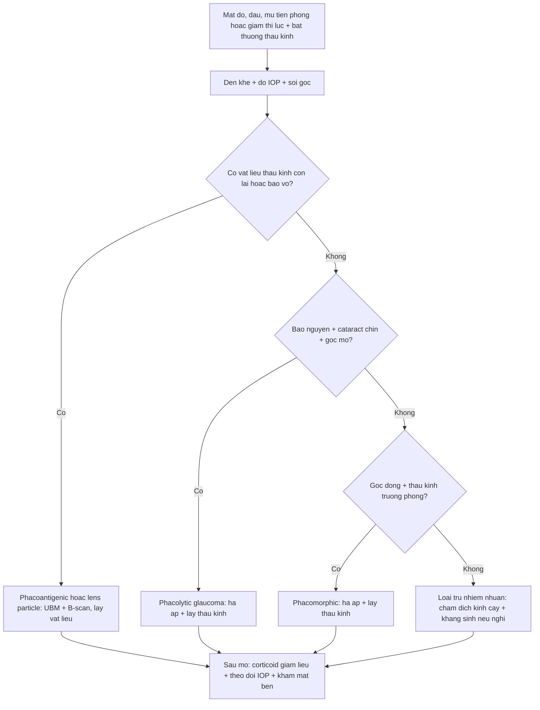
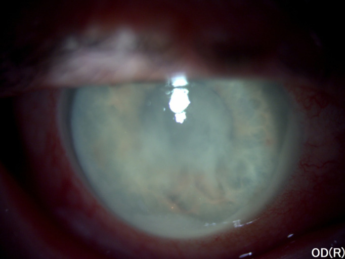
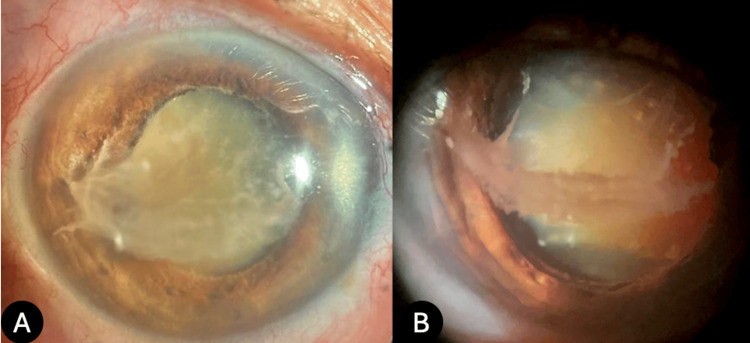

# 1443 — Viêm màng bồ đào do thấu kính: phacoantigenic (bao vỡ) vs phacolytic (bao nguyên) — phân biệt với viêm nội nhãn và viêm giao cảm / Lens-induced uveitis

**Tags:** `pattern:viem-mang-bo-dao` `pattern:u-hat` `pattern:mu-tien-phong` `pattern:bong-vong-mac-co-keo` `pattern:tang-nhan-ap` `pattern:sau-mo` `pattern:sau-chan-thuong` `vung:mat` `vung:tien-phong` `vung:the-thuy-tinh` `vung:dich-kinh` `protocol:den-khe` `protocol:UBM` `protocol:B-scan` `protocol:AS-OCT` `protocol:PPV`
**Mức chắc chắn (certainty):** tổng hợp y văn (literature synthesis) — đọc toàn văn một bài tổng quan có số liệu dịch tễ/chẩn đoán/điều trị (PMC7223998), ba ca nguyên văn có ảnh (PMC8697789, PMC7506203, PMC12457044). Tỷ lệ **3–23% kết hợp viêm màng bồ đào giao cảm** lấy từ tổng quan; phần **chọn đường mổ theo tình trạng bao** là **suy luận (inference)** từ cơ học mô, đã ghi rõ.

> **Vì sao bài này quan trọng:** đây là **một trong những chẩn đoán dễ bỏ sót nhất** trong nhãn khoa viêm — chỉ **6/140 ca** được chẩn đoán đúng trên lâm sàng trong một tổng quan (PMC7223998). Bệnh nhân đến với **mắt đỏ, đau, mủ tiền phòng** sau mổ hoặc với **đục thể thủy tinh già**; nếu gọi là **viêm nội nhãn** thì chọc dịch kính + kháng sinh, còn nếu gọi đúng thì **phải lấy vật liệu thấu kính**. Bỏ sót dẫn tới **dính mống mắt, glôcôm, bong võng mạc co kéo, và 3–23% kết hợp viêm màng bồ đào giao cảm** — một biến chứng **mù hai mắt**.

## 1. Tổng quan bệnh học – cơ chế hình ảnh – vì sao mủ tiền phòng lại vô khuẩn

### 1.1. Thấu kính là mô “ẩn miễn dịch” — và protein của nó vẫn là tự kháng nguyên

- **Bình thường:** thấu kính **không có mạch máu, không thần kinh**, tách khỏi tuần hoàn từ thời kỳ bào thai; protein crystallin nằm sau **bao thể thủy tinh (lens capsule)** — một hàng rào vật lý + miễn dịch.
- **Khi bao vỡ (chấn thương, mổ, rách bao tự phát):** crystallin tiếp xúc hệ miễn dịch → **mất dung thứ tế bào T (T-cell tolerance)** → phản ứng **u hạt (granulomatous)** quanh vật liệu thấu kính, tạo **u hạt dạng đới (zonal granuloma)** với **ba lớp**: trung tâm là vật liệu thấu kính, giữa là tế bào khổng lồ/đại thực bào, ngoài là lympho–xơ. Đây là **phacoantigenic uveitis** (tên cũ “phacoanaphylactic endophthalmitis” — **không phải** phản ứng IgE, nên tên cũ bị bỏ).
- **Khi bao còn nguyên nhưng thấm (cataract chín/già):** protein phân tử lượng cao **rò qua bao còn nguyên vẹn** vào tiền phòng → đại thực bào nuốt protein, **bít bè củng mạc (trabecular meshwork)** → **glôcôm góc mở** gọi là **phacolytic glaucoma**. Dịch tiền phòng có **đại thực bào to, tròn** — chính là “tế bào” gây **giả mủ (pseudohypopyon)**.
- **Vì sao mủ vô khuẩn:** “mủ” ở đây là **protein thấu kính + đại thực bào + fibrin**, không có vi khuẩn; vì vậy **cấy âm tính** và **kháng sinh không cải thiện** — nhưng **steroid giảm viêm tạm** trong khi **vật liệu thấu kính vẫn còn**.
- **Vì sao IOP có thể bình thường rồi tăng vọt:** trong ca minh họa của tổng quan, IOP **9 mmHg** lúc đầu (viêm làm giảm tiết thủy dịch) rồi **42 mmHg** sau 2 ngày khi **bít bè + viêm tăng**. **Một lần đo IOP bình thường không loại trừ glôcôm do thấu kính** — đây là điểm chốt của bài.

### 1.2. Ngưỡng định lượng đã có (và chỗ còn trống)

| Tình huống | Con số | Ý nghĩa thực hành | Nguồn |
|---|---|---|---|
| Chẩn đoán đúng trên lâm sàng | **6/140 ca** | Đây là bệnh **dễ bỏ sót nhất** trong viêm màng bồ đào | PMC7223998 |
| Glôcôm do thấu kính ở người đục thể thủy tinh tuổi già | **22%** khi đến cơ sở chuyên khoa tuyến tỉnh (Ấn Độ nông thôn) | Đục thể thủy tinh **để lâu** là yếu tố nguy cơ chính | PMC7223998 (dẫn Kothari) |
| Kết hợp **viêm màng bồ đào giao cảm (SO)** | **3–23%** ca LIU | **Liên quan trực tiếp tới chỉ định cắt bỏ nhãn cầu** — phải khám mắt bên | PMC7223998 |
| IOP trong glôcôm do thấu kính | **bình thường đến 90 mmHg** | Không dùng một ngưỡng IOP để loại trừ | PMC7223998 |
| Mắt bỏ vì glôcôm do thấu kính được chẩn đoán đúng | **21/138 mắt** | **117/138 ca còn lại không được chẩn đoán đúng** | PMC7223998 (dẫn Flocks) |
| Phẫu thuật **MSICS** cho LIU | **78,8% đạt BCVA ≥ 20/40 ở ngày 40** | Lấy vật liệu thấu kính là điều trị **hiệu quả**, không cần bỏ mắt | PMC7223998 (dẫn Venkatesh) |
| Thời điểm khởi phát phacoantigenic | **vài ngày–vài tuần** sau vỡ bao; có ca khởi phát **40 năm** sau mổ đục thể thủy tinh bẩm sinh (sau một mũi tiêm nội nhãn) | Tiền sử **rất xa** vẫn có giá trị | PMC7383197 |

- **Chỗ còn trống:** **không có tỷ lệ mắc chuẩn theo dân số** cho LIU (tổng quan nói rõ là thiếu dữ liệu); các con số trên là **tỷ lệ trong nhóm đến khám**, không phải tỷ lệ quần thể.

### 1.3. Vì sao hình ảnh lại quyết định ở đây

- **Không nhìn thấy thấu kính sau đục độ III–IV:** khi đáy mắt và tiền phòng bị che, **B-scan 10–20 MHz** là công cụ duy nhất trả lời: **vật liệu thấu kính nằm ở đâu, có bong võng mạc co kéo không, có khối sau không**.
- **UBM (ultrasound biomicroscopy, 35–50 MHz)** thấy **khiếm khuyết bao trước/sau, vị trí nhân lạc, mảnh vỏ còn lại** — chính là bằng chứng “bao vỡ” để chọn **phacoantigenic**.
- **AS-OCT** thấy **màng fibrin trên nội mô, độ sâu tiền phòng, dính mống mắt**; **OCT** phát hiện **bao thấu kính và túi dịch dưới bao** trong cataract thể Morgagni (tổng quan nêu OCT dùng để đánh giá tính toàn vẹn bao và dịch dưới bao).
- **Nguyên tắc:** hình ảnh không “chẩn đoán” LIU — nó **loại trừ** những thứ chết người (u, bong võng mạc, viêm nội nhãn) và **xác định vật liệu còn sót**.

## 2. Mẫu hình + chẩn đoán phân biệt theo tình trạng bao và thời điểm (Gamut)

### 2.1. Gamut theo tình trạng bao thể thủy tinh

- **Bao VỠ → phacoantigenic (phacogenic) uveitis:** viêm **u hạt**, thường **một mắt**, khởi phát **vài ngày–vài tuần** sau chấn thương/mổ; có thể **mủ tiền phòng vô khuẩn**, **dính mống mắt**, **màng fibrin**; tiến triển **mạn** nếu không lấy vật liệu.
- **Bao NGUYÊN + cataract già → phacolytic glaucoma:** bệnh nhân lớn tuổi, **giảm thị lực lâu**, đau đỏ **cấp**; **giả mủ**, **tế bào + flare mạnh**, **góc mở**, **cataract chín/Morgagni**, có thể **tinh thể cholesterol** trong tiền phòng; IOP **bình thường → 90 mmHg**.
- **Bao vỡ + mảnh nhân/vỏ rơi vào dịch kính → lens particle glaucoma/uveitis:** sau **phaco biến chứng**, chấn thương; viêm **tái phát**, có thể **bong co kéo/PVR**; đây là thể **hay bị gọi là “viêm nội nhãn muộn vô khuẩn”**.
- **Thấu kính trương phồng → phacomorphic glaucoma:** cataract **intumescent**, tiền phòng **nông**, **góc đóng**, IOP rất cao; **không mủ**; xử trí khác (hạ áp + lấy thấu kính).

### 2.2. Gamut theo thời điểm

- **0–3 ngày sau mổ/chấn thương:** nghĩ **viêm nội nhãn cấp/TASS** trước; LIU **hiếm** ở mốc này.
- **1 tuần–2 tháng:** **phacoantigenic** kinh điển; **viêm nội nhãn muộn** (nấm, P. acnes) vẫn phải loại trừ.
- **2 tháng–nhiều năm:** **mảnh nhân sót** trong dịch kính, **phacoantigenic mạn**, **phacolytic** ở cataract già; có ca **40 năm** sau mổ bẩm sinh.
- **Bất kỳ lúc nào:** **phacolytic** ở người già **không có tiền sử mổ** — chỉ có **đục thể thủy tinh lâu năm**.

### 2.3. Câu hỏi số 1: “vật liệu thấu kính còn trong mắt không?”

- **Còn:** LIU là chẩn đoán **hàng đầu**; điều trị **phải** bao gồm **lấy vật liệu**.
- **Không còn, bao nguyên, tiền phòng sạch:** nghĩ **nguyên nhân khác** (HLA-B27, herpetic, sarcoid, lymphoma, SO).
- **Không chắc:** **UBM/AS-OCT + B-scan**; nếu vẫn không rõ → **chọc tiền phòng/dịch kính** tế bào học (tổng quan nêu cytology hữu ích trong viêm tiền phòng không rõ nguyên nhân).

## 3. Bảng so sánh phân biệt (ma trận đối chiếu)

| Thực thể (entity) | Hình ảnh/lâm sàng điển hình | Chốt vào (rule-in) | Chốt loại (rule-out) | Gợi ý xác nhận |
|---|---|---|---|---|
| **Phacoantigenic uveitis** | Một mắt, **mủ tiền phòng vô khuẩn**, **màng fibrin**, dính mống mắt; tiền sử **vỡ bao/mổ/chấn thương** | **Vật liệu thấu kính/vỏ/nhân còn lại trên UBM/đèn khe** + viêm u hạt quanh nó; cấy âm tính | **Không còn vật liệu thấu kính**, không tiền sử vỡ bao | UBM/AS-OCT; đèn khe sau giãn đồng tử; tế bào học tiền phòng |
| **Phacolytic glaucoma** | Người già, **cataract chín/Morgagni**, **giả mủ**, góc **mở**, IOP **bình thường–90 mmHg** | **Bao nguyên + protein/đại thực bào trong tiền phòng + góc mở**; đau đỏ cấp trên nền mờ mắt lâu | **Bao vỡ, có mảnh nhân**, góc đóng do trương phồng | Đèn khe + soi góc; B-scan; đo IOP nhiều lần |
| **Lens particle glaucoma/uveitis** | Sau **phaco biến chứng**/chấn thương; viêm tái phát; có thể **bong co kéo** | **Mảnh nhân/vỏ thấy ở tiền phòng/dịch kính**, viêm quanh mảnh; OCT/B-scan có **màng co kéo** | **Không mảnh sót** trên UBM/B-scan | UBM, B-scan, OCT; đèn khe |
| **Phacomorphic glaucoma** | Cataract **trương phồng**, tiền phòng **nông**, **góc đóng**, IOP rất cao, đau | **Tiền phòng nông + góc đóng + thấu kính dày**; **không mủ** | **Góc mở**, có mủ/tế bào → phacolytic/LIU | Soi góc mắt bên; AS-OCT; đo sinh trắc |
| **Viêm nội nhãn cấp sau mổ** | **Đau tăng, thị lực giảm nhanh**, mủ tiền phòng, **viêm dịch kính**, khởi phát **3–7 ngày** | **Viêm dịch kính + cấy dương**; đáp ứng kém với steroid đơn thuần | **Dịch kính trong, không đau nhiều, cấy âm** | Chọc dịch kính cấy + nhuộm Gram; siêu âm B-scan |
| **TASS (toxic anterior segment syndrome)** | Khởi phát **12–48 giờ**, **phù giác mạc limbus-to-limbus**, tiền phòng viêm, **dịch kính trong**, hàng loạt ca cùng lô dụng cụ | **Khởi phát rất sớm + phù giác mạc lan tỏa + dịch kính trong**; cải thiện với steroid | **Viêm dịch kính, mủ đặc, cấy dương** → nội nhãn | Đèn khe; B-scan; dịch tễ phòng mổ |
| **Viêm màng bồ đào giao cảm (SO)** | Viêm **hai mắt** sau chấn thương/mổ xuyên thấu; **mắt kia cũng viêm**, SRD, DALM | **Mắt đối bên có viêm** (tế bào tiền phòng, SRD, DALM) | **Mắt đối bên hoàn toàn yên** → không phải SO | Khám mắt bên mỗi lần; OCT/FA; hỏi tiền sử chấn thương |
| **U hắc mạc/nội nhãn che giấu sau đục thể thủy tinh** | Mờ mắt, đau nhẹ, **không thấy đáy mắt**; có thể kèm bong thanh dịch | **B-scan: khối vòm đặc**, hồi âm trung bình–cao; A-scan tương ứng | **B-scan bình thường, chỉ đục thấu kính** | **B-scan bắt buộc** trước khi kết luận LIU đơn thuần |

*(a) Đèn khe: **viêm tiền phòng nặng, mủ tiền phòng** ở mắt phải; (b) OCT: **bong võng mạc co kéo** (dấu sao vàng) do **mảnh nhân thấu kính bị màng tăng sinh bao bọc** trong dịch kính — ca nam **60 tuổi**, 7 tháng sau một ca phaco biến chứng. Đây là lý do **không được dừng ở “viêm tiền phòng”**: phải tìm **vật liệu thấu kính** và **bong co kéo**. Nguồn: *Case Rep Ophthalmol* 2020 (PMC7506203) Fig. 1, **CC BY-NC 4.0 — nguyên bản**.*

## 4. Protocol chẩn đoán – điều trị – theo dõi

### 4.1. Khám và chụp tối thiểu

- **Đèn khe trước và sau giãn đồng tử:** tìm **mảnh vỏ/nhân**, **màng fibrin**, **dính mống mắt**, **giả mủ**; ghi **tế bào/flare**.
- **Đo IOP + soi góc (gonioscopy):** phân biệt **góc mở** (phacolytic) với **góc đóng** (phacomorphic) và **dính góc** (viêm mạn).
- **B-scan 10–20 MHz:** **bắt buộc** khi không thấy đáy mắt; tìm **mảnh nhân trong dịch kính, bong co kéo, khối u**.
- **UBM** khi nghi **vỡ bao/mảnh vỏ khuất sau mống mắt**; **AS-OCT** khi cần đánh giá **màng fibrin/độ sâu tiền phòng**.
- **Xét nghiệm viêm:** **chọc tiền phòng/dịch kính** (cấy, nhuộm Gram, tế bào học) khi **không chắc** hoặc **không đáp ứng steroid 48–72 giờ**; tế bào học giúp thấy **đại thực bào nuốt protein thấu kính**.

### 4.2. Điều trị — nguyên tắc “lấy vật liệu gây bệnh”

1. **Kiểm soát viêm và IOP trước mổ:** **corticoid tại chỗ** (prednisolone acetate 1% mỗi 1–2 giờ khi nặng), **atropine 1%** giãn đồng tử; **hạ áp**: ức chế carbonic anhydrase, chẹn beta, **mannitol/osmotic** khi IOP rất cao.
2. **Lấy vật liệu thấu kính:** **phaco/ECCE/MSICS** nếu còn trong bao; **rửa tiền phòng** khi mảnh nhỏ; **PPV** khi mảnh nhân/vỏ trong dịch kính hoặc có **PVR/bong co kéo**.
   - **MSICS** cho LIU: **78,8% đạt ≥ 20/40 ngày 40**, ít loạn thị và rẻ hơn phaco — lựa chọn tốt khi **bao mỏng, dây chằng yếu** (PMC7223998).
   - **Không cắt bỏ nhãn cầu** chỉ vì LIU: tổng quan nhấn mạnh **lấy thấu kính tốt hơn bỏ mắt**; 117/138 mắt bỏ vì glôcôm do thấu kính **lẽ ra có thể cứu**.
3. **Sau mổ:** tiếp **corticoid giảm liều**, **theo dõi IOP** (nguy cơ tăng áp do corticoid — bài 1411), **khám mắt bên** nếu có chấn thương/mổ xuyên thấu (nguy cơ SO).
4. **Mảnh nhân nhỏ trong dịch kính, viêm nhẹ và đang giảm:** có thể **theo dõi bằng corticoid** (tổng quan); **không theo dõi** nếu có **viêm nặng, PVR, bong võng mạc**.

### 4.3. Theo dõi và ngưỡng

- **IOP:** đo **mỗi lần khám**, đặc biệt **ngày 1–3–7** sau mổ và **tuần 2–6** (giai đoạn viêm + corticoid); **IOP ≥ 25 mmHg hoặc tăng ≥ 10 mmHg** so nền → điều trị, **không chờ**.
- **Viêm:** tế bào/flare phải **giảm rõ trong 1–2 tuần** sau khi lấy vật liệu; **không giảm** → tìm **mảnh sót, nhiễm trùng, SO**.
- **Đáy mắt:** **OCT + B-scan** ở tháng 1 và 3 nếu có mảnh nhân trong dịch kính hoặc mổ phức tạp; **B-scan** ngay khi không thấy đáy mắt.
- **Mắt bên:** khám **mỗi lần** trong 3 tháng đầu nếu có chấn thương/mổ xuyên thấu (SO có thể khởi phát **80% < 3 tháng, 90% < 1 năm** — bài 1438).

## 5. Biến thể bình thường và cạm bẫy

- **Cạm bẫy 1 — gọi mủ vô khuẩn là “viêm nội nhãn”:** chọc dịch kính + kháng sinh trong khi **vật liệu thấu kính vẫn còn** → viêm tái phát, dính mống mắt. **Cấy âm + đáp ứng steroid tạm** là gợi ý LIU, nhưng **chẩn đoán nằm ở việc tìm vật liệu**.
- **Cạm bẫy 2 — tin một lần IOP bình thường:** ca trong tổng quan có **IOP 9 mmHg** rồi **42 mmHg** sau 2 ngày. Đo lại, và **đo cả hai mắt**.
- **Cạm bẫy 3 — bỏ sót SO:** **3–23%** LIU kết hợp SO; **mắt bên “hơi viêm”** là dấu hiệu chết người. Không bao giờ **cắt bỏ nhãn cầu** khi chưa khám kỹ mắt bên và chưa loại trừ SO.
- **Cạm bẫy 4 — không B-scan vì “chỉ là cataract”:** đục thể thủy tinh dày có thể **che u hắc mạc/bong võng mạc**; ca bong lỗ rách + melanoma ở bài 1441 là ví dụ. **B-scan trước khi kết luận**.
- **Cạm bẫy 5 — phaco trên bao mỏng, dây chằng yếu:** bao thể thủy tinh trong LIU **mỏng, giòn**, dễ **rách bao, tuột dây chằng, mất nhân vào dịch kính**; cân nhắc **MSICS/ECCE** hoặc **PPV** thay vì phaco “cố định”.
- **Cạm bẫy 6 — corticoid kéo dài không kiểm soát:** giảm viêm nhưng gây **tăng nhãn áp/glôcôm do corticoid** (bài 1411) và **che dấu nhiễm trùng**; luôn có **ngưỡng giảm liều** và **lịch đo IOP**.
- **Cạm bẫy 7 — “mảnh nhân nhỏ thì kệ”:** mảnh nhỏ **đang giảm viêm** có thể theo dõi; nhưng **mảnh lớn, viêm nặng, PVR** phải lấy — nếu không sẽ **bong co kéo** như ca PMC7506203.

## 6. Tự lượng giá — Blind Quiz (mở trên Pages để tự đoán trước)

**Ca 1 — Nam 83 tuổi, nông dân, đau nhức mắt phải vài ngày; đã biết cataract chín mắt phải 3 tháng trước. Thị lực sáng tối, IOP 50 mmHg, giác mạc phù, giả mủ, thấy hạt trắng lơ lửng trong tiền phòng và vùng đồng tử.**

- Câu hỏi: Chẩn đoán là viêm nội nhãn hay bệnh do thấu kính? Cơ chế nào giải thích mủ vô khuẩn? Xử trí cấp?

<b>Bấm để hiện đáp án</b>

- **Phacolytic glaucoma (glôcôm do thấu kính tan):** **cataract chín + IOP 50 mmHg + giả mủ + hạt trắng**; protein phân tử lượng cao rò qua **bao còn nguyên**, đại thực bào bít bè → **góc mở**, viêm vô khuẩn.
- **Xử trí:** hạ áp (CAI, chẹn beta, osmotic), **corticoid + atropine**, rồi **lấy thấu kính** (phaco/ECCE/MSICS) — **không chọc dịch kính kháng sinh** nếu không có bằng chứng nhiễm trùng.
- **Bẫy:** IOP có thể **bình thường** lúc đầu (viêm giảm tiết) rồi tăng vọt; đo lại nhiều lần.
- Nguồn ảnh: *Rom J Ophthalmol* 2021 (PMC8697789) Fig. 3, **CC BY 4.0 — nguyên bản**.

**Ca 2 — Nam 60 tuổi, 7 tháng sau một ca phaco biến chứng (phải cắt dịch kính trước và khâu IOL xuyên củng mạc). Viêm nặng, đục dịch kính, đã dùng steroid tại chỗ + uống nhưng vẫn tiến triển; nay có bong võng mạc co kéo.**

- Câu hỏi: Vì sao viêm không dứt dù đã dùng steroid? Cần tìm gì trên mổ? Kết cục?

<b>Bấm để hiện đáp án</b>

- **Vật liệu thấu kính còn trong dịch kính:** PPV thấy **mảnh nhân ~60% kích thước nhân bình thường**, **bị màng tăng sinh bao bọc** — chính là ổ kháng nguyên nuôi viêm và gây **PVR/bong co kéo**.
- **Xử trí:** **PPV + lấy mảnh nhân** (lấy qua vạt củng mạc–giác mạc phía trên), rồi **corticoid tại chỗ + toàn thân**; võng mạc **gắn sau 1 năm**.
- **Bài học:** viêm **tái phát dai dẳng sau mổ phaco biến chứng** = nghĩ **LIU do mảnh nhân**, không phải “viêm vô căn”.
- Nguồn ảnh: *Case Rep Ophthalmol* 2020 (PMC7506203) Fig. 1, **CC BY-NC 4.0 — nguyên bản**.

**Ca 3 — Nam 76 tuổi, mắt phải mờ + đau 3 tuần; cataract hai mắt 9 năm, mắt trái đã mổ. Không chấn thương. IOP 15 mmHg, giác mạc trong, không KPs, nhưng có **màng fibrin trắng từ bờ mống mắt tới nội mô**, tế bào + flare; nhân thấu kính **vàng rơm, đặc, kết tinh**, **không còn vỏ hóa lỏng**. B-scan: đục thấu kính dày, **echo điểm lấm tấm di động ở dịch kính trước**, võng mạc gắn.**

- Câu hỏi: Đây có phải viêm nội nhãn? Vì sao đây vẫn là LIU dù bao trước còn nguyên? Cần làm gì trước khi mổ?

<b>Bấm để hiện đáp án</b>

- **Không phải viêm nội nhãn:** không KPs, không mủ đặc, **echo dịch kính mảnh, võng mạc gắn**; hình ảnh là **phản ứng fibrin + vật liệu thấu kính rò** — thể **LIU không điển hình** (tên bài: “retrolental opacity”).
- **Vì sao vẫn là LIU:** **nhân đặc, kết tinh, mất vỏ lỏng** = protein cô đặc rò qua bao mỏng; **màng fibrin** là phản ứng với protein thấu kính.
- **Trước mổ:** **B-scan/UBM xác nhận không có khối sau, không bong**; **corticoid tại chỗ** làm dịu viêm; rồi **lấy thấu kính** (nhân đặc, bao mỏng → cân nhắc MSICS/ECCE).
- Nguồn ảnh: *Cureus* 2025 (PMC12457044) Fig. 1, **CC BY 4.0 — nguyên bản**.

## Bài liên quan chéo
- [1438 – Viêm màng bồ đào giao cảm (SO)](../1438-viem-mang-bo-dao-giao-cam/lesson.md) (3–23% kết hợp LIU; mắt bên)
- [1436 – Bệnh Vogt–Koyanagi–Harada](../1436-benh-vogt-koyanagi-harada/lesson.md) (bong thanh dịch hai bên, hắc mạc dày)
- [1425 – Viêm nội nhãn sau tiêm nội nhãn](../1425-viem-noi-nhan-sau-tiem-noi-nhan/lesson.md) (phân biệt viêm nhiễm vs vô khuẩn)
- [495 – Nấm ngoại sinh sau mổ/tiêm vs TASS](../495-viem-noi-nhan-nam-ngoai-sinh-vs-TASS/lesson.md) (mốc 12–48 giờ, phù limbus-to-limbus)
- [1411 – Tăng nhãn áp do corticoid nội nhãn](../1411-tang-nhan-ap-do-corticoid-noi-nhan/lesson.md) (theo dõi IOP khi dùng corticoid kéo dài)
- [1402 – Bong võng mạc sau viêm nội nhãn](../1402-bong-vong-mac-sau-viem-noi-nhan/lesson.md) (bong do viêm: lỗ hoại tử vs màng xơ)
- [445 – Bong võng mạc](../445-bong-vong-mac/lesson.md) (PVR và bong co kéo)
- [411 – Siêu âm nhãn cầu](../411-sieu-am-nhan-cau/lesson.md) (B-scan/UBM: kỹ thuật và cạm bẫy)

## Ảnh
- Tên file: `1443_viem-mbd-thau-kinh_<Modality>_<PMCID>.jpg`; nguồn + giấy phép từng ảnh ở `images/CREDITS.md`.
- Cả ba ảnh dùng **nguyên bản**, không crop/ghép/đổi màu (có ảnh CC BY-NC).
- Ảnh không tải được (paywall/cấm tải) → dẫn link trong `sources.md`, không dùng ảnh license mơ hồ.

> Không dùng để chẩn đoán độc lập khi chưa có người hướng dẫn.
