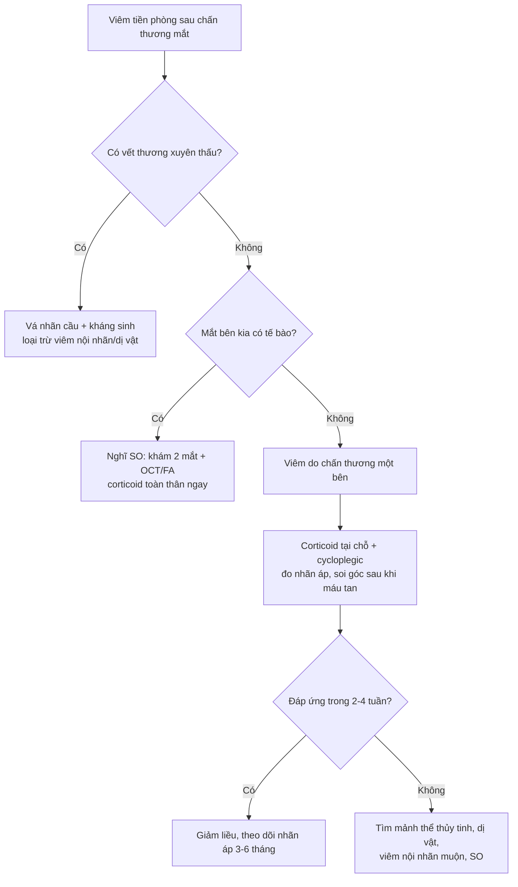
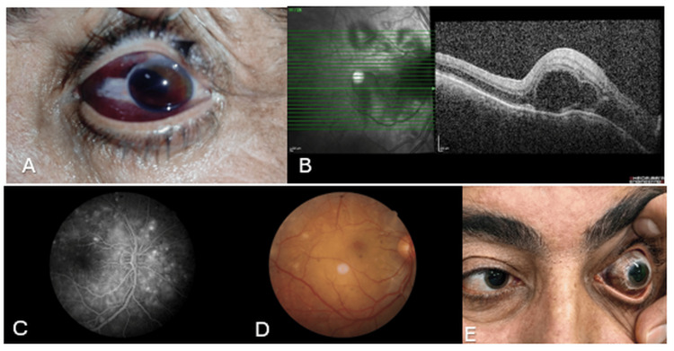
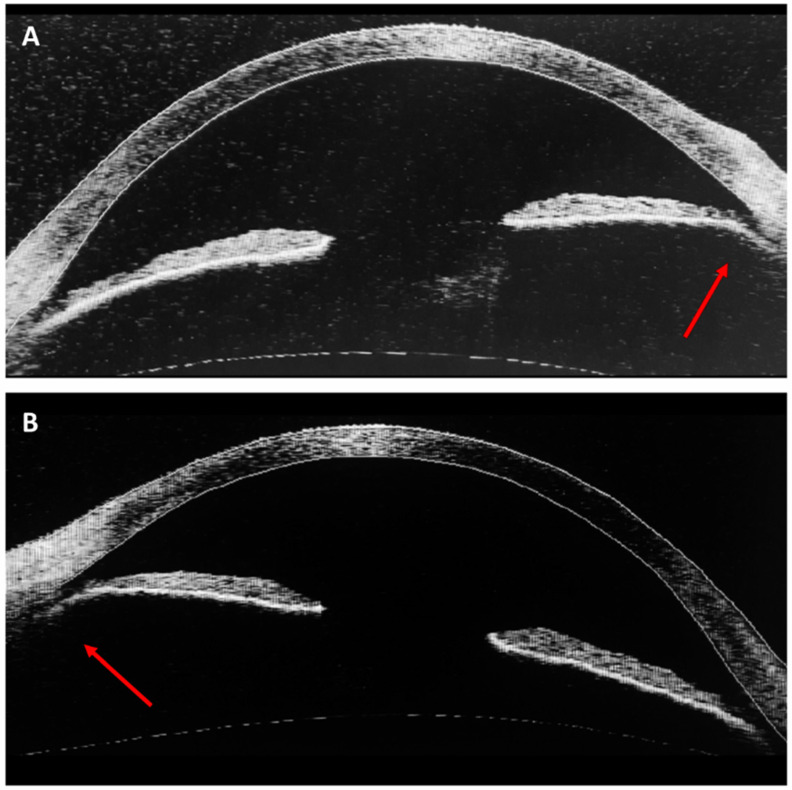
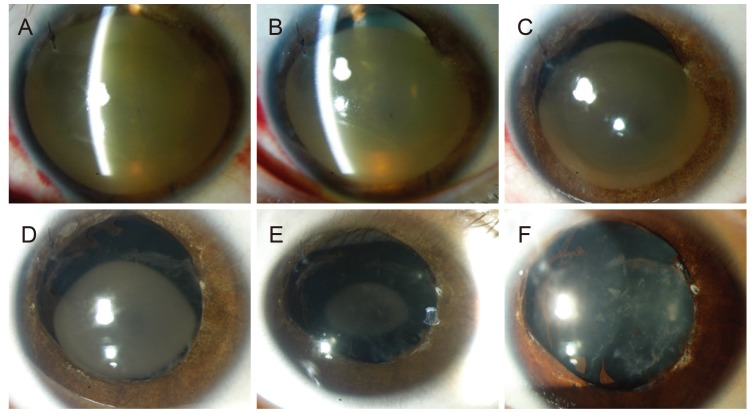

# 1444 — Viêm màng bồ đào sau chấn thương mắt cấp: lành tính một bên hay khởi đầu của viêm giao cảm? / Traumatic anterior uveitis

**Tags:** `pattern:viem-mang-bo-dao` `pattern:viem-tien-phong` `pattern:hyphema` `pattern:sau-chan-thuong` `vung:mat` `vung:tien-phong` `protocol:den-khe` `protocol:gonioscopy` `protocol:AS-OCT`
**Mức chắc chắn (certainty):** tổng hợp y văn (literature synthesis) — một đoàn hệ trẻ chấn thương mắt có số liệu biến chứng (PMC11755633), một tổng quan quản lý máu tiền phòng (PMC8291460), một đoàn hệ máu tiền phòng trẻ 5–12 năm (PMC6528766), một tổng quan + ca viêm giao cảm khởi phát sớm (PMC9359263, PMC12520157), và một ca góc lõm hai bên có AS-OCT (PMC10532958). **Không có thử nghiệm ngẫu nhiên** cho liều/thời gian corticoid tại chỗ trong viêm do chấn thương — phần liều là **phác đồ thực hành**, đã ghi rõ.

> **Vì sao bài này quan trọng:** đây là **biến chứng thường gặp nhất sau chấn thương kín** — **45,5%** trẻ bị chấn thương kín có **viêm màng bồ đào trước (traumatic iritis)**, cao hơn cả máu tiền phòng (30,3%) và đục thể thủy tinh (33,3%) (PMC11755633). Đa số **lành tính, một bên, tự giới hạn** — nhưng cùng một bệnh cảnh "mắt đỏ + tế bào tiền phòng sau chấn thương" lại có thể là **viêm màng bồ đào giao cảm (sympathetic ophthalmia, SO)** — bệnh **mù hai mắt** cần corticoid toàn thân ngay (bài 1438). Bài này trả lời đúng một câu hỏi: **khi nào được theo dõi, khi nào phải coi là SO/viêm nội nhãn và điều trị khác**.

## 1. Tổng quan bệnh học – cơ chế hình ảnh – vì sao viêm mà không có vi khuẩn

### 1.1. Chấn thương kín làm vỡ hàng rào máu–thủy dịch

- **Cơ chế:** vật tù đập vào mắt → nhãn cầu bị **nén theo trục trước–sau** rồi **giãn ra ở xích đạo** → lực cắt tại **chỗ bám của mống mắt/thể mi** và **vùng bè củng mạc**. Hệ quả: **rách cơ vòng mống mắt (iris sphincter tear)**, **đứt chân mống mắt (iridodialysis)**, **tách thể mi (cyclodialysis)**, và **vỡ hàng rào máu–thủy dịch (blood–aqueous barrier)**.
- **Vì sao có tế bào và flare:** hàng rào vỡ → **protein huyết tương và tế bào viêm** tràn vào tiền phòng; **prostaglandin/leukotriene** từ mống mắt–thể mi bị thương làm **giãn mạch và tăng tính thấm** → **flare (protein)** + **cells (bạch cầu)**. Đây là **viêm vô khuẩn**: **cấy âm**, **không có mủ thật**, **không cần kháng sinh**.
- **Vì sao tự giới hạn:** khác SO, kháng nguyên võng mạc–hắc mạc **không thoát ra mô lympho kết mạc** (bao kết mạc còn kín) → **không có mẫn cảm tế bào T**; khi hàng rào đóng lại, viêm **lắng trong vài tuần**.
- **Vì sao vẫn phải lo SO:** nếu chấn thương **xuyên thấu** hoặc có **sa u hắc mạc**, kháng nguyên thoát ra → SO; và SO có thể xuất hiện **sớm nhất 5 ngày** sau chấn thương — **"cửa sổ 2 tuần" không bảo vệ được** (bài 1438).

### 1.2. Ngưỡng định lượng đã có (và chỗ còn trống)

| Thông số | Con số | Ý nghĩa thực hành | Nguồn |
|---|---|---|---|
| Viêm màng bồ đào trước sau chấn thương **kín** | **15/33 (45,5%)** | Biến chứng **thường gặp nhất** của chấn thương kín ở trẻ | PMC11755633 |
| Máu tiền phòng (hyphema) sau chấn thương kín | **10/33 (30,3%)** | Thường đi kèm viêm; che lấp tổn thương phía sau | PMC11755633 |
| Đục thể thủy tinh sau chấn thương kín | **11/33 (33,3%)** | Đục do chấn thương có thể xuất hiện **muộn** | PMC11755633 |
| Chấn thương **xuyên thấu**: đục thể thủy tinh / máu tiền phòng / bong võng mạc | **82,8% / 24,1% / 17,2%** (24/29, 7/29, 5/29) | Ưu tiên loại trừ **viêm nội nhãn** và **dị vật nội nhãn** | PMC11755633 |
| Tái chảy máu tiền phòng (rebleed) | **tới 38%**, thường trong **tuần đầu** | Là yếu tố làm **tăng biến chứng** (glôcôm, thấm máu giác mạc) | PMC8291460 |
| Thời gian tan máu tiền phòng | **~1 tuần** ở đa số | Không cần can thiệp nếu không biến chứng | PMC8291460 |
| Nhãn áp bình thường | **8–22 mmHg** | Tăng nhãn áp sau chấn thương là **dấu hiệu cần xử trí**, không phải "đau do chấn thương" | PMC8291460 |
| Góc lõm (angle recession) ở trẻ có máu tiền phòng | **~50%** | Phải **soi góc** sau khi máu tan; nguy cơ glôcôm **nhiều năm sau** | PMC6528766 |
| Bất đối xứng nhãn áp sau **5–12 năm** | Liên quan **góc lõm** (p = 0,008) và **bất đối xứng độ sâu tiền phòng** (p = 0,012) | Theo dõi **nhãn áp dài hạn**, không chỉ 2 tuần | PMC6528766 |
| Thị lực cuối ≥ 20/40 ở trẻ sau máu tiền phòng | **81%** | Tiên lượng chung tốt nếu không tổn thương đoạn sau | PMC6528766 |
| SO sau chấn thương xuyên thấu | **0,12%** (gộp 8 nghiên cứu/7.620 ca) | Hiếm nhưng **không thể bỏ qua** | bài 1438 |
| SO sau mổ nội nhãn | **0,061%** (gộp 19 nghiên cứu) | Nguy cơ **tăng theo số lần mổ** | bài 1438 |
| Thời gian tiềm tàng SO | **5 ngày – 66 năm**; **80% < 3 tháng**, **90% < 1 năm** | Theo dõi **ít nhất 1 năm**, tốt nhất **2 năm** | PMC9359263 |

- **Chỗ còn trống:** **không có thử nghiệm ngẫu nhiên** xác định **thời gian corticoid tại chỗ** cho viêm do chấn thương; "2–4 tuần" là **phác đồ thực hành**, không phải kết quả thử nghiệm.

### 1.3. Vì sao hình ảnh học ở đây là "đèn khe + soi góc", không phải CT

- **Đèn khe** là "máy ảnh phân giải cao" của tiền phòng: đếm **tế bào**, đo **flare**, thấy **màng fibrin**, **dính mống mắt sau**, **rách cơ vòng**, **máu tiền phòng**.
- **Soi góc (gonioscopy)** là **bắt buộc** sau khi máu tan: phát hiện **góc lõm**, **đứt chân mống mắt**, **tách thể mi** — những tổn thương **không thấy trên đèn khe thường** và quyết định **glôcôm về sau**.
- **AS-OCT/UBM** đo **độ sâu tiền phòng**, xác định **góc lõm** khách quan, không phụ thuộc người soi; **B-scan** khi **phương tiện trong suốt bị che** (máu tiền phòng đặc, đục thể thủy tinh) để loại trừ **bong võng mạc/dị vật**.
- **CT hốc mắt lát ≤ 1 mm** chỉ khi nghi **dị vật nội nhãn/dị vật xuyên thấu**; **MRI chống chỉ định** khi nghi dị vật kim loại.

## 2. Mẫu hình + chẩn đoán phân biệt theo thời điểm và số mắt (Gamut)

### 2.1. Gamut theo thời điểm sau chấn thương

- **0–72 giờ:** **viêm do chấn thương** (tế bào + flare, đồng tử co nhỏ hoặc giãn), **máu tiền phòng**, **rách cơ vòng mống mắt**, **đứt chân mống mắt**, **tách thể mi** (nhãn áp **thấp**), **commotio retinae**, **rách võng mạc/ly giải võng mạc**.
- **3 ngày – 8 tuần:** viêm **kéo dài/bùng phát** → nghĩ **mảnh thể thủy tinh (lens particle)**, **viêm do thấu kính (phacoantigenic)**, **dị vật nội nhãn tồn lưu**, **viêm nội nhãn** (nếu có vết thương xuyên thấu), **SO khởi phát sớm**.
- **8 tuần – nhiều năm:** **SO**, **glôcôm do góc lõm**, **tách thể mi mạn (nhãn áp thấp)**, **bong võng mạc co kéo/PVR**, **đục thể thủy tinh do chấn thương**.

### 2.2. Gamut theo số mắt

- **Một bên:** viêm do chấn thương, viêm nội nhãn, viêm do thấu kính, dị vật, góc lõm — **chẩn đoán hàng đầu**.
- **Hai bên:** **SO** (nếu có tiền sử chấn thương/mổ ở một mắt), **VKH**, **nhiễm trùng hệ thống**, **thuốc** — **không được gọi là "viêm do chấn thương hai bên"**.
- **Câu hỏi chốt:** *"Mắt bên kia có tế bào không?"* — nếu **có**, đổi hoàn toàn hướng tiếp cận.

### 2.3. Gamut theo mức nhãn áp

- **Nhãn áp cao:** máu tiền phòng bít bè, **góc lõm sớm**, **dính mống mắt**, **corticoid** (đáp ứng steroid), **viêm**.
- **Nhãn áp thấp:** **tách thể mi (cyclodialysis)**, **vỡ nhãn cầu kín**, **bong hắc mạc**, **teo thể mi** — **không được dùng thuốc hạ nhãn áp** khi chưa loại trừ.

## 3. Bảng so sánh phân biệt (ma trận đối chiếu)

| Thực thể (entity) | Hình ảnh điển hình (đèn khe/AS-OCT) | Chốt vào (rule-in) | Chốt loại (rule-out) | Gợi ý xác nhận |
|---|---|---|---|---|
| **Viêm do chấn thương (bài này)** | Tế bào + flare **một bên**, **rách cơ vòng mống mắt** (đồng tử méo/giãn), máu tiền phòng nhẹ, **khởi phát trong 1–3 ngày**, không mủ thật | **Tiền sử chấn thương kín + một bên + tế bào/flare + đồng tử méo** | **Hai bên**, mủ đặc, **màng fibrin dày**, sốt → không phải viêm đơn thuần | Đèn khe, soi góc sau khi máu tan, theo dõi 1–2 tuần |
| **SO (bài 1438)** | **Viêm toàn màng bồ đào u hạt hai bên**, **mutton-fat KP**, **nốt Dalén–Fuchs**, bong thanh dịch; OCT: dịch dưới võng mạc | **Tiền sử chấn thương xuyên thấu/mổ ở một mắt + viêm hai bên + u hạt** | **Một bên**, không u hạt, không tiền sử can thiệp | Đèn khe hai mắt, OCT/FA; **không chờ** để điều trị |
| **Viêm nội nhãn** | Mủ tiền phòng **đặc**, **giả mủ**, viêm dịch kính, **đau tăng**, thị lực giảm nhanh; **sau xuyên thấu** | **Chấn thương xuyên thấu + mủ + viêm dịch kính + đau tăng** | **Không mủ**, không viêm dịch kính, không đau tăng | Cấy dịch tiền phòng/dịch kính, siêu âm B |
| **Viêm do thấu kính (bài 1443)** | **Mủ tiền phòng vô khuẩn**, **vật liệu thấu kính** trong tiền phòng/dịch kính; phacoantigenic (bao vỡ) hoặc phacolytic (bao nguyên) | **Thấy mảnh nhân/vỏ** trên UBM/AS-OCT; viêm **kéo dài/tái phát** sau chấn thương | Không có vật liệu thấu kính, bao nguyên, tiền phòng sạch | UBM, B-scan, tế bào học tiền phòng |
| **Glôcôm do góc lõm** | **Góc lõm ≥ 1 góc phần tư** trên soi góc; AS-OCT: **góc sâu bất thường**, **rễ mống mắt tách** | **Góc lõm + nhãn áp tăng/bất đối xứng sau nhiều năm** | Góc bình thường, không lõm | Soi góc 360°, AS-OCT/UBM, đo nhãn áp 2 mắt |
| **Tách thể mi (cyclodialysis)** | **Nhãn áp thấp**, tiền phòng nông, **góc hở bất thường**, có thể **bong hắc mạc** | **Nhãn áp thấp + góc hở + tiền phòng nông sau chấn thương** | Nhãn áp bình thường/cao, không hở góc | Soi góc, UBM, siêu âm B |
| **Đồng tử giãn do chấn thương** | Đồng tử **giãn một bên**, **mất phản xạ ánh sáng**, bờ **rách cơ vòng** | **Rách cơ vòng thấy được**, không liệt vận nhãn | **Sụp mi + lệch trục + liệt vận nhãn** → nghĩ **liệt dây III** | Đèn khe, đánh giá vận nhãn, chụp CT/MRI sọ nếu nghi thần kinh |

### 3.1. Ba dấu hiệu định vị trên đèn khe

- **Rách cơ vòng mống mắt:** bờ đồng tử **không đều**, hình **răng cưa**, đồng tử **giãn không đều** — dấu chứng của chấn thương kín.
- **Đứt chân mống mắt (iridodialysis):** một **vòng cung đen** ở ngoại vi mống mắt, đồng tử **hình chữ D**; có thể **máu tiền phòng**.
- **Góc lõm:** trên soi góc, **rễ mống mắt tách khỏi đường Schwalbe**, **rãnh lõm** giữa mống mắt và thể mi; **AS-OCT** cho thấy **góc sâu hơn hẳn** so với mắt bên.

## 4. Protocol khám – xử trí – theo dõi

### 4.1. Khám cấp (thứ tự không được đảo)

1. **Thị lực** từng mắt + **đồng tử** (kích thước, phản xạ, **RAPD**), **vận nhãn**.
2. **Đèn khe**: tế bào/flare (SUN 0,5+ đến 4+), **máu tiền phòng** (độ 0–IV), **màng fibrin**, **dính mống mắt sau**, **rách cơ vòng**, **đứt chân mống mắt**.
3. **Seidel** (thử rò thủy dịch) nếu nghi **vỡ nhãn cầu kín**; **nhãn áp** (8–22 mmHg là bình thường).
4. **Soi góc 360°** khi máu đã tan; ghi **số giờ góc lõm**.
5. **Soi đáy mắt giãn đồng tử**: commotio, **rách/ly giải võng mạc**, xuất huyết dịch kính, **dị vật**.
6. **B-scan** nếu không thấy đáy mắt; **CT hốc mắt ≤ 1 mm** nếu nghi dị vật/xuyên thấu; **không MRI** khi nghi dị vật kim loại.

### 4.2. Điều trị viêm do chấn thương (không có RCT — phác đồ thực hành)

| Thành phần | Liều/thời gian | Ghi chú |
|---|---|---|
| **Corticoid tại chỗ** | **Prednisolone acetate 1%**, khởi đầu **4–8 lần/ngày**, giảm dần theo tế bào/flare, **thường 2–4 tuần** | Ca minh họa dùng **prednisolone 1% + atropine 1% hai lần/ngày** (PMC8291460); **không ngừng đột ngột** |
| **Thuốc liệt điều tiết (cycloplegic)** | **Cyclopentolate 1%** hoặc **atropine 1%**, **2 lần/ngày** | Giảm co thắt thể mi, **phòng dính mống mắt sau**; thận trọng **góc hẹp** |
| **Hạ nhãn áp** | Theo nhãn áp; **tránh** khi nhãn áp thấp chưa loại trừ **tách thể mi** | Đo lại nhãn áp **24–48 giờ** |
| **Kháng sinh** | **Không** cho viêm vô khuẩn | Chỉ khi **xuyên thấu/nghi nhiễm** |
| **Theo dõi** | **24–48 giờ**, **1 tuần**, **2–4 tuần**, rồi **3–6 tháng** | **Soi góc lại** sau khi máu tan; **đo nhãn áp dài hạn** |

- **Máu tiền phòng:** đầu cao **> 30°**, **che mắt**, **hạn chế gắng sức**; **tầm soát bệnh hồng cầu hình liềm** ở trẻ/nhóm nguy cơ; **tái chảy máu tới 38%** trong tuần đầu (PMC8291460).
- **Chỉ định can thiệp:** máu tiền phòng **độ III–IV**, **nhãn áp cao không đáp ứng**, **thấm máu giác mạc**, **nghi tăng nhãn áp do hồng cầu**.

### 4.3. Điều trị SO (khi đã chuyển hướng — chi tiết ở bài 1438)

- **Prednisolone toàn thân 0,5–2 mg/kg/ngày**; thể nặng: **methylprednisolone 1 g/ngày × 3 ngày** (PMC9359263).
- **Không chờ** đủ tiêu chuẩn hình ảnh để bắt đầu; **không cắt bỏ nhãn cầu** với hy vọng "phòng" SO sau khi mắt kia đã viêm.

## 5. Biến thể bình thường và cạm bẫy

- **Đồng tử giãn do chấn thương ≠ liệt dây III:** rách cơ vòng cho **bờ răng cưa**, **không sụp mi**, **vận nhãn bình thường**; liệt III có **sụp mi + lệch trục + đồng tử giãn cố định** → cần **CT/MRI sọ**.
- **Máu tiền phòng độ 0 (microhyphema) dễ bỏ sót:** chỉ thấy **tế bào đỏ lơ lửng**, không có mức máu; **luôn đếm tế bào ở góc** trước khi kết luận "không có máu".
- **Tăng nhãn áp do corticoid:** nhãn áp tăng **sau 2–4 tuần** dùng corticoid, dễ bị quy cho "chấn thương"; **đo nhãn áp mỗi lần tái khám**.
- **Dị vật nội nhãn bị bỏ sót:** **gỗ, thủy tinh, nhựa** có thể **không cản quang** trên X-quang/CT; **nghi ngờ cao → siêu âm B/UBM**, không loại trừ bằng X-quang.
- **"Cửa sổ 2 tuần" là bẫy:** SO đã gặp **5 ngày** sau chấn thương; **theo dõi ít nhất 1 năm** (80% < 3 tháng, 90% < 1 năm).
- **Điều trị một mắt có thể che SO mắt kia:** corticoid tại chỗ làm **giảm tế bào ở mắt viêm** nhưng **không kiểm soát SO**; luôn **khám cả hai mắt** mỗi lần.
- **Trẻ em:** nguy cơ **nhược thị** nếu viêm/đục kéo dài; **theo dõi thị lực và khúc xạ** sau khi hết viêm.
- **Satisfaction of search:** thấy máu tiền phòng rồi dừng → bỏ sót **rách võng mạc/ly giải võng mạc** (5/29 ca chấn thương xuyên thấu có bong võng mạc — PMC11755633).

## 6. Tự lượng giá — Blind Quiz

**Ca 1 — Nam 45 tuổi, chấn thương tù mắt trái. Nhìn ảnh đèn khe trước, mô tả trước khi mở đáp án.**

- Gợi ý lâm sàng: thị lực mắt trái **cảm giác sáng**, nhãn áp **thấp**, tiền phòng **nông**, đồng tử **méo lệch trên–mũi**; mắt phải 20/20.
- Câu hỏi: (1) Dấu hiệu nào gợi ý **vỡ nhãn cầu**? (2) Vì sao phải khám **mắt phải** kỹ và theo dõi **≥ 1 năm**?

<b>Bấm để hiện đáp án (findings + chẩn đoán)</b>

- **Findings:** (A) mắt trái: **xuất huyết dưới kết mạc**, **tiền phòng nông**, **máu tiền phòng độ 1**, **đồng tử méo lệch trên–mũi** — phù hợp **vỡ nhãn cầu (globe rupture)**; (B) OCT mắt phải **ngày 18 sau mổ**: **nhiều khoang dịch dưới võng mạc và trong võng mạc**, **vách ngăn giữa các khoang**, **dãn đoạn ngoài tế bào cảm quang**, **hắc mạc dày** — dấu hiệu **viêm màng bồ đào giao cảm**; (C–D) FA/đáy mắt; (E) hai mắt.
- **Chẩn đoán:** **SO khởi phát sớm sau vỡ nhãn cầu** — **ngày 18** đã có **viêm toàn màng bồ đào hai bên**. Điều trị **corticoid toàn thân + ức chế miễn dịch** (cyclosporine, azathioprine); 3 năm sau thị lực mắt tổn thương **0,7**.
- **Vì sao khám mắt phải:** SO **luôn bắt đầu ở mắt "lành"**; phát hiện **tế bào/dịch dưới võng mạc** ở mắt phải là **chốt chuyển hướng** từ "viêm do chấn thương" sang **SO**.
- **Nguồn ảnh:** *Cureus* 2025 — PMC12520157, **CC BY 4.0**; chú thích gốc Fig. 1.

**Ca 2 — Nam 75 tuổi, chấn thương do túi khí (airbag) hai mắt 5 năm trước, nay nhãn áp 28 mmHg mắt phải. Ảnh AS-OCT hai mắt:**

- Gợi ý lâm sàng: **chấn thương kín hai mắt** do túi khí; mắt phải **glôcôm tiến triển**, mắt trái **tăng nhãn áp**; soi góc thấy **góc sâu bất thường ở góc dưới**.
- Câu hỏi: Dấu hiệu trên AS-OCT là gì? Vì sao **5 năm sau** mới tăng nhãn áp? Cần theo dõi gì ở mắt còn lại?

<b>Bấm để hiện đáp án (findings + chẩn đoán)</b>

- **Findings:** (A) mắt phải và (B) mắt trái — **góc lõm (angle recession)**: **rễ mống mắt tách khỏi thành**, **khoảng sâu bất thường** giữa mống mắt và thể mi (mũi tên đỏ); góc **sâu hơn hẳn** so với vùng bình thường.
- **Chẩn đoán:** **góc lõm hai bên sau chấn thương kín** → **glôcôm sau chấn thương mạn**. Góc lõm làm **bè củng mạc mất chỗ bám**, **thoái hóa theo thời gian** → nhãn áp tăng **nhiều năm sau**, không phải ngay.
- **Theo dõi:** **đo nhãn áp hai mắt mỗi 6–12 tháng**, **soi góc/AS-OCT định kỳ**, **theo dõi thị trường**; mắt trái có thể tiến triển dù hiện chỉ **tăng nhãn áp**.
- **Nguồn ảnh:** *Life (Basel)* 2023;13(9):1814 — PMC10532958, **CC BY 4.0**; chú thích gốc Fig. 3.

**Ca 3 — Bé trai 8 tuổi, máu tiền phòng sau chấn thương, 3 tuần sau mắt có vòng trắng đục ở giác mạc. Ảnh đèn khe:**

- Gợi ý lâm sàng: máu tiền phòng **tái chảy** trong tuần đầu; nhãn áp tăng; sau đó **giác mạc đục dần từ ngoại vi vào trung tâm**.
- Câu hỏi: Biến chứng gì đang xảy ra? Yếu tố nào làm tăng nguy cơ? Khi nào phải mổ?

<b>Bấm để hiện đáp án (findings + chẩn đoán)</b>

- **Findings:** **thấm máu giác mạc (corneal blood staining)** — **vòng đục vàng–nâu** lan từ ngoại vi vào trung tâm, **ranh giới rõ** giữa vùng đã trong và vùng còn thấm máu; chuỗi ảnh cho thấy **tự tan dần** theo thời gian.
- **Chẩn đoán:** biến chứng của **máu tiền phòng kéo dài + nhãn áp cao**; **tái chảy máu (tới 38%)** là yếu tố nguy cơ chính. Xử trí: kiểm soát nhãn áp, **rửa tiền phòng** nếu máu đặc/nhãn áp không kiểm soát; **theo dõi nhược thị** ở trẻ.
- **Bài học:** máu tiền phòng **không chỉ là "máu sẽ tan"** — **nhãn áp và thời gian** quyết định thấm máu giác mạc.
- **Nguồn ảnh:** *Korean J Ophthalmol* 2017;31(3):281 — PMC5469935, **CC BY-NC 4.0**; chú thích gốc Fig. 1.

## Bài liên quan chéo
- [400 – Tổng quan Mắt & thị giác](../400-tong-quan-mat-thi-giac/lesson.md)
- [1438 – Viêm màng bồ đào giao cảm: SO hai bên sau chấn thương/mổ](../1438-viem-mang-bo-dao-giao-cam/lesson.md)
- [1443 – Viêm màng bồ đào do thấu kính: phacoantigenic vs phacolytic](../1443-viem-mang-bo-dao-do-thau-kinh/lesson.md)
- [1425 – Viêm nội nhãn sau tiêm nội nhãn: mủ tiền phòng – viêm dịch kính](../1425-viem-noi-nhan-sau-tiem-noi-nhan/lesson.md)
- [1449 – Tiêm nội nhãn ở người dùng chống đông: máu tiền phòng và nguy cơ](../1449-tiem-noi-nhan-o-benh-nhan-dung-thuoc-chong-dong/lesson.md)
- [449 – Chấn thương mắt & dị vật nội nhãn: CT 1 mm + thang OTS](../449-chan-thuong-mat-dich-vat/lesson.md)

## Ảnh
- Tên file: `1444_viem-mbd-chan-thuong_*.jpg`; nguồn + giấy phép từng ảnh trong `images/CREDITS.md`.
- Không tạo ảnh ghép: có ảnh **CC BY-NC** (giữ nguyên bản).

> Không dùng để chẩn đoán độc lập khi chưa có người hướng dẫn.
