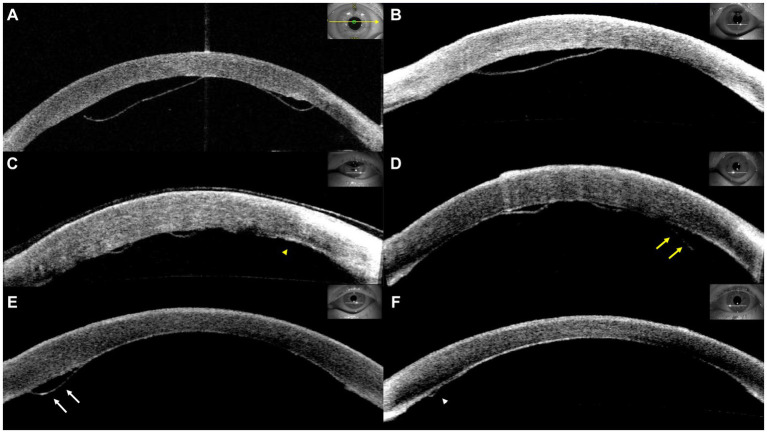
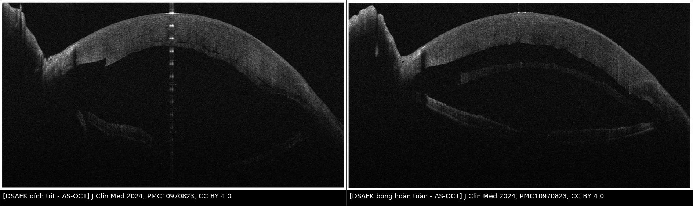
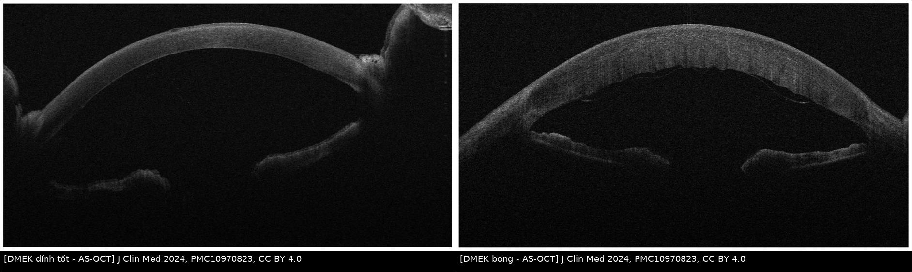
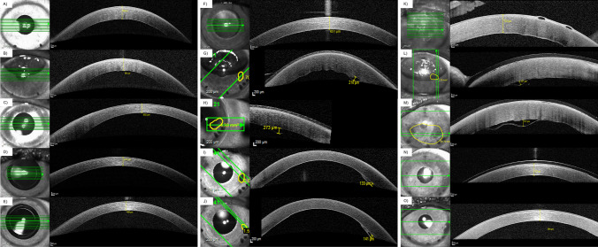
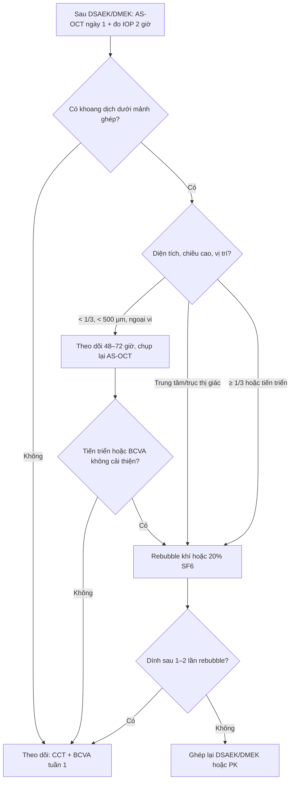
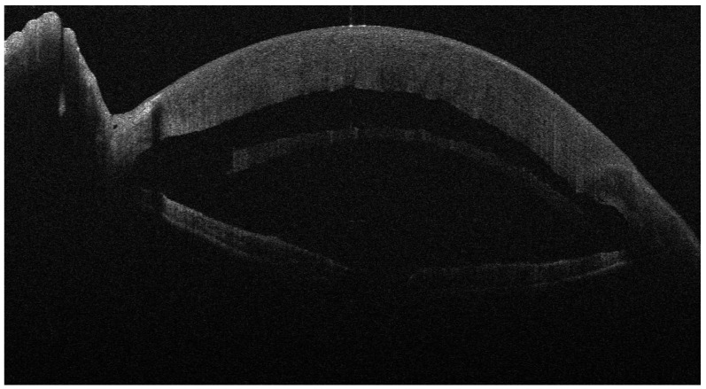
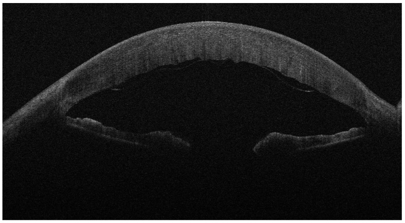

# 1445 — Bong mảnh ghép nội mô sau DSAEK/DMEK: theo dõi hay rebubble / Graft detachment after endothelial keratoplasty

**Tags:** `pattern:bong-manh-ghep` `pattern:phu-giac-mac` `pattern:mo-ghep-giac-mac` `vung:mat` `vung:giac-mac` `vung:tien-phong` `protocol:AS-OCT` `protocol:den-khe` `protocol:rebubble` `score:detachment-area`
**Mức chắc chắn (certainty):** tổng hợp y văn (literature synthesis) — 1 đoàn hệ 265 ca DSAEK về tỷ lệ bong theo môi trường bảo quản (PMC11986399), 1 sổ bộ đăng ký quốc gia 752 ca DMEK (PMC9763158), 1 đoàn hệ 80 mắt DSEK/DSAEK được rebubble (PMC6951175), 1 đoàn hệ 111 mắt bong nhỏ (PMC10152212), 1 đoàn hệ 52 mắt DMEK với yếu tố nguy cơ (PMC10881667), 1 đoàn hệ 45 mắt DMEK theo dõi CCT/AS-OCT (PMC11377527), 1 nghiên cứu kỹ thuật preload (PMC11265172), 1 ca khí di chuyển ra dịch kính (PMC13386901) và 1 ca interface fluid sau DSAEK thất bại (PMC9294039). Phần **phân độ 3 bậc** dưới đây là **tổng hợp ngưỡng từ các đoàn hệ trên [suy luận]**, không phải một hệ phân độ chính thức đã được hiệp hội phê chuẩn.

> **Vì sao bài này quan trọng:** đây là **biến chứng sớm thường gặp nhất** của mọi phẫu thuật ghép nội mô giác mạc — **19%** trong sổ đăng ký Hà Lan (PMC9763158) và **32,7%** ở một đoàn hệ DMEK (PMC10881667). Câu hỏi thực hành không phải "có bong không" mà là **"bong này có cần can thiệp không"**: rebubble mảnh ghép **nhỏ** không cải thiện thị lực (PMC10152212) nhưng rebubble lại làm **tăng mất tế bào nội mô** và **tăng nguy cơ thất bại mảnh ghép 4,28 lần** (PMC9763158). Bỏ sót bong **trung tâm/trục thị giác** thì mảnh ghép xơ dính, phù giác mạc vĩnh viễn; rebubble **quá tay** thì mất mảnh ghép vốn còn tốt.

## 1. Tổng quan bệnh học – cơ chế hình ảnh

### 1.1. Ghép nội mô không chỉ, dính bằng ba lực

- **DSAEK (Descemet stripping automated endothelial keratoplasty)** thay **Descemet + nội mô + một lớp nhu mô sau** (mảnh ghép dày, thường **100–200 µm**; nhóm > 150 µm có trung vị **186 µm** trong PMC12356417). **DMEK (Descemet membrane endothelial keratoplasty)** chỉ thay **Descemet + nội mô** — mảnh mỏng, đàn hồi và **cuộn lại** khi không bị ép.
- **Không có chỉ khâu:** mảnh ghép dính nhờ **ba cơ chế**: (1) **bơm nội mô** (Na⁺/K⁺-ATPase) hút dịch khỏi mặt phân cách; (2) **sức căng bề mặt của bóng khí** trong tiền phòng ép mảnh ghép vào nhu mô nền; (3) **áp lực thủy tĩnh** của tiền phòng giữ mảnh ghép.
- **Hệ quả vật lý:** bất cứ thứ gì chèn giữa mảnh ghép và nhu mô nền — **dịch, máu, mảnh Descemet của người nhận, bọt khí nhỏ, silicone** — đều tạo một **lớp dịch liên tục** ngăn bơm nội mô. Lớp dịch này không tự thoát vì **không có đường dẫn lưu**, nên bong **lan ra** theo trọng lực và theo động tác **dụi mắt**.

### 1.2. TẠI SAO bong mảnh ghép thấy được trên AS-OCT

- **AS-OCT (anterior segment OCT)** dùng ánh sáng **~1310 nm**, phân giải trục **5–10 µm** — đủ để tách **mảnh ghép** (dải tăng phản xạ do collagen/Descemet) khỏi **nhu mô nền**.
- **Khoang bong tối trên AS-OCT** vì **dịch trong suốt, không tán xạ ánh sáng** (không có tế bào/mỡ); ngược lại **mảnh ghép** và **nhu mô** tăng phản xạ. Vì vậy "đường đen" giữa hai dải sáng chính là **dịch ở mặt phân cách**, không phải mô.
- **Đo được hai đại lượng quyết định xử trí:** **diện tích bong (% diện tích mảnh ghép)** và **chiều cao bong tối đa (µm)**; kèm **vị trí có vào trục thị giác không**. Trong đoàn hệ 45 mắt DMEK, chính hai đại lượng này chia được 3 nhóm có tiên lượng khác nhau (PMC11377527).
- **Vì sao giác mạc vẫn đục dù chỉ bong một phần:** vùng bong mất bơm nội mô → **nhu mô ngấm nước** → **CCT tăng**, **nếp nhu mô sau (posterior stromal ripples)**. CCT vì thế là **dấu hiệu gián tiếp của bong** — nhưng **chậm hơn AS-OCT 1 tuần**.

### 1.3. Số liệu định lượng cốt lõi

- **Thời điểm:** bong cần rebubble được phát hiện lúc **5 ± 2,1 ngày** (1–8 ngày) sau DMEK (PMC10881667) — tức **cửa sổ vàng là tuần đầu**.
- **Tỷ lệ bong theo kỹ thuật/môi trường (DSAEK, 265 ca):** **32,9%** với mảnh pre-cut vận chuyển trong môi trường **có dextran**; **14,1%** với mảnh **surgeon-cut**; **6,3%** với pre-cut **không dextran** (p = 0,002). Ở nhóm không có yếu tố nguy cơ: **26,9% / 8,3% / 3,6%** (PMC11986399).
- **Tỷ lệ bong theo kỹ thuật (DMEK):** preload **endothelium-in 47%** vs **endothelium-out 28%** (p = 0,035) (PMC11265172); **24,4%** bong ≥ 1/3 diện tích phải rebubble trong một đoàn hệ 45 mắt (PMC11377527); **32,7%** trong đoàn hệ 52 mắt (PMC10881667); **19%** trong sổ đăng ký 752 mắt (PMC9763158).
- **Yếu tố nguy cơ độc lập (DMEK):** tuổi người nhận **OR 1,08/năm**; **đái tháo đường OR 23,8** (95% CI 2,61–217); chỉ định **FED OR 6,19**; **IOP 2 giờ sau mổ thấp** OR 1,21 mỗi mmHg và **IOP < 20 mmHg OR 25,1** (đa biến); **biến chứng trong mổ OR 2,28** (PMC10881667, PMC9763158).
- **Hậu quả của rebubble:** thất bại mảnh ghép **30% vs 9%** (OR 4,28; 95% CI 2,72–6,73) và **ECD thấp hơn có ý nghĩa ở 3, 6, 12 tháng** (PMC9763158). Nhưng rebubble **cứu dính được 96,25%** mảnh ghép DSEK/DSAEK bong, **68,75%** giữ trong; thất bại **31,25%**, sống trung vị **30 tháng** (PMC6951175).

## 2. Mẫu hình + chẩn đoán phân biệt theo vị trí và hình thái (Gamut)

### 2.1. Theo hình thái bong

- **Bong nhỏ ngoại vi (minor/peripheral):** dải dịch **< 1/3 diện tích**, chiều cao **< 500 µm**, **không vào trục thị giác** — thường **tự dính**; rebubble **không cải thiện kết cục** (PMC10152212).
- **Bong trung tâm trong trục thị giác (central):** dù diện tích nhỏ, **che trục thị giác** → thị lực giảm, dễ để lại **nếp/xơ trung tâm** → **chỉ định rebubble**.
- **Bong tiến triển (progressive):** từ ngày 1 đến ngày 8 lan rộng dần (Hình 1, PMC10881667) — **bong tiến triển là bong "động", phải can thiệp** dù lần đo đầu còn nhỏ.
- **Bong toàn bộ (total):** mảnh ghép tách hoàn toàn, **không còn bơm nội mô** → phù nặng; rebubble **hoặc ghép lại** tùy tình trạng mảnh ghép.
- **Bong dạng cuộn (DMEK scroll):** mảnh DMEK cuộn thành ống — trên AS-OCT thấy **cấu trúc hình vòng/2 lớp**; dễ bị đọc là "mảnh ghép lật" hoặc "màng giả".

### 2.2. Gamut theo nguyên nhân (vì sao bong)

- **Khí/bóng khí thoát ra sau (gas escape):** gặp ở mắt **đã cắt dịch kính (PPV)** hoặc **IOL cố định củng mạc (SFIOL)** — khí chui ra dịch kính → **không còn tamponade** → bong. Số liệu: khí ra dịch kính **22%** tổng thể; **SFIOL 63,7%** vs **PCIOL 6,7%** (PMC13386901).
- **Tamponade không đủ:** bóng khí quá nhỏ, bệnh nhân **nằm ngửa** nhiều, **dụi mắt**.
- **Dịch/máu/mảnh nhu mô ở mặt phân cách:** nhu mô nền **không đều**, **máu tiền phòng**, **mảnh Descemet còn sót** của người nhận.
- **Áp lực thấp:** **IOP 2 giờ < 20 mmHg** làm tăng nguy cơ (OR 25,1) — ngược trực giác "hạ áp cho an toàn" (PMC10881667).
- **Yếu tố mảnh ghép:** mảnh **pre-cut có dextran** (32,9% vs 6,3%), **preload endothelium-in** (47% vs 28%), **ECD người cho thấp**, **mảnh ghép lật ngược** (DMEK) → bơm nội mô **hướng sai phía**, không bao giờ dính.

*Hình 1 — Bốn hình thái bong mảnh ghép DMEK. (A) bong lớn; (B) bong trung tâm trong trục thị giác; (C, mũi nhọn vàng) ngày 1 → (D, mũi tên vàng) ngày 8: **bong tiến triển**; (E, mũi tên trắng) ngày 4: bong nhỏ → (F, mũi nhọn trắng) **tự dính**. Nguồn: Front Med 2024, PMC10881667, CC BY 4.0 — ảnh nguyên bản, không chỉnh sửa.*

## 3. Bảng so sánh phân biệt (ma trận đối chiếu)

| Thực thể (entity) | Hình ảnh điển hình (AS-OCT / đèn khe) | Chốt vào (rule-in) | Chốt loại (rule-out) | Gợi ý xác nhận |
|---|---|---|---|---|
| Bong nhỏ ngoại vi | Dải dịch **< 1/3 diện tích**, cao **< 500 µm**, ngoài trục thị giác; CCT giảm dần | **Khoang dịch khu trú ngoại vi + CCT 1 tuần < 600 µm + BCVA cải thiện** | Khoang dịch **lan rộng** giữa 2 lần chụp → không còn là "nhỏ" | AS-OCT lặp sau **2–3 ngày**; không rebubble (PMC10152212) |
| Bong trung tâm/trục thị giác | Dải dịch **che trục thị giác**, dù < 1/3 diện tích; thị lực không cải thiện | **Vị trí trung tâm + BCVA 1 tuần không tăng** (chỉ **18,2%** nhóm bong ≥ 1/3 cải thiện BCVA) | Dải tối **dưới mảnh ghép nhưng ngoài trục** → theo dõi | AS-OCT qua trục thị giác + đo CCT lúc 1 tuần (PMC11377527) |
| Bong tiến triển | Diện tích/chiều cao **tăng giữa 2 lần chụp**; bờ dịch lan | **Tăng ≥ 1/3 diện tích** hoặc **tăng chiều cao** | Ổn định/giảm sau 48–72 giờ | Chụp lại **48–72 giờ**, đo cùng mặt cắt |
| Bong toàn bộ | Mảnh ghép **tách hoàn toàn**, khoang dịch lớn; giác mạc phù nặng | **Toàn bộ mảnh ghép tách khỏi nhu mô** | Mảnh ghép **dính trung tâm**, chỉ bong chu vi | AS-OCT toàn bộ đường kính; đánh giá mảnh ghép còn dùng được không |
| Interface fluid (dịch mặt phân cách) | Khoang dịch **ở mặt phân cách cũ** (LASIK/DSAEK), thường **hai bên**, CCT tăng, **IOP cao** | **IOP cao + tiền sử LASIK/ghép cũ + dịch giảm khi hạ IOP** | Dịch **không đổi** dù IOP về bình thường → nghĩ bong thật | Đo IOP, thử hạ áp; ca PMC9294039 phải **ghép lại bằng DMEK** |
| Nếp gấp mảnh ghép (graft fold) | Đường **tăng phản xạ gấp khúc trong mảnh ghép**, **không có khoang dịch** | **Không có khoảng tối dưới mảnh ghép** | Có khoảng tối → bong | AS-OCT đối chiếu nhiều mặt cắt |
| Màng giả/mảnh Descemet còn sót | **Hai lớp** tăng phản xạ song song, không có dịch | **Hai lớp Descemet** (mảnh ghép + Descemet người nhận) | Một lớp + khoang dịch → bong | AS-OCT độ phân giải cao, đèn khe |

*Hình 2 — Trái: DSAEK **dính tốt** ngày 1, mảnh ghép dày áp sát nhu mô (đường mặt phân cách mảnh). Phải: DSAEK **bong hoàn toàn** ngày 4, khoang dịch lớn giữa mảnh ghép và nhu mô nền. Nguồn: J Clin Med 2024, PMC10970823, CC BY 4.0 — ảnh ghép letterbox, giữ nguyên tỉ lệ.*

*Hình 3 — Trái: DMEK **dính tốt**. Phải: DMEK **bong** — mảnh ghép **mỏng, gợn sóng/cuộn**, khoang dịch dưới mảnh; nhu mô dày hơn do phù. Nguồn: J Clin Med 2024, PMC10970823, CC BY 4.0 — ảnh ghép letterbox.*

## 4. Protocol chụp + phân độ + quyết định rebubble

### 4.1. Protocol theo dõi sau ghép nội mô

- **Ngày 1:** đèn khe + **AS-OCT** (mặt cắt qua **trung tâm và 4 kinh tuyến**, đo **CCT**, **diện tích bong %**, **chiều cao bong tối đa µm**), **đo IOP** (đặc biệt **IOP 2 giờ sau mổ**).
- **Ngày 3–5:** lặp AS-OCT nếu ngày 1 có **bất kỳ** dải dịch nào — vì bong **tiến triển** thường lộ rõ trong tuần đầu (5 ± 2,1 ngày).
- **Tuần 1:** đo **CCT**. Ngưỡng thực hành từ PMC11377527: nếu **CCT < 600 µm**, **giảm so với trước mổ**, **BCVA cải thiện** và **không có nếp nhu mô sau** → **rất khó có bong ≥ 1/3 cần rebubble** (90% nhóm không bong đạt CCT < 600 µm, so với 50% nhóm bong < 1/3 và **36,4%** nhóm bong ≥ 1/3).
- **Khi CCT ≥ 600 µm hoặc không giảm:** soi **chu vi mảnh ghép** bằng đèn khe + AS-OCT — vì bong **ngoại vi** là nơi dễ bỏ sót nhất.
- **Không chụp AS-OCT thay đèn khe:** AS-OCT bỏ sót **bong sát chu vi** ngoài đầu dò và **không đánh giá được mảnh ghép lật ngược** (cần đèn khe thấy mặt nội mô xù xì/không đều).

*Hình 4 — Cách đo chuẩn trên AS-OCT: mỗi lần chụp đo **CCT**, **diện tích bong** và **chiều cao bong tối đa**; ba cột là ba nhóm không bong (A–E), bong < 1/3 (F–J) và bong ≥ 1/3 phải rebubble (K–O), theo các mốc trước mổ, 1 ngày, 1 tuần, 1 tháng, 6 tháng. Nguồn: Graefes Arch Clin Exp Ophthalmol 2024, PMC11377527, CC BY 4.0 — ảnh nguyên bản.*

### 4.2. Phân độ thực hành 3 bậc [suy luận — tổng hợp ngưỡng]

| Bậc | Diện tích bong | Chiều cao tối đa | Vị trí | Xử trí |
|---|---|---|---|---|
| **1 — Nhỏ** | **< 20–1/3** diện tích mảnh ghép | **< 500 µm** | Ngoài trục thị giác | **Theo dõi** AS-OCT 2–3 ngày; không rebubble (PMC10152212) |
| **2 — Trung bình** | **1/3–1/2** diện tích | **500–1.000 µm** | Có thể vào rìa trục thị giác | **Cân nhắc rebubble** nếu không giảm sau 72 giờ hoặc thị lực không cải thiện |
| **3 — Lớn/toàn bộ** | **≥ 1/2** hoặc toàn bộ | **> 1.000 µm** hoặc mảnh cuộn | Trung tâm/trục thị giác | **Rebubble** (khí/20% SF₆); nếu thất bại → **ghép lại** |

### 4.3. Kỹ thuật rebubble và ngưỡng thành công

- **Khí dùng:** **không khí** hoặc **20% SF₆** (PMC10152212); bóng khí phải **phủ toàn bộ mảnh ghép** — kiểm tra bằng AS-OCT/đèn khe **theo tư thế nằm ngửa**.
- **Thành công:** dính lại **70%** trong sổ đăng ký DMEK (PMC9763158); **96,25%** dính ngay sau rebubble ở DSEK/DSAEK, nhưng chỉ **68,75%** giữ được mảnh trong lâu dài (PMC6951175).
- **Thất bại/lặp:** **3** mắt cần rebubble lần 2, **2** mắt ghép lại DSEK, **4** mắt phải **ghép xuyên (PK)** trong đoàn hệ 80 mắt (PMC6951175).
- **Giá phải trả:** thất bại mảnh ghép **30% vs 9%** (OR 4,28) và **ECD thấp hơn ở 3/6/12 tháng** — nên **chỉ rebubble khi có chỉ định**, không "rebubble cho chắc" (PMC9763158).

### 4.4. Dự phòng (dựa trên yếu tố nguy cơ đã chứng minh)

- **Duy trì IOP 2 giờ ≥ 20 mmHg** — tránh hạ áp quá mức vì **IOP < 20 mmHg làm tăng nguy cơ bong OR 25,1** (PMC10881667).
- **Chọn mảnh ghép:** ưu tiên **pre-cut không dextran** (6,3% vs 32,9%) (PMC11986399); với DMEK, **endothelium-out** giảm rebubble so với endothelium-in (28% vs 47%) (PMC11265172).
- **Mắt đã PPV/SFIOL:** dự trù **khí thoát ra dịch kính** (63,7% ở SFIOL) → cân nhắc **tăng thể tích khí**, tư thế, hoặc **kỹ thuật giữ khí** (PMC13386901).
- **Kiểm soát đường huyết** ở bệnh nhân đái tháo đường (OR 23,8) và **cảnh báo không dụi mắt** tuần đầu.

## 5. Biến thể bình thường và cạm bẫy

- **Bong nhỏ tự dính là "biến thể lành tính":** trong đoàn hệ 111 mắt, **54 mắt** bong nhỏ **tự dính không can thiệp**; rebubble **không** cải thiện CCT/ECD và thị lực chỉ hơn **0,22 logMAR** — với chiều cao **< 500 µm**, nhóm tự dính còn tăng BCVA **0,39 logMAR** so với **0,62** ở nhóm rebubble (p = 0,045) (PMC10152212).
- **Cạm bẫy 1 — "interface fluid" bị đọc là bong:** ở mắt có **mặt phân cách cũ** (LASIK, DSAEK cũ), dịch tích ở mặt phân cách do **IOP cao/mất bù nội mô**; **hạ IOP** làm dịch giảm. Ca PMC9294039 cho thấy **ghép lại bằng DMEK** giải quyết được, nhưng **phải kiểm soát IOP tích cực** sau mổ.
- **Cạm bẫy 2 — bong ở mắt PPV/SFIOL do khí thoát:** bóng khí **biến mất khỏi tiền phòng trong vài giờ**; nếu chỉ nhìn "không còn bóng khí" mà kết luận "đã tamponade đủ" thì bỏ sót nguyên nhân bong.
- **Cạm bẫy 3 — nếp gấp giả bong:** **nếp nhu mô sau (posterior stromal ripples)** chỉ là **đường tăng phản xạ**, không có khoảng tối; **không rebubble** vì rebubble không làm phẳng nếp.
- **Cạm bẫy 4 — mảnh DMEK lật ngược:** mặt nội mô hướng ra tiền phòng → **không bao giờ dính** dù rebubble nhiều lần; nhận ra nhờ **đèn khe thấy bề mặt mảnh ghép xù xì** và bong **tái phát ngay sau mỗi lần rebubble**.
- **Cạm bẫy 5 — vòng xơ co kéo muộn:** bong **muộn** (> 1 tháng) hiếm khi do dịch đơn thuần; nghĩ **màng xơ dưới mảnh ghép**, **mảnh Descemet còn sót** hoặc **tăng sinh nội mô** — cần AS-OCT độ phân giải cao trước khi rebubble.

## 6. Tự lượng giá — Blind Quiz

**Ca 1 — Ngày 4 sau DSAEK vì FED: giác mạc phù nhiều, thị lực không cải thiện.**

- Gợi ý: bệnh nhân 72 tuổi, DSAEK vì FED, ngày 4 thấy **giác mạc đục hơn ngày 1**, không đau.
- Câu hỏi: mô tả khoang dịch? Nó nằm ở đâu? Ba chẩn đoán phân biệt? Xử trí?

<b>Bấm để hiện đáp án (findings + chẩn đoán)</b>

- Dấu hiệu: **mảnh ghép dày tách hoàn toàn** khỏi nhu mô nền, **khoang dịch lớn** giữa mảnh ghép và nhu mô; giác mạc phù.
- Chẩn đoán: **bong mảnh ghép DSAEK toàn bộ** — mất bơm nội mô trên toàn bộ diện tích.
- Phân biệt: **interface fluid** (mặt phân cách cũ, IOP cao), **nếp gấp mảnh ghép** (không có khoảng dịch), **màng Descemet còn sót** (hai lớp, không dịch).
- Xử trí: **rebubble khí/20% SF₆**; nếu thất bại → ghép lại. Kiểm tra **IOP 2 giờ** vì IOP thấp làm tăng nguy cơ.
- Nguồn ảnh: J Clin Med 2024, PMC10970823, CC BY 4.0.

**Ca 2 — Ngày 5 sau DMEK ở mắt đã cắt dịch kính: đã rebubble 1 lần, vẫn mờ, AS-OCT còn khoang dịch.**

- Gợi ý: bệnh nhân **đái tháo đường**, mắt **đã cắt dịch kính (PPV)** trước đó; bóng khí trong tiền phòng **biến mất sau vài giờ**.
- Câu hỏi: mô tả mảnh ghép? Vì sao rebubble thất bại? Hai nguyên nhân cơ học phải loại trừ? Bước tiếp theo?

<b>Bấm để hiện đáp án (findings + chẩn đoán)</b>

- Dấu hiệu: **mảnh ghép mỏng, gợn sóng/cuộn**, tách khỏi nhu mô với **khoang dịch** dưới mảnh; nhu mô dày do phù.
- Vì sao thất bại: (1) **khí thoát ra dịch kính** ở mắt đã PPV → không còn tamponade (khí ra dịch kính **22%** tổng thể; **PPV là yếu tố nguy cơ**, p = 0,014); (2) **mảnh ghép lật ngược** → mặt nội mô hướng sai, không bao giờ dính.
- Bước tiếp: kiểm tra **hướng mảnh ghép bằng đèn khe** (mặt nội mô xù xì), tăng thể tích khí/đổi chiến lược tamponade và tư thế; nếu vẫn thất bại → **ghép lại**. Kiểm soát đường huyết (đái tháo đường **OR 23,8**).
- Nguồn ảnh: J Clin Med 2024, PMC10970823, CC BY 4.0.

**Ca 3 — Bốn bệnh nhân cùng ngày chụp AS-OCT sau DMEK: ca nào theo dõi, ca nào rebubble?**

- Gợi ý: mỗi panel là một mắt khác nhau, cùng một bác sĩ chụp, cùng mặt cắt qua trung tâm.
- Câu hỏi: gọi tên hình thái ở A, B, C→D, E→F? Ca nào **không** cần rebubble? Vì sao C→D khác E→F?

<b>Bấm để hiện đáp án (findings + chẩn đoán)</b>

- Dấu hiệu: **A** bong lớn; **B** bong trung tâm trong trục thị giác; **C→D** khoang dịch **lan rộng và cao thêm** từ ngày 1 đến ngày 8; **E→F** bong nhỏ ngày 4 rồi **tự dính**.
- Xử trí: **A, B, C→D cần rebubble** (A/B vì diện tích hoặc vị trí trục thị giác; C→D vì **tiến triển**). **E→F theo dõi** — bong nhỏ **< 500 µm** ngoại vi tự dính, rebubble không cải thiện kết cục (PMC10152212).
- Chốt: **bong "động" (tiến triển) nguy hiểm hơn bong "tĩnh" cùng kích thước** — phải chụp lại để phân biệt, không quyết định bằng một lần đo.
- Nguồn ảnh: Front Med 2024, PMC10881667, CC BY 4.0.

## Bài liên quan chéo
- [400 – Tổng quan Mắt & thị giác](../400-tong-quan-mat-thi-giac/lesson.md)
- [1428 – Phù giác mạc mất bù sau implant corticoid lạc vào tiền phòng](../1428-phu-giac-mac-sau-implant-tien-phong/lesson.md) (bối cảnh mắt đã PPV/SFIOL, DSAEK ưu tiên)
- [1411 – Tăng nhãn áp do corticoid nội nhãn](../1411-tang-nhan-ap-do-corticoid-noi-nhan/lesson.md) (IOP sau mổ và interface fluid)
- [1452 – Glôcôm do thể thủy tinh chưa mổ](../1452-glaucom-do-the-thuy-tinh-chua-mo/lesson.md) (phù giác mạc — phân biệt nguyên nhân nội mô)

## Ảnh
- Tên file: `1445_slug_Modality_SourceID.jpg`; nguồn + giấy phép từng ảnh trong `images/CREDITS.md`.
- Ảnh ghép: `images/composite_dsaek-attached-vs-detached.jpg`, `images/composite_dmek-attached-vs-detached.jpg` (tạo bằng `tools/make_composite.py`, letterbox giữ tỉ lệ).

> Không dùng để chẩn đoán độc lập khi chưa có người hướng dẫn.
