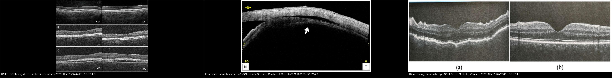
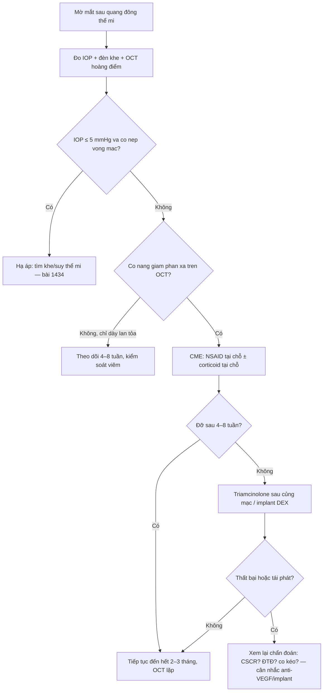
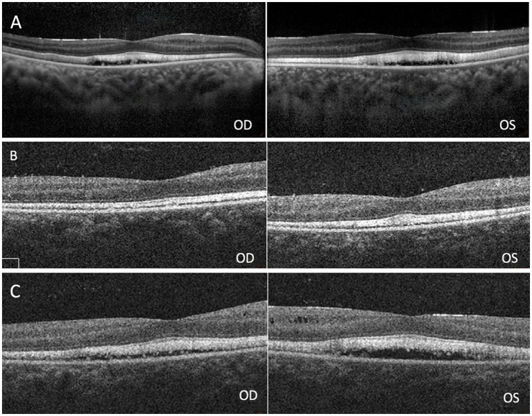
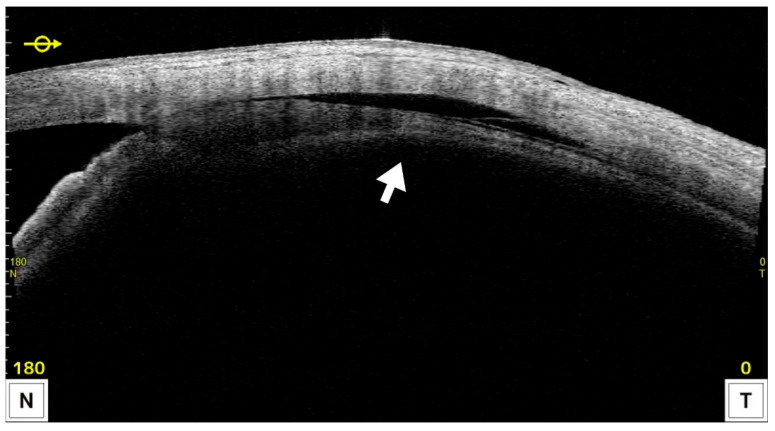
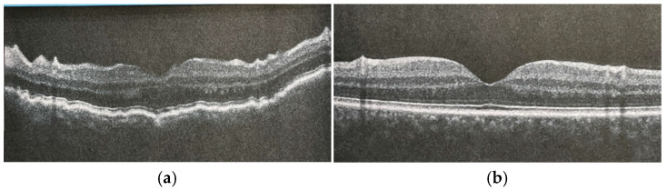

# 1446 — Phù hoàng điểm sau quang đông thể mi / Cystoid macular edema after cyclophotocoagulation

**Tags:** `pattern:phu-hoang-diem` `pattern:day-vong-mac` `pattern:giam-thi-luc` `pattern:ha-nhan-ap` `pattern:bong-hac-mac` `pattern:sau-quang-dong` `pattern:vien-tien-phong` `vung:mat` `vung:hoang-diem` `vung:vong-mac` `vung:the-mi` `protocol:OCT` `protocol:AS-OCT` `protocol:gonioscopy` `protocol:B-scan` `score:CMT` `score:IOP`
**Mức chắc chắn (certainty):** tổng hợp y văn (literature synthesis) — 1 đoàn hệ hồi cứu **31 mắt** theo dõi OCT 1–30 tháng (2026), 1 đoàn hệ **28 mắt** slow-coag 24 tháng (2024), 1 loạt **37 mắt** micropulse (2025), 1 loạt **113 mắt** slow-coag (2026), 1 ca nguyên văn có ảnh OCT trước–sau (2025), và 2 nghiên cứu điều trị CME **sau đục thể thủy tinh** dùng làm bằng chứng ngoại suy. **Không có RCT** nào so sánh “theo dõi” với “điều trị sớm” CME sau quang đông thể mi — phần điều trị là ngoại suy có ghi rõ.

> **Vì sao bài này quan trọng:** bài **1431** dạy chọn chế độ quang đông thể mi (CW “pop” – slow-coag – micropulse) và đã nêu **độ dày hoàng điểm tăng 165,5 µm với CW so với 55,8 µm với micropulse**. Bài **1434** dạy mặt đối lập — **hạ nhãn áp** sau đốt. Nhưng câu hỏi thường gặp nhất ở phòng khám lại nằm giữa hai bài đó: bệnh nhân **thấy mờ hơn sau đốt 3–6 tuần**, nhãn áp đã tốt, đáy mắt không có bong võng mạc — **đó là phù hoàng điểm, tràn dịch thể mi–hắc mạc, hay bệnh hoàng điểm do hạ áp?** Ba bệnh cảnh cùng làm mờ mắt, cùng có “dày hoàng điểm”, nhưng **một bên chỉ cần theo dõi, một bên cần corticoid/NSAID, một bên phải nâng nhãn áp**. Gọi sai là **tăng corticoid vô ích** hoặc **bỏ sót hạ áp đang làm hỏng hoàng điểm**.

> **Sửa tiền đề của backlog (trung thực nguồn):** backlog ghi “CMT tăng 165,5 vs 55,8 µm sau CW” như một con số của **CME**. Thực ra đó là **độ dày hoàng điểm trung bình** trong RCT, **không phải tỉ lệ CME có nang**. Bài này tách rõ hai khái niệm: **dày hoàng điểm đơn thuần** (rất thường gặp, thoáng qua) và **CME xác nhận trên OCT** (có khoang dạng nang) — vì chính sự lẫn lộn này làm tỉ lệ “CME sau đốt” dao động **2,6–25,8%** trong y văn.

## 1. Tổng quan bệnh học – cơ chế hình ảnh – vì sao “đốt thể mi” lại làm phù hoàng điểm

- **Bệnh học:** quang đông thể mi xuyên củng mạc dùng diode **810 nm**; năng lượng bị **melanin ở biểu mô sắc tố thể mi** hấp thụ → **đông hoại biểu mô thể mi và mô đệm** → giảm sản xuất thủy dịch. Nhưng nhiệt và mô hoại tử cũng giải phóng **prostaglandin, cytokine và protein viêm** vào tiền phòng và khoang trên hắc mạc. Chính **viêm** — không phải bản thân tia laser — là thứ phá vỡ hàng rào máu–võng mạc.
- **TẠI SAO là phù dạng nang:** viêm làm **tăng tính thấm mao mạch quanh hoàng điểm** và **suy bơm của biểu mô sắc tố (RPE)**; dịch tích **trong lớp nhân trong (INL) và lớp đám rối ngoài (OPL)**. Tế bào Müller hút dịch bằng **kênh aquaporin-4** rồi phình lên (phù độc tế bào), sau đó dịch tràn ra ngoài tế bào thành **khoang nang**. Vì dịch trong quang học, nang **giảm phản xạ (hyporeflective)** trên OCT — khác với **mảng xơ tăng phản xạ** của màng trước võng mạc.
- **TẠI SAO đỉnh ở tháng 1 rồi giảm:** phản ứng viêm sau đốt đạt đỉnh **1–4 tuần** rồi tự lui nếu không có yếu tố duy trì. Đoàn hệ 31 mắt slow-coag: **CSFT 279 ± 25 µm trước đốt → 355 ± 153 µm ở tháng 1 → 293 ± 25 µm ở tháng 12** (p < 0,001); đến lần khám cuối vẫn **294 ± 25 µm**, cao hơn nền (p < 0,001).
- **TẠI SAO tỉ lệ dao động 2,6–25,8%:** vì **cách phát hiện khác nhau**. Khi chỉ chẩn đoán trên **đáy mắt/giảm thị lực**, loạt 113 mắt slow-coag ghi **CME 2,65%** (3/113). Khi **chụp OCT chủ động** cho mọi mắt, đoàn hệ 31 mắt ghi **25,8%** (8/31), phát hiện **tháng 1–6, trung bình 2,1 ± 1,8 tháng**; đoàn hệ 28 mắt ghi **21,4%**, trong đó **10,7% còn dai dẳng** ở lần khám cuối. Micropulse (VITRA 810) ghi **5,4%** (2/37). → **Con số đúng để tư vấn là “khoảng 1/5 nếu chụp OCT, khoảng 1/40 nếu chỉ khám lâm sàng”**, không phải một con số duy nhất.
- **Yếu tố nguy cơ (mức bằng chứng yếu, đơn biến):** **đái tháo đường** (p = 0,031) và **tiền sử phù hoàng điểm do đái tháo đường** (p < 0,001); **CSFT nền cao hơn** ở nhóm phát triển CME (**311 ± 21 vs 267 ± 15 µm**, p < 0,001). Đây là **liên quan thăm dò**, không phải yếu tố nguy cơ độc lập — tác giả tự ghi rõ vì cỡ mẫu nhỏ.
- **TẠI SAO thị lực có thể không giảm dù CME:** trong đoàn hệ 31 mắt, **CDVA 0,90 ± 0,90 → 1,02 ± 0,85 logMAR** (p = 0,004) nhưng **không khác giữa nhóm có và không có CME** (p = 0,992). Nghĩa là **mờ mắt sau đốt phần lớn do bệnh glôcôm/giảm thị lực nền**, còn CME có thể **không triệu chứng**. Vì vậy **không được suy CME từ triệu chứng** — phải chụp OCT khi có chỉ định.
- **TẠI SAO phân biệt với hạ áp quan trọng:** hạ áp (**IOP ≤ 5 mmHg**) gây **nếp võng mạc–hắc mạc** và có thể kèm phù nội bào; điều trị là **nâng nhãn áp**, không phải tăng chống viêm. Ngược lại, **tràn dịch thể mi–hắc mạc (ciliochoroidal effusion)** gặp tới **59,4%** (22/37) sau micropulse, **hết trong 1 tháng ở 21/22 mắt có CE** (1 ca teo nhãn) và **không phải CME** — nhưng trên lâm sàng cả hai đều làm “hoàng điểm dày”.

## 2. Mẫu hình + chẩn đoán phân biệt theo vị trí và thời điểm (Gamut)

- **Theo thời điểm sau đốt:**
  - **Ngày 1–7:** dày hoàng điểm nhẹ, **chưa có nang** = phản ứng viêm cấp, **không gọi là CME**; kèm viêm tiền phòng (flare tăng), tràn dịch thể mi–hắc mạc sớm.
  - **Tuần 2 – tháng 6:** **CME thật** (nang trong INL/OPL), đỉnh tháng 1; đây là cửa sổ để chụp OCT.
  - **Sau 6 tháng:** CME dai dẳng (10,7% trong loạt 28 mắt) → nguy cơ **mỏng võng mạc ngoài, mất dải ELM/EZ**, thị lực khó hồi.
- **Theo vị trí tổn thương trên OCT:**
  - **Hoàng điểm trung tâm:** nang trong INL/OPL, mất hõm hoàng điểm, có thể có dịch dưới võng mạc.
  - **Quanh hoàng điểm:** dày lan tỏa không nang — thường gặp hơn, tự lui.
  - **Hắc mạc/thể mi (AS-OCT/UBM):** khoang giảm phản xạ giữa thể mi và củng mạc = tràn dịch thể mi–hắc mạc, **không phải CME**.
  - **Đĩa thị:** phù đĩa thị do hạ áp (kèm nếp võng mạc) — phân biệt với phù đĩa thị do glôcôm tiến triển.
- **Gamut “mờ mắt sau quang đông thể mi”:** CME sau đốt · **tràn dịch thể mi–hắc mạc** · **bệnh hoàng điểm do hạ áp** · **viêm tiền phòng/viêm màng bồ đào dai dẳng** · **phù hoàng điểm do đái tháo đường** (nếu có bệnh võng mạc nền) · **CSCR do corticoid** (nếu đã dùng corticoid) · **màng trước võng mạc/co kéo dịch kính–võng mạc** · **bong võng mạc** (phải loại trừ bằng B-scan/soi đáy mắt) · **tiến triển glôcôm** (thị trường, không phải hoàng điểm).

## 3. Bảng so sánh phân biệt (ma trận đối chiếu)

| Thực thể (entity) | Hình ảnh điển hình (OCT/AS-OCT/lâm sàng) | Chốt vào (rule-in) | Chốt loại (rule-out) | Gợi ý xác nhận |
|---|---|---|---|---|
| **CME sau quang đông thể mi** | Dày võng mạc trung tâm + **khoang giảm phản xạ dạng nang** ở INL/OPL; mất hõm hoàng điểm; không màng co kéo; xuất hiện **1–6 tháng** sau đốt | **Nang thật trên OCT** + bối cảnh đốt thể mi + loại trừ hạ áp | **Chỉ dày lan tỏa, không nang** → chưa gọi CME; **màng tăng phản xạ co kéo** → không phải CME | OCT hoàng điểm có/không cản quang; so sánh với OCT nền; FA nếu cần (kiểu cánh hoa) |
| **Tràn dịch thể mi–hắc mạc** | **AS-OCT/UBM: khoang giảm phản xạ giữa thể mi và củng mạc**; tiền phòng nông; IOP có thể thấp; gặp **59,4%** sau micropulse | **Dịch trên hắc mạc/thể mi** trên AS-OCT/UBM, hoàng điểm có thể bình thường | **Không có dịch trên hắc mạc** → loại trừ; **nang hoàng điểm đơn thuần** → CME | AS-OCT 360°, UBM 35–50 MHz; B-scan nếu không thấy |
| **Bệnh hoàng điểm do hạ áp** | **Nếp võng mạc–hắc mạc** (OCT: gấp khúc các lớp, đôi khi dịch dưới võng mạc), **IOP ≤ 5 mmHg**, tiền phòng nông, có thể phù đĩa thị | **Nếp + IOP ≤ 5 mmHg**, hồi phục khi nâng áp | **IOP ≥ 6 mmHg và không nếp** → ít khả năng | Đo IOP 2 lần, OCT hoàng điểm, AS-OCT/UBM tìm nguyên nhân hạ áp (bài 1434) |
| **Viêm tiền phòng/viêm màng bồ đào dai dẳng** | Tế bào/flare tiền phòng, dính mống mắt, có thể CME; đau, đỏ | **Tế bào/flare + đáp ứng corticoid** | **Không viêm, không đau** → loại trừ | Đèn khe, flare photometry; cấy nếu nghi nhiễm |
| **Phù hoàng điểm do đái tháo đường** | Dày hoàng điểm, nang, **xuất tiết cứng**, bệnh võng mạc nền; thường hai bên | **Bệnh võng mạc ĐTĐ + xuất tiết cứng/vùng không tưới máu** | **Không có bệnh võng mạc nền** → ít khả năng | OCT, FA/FFA; HbA1c |
| **CSCR do corticoid** | **Bong thanh dịch võng mạc** (không nang), hắc mạc dày; tiền sử corticoid | **Bong thanh dịch + hắc mạc dày**, không nang | **Nang trong võng mạc** → không điển hình CSCR | OCT EDI đo hắc mạc; ngừng corticoid nếu được |
| **Màng trước võng mạc/co kéo** | **Màng tăng phản xạ trên bề mặt** + co kéo, mất hõm; nang có thể có nhưng do traction | **Màng tăng phản xạ + co kéo** | **Không màng, không co kéo** → loại trừ | OCT cắt lớp mỏng; phân biệt tractional CME |

*Ba ô, từ trái sang phải: **(1) CME** — nang giảm phản xạ trong võng mạc; **(2) tràn dịch thể mi–hắc mạc** — khoang giảm phản xạ giữa thể mi và củng mạc (mũi tên); **(3) bệnh hoàng điểm do hạ áp** — nếp võng mạc–hắc mạc. Ảnh: Liu J và cs., *Front Med* 2025 (PMC12370765), Handa S và cs., *J Clin Med* 2025 (PMC12610210), Sacchi M và cs., *J Clin Med* 2025 (PMC12072686) — đều **CC BY 4.0**, xem `images/CREDITS.md`.*

## 4. Protocol theo dõi + thang điều trị

- **Trước đốt:** chụp **OCT hoàng điểm (macula cube/volume)** làm mốc, ghi **CSFT** và **có/không nang**; đo **IOP**, soi góc, đánh giá **bệnh võng mạc đái tháo đường** và **tiền sử CME** — đây là nhóm nguy cơ cao cần theo dõi dày hơn.
- **Sau đốt:** **ngày 1** đo IOP + đèn khe (viêm, tiền phòng); **tuần 1** đo IOP, đánh giá flare/đau; **tháng 1** chụp **OCT hoàng điểm** ở mọi mắt có nguy cơ hoặc có triệu chứng; sau đó **tháng 3, 6, 12** (đoàn hệ 2026 dùng đúng lịch 1–3–6–9–12 tháng).
- **Ngưỡng hành động thực dụng:**
  - **CSFT tăng ≥ 10%** so với nền nhưng **không nang** (ngưỡng này lấy từ định nghĩa PCME, không phải ngưỡng riêng sau đốt) → theo dõi, kiểm soát viêm; chưa cần corticoid toàn thân.
  - **Có nang trên OCT** → điều trị CME (dưới).
  - **IOP ≤ 5 mmHg + nếp võng mạc** → chuyển sang bài 1434 (tìm khe/suy thể mi), **không tăng corticoid mù**.
  - **Dịch thể mi–hắc mạc đơn thuần, IOP ổn, thị lực ổn** → theo dõi 4–8 tuần; phần lớn tự hết.
- **Thang điều trị CME (ngoại suy từ CME sau đục thể thủy tinh; không có RCT sau đốt thể mi):**
  1. **NSAID tại chỗ** (ví dụ nepafenac 1 mg/mL × 3 lần/ngày, **2 tháng**): trong 536 mắt CME sau phaco, **18/19 mắt (94,7%)** hết phù trong 2 tháng; đây là bằng chứng **gián tiếp** nhưng hợp lý vì cùng cơ chế viêm.
  2. **Corticoid tại chỗ** ± **tiêm sau củng mạc (posterior sub-Tenon) triamcinolone**: 43 mắt CME sau phaco cho thấy **BCVA và CMT cải thiện** ở mọi lần khám, IOP ổn định — dùng khi NSAID không đủ hoặc có viêm tiền phòng rõ. Ca CME sau micropulse có **tiền sử viêm màng bồ đào** đáp ứng nhanh với **triamcinolone sau củng mạc**.
  3. **Corticoid nội nhãn (implant dexamethasone)** hoặc **anti-VEGF** chỉ khi thất bại/thận trọng — **không có dữ liệu riêng sau đốt thể mi**, phải cá thể hóa và theo dõi IOP.
  4. **Điều trị nguyên nhân duy trì:** kiểm soát đường huyết, giảm viêm, tránh lặp đốt quá sớm khi hoàng điểm còn phù.
- **Tiên lượng để tư vấn:** phần lớn **giảm dần trong 6–12 tháng**; **10,7% dai dẳng**; thị lực cuối **không khác** giữa có/không CME trong đoàn hệ 31 mắt — nhưng CME dai dẳng có thể để lại **mỏng võng mạc ngoài**, nên vẫn phải điều trị khi có nang.

## 5. Biến thể bình thường và cạm bẫy

- **“Dày hoàng điểm” không đồng nghĩa CME:** sau đốt, CSFT có thể tăng **mà không có nang** (đặc biệt micropulse) — đây là phản ứng thoáng qua, **không đưa vào tỉ lệ CME** và **không cần corticoid toàn thân**.
- **Tràn dịch thể mi–hắc mạc là bình thường ở mức độ nhẹ:** gặp **59,4%** sau micropulse, **hết trong 1 tháng** ở mọi mắt trừ 1 ca teo nhãn; chỉ can thiệp khi **IOP thấp kéo dài, tiền phòng nông, hoặc thị lực giảm**.
- **Cạm bẫy “thỏa mãn tìm kiếm”:** đã thấy CME thì dễ bỏ **hạ áp** hoặc **tràn dịch thể mi–hắc mạc** đi kèm; phải đo IOP và xem AS-OCT ở **mọi** ca CME sau đốt.
- **Cạm bẫy “corticoid chữa mọi thứ”:** ở mắt có **CSCR do corticoid** hoặc **đáp ứng corticoid** (tăng IOP), tăng liều làm bệnh nặng hơn. Hỏi kỹ tiền sử corticoid, đo IOP sau 1–2 tuần.
- **Cạm bẫy “OCT segmentation”:** máy có thể tự động vẽ đường ranh giới sai khi có nang lớn hoặc nếp → **CSFT ảo**; luôn xem **lát cắt qua hõm hoàng điểm**, không chỉ đọc con số.
- **Biến thể giải phẫu:** **hõm hoàng điểm bẩm sinh/ngắn** làm CSFT nền thấp giả tạo; **cận thị cao** làm hoàng điểm mỏng hơn — dùng **so sánh với OCT nền của chính bệnh nhân**, không dùng ngưỡng tuyệt đối của người khác.
- **Không quên bệnh nền:** ở người đái tháo đường, CME sau đốt có thể là **phù hoàng điểm ĐTĐ tiến triển**, không phải biến chứng laser — điều trị và tiên lượng khác.

## 6. Tự lượng giá — Blind Quiz

**Ca 1 — Nam 52 tuổi, glôcôm góc đóng, đã đốt thể mi micropulse 6 tuần; nhãn áp 14 mmHg, mờ mắt nhẹ.**

- Gợi ý lâm sàng: nhãn áp đã kiểm soát, không đau, tiền phòng sâu; không có tiền sử đái tháo đường.
- Câu hỏi: (1) Mô tả bất thường trên OCT? (2) Ba chẩn đoán phân biệt? (3) Dấu hiệu nào chốt CME và bước tiếp theo?

<b>Bấm để hiện đáp án (findings + chẩn đoán)</b>

- **Dấu hiệu:** hàng A (OD/OS) cho thấy **dày võng mạc với khoang giảm phản xạ trong lớp nhân trong/đám rối ngoài**, mất hõm hoàng điểm — phù hoàng điểm dạng nang. Hàng B: phù lui sau điều trị; hàng C: **tái phát** với dịch dưới võng mạc ở mắt trái.
- **Chẩn đoán:** **CME sau quang đông thể mi** (bệnh nhân trong bài gốc còn có bestrophinopathy + glôcôm góc đóng; CME tái phát sau phẫu thuật). Cơ chế: viêm sau đốt → phá hàng rào máu–võng mạc → nang trong INL/OPL.
- **Bước tiếp:** NSAID tại chỗ ± corticoid; nếu dai dẳng → triamcinolone sau củng mạc; theo dõi OCT tháng 3/6/12.
- **Nguồn ảnh:** Liu J, Xue Y, Huang W, Wang Y. *Front Med* 2025;12:1567964 (PMC12370765), Fig. 2 — **CC BY 4.0**; ca gốc có bệnh võng mạc bestrophin, không đại diện thuần cho CME sau đốt ở mắt bình thường.

**Ca 2 — Nữ 68 tuổi, glôcôm tân mạch, micropulse 2 tuần; nhãn áp 9 mmHg, tiền phòng hơi nông, nhìn mờ.**

- Gợi ý lâm sàng: không đau, không viêm tiền phòng; OCT hoàng điểm chưa thấy nang rõ.
- Câu hỏi: (1) Mũi tên chỉ gì? (2) Có phải CME không? (3) Xử trí?

<b>Bấm để hiện đáp án (findings + chẩn đoán)</b>

- **Dấu hiệu:** **khoang giảm phản xạ giữa thể mi và củng mạc** (mũi tên) = **tràn dịch thể mi–hắc mạc (ciliochoroidal effusion)**, không phải nang trong võng mạc.
- **Chẩn đoán:** tràn dịch thể mi–hắc mạc sau micropulse — gặp **59,4%** trong loạt 37 mắt, thường liên quan **hạ áp nhẹ** và **tự hết**.
- **Xử trí:** theo dõi 4–8 tuần, đo IOP; chỉ can thiệp nếu hạ áp kéo dài/tiền phòng nông/thị lực giảm. **Không** tăng corticoid chỉ vì “hoàng điểm dày”.
- **Nguồn ảnh:** Handa S, Kawaji T, Otsuka SI. *J Clin Med* 2025;14(21):7453 (PMC12610210), Fig. 4 — **CC BY 4.0**.

**Ca 3 — Nam 61 tuổi, sau mổ glôcôm 2 tháng, nhãn áp 4 mmHg, nhìn mờ và biến dạng; OCT hoàng điểm dưới đây.**

- Gợi ý lâm sàng: tiền phòng nông, không đau, không viêm; đã đốt thể mi trước đó.
- Câu hỏi: (1) Dấu hiệu chính? (2) Vì sao không gọi là CME? (3) Hướng xử trí?

<b>Bấm để hiện đáp án (findings + chẩn đoán)</b>

- **Dấu hiệu:** **nếp gấp võng mạc–hắc mạc** (các lớp gấp khúc, dày không đều) ở ảnh (a); (b) cho thấy **hết nếp** sau khi nâng nhãn áp.
- **Chẩn đoán:** **bệnh hoàng điểm do hạ áp (hypotony maculopathy)** — IOP ≤ 5 mmHg + nếp; **không phải CME** vì cơ chế là **xẹp nhãn cầu gây biến dạng cơ học**, không phải viêm/nang.
- **Xử trí:** nâng nhãn áp (điều chỉnh corticoid/van, đóng rò, điều trị khe thể mi nếu có — bài 1434), theo dõi OCT; nếp có thể hồi phục nếu sớm.
- **Nguồn ảnh:** Sacchi M và cs., *J Clin Med* 2025;14(9):3030 (PMC12072686), Fig. 2 — **CC BY 4.0**; ảnh gốc là hạ áp sau trabeculectomy được điều trị bằng tiêm máu tự thân, không phải sau đốt thể mi — dùng làm **mẫu hình OCT**, đã ghi rõ.

## Bài liên quan chéo
- [1431 – Quang đông thể mi ở mắt bơm dầu: chọn CW/slow-coag/micropulse](../1431-quang-dong-the-mi-mat-bom-dau/lesson.md)
- [1434 – Hạ nhãn áp sau quang đông thể mi & rách thể mi](../1434-ha-nhan-ap-rach-the-mi-sau-quang-dong/lesson.md)
- [1447 – Rách thể mi sau MIGS và Yamane](../1447-rach-the-mi-sau-migs-va-yamane/lesson.md)
- [470 – CSCR do corticoid](../470-cscr-do-corticosteroid-mat-thi-luc-khong-dau/lesson.md)
- [1425 – Viêm nội nhãn sau tiêm nội nhãn](../1425-viem-noi-nhan-sau-tiem-noi-nhan/lesson.md)

## Ảnh
- `images/1446_phu-hoang-diem-sau-quang-dong-the-mi_OCT-CME_PMC12370765-Fig2.jpg` — OCT CME trước/trong/sau điều trị, **CC BY 4.0**.
- `images/1446_phu-hoang-diem-sau-quang-dong-the-mi_AS-OCT-CE_PMC12610210-Fig4.jpg` — AS-OCT tràn dịch thể mi–hắc mạc sau micropulse, **CC BY 4.0**.
- `images/1446_phu-hoang-diem-sau-quang-dong-the-mi_OCT-hypotony_PMC12072686-Fig2.jpg` — OCT nếp võng mạc–hắc mạc do hạ áp, **CC BY 4.0**.
- `images/composite_1446_CME-CE-hypotony.jpg` — ảnh ghép 3 bệnh cảnh, tạo bằng `tools/make_composite.py`, **không crop/kéo giãn**, có dải attribution.

> Không dùng để chẩn đoán độc lập khi chưa có người hướng dẫn.
