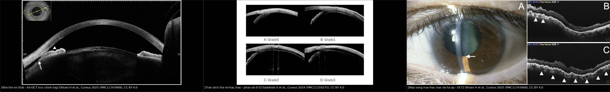
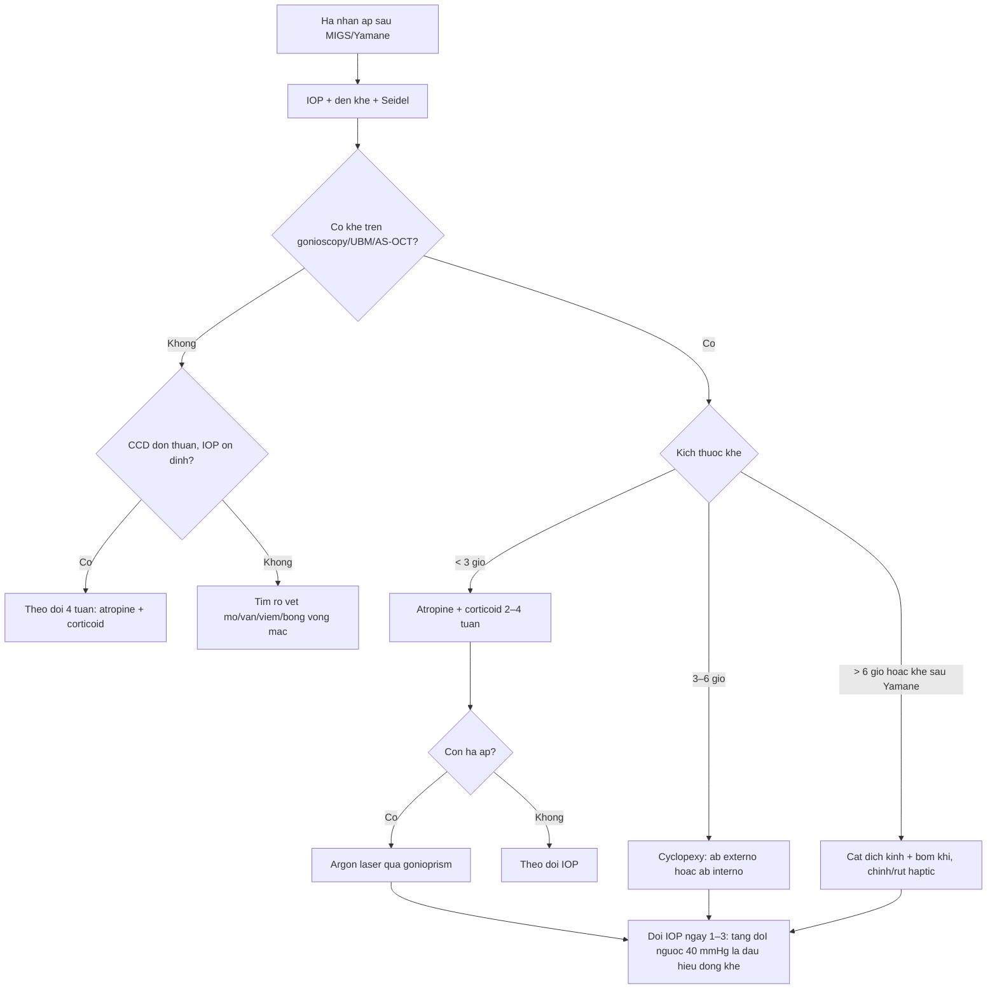
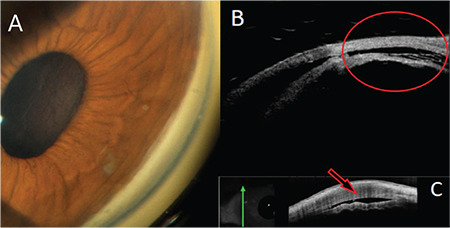
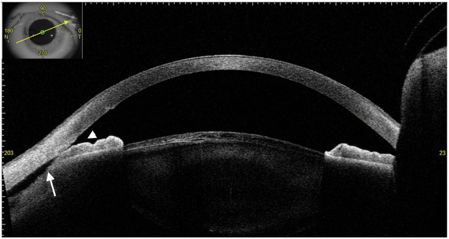
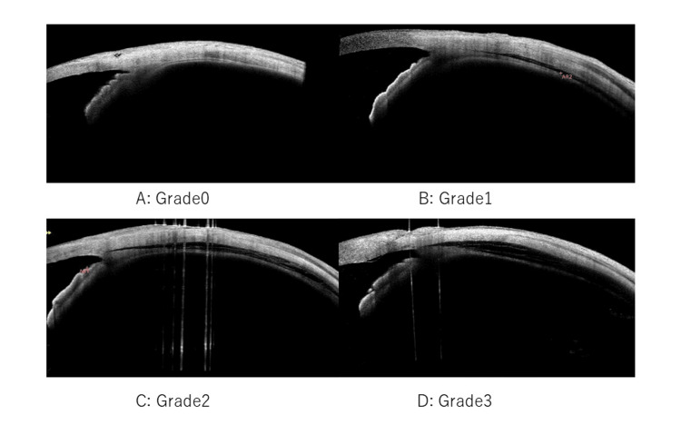
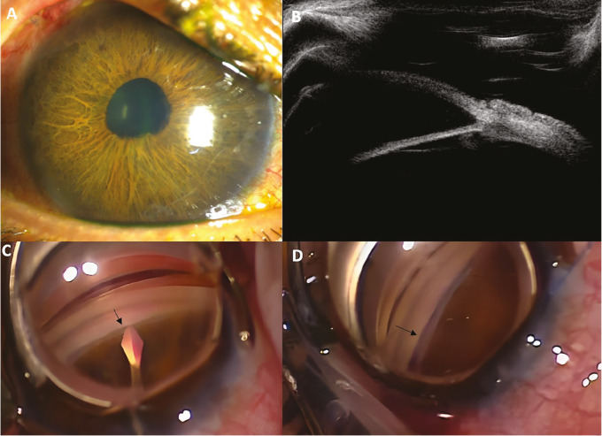

# 1447 — Rách thể mi sau MIGS và sau cố định IOL kiểu Yamane / Cyclodialysis cleft after MIGS and Yamane intrascleral IOL fixation

**Tags:** `pattern:rach-the-mi` `pattern:bong-the-mi` `pattern:ha-nhan-ap` `pattern:tien-phong-nong` `pattern:nep-vong-mac` `pattern:sau-mo-glaucoma` `pattern:sau-yamane` `pattern:giam-thi-luc` `pattern:mat-mot-ben` `vung:mat` `vung:the-mi` `vung:goc-tien-phong` `vung:hac-mac` `vung:hoang-diem` `protocol:gonioscopy` `protocol:UBM` `protocol:AS-OCT` `protocol:OCT` `score:IOP`
**Mức chắc chắn (certainty):** tổng hợp y văn (literature synthesis) — 1 tổng quan xử trí rách thể mi (2025), 1 phân tích gộp 100 năm phẫu thuật cyclodialysis (40 nghiên cứu), 1 tổng quan an toàn từng thiết bị MIGS, 2 đoàn hệ AS-OCT về tràn dịch thể mi–hắc mạc sau goniotomy (91 và 62 mắt), 1 đoàn hệ AS-OCT sau Yamane (45 mắt), và **6 ca nguyên văn có ảnh** (KDB, GATT, microhook, Yamane ×2, cyclopexy nội soi). **Không có RCT** so sánh atropine–laser–mổ; các ngưỡng là tổng hợp từ thuật toán Ormerod cải tiến + chuỗi ca.

> **Vì sao bài này quan trọng:** bài **1434** đã dạy **hạ nhãn áp sau quang đông thể mi** và đặt **MIGS/Yamane** vào ma trận như **một hàng**. Bài này trả lời câu hỏi mà hàng đó chưa trả lời: **sau một cuộc mổ glôcôm “thành công”, vì sao nhãn áp lại 3–5 mmHg — và khi nào đó là rách thể mi thật, khi nào chỉ là tràn dịch thể mi–hắc mạc thoáng qua?** Đây là nhóm **thủ thuật đang tăng nhanh**, biến chứng xuất hiện **sau mổ vài tuần đến 14 tháng**, và điểm chết người là **hai bệnh cảnh trông giống hệt trên AS-OCT thường quy** nhưng một bên **tự hết**, một bên cần **laser hoặc mổ lại**. Bỏ sót khe → **nếp hoàng điểm vĩnh viễn**; mổ quá sớm một tràn dịch thoáng qua → **tăng nhãn áp dữ dội sau khi đóng khe**.

> **Sửa tiền đề của backlog (trung thực nguồn):** backlog ghi “rách thể mi sau MIGS/Yamane” như một biến chứng đơn nhất. Y văn cho thấy **hai tầng khác nhau**: (1) **tràn dịch thể mi–hắc mạc (ciliochoroidal detachment, CCD)** — rất thường gặp sau mọi MIGS ab interno (19,7–29%) và sau Yamane (80% ngày 1), **phần lớn tự hết trong 1 tháng**, và (2) **khe thể mi thật (cyclodialysis cleft)** — hiếm (1,2–1,9% theo thiết bị), **không tự đóng**, mới là thứ cần can thiệp. Bài này tách hai tầng đó ra thay vì gộp thành “rách thể mi”.

## 1. Tổng quan bệnh học – cơ chế hình ảnh – vì sao “mổ nhẹ” vẫn rách thể mi

- **Giải phẫu quyết định:** các sợi **cơ thể mi hướng tâm (meridional ciliary muscle)** bám vào **scleral spur**; khi chúng bong khỏi spur, tiền phòng thông trực tiếp với **khoang trên hắc mạc**. Đây là **rách thể mi (cyclodialysis cleft)** — một đường rò nội bộ, không phải “viêm” và không phải “giảm sản xuất đơn thuần”.
- **TẠI SAO MIGS ab interno gây rách:** dụng cụ (lưỡi KDB, microhook, ống thông GATT) đi vào **góc tiền phòng** và cắt bè/ống Schlemm ngay **sát spur**. Nếu đầu dụng cụ **trượt sâu ra sau** hoặc **kéo dọc** theo sợi cơ thể mi, lực căng dồn vào **spur** → bong sợi hướng tâm. Vì vậy khe thường **khu trú đúng vị trí đường vào**, và **không tương quan với mức hạ áp** (khe nhỏ vẫn hạ áp nặng vì phần “giảm sản xuất” đi kèm).
- **TẠI SAO Yamane gây rách theo kiểu khác:** kim **27–30G** xuyên qua củng mạc **cách rìa giác mạc ~2 mm**, đi vào **ciliary sulcus**; đường hầm và **haptic** tạo một đường thông **phía sau góc**. Hệ quả: **gonioscopy chỉ loại trừ được khe phía trước**, còn khe sau kim **không thấy** — phải dùng **siêu âm/UBM**. Tệ hơn, chính **haptic** có thể **chèn vào đường rò, giữ khe mở**, nên **atropine thường thất bại** (2 ca Yamane trong y văn đều vậy).
- **TẠI SAO hạ áp làm mờ mắt:** nhãn cầu xẹp → củng mạc lún vào trong → **nếp võng mạc–hắc mạc** ở hoàng điểm → tế bào quang thụ biến dạng cơ học, cận thị hóa, nhìn biến dạng. Nếp có thể **hồi phục** nếu nâng áp sớm, nhưng **hạ áp kéo dài** để lại nếp vĩnh viễn.
- **TẦNG 1 — tràn dịch thể mi–hắc mạc (CCD) thoáng qua:** sau goniotomy, AS-OCT ngày 1 phát hiện **19,7% (18/91)** sau **KDB** và **29% (18/62)** sau **microhook**; **biến mất trong 1 tháng**. Sau **Yamane**, CCD ngày 1 gặp **80% (20/25)** so với **60% (12/20)** ở nhóm cắt dịch kính chứng (khác biệt **không có ý nghĩa**), còn **8%** vẫn còn ở tháng 1. Cơ chế: hạ áp + viêm + tăng tính thấm → dịch thoát vào khoang trên hắc mạc, **không có đường thông thật**.
- **TẦNG 2 — khe thể mi thật:** tỉ lệ theo thiết bị trong tổng quan an toàn MIGS: **KDB 1,2%**, **Trabectome 1,2%**, **iStent 1,9%**, **Hydrus 0,4%**; hạ áp chung sau KDB **0–3,13%**. Y văn chấn thương ghi **1–11%** rách thể mi sau chấn thương đụng dập — đây là **mốc so sánh**, không phải tỉ lệ sau MIGS.
- **Yếu tố nguy cơ đã báo cáo:** **mổ phối hợp với phaco** (CCD sau KDB tăng rõ), **giác mạc trung tâm mỏng** (yếu tố duy nhất trong phân tích đa biến sau microhook), **cận thị cao**, **tiền sử chấn thương/góc hẹp**, và **thao tác của phẫu thuật viên** (trong loạt KDB, CCD khác nhau theo người mổ, p < 0,05).
- **Dấu hiệu định lượng cần nhớ:** hạ áp = **IOP ≤ 5 mmHg**; CCD phân độ theo AS-OCT: **grade 1** < ½ độ dày thể mi, **grade 2** ≥ ½, **grade 3** > độ dày thể mi; sau đóng khe, **tăng áp dội ngược** thường gặp trong vài ngày đầu — ca GATT có **IOP 42 mmHg ngày 1**, ca microhook **35 mmHg** — đây là dấu hiệu **thành công**, không phải biến chứng.

## 2. Mẫu hình + chẩn đoán phân biệt theo thời điểm (Gamut)

- **Ngày 1–7 sau mổ:** hạ áp nhẹ + **CCD** trên AS-OCT (grade 1–2) là **bình thường** ở 20–80% tùy thủ thuật; tiền phòng có thể nông; **không vội mổ**.
- **Tuần 2 – tháng 3:** CCD lẽ ra phải hết; nếu **IOP vẫn ≤ 5 mmHg**, tiền phòng nông, hoặc xuất hiện **nếp hoàng điểm** → tìm **khe thật**.
- **Sau 3 tháng:** khe **mạn/ẩn** (đã có ca **14 tháng** không chẩn đoán được), thường biểu hiện bằng **cận thị hóa, nhìn mờ, nếp hoàng điểm**, IOP 2–6 mmHg.
- **Theo vị trí khe:** **trước (anterior)** — thấy trên gonioscopy, thường sau MIGS/chấn thương; **sau (posterior)** — sau kim Yamane/haptic, **gonioscopy âm**, phải UBM/siêu âm; **360°** — hiếm, gây hạ áp nặng, cần mổ.
- **Gamut “hạ áp sau MIGS/Yamane”:** CCD thoáng qua · **khe thể mi thật** · **suy thể mi** (đốt thể mi trước đó) · **rò vết mổ/bọng lọc** · **van dẫn lưu quá tải** · **viêm thể mi/nội nhãn** · **bong võng mạc** · **xuất huyết trên hắc mạc** · **hạ áp do thuốc** (hiếm).

## 3. Bảng so sánh phân biệt (ma trận đối chiếu)

| Thực thể (entity) | Hình ảnh/lâm sàng điển hình | Chốt vào (rule-in) | Chốt loại (rule-out) | Gợi ý xác nhận |
|---|---|---|---|---|
| **CCD thoáng qua sau MIGS/Yamane** | AS-OCT ngày 1: **khoang giảm phản xạ giữa thể mi và củng mạc** (grade 1–3), **không có khe thông**; IOP có thể thấp nhẹ; **hết trong 1 tháng** | **Dịch trên hắc mạc + không thấy đường thông** + tự cải thiện | **Khe rõ trên UBM/AS-OCT** hoặc **kéo dài > 1 tháng** → không còn là thoáng qua | AS-OCT 8 hướng/360°; đo IOP ngày 1, tuần 1, tháng 1 |
| **Khe thể mi thật (cyclodialysis cleft)** | **Đường thông tiền phòng → khoang trên hắc mạc** tại spur; IOP ≤ 5 mmHg; tiền phòng nông; nếp hoàng điểm | **Thấy khe trực tiếp** trên gonioscopy/UBM/AS-OCT; **hạ áp kéo dài**; hồi phục sau đóng khe | **Không thấy khe nhưng hạ áp** → suy thể mi/rò khác; **CCD đơn thuần** → theo dõi | Gonioscopy động + UBM 35–50 MHz; AS-OCT **trục chỉnh tay**; siêu âm khi khe sau |
| **Khe sau Yamane (posterior)** | Haptic xuyên củng mạc; **gonioscopy âm**; hạ áp + nếp; UBM thấy đường thông quanh haptic | **UBM/siêu âm thấy khe sau + haptic trong đường rò** | **Gonioscopy âm không loại trừ**; **atropine thất bại** là gợi ý | UBM, siêu âm cao tần; đối chiếu vị trí haptic |
| **Suy thể mi** | Tiền sử đốt thể mi/lặp đốt; thể mi mỏng/teo; **không khe**; IOP thấp | **Không có đường thông** + bối cảnh đốt nhiều | **Thấy khe** → khe là nguyên nhân | UBM; AS-OCT; theo dõi |
| **Rò vết mổ/bọng lọc** | **Seidel dương**, bọng lọc quá to, tiền phòng nông | **Seidel dương + bọng lọc** | **Seidel âm, không bọng** → loại trừ | Seidel test, đèn khe, AS-OCT vết mổ |
| **Van dẫn lưu quá tải** | IOP thấp, tiền phòng nông, có thể bong hắc mạc; tiền sử đặt van | **Van không có buồng/van, ống quá ngắn, đĩa bị bóc** | **Van hoạt động, IOP ổn** → loại trừ | Siêu âm/AS-OCT ống van; X-quang |
| **Viêm thể mi/nội nhãn** | Đau, đỏ, tế bào/flare, mủ tiền phòng, IOP thấp | **Dấu viêm rõ + cấy dương** | **Không viêm, không mủ** → loại trừ | Đèn khe, cấy/PCR; điều trị viêm trước |
| **Bong võng mạc** | IOP thấp, không thấy đáy mắt, B-scan có màng | **Bong võng mạc trên B-scan** | **Võng mạc áp** → loại trừ | B-scan; soi đáy mắt rộng |

*Ba ô: **(1) khe thể mi thật** — AS-OCT trục chỉnh tay thấy **bong góc + tiếp xúc mống mắt–bè** (mũi tên/đầu mũi tên); **(2) CCD thoáng qua** — phân độ grade 0–3 theo độ dày thể mi; **(3) nếp võng mạc–hắc mạc** do hạ áp. Ảnh: Ohtani H và cs., *Cureus* 2025 (PMC11743908), Sadahide A và cs., *Cureus* 2024 (PMC11316275) — **CC BY 4.0**, xem `images/CREDITS.md`.*

## 4. Protocol: phát hiện, phân tầng và thuật toán xử trí

- **Ngày 1 sau mọi MIGS/Yamane:** đo **IOP**, đèn khe (tiền phòng, Seidel), hỏi thị lực. **Không cần AS-OCT thường quy** nếu IOP ổn và không triệu chứng — vì CCD sinh lý sẽ chỉ làm ta can thiệp thừa.
- **Khi IOP ≤ 5 mmHg hoặc thị lực giảm không giải thích được:**
  - **Gonioscopy động** (ấn nhẹ, viscoelastic nếu tiền phòng nông) tìm khe **phía trước**.
  - **AS-OCT góc 360°** (8 hướng hoặc chế độ tự động) + **UBM 35–50 MHz** nếu nghi khe **sau** hoặc AS-OCT không thấy.
  - **AS-OCT trục chỉnh tay** khi chế độ mặc định báo “bình thường”: xoay mống mắt do thể mi bong có thể **che khe** — ca microhook chỉ lộ khe **203°** khi chỉnh tay.
  - **OCT hoàng điểm** tìm nếp/dịch; **B-scan** nếu không thấy đáy mắt.
- **Phân tầng xử trí (thuật toán Ormerod cải tiến):**
  1. **Nội khoa trước:** **atropine 1%** (giãn thể mi, kéo thể mi về spur) + **corticoid tại chỗ** giảm viêm; theo dõi **2–4 tuần**. Đây là điều trị đầu tay cho khe nhỏ, hạ áp nhẹ, **và cho CCD thoáng qua**.
  2. **Laser** khi khe **< 3 giờ đồng hồ** và nội khoa thất bại: **argon laser qua gonioprism** (hoặc diode transscleral/Nd:YAG ab externo). Cơ chế: **viêm do laser** gây dính thể mi vào củng mạc. Ca KDB đóng khe sau **3 lần argon**; ca GATT **thất bại** với atropine 2 tuần + argon → phải mổ.
  3. **Cyclopexy** khi khe **3–6 giờ** hoặc laser thất bại: **khâu trực tiếp thể mi vào củng mạc** (ab externo có vạt củng mạc, hoặc **ab interno qua tiền phòng** — ít xâm lấn, không mở kết mạc). Chuỗi 29 ca direct cyclopexy: **28/29 đóng thành công**; một số loạt chỉ **50%** sau một lần mổ.
  4. **Cắt dịch kính + bơm khí** khi khe **> 6 giờ**, khe 360°, hoặc khe sau Yamane có haptic chèn: **tamponade** đẩy thể mi áp vào củng mạc; có thể cần **rút/chỉnh haptic**.
  5. **Sau khi đóng khe:** cảnh báo **tăng nhãn áp dội ngược** (ca GATT **42 mmHg**, ca microhook **35 mmHg** ngày đầu) — đo IOP ngày 1–3, dùng thuốc hạ áp; đừng nhầm là “mổ thất bại”.
- **Dự phòng trong lúc mổ (checklist):**
  - **Luôn thấy đầu dụng cụ** trong góc; không đẩy sâu qua spur, không kéo dọc sợi cơ thể mi.
  - **Giữ tiền phòng bằng viscoelastic** đủ sâu để tách mống mắt khỏi góc và giảm ma sát.
  - **Kiểm tra góc bằng gonioscopy ngay cuối mổ** ở mắt nguy cơ (cận thị cao, CCT mỏng, mổ phối hợp).
  - **Yamane:** đường hầm củng mạc **~2 mm sau rìa**, kiểm tra haptic **nằm trong sulcus, không xuyên qua thể mi**; đóng kín vết mổ, kiểm tra Seidel.
  - **Ở mắt đã có tiền sử chấn thương/góc hẹp:** hạ thấp ngưỡng nghi ngờ, hẹn khám lại sớm hơn.

## 5. Biến thể bình thường và cạm bẫy

- **CCD sau MIGS là “biến thể bình thường” ở mức độ nhẹ:** 19,7–29% sau goniotomy, 80% sau Yamane ngày 1, **tự hết trong 1 tháng**. Điều trị mọi CCD bằng atropine dài ngày là **can thiệp thừa**.
- **Cạm bẫy AS-OCT mặc định:** ở ca microhook, chế độ tự động 45° **không thấy khe** vì mống mắt xoay ra trước che góc; **chỉnh trục tay** mới lộ **bong 203°**. Không được kết luận “không có khe” từ một lần quét mặc định.
- **Cạm bẫy gonioscopy sau Yamane:** khe **phía sau góc** không thấy bằng gương soi góc; **gonioscopy âm không loại trừ**. Phải UBM/siêu âm.
- **Cạm bẫy “atropine là đủ”:** với khe sau Yamane, **haptic giữ khe mở** nên atropine thất bại; cần **laser định vị hoặc rút/chỉnh haptic**.
- **Cạm bẫy tăng áp sau đóng khe:** IOP 40–42 mmHg ngày 1 là **dấu hiệu khe đã đóng**, không phải biến chứng; xử trí bằng thuốc, không mổ lại ngay.
- **Cạm bẫy “hạ áp = rách thể mi”:** sau đốt thể mi trước đó, hạ áp có thể do **suy thể mi** (bài 1434); tìm khe trước khi mổ là bắt buộc.
- **Cạm bẫy dùng corticoid kéo dài:** ở mắt đáp ứng corticoid, chính corticoid làm **tăng IOP** và che mất dấu hiệu đóng khe; đo IOP sau 1–2 tuần.
- **Biến thể giải phẫu:** **cận thị cao** làm củng mạc mỏng, dễ rách hơn và **nếp hoàng điểm nặng hơn**; **góc hẹp** làm gonioscopy khó, phải dùng viscoelastic/UBM.

## 6. Tự lượng giá — Blind Quiz

**Ca 1 — Nữ 69 tuổi, phaco + KDB một năm trước, nhìn mờ và đau mắt trái; IOP 3 mmHg, tiền phòng sâu bình thường.**

- Gợi ý lâm sàng: đáy mắt có nếp võng mạc; không sốt, không mủ tiền phòng.
- Câu hỏi: (1) Ba phương tiện trong ảnh cho thấy gì? (2) Vì sao tiền phòng vẫn sâu? (3) Bước tiếp theo?

<b>Bấm để hiện đáp án (findings + chẩn đoán)</b>

- **Dấu hiệu:** (A) gonioscopy thấy **khe/dải bong ở góc 10 giờ**; (B) UBM xác nhận **bong thể mi khỏi spur**; (C) AS-OCT thấy **đường tách thể mi** (mũi tên).
- **Chẩn đoán:** **khe thể mi thật sau KDB**, hạ áp 3 mmHg, **bệnh hoàng điểm do hạ áp** (nếp). Tiền phòng sâu vì dịch thoát qua khe, không phải qua vết mổ.
- **Bước tiếp:** atropine + corticoid, nếu không đóng → **argon laser** (ca gốc đóng sau **3 lần**); theo dõi IOP và OCT hoàng điểm.
- **Nguồn ảnh:** Şimşek D, Wagner I, Draper C, Şimşek T, Dorairaj S. *Turk J Ophthalmol* 2023;53(4):257–260 (PMC10442746), Fig. 1 — **CC BY-NC-ND 4.0**, dùng **nguyên bản**.

**Ca 2 — Nam 40 tuổi, microhook 14 tháng trước, hạ áp kéo dài; AS-OCT mặc định và gonioscopy ở tuyến trước đều “không thấy khe”.**

- Gợi ý lâm sàng: nhìn mờ, cận thị hóa, tiền phòng nông nhẹ, đồng tử biến dạng.
- Câu hỏi: (1) Vì sao AS-OCT mặc định bỏ sót? (2) Mũi tên và đầu mũi tên chỉ gì? (3) Xử trí?

<b>Bấm để hiện đáp án (findings + chẩn đoán)</b>

- **Dấu hiệu:** ảnh nhỏ góc trên cho thấy **trục quét chỉnh tay 23°–203°**; lát cắt chính: **bong góc (mũi tên)** và **tiếp xúc mống mắt–bè do mống mắt xoay ra trước (đầu mũi tên)**.
- **Chẩn đoán:** **khe thể mi mạn 203°** sau microhook; AS-OCT mặc định bỏ sót vì **mống mắt xoay che góc**, không phải vì không có khe.
- **Xử trí:** ca gốc **cyclopexy nội soi trực tiếp**; sau mổ IOP 35 mmHg (tăng dội ngược) rồi cần **van Ahmed**; nếp hoàng điểm cải thiện.
- **Nguồn ảnh:** Ohtani H và cs., *Cureus* 2025;17(1):e77516 (PMC11743908), Fig. 4 — **CC BY 4.0**.

**Ca 3 — Nam 71 tuổi, cố định IOL kiểu Yamane 1 tháng trước; IOP 4 mmHg, nhìn mờ; gonioscopy không thấy khe.**

- Gợi ý lâm sàng: tiền phòng nông, haptic thấy mờ qua kết mạc; không đau.
- Câu hỏi: (1) Ảnh phân độ gì? (2) Có phải khe thật không? (3) Vì sao gonioscopy âm vẫn phải làm UBM?

<b>Bấm để hiện đáp án (findings + chẩn đoán)</b>

- **Dấu hiệu:** **phân độ CCD grade 0–3** theo độ dày thể mi (grade 1 < ½, grade 2 ≥ ½, grade 3 > độ dày thể mi).
- **Chẩn đoán:** **CCD sau Yamane** — thường gặp (80% ngày 1), phần lớn thoáng qua; nhưng nếu **kéo dài + nếp hoàng điểm** phải tìm **khe sau** quanh haptic.
- **Vì sao UBM:** khe sau kim **nằm ngoài tầm nhìn của gonioscopy**; ca Yamane trong y văn có **atropine thất bại** vì haptic giữ khe mở, phải **laser định vị/chỉnh haptic**.
- **Nguồn ảnh:** Sadahide A, Ohara H, Oda R, Harada Y. *Cureus* 2024;16(8):e66562 (PMC11316275), Fig. 1 — **CC BY 4.0**.

**Ca 4 — Bệnh nhân GATT, hạ áp dai dẳng; sau cyclopexy 2 tuần, UBM dưới đây.**

- Gợi ý lâm sàng: IOP 24 mmHg sau mổ, tiền phòng sâu, không đau.
- Câu hỏi: (1) UBM xác nhận điều gì? (2) Vì sao IOP tăng sau mổ? (3) Theo dõi gì?

<b>Bấm để hiện đáp án (findings + chẩn đoán)</b>

- **Dấu hiệu:** (A) giác mạc trong; (B) **UBM xác nhận đóng hoàn toàn khe + hết dịch trên hắc mạc**; (C–D) hình soi góc/khâu sau mổ.
- **Chẩn đoán:** khe thể mi sau GATT **đã đóng**; IOP 24 mmHg là **tăng áp dội ngược** (dấu hiệu thành công), sau đó duy trì 12–16 mmHg với latanoprost.
- **Theo dõi:** IOP ngày 1–3 và tuần 1, OCT hoàng điểm, UBM lặp nếu IOP lại thấp.
- **Nguồn ảnh:** Üçgül AY, Aktaş Z. *Turk J Ophthalmol* 2026;56(2):135–139 (PMC13112503), Fig. 3 — **CC BY-NC-ND 4.0**, dùng **nguyên bản**.

## Bài liên quan chéo
- [1434 – Hạ nhãn áp sau quang đông thể mi & rách thể mi](../1434-ha-nhan-ap-rach-the-mi-sau-quang-dong/lesson.md)
- [1446 – Phù hoàng điểm sau quang đông thể mi](../1446-phu-hoang-diem-sau-quang-dong-the-mi/lesson.md)
- [1431 – Quang đông thể mi ở mắt bơm dầu](../1431-quang-dong-the-mi-mat-bom-dau/lesson.md)
- [1416 – Glôcôm do dầu silicone](../1416-glaucom-do-dau-silicone/lesson.md)
- [1425 – Viêm nội nhãn sau tiêm nội nhãn](../1425-viem-noi-nhan-sau-tiem-noi-nhan/lesson.md)

## Ảnh
- `images/1447_rach-the-mi-sau-migs-va-yamane_UBM-AS-OCT_PMC10442746-Fig1.jpg` — khe sau KDB (gonioscopy/UBM/AS-OCT), **CC BY-NC-ND 4.0**.
- `images/1447_rach-the-mi-sau-migs-va-yamane_AS-OCT-manual_PMC11743908-Fig4.jpg` — AS-OCT trục chỉnh tay, khe 203°, **CC BY 4.0**.
- `images/1447_rach-the-mi-sau-migs-va-yamane_AS-OCT-CCD-grade_PMC11316275-Fig1.jpg` — phân độ CCD 0–3, **CC BY 4.0**.
- `images/1447_rach-the-mi-sau-migs-va-yamane_OCT-nep-vong-mac_PMC11743908-Fig1.jpg` — nếp võng mạc–hắc mạc do hạ áp, **CC BY 4.0**.
- `images/1447_rach-the-mi-sau-migs-va-yamane_UBM-dong-cleft_PMC13112503-Fig3.jpg` — UBM sau đóng khe, **CC BY-NC-ND 4.0**.
- `images/composite_1447_cleft-CCD-fold.jpg` — ảnh ghép 3 bệnh cảnh, tạo bằng `tools/make_composite.py`, **không crop/kéo giãn**.

> Không dùng để chẩn đoán độc lập khi chưa có người hướng dẫn.
