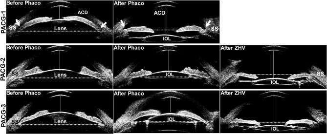
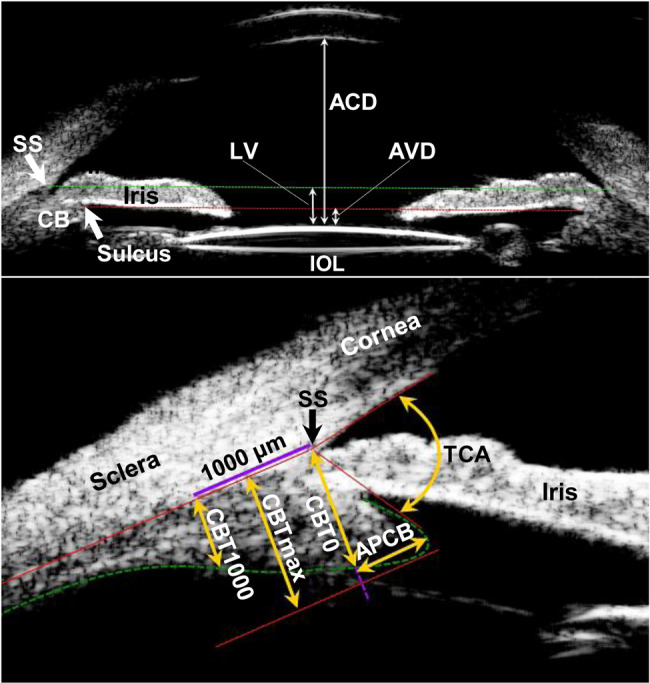
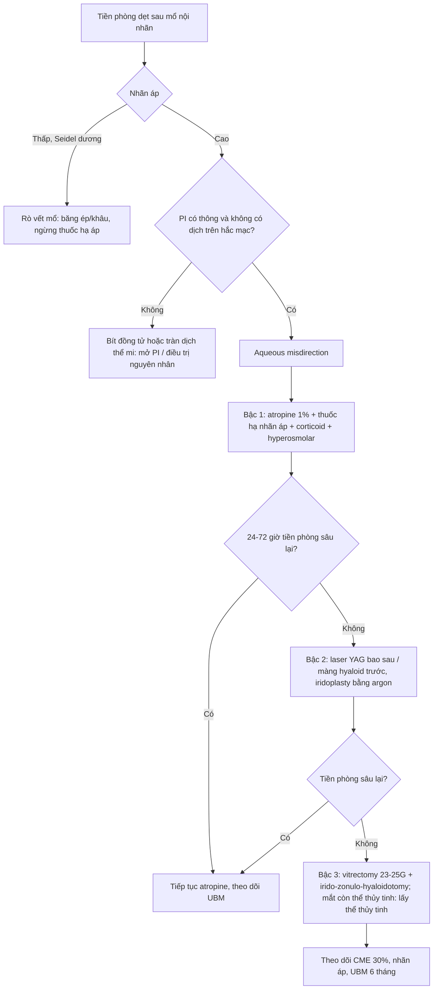
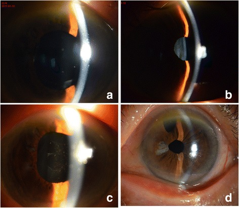
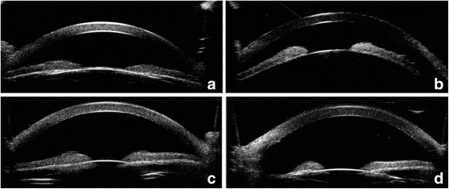

# 1448 — Glôcôm ác tính (aqueous misdirection) sau mổ nội nhãn, và mắt nanophthalmos / Malignant glaucoma (aqueous misdirection syndrome) after intraocular surgery in the nanophthalmic eye

**Tags:** `pattern:glaucoma` `pattern:tien-phong-det` `pattern:nhan-ap-cao` `pattern:mat-mot-ben` `pattern:nanophthalmos` `vung:mat` `vung:tien-phong` `vung:dich-kinh` `vung:nhan-cau` `protocol:UBM` `protocol:AS-OCT` `protocol:slit-lamp` `protocol:do-nhan-ap` `protocol:YAG`
**Mức chắc chắn (certainty):** tổng hợp y văn (literature synthesis) — 1 đoàn hệ UBM **60 mắt** (30 mắt glôcôm ác tính giả thể thủy tinh + 30 mắt chứng, BMC Ophthalmol 2025, PMC12036250), 1 loạt ca **12 mắt** sau phaco (2025, PMC11718072), 1 ca **nanophthalmos 82 tuổi** điều trị bằng laser (BMC Ophthalmol 2018, PMC5824548). Số liệu lấy từ toàn văn/bảng; câu nào là suy luận được ghi **[suy luận]**.

> **Vì sao bài này quan trọng:** đây là **"glôcôm góc đóng" mà mống mắt KHÔNG bị bít** — tiền phòng dẹt + nhãn áp cao sau mổ, **lỗ mở mống mắt (iridotomy) đã thông mà vẫn không giải quyết**. Điều trị **ngược hoàn toàn** với glôcôm góc đóng cấp: **atropine làm giãn thể mi**, **pilocarpine làm nặng thêm**. Ba bẫy chết người: **nhãn áp "chỉ 18–30 mmHg" nên không nghĩ glôcôm**, **tiền phòng dẹt bị đổ cho rò vết mổ**, và **mắt nanophthalmos bị xem là "chỉ cần phaco là an toàn"**.

## 1. Tổng quan bệnh học – cơ chế hình ảnh

- **Tên gọi:** **glôcôm ác tính (malignant glaucoma)** = **hội chứng thủy dịch đi lạc hướng (aqueous misdirection syndrome, AMS)** = **glôcôm do tắc thể mi (ciliary block glaucoma)**. Ba tên cùng một bệnh; "ác tính" chỉ nói **tiên lượng xấu nếu xử trí sai**, không phải ung thư.
- **Bộ ba chẩn đoán (phải đủ cả 3):**
  1. **Tiền phòng dẹt** — dẹt **cả trung tâm lẫn ngoại vi** (khác glôcôm góc đóng: trung tâm còn, ngoại vi dẹt).
  2. **Nhãn áp cao** (thường **30–60 mmHg**; có ca chỉ **18,6–30,8 mmHg** khi đã dùng thuốc — PMC5824548).
  3. **Bối cảnh sau mổ nội nhãn** (trabeculectomy, đặt ống dẫn lưu, **phaco**, YAG bao sau) **và lỗ mở mống mắt đã thông**.
- **Sinh lý bệnh — TẠI SAO thủy dịch "đi lạc":** thủy dịch do **biểu mô thể mi** tiết ra (**~2,5 µL/phút**) bình thường chảy qua đồng tử vào tiền phòng. Trong AMS, **thể mi xoay ra trước** và **mỏm thể mi áp sát chu biên thể thủy tinh / IOL** → tạo **"van một chiều"**: thủy dịch bị đẩy **về phía sau** vào **dịch kính**, tích trong các khoang dịch kính (schisis) và khoang trên thể mi. Vì **màng hyaloid trước còn nguyên** là hàng rào, khối dịch kính **căng ra** và **đẩy toàn bộ màng mống mắt–thể thủy tinh/IOL ra trước** → tiền phòng dẹt, góc đóng thứ phát, nhãn áp tăng.
- **TẠI SAO nhãn áp cao mà tiền phòng lại dẹt (nghịch lý cần hiểu):** áp lực trong **khoang sau** (dịch kính) cao hơn tiền phòng; **củng mạc** là vỏ đàn hồi kém nên áp lực đó **truyền ra thành nhãn cầu** và đo được bằng nhãn áp kế, trong khi **tiền phòng bị "bóp" rỗng**. Vì vậy **nhãn áp không phản ánh áp lực trong tiền phòng**, và **chọc tiền phòng cho "chảy bớt" là vô ích** (nước sẽ bị đẩy ra ngay, có khi gây rò và mất tiền phòng nặng hơn).
- **TẠI SAO nanophthalmos là thể nặng nhất:** mắt **trục ngắn (AL < 20,5 mm)**, **củng mạc dày**, **khoảng cách củng mạc–củng mạc (scleral spur to spur) hẹp**, thể mi **chen chúc trong vòng xơ cứng**; mổ nội nhãn làm **thể mi phù và xoay ra trước** dễ hơn hẳn. Glôcôm gặp ở **51,88%** mắt nanophthalmos (phân tích gộp **44 nghiên cứu, 1.397 mắt** — bài [418](../418-nanophthalmos-tran-dich-hac-mac/lesson.md)).
- **TẠI SAO thấy được trên UBM (vật lý):** UBM **35–50 MHz**, độ phân giải trục **~50 µm**, xuyên qua củng mạc/giác mạc **trong suốt** và **không cần mở nhãn cầu** → thấy trực tiếp **thể mi, mỏm thể mi, màng hyaloid trước, góc tiền phòng**. **CT** (độ phân giải ~0,5–1 mm) và **MRI** (bức xạ không, nhưng **không phân giải nổi thể mi 0,3–0,5 mm**) **không dùng để chẩn đoán AMS**; chúng chỉ để loại trừ khối sau nhãn cầu. **AS-OCT** đo tốt **độ sâu tiền phòng và cấu hình mống mắt–IOL** nhưng **kém xuyên qua mống mắt/củng mạc** nên **không thay được UBM** khi cần nhìn thể mi.
- **Số liệu định lượng cốt lõi (bắt buộc nhớ):**
  - **Tần suất:** **2–4%** sau **mổ glôcôm** (trabeculectomy/ống dẫn lưu); **< 2%** tổng số ca glôcôm (PMC11718072).
  - **Thời điểm khởi phát sau phaco:** trung bình **888 ngày** (SD ± 1.210; **khoảng 1–2.920 ngày ≈ 8 năm**) — **12 mắt** (PMC11718072). Nghĩa là **AMS giả thể thủy tinh có thể xuất hiện nhiều năm sau mổ**, không chỉ vài ngày.
  - **UBM trước cơn (30 mắt glôcôm ác tính giả thể thủy tinh so với 30 mắt chứng, đều là PACG đã phaco):** trước mổ **ACD 1,97 ± 0,12 mm** (chứng **1,99 ± 0,27 mm**, p = 0,638) và **AL 21,96 ± 0,61 mm** (chứng **22,25 ± 0,71 mm**, p = 0,101) — **không khác nhau**; điểm khác duy nhất là **CBTmax 0,87 ± 0,09 mm so với 0,95 ± 0,09 mm** (**p = 0,001**) (PMC12036250).
  - **Lúc cơn:** **ACD 2,41 mm (2,25–2,53)** so với **3,54 mm (3,39–3,75)**; **lens vault (LV) 0,46 mm** so với **−0,60 mm**; **AVD 0,69 mm** so với **−0,35 mm**; **TCA 53,92 ± 13,41°** so với **70,92 ± 10,65°** — tất cả **p < 0,001** (PMC12036250). **LV/AVD dương** nghĩa là **cực trước IOL đã vượt lên TRÊN đường nối hai gai củng mạc** — dấu chốt trên UBM.
  - **Giá trị tiên đoán:** **CBTmax** là **biến duy nhất** có giá trị tiên đoán trước cơn — **AUC 0,74 (95% CI 0,61–0,87); p = 0,001**; lúc cơn **AUC 0,86 (0,76–0,96)** (PMC12036250).
  - **Sau phaco, thể mi dày lên ở mắt KHÔNG bị AMS:** CBTmax **0,95 → 1,05 mm**, CBT0 **0,85 → 0,92 mm**, TCA **62,6 → 70,9°**; ở mắt bị AMS **không dày lên** (CBTmax **0,87 → 0,87 mm**) (PMC12036250). **[suy luận]** Đây là lý do "phaco xong vẫn phải đo lại UBM" ở mắt nguy cơ.
  - **Kết quả điều trị:** **laser mở mống mắt (LIT) 4 mắt → 3 mắt hết**; **9 mắt phải phẫu thuật 23G vitrectomy + irido-zonulectomy**; biến chứng hay gặp nhất **phù hoàng điểm dạng nang (CME) 30%** (PMC11718072). **Zonulo-hyaloido-vitrectomy (ZHV)** đạt **100% thành công, không tái phát trong 6 tháng** ở 30 mắt (PMC12036250, dẫn lại từ tài liệu trước).
  - **Ca nanophthalmos (82 tuổi, nam):** phaco **không biến chứng**, **2 tháng sau** vào viện vì glôcôm ác tính, **IOP dao động 18,6–30,8 mmHg** dù đã dùng thuốc; **thất bại với mở mống mắt ngoại vi bằng phẫu thuật + gỡ dính góc**; **một lần laser mở bao sau + cắt màng dịch kính trước** → **IOP về bình thường và tiền phòng sâu trong 24 giờ**, ổn định **9 tháng**, thị lực **20/50** (PMC5824548).

## 2. Mẫu hình + chẩn đoán phân biệt theo vị trí (gamut)

**Câu hỏi 1 — tiền phòng dẹt ở mắt ĐÃ MỔ, nhãn áp CAO hay THẤP?**

- **Dẹt + nhãn áp CAO** → **aqueous misdirection**, **glôcôm góc đóng do bít đồng tử (pupillary block)**, **hội chứng tắc bao (capsular block)**, **xuất huyết trên hắc mạc (suprachoroidal hemorrhage)**, **tràn dịch thể mi/hắc mạc gây đóng góc**.
- **Dẹt + nhãn áp THẤP** → **rò vết mổ (wound leak)**, **quá lọc sau trabeculectomy**, **hạ nhãn áp do thuốc**, **bong hắc mạc**. *Đây là phân nhánh quyết định — đo nhãn áp trước, rồi mới đo độ sâu tiền phòng.*

**Câu hỏi 2 — lỗ mở mống mắt có thông không?**

- **PI thông + vẫn dẹt/dẹt lại** → **loại trừ bít đồng tử**, nghĩ **misdirection** (hoặc **tắc bao** nếu IOL còn bít lỗ bao sau).
- **PI bít/không có** → **bít đồng tử** trước tiên; mở PI rồi đánh giá lại.

**Câu hỏi 3 — có gì ở phía SAU mống mắt (UBM/B-scan)?**

- **Không có khối, không có dịch trên hắc mạc, màng hyaloid trước nguyên** → **misdirection**.
- **Dịch trên hắc mạc/trên thể mi** → **tràn dịch thể mi–hắc mạc** (nguyên nhân hoặc bạn đồng hành).
- **Khối tăng âm trong dịch kính, "kissing choroid"** → **xuất huyết trên hắc mạc** (cấp cứu).
- **Khối đặc sau nhãn cầu** → **u (melanoma, di căn)**, **nang** — hiếm nhưng phải loại trừ trước khi mổ dịch kính.

**Gamut theo bối cảnh mổ (dễ nhớ):**

- **Sau phaco/trong bao IOL:** capsular block (ngày 1–7, dịch đục sau IOL), **misdirection giả thể thủy tinh** (ngày → 8 năm), **IOL bị bắt giữ đồng tử (optic capture)**.
- **Sau trabeculectomy/ống dẫn lưu:** **misdirection** (2–4%), **quá lọc/hạ nhãn áp**, **bít lỗ củng mạc**.
- **Sau YAG bao sau / sau chấn thương:** vỡ màng hyaloid → misdirection **thường gặp hơn** (mất hàng rào nhưng dịch kính lỏng hóa di chuyển dễ) **[suy luận]**.
- **Mắt nanophthalmos / góc hẹp / đục thể thủy tinh bẩm sinh:** nguy cơ **cao nhất**, cân nhắc **phẫu thuật một thì + theo dõi UBM**.

*Cột "Before Phaco": tiền phòng nông, thể mi áp sát chu biên thể thủy tinh. Cột "After Phaco": ở PACG-2 và PACG-3 **màng mống mắt–IOL bị đẩy ra trước, tiền phòng dẹt lại** — dấu chốt của misdirection giả thể thủy tinh. Cột "After ZHV": sau mổ **tiền phòng sâu trở lại**. Nguồn: Qin YJ và cs, *BMC Ophthalmol* 2025 (PMC12036250) Fig. 2, CC BY 4.0.*

## 3. Bảng so sánh phân biệt (ma trận đối chiếu)

| Thực thể (entity) | Hình ảnh điển hình (slit lamp / UBM / B-scan) | Chốt vào (rule-in) | Chốt loại (rule-out) | Gợi ý xác nhận |
|---|---|---|---|---|
| **Aqueous misdirection (glôcôm ác tính)** | Tiền phòng **dẹt đều cả trung tâm và ngoại vi**; **IOL/mống mắt đẩy ra trước vượt đường gai củng mạc** (LV **0,46 mm**, AVD **0,69 mm**); **không dịch trên hắc mạc**; **PI thông** | **PI thông + AC dẹt + IOP cao sau mổ + không có dịch trên hắc mạc** | **Có dịch trên hắc mạc rõ** → tràn dịch thể mi–hắc mạc; **IOP thấp** → rò/quá lọc | UBM 35–50 MHz; **atropine 1% thử** (đáp ứng = ủng hộ) |
| **Bít đồng tử (pupillary block)** | **Mống mắt phồng (iris bombe)** — tiền phòng **trung tâm còn, ngoại vi dẹt**; **PI không thông/bít** | **PI bít + iris bombe + mở PI giải quyết ngay** | **PI thông mà vẫn dẹt** → không phải bít đồng tử | Soi góc; mở PI bằng laser rồi đánh giá lại |
| **Hội chứng tắc bao (capsular block)** | **Ngày 1–7 sau phaco**; **IOL bị đẩy ra sau**, **dịch đục (milky) kẹt giữa IOL và bao sau**; tiền phòng nông | **Dịch sau IOL + thời điểm sớm + YAG bao sau giải quyết** | **Dịch kính căng, nhiều năm sau mổ** → misdirection | Khe sáng hẹp; YAG bao sau |
| **Xuất huyết trên hắc mạc** | **Đau dữ dội**; **bong hắc mạc hình vòm sẫm màu**, có khi **"kissing choroid"**; B-scan: khối **tăng âm dày** dưới hắc mạc | **Đau + bong hắc mạc dày + tăng âm trên B-scan** | **Không đau, hắc mạc áp sát, UBM chỉ thấy thể mi xoay** → misdirection | B-scan cấp cứu; theo dõi tan máu |
| **Tràn dịch thể mi–hắc mạc** | **Dịch đồng vang thấp** khoang trên hắc mạc/trên thể mi; góc đóng thứ phát; thường **hạ nhãn áp** hoặc IOP cao khi đóng góc | **Dịch trên thể mi/hắc mạc trên UBM** | **Không có dịch, chỉ thể mi xoay** → misdirection | UBM; ngừng thuốc gây (topiramate...), corticoid |
| **Rò vết mổ / quá lọc** | **Tiền phòng dẹt + IOP THẤP**; **Seidel dương**; giác mạc nhăn | **Seidel (+) hoặc IOP < 6 mmHg** | **IOP cao** → không phải rò | Thử fluorescein; băng ép/khâu |
| **Khối sau nhãn cầu** | B-scan: khối đặc, có thể kèm bong võng mạc tiết dịch | **Khối đặc trên B-scan/CT–MRI** | **Không khối** → loại | B-scan, CT/MRI hốc mắt |

- **Ảnh đối chiếu lâm sàng:** slit lamp mắt nanophthalmos trước và sau điều trị (a–b: tiền phòng dẹt; c–d: tiền phòng sâu trở lại sau laser/mổ) — `images/1448_glaucoma-ac-tinh_SL-nanophthalmos_PMC5824548-F1.jpg`.

## 4. Protocol chụp + hệ phân độ/điểm chuẩn hóa

**Bước 1 — khám tại chỗ (quyết định trước mọi hình ảnh):**

1. **Nhãn áp** (Goldmann) + **độ sâu tiền phòng trung tâm** (khe sáng hẹp) + **tiền phòng ngoại vi** (soi góc).
2. **Seidel** (loại rò) và **tình trạng lỗ PI** (thông/bít).
3. **Vị trí IOL** (trong bao / rãnh / bắt giữ đồng tử), **dấu hiệu tắc bao** (dịch sau IOL).

**Bước 2 — UBM 35–50 MHz (khảo sát 4 góc phần tư, đo 3 lần lấy trung vị):**

| Tham số | Cách đo | Ngưỡng/ý nghĩa |
|---|---|---|
| **ACD** (central anterior chamber depth) | mặt trong giác mạc trung tâm → mặt trước thể thủy tinh/IOL | Lúc cơn **2,41 mm** so với **3,54 mm** ở mắt chứng |
| **LV** (lens vault) | cực trước IOL → đường nối hai **gai củng mạc (scleral spur)** | **Dương** (vượt đường) = màng chắn đã bị đẩy ra trước; lúc cơn **0,46 mm** |
| **AVD** (anterior vault distance) | cực trước IOL → đường nối hai **rãnh thể mi** | Lúc cơn **0,69 mm** |
| **CBTmax** (độ dày thể mi tối đa) | điểm trong cùng của thể mi → bờ trong củng mạc | **Mỏng trước cơn: 0,87 mm so với 0,95 mm**; **AUC 0,74** |
| **TCA** (trabecular–ciliary angle) | mặt sau giác mạc ↔ mặt trước thể mi | Lúc cơn **53,9°** so với **70,9°** |
| **APCB** | bờ trước thể mi → đường thẳng đứng qua gai củng mạc | **Tăng khi đã có cơn**, không dùng để tiên đoán sớm |

*Trên: ACD, LV, AVD so với đường nối hai gai củng mạc (SS, đường xanh lá) và rãnh thể mi (đường đỏ). Dưới: CBT0, CBTmax, CBT1000, APCB và TCA. Nguồn: Qin YJ và cs, *BMC Ophthalmol* 2025 (PMC12036250) Fig. 1, CC BY 4.0.*

**Bước 3 — hình ảnh bổ trợ:** **AS-OCT** khi chỉ cần độ sâu tiền phòng và cấu hình mống mắt–IOL (nhanh, không cần tiếp xúc); **B-scan 10 MHz** khi phương tiện đục hoặc nghi **xuất huyết trên hắc mạc/khối sau nhãn cầu**.

**Bước 4 — điều trị theo bậc (không có RADS; dùng thuật toán):**

- **Nguyên tắc thuốc — chỗ hay sai:** **atropine 1%** (giãn thể mi, kéo thể mi ra sau) là **thuốc chủ lực**; **pilocarpine chống chỉ định** (co thể mi làm mỏm thể mi áp sát chu biên thể thủy tinh hơn); hạ nhãn áp bằng **ức chế tiết (timolol, dorzolamide, brimonidine)** + **acetazolamide/hyperosmolar**; **corticoid tại chỗ** giảm phù thể mi.
- **Bậc 2 — laser:** **YAG mở bao sau/màng hyaloid trước** (hiệu quả nhất khi còn **dịch kính lỏng hóa/đã phaco**); **argon iridoplasty ngoại vi** ít dùng hơn.
- **Bậc 3 — mổ:** **vitrectomy + irido-zonulo-hyaloidotomy** (nối tiền phòng với khoang dịch kính qua một đường ở chu biên); **thành công 100% trong 6 tháng** ở loạt 30 mắt (PMC12036250 dẫn lại); mắt **còn thể thủy tinh** thì **lấy thể thủy tinh ± vitrectomy**.
- **Theo dõi:** nhãn áp + tiền phòng **ngày 1, tuần 1, tháng 1–3–6**; **OCT hoàng điểm** tìm **CME (30%)**; **UBM lặp lại** nếu tiền phòng nông lại.

## 5. Biến thể bình thường và cạm bẫy

- **Biến thể bình thường dễ nhầm:** mắt **nanophthalmos** có **ACD < 2,2 mm** và **AL < 20,5 mm** *từ trước mổ* — **tiền phòng nông là "bình thường" của mắt này**, nên **dẹt thêm sau mổ** mới là bất thường. Đừng lấy ngưỡng ACD của mắt thường (≈ 3,0–3,5 mm) để đánh giá.
- **Cạm bẫy 1 — "nhãn áp chỉ hơi cao":** ca nanophthalmos **18,6–30,8 mmHg** dưới thuốc (PMC5824548) — **không có cơn tăng vọt 50–60 mmHg** vẫn là glôcôm ác tính. **Nhãn áp bình thường không loại trừ** khi đã dùng thuốc.
- **Cạm bẫy 2 — PI "đã mở" nên loại trừ misdirection:** PI thông **chỉ loại trừ bít đồng tử**, **không loại trừ** misdirection. Ngược lại, **PI thông + tiền phòng vẫn dẹt** là **dấu hiệu ủng hộ** misdirection.
- **Cạm bẫy 3 — dùng pilocarpine:** làm **nặng thêm**; đây là lỗi hay gặp khi chẩn đoán nhầm thành glôcôm góc đóng cấp.
- **Cạm bẫy 4 — chọc tiền phòng "cho xẹp":** thủy dịch bị đẩy ra sau ngay, **không giải quyết**, lại có nguy cơ **rò/mất tiền phòng** và **viêm nội nhãn**.
- **Cạm bẫy 5 — bỏ sót dịch trên hắc mạc đi kèm:** tràn dịch thể mi có thể **vừa là nguyên nhân vừa là hậu quả**; UBM **trước khi mổ dịch kính** là bắt buộc.
- **Cạm bẫy 6 — đo CBTmax sai thời điểm:** thuốc **cycloplegic/corticoid** làm thay đổi thể mi; muốn dùng **CBTmax** làm chỉ báo tiên đoán thì **đo trước cơn/trước mổ** (PMC12036250).
- **Cạm bẫy 7 — "phaco xong là hết nguy cơ":** AMS giả thể thủy tinh khởi phát tới **2.920 ngày (8 năm)** sau phaco (PMC11718072) — bệnh nhân **nanophthalmos/góc hẹp cần được dặn** triệu chứng và theo dõi dài.
- **Bẫy "thỏa mãn tìm kiếm":** thấy **một mắt** đã xử lý xong thì **không khám mắt bên** — nanophthalmos **hai bên**, mắt bên thường đã mổ hoặc sẽ mổ.

## 6. Tự lượng giá — Blind Quiz ngay trên trang tĩnh

**Ca 1 — nam 82 tuổi, nanophthalmos, 2 tháng sau phaco mắt phải. Nhìn ảnh, mô tả trước khi mở đáp án.**

- Gợi ý lâm sàng: phaco **không biến chứng** 2 tháng trước, nay **nhìn mờ**, **IOP 18,6–30,8 mmHg** dù đã dùng thuốc hạ áp.
- Câu hỏi: (1) Tiền phòng ở (a) và (b) khác gì tiền phòng ở (c) và (d)? (2) Ba chẩn đoán phân biệt? (3) Dấu hiệu nào **loại trừ bít đồng tử**?

<b>Bấm để hiện đáp án (findings + chẩn đoán)</b>

- Dấu hiệu (findings): (a) mắt phải và (b) mắt trái — **tiền phòng rất nông, mống mắt áp sát giác mạc**; (c) sau laser mắt phải và (d) sau mổ mắt trái — **tiền phòng sâu, thấy rõ IOL**.
- Chẩn đoán (diagnosis): **glôcôm ác tính (aqueous misdirection) trên mắt nanophthalmos** — thủy dịch đi lạc về dịch kính đẩy màng mống mắt–IOL ra trước; **không phải bít đồng tử** vì mống mắt **không phồng kiểu iris bombe** và **mở mống mắt + gỡ dính góc đã thất bại**.
- Nguồn ảnh: Wang J, Du E, Tang J. *BMC Ophthalmol* 2018 (PMC5824548) Fig. 1, CC BY 4.0.

**Ca 2 — cùng bệnh nhân, UBM trước và sau điều trị. Đoán trước khi mở.**

- Gợi ý lâm sàng: UBM thực hiện **trước** (a, b) và **sau** điều trị (c, d).
- Câu hỏi: (1) Ở (a) tiền phòng sâu bao nhiêu so với đường kính giác mạc? (2) Thể mi nằm ở đâu so với gai củng mạc? (3) Sau điều trị, thay đổi nào chứng minh cơ chế đã được giải quyết?

<b>Bấm để hiện đáp án (findings + chẩn đoán)</b>

- Dấu hiệu (findings): (a–b) **tiền phòng gần như bằng 0**, mống mắt và IOL **áp sát nội mô giác mạc**; (c–d) **tiền phòng sâu**, khoảng cách giác mạc–IOL rõ.
- Chẩn đoán (diagnosis): **aqueous misdirection** — mở thông bao sau + cắt màng dịch kính trước đã **tạo lại đường thông tiền phòng–dịch kính**, tiền phòng sâu trong **24 giờ**; ổn định **9 tháng**, thị lực **20/50**.
- Phản biện: đáp ứng với **laser** (không cần vitrectomy) là **may mắn về giải phẫu** — mắt còn **dịch kính lỏng hóa** và **đã phaco**; mắt nanophthalmos khác có thể phải **ZHV**.
- Nguồn ảnh: Wang J, Du E, Tang J. *BMC Ophthalmol* 2018 (PMC5824548) Fig. 2, CC BY 4.0.

**Ca 3 — ba mắt PACG đã phaco, UBM theo dõi. Tìm mắt đã bị glôcôm ác tính.**

- Gợi ý lâm sàng: cả ba mắt đều **PACG, AL ~22 mm**, phaco trong bao, IOL trung tâm.
- Câu hỏi: (1) Hàng nào có màng mống mắt–IOL **vượt đường nối gai củng mạc**? (2) Tham số nào **khác nhau TRƯỚC cơn**? (3) Vì sao "AL ngắn và ACD nông" **không đủ** để tiên đoán?

<b>Bấm để hiện đáp án (findings + chẩn đoán)</b>

- Dấu hiệu (findings): **PACG-2 và PACG-3** — sau phaco tiền phòng **dẹt lại**, cực trước IOL **vượt lên trên đường gai củng mạc** (LV **0,46 mm**, AVD **0,69 mm**); **PACG-1** giữ tiền phòng sâu. Sau **ZHV**, tiền phòng sâu trở lại.
- Chẩn đoán (diagnosis): **glôcôm ác tính giả thể thủy tinh**; **trước cơn** chỉ **CBTmax** khác biệt (**0,87 so với 0,95 mm**, p = 0,001; **AUC 0,74**), còn **AL/ACD trước mổ không khác** (AL **21,96 so với 22,25 mm**, p = 0,101).
- Nguồn ảnh: Qin YJ và cs, *BMC Ophthalmol* 2025 (PMC12036250) Fig. 2, CC BY 4.0.

## Bài liên quan chéo

- [418 – Nanophthalmos & hội chứng tràn dịch hắc mạc](../418-nanophthalmos-tran-dich-hac-mac/lesson.md)
- [414 – Glôcôm và nhãn cầu nhỏ ở PFV](../414-glaucoma-va-nhan-cau-nho-o-pfv/lesson.md)
- [442 – Glôcôm trên OCT](../442-glaucoma-OCT/lesson.md)
- [1452 – Glôcôm do thể thủy tinh chưa mổ](../1452-glaucom-do-the-thuy-tinh-chua-mo/lesson.md)
- [1411 – Tăng nhãn áp do corticoid nội nhãn](../1411-tang-nhan-ap-do-corticoid-noi-nhan/lesson.md)

## Ảnh

- `1448_glaucoma-ac-tinh_SL-nanophthalmos_PMC5824548-F1.jpg` — sinh hiển vi đèn khe, **CC BY 4.0**.
- `1448_glaucoma-ac-tinh_UBM-nanophthalmos_PMC5824548-F2.jpg` — UBM, **CC BY 4.0**.
- `1448_glaucoma-ac-tinh_UBM-PACG_PMC12036250-F2.jpg` — UBM 3 bệnh nhân, **CC BY 4.0**.
- `1448_glaucoma-ac-tinh_UBM-do-luong_PMC12036250-F1.jpg` — sơ đồ đo 7 tham số, **CC BY 4.0**.
- Chi tiết nguồn/giấy phép: `images/CREDITS.md`; link gốc: `sources.md`.

> Không dùng để chẩn đoán độc lập khi chưa có người hướng dẫn.
