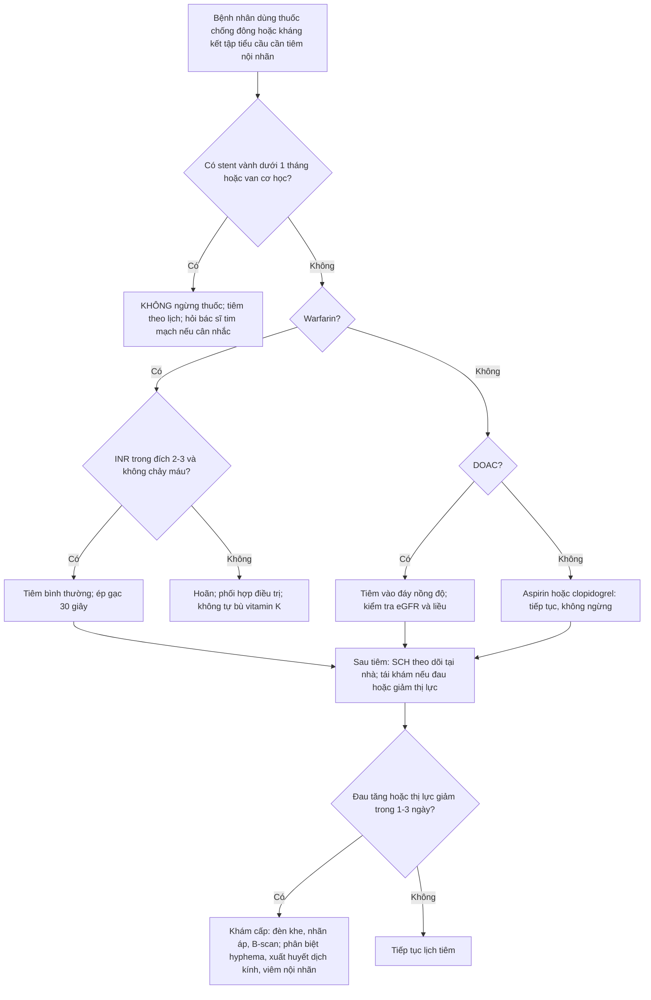
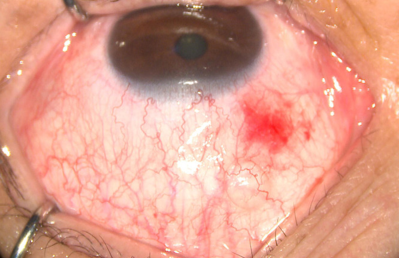
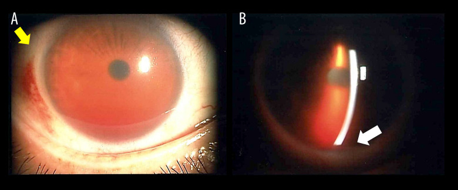
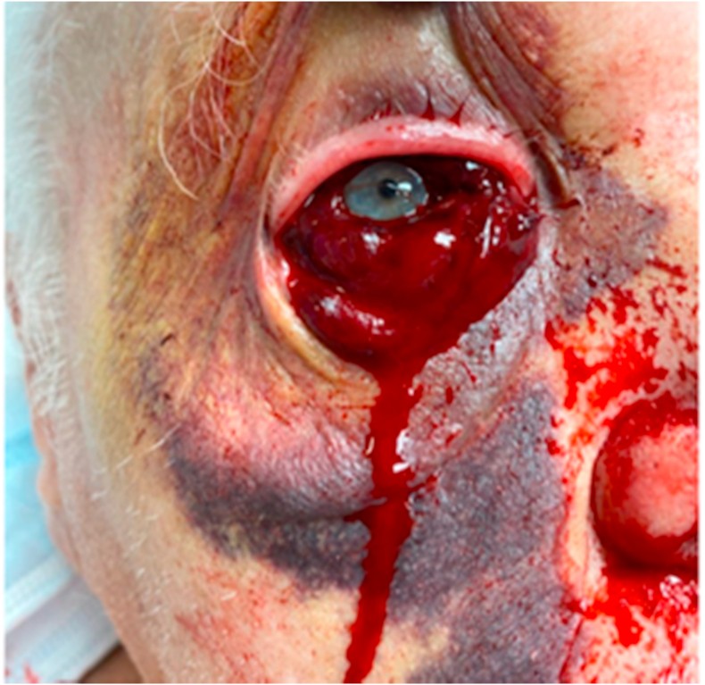

# 1449 — Tiêm nội nhãn ở bệnh nhân dùng thuốc chống đông/kháng kết tập tiểu cầu: ngừng hay tiếp tục? / Intravitreal injection in patients on anticoagulants or antiplatelets

**Tags:** `pattern:xuat-huyet-duoi-ket-mac` `pattern:hyphema` `pattern:xuat-huyet-dich-kinh` `pattern:xuat-huyet-duoi-vong-mac` `pattern:xuat-huyet-hac-mac` `vung:mat` `vung:ket-mac` `vung:tien-phong` `vung:dich-kinh` `vung:vong-mac` `protocol:tiem-noi-nhan` `protocol:INR` `protocol:khang-dong` `protocol:antiplatelet`

**Mức chắc chắn (certainty):** tổng hợp y văn (literature synthesis) — đọc toàn văn 3 bài mở (2 ca nguyên văn + 1 thử nghiệm ngẫu nhiên 2026) và abstract/đoàn hệ của 6 nghiên cứu lớn; **không có thử nghiệm ngẫu nhiên nào** so sánh "ngừng" với "tiếp tục" thuốc chống đông trước tiêm nội nhãn (không thể làm vì biến cố nặng quá hiếm). Các ngưỡng dưới đây là **suy luận (inference)** từ đoàn hệ lớn + dược lý, ghi rõ tại chỗ.

## 1. Tổng quan bệnh học – cơ chế hình ảnh – vì sao "chảy máu dưới kết mạc" lại khác "chảy máu trong mắt"

### 1.1. Ba tầng cầm máu, ba loại thuốc, ba kiểu chảy máu

- **Cầm máu tiên phát (primary haemostasis)** do **tiểu cầu** đảm nhiệm ở **kết mạc – củng mạc** (mô mềm, mao mạch nông). **Aspirin** ức chế không hồi phục **COX-1** → giảm thromboxane A₂; **clopidogrel/prasugrel/ticagrelor** ức chế không hồi phục **P2Y12**. Vì tiểu cầu sống **7–10 ngày**, hiệu lực thuốc kéo dài **suốt đời sống tiểu cầu** dù nồng độ thuốc trong máu đã hết.
- **Thác đông máu (coagulation cascade)** quyết định **cục máu đông bền trong lòng mạch**. **Warfarin** ức chế **VKORC1** → giảm yếu tố **II, VII, IX, X** (nửa đời hiệu dụng **36–42 giờ**, nên INR phản ánh trạng thái **2–3 ngày** trước); **DOAC** (apixaban, rivaroxaban, edoxaban ức chế **Xa**; dabigatran ức chế **thrombin**) có nửa đời **~10–14 giờ** ở người chức năng thận bình thường.
- **Tiêu sợi huyết (fibrinolysis)** quyết định máu đã đông **tan nhanh hay chậm** — đây là lý do máu dưới kết mạc **đổi màu vàng** sau **1–2 tuần** (hemoglobin → bilirubin).

**Hệ quả lâm sàng:** thuốc kháng kết tập tiểu cầu làm tăng chủ yếu **xuất huyết dưới kết mạc (subconjunctival haemorrhage, SCH)** — biến cố **lành tính, tự khỏi**; thuốc chống đông (đặc biệt warfarin) mới là yếu tố làm tăng **xuất huyết trong mắt** (dịch kính, dưới võng mạc) ở mắt có **màng tân mạch dễ vỡ**.

### 1.2. Vì sao SCH gặp ở 40–70% người tiêm — kể cả KHÔNG dùng thuốc

- Kim **27–30G** xuyên **kết mạc + Tenon** ở **3,5–4,0 mm sau rìa giác mạc**, nơi có **đám rối mạch máu thượng củng mạc** dày. Khoang dưới kết mạc **lỏng, dễ bóc tách**, nên chỉ **0,5–2 mL máu** đã loang **360°** và thấm ra mi → trông "khủng khiếp" nhưng **không ảnh hưởng thị lực**.
- Tỷ lệ SCH **41,2%** ở nhóm xem video giáo dục và **69,2%** ở nhóm chứng trong một RCT 103 bệnh nhân tiêm anti-VEGF lần đầu (PMC13102109, 2026) — **không có bệnh nhân nào dùng thuốc chống đông bị biến chứng nặng** trong nghiên cứu này. Nhưng chính nghiên cứu đó cho thấy **dùng thuốc chống đông làm tăng SCH: OR 3,252 (95% CI 1,166–9,071; p = 0,024)**.
- Loạt 80 mũi tiêm ở người dùng **kháng vitamin K hoặc kháng kết tập tiểu cầu**: SCH nhỏ **45%**, **không ca nào** xuất huyết dưới kết mạc bán phần hay xuất huyết dịch kính (PMID 18351536, 2008).

### 1.3. Vì sao xuất huyết ĐE DỌA THỊ LỰC lại hiếm — và khi nào nó xảy ra

- **Đường vào pars plana tương đối vô mạch**, vết kim **30G tự bít** khi rút; **0,05 mL** dịch tiêm chỉ làm nhãn áp tăng **thoáng qua** vài phút. Vì vậy **không có lý do cơ học** để chảy máu ồ ạt chỉ vì INR 2,5.
- Xuất huyết nặng xảy ra khi **kim chạm mạch máu bất thường**:
  - **Chạm màng tân mạch (CNV) hoặc polyp (PCV)** đang hoạt động → **xuất huyết dưới võng mạc/dịch kính đột phá (breakthrough vitreous haemorrhage)**. Trong AMD có xuất huyết dưới hoàng điểm lớn, **dùng thuốc chống đông là yếu tố nguy cơ độc lập cho xuất huyết dịch kính đột phá (p = 0,014)**; **thể PCV có OR 35,01**, và **diện xuất huyết 22,7 ± 12,4 DA vs 5,4 ± 6,9 DA** (PMID 30002432, 2018).
  - **Chạm mạch thể mi/hắc mạc** (kim quá ra sau, mắt xoay) → **xuất huyết hắc mạc (suprachoroidal haemorrhage)** — đau dữ dội, tiền phòng nông, khối sẫm màu; **hiếm nhưng mù**.
  - **Chạm mống mắt/thể mi** (mắt đã mổ, tiền phòng nông) → **hyphema**; loạt **26.184 mũi** ghi nhận **3 ca hyphema ≈ 1/10.000**, **2/3 ca đang dùng warfarin + aspirin liều thấp** (PMID 25389692, 2011).
- **Bằng chứng "không ngừng thuốc":** đoàn hệ **520 bệnh nhân/675 mắt/3.106 mũi** — **548 mũi** ở người dùng warfarin, **523 mũi** clopidogrel, **1.254 mũi** aspirin — **0 biến chứng xuất huyết** (xuất huyết hắc mạc, dịch kính, hoặc tăng xuất huyết dưới hoàng điểm); giới hạn tin cậy trên của tỷ lệ biến cố chỉ **0,37–0,88%** tùy nhóm (PMID 20924260, 2010).
- **Warfarin so với DOAC:** ở bệnh nhân AMD + rung nhĩ theo dõi **5 năm**, warfarin làm tăng **xuất huyết hoàng điểm RR 1,86 (1,47–2,35)**, **xuất huyết dịch kính RR 2,22 (1,51–3,26)** và **chuyển dạng tân mạch RR 1,25 (1,14–1,38)** so với DOAC; **không khác biệt biến cố chảy máu toàn thân nặng** (PMID 39116948, 2025). Đây là lý do **ưu tiên DOAC** khi có lựa chọn — **không phải lý do ngừng thuốc**.

### 1.4. Vì sao "ngừng thuốc cho chắc" lại là quyết định SAI

- Ngừng kháng kết tập tiểu cầu ở người **vừa đặt stent mạch vành** có thể gây **huyết khối stent** — tử vong **20–40%**, cao hơn **hàng nghìn lần** nguy cơ xuất huyết nặng sau tiêm.
- Ngừng warfarin ở bệnh nhân **van tim cơ học** hoặc **rung nhĩ có điểm CHA₂DS₂-VASc cao** gây **đột quỵ**; "cầu nối" heparin làm tăng cả chảy máu và huyết khối.
- **98% bác sĩ võng mạc** trong một khảo sát **không yêu cầu ngừng thuốc chống đông** trước tiêm (PMID 27366050, 2016); hội nghị đồng thuận Đức xếp **tiêm nội nhãn vào nhóm thủ thuật KHÔNG cần điều chỉnh thuốc** (PMID 29770858, 2018).

## 2. Mẫu hình + chẩn đoán phân biệt theo vị trí và theo thời điểm (Gamut)

- **Mẫu hình cốt lõi:** bệnh nhân đang dùng **aspirin/clopidogrel/warfarin/DOAC**, tiêm anti-VEGF định kỳ, sau tiêm **1–3 ngày** đỏ mắt → **phân biệt bằng "máu nằm ở đâu"**, không bằng "INR bao nhiêu".
- **Gamut theo vị trí (từ ngoài vào trong):**
  - **Dưới kết mạc (SCH):** đỏ tươi → sẫm, lan 360°, không đau, thị lực bình thường.
  - **Tiền phòng (hyphema):** mức máu ngang, có thể **tế bào hồng cầu lơ lửng**, đau nhẹ, **nhìn mờ**.
  - **Dịch kính (vitreous haemorrhage):** mờ đỏ đồng nhất hoặc **"đom đóm"**, **mất phản xạ đỏ**, không thấy đáy mắt.
  - **Dưới võng mạc (submacular):** mảng đỏ sẫm dưới hoàng điểm, **giảm thị lực đột ngột**.
  - **Hắc mạc (suprachoroidal):** khối sẫm màu **lồi vào dịch kính**, đau nhiều, tiền phòng nông, nhãn áp cao.
  - **Hốc mắt (retrobulbar/orbital):** **lồi mắt, đau, căng**, thị lực giảm, đồng tử giãn — **cấp cứu**.
- **Gamut theo thời điểm:**
  - **Trong/ngay sau tiêm:** SCH, hyphema, xuất huyết hắc mạc, retrobulbar.
  - **1–3 ngày:** SCH lan rộng, hyphema "muộn", **viêm nội nhãn** (phân biệt quan trọng).
  - **1–4 tuần:** xuất huyết dịch kính đột phá từ PCV/CNV, **glaucoma tan máu (hemolytic glaucoma)** do hồng cầu thoái hóa.
- **Gamut theo thuốc:** **aspirin/clopidogrel** → SCH là chính; **warfarin** → xuất huyết trong mắt nhiều hơn DOAC; **kháng kết tập kép (DAPT) hoặc ba thuốc** → SCH nhiều nhất; tín hiệu xuất huyết nội nhãn mạnh nhất trong **90 ngày đầu** dùng thuốc (PMC10130193, 2023).

## 3. Bảng so sánh phân biệt (ma trận đối chiếu)

| Thực thể (entity) | Hình ảnh điển hình | Chốt vào (rule-in) | Chốt loại (rule-out) | Gợi ý xác nhận |
|---|---|---|---|---|
| **Xuất huyết dưới kết mạc (SCH)** | Đỏ tươi/sẫm lan 360°, bờ không đều, không mức máu trong tiền phòng | **Đỏ kết mạc đơn thuần + thị lực không đổi + không đau** | Có **mức máu tiền phòng**, giảm thị lực, đau → không phải SCH đơn thuần | Đèn khe; đo nhãn áp nếu nghi |
| **Hyphema sau tiêm** | Mức máu ngang tiền phòng, hồng cầu lơ lửng, có thể **tăng nhãn áp** | **Máu tiền phòng + tiền sử tiêm 1–3 ngày** | Đồng tử dính, mủ tiền phòng, phản ứng thể mi mạnh → nghĩ viêm nội nhãn | Đèn khe, nhãn áp, siêu âm B nếu không thấy đáy mắt |
| **Xuất huyết dịch kính đột phá (PCV/CNV)** | Mờ đỏ đồng nhất, không thấy đáy mắt; tiền sử **PCV hoặc xuất huyết dưới hoàng điểm lớn** | **PCV + diện xuất huyết lớn (22,7 DA) + đang dùng chống đông** | Đáy mắt thấy rõ, không có màng tân mạch → loại trừ | Siêu âm B, OCT/FA sau khi máu tan |
| **Xuất huyết hắc mạc** | Khối sẫm màu lồi vào dịch kính, tiền phòng nông, **đau dữ dội**, nhãn áp cao | **Đau + tiền phòng nông + khối sẫm màu sau tiêm** | Chỉ đỏ kết mạc, không đau, tiền phòng sâu → loại trừ | Siêu âm B (khối dày, không di động) |
| **Xuất huyết sau nhãn cầu/orbit** | **Lồi mắt, căng, đau**, đồng tử giãn, thị lực giảm nhanh | **Lồi mắt + đau + giảm thị lực trong vài giờ** | Không lồi mắt, đồng tử bình thường → loại trừ | CT hốc mắt nếu cần; **canthotomy trong 2 giờ** |
| **Viêm nội nhãn sau tiêm** | Mủ tiền phòng, viêm dịch kính, **đau tăng**, 1–3 ngày | **Đau + mủ tiền phòng + viêm dịch kính** | Chỉ máu, không mủ, không viêm dịch kính → ít nghĩ | B-scan, chọc tiền phòng cấy (khi đủ chỉ định) |
| **Phù/xung huyết kết mạc do povidone-iodine** | Đỏ nhạt, phù kết mạc, không có máu đọng | **Đỏ ngay sau tiêm, mờ dần trong 24 giờ** | Có mảng máu đặc, đổi màu theo ngày → không phải | Quan sát 24 giờ |

## 4. Protocol tiêm + phân tầng xử trí theo thuốc

### 4.1. Trước tiêm — 6 câu hỏi bắt buộc

1. **Thuốc gì, vì sao dùng?** (rung nhĩ, van cơ học, stent vành, đột quỵ, huyết khối tĩnh mạch).
2. **Lần dùng cuối?** DOAC: tiêm vào **đáy nồng độ (trough)** — apixaban/rivaroxaban **12 giờ**, dabigatran **12–24 giờ** sau liều trước; warfarin: không cần canh giờ.
3. **INR (nếu warfarin):** đích **2,0–3,0** (van cơ học **2,5–3,5**). **Không có ngưỡng INR nào được chứng minh làm giảm biến chứng** — chỉ **hoãn** khi INR **> 4,5** hoặc có chảy máu đang hoạt động, và phối hợp với bác sĩ điều trị.
4. **Stent vành trong 1 tháng?** → **tuyệt đối không ngừng** DAPT; nếu cần, **hoãn tiêm** đến khi hỏi được bác sĩ tim mạch.
5. **Tiểu cầu và chức năng thận:** tiểu cầu **< 50 × 10⁹/L** → hoãn; eGFR **< 30 mL/phút** → DOAC tích lũy, hỏi lại liều.
6. **Mắt có màng tân mạch dễ vỡ?** PCV, xuất huyết dưới hoàng điểm **> 5 DA**, tân mạch mống mắt → **nguy cơ xuất huyết trong mắt cao hơn**; vẫn tiêm nhưng **theo dõi sát 1 tuần**.

### 4.2. Kỹ thuật — các bước làm giảm SCH mà không cần ngừng thuốc

- **Povidone-iodine 5–10%** kết mạc **30–60 giây** (bắt buộc; giảm viêm nội nhãn).
- **Banh mi**, bệnh nhân nhìn thẳng hoặc lên trên; đo **3,5–4,0 mm sau rìa**; **tránh mạch máu lớn** nhìn thấy; kim **30G**, **vát lên**.
- Tiêm **chậm** (0,05 mL trong **≥ 5 giây**), rút kim **theo trục**, **ép gạc 15–30 giây** tại chỗ chọc (giảm SCH, không thay đổi nguy cơ trong mắt).
- **Kiểm tra thị lực/ánh sáng** sau tiêm; đo **nhãn áp** nếu đau hoặc nhìn mờ.
- **KHÔNG** chọc dò tiền phòng "dự phòng", **KHÔNG** dùng thuốc co mạch, **KHÔNG** đắp băng ép kín (che mất dấu hiệu viêm nội nhãn).

### 4.3. Lưu đồ quyết định

### 4.4. Ngưỡng xử trí biến chứng

| Biến cố | Ngưỡng hành động | Xử trí |
|---|---|---|
| SCH đơn thuần | Không có ngưỡng — **không cần điều trị** | Giải thích, nước mắt nhân tạo; **không ngừng thuốc** |
| SCH ồ ạt + chảy máu hoạt động + chemosis chèn ép | **Thị lực giảm hoặc không cải thiện sau 1 tuần** | Ép tại chỗ, **ngừng và đảo ngược kháng đông** cùng huyết học (ca nguyên văn INR 2,85) |
| Hyphema | **Nhãn áp > 30 mmHg** hoặc thị lực giảm | Corticoid tại chỗ, thuốc hạ nhãn áp; **rửa tiền phòng/PPV khi nhãn áp > 40–50 mmHg không đáp ứng** |
| Xuất huyết dịch kính | Không tự tan sau **4–8 tuần** hoặc có bong võng mạc | PPV; **không đổi thuốc chống đông chỉ vì xuất huyết** |
| Xuất huyết hắc mạc | Bất kỳ | Cấp cứu; **PPV + dầu silicon**, kiểm soát nhãn áp |
| Xuất huyết hốc mắt | **Nhãn áp > 40 mmHg hoặc giảm thị lực** | **Canthotomy/cantholysis trong 2 giờ** |

## 5. Biến thể bình thường và cạm bẫy

- **SCH "nở" sau 24–48 giờ** là bình thường (máu loang theo trọng lực, xuống mi dưới) — **không phải dấu hiệu thuốc quá liều**.
- **Sắc tố kết mạc (melanosis, nevus) bẩm sinh** bị đọc là SCH mạn: màu nâu xám, **không đổi màu vàng** theo tuần.
- **Chemosis do povidone-iodine/thuốc tê** giả "xuất huyết" — bờ phù trong, không có mảng máu đặc.
- **Hyphema ở mắt giả thủy tinh** có thể chỉ là **máu trào ngược theo vết kim**, tự tan; đừng vội gọi "tân mạch mống mắt".
- **Bỏ sót viêm nội nhãn vì "đã có máu"** (satisfaction of search): đau tăng + mủ tiền phòng + viêm dịch kính trong **1–3 ngày** phải thắng chẩn đoán "chỉ là máu".
- **Tự ngừng aspirin "3 ngày trước tiêm"** là thói quen không có bằng chứng, làm tăng biến cố tim mạch; **không làm**.
- **Đo INR ở người dùng DOAC** là sai xét nghiệm (INR không phản ánh tác dụng DOAC); dùng **anti-Xa** khi thật cần.
- **Xuất huyết hắc mạc có thể xảy ra với INR bình thường** — cơ chế là **chấn thương mạch máu**, không phải rối loạn đông máu; đừng chờ "đông máu xấu" mới xử trí.

## 6. Tự lượng giá — Blind Quiz ngay trên trang tĩnh

**Ca 1 — Nam 78 tuổi, rung nhĩ, đang apixaban 5 mg × 2/ngày, tiêm anti-VEGF mắt phải ngày hôm qua. Hôm nay đỏ mắt, không đau, thị lực 20/40 (như trước tiêm).**

- Câu hỏi: Tổn thương ở đâu? Có phải ngừng apixaban không? Cần làm gì thêm?

<b>Bấm để hiện đáp án (findings + chẩn đoán)</b>

- **Dấu hiệu:** mảng xuất huyết đỏ tươi **khu trú** ở kết mạc, **không có mức máu tiền phòng**, không phù mi, thị lực không đổi → **SCH đơn thuần**.
- **Chẩn đoán:** xuất huyết dưới kết mạc sau tiêm — **lành tính**, tự tan **1–3 tuần**. Dùng chống đông làm **tăng SCH (OR 3,25)** nhưng **không tăng biến chứng nặng** trong các đoàn hệ lớn.
- **Xử trí:** **tiếp tục apixaban**, giải thích, nước mắt nhân tạo; tái khám nếu **đau tăng hoặc thị lực giảm**.
- Nguồn ảnh: *Patient Prefer Adherence* 2026 (PMC13102109), **CC BY-NC 4.0**.

**Ca 2 — Nam 54 tuổi, tiêm aflibercept mũi thứ 10. Ngày thứ 3 nhìn mờ, ngày thứ 4 chỉ còn đếm ngón tay; nhãn áp 20 mmHg, tiền phòng có mức máu; ngày thứ 7 nhãn áp 50 mmHg.**

- Câu hỏi: Chẩn đoán? Vì sao nhãn áp tăng dù không có glaucoma trước đó? Hướng xử trí?

<b>Bấm để hiện đáp án (findings + chẩn đoán)</b>

- **Dấu hiệu:** **hyphema có mức máu** (A) + hồng cầu lơ lửng/ánh đỏ tiền phòng (B); đáy mắt không thấy; nhãn áp **20 → 50 mmHg** trong 7 ngày.
- **Chẩn đoán:** **glaucoma tan máu (hemolytic glaucoma)** sau hyphema — hồng cầu thoái hóa giải phóng mảnh màng và hemoglobin **bít lỗ bè**, gây tăng nhãn áp **thứ phát**. (Ca nguyên văn còn có **xuất huyết dịch kính nhẹ** và **cục máu ở pars plana đúng chỗ chọc**.)
- **Xử trí:** thuốc hạ nhãn áp + corticoid tại chỗ; **rửa tiền phòng và PPV khi nhãn áp không đáp ứng** (ca này PPV + phaco, thị lực hồi phục). **Không** ngừng hay đổi anti-VEGF chỉ vì biến cố này.
- Nguồn ảnh: *Am J Case Rep* 2026 (PMC13137914), **CC BY-NC-ND 4.0** (nguyên bản).

**Ca 3 — Nam 86 tuổi, warfarin 2,5 mg/ngày + aspirin 81 mg, INR 2,85. Một tuần đỏ mắt tăng dần, nay máu tràn qua mi, chemosis 360°, chảy máu hoạt động, thị lực 20/80.**

- Câu hỏi: Đây có còn là "SCH lành tính" không? Khi nào phải đảo ngược kháng đông? Ngưỡng can thiệp?

<b>Bấm để hiện đáp án (findings + chẩn đoán)</b>

- **Dấu hiệu:** chemosis xuất huyết **360°**, máu tràn ra mặt, **chảy máu hoạt động** từ kết mạc; không có chấn thương; **INR trong đích 2,85**.
- **Chẩn đoán:** SCH **thể tối cấp** (rất hiếm) — **không phải** biểu hiện thường gặp của INR điều trị. Biến chứng nặng ở đây là **mất máu + chèn ép/che thị lực**, không phải xuất huyết trong mắt.
- **Xử trí:** **ép tại chỗ**, **ngừng warfarin + đảo ngược** (vitamin K ± PCC) cùng huyết học, xem xét **khâu/đốt mạch máu** nếu tái phát; **không** đảo ngược chỉ vì SCH nhỏ.
- **Bài học:** SCH thường lành tính, nhưng **chảy máu hoạt động + chemosis + giảm thị lực** là ngưỡng phải hành động.
- Nguồn ảnh: *Am J Ophthalmol Case Rep* 2021 (PMC7937659), **CC BY-NC-ND 4.0** (nguyên bản).

## Bài liên quan chéo

- [1424 – Tăng huyết áp & biến cố tim mạch–thận toàn thân sau tiêm anti-VEGF](../1424-tang-ha-va-bien-co-toan-than-anti-vegf/lesson.md) (biến cố toàn thân, không phải tại chỗ)
- [1425 – Viêm nội nhãn sau tiêm nội nhãn](../1425-viem-noi-nhan-sau-tiem-noi-nhan/lesson.md) (phân biệt "đỏ mắt sau tiêm")
- [1426 – Viêm nội nhãn sau tiêm tái phát/không đáp ứng](../1426-viem-noi-nhan-tai-phat-khong-dap-ung/lesson.md) (khi nào PPV)
- [1427 – Tiêm anti-VEGF hai mắt cùng ngày](../1427-tiem-anti-vegf-hai-mat-cung-ngay/lesson.md) (an toàn hai mắt, SCH)
- [1404 – Biến chứng mạn của tiêm anti-VEGF](../1404-bien-chung-man-anti-vegf/lesson.md) (tăng nhãn áp kéo dài)
- [1408 – Anti-VEGF trong thai kỳ & cho con bú](../1408-anti-vegf-thai-ky-cho-con-bu/lesson.md) (quyết định theo thai, không theo INR)
- [1411 – Tăng nhãn áp do corticoid nội nhãn](../1411-tang-nhan-ap-do-corticoid-noi-nhan/lesson.md) (tăng nhãn áp thứ phát khác)
- [445 – Bong võng mạc](../445-bong-vong-mac/lesson.md) (khi xuất huyết dịch kính che mất bong võng mạc)
- [400 – Tổng quan Mắt & thị giác](../400-tong-quan-mat-thi-giac/lesson.md)

## Ảnh

- `images/1449_tiem-noi-nhan_XHDKM-sau-tiem_AS_PMC13102109.jpg` — SCH sau tiêm, *Patient Prefer Adherence* 2026, **CC BY-NC 4.0**.
- `images/1449_hyphema-tan-mau-sau-tiem_AS_PMC13137914.jpg` — hyphema + hồng cầu tiền phòng, *Am J Case Rep* 2026, **CC BY-NC-ND 4.0** (nguyên bản, không chỉnh sửa).
- `images/1449_chong-dong_XHDKM-o-at_Warfarin_PMC7937659.jpg` — SCH ồ ạt ở bệnh nhân warfarin, *Am J Ophthalmol Case Rep* 2021, **CC BY-NC-ND 4.0** (nguyên bản, không chỉnh sửa).
- Chi tiết nguồn – giấy phép từng file: `images/CREDITS.md`; danh sách bài gốc: `sources.md`.

> Không dùng để chẩn đoán độc lập khi chưa có người hướng dẫn.
