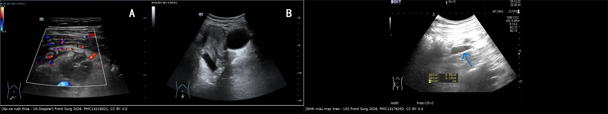
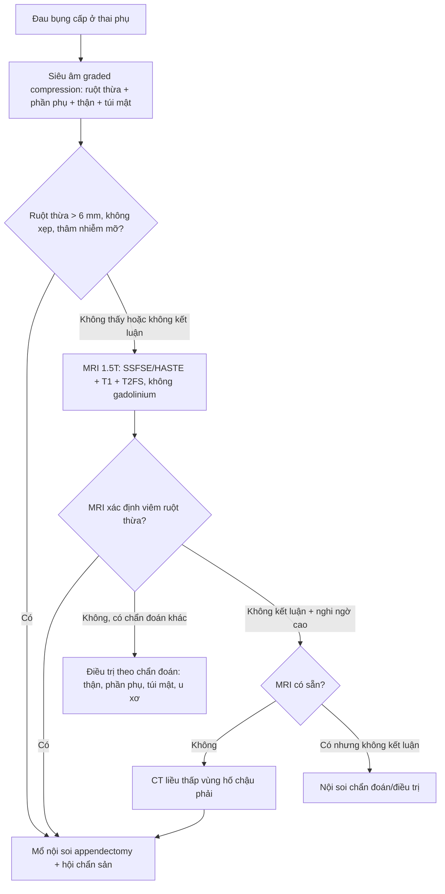
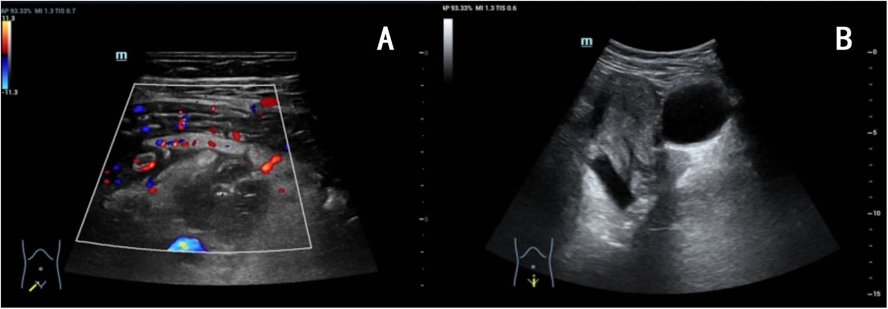
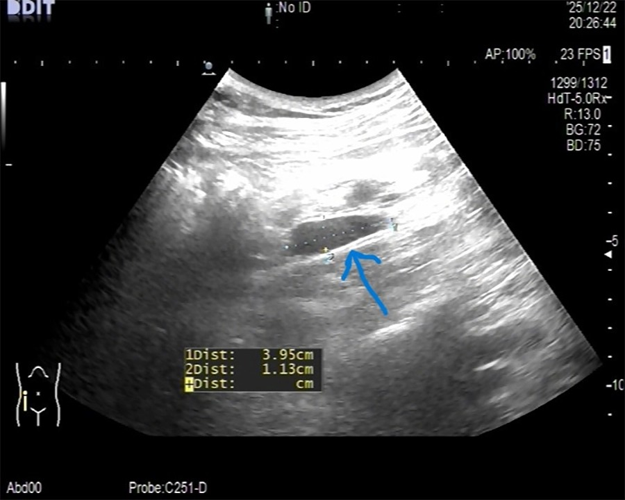
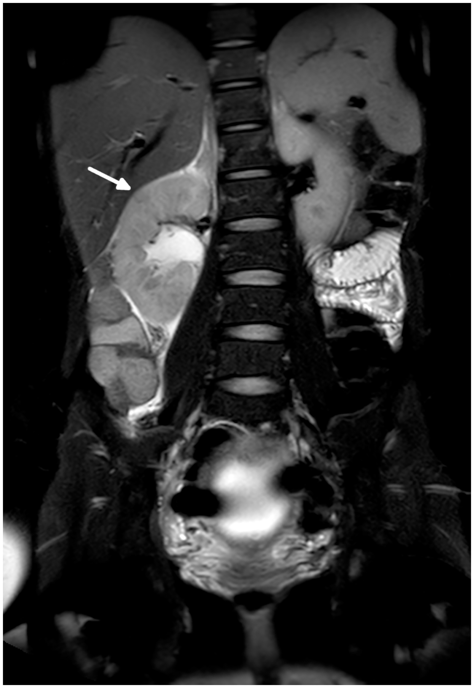

# 145 — Viêm ruột thừa trong thai kỳ: ruột thừa di lệch, siêu âm → MRI, mổ nội soi hay kháng sinh / Acute appendicitis in pregnancy

**Tags:** `pattern:viem` `pattern:cap-cuu` `vung:bung` `vung:thai-ky` `protocol:US` `protocol:MRI` `protocol:CT` `score:Alvarado`
**Mức chắc chắn (certainty):** tổng hợp y văn (literature synthesis) — guideline WSES Jerusalem 2020, tổng quan hệ thống 2026, đoàn hệ và meta-analysis 2026. Không có RCT lớn về điều trị kháng sinh trong thai kỳ; các khuyến cáo điều trị dựa trên bằng chứng quan sát.

## 1. Tổng quan bệnh học – cơ chế hình ảnh

- **Tần suất:** viêm ruột thừa cấp là **cấp cứu ngoại khoa không sản khoa phổ biến nhất** trong thai kỳ, khoảng **0,5–1/1.000 thai** (0,063%); chiếm **65,6%** các cấp cứu ngoại khoa không chấn thương ở thai phụ; gặp nhiều nhất ở **tam cá nguyệt 2** (PMC10591244, PMC13216021).
- **Vì sao khó chẩn đoán — 3 thay đổi sinh lý:**
  1. **Tử cung lớn đẩy ruột thừa lên cao và ra ngoài:** tam cá nguyệt 1 ở **hố chậu phải (RIF)**; tam cá nguyệt 2 ngang **gờ chậu (pelvic brim)**; tam cá nguyệt 3 ở **hạ sườn phải (RUQ)**. Tuy vậy **90% thai phụ vẫn đau hố chậu phải** bất kể tam cá nguyệt — vị trí đau không đủ để loại trừ (PMC10591244).
  2. **Bạch cầu tăng sinh lý:** WBC nền tăng theo thai; trong một đoàn hệ, WBC trung bình **14,30 ± 4,77** (viêm thật) vs **12,37 ± 4,29** (không viêm), **p = 0,040** — khác biệt nhỏ, **không đủ chốt** (PMC12743394).
  3. **Buồn nôn/nôn, chán ăn, đau bụng** là triệu chứng thai kỳ bình thường → dễ trấn an sai và **chẩn đoán muộn**.
- **TẠI SAO hình ảnh là mấu chốt:** ruột thừa viêm to ra do **phù thành + ứ dịch lòng + tăng áp lực lòng**; trên siêu âm là **cấu trúc hình ống, không xẹp được (non-compressible)**, đường kính ngoài **> 6 mm**, thành **> 2 mm**; trên CT/MRI thêm **thâm nhiễm mỡ quanh ruột thừa**, **dày thành > 3 mm**, **ngấm thuốc**, **dịch lòng ruột thừa không có khí** (ngưỡng **2,6 mm** có giá trị) (PMC12754330).
- **Cạm bẫy số đo:** tới **40% ruột thừa bình thường có đường kính > 6 mm** khi lòng chứa khí/dịch → **không chẩn đoán chỉ bằng đường kính**; phải có **dấu hiệu phụ** (thâm nhiễm mỡ, dày thành, mất nhu động, dịch quanh) (PMC12754330).
- **Hiệu năng hình ảnh (định lượng):**
  - **Siêu âm:** độ nhạy **~70%**, độ đặc hiệu **~83%** (PMC10591244); trong đoàn hệ so sánh, độ nhạy ở thai **46,5%** vs **53,2%** ở không thai (PMC13629179); một đoàn hệ khác: siêu âm đúng **66%** ca viêm thật vs **28%** ca không viêm (PMC12743394).
  - **MRI:** gộp **độ nhạy 94%, độ đặc hiệu 97%** (meta-analysis dẫn trong PMC13189549); độ đặc hiệu **90,2–100%**, **NPV 95,2–96%**; đưa MRI vào quy trình giảm **mổ ruột thừa âm tính từ 26,3% xuống 2,6%** (PMC13189549).
  - **MRI còn tìm được chẩn đoán khác:** 167 thai phụ nghi viêm ruột thừa — **20,9%** viêm ruột thừa thật, **18%** chẩn đoán khác (56,7% phụ khoa, 26,7% niệu, 20% tiêu hóa) (PMC10852244).
- **Hậu quả nếu chẩn đoán muộn:** thủng ruột thừa → viêm phúc mạc, nhiễm trùng huyết, **sinh non và thai lưu**. Mổ ruột thừa trong thai có liên quan **sinh non (PTB) tăng**: **aHR 1,73 (1,42–2,09)**; **11,9% vs 5,4%** ở nhóm chứng; đặc biệt **mổ ruột thừa âm tính** có PTB **20,5% vs 9,2%** khi ruột thừa viêm thật (PMC12842138). Đây là lý do **chẩn đoán đúng quan trọng như mổ kịp thời**.

## 2. Mẫu hình + chẩn đoán phân biệt theo tam cá nguyệt và vị trí đau (Gamut)

**Gamut theo tam cá nguyệt:**

- **Tam cá nguyệt 1 — đau RIF:** viêm ruột thừa, **thai ngoài tử cung**, **xoắn phần phụ**, **xuất huyết hoàng thể**, **viêm phần phụ (PID)**, **sỏi niệu quản**, **viêm túi mật** (ít gặp).
- **Tam cá nguyệt 2 — đau quanh gờ chậu:** viêm ruột thừa (vị trí cao hơn), **ứ nước/thận ứ do thai (hydronephrosis of pregnancy)**, **sỏi niệu quản**, **xoắn phần phụ**, **thoát vị bẹn nghẹt**, **nhồi máu mạc treo (omental infarction)**.
- **Tam cá nguyệt 3 — đau RUQ:** viêm ruột thừa (ruột thừa cao), **viêm túi mật/sỏi mật**, **hội chứng HELLP**, **nhồi máu gan**, **bóc tách/khối máu gan**, **tiền sản giật**, **nhau bong non**, **thoái hóa u xơ (red degeneration)**, **vỡ tử cung**.
- **Sau sinh:** ruột thừa về vị trí bình thường nhưng **giãn cơ thành bụng + đau tử cung co hồi** dễ che lấp; vẫn phải nghĩ viêm ruột thừa.

**Gamut theo hình thái trên hình ảnh:**

- **Ống ruột thừa > 6 mm, không xẹp, thâm nhiễm mỡ quanh** → viêm ruột thừa.
- **Ống/hang có nhu động, không thâm nhiễm mỡ, xẹp khi ép** → bình thường hoặc giãn thoáng qua.
- **Khối hỗn hợp echo dày, không có cấu trúc ruột thừa rõ, có mỡ tăng echo** → nhồi máu mạc treo (mimic).
- **Thận ứ nước + dịch quanh thận, không thấy ruột thừa bất thường** → nguyên nhân niệu khoa (mimic).
- **Nang/khối phần phụ có mạch, đau khu trú** → xoắn/phần phụ (mimic).
- **Túi mật thành dày > 3 mm, sỏi, dấu Murphy** → viêm túi mật (mimic).

## 3. Bảng so sánh phân biệt (ma trận đối chiếu)

| Thực thể (entity) | Hình ảnh điển hình | Chốt vào (rule-in) | Chốt loại (rule-out) | Gợi ý xác nhận |
|---|---|---|---|---|
| **Viêm ruột thừa** | Ống > 6 mm, không xẹp, thành dày, thâm nhiễm mỡ quanh; MRI: dịch lòng, ngấm thuốc | **Ruột thừa > 6 mm + không xẹp + thâm nhiễm mỡ quanh** trên US/MRI | **Ruột thừa bình thường thấy rõ, xẹp được, không thâm nhiễm mỡ** | US trước, MRI nếu không kết luận; mổ nội soi |
| **Thai ngoài tử cung** | Khối cạnh tử cung, túi thai ngoài lòng tử cung, dịch Douglas | **β-hCG + không thấy túi trong tử cung + khối phần phụ** | **Túi thai trong tử cung có tim thai + không khối phần phụ** | US đầu dò âm đạo + β-hCG; MRI nếu cần |
| **Xoắn phần phụ** | Buồng trứng to, nang, **dấu xoắn (whirlpool)**, không có mạch | **Đau đột ngột + buồng trứng to + mất tín hiệu Doppler** | **Mạch buồng trứng bình thường + không nang** | US Doppler; MRI; mổ nội soi |
| **Sỏi niệu quản / ứ thận** | Ứ thận, dịch quanh thận, sỏi tăng tín hiệu trên T2/CT | **Ứ thận cùng bên đau + sỏi** | **Không ứ thận, không sỏi** | US + MRI (không cản quang); CT liều thấp nếu cần |
| **Nhồi máu mạc treo** | Khối mỡ tăng echo/đậm độ, **không có ruột thừa viêm**, dấu "whirl" mạch mạc treo | **Khối mỡ viêm + ruột thừa bình thường** | **Ruột thừa viêm rõ** | MRI/CT; mổ nội soi chẩn đoán |
| **Viêm túi mật** | Túi mật giãn, thành > 3 mm, sỏi, dịch quanh, dấu Murphy | **Sỏi + thành dày + Murphy** | **Túi mật bình thường, không sỏi** | US; MRI/MRCP |
| **Thoái hóa u xơ (red degeneration)** | Khối cơ tử cung đau khu trú, tín hiệu T1 cao/T2 thay đổi, không có ổ bụng | **Khối u xơ + đau khu trú + sốt nhẹ** | **Không u xơ, không đau khu trú** | MRI tiểu khung |

*Trái: siêu âm Doppler — áp-xe ruột thừa 41 × 25 × 29 mm ở thai 3 tuần 4 ngày (PMC13216021). Phải: siêu âm — cấu trúc dạng ống 3,95 × 1,13 cm ở hố chậu phải, ban đầu đọc là viêm ruột thừa nhưng mổ ra là **nhồi máu mạc treo** (PMC13176252). Cả hai CC BY 4.0, ghép letterbox.*

## 4. Protocol chụp + quy trình quyết định

**A. Siêu âm — bước 1, bắt buộc**

- Đầu dò convex, **ép có kiểm soát (graded compression)**, bắt đầu ở **hố chậu phải**, sau đó **di chuyển lên trên và ra ngoài theo tử cung** (tam cá nguyệt 2–3).
- Tư thế: ngửa, có thể **nghiêng trái** để tử cung dồn sang phải; bàng quang vừa đủ.
- Đo: **đường kính ngoài (outer-to-outer)**, độ dày thành, chiều dài; đánh giá **xẹp khi ép**, **nhu động**, **Doppler**, **thâm nhiễm mỡ**, **dịch ổ bụng**, **sỏi/ứ thận**, **buồng trứng**.
- **Không thấy ruột thừa ≠ loại trừ** — ghi rõ "không quan sát được" và chuyển MRI.

**B. MRI — bước 2 khi siêu âm không kết luận**

- **1,5 T**, không cần nhịn thở; chuỗi: **SSFSE/HASTE** axial–coronal–sagittal, **T1 axial**, **T2 fat-sat** (và DWI nếu có).
- **Không dùng gadolinium thường quy**; chỉ dùng khi thật cần và sau khi cân nhắc (ACR Manual on Contrast Media).
- Nhịn ăn **4 giờ**; thuốc giảm nhu động nếu cần; tổng thời gian ~20–30 phút.
- Đọc **theo thứ tự**: ruột thừa (đường kính, thành, dịch lòng, thâm nhiễm mỡ) → **dấu hiệu phụ** → **chẩn đoán khác** (thận, phần phụ, túi mật, u xơ).

**C. CT — chỉ khi MRI không có/không kết luận**

- **CT liều thấp**, giới hạn trường chụp vào hố chậu phải; chỉ khi **MRI không sẵn có, chống chỉ định hoặc không kết luận** mà nghi ngờ cao (WSES 2020; ACR).
- Không dùng CT làm bước 1 vì **liều xạ thai nhi** và vì MRI có độ chính xác tương đương.

**D. Điều trị**

- **Phẫu thuật là chuẩn mực** khi chẩn đoán xác định: **nội soi (laparoscopy) được ưu tiên** khi có kinh nghiệm (WSES 2020, khuyến cáo 2B), với **áp lực bơm 10–12 mmHg**, **nghiêng trái sau 20 tuần**, trocar đặt cao hơn theo tử cung.
- **Không điều trị kháng sinh đơn thuần thường quy trong thai kỳ** (WSES 2020 khuyến cáo **chống** NOM, 2C) — vì **thất bại tới 30%** và nguy cơ thủng (PMC13216021).
- **Ngoại lệ chọn lọc:** áp-xe đã khu trú, thai phụ ổn định → **dẫn lưu qua da + kháng sinh**, hoặc **ERAT** (nội soi ngược dòng ruột thừa) ở trung tâm có kinh nghiệm; ca báo cáo 24 tuổi thai 3 tuần 4 ngày đã thành công sau PCD + ertapenem + ERAT (PMC13216021). **[suy luận]** Đây là bằng chứng ca, không thay thế mổ.
- **Mổ nội soi vs mở — cân nhắc 2 chiều:**
  - WSES 2020: nội soi **an toàn, ít biến chứng vết mổ, nằm viện ngắn hơn**, ưu tiên khi có kinh nghiệm (2B); đoàn hệ Nhật 152 ca **không có thai lưu ở cả hai nhóm** (PMC12757167).
  - Meta-analysis 2026 (22 nghiên cứu, **28.160 thai phụ**): nội soi **tăng thai lưu** so với mở (**OR 2,02; 1,40–2,92**), đặc biệt **tam cá nguyệt 2**; nhưng **giảm sinh non** và biến chứng mẹ (PMC13446501).
  - **Kết luận thực hành:** ưu tiên nội soi khi **phẫu thuật viên có kinh nghiệm**, thai phụ được hồi sức ổn; **không "cố" nội soi** nếu khó khăn — chuyển mở là quyết định đúng, không phải thất bại.
- **Theo dõi sản khoa:** monitoring thai theo tuổi thai (nghe tim thai, NST nếu ≥ khả năng sống), **không dùng tocolysis thường quy**; kháng sinh dự phòng theo phác đồ; hội chẩn sản khoa trước–trong–sau mổ.

**E. Sơ đồ quyết định**

## 5. Biến thể bình thường và cạm bẫy

- **Bẫy 1 — "6 mm là chắc chắn viêm":** tới **40%** ruột thừa bình thường > 6 mm; phải có **dấu hiệu phụ** (thâm nhiễm mỡ, dày thành, mất xẹp, dịch quanh).
- **Bẫy 2 — "không thấy ruột thừa = không viêm":** siêu âm ở thai có độ nhạy chỉ **46,5–70%**; **không thấy** là chỉ định **MRI**, không phải kết luận âm.
- **Bẫy 3 — giải thích đau bằng thai kỳ:** buồn nôn, đau nhẹ, bạch cầu tăng đều là sinh lý → **trấn an sai**; chẩn đoán muộn làm tăng thủng, sinh non, thai lưu.
- **Bẫy 4 — nhồi máu mạc treo (omental infarction):** hình ảnh rất giống viêm ruột thừa trên siêu âm; ca báo cáo bị mổ vì "viêm ruột thừa" nhưng ruột thừa bình thường, tổn thương là **mạc treo hoại tử** (PMC13176252). Nếu ruột thừa bình thường mà vẫn có khối viêm → **tìm tổn thương khác**.
- **Bẫy 5 — ứ thận sinh lý vs bệnh lý:** **ứ thận phải nhẹ do tử cung chèn** là hiện tượng thường gặp trong thai kỳ; chỉ coi là nguyên nhân khi **ứ vừa/nặng + sỏi + đau khu trú**, và **phải loại trừ viêm ruột thừa trước** (PMC10852244).
- **Bẫy 6 — mổ ruột thừa âm tính không phải "vô hại":** PTB **20,5%** sau mổ âm tính vs **9,2%** khi viêm thật (PMC12842138) → **xác định chẩn đoán trước mổ** quan trọng hơn "mổ sớm cho chắc".
- **Bẫy 7 — bỏ qua thủng/áp-xe:** sốt cao, đau tăng, nhiễm trùng huyết, dịch ổ bụng → **áp-xe/viêm phúc mạc**, cần mổ/dẫn lưu cấp, không chờ.
- **Bẫy 8 — không hội chẩn sản khoa:** quyết định mổ và theo dõi thai phải **đa chuyên khoa**; tuổi thai quyết định cách monitoring và nơi mổ (phòng mổ có nhi sơ sinh).

## 6. Tự lượng giá — Blind Quiz

**Ca 1 — Thai 8 tuần, sốt 38,2 °C, đau hố chậu phải 2 ngày. Nhìn siêu âm, mô tả trước khi xem đáp án.**

- Câu hỏi: Cấu trúc bất thường là gì? Đo kích thước? Chẩn đoán và 3 việc cần làm tiếp?

<b>Bấm để hiện đáp án</b>

- Khối echo hỗn hợp, giới hạn không rõ, có **tín hiệu Doppler quanh khối** ở hố chậu phải; kích thước **41 × 25 × 29 mm** — phù hợp **áp-xe ruột thừa** (không phải ruột thừa đơn thuần).
- Chẩn đoán: **áp-xe ruột thừa trong thai sớm**. Việc cần làm: **MRI/CT liều thấp nếu cần xác định**, **kháng sinh + hội chẩn sản–ngoại**, và **dẫn lưu/mổ** (ca này được PCD + ertapenem rồi ERAT).
- Cạm bẫy: khối áp-xe có thể không có hình ống điển hình — đừng loại trừ vì "không thấy ruột thừa".
- Nguồn: Zhou B et al., Front Surg 2026 (PMC13216021), CC BY 4.0.

**Ca 2 — Thai 22 tuần, đau hố chậu phải, siêu âm thấy cấu trúc 3,95 × 1,13 cm. Chẩn đoán?**

- Câu hỏi: Hình ảnh gợi ý gì? Vì sao không kết luận ngay viêm ruột thừa? Bước tiếp theo?

<b>Bấm để hiện đáp án</b>

- Cấu trúc **dạng ống, echo dày, 3,95 × 1,13 cm**, không có đặc điểm ruột thừa điển hình — ban đầu bị đọc là **gợi ý viêm ruột thừa**, nhưng trên mổ là **nhồi máu mạc treo (omental infarction)**; ruột thừa bình thường.
- Vì sao không kết luận: **kích thước > 6 mm không đặc hiệu**; cần **dấu hiệu phụ** và **MRI** để phân biệt mỡ viêm/mạc treo với ruột thừa.
- Bước tiếp: **MRI** (hoặc nội soi chẩn đoán nếu nghi ngờ cao) + **đánh giá ruột thừa có thật bất thường không**.
- Nguồn: Zhuang X, Front Surg 2026 (PMC13176252), CC BY 4.0.

**Ca 3 — Thai 17 tuần, đau hông lưng phải lan xuống, sốt nhẹ. MRI có hình sau. Chẩn đoán và mối liên quan với viêm ruột thừa?**

- Câu hỏi: Dấu hiệu chính? Đây có phải viêm ruột thừa không? Vì sao MRI quan trọng ở thai phụ?

<b>Bấm để hiện đáp án</b>

- **Ứ thận phải mức độ nhẹ–vừa** (mũi tên), kèm **dịch quanh thận và thâm nhiễm mỡ** — phù hợp **viêm thận–bể thận/ứ thận có biến chứng**, không phải viêm ruột thừa.
- MRI giúp **loại trừ viêm ruột thừa** và **tìm chẩn đoán khác**: trong 167 thai phụ, **18%** có chẩn đoán khác trên MRI (phụ khoa 56,7%, niệu 26,7%, tiêu hóa 20%).
- Vì sao quan trọng: **không xạ**, độ nhạy 94%/đặc hiệu 97%, giảm mổ âm tính; **không dùng gadolinium thường quy**.
- Nguồn: Bufman H et al., PLoS One 2024 (PMC10852244), CC BY 4.0.

## Bài liên quan chéo
- [161 – Viêm ruột thừa cấp](../161-viem-ruot-thua-cap/lesson.md)
- [550 – Thai sớm: sảy thai, thai ngoài tử cung](../550-thai-som-say-thai-thai-ngoai-tu-cung/lesson.md)
- [583 – Nang lạc nội mạc trong thai kỳ](../583-nang-lac-noi-mac-trong-thai-ky/lesson.md)
- [160 – Bụng cấp hố chậu & tắc ruột](../160-bung-cap-GI/lesson.md)

## Ảnh
- `145_apxe-ruot-thua-thai-som_US_PMC13216021.jpg`, `145_viem-mo-mac-treo_US_PMC13176252.jpg`, `145_MRI-chan-doan-khac_PMC10852244.jpg` — CC BY 4.0.
- `composite_dau-hcp-thai-ky.jpg` — ảnh ghép letterbox từ ảnh 1 và 3 (CC BY 4.0).
- Nguồn, giấy phép, tác giả: xem `images/CREDITS.md` và `sources.md`.

> Không dùng để chẩn đoán độc lập khi chưa có người hướng dẫn.
