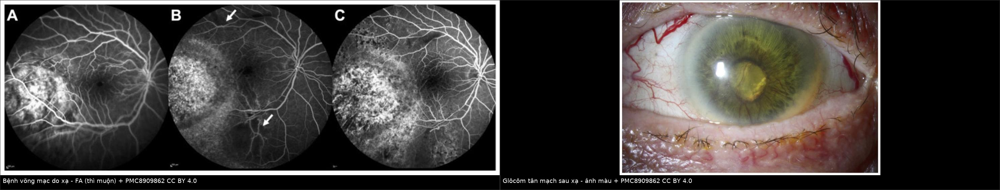
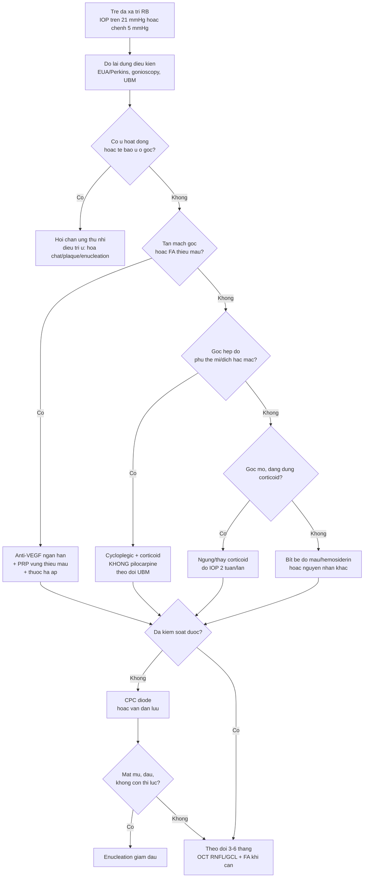
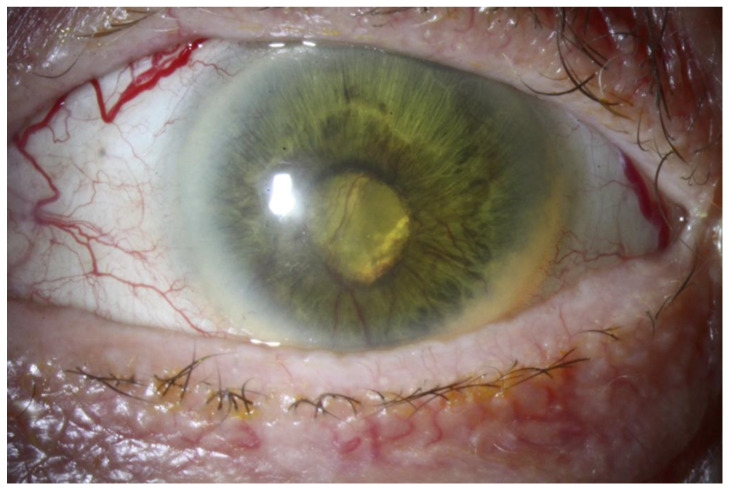
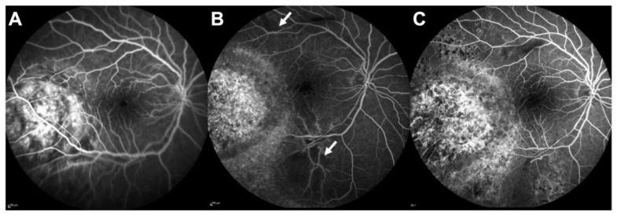
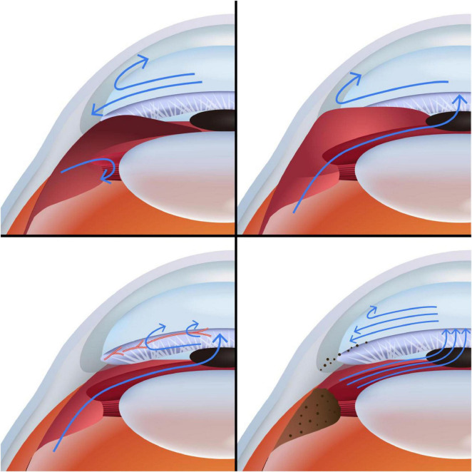

# 1450 — Glôcôm sau xạ trị ở trẻ: tân mạch góc, góc hẹp do phù thể mi, corticoid / Radiation-induced glaucoma after retinoblastoma radiotherapy

**Tags:** `pattern:tang-nhan-ap` `pattern:glaucom-tan-mach` `pattern:goc-dong` `pattern:teo-vong-mac` `vung:mat` `vung:goc-tien-phong` `vung:the-mi` `protocol:do-nhan-ap` `protocol:UBM` `protocol:gonioscopy` `protocol:FA` `protocol:OCT` `protocol:CPC` `incidentaloma:khong`

**Mức chắc chắn (certainty):** tổng hợp y văn (literature synthesis) — 1 **review cơ chế glôcôm do ung thư** (Front Med 2025, PMC12392418, CC BY), 1 **review biến chứng mắt do xạ** (Cancers 2022, PMC8909862, CC BY), **2 loạt plaque I-125 ở trẻ RB** (Ophthalmology 2001, PMID 11713089; Ophthalmology 2006, PMID 16949158), 1 **loạt plaque RB kháng trị 20 mắt** (J Clin Med 2025, PMC11901221, CC BY), **PENTEC** về liều–độc tính mắt (Int J Radiat Oncol Biol Phys 2024, PMID 37565958), 1 **review dịch tễ học tác dụng phụ xạ** (Int J Radiat Biol 2021, PMC10656152), 1 **nghiên cứu IOP bình thường ở trẻ** (Eye 2022, PMC9151725), 1 **meta-analysis van dẫn lưu ở trẻ** (Surv Ophthalmol 2023, PMID 36740196), 1 **nghiên cứu quang đông thể mi micropulse** (Eur J Ophthalmol 2020, PMID 31256680), **Cochrane anti-VEGF trong NVG** (2023, PMID 37010901), và 1 **nghiên cứu tăng nhãn áp do corticoid ở trẻ** (Acta Ophthalmol 2021, PMID 33629533). **Không có ca nguyên văn do nhóm tự viết**; ảnh quiz lấy từ bài gốc, ghi rõ PMCID và bối cảnh người lớn khi cần.

> **Câu chốt:** glôcôm sau xạ trị **không phải một bệnh mà là 4 cơ chế chồng nhau**: **(1) tân mạch góc (NVG) do bệnh võng mạc do xạ**, **(2) góc hẹp do phù thể mi/tràn dịch hắc mạc**, **(3) tăng nhãn áp do corticoid**, và **(4) bít bè do tế bào u/máu**. Sau plaque I-125 ở trẻ RB, **glôcôm tích lũy 5 năm 11%** (loạt 208 u) và **4%** (loạt 84 u); **NVG 5%** trong loạt plaque kháng trị. Ở trẻ, **IOP bình thường 5–20 mmHg (trung bình 11,5)** — nên **> 21 mmHg là bất thường**, nhưng phải đo đúng điều kiện vì **gây mê làm IOP giảm > 20%**. Điều trị **không bao giờ tách rời khỏi kiểm soát u**: **không đặt van/lọc trong mắt còn u hoạt động**.

## 1. Tổng quan bệnh học – cơ chế hình ảnh

### 1.1 Bối cảnh: ai bị, khi nào

- **Retinoblastoma (RB)** là u nội nhãn ác tính hay gặp nhất ở trẻ; xạ trị còn dùng ở **plaque I-125** (liều đỉnh **40–50 Gy**, thường **45 Gy**) cho u kháng trị hoặc tái phát, **proton beam**, và **EBRT** trong một số hoàn cảnh (PMC11232864). Xạ cứu mắt nhưng **để lại tổn thương mạch máu võng mạc, thể mi và bè**.
- **Thời điểm:** NVG thường **muộn (tháng–năm)** sau xạ; góc hẹp do phù thể mi có thể **sớm (ngày–tuần)**; tăng nhãn áp do corticoid **2–6 tuần** sau khi bắt đầu corticoid. Vì vậy **một lần IOP bình thường không loại trừ** — phải theo dõi dọc.
- **Tần suất:** sau plaque cho RB, **glôcôm 11% lúc 5 năm** (208 u, 141 trẻ) và **4%** (84 u tái phát sau chemoreduction); **tân mạch mống mắt 8%** ở loạt thứ hai (PMID 11713089; PMID 16949158). Loạt plaque kháng trị 20 mắt: **NVG 5% (1/20)** (PMC11901221). Trong RB nói chung, **22%** có glôcôm kháng trị do **xâm lấn góc hoặc tân mạch mống mắt** — con số này **gộp cả u và xạ**, không tách riêng (PMC12392418).

### 1.2 TẠI SAO xạ gây glôcôm — 4 cơ chế, giải thích bằng vật lý và mô bệnh

1. **Tân mạch góc (NVG) — cơ chế chính của thể muộn.** Xạ làm **tổn thương tế bào nội mô mao mạch võng mạc** → **mất tưới máu mao mạch** (thấy trên FA là vùng tối không ngấm) → thiếu oxy nội võng mạc → **HIF-1α** tăng → **VEGF** tăng → **tân mạch mống mắt và góc**. Tân mạch ban đầu **chưa làm tăng IOP** (pha 1), sau đó **màng xơ mạch co kéo dính góc** → **góc đóng dính** → IOP tăng vọt. Đây là lý do **điều trị tân mạch sớm có ý nghĩa hơn chờ IOP tăng** (PMC12392418; PMC8909862).
2. **Góc hẹp do phù thể mi/tràn dịch hắc mạc.** Xạ gây **phù và thiếu máu thể mi**, **tràn dịch hắc mạc**, làm **thể mi xoay ra trước**, đẩy **chân mống mắt** vào góc → tiền phòng nông, góc đóng **không có dính ban đầu**. Trên **UBM**: thể mi dày, dịch dưới thể mi, góc hẹp; **không có tân mạch**. Cơ chế này **hồi phục** nếu điều trị đúng (cycloplegic + corticoid), và **dùng pilocarpine sẽ làm nặng hơn** vì co đồng tử kéo mống mắt vào thể mi đang phù.
3. **Tăng nhãn áp do corticoid.** Corticoid làm tăng **glycosaminoglycan** ở bè và **ức chế tái cấu trúc sợi**, tăng sức cản thoát dịch tiền phòng. Ở trẻ dùng corticoid toàn thân liều cao, **56% có đáp ứng tăng IOP** (định nghĩa tăng ≥ 6 mmHg hoặc đỉnh ≥ 21 mmHg) và **12% là đáp ứng mạnh** (đỉnh **32–44 mmHg**); **trẻ nhỏ có nguy cơ cao hơn** (PMID 33629533). Vì vậy **mỗi lần tăng corticoid phải kèm đo IOP**, không quy mọi tăng IOP cho "bệnh nặng lên".
4. **Bít bè do tế bào u, máu, hạt sắc tố.** U xâm lấn góc, **gieo tế bào vào tiền phòng** (pseudohypopyon), **máu tiền phòng** và **hemosiderin** trong bè đều làm tắc đường thoát. Đây là cơ chế **nguy hiểm nhất** vì **gọi nhầm là biến chứng xạ sẽ bỏ sót tái phát u**.

### 1.3 Ngưỡng định lượng trụ cột

| Đại lượng | Con số | Nguồn |
|---|---|---|
| Liều plaque I-125 cho RB | **40–50 Gy** (thường **45 Gy** đỉnh), **3–4 tuần** | PMC11232864; PMC11901221 |
| Glôcôm sau plaque (RB) | **11%** lúc 5 năm (208 u); **4%** (84 u); **NVI 8%** | PMID 11713089; PMID 16949158 |
| NVG sau plaque kháng trị | **5% (1/20 mắt)** | PMC11901221 |
| Bệnh võng mạc do xạ (PENTEC) | **5% ở 42 Gy**, **50% ở 62 Gy** | PMID 37565958 |
| Bệnh thần kinh thị do xạ (PENTEC) | **5% ở 57 Gy**, **50% ở 64 Gy** | PMID 37565958 |
| Đục thể thủy tinh do xạ | **50% ở 9 Gy** (chẩn đoán bởi bác sĩ) | PMID 37565958 |
| Glôcôm do xạ (dịch tễ) | chỉ ghi nhận ở **liều > 5 Gy**; là **tissue reaction** | PMC10656152 |
| Glôcôm kháng trị trong RB (gộp u + xạ) | **22%** do xâm lấn góc/tân mạch | PMC12392418 |
| IOP bình thường ở trẻ 0–12 tuổi | **5–20 mmHg**, trung bình **11,5 ± 2,3** | PMC9151725 |
| IOP dưới gây mê | **< 8 mmHg** (< 3 tháng), **< 12 mmHg** (6–9 tháng); ước **0,71 × tuổi + 10** | J Fr Ophtalmol 2009 (PMID 19515328) |
| Đáp ứng corticoid ở trẻ | **56% tăng IOP**, **12% đáp ứng mạnh** (đỉnh 32–44 mmHg) | PMID 33629533 |

### 1.4 Vì sao trẻ khác người lớn

- **Củng mạc còn giãn:** IOP cao kéo dài làm **nhãn cầu to ra (buphthalmos)**, **giác mạc to > 12 mm**, **rạn Haab**, **cận thị trục dài** — trông như **glôcôm bẩm sinh** nếu không hỏi tiền sử xạ.
- **Đo IOP khó:** trẻ nhỏ cần **gây mê/topical + Perkins hoặc Tono-Pen/iCare**; **sevoflurane làm IOP giảm** (CV > 20% ở mọi giai đoạn mê), nên **một trị số thấp dưới mê không loại trừ glôcôm** (PMID 33759070).
- **Không đo được thị lực/thị trường:** phải dựa vào **OCT RNFL/GCL, đáy mắt, khám dưới mê (EUA)** và **theo dõi liên tục** — không chờ trẻ "kêu mờ mắt".

## 2. Mẫu hình + chẩn đoán phân biệt theo cơ chế (Gamut)

**Mẫu hình chung:** trẻ **đã xạ trị RB**, nhãn áp **> 21 mmHg** (hoặc **chênh > 5 mmHg** so với mắt bên), **giác mạc có thể đục**, **tiền phòng nông hoặc sâu**, **đồng tử dính**, **mống mắt có tân mạch**.

- **Tân mạch (NVG):** tân mạch **bờ đồng tử trước**, lan ra góc; **FA có vùng không tưới máu**; thường **sau 6 tháng–nhiều năm**; mắt có thể **đã teo thị**.
- **Góc hẹp do phù thể mi/tràn dịch hắc mạc:** **tiền phòng nông**, **UBM thể mi dày/dịch**, **không tân mạch**, thường **sớm sau xạ**, đau nhiều.
- **Corticoid:** **góc mở**, **không tân mạch**, IOP tăng **2–6 tuần** sau bắt đầu corticoid, **giảm khi ngừng**.
- **Bít bè do u/máu:** **pseudohypopyon**, **máu tiền phòng**, **khối u ở góc**, **tăng kích thước theo tháng**; đây là **tái phát/u hoạt động** cho tới khi chứng minh ngược lại.
- **Nguyên nhân khác cần loại trừ:** **glôcôm bẩm sinh** (giác mạc to, rạn Haab, không tiền sử xạ), **glôcôm sau phaco** ở mắt RB (bài 1643), **glôcôm do dầu silicone** nếu mắt đã phẫu thuật (bài 1416), **viêm màng bồ đào** gây dính góc.

## 3. Bảng so sánh phân biệt (ma trận đối chiếu)

| Thực thể (entity) | Hình ảnh điển hình | Chốt vào (rule-in) | Chốt loại (rule-out) | Gợi ý xác nhận |
|---|---|---|---|---|
| **NVG sau xạ** | Tân mạch **bờ đồng tử → góc**, dính góc, **FA vùng không tưới máu**, đĩa thị lõm | **Tân mạch góc + FA thiếu máu + tiền sử xạ** | **Không tân mạch, góc mở, FA tưới máu bình thường** → không phải NVG | Gonioscopy + FA/ICGA; OCT RNFL |
| **Góc hẹp do phù thể mi** | Tiền phòng nông, **UBM thể mi dày/dịch**, góc hẹp không dính, **không tân mạch** | **UBM có dịch/dày thể mi + tiền phòng nông** | **Tân mạch + dính góc** → NVG; **góc mở** → bít bè | UBM 50 MHz; AS-OCT |
| **Tăng nhãn áp do corticoid** | **Góc mở**, không tân mạch, IOP tăng sau corticoid, **giảm khi ngừng** | **Dùng corticoid + góc mở + IOP giảm sau ngừng 2–4 tuần** | **Tân mạch, dính góc, khối u** → nguyên nhân khác | Ngừng thử corticoid; đo IOP 2 tuần/lần |
| **U xâm lấn/gieo tế bào góc** | **Pseudohypopyon**, máu tiền phòng, khối ở góc, **tăng kích thước** | **Tế bào u trong tiền phòng/dịch tiền phòng + khối mới** | **Không khối, ổn định qua 3–6 tháng** | Chọc dịch tiền phòng tế bào học; B-scan; MRI |
| **Máu tiền phòng/hemosiderin** | Máu tiền phòng, lắng đọng nâu ở bè, IOP tăng sau nhiều đợt | **Tiền sử chảy máu + hemosiderin ở góc** | **Không máu, không lắng đọng** | Gonioscopy; siêu âm |
| **Glôcôm bẩm sinh/tiền có** | Giác mạc to, rạn Haab, **không tiền sử xạ**, xuất hiện sớm | **Giác mạc > 12 mm + rạn Haab + không xạ** | **Tiền sử xạ + tổn thương mạch máu võng mạc** | Đo đường kính giác mạc, khúc xạ, UBM |
| **Teo nhãn (phthisis)** | Nhãn cầu teo, IOP **thấp**, không đau | **IOP thấp + nhãn cầu teo** | **IOP cao** → không phải teo nhãn | B-scan; đo IOP |

*Trái: **FA thì muộn** sau plaque — vùng **không tưới máu** (mũi tên) là nền của thiếu oxy và VEGF. Phải: **glôcôm tân mạch** sau xạ proton — tân mạch mống mắt, phù giác mạc, đồng tử dính. Cả hai ảnh từ **Cancers 2022 (PMC8909862), CC BY 4.0**; ảnh ghép letterbox, không crop.*

### Dấu hiệu đọc chuẩn xác

- **Tân mạch mống mắt:** bắt đầu ở **bờ đồng tử** (không phải góc) rồi lan ra góc; **gonioscopy** phải làm **trước khi** kết luận "góc mở".
- **FA:** vùng **không tưới máu (nonperfusion)** là **chứng cứ thiếu máu**; **không đốt laser** nếu **OCTA còn dòng chảy** (bài 1419).
- **UBM:** phân biệt **phù thể mi** (góc hẹp hồi phục) với **dính góc** (NVG) — hai hướng điều trị **ngược nhau**.

## 4. Protocol chụp + hệ phân độ/điểm chuẩn hóa

### 4.1 Theo dõi sau xạ trị RB

- **EUA (khám dưới mê) mỗi 3 tháng trong 2 năm đầu**, mỗi 6 tháng tới 5 năm, hằng năm sau đó — cùng lịch với bài 1419; mỗi lần đo **IOP (Perkins/Tono-Pen), đường kính giác mạc, khúc xạ, gonioscopy khi làm được**, **đáy mắt + B-scan**, **OCT RNFL/GCL nếu hợp tác**.
- **Chụp ảnh màu + FA/ICGA** khi nghi NVG hoặc bệnh võng mạc do xạ; **UBM** khi tiền phòng nông; **AS-OCT** khi cần đánh giá góc.
- **Ngưỡng hành động:** IOP **> 21 mmHg** hoặc **chênh > 5 mmHg** so với mắt bên, **tăng ≥ 6 mmHg** so với nền, hoặc **góc bắt đầu dính/tân mạch mới** → khám lại sớm và điều trị.

### 4.2 Liều xạ và phòng ngừa

- **PENTEC:** bệnh võng mạc **5% ở 42 Gy / 50% ở 62 Gy**; bệnh thần kinh thị **5% ở 57 Gy / 50% ở 64 Gy**; đục thể thủy tinh **50% ở 9 Gy** (PMID 37565958). Đây là **ngưỡng người lớn/trẻ gộp**, không phải ngưỡng riêng cho trẻ.
- **Giảm liều nhãn cầu** bằng **plaque che chắn** hoặc **proton** khi có thể; **EBRT tránh ở RB thể mầm** vì **ung thư thứ phát 53% ở tuổi 50** (PMC11232864).
- **Không có "ngưỡng an toàn" tuyệt đối:** glôcôm do xạ đã ghi nhận ở **> 5 Gy** (PMC10656152) — vì vậy **theo dõi IOP suốt đời**, kể cả liều thấp.

### 4.3 Thuật toán xử trí

### 4.4 Hiệu quả các lựa chọn (số liệu để tư vấn)

- **Thuốc hạ áp:** bước đầu; **beta-blocker** thận trọng ở trẻ hen; **ức chế carbonic anhydrase** (acetazolamide) khi cần hạ nhanh; **alpha-2 agonist** có thể gây ngủ ở nhũ nhi.
- **Anti-VEGF trong NVG:** Cochrane 2023 — giảm IOP **−6,37 mmHg** ở **4–6 tuần** (bằng chứng rất thấp), **không có bằng chứng dài hạn**; là **điều trị bổ trợ**, không thay PRP/phẫu thuật (PMID 37010901). Trong RB, **phối hợp chuyên khoa u** vì nguy cơ lý thuyết về gieo tế bào u.
- **Quang đông thể mi (CPC) micropulse:** IOP **37,5 → 20,0 mmHg** sau 15 tháng (**giảm 37,2%**), nhưng **66,7% cần lần 2** (PMID 31256680). Chỉ làm khi **u đã kiểm soát**.
- **Van dẫn lưu (GDD) ở trẻ:** thành công **87% / 77% / 54% / 37%** ở **12 / 24 / 48 / 120 tháng** (32 nghiên cứu, 1.221 mắt) (PMID 36740196).
- **Nguyên tắc an toàn ung thư:** **không lọc/đặt van** ở mắt **còn u hoạt động** vì nguy cơ **gieo tế bào u** theo đường mổ; ưu tiên **kiểm soát u trước**, và **enucleation** nếu mắt mù đau (PMID 30562240).

## 5. Biến thể bình thường và cạm bẫy

- **"IOP dưới mê bình thường"** — sai: sevoflurane làm IOP giảm; **CV > 20%**; phải đo **cùng độ sâu mê** và so **nhiều lần** (PMID 33759070).
- **"Giác mạc to là glôcôm bẩm sinh"** — ở trẻ đã xạ, **buphthalmos do xạ** có thể xuất hiện muộn; hỏi **tiền sử xạ** trước khi quy cho bẩm sinh.
- **"Corticoid là vô hại"** — **56% trẻ** tăng IOP khi dùng corticoid toàn thân; **12% đáp ứng mạnh**; luôn đo IOP sau khi bắt đầu (PMID 33629533).
- **"Tân mạch = phải đốt laser ngay"** — nếu **OCTA còn dòng chảy**, có thể chỉ **trắng mạch thoáng qua**; đốt vội gây **teo võng mạc** (bài 1419).
- **"Góc hẹp thì dùng pilocarpine"** — **sai** trong phù thể mi: pilocarpine kéo mống mắt vào thể mi đang phù, làm **góc hẹp hơn**; dùng **cycloplegic**.
- **"Glôcôm sau xạ không cần tìm u"** — **sai**: pseudohypopyon/máu tiền phòng ở mắt RB **luôn phải loại trừ tái phát** trước khi gọi là biến chứng xạ.
- **Bẫy "satisfaction of search":** thấy tân mạch là dừng, bỏ sót **khối u ở cực sau** hoặc **di căn** trên cùng MRI.

## 6. Tự lượng giá — Blind Quiz ngay trên trang tĩnh

**Ca 1 — Trẻ 3 tuổi, RB nhóm D mắt trái đã plaque 18 tháng. Mắt đỏ, nhìn kém, IOP 34 mmHg.**

- Gợi ý lâm sàng: không sốt, không chấn thương; mắt đã xạ, u trên B-scan ổn định; tiền phòng nông nhẹ.
- Câu hỏi: (1) Dấu hiệu chính? (2) Cơ chế nào dẫn tới IOP 34? (3) Bước tiếp theo **trước khi** đặt van?

<b>Bấm để hiện đáp án (findings + chẩn đoán)</b>

- **Tân mạch mống mắt + phù giác mạc + đồng tử dính** = **NVG**; ở mắt đã xạ, nguyên nhân nền là **bệnh võng mạc do xạ** → thiếu máu → VEGF.
- Cần **FA/ICGA** tìm vùng không tưới máu và **gonioscopy** xem dính góc; **loại trừ u hoạt động** bằng B-scan/MRI trước khi can thiệp.
- Điều trị: **thuốc hạ áp + anti-VEGF ngắn hạn + PRP** vùng thiếu máu; **không đặt van/lọc khi còn u hoạt động**. Nếu u đã kiểm soát và IOP không giảm → **CPC hoặc van** (thành công GDD giảm dần: 87% ở 12 tháng → 37% ở 10 năm).
- **Lưu ý nguồn ảnh:** hình minh hoạ từ **bệnh nhân người lớn sau xạ proton cho u hắc mạc** (Cancers 2022, PMC8909862, CC BY 4.0) — dùng để nhận diện dấu hiệu; cơ chế tương tự ở trẻ.

**Ca 2 — Trẻ 2 tuổi, xạ ngoài 45 Gy cho RB hai bên. Ba tuần sau: đau, tiền phòng nông, IOP 28 mmHg, không tân mạch.**

- Gợi ý lâm sàng: mắt đỏ, giác mạc hơi đục; UBM cho thấy **thể mi dày, dịch dưới thể mi**, góc hẹp **không dính**.
- Câu hỏi: (1) Cơ chế? (2) Vì sao **không** dùng pilocarpine? (3) Điều trị ban đầu?

<b>Bấm để hiện đáp án (findings + chẩn đoán)</b>

- **Góc hẹp do phù thể mi/tràn dịch hắc mạc sau xạ** — không phải NVG vì **không tân mạch**, góc hẹp **không dính**.
- **Không pilocarpine** vì thuốc co đồng tử **kéo mống mắt vào thể mi đang phù**, làm góc hẹp nặng hơn.
- Điều trị: **cycloplegic (atropine) + corticoid tại chỗ/toàn thân**, thuốc hạ áp; **theo dõi UBM**; thường hồi phục sau vài tuần. Nếu không hồi phục → cân nhắc can thiệp.
- Ảnh FA cho thấy **vùng không tưới máu** — đây cũng là nền của NVG về sau, nên **tiếp tục theo dõi góc** dù đợt cấp đã qua.
- Nguồn ảnh: Cancers 2022, PMC8909862, Fig. 3, **CC BY 4.0**.

**Ca 3 — Trẻ 5 tuổi, RB đã xạ, đang tra dexamethasone vì viêm tiền phòng. Bốn tuần sau IOP 30 mmHg, góc MỞ, không tân mạch.**

- Gợi ý lâm sàng: mắt không đau nhiều, giác mạc trong; không khối mới; IOP mắt bên 14 mmHg.
- Câu hỏi: (1) Xếp ca này vào ô nào của sơ đồ? (2) Xử trí đầu tiên? (3) Khi nào nghĩ tới u tái phát?

<b>Bấm để hiện đáp án (findings + chẩn đoán)</b>

- **Tăng nhãn áp do corticoid**: góc **mở**, **không tân mạch**, IOP tăng sau 4 tuần dùng corticoid, **giảm khi ngừng** — khớp với **ô "thuốc"** trong sơ đồ cơ chế (ô thứ 4: viêm/neovascular; lưu ý sơ đồ gộp nhiều cơ chế).
- Xử trí: **ngừng/giảm corticoid** nếu viêm đã kiểm soát, **thuốc hạ áp**, đo IOP **2 tuần/lần**; IOP thường về bình thường sau 2–4 tuần.
- Nghĩ **u tái phát** khi có **pseudohypopyon, máu tiền phòng, khối mới, tăng kích thước** hoặc IOP **không giảm dù đã ngừng corticoid** → chọc dịch tiền phòng/B-scan/MRI.
- Nguồn ảnh: Front Med 2025, PMC12392418, Figure 1, **CC BY 4.0**.

## Bài liên quan chéo
- [400 – Tổng quan Mắt & thị giác](../400-tong-quan-mat-thi-giac/lesson.md)
- [1419 – Bệnh võng mạc do xạ ở trẻ sau xạ trị u não/RB](../1419-vong-mac-xa-tre-sau-xa-tri/lesson.md) (ngưỡng liều, lịch OCT/OCTA)
- [1441 – Bong võng mạc sau xạ trị u nội nhãn](../1441-bong-vong-mac-xa-sau-xa-tri-u-noi-nhan/lesson.md) (NVG 8,8% sau PPV)
- [1416 – Glôcôm do dầu silicone](../1416-glaucom-do-dau-silicone/lesson.md) (cơ chế bít bè/dính góc)
- [1411 – Tăng nhãn áp do corticoid nội nhãn](../1411-tang-nhan-ap-do-corticoid-noi-nhan/lesson.md)
- [442 – Glaucoma: OCT RNFL/GCC + góc tiền phòng](../442-glaucoma-OCT/lesson.md)
- [1643 – Glaucoma sau mổ đục thể thủy tinh bẩm sinh](../1643-glaucoma-sau-mo-duc-thuy-tinh-the-bam-sinh/lesson.md)
- [600 – Tổng quan Hệ Nhi khoa](../600-tong-quan-nhi-khoa/lesson.md)

## Ảnh
- `1450_co-che-tumor-glaucoma_PMC12392418-F1.jpg` — sơ đồ 4 cơ chế tăng nhãn áp do ung thư/điều trị (Front Med 2025, CC BY 4.0).
- `1450_vong-mac-xa_PMC8909862-F3.jpg` — FA bệnh võng mạc do xạ, vùng không tưới máu (Cancers 2022, CC BY 4.0).
- `1450_glaucom-tan-mach_PMC8909862-F6.jpg` — NVG sau xạ proton (Cancers 2022, CC BY 4.0; bệnh nhân người lớn).
- `1450_RB-dieu-tri_PMC11901221-F1.jpg` — RB nhóm D trước/sau điều trị (J Clin Med 2025, CC BY 4.0).
- `composite_xa-thieu-mau-nvg.jpg` — ảnh ghép FA thiếu máu + NVG, cả hai CC BY 4.0.
- Nguồn + giấy phép từng ảnh: xem `images/CREDITS.md` và `sources.md`.

> Không dùng để chẩn đoán độc lập khi chưa có người hướng dẫn.
