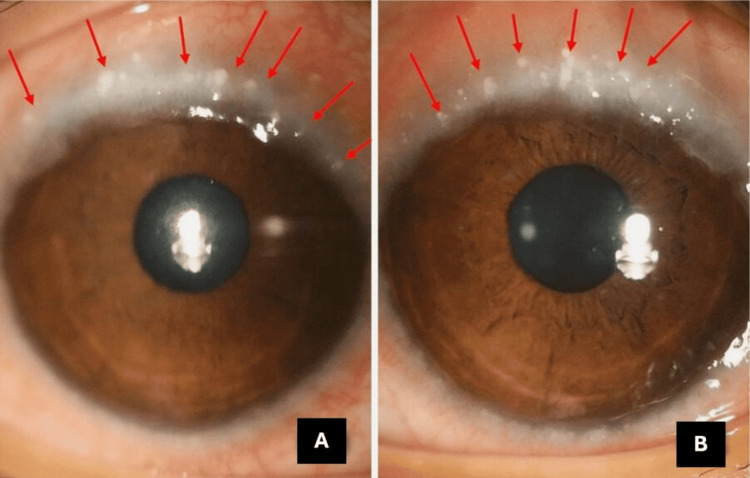
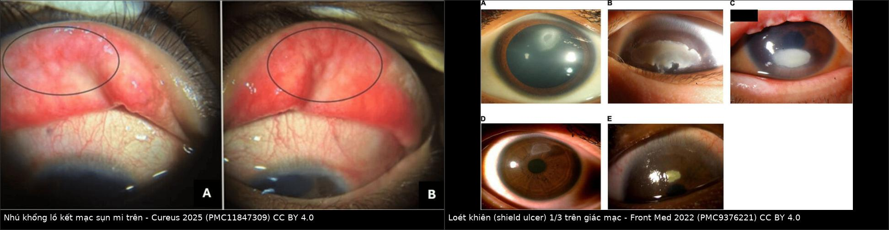
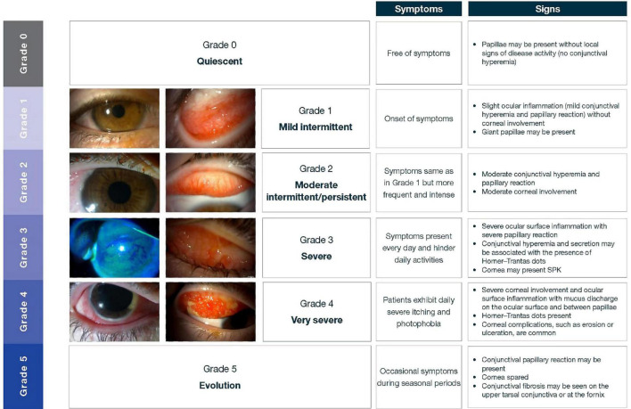
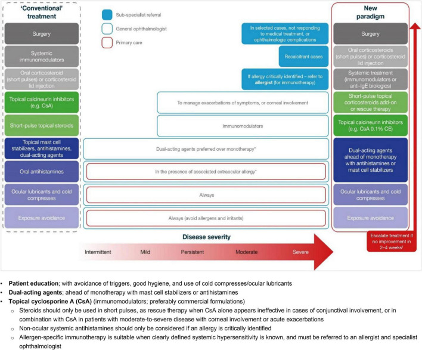
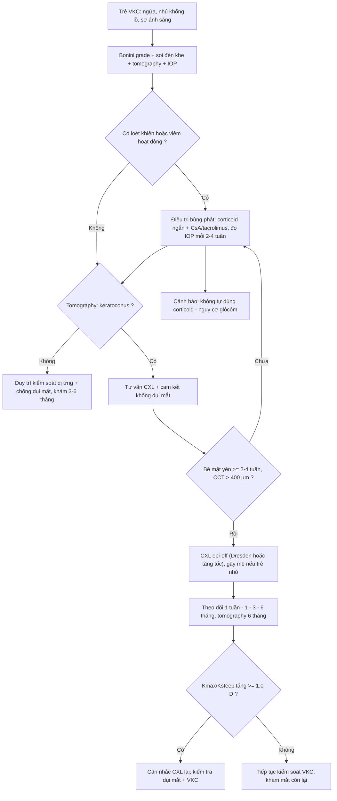
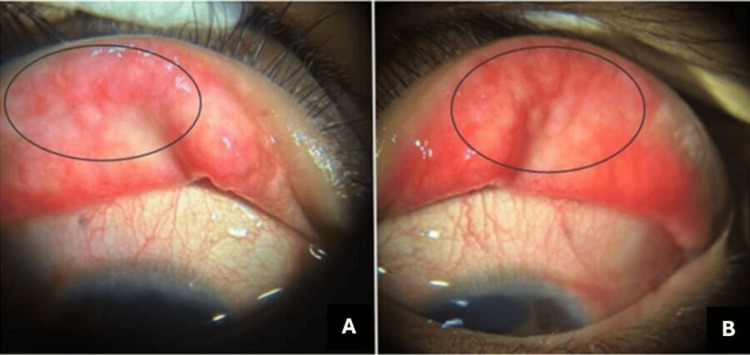
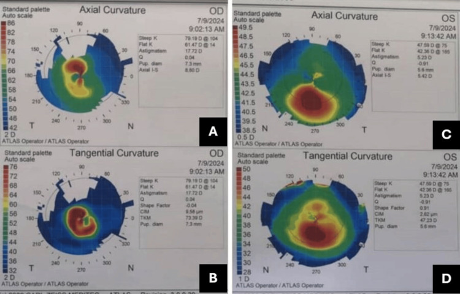
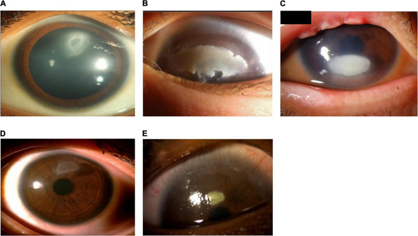

# 1451 — VKC ở trẻ có keratoconus: kiểm soát viêm và dụi mắt TRƯỚC–SAU CXL / Vernal keratoconjunctivitis with keratoconus in children: controlling inflammation and eye rubbing around cross-linking

**Tags:** `pattern:vkc` `pattern:ectasia-giac-mac` `pattern:loet-khien` `pattern:loi-khuc-xa-khong-deu` `vung:mat` `vung:giac-mac` `vung:ket-mac` `score:Bonini` `protocol:CXL` `protocol:tomography-giac-mac` `incidentaloma:keratoconus-tre`

**Mức chắc chắn (certainty):** tổng hợp y văn (literature synthesis) — tự biên từ **đồng thuận ERN-EYE 2026 về keratoconus trẻ em** (PMC13518778, CC BY-NC 4.0), **khuyến cáo VKC châu Á 2022 kèm thang Bonini** (PMC9376221, CC BY 4.0), **ca VKC + keratoconus + glôcôm do corticoid** (PMC11847309, CC BY 4.0), **38 mắt CXL ngay khi chẩn đoán ở trẻ có VKC đã kiểm soát** (PMC13529036, CC BY 4.0), **723 mắt viêm thấm sau CXL tăng tốc** (PMC13529035, CC BY-NC-ND 4.0) và **nghiên cứu nhãn áp sau corticoid ở trẻ** (PMC13233790, CC BY 4.0). Chưa gắn một ca nguyên văn đơn lẻ của riêng bài.

> **Bài này là phần "chuẩn bị và theo dõi" của [1414 – Keratoconus ở trẻ Down syndrome](../1414-keratoconus-down-syndrome/lesson.md).** 1414 đã chốt **ngưỡng tomography riêng của nhóm Down** và **dụi mắt 30% / atopy 26%** là hai lực đẩy ectasia. Nhưng ở trẻ **VKC**, câu hỏi không phải "có CXL hay không" mà là **"CXL lúc bề mặt còn đang viêm được không, và sau CXL ai giữ được mắt không tái tiến triển"** — vì chính **corticoid để dập viêm** là thứ gây **glôcôm thứ phát**, còn **dụi mắt** là thứ làm **CXL thất bại**.

> **Câu chốt:** **Trong VKC, keratoconus không phải biến chứng hiếm: tỷ lệ keratoconus lên tới 26,8% và bất thường tomography tới 71%** (PMC13518778); **65–78% bệnh nhân keratoconus có tiền sử viêm kết mạc dị ứng** (PMC13518778). Nhưng **CXL trên mắt đang viêm hoạt động là chống chỉ định** — viêm hoạt động nằm trong danh sách chống chỉ định của đồng thuận ERN-EYE 2026. Khi VKC **đã kiểm soát**, CXL ngay lúc chẩn đoán ở trẻ **an toàn và hiệu quả**: 38 mắt, **K steep giảm 2,02 D, K đỉnh giảm 2,26 D, khúc xạ cầu tương đương giảm 1,72 D** sau 12 tháng, **không khác biệt giữa mắt có và không có VKC**, chỉ **3 ca thấm vô khuẩn thoáng qua** (PMC13529036).

## 1. Tổng quan bệnh học – cơ chế hình ảnh

- **VKC là gì:** viêm kết mạc dị ứng **mạn, hai bên, theo mùa**, chủ yếu ở **bé trai 3–15 tuổi**; cơ chế **IgE (type I)** cộng **miễn dịch tế bào Th2/Th17 (type IV)**, với **bạch cầu ái toan, MMP-9, periostin** trong nước mắt. Khoảng **một nửa** bệnh nhân **không tìm thấy dị nguyên hệ thống** — tức **không cần test dị ứng dương mới được chẩn đoán** (PMC13413424).
- **Ba thể lâm sàng:** **thể sụn mi (tarsal)** — nhú khổng lồ hình sỏi cuội ở **sụn mi trên**; **thể rìa (limbal)** — **nốt Horner–Trantas** và phì đại rìa; **thể hỗn hợp**. Thể nào cũng có thể dẫn tới **loét khiên (shield ulcer)**, **sẹo giác mạc**, **giảm tế bào gốc rìa (LSCD)** và **keratoconus** (PMC9376221).
- **TẠI SAO VKC làm giác mạc biến dạng — hai lực cùng lúc:** (1) **viêm mạn** làm tăng **MMP-9** và phá collagen → **mỏng và yếu giác mạc**; (2) **dụi mắt** tạo **tải cơ học lặp lại** — chính là yếu tố **duy nhất can thiệp được bằng hành vi**. Đồng thuận ERN-EYE xếp **atopy, dị ứng, VKC, ngứa mắt và dụi mắt** vào cùng nhóm **yếu tố nguy cơ hành vi – môi trường** của keratoconus trẻ em (PMC13518778).
- **TẠI SAO keratoconus ở trẻ khác người lớn:** trẻ **tiến triển nhanh hơn**, **thời gian tiến triển dài hơn** (tới tuổi 30–40 mới ổn định), và **mắt đang phát triển thị giác** — nên **chẩn đoán muộn = nhược thị + sẹo + ghép giác mạc**. Đó là lý do **Đồng thuận toàn cầu lần 2 khuyến cáo CXL ngay khi chẩn đoán ở trẻ, kể cả khi chưa thấy tiến triển** (PMC13518778).
- **TẠI SAO CXL cần bề mặt "yên":** CXL **epi-off** bóc toàn bộ biểu mô **8–9 mm** và chiếu **UV-A 365 nm**. Trên giác mạc **đang viêm**, biểu mô **lành chậm**, **MMP-9 còn cao**, và mô đang viêm dễ **thấm vô khuẩn/ nhiễm khuẩn**. Đồng thuận ERN-EYE liệt kê **viêm mắt hoạt động** là **chống chỉ định** của CXL (PMC13518778). Ngược lại, khi VKC **đã kiểm soát**, kết quả ở trẻ **không khác mắt không VKC** (PMC13529036).
- **Số phải nhớ — kết quả và thất bại của CXL ở trẻ:** **ổn định sau 10 năm > 95%**, **tỷ lệ CXL lại 4,2%** (thường ở trẻ **< 15 tuổi, có dụi mắt và dị ứng**, làm lại sau **trung bình 36 tháng**); **7,9%** vẫn tiến triển **sau mốc 10 năm**; **25%** mắt còn lại cần CXL (PMC13518778). Nguy cơ **tiến triển sau CXL** được báo cáo **4–35%** tùy định nghĩa (tăng **Kmax/Kmean/Ksteep ≥ 1,0 D**) (PMC13518778).
- **Số phải nhớ — biến chứng CXL:** **thấm vô khuẩn 1,4–7,8%**; **mờ đục/sẹo dai dẳng < 3%** (PMC13518778). Trong loạt **723 mắt CXL tăng tốc**, **viêm thấm sau CXL 1,93% (14/723)**; **tuổi ≤ 16 làm tăng nguy cơ 2,38 lần**, còn **tiền sử VKC trong loạt này KHÔNG phải yếu tố nguy cơ (RR 0,7)** — một phản biện quan trọng với giả định "VKC luôn làm CXL nguy hiểm" (PMC13529035).
- **TẠI SAO corticoid là con dao hai lưỡi ở trẻ:** corticoid tại chỗ dập viêm nhanh nhưng gây **tăng nhãn áp**. Ở **158 trẻ** sau mổ lác dùng **dexamethasone**: **82,2% tăng nhãn áp so với nền**, **đỉnh trung bình 23,1 mmHg**, **tăng ròng 10 mmHg**; theo **Armaly**: đáp ứng nhẹ **< 6 mmHg**, trung bình **6–15 mmHg**, mạnh **> 15 mmHg**, và **5% là đáp ứng mạnh** (PMC13233790). Ở mắt **giác mạc mỏng–dốc**, đo nhãn áp còn **thấp giả** vì **CCT mỏng** → glôcôm dễ bị bỏ sót.
- **TẠI SAO phải đo tomography chứ không chỉ soi đèn khe:** keratoconus sớm **không thấy bằng mắt**; chốt nằm ở **độ cao bề mặt sau, Kmax, loạn thị không đều, mỏng khu trú**. Ca minh họa được chẩn đoán bằng **Atlas 993** với **loạn thị bow-tie không đối xứng, trục lệch, dốc–mỏng–không đều** (PMC11847309).
- **TẠI SAO "đã CXL" không có nghĩa "đã an toàn":** ca 18 tuổi trong bài: **CXL hai mắt** vẫn **mờ đi**, rồi **bùng phát VKC**, tự dùng corticoid → **nhãn áp 54 mmHg (OD) / 20 mmHg (OS)**, **C/D 0,95 nhạt màu (OD)** (PMC11847309). CXL **chặn ectasia**, không **chặn viêm** — hai việc khác nhau.

## 2. Mẫu hình + chẩn đoán phân biệt theo hình thái (gamut)

- **Nhú khổng lồ sụn mi trên (thể tarsal):** **nhú ≥ 1 mm**, hình sỏi cuội, **đỉnh dẹt**, xếp thành dãy; ngứa dữ dội, **dính mi buổi sáng**, chảy nước mắt. Đây là hình thái hay gặp nhất ở trẻ.
- **Thể rìa (limbal):** **nốt Horner–Trantas** trắng ở rìa, **phì đại rìa 360°**, sợ ánh sáng; nguy cơ **loét khiên** và **giảm thị lực** cao hơn.
- **Loét khiên (shield ulcer):** **khuyết biểu mô hình bầu dục 1/3 trên giác mạc**, đáy có **mảng fibrin trắng (plaque)**; do **nhú khổng lồ cọ xát** + **chất trung gian viêm**. Đây là **biến chứng nặng nhất trước khi có sẹo** (PMC9376221).
- **Keratoconus trên nền VKC:** **loạn thị không đều tăng dần**, **đổi kính liên tục**, **Kmax tăng**, **mỏng khu trú**, **dấu Munson/ Rizzuti** khi muộn; thường **hai bên nhưng không đối xứng**.
- **Bảng phân biệt nhanh theo "hình thái – vị trí – đối xứng":**

| Hình thái | Vị trí tổn thương chính | Đối xứng | Dấu chốt |
|---|---|---|---|
| VKC thể sụn mi | Sụn mi trên | Hai bên | Nhú ≥ 1 mm hình sỏi cuội, đỉnh dẹt |
| VKC thể rìa | Rìa giác mạc | Hai bên | Nốt Horner–Trantas, phì đại rìa |
| Loét khiên | 1/3 trên giác mạc | Một hoặc hai bên | Khuyết biểu mô + mảng fibrin |
| Keratoconus | Trung tâm/cạnh trung tâm | Hai bên, lệch | Kmax tăng, mỏng khu trú, bề mặt sau cao |
| Viêm kết mạc mùa (SAC) | Kết mạc | Hai bên | Ngứa nhẹ, **không nhú khổng lồ**, không tổn thương giác mạc |
| Viêm kết mạc dị ứng tiếp xúc (GPC do kính) | Sụn mi trên | Hai bên | Nhú **nhỏ đều**, **có tiền sử đeo kính**, hết khi ngừng kính |

- **Gợi nhớ 5 chữ — "I-T-C-H-Y":** **I**nflammation mạn (MMP-9) · **T**arsal nhú khổng lồ · **C**orneal shield ulcer · **H**igh IOP do corticoid · **Y**oung + **dụi mắt** = ectasia tiến triển.

*Thể rìa (limbal): viêm rìa 360° mạn kèm **nốt Horner–Trantas** ở cả hai mắt — (A) phải, (B) trái. Đây là hình thái có nguy cơ **loét khiên** và **giảm thị lực** cao hơn thể sụn mi. Nguồn: *Cureus* 2025 (PMC11847309) Figure 2, CC BY 4.0.*

## 3. Bảng so sánh phân biệt (ma trận đối chiếu)

| Thực thể (entity) | Hình ảnh điển hình | Chốt vào (rule-in) | Chốt loại (rule-out) | Gợi ý xác nhận |
|---|---|---|---|---|
| **VKC thể sụn mi** | Nhú **≥ 1 mm**, hình sỏi cuội, **đỉnh dẹt**, sụn mi trên | **Nhú khổng lồ + ngứa theo mùa + bé trai 3–15 tuổi** | Nhú nhỏ đều + tiền sử đeo kính → GPC | Soi đèn khe lật mi; Bonini grade |
| **VKC thể rìa** | **Nốt Horner–Trantas**, phì đại rìa 360° | **Nốt trắng ở rìa + sợ ánh sáng** | Rìa bình thường, chỉ nhú sụn → thể tarsal | Soi rìa; nhuộm fluorescein |
| **Loét khiên** | **Khuyết biểu mô 1/3 trên**, **mảng fibrin trắng**, bờ dày | **VKC đang hoạt động + khuyết biểu mô + mảng fibrin** | Khuyết biểu mô nhỏ, bờ trong, không mảng → trợt do khô/dụi | Nhuộm fluorescein, chụp màu; cấy nếu nghi nhiễm |
| **Keratoconus** | **Kmax tăng**, **mỏng khu trú**, **độ cao bề mặt sau**, loạn thị không đều | **≥ 2 tham số tomography bất thường + tiến triển theo thời gian** | Loạn thị đều, tomography bình thường → loạn thị thông thường | Pentacam/Sirius/Atlas, so sánh cùng máy |
| **Viêm giác mạc do vi khuẩn/ nấm** | Thấm **khu trú**, **mủ tiền phòng**, đau nhiều, **không liên quan nhú** | **Thấm + tiền phòng có mủ + cấy dương** | Thấm vô khuẩn thoáng qua sau CXL, cấy âm → thấm do viêm | Cấy/soi tươi trước khi tăng corticoid |
| **Glôcôm do corticoid** | **IOP tăng ≥ 10 mmHg** so với nền, **C/D lớn dần**, thị trường thu hẹp | **Tiền sử corticoid + IOP tăng có hồi phục khi ngừng** | IOP bình thường nhiều lần, C/D ổn định → loại | Đo IOP **cùng máy, cùng thời điểm**, bù CCT; chụp OCT RNFL |
| **GPC do kính tiếp xúc** | Nhú **nhỏ, đều**, sụn mi trên, **ngứa khi đeo** | **Hết sau ngừng kính 2–4 tuần** | Nhú khổng lồ đỉnh dẹt + không đeo kính → VKC | Ngừng kính thử; hỏi tiền sử |

*Trái: **nhú khổng lồ (macropapillae)** ở kết mạc sụn mi trên, khoanh tròn — (A) mắt phải, (B) mắt trái. Phải: **loét khiên** điển hình ở **1/3 trên giác mạc** với **mảng fibrin**, trên nền VKC nặng. Ảnh ghép letterbox nền đen, không crop/kéo giãn. Nguồn: *Cureus* 2025 (PMC11847309) Figure 1, CC BY 4.0 (trái); *Front Med* 2022 (PMC9376221) Figure 4, CC BY 4.0 (phải).*

### Vì sao phải phân độ trước khi chọn thuốc
- **Bonini grade 0–4** (PMC12507153, dẫn theo Bonini 2007):
  - **Grade 0** — yên: không triệu chứng.
  - **Grade 1** — nhẹ, từng đợt: triệu chứng thoáng qua, **không tổn thương giác mạc**.
  - **Grade 2A/2B** — trung bình từng đợt/liên tục: triệu chứng + **sợ ánh sáng**, **không hoặc rất ít tổn thương giác mạc**.
  - **Grade 3** — nặng: triệu chứng liên tục + **viêm giác mạc chấm nông**, **nhú khổng lồ** và/hoặc **nốt Horner–Trantas**.
  - **Grade 4** — rất nặng: triệu chứng dai dẳng ± **biến chứng** (sẹo giác mạc, **LSCD**, **glôcôm do corticoid**, **keratoconus**).
- **Ý nghĩa thực hành:** **grade 3–4 là lúc phải dùng thuốc ức chế miễn dịch tại chỗ** (cyclosporine A **0,05–2%**, tacrolimus **0,1%** mỡ/dung dịch) để **giảm liều corticoid**, và là lúc **phải đo tomography + nhãn áp** vì đã có tổn thương giác mạc (PMC12507153, PMC13025120).

*Các mức độ nặng của VKC theo **thang Bonini** — từ thể nhẹ (nhú, không tổn thương giác mạc) đến thể rất nặng có **biến chứng giác mạc**. Phân độ quyết định việc dùng corticoid ngắn hay chuyển sang ức chế miễn dịch tại chỗ. Nguồn: *Front Med* 2022 (PMC9376221) Figure 8, CC BY 4.0 (hình phái sinh do bài gốc công bố lại).*

## 4. Protocol + thang phân độ + quy trình CXL

- **Đánh giá ban đầu (mọi trẻ VKC):** thị lực **có/không kính**, khúc xạ **sau liệt điều tiết**, **soi đèn khe lật mi trên**, **nhuộm fluorescein**, **đo nhãn áp**, **soi đáy mắt**, **tomography giác mạc** (Pentacam/Sirius/Atlas) + **chụp ảnh**. Ở trẻ nhỏ **không hợp tác**: làm dưới **gây mê/giãn cách**.
- **Phân độ Bonini** mỗi lần khám (0–4) + ghi **nhú (mm)**, **nốt Horner–Trantas (có/không)**, **loét khiên (mm²)**, **Kmax (D)**, **CCT mỏng nhất (µm)**, **IOP (mmHg)**.
- **Điều trị VKC theo bậc (PMC9376221, PMC13025120):**
  1. **Tránh dị nguyên + nước mắt nhân tạo + kháng histamin/ổn định tế bào mast** — thể nhẹ.
  2. **Corticoid tại chỗ liều ngắn ("pulse")** khi bùng phát — **luôn có lịch đo IOP**; ưu tiên **fluorometholone/loteprednol** ít gây tăng nhãn áp hơn dexamethasone.
  3. **Ức chế miễn dịch tại chỗ:** **cyclosporine A 0,05–2%** hoặc **tacrolimus 0,1%** — để **cai corticoid**; tacrolimus **0,1% mỡ** có thể bôi **da mi trên** như liệu pháp hỗ trợ.
  4. **Ca kháng trị:** **tiêm corticoid dưới sụn mi (triamcinolone)**, **interferon-α2b**, **omalizumab/dupilumab** (bằng chứng còn hạn chế).
  5. **Ngoại khoa:** **cắt nhú + ghép màng kết tự thân** ở thể sụn mi kháng trị; **ghép tế bào gốc rìa** khi LSCD.
- **Chỉ định CXL ở trẻ có VKC:** keratoconus **xác nhận trên tomography**, và theo đồng thuận **làm ngay khi chẩn đoán** ở trẻ (kể cả chưa tiến triển), **nhưng chỉ khi VKC đã kiểm soát** — không loét khiên, không viêm hoạt động, không nhiễm trùng.
- **Chuẩn bị trước CXL (checklist):**
  - **Bề mặt yên ≥ 2–4 tuần**, **không loét khiên**, **không mảng fibrin**.
  - **IOP đã đo và trong giới hạn**; nếu đang dùng corticoid → **đo lại sau 2–4 tuần**.
  - **CCT mỏng nhất > 400 µm** cho protocol chuẩn; **< 400 µm** dùng **riboflavin ưu trương (hypotonic) / nomogram sub400** theo đồng thuận (PMC13518778).
  - **Bố mẹ/trẻ hiểu và cam kết**: **không dụi mắt**, tái khám đúng hẹn, **không tự mua corticoid**.
- **Protocol CXL:** **epi-off Dresden 3 mW/cm² × 30 phút = 5,4 J/cm²**, riboflavin **0,1%** nhỏ **20–30 phút**; hoặc **tăng tốc 9 mW/cm² × 10 phút** hoặc **18 mW/cm² × 5 phút**. Trẻ **< 12–14 tuổi hoặc không hợp tác** → **gây mê toàn thân**.
- **Sau CXL:** **kính áp tròng băng** 3–5 ngày, **kháng sinh + corticoid ngắn ngày**, **giảm đau**; khám **1 tuần – 1 tháng – 3 tháng – 6 tháng**, **tomography lại 6 tháng**; tiếp tục **kiểm soát VKC và dụi mắt**.
- **Theo dõi dài hạn:** tomography **mỗi 6–12 tháng** tới khi ổn định; **CXL lại** nếu **Kmax/Ksteep tăng ≥ 1,0 D**; **mắt còn lại** khám cùng lịch (**25% sẽ cần CXL**).

*Sơ đồ **điều trị VKC theo bậc**: từ kháng histamin/ổn định tế bào mast → corticoid ngắn → ức chế miễn dịch tại chỗ (CsA/tacrolimus) → sinh học/ngoại khoa. Điểm cần nhớ: **corticoid là bậc tạm, không phải bậc duy trì**. Nguồn: *Front Med* 2022 (PMC9376221) Figure 1, CC BY 4.0.*

## 5. Biến thể bình thường và cạm bẫy

- **Cạm bẫy "mắt đỏ đã CXL = thất bại CXL":** ca 18 tuổi **vẫn tiến triển và mờ** sau CXL **vì VKC bùng phát + dụi mắt + corticoid không kiểm soát**, không phải vì CXL hỏng (PMC11847309). Trước khi kết luận thất bại, phải hỏi **dụi mắt, tuân thủ, bùng phát dị ứng**.
- **Cạm bẫy nhãn áp "bình thường" ở mắt mỏng:** **CCT mỏng làm IOP đo thấp giả**; ở keratoconus **không được tin một lần đo**. Phải **đo cùng máy, cùng thời điểm trong ngày**, **so với nền trước corticoid**, và **soi đĩa thị + OCT RNFL**.
- **Cạm bẫy "nhú nhỏ = không phải VKC":** **GPC do kính** cũng nhú sụn mi trên nhưng **nhú nhỏ, đều**, và **hết sau ngừng kính 2–4 tuần**; hỏi **tiền sử đeo kính** trước khi gắn nhãn VKC.
- **Cạm bẫy "thấm sau CXL là nhiễm trùng":** phần lớn **thấm vô khuẩn** (1,4–7,8%), đáp ứng corticoid; nhưng **không được tăng corticoid mù** khi chưa **cấy/soi tươi** — nhiễm trùng trên giác mạc đang dùng corticoid là tình huống mất mắt.
- **Cạm bẫy "VKC làm CXL nguy hiểm hơn":** loạt **723 mắt** cho thấy **tiền sử VKC không tăng nguy cơ viêm thấm (RR 0,7)**, còn **tuổi ≤ 16 tăng 2,38 lần** (PMC13529035). Vậy **tuổi và tuân thủ** quan trọng hơn nhãn "VKC".
- **Cạm bẫy "CXL xong là hết phải theo dõi":** **7,9% tiến triển sau 10 năm**, **4,2% phải CXL lại** (trung bình **36 tháng**), **25% mắt còn lại cần CXL** (PMC13518778) — **không có mốc "khỏi"**.
- **Cạm bẫy "trẻ nhỏ không đo được nên bỏ qua":** **không đo được thị lực/tomography tại giường không có nghĩa không có bệnh**; với VKC nặng + nhú khổng lồ, **chỉ định khám dưới gây mê** để không bỏ lỡ **loét khiên/keratoconus**.
- **Biến thể "keratoconus cận lâm sàng":** tomography bất thường nhưng **soi đèn khe bình thường** — vẫn phải **theo dõi 3–6 tháng** vì **71% VKC có bất thường tomography** (PMC13518778).
- **Cạm bẫy thuốc:** **tacrolimus/cyclosporine tại chỗ gây bỏng rát** lúc đầu → **giảm tuân thủ**; giải thích trước và **bắt đầu 1 lần/ngày rồi tăng**.

## 6. Tự lượng giá — Blind Quiz

**Ca 1 — Bé gái 14 tuổi, ngứa mắt hai bên theo mùa, sợ ánh sáng, đổi kính liên tục. Lật mi trên thấy hình dưới. Hỏi: chẩn đoán, phân độ, và hai việc phải làm ngay.**

<b>Bấm để hiện đáp án</b>

- **VKC thể sụn mi** với **nhú khổng lồ đỉnh dẹt** (khoanh tròn) ở cả hai mắt; sợ ánh sáng + đổi kính liên tục → nghi **tổn thương giác mạc/keratoconus**.
- Phân độ **Bonini**: có nhú khổng lồ + viêm giác mạc chấm nông → **grade 3**; nếu đã có sẹo/keratoconus → **grade 4**.
- Hai việc ngay: (1) **tomography giác mạc** tìm keratoconus; (2) **đo nhãn áp + soi đèn khe nhuộm fluorescein** tìm **loét khiên**, trước khi kê corticoid.

*Bản đồ giác mạc sau CXL — (A,B) mắt phải tiến triển rõ, (C,D) mắt trái tiến triển ít; minh họa rằng **CXL không thay thế kiểm soát viêm và dụi mắt**. Nguồn: *Cureus* 2025 (PMC11847309) Figure 3, CC BY 4.0.*

- Nguồn: *Cureus* 2025 (PMC11847309) Figure 1, CC BY 4.0.

**Ca 2 — Bé trai 11 tuổi VKC nặng, đau mắt phải 5 ngày, không chấn thương. Giác mạc 1/3 trên có khuyết biểu mô hình bầu dục, đáy trắng đục.**

- Hỏi: chẩn đoán? Vì sao **không được coi là loét nhiễm khuẩn thông thường**? Điều trị và điều gì phải kiểm tra cùng lúc?

<b>Bấm để hiện đáp án</b>

- **Loét khiên (shield ulcer)** trên nền VKC: vị trí **1/3 trên** đúng nơi **nhú khổng lồ cọ xát**, đáy có **mảng fibrin (plaque)**.
- Không phải loét nhiễm khuẩn thông thường vì **cơ chế cọ xát + viêm**, không có mủ tiền phòng; nhưng **vẫn phải cấy/soi tươi** vì loét khiên **có thể bội nhiễm** và vì **corticoid sẽ được dùng**.
- Điều trị: **corticoid tại chỗ mạnh ngắn ngày + ức chế miễn dịch (CsA/tacrolimus)**; **bóc mảng fibrin** nếu dày; **kiểm soát nhú** (cắt nhú + ghép màng kết nếu kháng trị); **chống dụi mắt**.
- Kiểm tra cùng lúc: **nhãn áp** (corticoid), **tomography** (keratoconus), **mắt còn lại**.
- Nguồn: *Front Med* 2022 (PMC9376221) Figure 4, CC BY 4.0.

**Ca 3 — Bé 15 tuổi VKC, đã CXL 8 tháng, thị lực giảm dần, nhãn áp 32 mmHg, C/D 0,8. Mẹ cho biết cháu "nhỏ thuốc đỏ" mỗi lần ngứa.**

<b>Bấm để hiện đáp án</b>

- **Glôcôm do corticoid** (không phải VKC tiến triển): dùng corticoid **không giám sát** + IOP **32 mmHg** + **C/D 0,8**.
- Xử trí: **ngừng corticoid ngay**, khởi đầu **thuốc hạ nhãn áp**, chuyển sang **CsA/tacrolimus** để kiểm soát VKC, **đo IOP + OCT RNFL + thị trường** định kỳ; nếu không hồi phục → **can thiệp lọc/thủ thuật**.
- Bài học từ ca thật: bệnh nhân **bỏ tái khám từ 14 tuổi** và **tự dùng corticoid** → **IOP 54 mmHg, C/D 0,95** (PMC11847309). Giáo dục bệnh nhân/ gia đình là một phần của điều trị.

## Bài liên quan chéo
- [1414 – Keratoconus ở trẻ Down syndrome: ngưỡng tomography riêng, CXL](../1414-keratoconus-down-syndrome/lesson.md)
- [1412 – Đo khúc xạ lý liệt ở trẻ đặc biệt](../1412-do-khuc-xa-ly-liet-tre-dac-biet/lesson.md)
- [1438 – Viêm màng bồ đào giao cảm](../1438-viem-mang-bo-dao-giao-cam/lesson.md) — hàng phân biệt viêm nội nhãn
- [442 – Glôcôm và OCT RNFL](../442-glaucoma-OCT/lesson.md) — theo dõi glôcôm do corticoid
- [446 – Phù hoàng điểm do viêm](../446-phu-hoang-diem-viem/lesson.md) — biến chứng viêm nội nhãn

> Không dùng để chẩn đoán độc lập khi chưa có người hướng dẫn.
