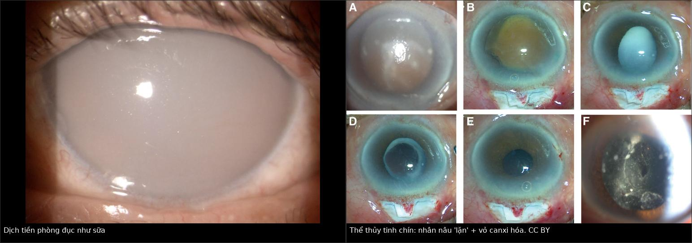
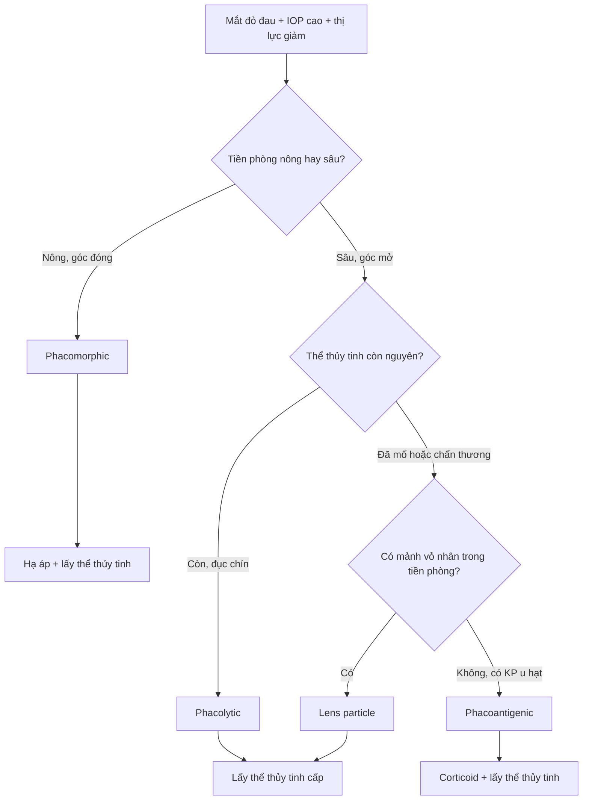
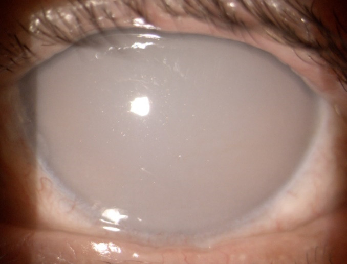
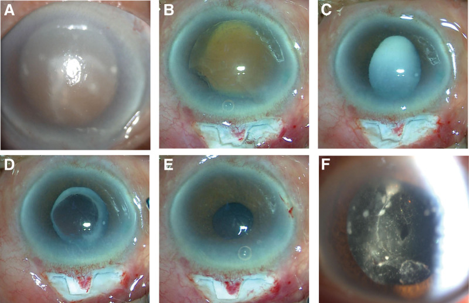
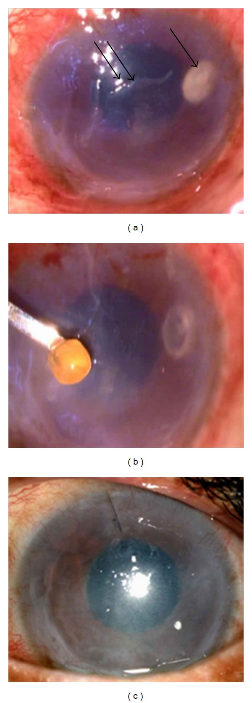

# 1452 — Glôcôm do thể thủy tinh chưa mổ: phacolytic & viêm do protein thể thủy tinh / Phacolytic glaucoma & lens-protein uveitis

**Tags:** `pattern:glaucoma` `pattern:phacolytic` `pattern:phu-giac-mac` `pattern:viem-tien-phong` `pattern:mat-mot-ben` `vung:mat` `vung:tien-phong` `vung:the-thuy-tinh` `vung:goc-tien-phong` `protocol:slit-lamp` `protocol:UBM` `protocol:AS-OCT` `protocol:do-nhan-ap` `protocol:phaco`
**Mức chắc chắn (certainty):** tổng hợp y văn (literature synthesis) — 1 đoàn hệ hồi cứu **488 mắt** (279 phacolytic; PMC9240532), 1 ca **phacolytic sau phaco 7 năm** (PMC10627700), 1 ca **tiền phòng đục như sữa** (PMC8207859) và 1 ca **giả áp-xe giác mạc** (PMC3350162). Câu nào là suy luận được ghi **[suy luận]**.

> **Vì sao bài này quan trọng:** đây là **glôcôm thứ phát góc MỞ** ở mắt **còn thể thủy tinh**, chữa khỏi bằng **lấy thể thủy tinh** — nhưng thường bị điều trị như **viêm nội nhãn/TASS** rồi **chọc tiền phòng + kháng sinh**, hoặc chỉ **hạ áp bằng thuốc** và để mất thị lực. Ba bẫy chết người: **tiền phòng đục như sữa bị đọc là mủ**, **thể thủy tinh dính nội mô bị đọc là áp-xe giác mạc**, và **"đã mổ phaco rồi" nên loại trừ phacolytic**.

## 1. Tổng quan bệnh học – cơ chế hình ảnh

- **Bốn thể glôcôm do thể thủy tinh (lens-induced glaucoma, LIG):**
  1. **Phacomorphic** — thể thủy tinh **phồng/to ra** đẩy mống mắt ra trước → **góc ĐÓNG**, tiền phòng **nông**.
  2. **Phacolytic** — thể thủy tinh **chín/quá chín (hypermature, Morgagnian)**; **protein phân tử lượng lớn rò qua bao** vào tiền phòng → **góc MỞ**, tiền phòng **sâu**.
  3. **Lens particle** — **vỏ/nhân** còn sót sau mổ/chấn thương/YAG bao sau → hạt chặn bè.
  4. **Phacoantigenic (lens-induced uveitis)** — phản ứng **u hạt** với kháng nguyên thể thủy tinh sau **rách bao**, thường có **KP mỡ cừu**.
- **TẠI SAO protein thể thủy tinh gây tăng nhãn áp:** thể thủy tinh có **nồng độ protein cao nhất cơ thể** (chủ yếu crystallin). Khi chín, sợi vỏ thoái hóa thành **cụm protein hòa tan phân tử lượng lớn**; các cụm này **rò qua bao** — bao thường **trông còn nguyên**, nhưng một nghiên cứu kính hiển vi điện tử trên bao "nguyên" đã thấy **nhiều lỗ khuyết toàn thành** (dẫn trong PMC8207859) — vào tiền phòng. Tại đây chúng **bị đại thực bào ngấm** và **cùng với protein trực tiếp bít lưới bè** → **tăng sức cản thoát thủy dịch** → IOP tăng. Đây là **glôcôm góc mở**, không phải góc đóng.
- **TẠI SAO tiền phòng "đục như sữa":** huyền phù protein + đại thực bào + tinh thể cholesterol/lipid **tán xạ ánh sáng** (hiệu ứng Tyndall mạnh) → dịch tiền phòng **trắng đục**, che các cấu trúc phía sau. Trên nội mô có thể thấy **tinh thể trắng lấp lánh** (PMC8207859).
- **TẠI SAO mắt đau dữ dội:** IOP tăng nhanh **40–60 mmHg** làm **căng bao nhãn cầu** và **phù giác mạc**; kèm **buồn nôn/nôn** do phản xạ thần kinh sinh ba – phó giao cảm. Vì vậy thể này **bắt chước glôcôm góc đóng cấp**.
- **Số liệu định lượng cốt lõi:**
  - **Tần suất:** LIG chiếm **0,64%** trong **82.205** ca mổ đục thể thủy tinh tại một bệnh viện mắt (525 ca); các báo cáo khác **0,7–2,4%** (PMC9240532).
  - **IOP trước mổ:** phacolytic **40,05 ± 12,0 mmHg** (279 mắt) so với phacomorphic **43,15 ± 12,9 mmHg** (209 mắt), p = 0,006 (PMC9240532).
  - **Ca 76 tuổi (PMC8207859):** thị lực **sáng tối (light perception)**, **IOP 48 mmHg**, tiền phòng sâu, **dịch như sữa**, **tinh thể trắng trên nội mô**; sau mổ thị lực tốt.
  - **Ca 79 tuổi (PMC10627700):** **7 năm sau phaco**, **IOP 60 mmHg**, thị lực **sáng tối**, tiền phòng sâu **3,33 mm** (mắt bên 4,02 mm trên UBM), **vỏ canxi hóa**, **nhân nâu "lặn" (sun-setting)**; **ECCE + trabeculectomy**, ngày 1 **IOP 11 mmHg**, thị lực **đếm ngón tay 20 cm**.
  - **Tiên lượng:** **triệu chứng < 1 tuần** → khả năng **BCVA ≥ 6/18** cao hơn (**OR 1,58; 1,0–2,4**); **không có tổn thương dịch kính** → **OR 23,53 (5,1–108,0)**; **tuổi < 60** giảm nguy cơ **viêm nặng sau mổ** (**OR 0,44; 0,23–0,83**). Biến chứng trong mổ chung **15,4%**, phức hợp **dây chằng–bao 10,9%**; **5,1%** không đặt được IOL (PMC9240532).

## 2. Mẫu hình + chẩn đoán phân biệt theo vị trí (gamut)

- **Theo độ sâu tiền phòng — câu hỏi đầu tiên:**
  - **Tiền phòng SÂU + góc MỞ + thể thủy tinh còn** → **phacolytic**, **lens particle**, **phacoantigenic**, **viêm nội nhãn**, **TASS**.
  - **Tiền phòng NÔNG + góc ĐÓNG + thể thủy tinh còn** → **phacomorphic**, **glôcôm góc đóng cấp nguyên phát**, **khối sau mống mắt**.
- **Theo bối cảnh mổ/chấn thương:** **chưa từng mổ** → phacolytic/phacomorphic; **sau phaco/YAG/chấn thương** → lens particle/phacoantigenic (kể cả **phacolytic "giả" do vỏ sau bao**, PMC10627700).
- **Theo mức viêm:** **giả mủ + tinh thể** → phacolytic; **KP mỡ cừu + nốt mống mắt** → phacoantigenic; **mủ thật + viêm dịch kính + đau sau mổ** → **viêm nội nhãn** (cấp cứu).
- Gợi nhớ **"LENS"**: **L**eak of lens protein (phacolytic), **E**ndophthalmitis (mủ thật + vitritis), **N**uclear/cortical fragments (lens particle), **S**welling lens (phacomorphic).

## 3. Bảng so sánh phân biệt (ma trận đối chiếu)

| Thực thể (entity) | Hình ảnh điển hình | Chốt vào (rule-in) | Chốt loại (rule-out) | Gợi ý xác nhận |
|---|---|---|---|---|
| **Phacolytic glaucoma** | Thể thủy tinh **chín/quá chín**, tiền phòng **sâu**, **dịch như sữa**, **tinh thể trắng trên nội mô**, góc **MỞ**, IOP **40–60 mmHg** | **Dịch sữa + hạt/tinh thể + góc mở + thể thủy tinh chín** | Mủ thật + viêm dịch kính → viêm nội nhãn | Lấy thể thủy tinh cấp |
| **Phacomorphic glaucoma** | Thể thủy tinh **dày/phồng**, tiền phòng **nông**, góc **ĐÓNG**, mống mắt áp sát | **Tiền phòng nông + góc đóng + thể thủy tinh phồng** | Tiền phòng sâu + góc mở → phacolytic | Hạ áp + lấy thể thủy tinh |
| **Lens particle glaucoma** | Sau mổ/chấn thương/YAG: **mảnh vỏ/nhân trắng** trong tiền phòng, **góc mở**, viêm nhẹ–vừa | **Mảnh thể thủy tinh thấy được + tiền sử mổ/chấn thương** | Không có mảnh, thể thủy tinh nguyên → phacolytic | Rửa tiền phòng ± lấy mảnh |
| **Phacoantigenic uveitis** | **KP mỡ cừu**, **nốt mống mắt**, dính đồng tử sau, viêm mạn sau **rách bao** | **KP u hạt + nốt mống mắt + tiền sử rách bao** | Không KP u hạt → phacolytic | Corticoid + lấy thể thủy tinh |
| **Viêm nội nhãn cấp** | **Mủ thật** tiền phòng, **viêm dịch kính**, đau tăng, sau mổ vài ngày | **Mủ + vitritis + đau sau mổ** | Dịch sữa không mủ, không vitritis → phacolytic | Chọc dịch kính + kháng sinh |
| **TASS** | Sau mổ **ngày 1–2**, viêm **lan tỏa** không mủ, giác mạc phù, **không vitritis** | **Khởi phát rất sớm + không nhiễm khuẩn** | Mủ/vitritis → viêm nội nhãn | Corticoid tại chỗ |
| **Glôcôm góc đóng cấp** | Tiền phòng **nông**, góc đóng, **giác mạc phù**, đồng tử giữa giãn | **Góc đóng + tiền phòng nông** | Góc mở + thể thủy tinh chín → phacolytic | Hạ áp + laser/mổ |

*Trái: **tiền phòng đục như sữa**, che hoàn toàn mống mắt và thể thủy tinh (PMC8207859, CC BY 2.0). Phải: **thể thủy tinh chín** — vỏ trước canxi hóa, nhân nâu "lặn" xuống dưới sau giãn đồng tử; (A) trước mổ, (B–F) các thì mổ (PMC10627700, CC BY 4.0). Ảnh ghép letterbox.*

### Ba dấu hiệu phải đọc đúng
- **Dịch tiền phòng "như sữa" không phải mủ:** không có **màng fibrin**, không **vitritis**, không đau tăng theo giờ sau mổ; hạt **lấp lánh** khi di chuyển đèn.
- **Nhân "lặn" (sun-setting nucleus):** nhân nâu nằm **thấp nhất** trong bao, vỏ đục phía trên — dấu của thể thủy tinh **quá chín**, gợi ý phacolytic.
- **Góc MỞ trên gonioscopy:** phân biệt với phacomorphic/góc đóng; nếu **không soi được góc vì giác mạc phù**, hạ áp tạm rồi soi lại.

## 4. Protocol chụp + hệ phân độ/điểm chuẩn hóa

- **Đèn khe (bắt buộc):** độ sâu tiền phòng, **tế bào/flare**, hạt/tinh thể, **màng fibrin**, **KP**, nốt mống mắt, dính đồng tử sau; đánh giá **thể thủy tinh: chín, vỡ bao, nhân lặn, vỏ canxi**; đo **IOP** (Goldmann) và **soi góc** khi giác mạc đủ trong.
- **Siêu âm B-scan / UBM:** khi không nhìn thấy thể thủy tinh sau (giác mạc phù, tiền phòng đục); UBM đo **độ sâu tiền phòng** (ca 79 tuổi: **3,33 mm** so với **4,02 mm** mắt bên) và tìm **vỏ sau bao/cortex**.
- **AS-OCT:** đánh giá **phù giác mạc**, **mống mắt–giác mạc**, **vị trí thể thủy tinh**; không thay được soi góc.
- **Xét nghiệm:** không có xét nghiệm máu đặc hiệu; **hCG** nếu nghi thai trứng (không áp dụng ở nam); **cấy dịch tiền phòng/dịch kính** chỉ khi nghi **viêm nội nhãn** — **không chọc tiền phòng thường quy** vì làm chậm lấy thể thủy tinh.
- **Điều trị nội khoa (cầu nối):** **ức chế beta tại chỗ + alpha-agonist + ức chế carbonic anhydrase**; **acetazolamide uống 250 mg** (hoặc IV) và **mannitol 20% tĩnh mạch** khi IOP rất cao; **tránh pilocarpine** vì co đồng tử làm tăng viêm và không mở được góc đã mở **[suy luận từ cơ chế]**.
- **Điều trị triệt để:** **lấy thể thủy tinh** (phaco hoặc ECCE) ± IOL; **kết hợp trabeculectomy** khi IOP cao kéo dài/tổn thương thị thần kinh (ca 79 tuổi). Ở nơi thiếu máy, **MSICS** cho kết quả tốt (488 mắt; PMC9240532).
- **Không có hệ phân độ chính thức** cho LIG. Mô tả theo **4 trục:** *IOP (mmHg) × độ sâu tiền phòng (mm) × hình thái thể thủy tinh (chín/phồng/vỡ bao) × mức viêm (tế bào/flare/KP/vitritis)*.
- **Theo dõi:** ngày 1 sau mổ **IOP + phù giác mạc + phản ứng tiền phòng**; sau đó **1 tuần, 1 tháng, 3 tháng**; cảnh báo **viêm nặng/giả mủ ngày 1** (nguy cơ cao hơn ở **tuổi ≥ 60**, OR 0,44 cho người trẻ).

## 5. Biến thể bình thường và cạm bẫy

- **Biến thể:** thể thủy tinh **chín nhưng bao còn nguyên**, không rò protein → **không tăng IOP**; chỉ khi có **rò + đại thực bào** mới thành phacolytic. **Đục thể thủy tinh đơn thuần không gây glôcôm.**
- **Cạm bẫy 1 — "mủ" giả:** dịch sữa + tinh thể bị đọc là **mủ tiền phòng** → chọc tiền phòng/kháng sinh, trì hoãn mổ. **Không có vitritis, không fibrin, không đau tăng sau mổ** → nghĩ phacolytic.
- **Cạm bẫy 2 — giả áp-xe giác mạc:** thể thủy tinh **dính chặt vào nội mô** gây thâm nhiễm + **khiếm khuyết biểu mô**, bị điều trị **kháng sinh/kháng nấm 2 tháng** mà không khỏi; xử trí đúng là **lấy thể thủy tinh** (ca 73 tuổi; PMC3350162).
- **Cạm bẫy 3 — "đã phaco rồi":** phacolytic vẫn xảy ra **sau phaco nhiều năm** nếu **cortex còn sau bao sau** (ca 79 tuổi, **7 năm**, IOP **60 mmHg**; PMC10627700). Đừng loại trừ chỉ vì có IOL.
- **Cạm bẫy 4 — chỉ hạ áp bằng thuốc:** IOP có thể giảm tạm nhưng **protein tiếp tục rò**; **không lấy thể thủy tinh = tái tăng + teo thị thần kinh**.
- **Cạm bẫy 5 — pilocarpine:** co đồng tử trên mắt viêm làm **dính đồng tử sau** và **tăng phản ứng tiền phòng**; không dùng thường quy.
- **Cạm bẫy 6 — bỏ sót viêm nội nhãn:** nếu **đau tăng, mủ thật, vitritis** sau mổ → **viêm nội nhãn là cấp cứu**, không được xếp vào phacolytic.

## 6. Tự lượng giá — Blind Quiz

**Ca 1 — Nam 76 tuổi, đau dữ dội mắt trái 1 ngày, nhìn sáng tối, IOP 48 mmHg.**

- Gợi ý: mắt phải đã mổ phaco + IOL từ 2007; mắt trái mờ dần nhiều năm; không chấn thương.
- Hỏi: (1) Vì sao không thấy mống mắt? (2) Góc đóng hay mở? (3) Điều trị nào chữa nguyên nhân?

<b>Bấm để hiện đáp án</b>

- **Dấu hiệu:** **dịch tiền phòng đục như sữa** che mống mắt và thể thủy tinh; **tinh thể trắng lấp lánh trên nội mô**; tiền phòng **sâu**, góc **mở**.
- **Chẩn đoán:** **phacolytic glaucoma** trên thể thủy tinh **quá chín** — protein rò qua bao, đại thực bào bít lưới bè.
- **Điều trị:** hạ áp nội khoa rồi **lấy thể thủy tinh**; chỉ hạ áp bằng thuốc là điều trị triệu chứng.
- Nguồn: Rom J Ophthalmol 2021, PMC8207859, CC BY 2.0 (Fig. 2).

**Ca 2 — Nam 79 tuổi, mờ mắt trái 7 năm, đau 1 ngày, IOP 60 mmHg, đã phaco 7 năm trước.**

- Gợi ý: tiền phòng sâu, có hạt trắng–màu trôi; UBM: tiền phòng 3,33 mm.
- Hỏi: mô tả (A) trước mổ; vì sao đã có IOL mà vẫn phacolytic? Xử trí trong ca này?

<b>Bấm để hiện đáp án</b>

- **Dấu hiệu:** (A) **phù giác mạc lan tỏa**, **vỏ trước canxi hóa thành vảy trắng**, **nhân nâu lặn xuống dưới**; (B–F) các thì lấy nhân, thấy **cortex trắng như cháo sau bao sau**.
- **Vì sao sau phaco vẫn phacolytic:** **cortex còn lại sau bao sau** rò protein — thể hiếm nhưng đã báo cáo; **có IOL không loại trừ**.
- **Xử trí:** **ECCE + trabeculectomy**; ngày 1 **IOP 11 mmHg**, thị lực **FC 20 cm**; không đặt IOL vì bao không vững.
- Nguồn: Medicine 2023, PMC10627700, CC BY 4.0 (Fig. 1).

**Ca 3 — Nữ 73 tuổi, đau–sợ ánh sáng–đỏ mắt trái 2 tháng, đã dùng kháng sinh và kháng nấm không khỏi.**

- Gợi ý: thị lực giảm, giác mạc có **thâm nhiễm sâu + khiếm khuyết biểu mô**; không chấn thương, đã dùng kháng sinh và kháng nấm 2 tháng.
- Hỏi: vì sao chẩn đoán sai 2 tháng? Mô bệnh học cho thấy gì?

<b>Bấm để hiện đáp án</b>

- **Dấu hiệu:** (a) **thâm nhiễm trong nhu mô giác mạc** (mũi tên) + **khiếm khuyết biểu mô** quanh đó; (b) thể thủy tinh vàng lấy ra từ trong ổ thâm nhiễm.
- **Chẩn đoán:** **thể thủy tinh dính chặt nội mô** gây phản ứng kiểu phacolytic, **giả áp-xe giác mạc** — không phải nhiễm khuẩn/nấm.
- **Mô bệnh:** thâm nhiễm **bạch cầu đa nhân + đại thực bào + tế bào khổng lồ đa nhân** quanh chất thể thủy tinh (PAS ×400) → phản ứng với **kháng nguyên thể thủy tinh**.
- **Xử trí:** **rửa tiền phòng + lấy thể thủy tinh**, kháng sinh phối hợp; triệu chứng hết sau mổ.
- Nguồn: Case Rep Ophthalmol Med 2011, PMC3350162, CC BY 3.0 (Fig. 1).

## Bài liên quan chéo
- [400 – Tổng quan Mắt & thị giác](../400-tong-quan-mat-thi-giac/lesson.md)
- [1442 – Mảnh thể thủy tinh còn sót trong tiền phòng: mảnh 0,96 × 0,75 mm, IOP 14–15 mmHg, UBM/AS-OCT là chốt](../1442-manh-the-thuy-tinh-con-sot/lesson.md)
- [1411 – Tăng nhãn áp do corticoid nội nhãn: đỉnh tháng 2–3, implant lạc tiền phòng](../1411-tang-nhan-ap-do-corticoid-noi-nhan/lesson.md)
- [442 – Glôcôm & OCT: RNFL/GCL, theo dõi tổn thương thị thần kinh](../442-glaucoma-OCT/lesson.md)
- [418 – Nanophthalmos & tràn dịch hắc mạc: góc hẹp, glaucoma 51,88%](../418-nanophthalmos-tran-dich-hac-mac/lesson.md)

> Không dùng để chẩn đoán độc lập khi chưa có người hướng dẫn.
