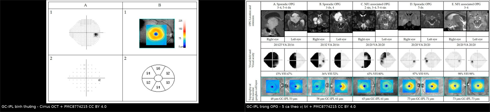
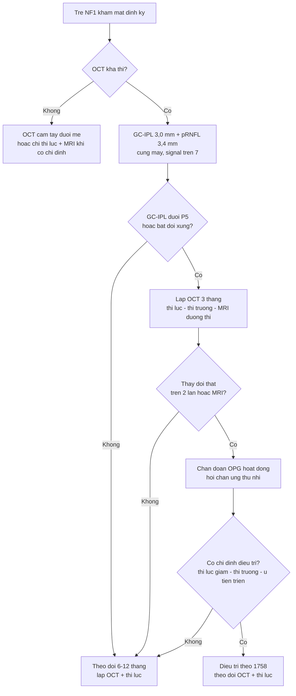
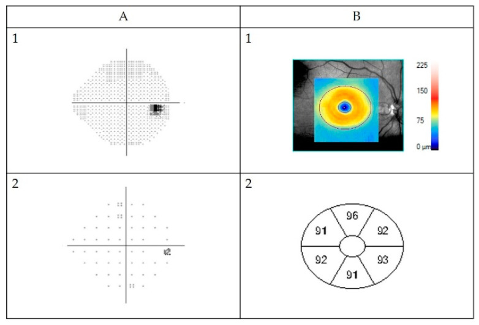
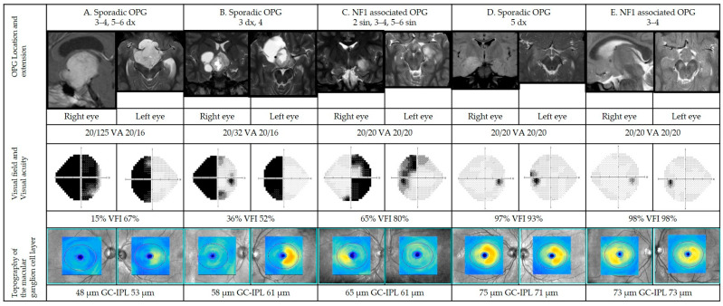
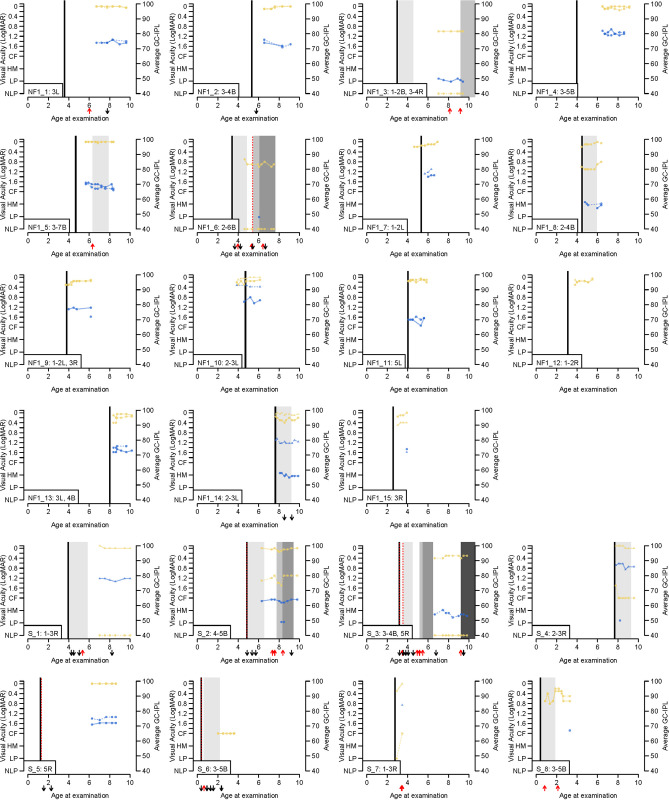

# 1453 — OCT RNFL/GCL trong theo dõi OPG–NF1: ngưỡng mỏng bao nhiêu, có báo trước giảm thị lực không / OCT RNFL and GC-IPL in NF1 optic pathway glioma surveillance

**Tags:** `pattern:mong-vong-mac` `pattern:teo-gai-thi` `pattern:u-duong-thi` `vung:mat` `vung:hoang-diem` `vung:than-kinh-thi` `protocol:OCT` `protocol:OCT-RNFL` `protocol:sang-loc-thi-luc` `score:percentile` `incidentaloma:khong`

**Mức chắc chắn (certainty):** tổng hợp y văn (literature synthesis) — 1 **đoàn hệ tiến cứu 77 trẻ** (25 OPG) với GC-IPL/pRNFL (PLoS One 2024, PMC11239031, CC BY), 1 **nghiên cứu 51 trẻ** đối chiếu GC-IPL với thị trường–MRI (Cancers 2022, PMC8774215, CC BY), 1 **đoàn hệ dọc 55 mắt/250 lượt** về ngưỡng RNFL dự báo mất thị lực (Am J Ophthalmol 2015, PMC4661093), 1 **nghiên cứu GC-IPL phân biệt mất thị lực** (IOVS 2014, PMC3954001), 1 **giá trị chuẩn GC-IPL ở 85 trẻ 6,5 tuổi** (BMC Ophthalmol 2020, PMC7425168, CC BY), 1 **tổng quan hệ thống** về độ chính xác OCT (PLoS One 2021, PMC8699950, CC BY), 1 **nghiên cứu độ tái lặp OCT cầm tay** (Am J Ophthalmol 2014, PMID 25068639), và guideline NF1 đã tổng hợp ở bài **1758** (ERN GENTURIS 2023, PMC9845795). **Không có ca nguyên văn do nhóm tự viết**; ca quiz lấy từ hình bài gốc, ghi PMCID.

> **Câu chốt:** **không có một ngưỡng µm tuyệt đối dùng chung** cho mọi máy, mọi tuổi. Cách đúng là **3 lớp**: (1) **so với chuẩn theo tuổi/máy** — ở trẻ 6,5 tuổi (Cirrus), GC-IPL trung bình **85,9 ± 5,3 µm**, **bách phân vị 5 = 76,0 µm**; (2) **so mắt bên** — chênh > **2 µm** giữa hai bán cầu là bất thường; (3) **theo dõi dọc** — **giảm ≥ 10% RNFL ở ≥ 2 vùng giải phẫu** dự báo mất thị lực với **PPV 100% / NPV 94%**. Ở trẻ NF1 có OPG, GC-IPL trung bình **70 µm** (so với **85 µm** khi không OPG) và **62 µm** ở OPG lẻ tẻ. GC-IPL **lấy được ở 88% mắt** (pRNFL chỉ **49%**) và **sớm hơn 1,2 năm tuổi** — nên **ưu tiên GC-IPL** khi trẻ chưa hợp tác.

## 1. Tổng quan bệnh học – cơ chế hình ảnh

### 1.1 Giải phẫu – vì sao OCT nhìn được tổn thương đường thị

- **Tế bào hạch võng mạc (retinal ganglion cell)** nằm ở lớp tế bào hạch; sợi trục của chúng tạo **lớp sợi thần kinh (RNFL)**, chạy về **đĩa thị** rồi thành **dây thị**. Khi đường thị bị chèn ép/u thâm nhiễm, sợi trục thoái hóa **ngược dòng** → **mỏng GC-IPL ở hoàng điểm** và **mỏng pRNFL quanh đĩa**.
- **Thứ tự thời gian:** tổn thương thân tế bào/thần kinh → **mất sợi trục** → **mỏng RNFL**; vì RNFL là sợi trục, nó **mỏng sau** khi tế bào hạch đã tổn thương. **GC-IPL (thân tế bào)** thường **phản ánh sớm hơn** và **dễ đo hơn ở trẻ nhỏ** (PMC11239031).
- **Vì sao "mỏng mà thị lực còn tốt" vẫn có thể xảy ra:** thị lực đo **trung tâm** và chỉ cần một phần nhỏ tế bào hạch hoàng điểm; **mất 40–50% tế bào hạch** mới làm **thị trường lâm sàng** lộ ra. Ở trẻ, thị lực/ thị trường còn **khó đo**, nên OCT có thể là **dấu hiệu sớm hơn** — nhưng đây là **suy luận từ bệnh sinh**, chưa phải bằng chứng can thiệp (xem 1.4).

### 1.2 Vật lý OCT — đọc đúng con số

- **SD-OCT 840 nm**, độ phân giải trục **~5 µm**; phần mềm **tự phân đoạn** các lớp. **GC-IPL** = **lớp tế bào hạch + lớp rối trong**; máy Cirrus đo trong **vòng ellipse 3,0 mm** quanh hoàng điểm (6 vùng).
- **pRNFL** đo trên **vòng tròn 3,4 mm** quanh đĩa thị; **bị ảnh hưởng bởi bán kính nhãn cầu** (mắt cận thị dài → RNFL mỏng giả) và **đĩa thị nghiêng**.
- **Sàn đo (measurement floor):** GC-IPL **không thể mỏng hơn 31–45 µm** trên Cirrus (tùy phiên bản) — khi đã ở sàn, **không phân biệt được nặng thêm**; đây là lý do **không dùng GC-IPL để theo dõi mắt đã mù** (PMC11239031).
- **Chất lượng ảnh:** signal strength **≥ 7/10** (hoặc ≥ 6 nếu máy cũ), **không lệch tâm**, **đồng tử giãn**, **cùng máy** qua các lần — nếu không, **không kết luận tiến triển**.

### 1.3 Ngưỡng định lượng trụ cột

| Đại lượng | Con số | Nguồn |
|---|---|---|
| GC-IPL trung bình ở trẻ **không OPG** | **85 ± 0,4 µm** (SE) | PMC11239031 |
| GC-IPL ở **NF1 có OPG** | **70 ± 0,7 µm** | PMC11239031 |
| GC-IPL ở **OPG lẻ tẻ** | **62 ± 1,4 µm** | PMC11239031 |
| pRNFL trung bình (không OPG / NF1-OPG / lẻ tẻ) | **100 / 70 / 77 µm** | PMC11239031 |
| Chuẩn GC-IPL trẻ 6,5 tuổi (Cirrus) | **85,9 ± 5,3 µm**; **P5 = 76,0 µm**; P95 = 94,6 µm | PMC7425168 |
| Chênh lệch GC-IPL giữa hai mắt | bán cầu **< 2 µm**; chênh sector lớn nhất **6,4 ± 2,2 µm** (P5–P95: 3,0–10,0) | PMC7425168 |
| Tỉ lệ lấy được GC-IPL / pRNFL | **88%** (132/151 mắt) / **49%** (73/151) | PMC11239031 |
| Tuổi lấy được lần đầu | GC-IPL **5,6 ± 1,5** vs pRNFL **6,8 ± 1,3** tuổi | PMC11239031 |
| Tương quan GC-IPL–pRNFL / –VA / –VFI | **r = 0,662 / −0,661 / 0,644** | PMC11239031 |
| Ngưỡng **giảm RNFL dự báo mất thị lực** | **≥ 10% ở ≥ 2 vùng** → **PPV 100%, NPV 94%** | PMC4661093 |
| AUC của RNFL trung bình dự báo tiến triển | **0,94** | PMID 23736991 |
| GC-IPL dưới **bách phân vị 5** phân biệt mất thị lực | **AUC 0,989** (vòng 3,0 mm) | PMC3954001 |
| Độ chính xác OCT (tổng quan) | RNFL **Se 60–100% / Sp 76,6–100%**; GC-IPL **AUC 0,91–0,98** | PMC8699950 |
| Độ tái lặp GC-IPL cầm tay | **CV ≤ 4,5%** trong lần; **CV 1,6–5,2%** giữa các lần | PMID 25068639 |

### 1.4 "Có dự báo trước khi khám thấy giảm thị lực không?" — trả lời có điều kiện

- **Có, ở mức tín hiệu:** nghiên cứu dọc 55 mắt cho thấy **giảm ≥ 10% RNFL ở ≥ 2 vùng** có **PPV 100% / NPV 94%** cho một đợt mất thị lực mới; mức giảm lớn nhất ở **vùng trên (−14%)**, **dưới (−10%)** và **trung bình toàn cầu (−13%)** (PMC4661093).
- **GC-IPL tương ứng với thị trường và MRI:** mất GC-IPL theo **hình thái** khớp **95%** với khuyết thị trường và **92%** với vị trí tổn thương trên MRI; tác giả kết luận GC-IPL có thể là **dấu hiệu sớm** của thay đổi đe dọa thị lực (PMC8774215).
- **Nhưng chưa có bằng chứng can thiệp:** tổng quan hệ thống chỉ tìm được **5 nghiên cứu chẩn đoán** (186 trẻ), **không có nghiên cứu tiên lượng** đủ tiêu chuẩn; **rất không đồng nhất** về máy, protocol, ngưỡng (PMC8699950). Vì vậy **không được điều trị chỉ vì một lần OCT mỏng** — phải lặp lại, đối chiếu thị lực/thị trường/MRI và hội chẩn.
- **Cạm bẫy diễn giải:** "OCT mỏng trước" trong nghiên cứu **cắt ngang** không chứng minh **nhân quả**; một số mắt có **thị lực bình thường nhưng GC-IPL đã mỏng** (PMC8774215), ngược lại có mắt **mỏng do cận thị/đĩa nghiêng** không do u.

## 2. Mẫu hình + chẩn đoán phân biệt theo vị trí (Gamut)

**Mẫu hình:** trẻ **NF1** (hoặc nghi OPG), **OCT mỏng GC-IPL/pRNFL**, thị lực có thể **bình thường hoặc giảm**.

- **OPG đoạn trước giao thoa/dây thị:** mỏng **một mắt**, đôi khi **một phần tư**; đĩa thị có thể **teo**; MRI dày dây thị.
- **OPG giao thoa:** mỏng **hai mắt không đối xứng**, có thể **bitemporal**; thị trường **bán manh hai bên**.
- **OPG đường thị (tract):** teo **theo hình thái homonymous** (nửa võng mạc cùng phía tổn thương) — **gợi ý mạnh** vị trí sau giao thoa; có ca **không có khuyết thị trường** (PMC32351443).
- **Không phải OPG:** **FASI** của NF1 (không mỏng), **teo thị do tăng áp nội sọ/não úng thủy**, **bệnh thần kinh thị do độc chất/di truyền**, **glôcôm**, **bất thường giải phẫu (đĩa nghiêng, cận thị nặng)**, **lỗi phân đoạn**.
- **Mỏng giả:** **lệch tâm hoàng điểm**, **máy khác**, **không giãn đồng tử**, **mờ do đục thể thủy tinh**, **bán kính nhãn cầu dài**.

## 3. Bảng so sánh phân biệt (ma trận đối chiếu)

| Thực thể (entity) | Hình ảnh điển hình (OCT) | Chốt vào (rule-in) | Chốt loại (rule-out) | Gợi ý xác nhận |
|---|---|---|---|---|
| **OPG–NF1 (bài này)** | GC-IPL mỏng **một bên/không đối xứng**, pRNFL mỏng theo vùng; pattern khớp **MRI** và **thị trường** | **NF1 + mỏng GC-IPL/pRNFL + MRI dày đường thị** | **OCT bình thường đối xứng + MRI không tổn thương** → không OPG hoạt động | MRI sọ–hốc mắt; lặp OCT 6–12 tháng; khám thần kinh nhãn khoa |
| **FASI của NF1** | T2/FLAIR tăng tín hiệu **không choán chỗ**, **không mỏng** GC-IPL | **Không hiệu ứng khối + OCT bình thường** | **Mỏng GC-IPL tiến triển + MRI dày đường thị** → OPG | So MRI nhiều lần; không điều trị FASI |
| **Teo thị do tăng áp nội sọ** | pRNFL **dày giai đoạn cấp** (phù gai), sau đó mỏng; GC-IPL mỏng **vành hoàng điểm** | **Phù gai hai bên + đau đầu/nôn + MRI não úng thủy** | **pRNFL mỏng đều, không phù gai, không tăng áp** | MRI não; đo áp lực mở; OCT lặp |
| **Glôcôm** | pRNFL mỏng **theo bó**, GC-IPL mỏng **tương ứng**, đĩa lõm | **IOP cao + lõm đĩa + mỏng theo bó** | **IOP bình thường, đĩa không lõm, mỏng đối xứng** | Đo IOP, gonioscopy, thị trường |
| **Cận thị trục dài/đĩa nghiêng** | pRNFL mỏng **giả**, GC-IPL bình thường; đĩa nghiêng | **Bán kính nhãn cầu dài + GC-IPL bình thường** | **GC-IPL mỏng thật + MRI tổn thương** | Đo trục nhãn cầu; OCTA; so mắt bên |
| **Lỗi phân đoạn/ảnh kém** | Đường phân đoạn lệch, signal thấp, **thay đổi giữa 2 lần** | **Signal ≥ 7 + cùng máy + lặp lại ổn định** | **Signal thấp/lệch tâm/lệch máy** | Chụp lại; kiểm tra segmentation |
| **Bệnh thần kinh thị khác (LHON, độc chất)** | Mỏng GC-IPL **hai bên đối xứng**, không liên quan MRI đường thị | **Tiền sử gia đình/thuốc + mỏng đối xứng** | **Mỏng một bên + MRI OPG** | Bệnh sử, xét nghiệm di truyền/độc chất |

*Trái: **GC-IPL bình thường** — bản đồ dày, các sector **91–96 µm**, thị trường bình thường. Phải: **5 ca OPG** theo vị trí — GC-IPL **48–75 µm**, mất theo hình thái khớp thị trường và MRI. Cả hai từ **Cancers 2022 (PMC8774215), CC BY 4.0**; ảnh ghép letterbox, không crop.*

### Dấu hiệu đọc chuẩn xác

- **Đọc theo hình thái, không chỉ số trung bình:** mỏng **một phần tư**/nửa võng mạc gợi ý tổn thương **trước giao thoa**; **homonymous** gợi ý **đường thị**; **vành hoàng điểm** gợi ý **bệnh thần kinh thị/glôcôm**.
- **So mắt bên:** ở trẻ **chưa có chuẩn theo tuổi**, **bất đối xứng > 2 µm giữa hai bán cầu** hoặc **> 10 µm giữa sector** là **cờ đỏ** (dựa trên phân bố chuẩn, PMC7425168).
- **Luôn đặt cạnh MRI:** GC-IPL khớp **92%** với vị trí tổn thương trên MRI trong nghiên cứu của PMC8774215 — nhưng **8% không khớp**, nên **MRI vẫn là chuẩn vị trí**.

## 4. Protocol chụp + hệ phân độ/điểm chuẩn hóa

### 4.1 Khi nào chụp — lịch thực hành

- **Bắt đầu khi chẩn đoán NF1**, cùng lúc với khám mắt cơ sở; lặp **6–12 tháng/lần đến 8 tuổi**, sau đó **hằng năm đến tuổi trưởng thành** (guideline ERN GENTURIS 2023, PMC9845795 — chi tiết ở bài 1758).
- **OCT mỗi lần khám mắt định kỳ khi trẻ hợp tác**; nếu trẻ **< 5 tuổi/không hợp tác**, dùng **OCT cầm tay dưới mê** (cùng lúc MRI/EUA) — GC-IPL **lấy được sớm hơn pRNFL 1,2 năm** (PMC11239031).
- **Chụp thêm ngay** khi: thị lực **giảm ≥ 0,2 logMAR**, thị trường **mới bất thường**, **lác/mất thị lực một mắt**, hoặc **MRI mới có tổn thương** — không chờ lịch định kỳ.

### 4.2 Cách chụp — thông số tối thiểu

- **Máy:** cùng một máy qua các lần (Cirrus/Spectralis/….); ghi **model + phần mềm**.
- **GC-IPL:** macular cube **512 × 128**, vòng ellipse **3,0 mm** (hoặc 1,5/4,5 để so), **6 sector + trung bình + minimum**.
- **pRNFL:** vòng tròn **3,4 mm** quanh đĩa, **4 quadrant + trung bình**; đo **bán kính nhãn cầu** nếu cận thị.
- **Chất lượng:** **signal ≥ 7**, không lệch tâm, đồng tử giãn; **lưu ảnh thô** để so segmentation.

### 4.3 Ngưỡng diễn giải (3 lớp) + thuật toán

| Lớp | Ngưỡng | Hành động |
|---|---|---|
| **Tuyệt đối theo tuổi/máy** | GC-IPL trung bình **< P5** (ở 6,5 tuổi Cirrus: **< 76,0 µm**); pRNFL theo bảng tuổi của máy | Lặp lại + khám thị lực/thị trường/MRI |
| **Bất đối xứng** | Chênh **> 2 µm** giữa hai bán cầu hoặc **> 10 µm** giữa sector | Nghi tổn thương một bên; MRI đường thị |
| **Theo dõi dọc** | **Giảm ≥ 10%** RNFL ở **≥ 2 vùng** (hoặc **giảm ≥ 5%** ở ≥ 2 vùng nếu có triệu chứng) | **Cờ đỏ tiến triển**; lặp 3 tháng + MRI |

### 4.4 Không thay thế được gì

- **OCT không thay MRI** để **chẩn đoán/vị trí** OPG; **không thay thị lực** để **quyết định điều trị** (guideline 1758).
- **Không dùng OCT để sàng lọc NF1 không triệu chứng** thay khám mắt — bằng chứng can thiệp còn thiếu; OCT là **công cụ bổ trợ** khi khám mắt **không kết luận** hoặc trẻ **không đo được thị lực**.

## 5. Biến thể bình thường và cạm bẫy

- **"Mỏng hơn 76 µm là bệnh"** — chỉ đúng với **Cirrus ở trẻ 6,5 tuổi**; máy khác, tuổi khác, **bán kính nhãn cầu khác** → phải dùng **bách phân vị theo tuổi/máy**, không dùng một số cho mọi trẻ.
- **Sàn đo 31–45 µm:** ở mắt đã mù, GC-IPL **không thể giảm thêm**; đừng báo "ổn định" hay "tiến triển" dựa trên con số ở sàn.
- **Đo một lần rồi kết luận:** độ tái lặp **CV 1,6–5,2%** giữa các lần — thay đổi **< 5%** có thể là **nhiễu**, không phải tiến triển (PMID 25068639).
- **FASI không phải u:** ổ T2 tăng tín hiệu **không choán chỗ**, **không làm mỏng GC-IPL**; gọi nhầm dẫn tới điều trị hóa chất oan (bài 1758).
- **Đĩa nghiêng/cận thị:** pRNFL **mỏng giả**; kiểm tra **GC-IPL** và **bán kính nhãn cầu** trước khi kết luận teo thị.
- **Phù gai cấp:** pRNFL **dày**, không mỏng — đừng loại trừ OPG/tăng áp nội sọ chỉ vì "RNFL dày"; phải xem **GC-IPL** và **MRI**.
- **"OCT bình thường = không cần MRI"** — sai trong thể **giao thoa/đường thị** giai đoạn sớm; **MRI vẫn cần** khi có triệu chứng hoặc thị lực bất thường.

## 6. Tự lượng giá — Blind Quiz ngay trên trang tĩnh

**Ca 1 — Trẻ 5 tuổi NF1, thị lực 20/25 hai mắt, không triệu chứng. GC-IPL 68 µm mắt phải, 72 µm mắt trái; MRI có dày giao thoa thị.**

- Gợi ý lâm sàng: không đau, không lác; đốm café-au-lait; phụ huynh hỏi "thị lực tốt sao phải theo dõi?".
- Câu hỏi: (1) GC-IPL 68–72 µm có bất thường không? (2) Có điều trị ngay? (3) Bước tiếp theo?

<b>Bấm để hiện đáp án (findings + chẩn đoán)</b>

- **Bất thường:** trung bình **68–72 µm** thấp hơn **P5 76,0 µm** của trẻ 6,5 tuổi (Cirrus) và thấp hơn **85 µm** ở NF1 không OPG; kèm **bất đối xứng 4 µm**.
- **Chưa điều trị ngay:** thị lực bình thường, không triệu chứng; nhưng **MRI đã có OPG** → cần **khám thần kinh nhãn khoa + thị trường + lặp OCT 3 tháng**.
- **Bước tiếp theo:** xác nhận **cùng máy, signal ≥ 7**, đối chiếu **hình thái mất GC-IPL với vị trí MRI**; nếu **giảm thêm ≥ 10% ở ≥ 2 vùng** hoặc thị lực giảm → hội chẩn điều trị.
- Nguồn ảnh: Cancers 2022, PMC8774215, Figure 1, **CC BY 4.0** (ảnh bình thường để so sánh).

**Ca 2 — Trẻ 6 tuổi NF1 có OPG giao thoa đang theo dõi. GC-IPL 85 µm → 72 µm sau 9 tháng; pRNFL 100 → 88 µm; thị lực vẫn 20/25.**

- Gợi ý lâm sàng: không đau; thị trường **chưa làm được** vì trẻ chưa hợp tác; MRI **chưa đổi** so với 1 năm trước.
- Câu hỏi: (1) Mức giảm có ý nghĩa? (2) Có gọi là tiến triển? (3) Làm gì tiếp?

<b>Bấm để hiện đáp án (findings + chẩn đoán)</b>

- GC-IPL giảm **(85 − 72)/85 = 15,3%**; pRNFL giảm **12%** — **vượt ngưỡng ≥ 10%** ở **≥ 2 vùng** nếu xác nhận trên bản đồ sector.
- **Chưa đủ gọi tiến triển bệnh** nếu chỉ một lần: cần **lặp sau 3 tháng**, cùng máy, signal tốt; đối chiếu **thị trường (khi làm được) và MRI**.
- Nếu lặp lại **vẫn giảm** hoặc **thị lực giảm ≥ 0,2 logMAR** → **cờ đỏ tiến triển**, hội chẩn điều trị theo bài 1758. Nếu **ổn định** → tiếp tục theo dõi 6 tháng.
- Bài học: **OCT có thể báo trước**, nhưng **một lần đo không đủ**; PPV 100% trong nghiên cứu là khi **≥ 2 vùng** và **xác nhận**.
- Nguồn ảnh: Cancers 2022, PMC8774215, Figure 6, **CC BY 4.0**.

**Ca 3 — Trẻ 4 tuổi NF1, GC-IPL mắt trái 60 µm, mắt phải 82 µm; mất thị trường kiểu homonymous phải; MRI có tổn thương đường thị trái.**

- Gợi ý lâm sàng: trẻ không kêu; thị lực đo được 20/32 mắt trái; phụ huynh thấy trẻ **nghiêng đầu** khi nhìn.
- Câu hỏi: (1) Giải thích **hình thái mất GC-IPL**? (2) Vì sao thị lực chỉ giảm nhẹ? (3) Theo dõi thế nào?

<b>Bấm để hiện đáp án (findings + chẩn đoán)</b>

- **Mỏng GC-IPL một mắt + mất thị trường homonymous** khớp **tổn thương đường thị trái** (teo ngược **theo hình thái homonymous**), không phải bệnh toàn thân.
- Thị lực chỉ giảm nhẹ vì **trung tâm hoàng điểm còn một phần tế bào hạch**; thị trường **đã mất một nửa** — đây là lý do **không dựa vào thị lực đơn thuần**.
- Theo dõi: **OCT GC-IPL mỗi 3–6 tháng**, thị trường khi hợp tác, **MRI 6–12 tháng**; hội chẩn điều trị nếu **thị trường xấu đi** hoặc **GC-IPL giảm tiếp**.
- Hình minh hoạ **diễn tiến thị lực (đen) và GC-IPL (xanh)** theo tuổi ở nhiều bệnh nhi; mũi tên đỏ = đợt mất thị lực — cho thấy **GC-IPL có thể giảm trước/đồng thời** với thị lực.
- Nguồn ảnh: PLoS One 2024, PMC11239031, Fig. 3, **CC BY 4.0**.

## Bài liên quan chéo
- [400 – Tổng quan Mắt & thị giác](../400-tong-quan-mat-thi-giac/lesson.md)
- [1758 – U thần kinh đệm đường thị trong NF1](../1758-glioma-duong-thi-nf1/lesson.md) (sàng lọc, điều trị, guideline)
- [431 – U thần kinh thị: glioma vs meningioma](../431-u-than-kinh-thi/lesson.md)
- [483 – Sàng lọc thị lực trẻ mầm non](../483-sang-loc-thi-luc-tre-mam-non/lesson.md)
- [442 – Glaucoma: OCT RNFL/GCC + góc tiền phòng](../442-glaucoma-OCT/lesson.md)
- [1419 – Bệnh võng mạc do xạ ở trẻ](../1419-vong-mac-xa-tre-sau-xa-tri/lesson.md) (OCT/OCTA trong theo dõi sau xạ)
- [262 – Bệnh mạch máu lớn do xạ trị não (moyamoya)](../262-benh-mach-mau-lon-do-xa-tri-moyamoya/lesson.md)
- [600 – Tổng quan Hệ Nhi khoa](../600-tong-quan-nhi-khoa/lesson.md)

## Ảnh
- `1453_GCIPL-binh-thuong_PMC8774215-F1.jpg` — GC-IPL bình thường + thị trường (Cancers 2022, CC BY 4.0).
- `1453_OPG-GCIPL_PMC8774215-F6.jpg` — 5 ca OPG: MRI, thị lực, thị trường, GC-IPL 48–75 µm (Cancers 2022, CC BY 4.0).
- `1453_dien-tien_PMC11239031-F3.jpg` — diễn tiến thị lực và GC-IPL theo tuổi (PLoS One 2024, CC BY 4.0).
- `composite_gcipl-binh-thuong-vs-opg.jpg` — ảnh ghép bình thường vs OPG, cả hai CC BY 4.0.
- Nguồn + giấy phép từng ảnh: xem `images/CREDITS.md` và `sources.md`.

> Không dùng để chẩn đoán độc lập khi chưa có người hướng dẫn.
