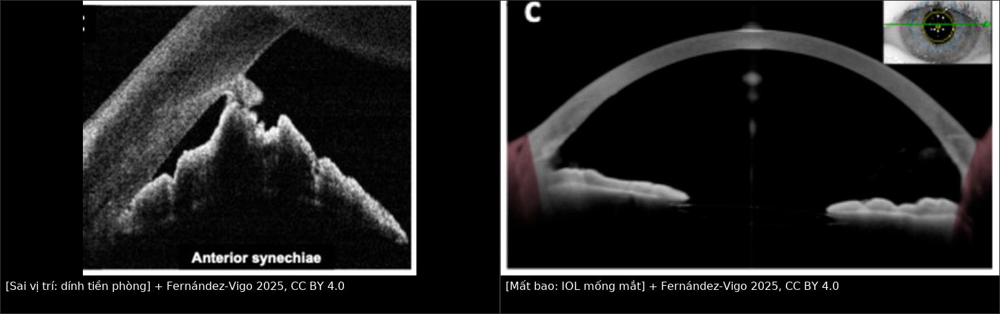
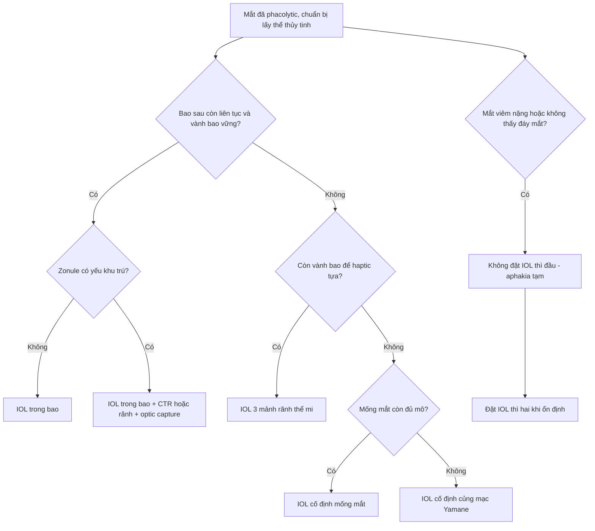
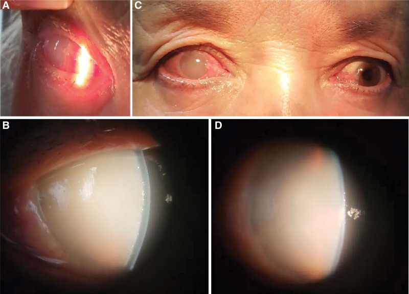
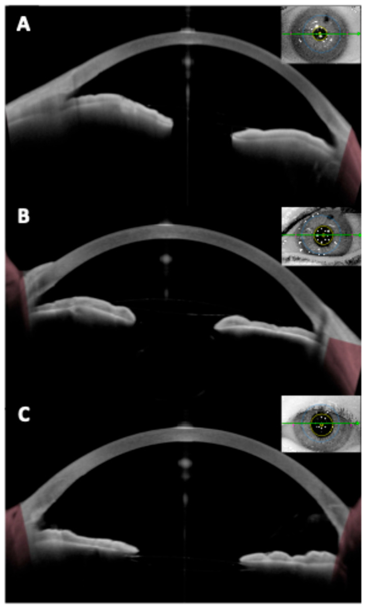
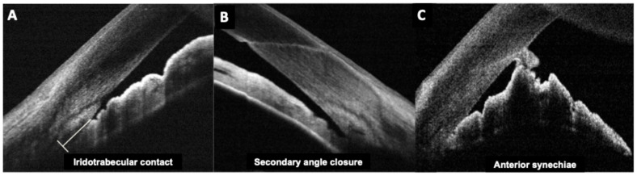

# 1454 — Đặt IOL ở mắt đã phacolytic: trong bao, rãnh thể mi hay không đặt / IOL implantation after phacolytic glaucoma

**Tags:** `pattern:phacolytic` `pattern:mat-mot-ben` `pattern:phu-giac-mac` `vung:mat` `vung:the-thuy-tinh` `vung:tien-phong` `vung:goc-tien-phong` `anatomy:bao-the-thuy-tinh` `protocol:slit-lamp` `protocol:AS-OCT` `protocol:UBM` `protocol:do-nhan-ap` `protocol:phaco`
**Mức chắc chắn (certainty):** tổng hợp y văn (literature synthesis) — đoàn hệ hồi cứu **488 mắt** (279 phacolytic; PMC9240532), **50 nghiên cứu** về IOL rãnh thể mi (PMC13047016), **38 mắt** dùng kỹ thuật IOL làm giá đỡ (PMC36729596), **2 ca nguyên văn** có ảnh (PMC9575782, PMC13512798) và **1 ca phacolytic không điển hình** (PMID 38602030). Câu nào là suy luận được ghi **[suy luận]**.

> **Vì sao bài này quan trọng:** [1452](../1452-glaucom-do-the-thuy-tinh-chua-mo/lesson.md) đã chốt **chẩn đoán và việc phải lấy thể thủy tinh**; câu hỏi còn lại trong phòng mổ là **đặt IOL ở đâu** — và câu trả lời **không** phải "cứ đặt trong bao". Trong 279 mắt phacolytic mổ MSICS, **95,5% IOL đặt vào rãnh thể mi** (423/443), chỉ **4,5% trong bao**, **1,2% cần vòng căng bao**, và **5,1% không đặt được IOL** (PMC9240532). Chọn sai vị trí gây **cọ xát mống mắt/UGH**, **dính tiền phòng**, hoặc **mất thị lực vĩnh viễn vì chờ đợi** — trong khi đặt IOL không hề chữa được tổn thương thị thần kinh đã có.

## 1. Tổng quan bệnh học – cơ chế hình ảnh

- **Vì sao bao thể thủy tinh ở mắt phacolytic KHÔNG vững:** thể thủy tinh **chín/quá chín** có vỏ mỏng, **cortex hóa lỏng** và **nhân cứng**; các sợi zonule bị **kéo giãn, thoái hóa** do thể tích thể thủy tinh tăng và viêm. Khi mở bao, **vỏ trước giòn dễ rách lan (capsule tear)**, còn **vỏ sau có thể đã có lỗ khuyết vi thể** — đúng cơ chế protein rò qua bao ở phacolytic. Vì vậy "bao trông còn nguyên" **không** đồng nghĩa "bao chịu được IOL".
- **TẠI SAO vị trí IOL thay đổi công suất:** công suất IOL tính theo **vị trí hiệu dụng của thấu kính (effective lens position, ELP)**. Rãnh thể mi nằm **trước** bao sau khoảng **0,3–0,5 mm**, nên cùng một công suất sẽ **cận thị hơn** khi đặt rãnh; y văn khuyến cáo **hiệu chỉnh công suất (power adjustment)** nhưng **không có con số thống nhất** (PMC13047016). Trong đoàn hệ MSICS, **86,1%** mắt phacolytic đạt **khúc xạ cầu tương đương trong ± 1,0 D** — nghĩa là vẫn có **13,9% lệch > 1 D**, cần tư vấn trước mổ.
- **TẠI SAO IOL 1 mảnh acrylic KHÔNG được đặt rãnh thể mi:** IOL 1 mảnh có **haptic 0° gắn liền optic**, thiết kế cho **trong bao**; ở rãnh, haptic **cọ mống mắt và thể mi**, gây **phân tán sắc tố, viêm, tăng nhãn áp, hội chứng UGH**. IOL 3 mảnh (PMMA hoặc acrylic gập) có **haptic nghiêng 10°**, tựa vào rãnh mà **không ép optic vào mống mắt** — đây là lựa chọn chuẩn khi mất bao (PMC13047016).
- **Vì sao phacolytic để lại hậu quả dù đặt IOL đúng:** tăng nhãn áp **40–65 mmHg** trong nhiều ngày làm **teo thị thần kinh** không hồi phục. Ca nguyên văn: **IOP 65 mmHg**, thị lực **sáng tối**, sau ECCE + IOL **giác mạc trong, IOP 11 mmHg** nhưng **1 tháng vẫn 6/120** vì **đĩa thị nhợt** và **dẫn truyền thị giác giảm** (PMC9575782). Vị trí IOL tốt **không** bù được thời gian chờ.
- **Số liệu định lượng cốt lõi (279 mắt phacolytic, MSICS; PMC9240532):**
  - **Loại IOL:** 3 mảnh PMMA **90,8%** (20 trong bao, **423 rãnh thể mi**); 1 mảnh PMMA **2,0%** (toàn bộ trong bao); IOL cố định mống mắt **2,0%**; **không đặt IOL 5,1%** (25 mắt). Vòng căng bao (CTR) **1,2%**.
  - **Biến chứng trong mổ:** **đứt zonule 7,5%** (phacomorphic **1,4%**; p = 0,002), **lấy cả bao 5,0%**, **rách bao sau 3,9%**, **rơi nhân 0,4%**, **rơi IOL 0,4%**.
  - **Ngày 1 sau mổ:** phù giác mạc **< 15 nếp Descemet 48,75%**, **> 15 nếp 8,60%**, **phù vi nang 30,82%**; **viêm màng bồ đào fibrin 35,48%**; mủ tiền phòng **0,36%**; **IOL lệch 0,36%**.
  - **1 tháng:** **IOP < 21 mmHg 83,3%** (trung bình **16,92 ± 8,2 mmHg**); **thị lực ≥ 6/18 73,1%**; **thị lực < 3/60 4,7%**.
  - **Yếu tố tiên lượng:** **không tổn thương dịch kính** → IOP < 21 mmHg **OR 35,0 (3,8–325,7)** và thị lực ≥ 6/18 **OR 23,53 (5,1–108,0)**; **tuổi < 60** giảm viêm nặng ngày 1 (**OR 0,44; 0,23–0,83**) và giảm phù giác mạc do tăng áp (**OR 0,25; 0,12–0,54**).
  - **Kỹ thuật "IOL làm giá đỡ" (IOL scaffolding):** **35/38 mắt (92,1%)** thành công, gồm **5 mắt phacolytic**; 3 thất bại phải chuyển **SICS thường (2)** hoặc **cố định mống mắt sau mống (1)** (PMC36729596).

## 2. Mẫu hình + chẩn đoán phân biệt theo vị trí (gamut)

**Câu hỏi trung tâm không phải "có đặt IOL không" mà "bao còn treo được IOL không".** Thứ tự quyết định theo **tình trạng bao–zonule**:

- **A. Bao nguyên, zonule tốt (hiếm ở phacolytic):** đặt **IOL trong bao** — ưu tiên 3 mảnh hoặc 1 mảnh tùy chất liệu; nếu zonule yếu khu trú, thêm **CTR**.
- **B. Bao nguyên nhưng zonule yếu / dialysis khu trú:** **IOL 3 mảnh trong bao + CTR** hoặc **rãnh thể mi + "optic capture"** (nhét optic qua lỗ bao trước để IOL không trượt ra trước).
- **C. Bao rách lớn, lấy cả bao, hoặc dialysis rộng:** **IOL 3 mảnh ở rãnh thể mi** nếu còn **vành bao–zonule đủ tựa**; nếu không → **IOL cố định mống mắt (iris-claw/retropupillary)** hoặc **cố định củng mạc (Yamane)**.
- **D. Không còn bao, viêm nặng, không thấy đáy mắt:** **không đặt IOL trong thì đầu** — lấy thể thủy tinh, kiểm soát viêm/áp, đặt IOL **thì hai** khi mắt ổn định; chấp nhận **aphakia tạm**.
- **E. Bắt buộc tránh:** **IOL 1 mảnh acrylic ở rãnh thể mi** (UGH, sắc tố, tăng nhãn áp) — chốt loại tuyệt đối (PMC13047016).

**Gamut "vì sao không đặt được IOL" (5,1%):** lấy cả bao/rách bao sau lan rộng; đứt zonule nhiều góc; nhân cứng rơi vào dịch kính; IOL rơi trong mổ (0,4%); viêm–phù giác mạc che mổ; bệnh nhân không đồng ý đặt IOL [suy luận từ các biến chứng trên].

## 3. Bảng so sánh phân biệt (ma trận đối chiếu)

| Thực thể (entity) | Hình ảnh/chỉ định điển hình | Chốt vào (rule-in) | Chốt loại (rule-out) | Gợi ý xác nhận |
|---|---|---|---|---|
| **IOL trong bao (in-the-bag)** | Bao còn liên tục, **vỏ trước đủ rộng**, zonule giữ vành bao; IOL nằm sau mống mắt, optic trong bao | **Bao kín, không dialysis, vỏ trước còn vành ≥ 5 mm** | Bao rách lan, mất vành bao, **dialysis > 1 góc phần tư** | Quan sát trực tiếp thì mổ; AS-OCT/UBM trước mổ khi nghi bao yếu |
| **IOL rãnh thể mi 3 mảnh (sulcus 3-piece)** | Haptic tựa rãnh, optic sau mống mắt; dùng khi bao hỏng nhưng còn vành bao | **Còn vành bao–zonule để haptic tựa; IOL 3 mảnh** | **Không còn vành bao**, rãnh hẹp, **IOL 1 mảnh acrylic** | Soi rãnh thì mổ; kiểm tra tilt/centration bằng AS-OCT sau mổ |
| **IOL cố định mống mắt (iris-claw/retropupillary)** | IOL treo vào mặt sau mống mắt; dùng khi **không còn bao** | **Không còn bao/sulcus không đủ tựa**; mống mắt còn đủ mô | Mống mắt teo, rách, **góc đóng/dính tiền phòng** | AS-OCT: khoảng cách optic–nội mô, centration |
| **IOL cố định củng mạc (Yamane/scleral-fixated)** | Haptic xuyên củng mạc, cố định không khâu; dùng khi mất bao hoàn toàn | **Không còn bao + không đủ mống mắt**, mắt không viêm cấp | Viêm nội nhãn/viêm màng bồ đào hoạt động, củng mạc mỏng | AS-OCT/UBM: vị trí haptic, tilt; khám củng mạc |
| **Không đặt IOL (aphakia)** | Không có IOL; mắt aphakic, đeo kính/contact lens hoặc IOL thì hai | **Viêm nặng, bao–zonule mất hoàn toàn, không thấy đáy mắt** | Mắt ổn định, đủ điều kiện đặt IOL thì một | Theo dõi 1 tuần–1 tháng; đo lại sinh trắc khi ổn định |
| **IOL 1 mảnh acrylic ở rãnh** | Haptic 0° cọ mống mắt; sắc tố, viêm, tăng nhãn áp | **Không có chỉ định** — chỉ dùng trong bao | Mọi trường hợp cần đặt rãnh | Loại trừ khỏi lựa chọn |

*Trái: **dính tiền phòng (anterior synechiae)** sau đặt IOL sau phòng — góc bị bít, nguy cơ tăng nhãn áp. Phải: **IOL cố định mống mắt** ở mắt aphakic, optic nằm sau mống mắt, không tựa bao. Nguồn: Fernández-Vigo JI et al., Diagnostics 2025 (PMC12468152), CC BY 4.0; ảnh ghép letterbox.*

## 4. Protocol chụp + hệ phân độ/điểm chuẩn hóa

- **Trước mổ — đánh giá bao và hậu đoạn:**
  - **Đèn khe:** độ sâu tiền phòng, phù giác mạc, tế bào/flare, **màng fibrin**, dính đồng tử sau; đánh giá **vỏ trước, nhân, vỏ sau** và **độ vững của vành bao**.
  - **AS-OCT / UBM:** đo **độ sâu tiền phòng**, phát hiện **vỡ bao sau, mảnh cortex sau bao, dính tiền phòng**; khi giác mạc phù nhiều, **UBM** hữu ích hơn (bước sóng xuyên qua đục).
  - **Siêu âm B-scan:** khi không thấy đáy mắt — loại trừ **rơi nhân/dịch kính**, **bong võng mạc**, **xuất huyết dịch kính**.
  - **Sinh trắc (biometry):** chỉ đáng tin khi **giác mạc đủ trong** và **IOP đã hạ**; ghi rõ **mắt đang viêm** vì có thể lệch khúc xạ.
- **Trong mổ — nguyên tắc chọn vị trí:**
  1. **Kiểm tra bao sau** sau khi lấy nhân: nếu **còn liên tục và vành bao vững** → cân nhắc **trong bao**; nếu **nghi ngờ** → mặc định **rãnh thể mi 3 mảnh**.
  2. **Vòng căng bao (CTR)** khi zonule yếu nhưng bao còn; **không** dùng CTR thay thế IOL cố định củng mạc khi mất vành bao.
  3. **IOL scaffolding:** giữ IOL 3 mảnh trong bao như **giá đỡ** để bao không xẹp sau khi lấy nhân — thành công **35/38 (92,1%)** (PMC36729596).
  4. **Optic capture** qua lỗ bao trước khi đặt rãnh để giảm **tilt** và **trượt optic ra trước** (PMC13047016).
  5. **Viscoelastic phân tán** + **thì mổ nhẹ nhàng** vì nội mô đã tổn thương do IOP cao.
- **Sau mổ — theo dõi có ngưỡng:**
  - **Ngày 1:** đo IOP, đánh giá **phù giác mạc** (đếm nếp Descemet), **fibrin**, **vị trí IOL**. Phù **< 15 nếp** gặp **48,75%**, **> 15 nếp** gặp **8,60%** — thường do tăng áp/viêm, **không** mặc định là nhiễm trùng.
  - **1 tuần / 1 tháng / 3 tháng:** IOP, thị lực, khúc xạ, **AS-OCT** kiểm tra tilt/centration; mục tiêu **IOP < 21 mmHg** (đạt **83,3%** ở đoàn hệ) và **thị lực ≥ 6/18** (đạt **73,1%**).
  - **Khi nào kết hợp trabeculectomy:** theo hướng dẫn thực hành — **tổn thương thị thần kinh nặng, IOP không kiểm soát dù nhiều thuốc, không theo dõi được, không thể mổ hai thì**, hoặc **IOP vẫn cao sau khi lấy thể thủy tinh** (PMC9907291). Ngược lại, **glôcôm nhẹ kiểm soát bằng 1–2 thuốc** → **chỉ lấy thể thủy tinh trước**, đánh giá lại sau 1 tháng.
- **Không có hệ phân độ chính thức cho "vị trí IOL sau phacolytic".** Dùng **thuật toán 3 câu hỏi:** *(1) Bao còn vành tựa không? (2) Rãnh thể mi còn đủ rộng không? (3) Mắt còn viêm/không thấy đáy mắt không?*

## 5. Biến thể bình thường và cạm bẫy

- **Biến thể:** **bao trông nguyên nhưng mất vành tựa** — vỏ trước rách nhỏ, vỏ sau mỏng; **không** đủ để giữ IOL trong bao dù "không thấy rách". Kiểm tra bằng **scaffolding** hoặc chọn rãnh.
- **Cạm bẫy 1 — "cứ đặt trong bao cho tự nhiên":** ở phacolytic, **đứt zonule 7,5%** và **lấy cả bao 5,0%**; cố đặt trong bao khi vành bao yếu dẫn tới **IOL lệch/rơi** (0,4%) và phải mổ lại.
- **Cạm bẫy 2 — IOL 1 mảnh acrylic ở rãnh:** gây **cọ xát mống mắt, phân tán sắc tố, UGH**; đây là **chống chỉ định**, không phải "linh hoạt".
- **Cạm bẫy 3 — IOL quá lớn/đặt quá trước:** optic ép mống mắt ra trước → **dính tiền phòng, góc đóng thứ phát** (ảnh phải của composite). Chọn đúng đường kính và kiểm tra **khoảng cách optic–nội mô** trên AS-OCT.
- **Cạm bẫy 4 — hứa "mổ là hết mờ":** IOL chỉ thay thấu kính; **teo thị thần kinh do IOP 40–65 mmHg** không hồi phục. Ca **6/120** dù IOL trong bao, giác mạc trong, IOP 11 mmHg (PMC9575782) là bài học tư vấn.
- **Cạm bẫy 5 — IOP vẫn cao sau khi lấy thể thủy tinh:** có thể đã có **tổn thương bè/traumatic outflow**; ca hỗn hợp **IOP 45,3 mmHg sau lensectomy** phải **trabeculectomy + MMC**, 6 tháng **IOP 20,1 mmHg với 3 thuốc**, thị lực **bóng tay 30 cm** (PMC13512798). Đừng quy mọi tăng áp sau mổ cho "viêm".
- **Cạm bẫy 6 — coi aphakia là thất bại:** **5,1%** mắt không đặt được IOL; đặt IOL muộn khi mắt ổn định **an toàn hơn** cố đặt trong mắt đang viêm, phù giác mạc.

## 6. Tự lượng giá — Blind Quiz

**Ca 1 — Nữ 63 tuổi, đỏ–đau–mờ mắt phải 1 tuần, IOP 65 mmHg, được tuyến trước điều trị như viêm nội nhãn.**

- Gợi ý: thị lực **sáng tối**; tiền phòng **sâu**; không chấn thương; mắt bên có đục thể thủy tinh chưa chín.
- Hỏi: (1) Vì sao không thấy mống mắt? (2) Sau khi rửa tiền phòng thấy gì? (3) Vì sao đặt IOL đúng vị trí mà thị lực cuối vẫn kém?

<b>Bấm để hiện đáp án</b>

- **Dấu hiệu:** (a) mắt đỏ, phù mi; (b) **giác mạc phù đục**, **tiền phòng đục như sữa** che mống mắt/thể thủy tinh; (c) giảm phù sau điều trị; (d) vẫn đục.
- **Sau rửa tiền phòng:** thấy **thể thủy tinh Morgagnian**; tế bào học dịch tiền phòng có **đại thực bào ngấm protein thể thủy tinh** → xác nhận **phacolytic**, không phải viêm nội nhãn.
- **Diễn biến:** IOP vẫn **> 40 mmHg** sau rửa, phải dùng thuốc + **chọc tiền phòng hằng ngày 5 ngày**, rồi **ECCE + IOL**; **IOL nằm trong bao**; 1 tháng **IOL 11 mmHg**, giác mạc trong, nhưng **6/120** vì **đĩa thị nhợt** và dẫn truyền thị giác giảm.
- **Bài học:** vị trí IOL không cứu được **thời gian tăng áp**; cần mổ sớm khi IOP còn kiểm soát được.
- Nguồn: Medicine 2022, PMC9575782, CC BY 4.0 (Fig. 1).

**Ca 2 — Mắt aphakic, không còn bao thể thủy tinh; AS-OCT mặt cắt ngang.**

- Gợi ý: bệnh nhân đã lấy thể thủy tinh, không đặt được IOL trong bao/rãnh.
- Hỏi: (1) IOL đang tựa vào đâu? (2) Vì sao không đặt trong bao? (3) Hai lựa chọn thay thế nếu mống mắt không đủ mô?

<b>Bấm để hiện đáp án</b>

- **Dấu hiệu:** (A, B) **IOL cố định mống mắt** (Artisan/Artiflex) — optic nằm trước mống mắt, hai haptic kẹp mống mắt; (C) **IOL cố định mặt sau mống mắt (retropupillary iris-claw)** — optic nằm sau mống mắt, sát mặt trước dịch kính.
- **Vì sao không trong bao/rãnh:** **mất bao–zonule** hoặc vành bao không đủ tựa; đặt rãnh sẽ **lệch/tilt**.
- **Nếu mống mắt không đủ mô:** **IOL cố định củng mạc (Yamane)** hoặc **aphakia** + kính/contact lens, đặt IOL thì hai.
- Nguồn: Fernández-Vigo JI et al., Diagnostics 2025 (PMC12468152), CC BY 4.0 (Fig. 6).

**Ca 3 — AS-OCT góc tiền phòng sau đặt IOL sau phòng.**

- Gợi ý: bệnh nhân đã đặt IOL sau phòng; IOP tăng dần, góc hẹp trên soi góc.
- Hỏi: (1) Mô tả ba kiểu bất thường góc (A, B, C)? (2) Cơ chế nào liên quan IOL? (3) Cách phòng?

<b>Bấm để hiện đáp án</b>

- **Dấu hiệu:** (A) **tiếp xúc mống mắt–bè (iridotrabecular contact)**; (B) **đóng góc thứ phát**; (C) **dính tiền phòng (anterior synechiae)** — mống mắt dính vào mặt sau giác mạc/góc.
- **Cơ chế:** IOL **quá lớn** hoặc **đặt quá trước** đẩy mống mắt ra trước; viêm sau mổ tạo fibrin dính; mắt phacolytic vốn có **hàng rào máu–thủy dịch bị phá vỡ**.
- **Phòng:** chọn **đúng đường kính**, đặt optic **sau mống mắt**, **optic capture** khi cần, kiểm soát viêm, theo dõi IOP/góc sau mổ.
- Nguồn: Fernández-Vigo JI et al., Diagnostics 2025 (PMC12468152), CC BY 4.0 (Fig. 2).

## Bài liên quan chéo
- [400 – Tổng quan Mắt & thị giác](../400-tong-quan-mat-thi-giac/lesson.md)
- [1452 – Glôcôm do thể thủy tinh chưa mổ: phacolytic & viêm do protein thể thủy tinh](../1452-glaucom-do-the-thuy-tinh-chua-mo/lesson.md)
- [1442 – Mảnh thể thủy tinh còn sót trong tiền phòng](../1442-manh-the-thuy-tinh-con-sot/lesson.md)
- [1411 – Tăng nhãn áp do corticoid nội nhãn](../1411-tang-nhan-ap-do-corticoid-noi-nhan/lesson.md)
- [442 – Glôcôm & OCT: RNFL/GCL](../442-glaucoma-OCT/lesson.md)

> Không dùng để chẩn đoán độc lập khi chưa có người hướng dẫn.
