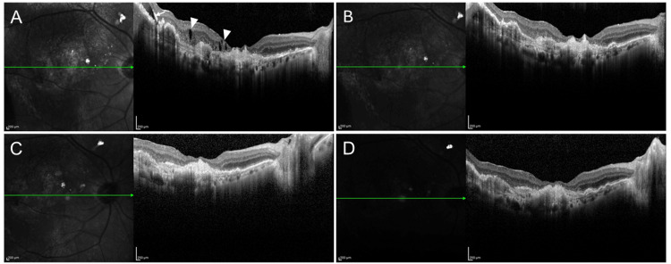
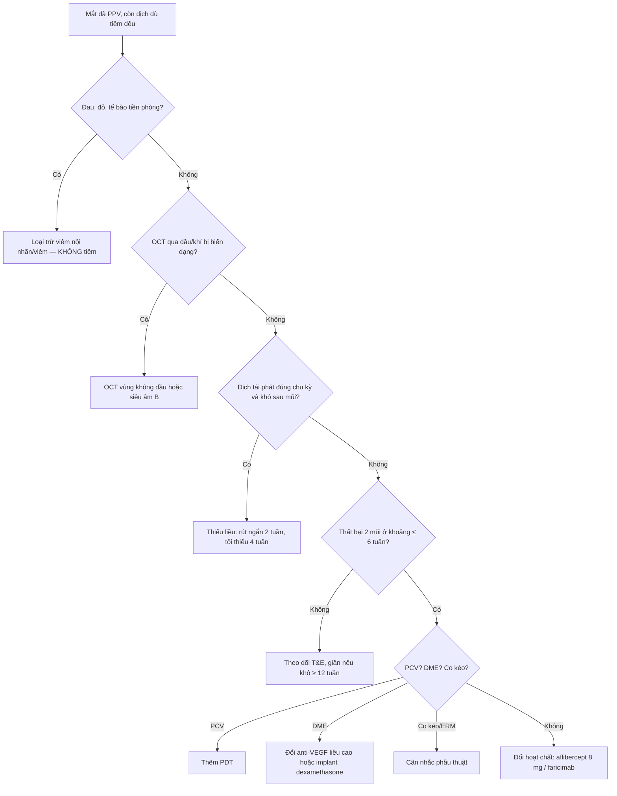
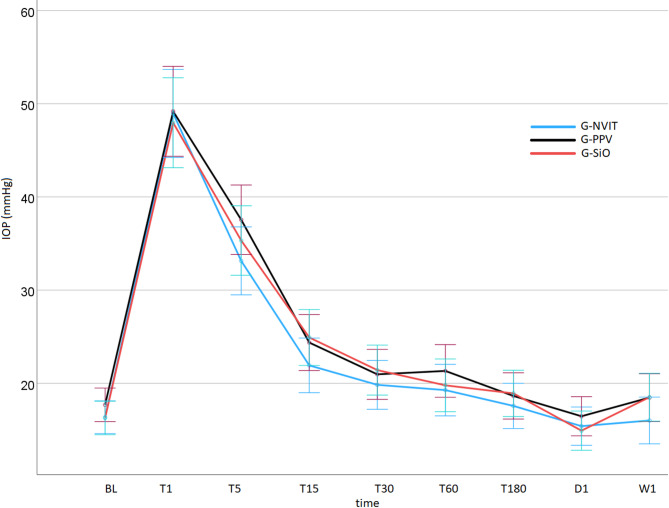
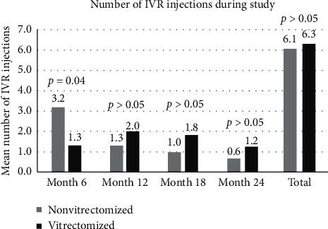

# 1455 — Tiêm anti-VEGF ở mắt ĐÃ CẮT DỊCH KÍNH: dược động khác, khoảng tái tiêm và cạm bẫy dầu/khí

**Tags:** `pattern:phu-vong-mac` `pattern:tai-phat` `vung:dich-kinh` `vung:hac-vong-mac` `anatomy:PPV` `protocol:OCT` `protocol:anti-VEGF` `score:logMAR` `score:IOP`

**Mức chắc chắn (certainty):** tổng hợp y văn (literature synthesis) — tự biên từ **tổng quan dược động phân tử anti-VEGF** (*2026*, PMC13566860, CC BY), **nghiên cứu tiến cứu 46 mắt aflibercept ở mắt có/không cắt dịch kính** (*Int J Retina Vitreous* 2025, PMC12801680, CC BY), **nghiên cứu tiến cứu 67 mắt về nhãn áp sau tiêm** (*Sci Rep* 2026, PMC13000209, CC BY), **loạt 3 mắt chuyển aflibercept 2 mg → 8 mg** (*Cureus* 2025, PMC12577147, CC BY) và **hồi cứu 28 mắt ranibizumab 24 tháng** (*J Ophthalmol* 2020, PMC7428899, CC BY). Không gắn một ca nguyên văn duy nhất của riêng bài.

> **Bài này là ngoại lệ dược động của [1427 – Tiêm anti-VEGF hai mắt cùng ngày](../1427-tiem-anti-vegf-hai-mat-cung-ngay/lesson.md).** 1427 đã chốt **lịch treat-and-extend (T&E)** và an toàn tiêm hai mắt; nhưng **mắt đã cắt dịch kính (PPV)** là nhóm **bị loại khỏi hầu hết thử nghiệm** — nơi câu hỏi "có phải tiêm dày hơn?" xuất hiện thường xuyên, và câu trả lời **không đơn giản là "có"**.

> **Câu chốt:** **Cắt dịch kính làm thay đổi dược động, nhưng không biến mọi mắt PPV thành "mắt cần tiêm 4 tuần".** Trong thực nghiệm trên khỉ, **ức chế VEGF của ranibizumab rút ngắn từ ~3 tuần xuống ~1 tuần** sau PPV (PMC13566860) — nghe như phải tiêm dày gấp ba. Nhưng trên người, **tổng số mũi tiêm 24 tháng gần như bằng nhau (6,3 vs 6,1)**, thậm chí **6 tháng đầu mắt PPV cần ít mũi hơn (1,3 vs 3,2)** (PMC7428899); nghiên cứu tiến cứu khác: **10 vs 9,5 mũi/12 tháng** (PMC12801680). Vì vậy: **đánh giá lại nguyên nhân "còn dịch" trước khi rút ngắn khoảng** — và **không áp dụng giảm khoảng hàng loạt** (PMC13566860).

## 1. Tổng quan bệnh học – cơ chế hình ảnh

- **Dịch kính là "bình chứa" thuốc, không chỉ là môi trường trong suốt.** Ở mắt nguyên vẹn, **gel hyaluronan – collagen** giữ phân tử thuốc tại chỗ, làm chậm khuếch tán ra tiền phòng và ra sau; **thể tích dịch kính ~4 mL** ở người lớn. Sau **PPV**, khoang dịch kính được thay bằng **dịch nước**, **mất tác dụng giữ thuốc** → thuốc **khuếch tán nhanh hơn vào tiền phòng** và **thải qua bè củng mạc**; đồng thời **trao đổi nước – dịch kính tăng** làm **nồng độ đỉnh giảm nhanh**.
- **Kích thước phân tử quyết định mức ảnh hưởng (bảng 1).** Phân tử càng nhỏ, hệ số khuếch tán càng lớn, càng "mất" nhanh khi không còn gel:

| Thuốc | Dạng | Khối lượng | Liều chuẩn | Số phân tử/lần |
|---|---|---|---|---|
| Bevacizumab | IgG1 toàn vẹn | **149 kDa** | 1,25 mg | 8,4 nmol |
| Ranibizumab | Fab đơn trị | **48 kDa** | 0,5 mg | 10,4 nmol |
| Aflibercept 2 mg | VEGFR1/R2–Fc | **115 kDa** | 2 mg | 17,4 nmol |
| Aflibercept 8 mg | VEGFR1/R2–Fc | **115 kDa** | 8 mg | 69,6 nmol |
| Brolucizumab | scFv | **26 kDa** | 6 mg | 231 nmol |
| Faricimab | IgG1 dị thể | **149 kDa** | 6 mg | 40,3 nmol |

- **TẠI SAO "nhỏ hơn" không đồng nghĩa "kém hơn":** brolucizumab **26 kDa** nhưng liều **6 mg = 231 nmol** — **nồng độ phân tử cao gấp ~22 lần** ranibizumab 0,5 mg; bù lại **thời gian lưu ngắn hơn**. Đây là lý do **không thể suy khoảng tiêm từ khối lượng phân tử** (PMC13566860).
- **Nửa đời thải trừ ở người (khác với thực nghiệm):** ranibizumab **7,19 ngày**, bevacizumab **9,82 ngày**, aflibercept tự do **~11 ngày** (thủy dịch, mắt không PPV) (PMC13566860). **Thực nghiệm trên khỉ** sau PPV: ức chế VEGF của **ranibizumab ~1 tuần vs ~3 tuần**, của aflibercept cũng **ngắn hơn** — nhưng tác giả **cảnh báo không được chuyển thẳng kết quả động vật thành quy tắc giảm khoảng ở người**.
- **Vì sao mắt PPV có thể "không tệ hơn":** PPV **loại bỏ môi trường giàu VEGF** (dịch kính chứa cytokine, mảnh collagen), **cải thiện oxy hóa võng mạc** và **giảm phù**; đồng thời **thuốc tiếp xúc trực tiếp với võng mạc** nhiều hơn. Hai hiệu ứng **ngược chiều** — thải nhanh hơn nhưng bệnh nền "sạch" hơn.
- **Con số lâm sàng (đọc kỹ chiều):**
  - **28 mắt ranibizumab (11 PPV, 17 không PPV), 24 tháng:** tổng mũi **6,3 vs 6,1** (p > 0,05); **6 tháng đầu: 1,3 (PPV) vs 3,2 (không PPV), p = 0,04** — mắt PPV **cần ít mũi hơn** (PMC7428899).
  - **46 mắt aflibercept (23/23), 12 tháng:** **10 vs 9,5 mũi**; **28,3% kháng trị** (8 PPV vs 5 không PPV, p > 0,05); thị lực **+7,0 chữ (PPV) vs +11,1 chữ** — **giải phẫu tương đương, chức năng kém hơn** (PMC12801680).
  - **28 mắt aflibercept PPV, 2 năm:** **+5,4 chữ**, **giảm bề dày trung tâm −62 µm** (PMC8923833).
- **TẠI SAO thị lực hồi phục kém hơn dù OCT giống nhau:** lớp **sợi thần kinh (RNFL) trung tâm dày hơn** lúc đầu dự báo **thị lực cuối kém hơn** ở mắt PPV (**r = −0,942, p < 0,001**) — tức **"dự trữ võng mạc trong" đã mỏng** sau PPV/đái tháo đường, không phải do thuốc kém (PMC7428899).
- **Nhãn áp sau tiêm — cùng một quy luật cho mọi loại dịch kính:** tiêm **0,05 mL** làm IOP tăng ngay lập tức lên **48,95 mmHg (không PPV) / 49,18 (PPV) / 47,95 (dầu silicon)** — **không khác biệt**, và **về baseline trong 180 phút** ở cả ba nhóm (PMC13000209). Đây là **hiệu ứng thể tích**, không phải hiệu ứng dịch kính.

## 2. Mẫu hình + chẩn đoán phân biệt theo vị trí (gamut)

**Mẫu hình cần nhận ra:** mắt **đã PPV**, đang tiêm anti-VEGF **đều mỗi 4–8 tuần**, **OCT vẫn còn dịch** (IRF/SRF) hoặc **máu/vẩn đục**; câu hỏi đặt ra là **"thuốc thất bại" hay "khoảng tiêm sai" hay "hình ảnh sai"**.

- **Gamut theo nguyên nhân "còn dịch" (5 nhóm, phải loại trừ theo thứ tự):**
  1. **Khoảng tiêm chưa đủ ngắn** — dịch tái phát **đúng chu kỳ** (ví dụ ngày 28–35), hết sau mũi kế tiếp; đây là **thiếu liều**, không phải kháng thuốc.
  2. **Kháng thuốc thật/tachyphylaxis** — đáp ứng giảm dần **dù khoảng ngắn**, không liên quan nồng độ; cần **đổi hoạt chất hoặc tăng liều**.
  3. **Nguyên nhân cơ học** — **màng trước võng mạc (ERM)**, co kéo, **lỗ hoàng điểm**, **dầu silicon non-fill/underfill**, **bóng khí** làm OCT giả.
  4. **Bệnh nền khác** — **PCV**, **macroaneurysm**, **bệnh mạch máu võng mạc**, **viêm màng bồ đào**, **nhiễm trùng nội nhãn muộn**.
  5. **Hình ảnh giả** — **dầu silicon** gây **biến dạng quang học** (chiết suất **1,40 vs 1,33** của dịch kính), **bóng của dầu**, **giọt dầu nhũ tương**; **khí** làm **phóng đại/thay đổi trục đo**.
- **Gamut theo trạng thái dịch kính (quyết định cách đọc OCT):**
  - **Không PPV:** OCT chuẩn, dùng T&E thông thường.
  - **PPV không dầu:** OCT tốt, nhưng **đường viền hoàng điểm có thể méo nhẹ** do mất gel; đánh giá **IRF/SRF** như bình thường.
  - **PPV + dầu silicon:** **OCT qua dầu bị biến dạng**, không đánh giá được **màng ngăn** và **dịch dưới võng mạc mỏng**; phải dùng **OCT góc rộng/qua vùng không dầu**, hoặc **siêu âm** khi không thấy đáy mắt.
  - **PPV + khí:** **OCT bị phóng đại**, không đo được **độ dày võng mạc** chính xác; chờ khí tan.
- **Gamut theo bệnh:** **nAMD** (cần kiểm soát dịch chặt), **DME** (dịch tái phát nhanh, có thể chuyển **implant dexamethasone**), **RVO** (thường đáp ứng tốt, ít kháng), **PCV** (cần **PDT** phối hợp, không chỉ anti-VEGF).

## 3. Bảng so sánh phân biệt (ma trận đối chiếu)

| Thực thể (entity) | Hình ảnh điển hình | Chốt vào (rule-in) | Chốt loại (rule-out) | Gợi ý xác nhận |
|---|---|---|---|---|
| **Khoảng tiêm quá dài (undertreatment)** | Dịch tái phát **đúng hẹn**, hết sau mũi kế; OCT khô ở tuần 1–2 | **Dịch xuất hiện lại theo chu kỳ cố định + khô sau mỗi mũi** | Dịch **vẫn còn ngay sau tiêm** → không phải do khoảng | Hỏi lịch tiêm thực tế; OCT 1–2 tuần sau mũi |
| **Tachyphylaxis/kháng thuốc** | Dịch **tăng dần** dù khoảng ngắn; **không đáp ứng** 2 mũi liên tiếp | **Thất bại 2 mũi liên tiếp cùng thuốc, khoảng ≤ 4–6 tuần, đã loại nguyên nhân khác** | Đáp ứng tốt trở lại khi **rút ngắn khoảng** → chỉ là thiếu liều | Đổi thuốc/tăng liều thử; ghi lại đáp ứng |
| **Dầu silicon (OCT giả)** | **Biến dạng đường viền**, vùng **tối bất thường**, giọt dầu; **không khớp** với thị lực | **Tiền sử bơm dầu + hình ảnh không nhất quán giữa các lần chụp** | OCT qua vùng **không có dầu** bình thường → không phải bệnh | OCT góc rộng, siêu âm B; soi góc tìm **giọt dầu nhũ tương** |
| **Co kéo/ERM** | **Màng tăng phản xạ trên võng mạc**, **mất đường viền fovea**, co kéo | **Màng + co kéo + lỗ/giả lỗ** | Không màng, chỉ dịch → do thuốc/bệnh nền | OCT cắt lớp; cân nhắc **bóc màng** |
| **PCV** | **U nhú/khối dưới biểu mô**, **xuất huyết – dịch không đều**, OCT dày **RPE** | **Khối dưới RPE + xuất huyết đỏ cam** | Chỉ dịch trong võng mạc → nAMD/DME | **ICGA**, OCT-A; cần **PDT** phối hợp |
| **Nhiễm trùng/viêm nội nhãn muộn** | **Vẩn đục dịch kính**, **giả mủ tiền phòng**, đau, đỏ | **Đau + giảm thị lực nhanh + tế bào tiền phòng** | Đau nhẹ, không tế bào, chỉ dịch → không nhiễm | Chọc dịch kính; **không tiêm thêm anti-VEGF** khi chưa loại |
| **Mắt PPV bình thường** | Dịch kính **trong**, không màng; **đường viền hoàng điểm rõ** | **Không dịch, không tăng phản xạ bất thường** | Có dịch/màng → bệnh lý | OCT so với mắt bên |

*Bốn lát cắt OCT của **cùng một mắt PPV** bị nAMD: (A) sau aflibercept **2 mg** 5 tuần — còn **IRF (đầu mũi tên) và SRF (mũi tên)**, thị lực 20/32; (B) sau khi chuyển **8 mg** 5 tuần — **khô**, 20/25; (C) sau mũi 8 mg thứ hai — vẫn khô; (D) 8 tuần sau mũi thứ ba — duy trì khô, 20/25. Nguồn: PMC12577147, CC BY 4.0.*

### Ba con số để không rút ngắn khoảng một cách máy móc
- **~1 tuần vs ~3 tuần:** thời gian ức chế VEGF sau PPV ở **khỉ** (ranibizumab) — **không phải** dữ liệu người (PMC13566860).
- **6,3 vs 6,1 mũi/24 tháng:** tổng số mũi **không khác** giữa mắt PPV và không PPV; **1,3 vs 3,2** trong 6 tháng đầu (mắt PPV **ít hơn**) (PMC7428899).
- **28,3%:** tỉ lệ **kháng trị** aflibercept ở DME (8/23 PPV vs 5/23 không PPV, p > 0,05) — **không phải** đặc trưng riêng của mắt PPV (PMC12801680).

## 4. Protocol chụp + hệ phân độ/điểm chuẩn hóa

- **Trước mỗi mũi tiêm — 5 bước bắt buộc:**
  1. **Thị lực (logMAR/ETDRS)** và **IOP hai mắt** (bài [1427](../1427-tiem-anti-vegf-hai-mat-cung-ngay/lesson.md)).
  2. **OCT hoàng điểm**: ghi rõ **IRF/SRF/PED**, **bề dày trung tâm (µm)**, và **trạng thái dịch kính** (PPV/dầu/khí) — **đo trên vùng không bị dầu che** nếu có dầu.
  3. **Soi tiền phòng – góc**: tìm **tế bào**, **giọt dầu nhũ tương**, **tân mạch góc** (bài [1410](../1410-lay-dau-silicone-va-dau-ton-luu/lesson.md)).
  4. **Rà lịch tiêm thực tế** (không chỉ lịch hẹn): mũi cuối cách nay **bao nhiêu ngày**, có **bỏ mũi** không.
  5. **Loại trừ nhiễm trùng/viêm** trước khi tiêm (mắt đỏ đau + vẩn đục = **không tiêm**).
- **Kỹ thuật tiêm (không đổi vì PPV):** **0,05 mL**, kim **30G**, cách rìa **3,5–4 mm** (giả thể thủy tinh) hoặc **3,5 mm** (có thể thủy tinh); **tránh rạch qua vết mổ cũ**; **kiểm IOP ngay sau tiêm** và **30 phút**. Chọc tiền phòng/paracentesis nếu **không có cảm giác ánh sáng (NLP)** hoặc **IOP > 50 mmHg ở phút 30** (PMC13000209).
- **Chiến lược khoảng tiêm (T&E, không "cứng"):**
  - **Khô ≥ 12 tuần** → **giãn 2 tuần/lần** đến tối đa dung nạp.
  - **Dịch tái phát ở 4–6 tuần** → **rút ngắn 2 tuần** (tối thiểu 4 tuần) **trước khi** kết luận kháng thuốc.
  - **Vẫn còn dịch sau 2 mũi ở khoảng 4 tuần** → **đổi hoạt chất** (ví dụ **aflibercept 8 mg**) hoặc **tăng liều**; với **DME** cân nhắc **implant dexamethasone** (bài [1411](../1411-tang-nhan-ap-do-corticoid-noi-nhan/lesson.md)).
  - **Có dầu silicon** → **không tự động rút ngắn**; dữ liệu IOP cho thấy tiêm trong dầu **an toàn tương đương** (PMC13000209), nhưng **đánh giá đáp ứng bằng OCT qua vùng không dầu/siêu âm**.
- **Theo dõi sau đổi thuốc:** OCT **4–6 tuần** sau mũi đầu; nếu **khô** → giãn dần; nếu **vẫn dịch** → **đổi cơ chế** (PCV → PDT; DME → steroid; viêm → điều trị viêm).
- **Không có hệ phân độ riêng cho "mắt PPV"**: dùng **T&E** + **đáp ứng OCT**; ghi **số mũi/năm**, **khoảng tối đa đạt được**, **biến chứng** (viêm nội nhãn, tăng IOP, bong võng mạc).

## 5. Biến thể bình thường và cạm bẫy

- **Cạm bẫy 1 — "PPV thì phải tiêm 4 tuần":** sai và tốn kém. **Tổng số mũi 24 tháng không khác** (6,3 vs 6,1), **6 tháng đầu mắt PPV còn ít mũi hơn** (PMC7428899); tổng quan dược động **cấm** biến dữ liệu động vật thành **quy tắc giảm khoảng hàng loạt** (PMC13566860). Rút ngắn chỉ khi **bằng chứng tái phát theo chu kỳ**.
- **Cạm bẫy 2 — đọc OCT qua dầu silicon như OCT thường:** dầu có **chiết suất 1,40** (dịch kính 1,33) → **khúc xạ lệch**, **bóng**, **đường viền giả**; dịch **dưới võng mạc mỏng có thể biến mất** hoặc **xuất hiện giả**. Luôn ghi **trạng thái dầu** và dùng **vùng không dầu**/siêu âm (bài [1863](../1863-duc-the-thuy-tinh-mat-bom-dau-silicone/lesson.md), [1410](../1410-lay-dau-silicone-va-dau-ton-luu/lesson.md)).
- **Cạm bẫy 3 — bỏ qua giọt dầu nhũ tương ở góc tiền phòng:** có thể gây **tăng nhãn áp** và **viêm**; soi góc trước khi kết luận "tăng IOP do thuốc". Đây là **nguyên nhân phổ biến của IOP cao kéo dài** ở mắt bơm dầu.
- **Cạm bẫy 4 — nhầm "kháng thuốc" với "bệnh nền chưa kiểm soát":** **PCV** cần **PDT**; **DME** có thể cần **steroid**; **ERM** cần **phẫu thuật**. Tăng liều anti-VEGF ở PCV **không thay thế** PDT.
- **Cạm bẫy 5 — tiêm khi còn khí/dầu chưa ổn định:** **khí** làm OCT phóng đại, **dầu** làm lệch; nhưng **tiêm vẫn an toàn** nếu **không có nhiễm trùng** và **IOP ổn**. Không hoãn tiêm chỉ vì "có dầu" — nhưng **phải biết mình đang đo cái gì**.
- **Cạm bẫy 6 — bỏ qua mắt bên:** trong PPV **một mắt**, mắt còn lại thường **không PPV** và **đáp ứng khác**; so sánh hai mắt giúp phát hiện **bệnh nền toàn thân** (đái tháo đường, tăng huyết áp) thay vì chỉ đổ lỗi cho "mắt đã mổ".
- **Biến thể bình thường:** **đường viền hoàng điểm hơi mờ** sau PPV do mất gel; **túi dịch kính nhỏ (pseudocyst)** ở mắt PPV lâu năm; **màng trước võng mạc mảnh, không co kéo** — **không** phải chỉ định can thiệp.

## 6. Tự lượng giá — Blind Quiz ngay trên trang tĩnh

**Ca 1 — Nam 68 tuổi, nAMD mắt phải, PPV 3 năm trước vì xuất huyết dịch kính; đang aflibercept 2 mg mỗi 5 tuần, vẫn còn dịch. Nhìn OCT, mô tả trước.**

- Gợi ý: 5 tuần sau mũi 2 mg vẫn còn **IRF + SRF**, thị lực 20/32.
- Câu hỏi: Đây là **kháng thuốc** hay **thiếu liều**? Bước tiếp theo hợp lý nhất? Vì sao **không** chọn "tiêm dày 4 tuần" ngay?

<b>Bấm để hiện đáp án (findings + chẩn đoán)</b>

- **Findings (A):** còn **dịch trong võng mạc (IRF, đầu mũi tên)** và **dịch dưới võng mạc (SRF, mũi tên)** ở 5 tuần sau aflibercept 2 mg; thị lực **20/32**.
- **Chẩn đoán:** **còn hoạt động bệnh do chưa đủ nồng độ/độ bền** ở mắt PPV — không đủ tiêu chuẩn "kháng thuốc" (mới **một** mũi ở khoảng 5 tuần).
- **Xử trí:** trong loạt ca này, chuyển **aflibercept 8 mg** → **khô sau 5 tuần (B)**, duy trì khô sau mũi 2 (C) và **8 tuần sau mũi 3 (D)**, thị lực **20/25**.
- **Vì sao không rút ngắn ngay:** tổng số mũi 24 tháng **không khác** giữa PPV và không PPV; **rút ngắn không có bằng chứng** là cần thiết, còn **tăng liều** giải quyết **độ bền** mà không tăng số lần tiêm.
- **Lưu ý:** đây là **loạt 3 ca**, không phải thử nghiệm — hiệu quả **gợi ý**, không phải chuẩn.
- Nguồn ảnh: *Cureus* 2025 (PMC12577147), CC BY 4.0.

**Ca 2 — Cùng bệnh nhân, IOP sau tiêm: trước tiêm 16 mmHg, 1 phút sau 49 mmHg, phút 30 còn 38 mmHg, phút 180 về 18 mmHg. Xử trí?**

- Câu hỏi: Có cần chọc tiền phòng không? Ngưỡng nào? Mắt PPV có khác mắt thường?

<b>Bấm để hiện đáp án</b>

- **Không cần chọc tiền phòng** nếu bệnh nhân **còn cảm giác ánh sáng** và **IOP ≤ 50 mmHg ở phút 30**; đường cong sẽ **tự về baseline trong 180 phút**.
- **Ngưỡng can thiệp:** **NLP** ở bất kỳ thời điểm, hoặc **IOP > 50 mmHg ở phút 30** → **paracentesis/acetazolamide**.
- **Mắt PPV không khác:** IOP tức thì **49,18 mmHg (PPV) vs 48,95 (không PPV) vs 47,95 (dầu)** — **không khác biệt**; về baseline **trong 180 phút** ở cả ba nhóm (67 mắt).
- **Vì sao:** tăng IOP là **hiệu ứng thể tích 0,05 mL**, không phải dịch kính.
- Nguồn ảnh: *Sci Rep* 2026 (PMC13000209), CC BY 4.0.

**Ca 3 — Số mũi tiêm ranibizumab trong 24 tháng: mắt PPV 6,3; mắt không PPV 6,1 (p > 0,05). Đọc biểu đồ và trả lời:**

- Câu hỏi: Nhìn 6 tháng đầu, nhóm nào tiêm nhiều hơn? Điều này có ủng hộ quan điểm "PPV phải tiêm dày" không?

<b>Bấm để hiện đáp án</b>

- **6 tháng đầu:** **không PPV 3,2 mũi** vs **PPV 1,3 mũi** (p = 0,04) — mắt PPV **ít hơn**.
- **Các mốc 12–24 tháng:** PPV **nhiều hơn nhẹ** (2,0 vs 1,3; 1,8 vs 1,0; 1,2 vs 0,6) nhưng **không có ý nghĩa**; **tổng 24 tháng 6,3 vs 6,1** (p > 0,05).
- **Kết luận:** dữ liệu người **không ủng hộ** việc rút ngắn khoảng hàng loạt cho mắt PPV; quyết định theo **đáp ứng OCT từng mắt**.
- Nguồn ảnh: *J Ophthalmol* 2020 (PMC7428899), CC BY 4.0.

## Bài liên quan chéo
- [1427 – Tiêm anti-VEGF hai mắt cùng ngày: T&E & an toàn](../1427-tiem-anti-vegf-hai-mat-cung-ngay/lesson.md)
- [1410 – Lấy dầu silicone và dầu tồn lưu](../1410-lay-dau-silicone-va-dau-ton-luu/lesson.md)
- [1411 – Tăng nhãn áp do corticoid nội nhãn](../1411-tang-nhan-ap-do-corticoid-noi-nhan/lesson.md)
- [1863 – Đục thể thủy tinh ở mắt bơm dầu](../1863-duc-the-thuy-tinh-mat-bom-dau-silicone/lesson.md)
- [400 – Tổng quan Mắt & thị giác](../400-tong-quan-mat-thi-giac/lesson.md)

## Ảnh
- `images/1455_tai-tiet-dich-kinh_OCT_PMC12577147.jpg` — OCT 4 lát cắt, **CC BY 4.0**.
- `images/1455_nhan-ap-do_IOP_PMC13000209.jpg` — đường cong IOP 3 nhóm, **CC BY 4.0**.
- `images/1455_so-mui-tiem_Bar_PMC7428899.jpg` — số mũi tiêm theo thời gian, **CC BY 4.0**.
- Nguồn + giấy phép từng ảnh: `images/CREDITS.md`; nguồn bài: `sources.md`.

> Không dùng để chẩn đoán độc lập khi chưa có người hướng dẫn.
