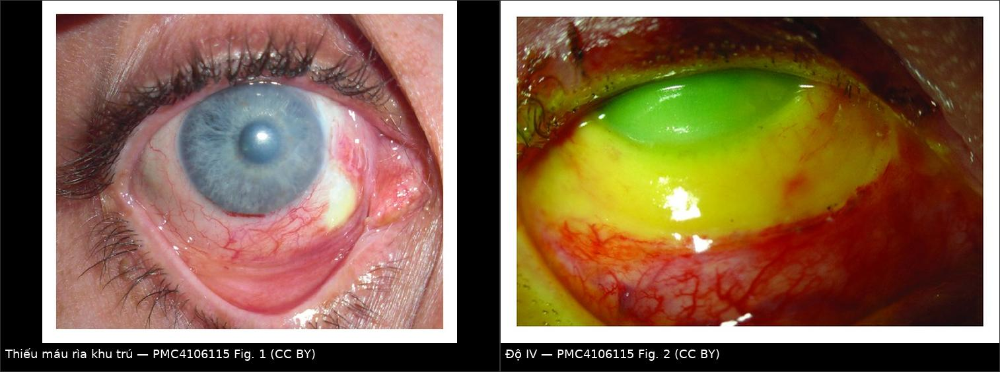
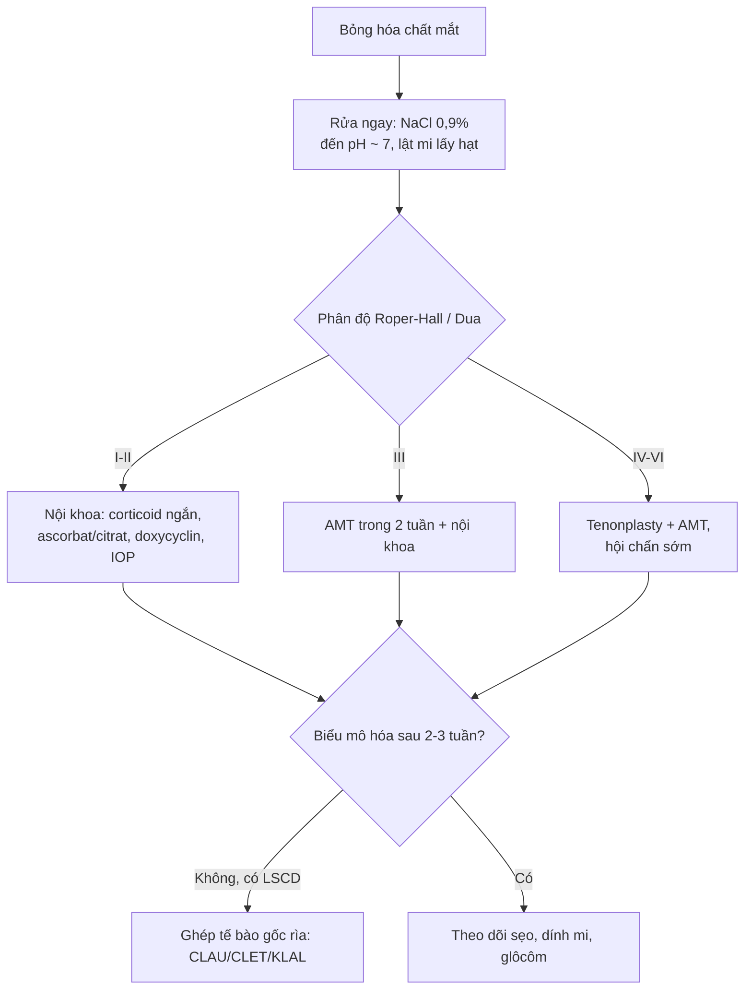
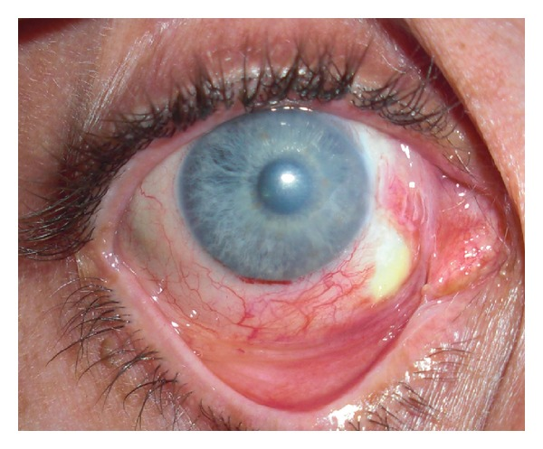
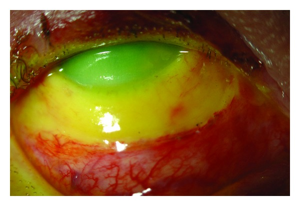

# 1456 — Bỏng hóa chất mắt cấp: phân độ Roper–Hall & Dua, rửa mắt là điều trị / Chemical ocular burn

**Tags:** `pattern:bong-hoa-chat` `pattern:thieu-mau-ria` `pattern:khuyet-bieu-mo-giac-mac` `pattern:phu-giac-mac` `vung:giac-mac` `vung:mat` `score:Roper-Hall` `score:Dua` `protocol:AS-OCT` `protocol:slit-lamp` `protocol:UBM` `incidentaloma:khong`

**Mức chắc chắn (certainty):** tổng hợp y văn (literature synthesis) — 2 bài tổng quan (Eye 2019 **PMC7002428**, 13 năm kinh nghiệm Moorfields; J Ophthalmol 2014 **PMC4106115**), 1 bài tổng quan ngắn CMAJ 2019 (**PMC6751045**), 1 đoàn hệ hồi cứu **135 mắt** về pH lúc vào (**PMC12271035**), 1 case series **9 mắt** về bong màng Descemet trên AS-OCT (**PMC10538613**). Không có thử nghiệm ngẫu nhiên về rửa mắt.

> **Câu chốt:** bỏng hóa chất mắt là **cấp cứu mà chẩn đoán là lâm sàng, điều trị là rửa** — **không chờ chẩn đoán hình ảnh**. Thứ quyết định tiên lượng **không phải độ đục giác mạc** mà là **số giờ rìa bị thiếu máu (limbal ischemia)**: mất mạch rìa = mất nguồn tế bào gốc biểu mô giác mạc → **kiết mạc hóa, tân mạch, mù**.

## 1. Tổng quan bệnh học – cơ chế hình ảnh

### 1.1 Kiềm ăn sâu, acid tự giới hạn — vì sao?
- **Kiềm (alkali):** ion OH⁻ **xà phòng hóa acid béo của màng tế bào** → **hoại tử hóa lỏng (liquefactive necrosis)**, không có hàng rào → ngấm sâu vào nhu mô, tiền phòng, **bè củng mạc (trabecular meshwork)** và thể mi. **pH > 11,5** là ngưỡng gây tổn thương giác mạc đáng kể; **amoniac** thấm vào tiền phòng **trong vài giây**; vôi sống tạo **Ca(OH)₂ pH 12,4**. Tổn thương nội nhãn không hồi phục có thể xảy ra **trong 5–15 phút**.
- **Acid:** **đông vón protein (coagulative necrosis)** tạo hàng rào → **tự giới hạn độ sâu**. Ngoại lệ: **acid flohydric (HF)** đi qua màng tế bào nhanh như kiềm.
- **Vì sao mất mạch rìa là chốt:** tế bào gốc biểu mô giác mạc cư trú ở **rìa (limbus)**. Thiếu máu rìa → thiếu oxy + mất tế bào gốc → biểu mô không tái tạo được, **kết mạc mọc lên giác mạc (conjunctivalization)**. Vì vậy phân độ dựa trên **số giờ rìa thiếu máu**, không dựa vào độ đục.
- **Diễn tiến 4 pha:** tức thì (giây–giờ) → cấp (0–7 ngày, viêm mạnh, **nhãn áp tăng hai pha**) → sửa chữa sớm (**8–20 ngày**, nguy cơ **loét chảy/thủng giác mạc do collagenase/MMP**) → sửa chữa muộn (> 21 ngày, sẹo, dính mi–kết mạc, glôcôm).

### 1.2 Chẩn đoán hình ảnh đóng vai trò gì (và không đóng vai trò gì)
- **Không có hình ảnh nào thay được đèn khe (slit-lamp) và đo pH.** Chẩn đoán và phân độ làm **ngay tại giường**.
- **AS-OCT (anterior segment OCT):** đo **độ dày giác mạc** (theo dõi mỏng dần/nguy cơ thủng), phát hiện **bong màng Descemet (Descemet membrane detachment, DMD)** — 3 kiểu: **A** dải căng (PDL + DM bong cùng nhau), **B** đường lượn sóng tách khỏi nhu mô, **C** DM bong và tách khỏi PDL; **vùng rìa tổn thương + xuất tiết sau giác mạc** gợi ý DMD. DMD bị bỏ sót ở ca tổn thương rìa rộng và góp phần làm bề mặt nhãn cầu không ổn định.
- **UBM (ultrasound biomicroscopy):** góc tiền phòng, thể mi, **tách thể mi (cyclodialysis)** khi nghi chấn thương kèm theo.
- **Siêu âm B-scan:** bắt buộc khi **giác mạc đục không nhìn được đáy mắt** (loại trừ bong võng mạc, xuất huyết dịch kính).
- **CT hốc mắt:** chỉ khi nghi **dị vật/ hạt hóa chất cắm sâu**, chấn thương xuyên thấu hoặc **vỡ xương hốc mắt** (bỏng do nổ bình acquy).

### 1.3 Ngưỡng định lượng phải nhớ
| Chỉ số | Ngưỡng / số liệu | Ý nghĩa |
|---|---|---|
| pH bề mặt nhãn cầu | **≈ 7,0** mới ngừng rửa; đo lại tới **1 giờ** | Còn hạt hóa chất = pH tăng lại |
| pH lúc vào | **< 6,5 hoặc > 7,5** | Yếu tố dự báo **thiếu hụt tế bào gốc rìa (LSCD)** |
| pH dung dịch | kiềm **> 11,5** | Ngưỡng tổn thương giác mạc đáng kể |
| Thiếu máu rìa (Roper–Hall) | **< 1/3 · 1/3–1/2 · > 1/2** | Độ II · III · IV |
| Thời điểm can thiệp màng ối | **trong 2 tuần** | Hiệu quả ở độ II–III |
| Tỷ lệ bỏng hóa chất trong chấn thương mắt | **11,5–22,1%** | Lý do phải có quy trình cấp cứu |

## 2. Mẫu hình + chẩn đoán phân biệt theo vị trí (gamut)

- **Trung tâm giác mạc:** bỏng hóa chất (kiềm/acid) · bỏng nhiệt · **viêm giác mạc do tia cực tím (photokeratitis)** · **SJS/TEN** · viêm giác mạc do herpes (bờ nhánh).
- **Rìa giác mạc:** **bỏng kiềm có thiếu máu rìa** · **bỏng acid** (ít thiếu máu hơn) · **hạt vôi còn sót** · **bỏng do dung dịch sát khuẩn/ alcohol gel** · **bệnh mắt do hóa chất dạng keo**.
- **Kết mạc – cùng đồ:** bỏng kiềm lan sâu · **dính mi–kết mạc (symblepharon)** sớm · bỏng nhiệt · **viêm kết mạc hóa chất nhẹ** (không phải "burn" thật).
- **Tiền phòng – thể mi:** bỏng kiềm nặng (viêm tiền phòng, **tăng nhãn áp**, **tách thể mi**) · bỏng acid nặng · chấn thương xuyên thấu kèm hóa chất.
- **Bờ mi – da:** bỏng hóa chất da mi · bỏng nhiệt · **SJS/TEN** (tổn thương niêm mạc hai bên, toàn thân).

## 3. Bảng so sánh phân biệt (ma trận đối chiếu)

| Thực thể (entity) | Hình ảnh lâm sàng điển hình | Chốt vào (rule-in) | Chốt loại (rule-out) | Gợi ý xác nhận |
|---|---|---|---|---|
| **Bỏng kiềm** | Mất biểu mô rộng, **kết mạc trắng bệch/thiếu máu**, tiền phòng viêm, đục giác mạc tiến triển | **Thiếu máu rìa + pH cao + tiền sử kiềm (vôi, amoniac, xút)** | Mạch rìa còn tốt, pH trung tính → nhẹ hơn | Đèn khe + pH; AS-OCT |
| **Bỏng acid** | Mất biểu mô, **bề mặt đông vón**, ít thiếu máu rìa | **Bờ tổn thương rõ, tự giới hạn, pH thấp** | Thiếu máu rìa lan rộng → nghĩ kiềm/HF | pH; hỏi hóa chất |
| **Bỏng nhiệt** | Da mi bỏng, giác mạc khô–đục khu trú, **không có hóa chất** | **Tiền sử nhiệt/kim loại nóng, pH bình thường** | pH bất thường → có hóa chất kèm | Hỏi bệnh sử; đèn khe |
| **SJS/TEN** | **Hai mắt**, loét niêm mạc miệng–sinh dục, ban da, **dính kết mạc nặng** | **Tổn thương đa niêm mạc + toàn thân** | Một mắt, có hóa chất → bỏng | Da, niêm mạc; sinh thiết nếu cần |
| **Hạt vôi còn sót** | Chấm trắng ở cùng đồ trên/dưới, **pH tăng lại sau rửa** | **Thấy hạt + pH dao động** | pH ổn định sau rửa → không còn hạt | Lật mi đôi, lau cùng đồ |
| **Viêm giác mạc do HSV** | Bờ nhánh, **giác mạc trong**, không thiếu máu rìa | **Bờ nhánh + không có hóa chất** | Thiếu máu rìa + mất biểu mô rộng → bỏng | Nhuộm fluorescein; PCR |

*Trái: thiếu máu rìa một góc (vùng trắng, mất mạch) ngày 8 sau bỏng kiềm. Phải: bỏng độ IV — thiếu máu lan rộng và giác mạc đục. Nguồn: Eslani M et al., J Ophthalmol 2014, PMC4106115 Fig. 1 và Fig. 2 — CC BY; ảnh ghép letterbox bằng `tools/make_composite.py`.*

## 4. Protocol xử trí + hệ phân độ

### 4.1 Rửa mắt — việc duy nhất không được chậm
- **Bắt đầu ngay tại hiện trường** bằng nước sạch/nước muối nếu chưa có dung dịch chuẩn; **không chờ khám đầy đủ**.
- Tại bệnh viện: **NaCl 0,9% hoặc Ringer lactat**, rửa liên tục **ít nhất 10 phút**, **tiếp tục đến khi pH ≈ 7,0**; có thể dùng **ống rửa (Morgan lens)** hoặc dây truyền dịch.
- **Lật mi đôi, lau cùng đồ** để lấy **hạt vôi/hóa chất dạng bột** — nếu không, pH sẽ tăng lại sau rửa. **Đo lại pH định kỳ tới 1 giờ**.
- **Giảm đau tại chỗ** giúp rửa nhiều hơn, nhưng **thuốc tê có thể làm tăng ngấm hóa chất vào tiền phòng** (đặc biệt amoniac) → rửa trước, dùng tê khi cần.

### 4.2 Phân độ (ghi cả hai hệ)
| Độ | Roper–Hall: giác mạc | Roper–Hall: rìa | Dua: giờ rìa / % kết mạc | Tiên lượng |
|---|---|---|---|---|
| I | Mất biểu mô | Không thiếu máu | 0 giờ / 0% | Tốt |
| II | Đục nhẹ, còn thấy chi tiết mống mắt | **< 1/3** | ≤ 3 giờ / ≤ 30% | Tốt |
| III | Mất biểu mô toàn bộ, đục che chi tiết mống mắt | **1/3–1/2** | > 3–6 giờ / > 30–50% | Dè dặt |
| IV | Giác mạc đục, không thấy mống mắt/đồng tử | **> 1/2** | **> 6–12 giờ / > 50–100%** (Dua IV–VI) | Kém |

- **Dua V–VI:** **> 9–< 12 giờ** hoặc **12 giờ (toàn bộ rìa) + 100% kết mạc** → tiên lượng rất kém, nguy cơ **hoại tử phân đoạn trước**.
- Ghi **thang tương tự (analogue scale)** của Dua (ví dụ **6,1–9/51–75%**) để theo dõi tiến triển dù độ không đổi.

### 4.3 Điều trị theo bậc
- **Nội khoa:** nước mắt nhân tạo không chất bảo quản, mỡ bôi; **corticoid tại chỗ 7–10 ngày** (giảm viêm, nhưng **ngừng/giảm khi có khuyết biểu mô kéo dài** vì ức chế tạo collagen → **mỏng/thủng**); **acid ascorbic + citrat**, **doxycyclin** (ức chế MMP); **liệt thể mi** giảm đau; **kiểm soát nhãn áp** (ưu tiên thuốc uống để tránh độc biểu mô); kháng sinh dự phòng; **vòng chống dính (symblepharon ring)**.
- **Ngoại khoa:** **ghép màng ối (AMT) trong 2 tuần** cho độ II–III (giảm đau, giúp biểu mô hóa); **tenonplasty** ở độ IV (kéo Tenon còn sống tới rìa để tái lập tưới máu); **ghép tế bào gốc rìa** (CLAU một mắt — thành công **80–90%**; CLET; lr-CLAL/KLAL hai mắt) **trì hoãn** đến khi viêm ổn; **ghép giác mạc xuyên/giác mạc nhân tạo** là bước cuối.

### 4.4 Theo dõi
- **Ngày 1–7:** đo lại pH, **nhãn áp hai mắt**, soi đèn khe tìm **dính mi–kết mạc**, đánh giá khuyết biểu mô.
- **Tuần 2–3:** AS-OCT đánh giá độ dày giác mạc/DMD; **B-scan** nếu không thấy đáy mắt.
- **Tháng 1–6:** sẹo giác mạc, tân mạch, **glôcôm muộn**, hở mi, dính cùng đồ.

## 5. Biến thể bình thường và cạm bẫy

- **Kết mạc đỏ che mất thiếu máu rìa:** vùng **trắng bệch, không mạch** mới là thiếu máu; đừng đọc "đỏ = còn tưới máu".
- **pH bình thường giả:** hạt vôi nằm trong cùng đồ vẫn nhả kiềm sau rửa → **luôn lật mi đôi** và **đo lại pH tới 1 giờ**.
- **Bỏ sót tăng nhãn áp:** tăng hai pha (ngay sau bỏng và muộn do xơ bè) — **đo nhãn áp** dù giác mạc đục.
- **Corticoid quá tay:** dùng kéo dài khi **khuyết biểu mô chưa lành** → **chảy giác mạc/thủng**; ngưỡng thực hành là **7–10 ngày** rồi đánh giá lại.
- **Tê tại chỗ trước khi rửa** có thể làm tăng ngấm hóa chất (nhất là amoniac): **rửa trước, tê sau**.
- **Bỏ sót chấn thương kèm theo:** vụ nổ bình acquy = **hóa chất + nhiệt + chấn thương**; phải loại trừ **dị vật nội nhãn** (CT/ X-quang khi cần).
- **Không ghi rõ hóa chất, thời điểm, thời gian rửa** → mất giá trị pháp lý và không so sánh được lần khám sau (đa số ca bỏng nặng có yếu tố hành hung, **33,3%** theo BOSU).

## 6. Tự lượng giá — Blind Quiz

**Ca 1 — Nam 34 tuổi, bỏng kiềm công nghiệp, ngày thứ 8. Nhìn ảnh, mô tả vùng rìa trước khi đọc đáp án.**

- Câu hỏi: Vùng trắng ở rìa là gì? Nó thuộc độ mấy theo Roper–Hall? Vì sao phải can thiệp sớm?

<b>Bấm để hiện đáp án (findings + chẩn đoán)</b>

- **Dấu hiệu:** **thiếu máu rìa khu trú** ở góc dưới–mũi (vùng nhợt, mất mạng mạch), kèm đục giác mạc nhẹ; đây là vùng **mất tế bào gốc rìa**.
- **Phân độ:** tổn thương **dưới 1/3 chu vi rìa** → **Roper–Hall II** (nếu đục che chi tiết mống mắt → III); ghi thêm **số giờ rìa** theo Dua.
- **Xử trí:** ca này đã được **tenonplasty + kéo kết mạc** che khuyết; mục tiêu là tái lập tưới máu rìa trước khi kết mạc hóa.
- Nguồn ảnh: Eslani M et al., J Ophthalmol 2014, Fig. 1 — **CC BY** (PMC4106115).

**Ca 2 — Nam 45 tuổi, bỏng kiềm nặng 2 giờ, giác mạc đục hoàn toàn, rìa thiếu máu gần 360°.**

- Câu hỏi: Phân độ? Tiên lượng? Kể 3 bước điều trị ngoại khoa theo thứ tự?

<b>Bấm để hiện đáp án</b>

- **Dấu hiệu:** **giác mạc đục, không thấy mống mắt**, **thiếu máu rìa lan rộng (vượt 1/2 chu vi)** → **Roper–Hall IV**, tương ứng **Dua IV–VI** tùy số giờ rìa/kết mạc.
- **Tiên lượng:** kém — nguy cơ **LSCD, kết mạc hóa, glôcôm, thủng giác mạc**; cần theo dõi suốt đời.
- **Ngoại khoa:** (1) **tenonplasty + AMT** sớm để tái lập tưới máu và che bề mặt; (2) **kiểm soát viêm/nhãn áp**, chờ bề mặt ổn; (3) **ghép tế bào gốc rìa** (CLAU/CLET/KLAL) khi hết viêm, sau đó mới **ghép giác mạc** nếu cần.
- Nguồn ảnh: Eslani M et al., J Ophthalmol 2014, Fig. 2 — **CC BY** (PMC4106115).

## Bài liên quan chéo

- [400 — Tổng quan Mắt & thị giác](../400-tong-quan-mat-thi-giac/lesson.md)
- [1444 — Viêm màng bồ đào sau chấn thương kín](../1444-viem-mang-bo-dao-sau-chan-thuong/lesson.md)
- [1445 — Bong mảnh ghép sau ghép nội mô (DSAEK/DMEK)](../1445-bong-manh-ghep-dsaek-dmek-rebubble/lesson.md)
- [449 — Chấn thương mắt do dị vật](../449-chan-thuong-mat-dich-vat/lesson.md)
- [411 — Siêu âm nhãn cầu](../411-sieu-am-nhan-cau/lesson.md)

> **Disclaimer:** Tài liệu học tập, không dùng để chẩn đoán độc lập khi chưa có bác sĩ chuyên khoa hướng dẫn.
