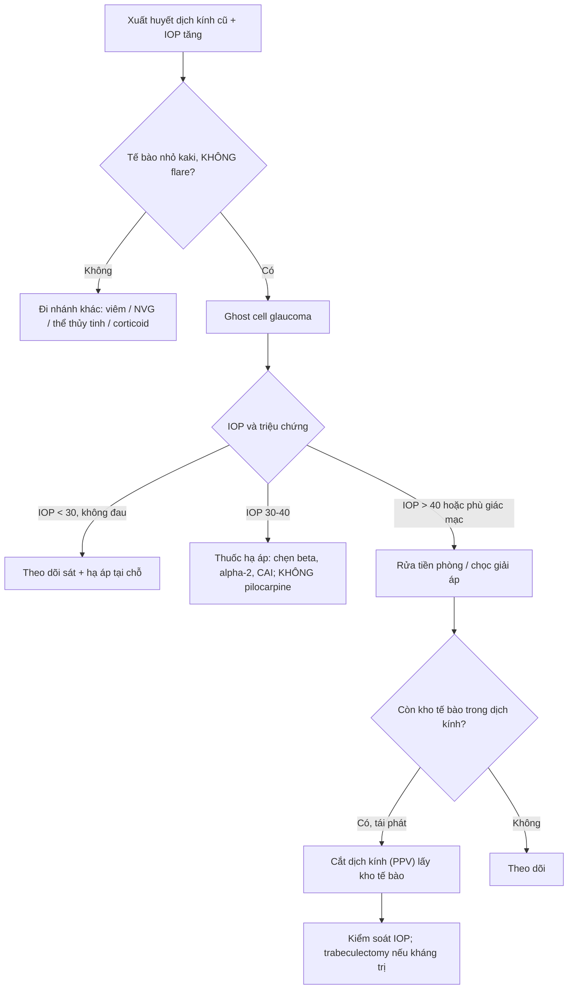
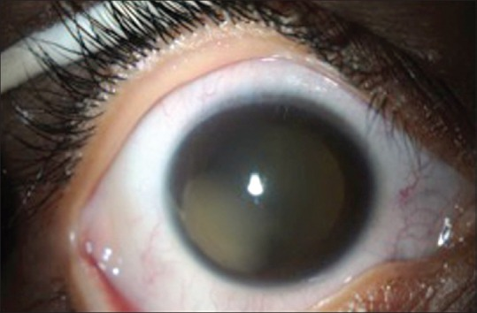
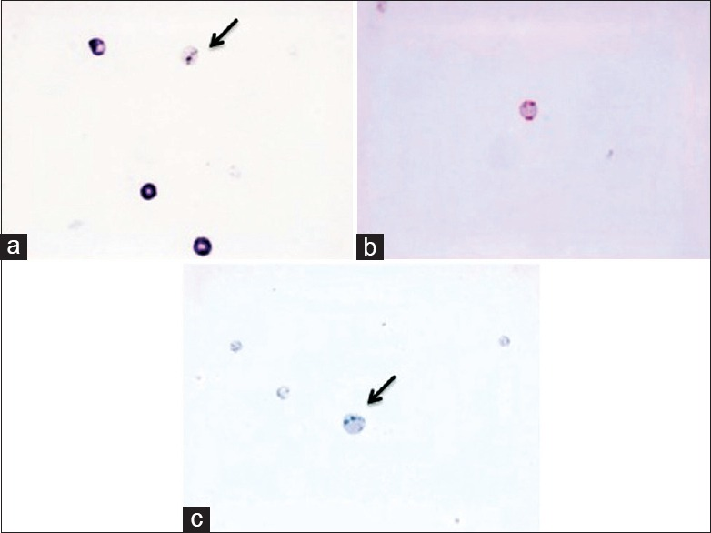
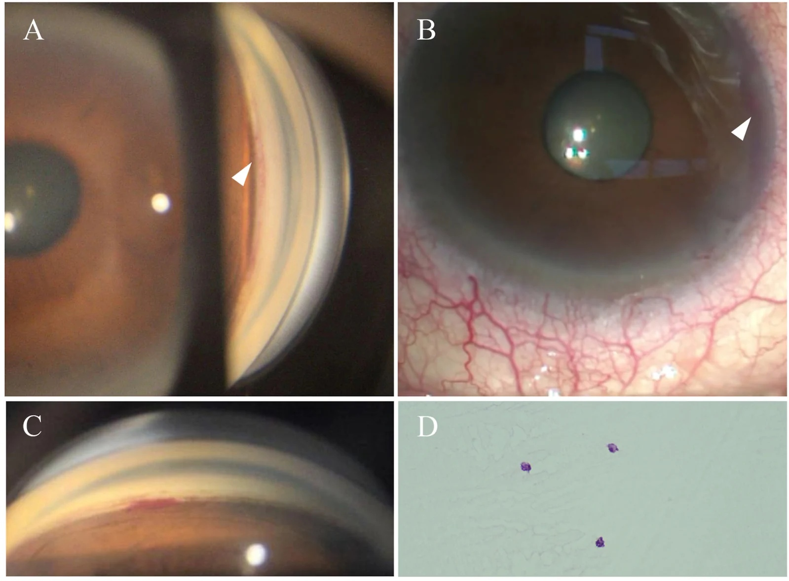

# 1457 — Glôcôm tế bào hồng cầu "ma" sau xuất huyết dịch kính: tế bào bạc màu bít bè, nhãn áp tăng MUỘN / Ghost cell glaucoma

**Tags:** `pattern:glaucom-thu-phat` `pattern:te-bao-mao` `pattern:xuat-huyet-dich-kinh` `pattern:tang-nhan-ap` `vung:mat` `vung:tien-phong` `vung:goc-tien-phong` `vung:dich-kinh` `protocol:sinh-hieu-giac-mac` `protocol:gonioscopy` `protocol:do-nhan-ap` `protocol:B-scan` `score:IOP` `incidentaloma:khong`

**Mức chắc chắn (certainty):** tổng hợp y văn (literature synthesis) — ghép **loạt 71 mắt đái tháo đường tăng sinh sau tiêm ranibizumab** (*BMC Ophthalmology* 2020, **PMC7161240**, CC BY 4.0), **ca trẻ 10 tuổi chấn thương có cytology xác nhận** (*Middle East Afr J Ophthalmol* 2016, **PMC4968153**, CC BY-NC-SA 3.0), **ca muộn 45 tháng sau goniotomy có mô bệnh học** (*Am J Ophthalmol Case Rep* 2026, **PMC13734763**, CC BY-NC-ND 4.0), **ca trẻ 3 tuổi 9 tháng phối hợp tân mạch–tế bào ma** (**PMC10551837**, CC BY-NC-ND 4.0), **ca tan máu sau tiêm aflibercept** (*Am J Case Rep* 2026, **PMC13137914**) và **dịch tễ glôcôm thứ phát** (**PMC12350547**, CC BY 4.0). Nhóm **không có bệnh nhân của mình**.

> **Câu chốt:** trong xuất huyết dịch kính **cũ**, hồng cầu mất dần hemoglobin, trở thành **tế bào "ma" (ghost cell)** — tròn, cứng, **mất khả năng biến dạng** — nên khi qua được **màng hyaloid trước bị rách** vào tiền phòng, chúng **bít cơ học bè củng mạc** và gây **glôcôm góc mở**. Vì vậy bệnh cảnh kinh điển là: **máu tiền phòng đã "tan", mắt hết đỏ, rồi nhãn áp vọt lên vài tuần–vài tháng sau** — tế bào **nhỏ, bạc màu "kaki"**, **không flare**, **góc mở**. Chẩn đoán nhầm thành **viêm màng bồ đào** (rồi cho corticoid) hoặc **glôcôm góc mở nguyên phát** là hai lỗi hay gặp nhất.

## 1. Tổng quan bệnh học – cơ chế hình ảnh (TẠI SAO)

### 1.1 Hồng cầu "chết" trong dịch kính: kho dự trữ lưu lượng thấp

- **Dịch kính là kho lưu lượng thấp (low-turnover reservoir).** Sau xuất huyết, hồng cầu nằm lại trong **gel dịch kính** — nơi **không có dòng chảy và ít oxy** — nên **không được "rửa" và không được thay thế** như trong tiền phòng. Đây là điều kiện để hồng cầu **thoái hóa tại chỗ** thay vì bị đào thải.
- **Quá trình "thành ma" mất 1–3 tuần** (Alamri 2016, PMC4968153): hồng cầu **mất hemoglobin** vào khoang ngoại bào, **màng co lại thành hình cầu**, phần hemoglobin còn lại **kết đặc thành thể Heinz (Heinz bodies)**. Tế bào **mất tính dẻo** — đây mới là yếu tố quyết định bệnh sinh, không phải kích thước.
- **TẠI SAO tế bào ma "bạc màu" (khaki/tan) trên sinh hiển vi:** màu đỏ của hồng cầu là màu của **hem**, mà hem đã mất → tế bào chỉ còn **khung màng + mảnh hemoglobin kết đặc**, tán xạ ánh sáng yếu và lệch màu → **xám-vàng-nâu nhạt**. Đồng thời tế bào **nhỏ hơn, tròn hơn, ít phản quang** so với hồng cầu tươi.
- **TẠI SAO tiền phòng KHÔNG tạo được tế bào ma:** tiền phòng có **dòng thủy dịch lưu thông nhanh + oxy cao**, hồng cầu bị rửa trôi và ly giải trước khi kịp thoái hóa. Vì vậy **máu tiền phòng đơn thuần (hyphema) hầu như không sinh ghost cell** — phải có **kho dịch kính** làm nguồn.
- **Điều kiện thứ hai: hàng rào hyaloid trước phải hở.** Tế bào ma từ dịch kính vào tiền phòng qua **màng hyaloid trước bị rách** — sau **chấn thương, phaco, cắt dịch kính, goniotomy**, hoặc đôi khi **tự nhiên**. Đây là lý do bệnh xuất hiện ở mắt **đã can thiệp** hoặc **đã chấn thương**, hiếm khi ở mắt nguyên vẹn.

### 1.2 TẠI SAO nhãn áp tăng: bít khe lọc, không phải viêm

- Bè củng mạc là **lưới collagen có khe lọc rất hẹp**; hồng cầu tươi **biến dạng được** nên lọt qua, còn tế bào ma **cứng, hình cầu** nên **kẹt lại ở lớp bè** → tăng sức cản thoát lưu → **IOP tăng theo kiểu góc mở**.
- **Không có phản ứng viêm:** tế bào ma **không tiết cytokine**, nên **không flare, không KP, không dính đồng tử**. Đây là **chốt loại viêm** quan trọng nhất trên sinh hiển vi.
- **IOP tăng nhanh nhưng mắt "yên":** mắt có thể chỉ **hơi đau, nhìn mờ do phù giác mạc**, không đỏ nhiều — nên bệnh nhân **đến muộn** hoặc bị bỏ qua khi "máu đã tan".

### 1.3 Số liệu định lượng nằm lòng

| Đại lượng | Số liệu | Nguồn |
|---|---|---|
| Thời gian hồng cầu thành tế bào ma trong dịch kính | **1–3 tuần**; tồn tại **nhiều tháng** sau khi máu đã tan | PMC4968153 |
| Tỉ lệ sau tiêm anti-VEGF ở mắt đái tháo đường tăng sinh (PDR) | **8/71 mắt = 11,3%** | PMC7161240 |
| IOP đỉnh trong loạt 8 mắt | **46,5 ± 8,0 mmHg** | PMC7161240 |
| Thời điểm phát hiện sau tiêm | **0–48 giờ** (2 mắt > 30 mmHg trong 30 phút; 4 mắt bình thường ở 30 phút rồi tăng < 1 ngày) | PMC7161240 |
| Yếu tố nguy cơ (hồi quy logistic) | **Bong võng mạc co kéo: RR 4,60** (KTC 2,02–8,48, p = 0,004); **màng xơ mạch tới đĩa: RR −3,57**; **AUC 0,88** | PMC7161240 |
| Ca chấn thương ở trẻ | **10 tuổi**, **3+ tế bào kaki**, **30% góc rẽ**, IOP **37 mmHg** dù 3 thuốc | PMC4968153 |
| Ca muộn sau goniotomy | **45 tháng**, IOP **45,1–45,3 mmHg**, **B-scan không thấy xuất huyết dịch kính**, mô bệnh có tế bào ma | PMC13734763 |
| Ca trẻ phối hợp | **3 tuổi 9 tháng**, IOP **45 mmHg**, **ánh vàng tiền phòng**, cytology **không có tế bào (âm tính giả)** | PMC10551837 |
| Ca tan máu sau tiêm (đối chứng) | IOP **50 mmHg ngày 7**, **KHÔNG thấy tế bào kaki rõ** | PMC13137914 |
| Glôcôm thứ phát trong dân số khám glôcôm | **208/1.403 = 14,83%** ca khám lần đầu | PMC12350547 |

> **Đọc số cho đúng:** 11,3% trong loạt PMC7161240 là **sau tiêm anti-VEGF ở mắt PDR có bong võng mạc co kéo** — không phải tỉ lệ chung của mọi xuất huyết dịch kính. Con số này cho thấy **bối cảnh** (PDR + bong co kéo + màng xơ mạch) mới là yếu tố quyết định, không phải "tiêm thuốc".

## 2. Mẫu hình + chẩn đoán phân biệt theo cơ chế và thời điểm (Gamut)

- **Nhóm A — sau xuất huyết dịch kính ≥ 1–3 tuần (thể kinh điển):** tế bào **nhỏ, kaki, lơ lửng**, lắng ở **nửa dưới** tiền phòng; **góc mở**, không dính; **không flare**; IOP **30–70 mmHg**. Nguồn dịch kính: **PDR, chấn thương, hội chứng Terson, xuất huyết dịch kính sau phẫu thuật**.
- **Nhóm B — sớm sau xuất huyết (giờ–ngày):** hồng cầu **tươi** (đỏ, đậm), có thể **mức máu – dịch (hyphema)**, IOP tăng do **bít bằng hồng cầu tươi + cục máu**. Khác nhóm A ở **màu và thời điểm**, không phải cơ chế.
- **Nhóm C — tan máu (haemolytic glaucoma):** mảnh hồng cầu, **hemoglobin tự do, đại thực bào chứa hemosiderin** bít bè; xuất hiện **vài ngày–vài tuần**, thường sau **hyphema** hơn là xuất huyết dịch kính. Trên lâm sàng **khó phân biệt tuyệt đối** với nhóm A — nhiều tác giả coi là **một phổ sau xuất huyết** (PMC13137914).
- **Nhóm D — viêm:** tế bào + **flare + KP + dính đồng tử + đau đỏ**; IOP có thể cao do viêm bè. **Chốt loại ghost cell: không flare.**
- **Nhóm E — thể thủy tinh:** **phacolytic** (đại thực bào to, dịch tiền phòng như sữa, thể thủy tinh chín), **phacoantigenic**, **mảnh thể thủy tinh sót**; tế bào **to, có thể kèm hạt**, thường **một mắt sau phaco cũ**.
- **Nhóm F — tân mạch (NVG):** **tân mạch mống mắt/góc**, fibrin, tế bào; IOP cao **kèm bệnh võng mạc thiếu máu**. **Có thể phối hợp** với ghost cell (PMC10551837) — gọi là **glôcôm hỗn hợp**.
- **Nhóm G — sắc tố & dầu silicon:** hội chứng phân tán sắc tố (tế bào sắc tố + **Krukenberg spindle**); dầu silicon trong tiền phòng (giọt dầu + tế bào giả) — **bối cảnh mắt bơm dầu** (bài 1416/1864).
- **Nhóm H — do thuốc:** **tăng nhãn áp do corticoid** (không tế bào, tiền sử nhỏ corticoid ≥ 2–4 tuần) — đây là **bẫy** khi bệnh nhân được cho corticoid vì "nghĩ viêm".

**Ba câu hỏi định vị (dùng trước khi kết luận):** (1) **Có xuất huyết dịch kính cũ / mắt đã mổ – chấn thương không?** (2) **Tế bào nhỏ bạc màu, có flare không?** (3) **Góc mở hay dính/tân mạch?**

## 3. Bảng so sánh phân biệt (ma trận đối chiếu)

| Thực thể (entity) | Hình ảnh điển hình (sinh hiển vi / góc / siêu âm) | Chốt vào (rule-in) | Chốt loại (rule-out) | Gợi ý xác nhận |
|---|---|---|---|---|
| **Glôcôm tế bào ma** | Tế bào **nhỏ, tròn, kaki**, lơ lửng và lắng nửa dưới; **không flare**; **góc mở**; B-scan có/không còn máu dịch kính | **Tiền sử xuất huyết dịch kính ≥ 1–3 tuần + tế bào kaki không flare + góc mở + IOP tăng** | Flare/KP/dính đồng tử → viêm; tân mạch góc → NVG; tế bào to có hạt → thể thủy tinh | Soi sinh hiển vi **đèn hẹp**, đo IOP 2 mắt, gonioscopy; cytology thủy dịch khi không chắc |
| **Hồng cầu tươi (hyphema)** | Tế bào **đỏ, đậm**, có thể **mức máu ngang**, đông cục; mắt đỏ | **Máu toàn phần + mức dịch ngang + mới trong giờ–ngày** | Tế bào nhạt màu, không mức máu → tế bào ma | Soi đèn hẹp: màu và tỉ trọng tế bào; hỏi mốc chấn thương |
| **Tan máu (haemolytic)** | Dịch tiền phòng **nâu đỏ**, mảnh tế bào, đại thực bào; thường sau hyphema | **Hyphema vài ngày–vài tuần + IOP tăng + không tế bào kaki rõ** | Tế bào kaki rõ + xuất huyết dịch kính cũ → ghost cell | Cytology (hemosiderin), bối cảnh |
| **Viêm màng bồ đào** | **Flare + KP + dính đồng tử + co đồng tử**, đau đỏ | **Flare/KP/dính + đáp ứng corticoid** | **Không flare, đồng tử không dính, tế bào kaki** | Đèn hẹp; thử corticoid có kiểm soát IOP |
| **Phacolytic / phacoantigenic** | Tế bào **to**, dịch như sữa, **thể thủy tinh chín**; có thể giả áp-xe | **Thể thủy tinh chín + tế bào to + một mắt** | Tế bào nhỏ kaki + xuất huyết dịch kính → ghost cell | Soi thể thủy tinh, siêu âm; xử trí phaco |
| **NVG** | **Tân mạch mống mắt/góc**, fibrin, đồng tử giãn dính | **Tân mạch góc/mống mắt + bệnh võng mạc thiếu máu** | Góc mở không tân mạch → không NVG | Gonioscopy, FA/đáy mắt |
| **Tăng nhãn áp do corticoid** | Tiền phòng **trong**, không tế bào; tiền sử nhỏ corticoid | **Dùng corticoid 2–4 tuần + không tế bào + giảm khi ngừng** | Có tế bào kaki → không đơn thuần do corticoid | Ngừng corticoid, theo dõi IOP |
| **Dầu silicon / sắc tố** | Giọt dầu **lóng lánh**, bờ ngang; sắc tố + Krukenberg | **Tiền sử bơm dầu; sắc tố + mống mắt lõm** | Tế bào kaki lơ lửng đều → ghost cell | Đèn hẹp, UBM/gonioscopy |

### Dấu hiệu đọc đúng thứ tự trên đèn hẹp
1. **Màu tế bào:** đỏ = tươi; **kaki/xám** = thoái hóa.
2. **Kích thước:** nhỏ đều = hồng cầu; **to, không đều** = đại thực bào/viêm.
3. **Flare:** có = viêm; **không = bít cơ học**.
4. **Vị trí lắng:** nửa dưới (trọng lực) — cả hai thể đều lắng, nên **không phân biệt được bằng vị trí**.
5. **Góc:** mở + không tân mạch + có **máu cũ ở góc** (gonioscopy) là chốt.

## 4. Protocol khám + ngưỡng xử trí

### 4.1 Khám tối thiểu khi "nhãn áp tăng sau xuất huyết dịch kính"
- **Đo IOP cả hai mắt** (Goldmann; trẻ nhỏ dùng iCare/pneumotonometry), ghi **giờ đo** và thuốc đang dùng.
- **Sinh hiển vi đèn hẹp:** đếm tế bào, mô tả **màu/kích thước**, tìm **flare, KP, dính đồng tử, tân mạch mống mắt**, mức máu.
- **Gonioscopy:** góc mở/đóng, **máu cũ ở góc**, **góc rẽ (angle recession)**, tân mạch. Ở trẻ không hợp tác → **khám dưới mê**.
- **B-scan:** còn máu dịch kính, bong võng mạc, màng xơ mạch; **B-scan bình thường KHÔNG loại trừ** ghost cell (PMC13734763).
- **Siêu âm sinh hiển vi (UBM)/AS-OCT** khi cần xác định **màng hyaloid trước**, dầu silicon, vị trí mảnh.
- **Cytology thủy dịch (Giemsa/H&E):** chỉ khi chẩn đoán không rõ; **âm tính giả** đã gặp (PMC10551837) → **không dùng để loại trừ**.

### 4.2 Ngưỡng và bậc điều trị

- **Thuốc:** **ức chế thủy dịch** (chẹn beta tại chỗ, **alpha-2 agonist**, **ức chế carbonic anhydrase** tại chỗ/uống). **Pilocarpine không có vai trò** — co đồng tử không mở được bè đã bị bít và có thể làm tăng viêm/đau.
- **Rửa tiền phòng (AC washout/lavage)** khi IOP cao, phù giác mạc, hoặc tế bào dày đặc: lấy đi **nguồn tế bào tại chỗ**; có thể phải **lặp lại**.
- **Cắt dịch kính (PPV)** khi **còn kho tế bào trong dịch kính** (máu cũ, bong co kéo) hoặc **tái phát sau rửa**: mục tiêu là **loại bỏ kho dự trữ**, không chỉ hạ áp.
- **Trabeculectomy / van** khi tổn thương bè không hồi phục hoặc **thấm máu giác mạc (corneal blood staining)**.
- **Điều trị bệnh nền:** kiểm soát PDR (PRP/anti-VEGF), xử lý bong võng mạc co kéo, ngừng corticoid không cần thiết.

### 4.3 Bảng ngưỡng thực hành

| Tình huống | Ngưỡng / hành động | Ghi chú |
|---|---|---|
| IOP tăng nhẹ, mắt không triệu chứng | **< 30 mmHg**: theo dõi **1–3 ngày/lần** đến khi ổn định | Ghost cell có thể tự giới hạn |
| IOP trung bình | **30–40 mmHg**: thuốc hạ áp tối đa | Tránh pilocarpine |
| IOP cao / phù giác mạc | **> 40 mmHg** hoặc **giảm thị lực**: rửa tiền phòng | Rửa sớm tốt hơn chờ |
| Tái phát sau rửa | **≥ 2 lần** tái phát: PPV | Loại bỏ kho tế bào |
| Thấm máu giác mạc | Chỉ định **phẫu thuật sớm** | Yếu tố tiên lượng xấu |

## 5. Biến thể bình thường và cạm bẫy

- **"Máu đã tan" không có nghĩa là hết bệnh:** IOP có thể **bình thường vài tuần rồi tăng** (thể muộn 45 tháng sau goniotomy, PMC13734763). Hỏi **mốc xuất huyết dịch kính cũ** là bước không được bỏ.
- **Tế bào ma không chỉ sau xuất huyết dịch kính tự phát:** đã gặp sau **goniotomy/GATT** (máu trào ngược từ góc), sau **phaco**, sau **cắt dịch kính**. B-scan **không có máu** vẫn có thể có tế bào ma trong tiền phòng.
- **Âm tính giả của cytology:** mẫu **0,1 mL**, không cell block, không đếm tế bào → có thể **không thấy tế bào** dù bệnh thật (PMC10551837). **Không loại trừ** dựa vào cytology.
- **Chẩn đoán nhầm viêm:** cho **corticoid** sẽ **làm tăng IOP** và che mất bệnh; nếu nghi ngờ, **không flare** là chốt loại.
- **Bỏ sót góc rẽ (angle recession):** **30%** trong ca trẻ chấn thương (PMC4968153); cơ chế **hỗn hợp** → cần gonioscopy và theo dõi dài hạn.
- **Nhầm với glôcôm góc mở nguyên phát:** bệnh nhân **trẻ, có chấn thương/mổ cũ, một mắt** → **không gọi POAG** khi chưa loại ghost cell.
- **Thấm máu giác mạc (corneal blood staining):** có thể xuất hiện **dù IOP không cao**; khi máu tan và IOP kiểm soát, **có thể tự hồi phục** (PMC4968153) — nhưng cần theo dõi nội mô.
- **Tăng IOP thoáng qua sau tiêm nội nhãn** (bài 1427) khác ghost cell: **tăng trong phút–giờ rồi tự về**, không tế bào kaki; còn ghost cell sau tiêm PDR có thể **0–48 giờ** (PMC7161240) — **bối cảnh PDR/bong co kéo** là điểm phân biệt.

## 6. Tự lượng giá — Blind Quiz

**Ca 1 — Bé trai 10 tuổi, chấn thương đụng dập mắt phải 1 tháng trước, "máu tiền phòng đã hết" nhưng mắt mờ dần.**

- Gợi ý lâm sàng: thị lực **HM**, IOP **20 mmHg** lúc đầu, sau **2 tuần** tăng **37 mmHg** dù 3 thuốc; **3+ tế bào kaki**, **góc rẽ 30%**; B-scan: máu dịch kính đặc, võng mạc áp.
- Câu hỏi: (1) Tế bào trong tiền phòng là loại gì? (2) Vì sao IOP tăng **sau** khi máu tiền phòng đã tan? (3) Hai chẩn đoán phân biệt và một dấu hiệu loại chúng?

<b>Bấm để hiện đáp án (findings + chẩn đoán)</b>

- **Dấu hiệu:** **3+ tế bào kaki**, **không flare**, **góc mở có 30% góc rẽ**; **B-scan: xuất huyết dịch kính đặc**. Giác mạc có **thấm máu dạng dải** (ảnh).
- **Chẩn đoán:** **glôcôm tế bào ma sau xuất huyết dịch kính do chấn thương**, cơ chế **hỗn hợp** với góc rẽ. Máu tiền phòng tan nhưng **kho tế bào trong dịch kính vẫn còn** → tiếp tục bít bè.
- **Vì sao:** hồng cầu mất hemoglobin trong dịch kính **1–3 tuần**, mất tính biến dạng → kẹt ở bè; **không viêm** nên không flare.
- **Xử trí trong ca gốc:** **PPV + rửa tiền phòng**, cytology xác nhận **tế bào ma**; sau mổ **IOP ổn, thị lực 20/40**; 2 năm sau phaco, **thấm máu giác mạc tự hồi phục**.
- Nguồn ảnh: Alamri A, Alkatan H, Aljadaan I. *Middle East Afr J Ophthalmol* 2016;23:271–273 (**PMC4968153**), **CC BY-NC-SA 3.0** — nguyên bản, không crop/ghép.

**Ca 2 — Cùng bệnh nhân, mẫu thủy dịch được nhuộm để tìm nguyên nhân bít bè.**

- Câu hỏi: Ba tiêu bản cho thấy **loại tế bào nào**? Dấu hiệu nào trên tiêu bản **chứng minh** tế bào đã thoái hóa?

<b>Bấm để hiện đáp án</b>

- **Dấu hiệu:** (a) **Giemsa**: nhiều hồng cầu, một số **thoái hóa (mũi tên)**; (b) **H&E**: tế bào **mất màu, màng nhăn**; (c) **xanh methylen**: **thể Heinz** dạng chấm đậm trong tế bào (mũi tên).
- **Chẩn đoán:** **tế bào ma (ghost cells)** — hồng cầu mất hemoglobin, còn **thể Heinz**.
- **Vì sao:** hemoglobin bị mất vào dịch kính; phần còn lại kết đặc trên mặt trong màng → **thể Heinz**, dấu hiệu mô học đặc trưng.
- Nguồn ảnh: **PMC4968153**, Fig. 2; **CC BY-NC-SA 3.0** — nguyên bản, không crop/ghép.

**Ca 3 — Nam 73 tuổi, tăng nhãn áp 45 mmHg sau "mổ glôcôm vi phẫu" 45 tháng; B-scan không thấy máu dịch kính.**

- Gợi ý: tiền sử **goniotomy 120°** bằng móc Tanito; ngày 1 sau mổ có **máu tiền phòng 1 mm**; IOP ổn **14–18 mmHg** trong 3 năm; nay **45,1 mmHg**, giác mạc phù, **máu lắng ở góc 6 giờ**.
- Câu hỏi: (1) Vì sao ghost cell xuất hiện **muộn** dù không có xuất huyết dịch kính? (2) Dấu hiệu nào trên gonioscopy gợi ý **đường vào của máu**? (3) Xử trí?

<b>Bấm để hiện đáp án</b>

- **Dấu hiệu:** (A) **dải máu tại vị trí goniotomy cũ**; (B) khi **giải áp tiền phòng**, máu **trào ngược từ góc mũi** (đúng vị trí mổ); (C) **máu lắng ở góc 6 giờ**; (D) **H&E: hồng cầu thoái hóa + tế bào ma**.
- **Chẩn đoán:** **glôcôm góc mở thứ phát do trào máu muộn + thành phần tế bào ma**, 45 tháng sau goniotomy.
- **Vì sao:** đường lọc bè đã mở **vẫn là đường cho máu trào ngược** khi **áp lực tĩnh mạch củng mạc > IOP**; hồng cầu thoái hóa tại **góc/tiền phòng** (không cần kho dịch kính lớn) rồi bít bè.
- **Xử trí:** rửa tiền phòng/giải áp **không kiểm soát bền** → **trabeculectomy + MMC**; IOP **10 mmHg** sau 11 tháng.
- Nguồn ảnh: Zhang M, Jia J, Tan J, Gao X. *Am J Ophthalmol Case Rep* 2026;44:102686 (**PMC13734763**), Fig. 1; **CC BY-NC-ND 4.0** — chỉ đổi định dạng webp→jpg, **không crop/không ghép**.

## Bài liên quan chéo
- [1444 – Viêm màng bồ đào sau chấn thương](../1444-viem-mang-bo-dao-sau-chan-thuong/lesson.md)
- [449 – Chấn thương mắt & dị vật nội nhãn](../449-chan-thuong-mat-dich-vat/lesson.md)
- [1452 – Glôcôm do thể thủy tinh chưa mổ (phacolytic)](../1452-glaucom-do-the-thuy-tinh-chua-mo/lesson.md)
- [1411 – Tăng nhãn áp do corticoid nội nhãn](../1411-tang-nhan-ap-do-corticoid-noi-nhan/lesson.md)
- [1427 – Tiêm anti-VEGF hai mắt cùng ngày: kỹ thuật & biến chứng](../1427-tiem-anti-vegf-hai-mat-cung-ngay/lesson.md)
- [1416 – Glôcôm do dầu silicon](../1416-glaucom-do-dau-silicone/lesson.md)
- [1864 – Dầu silicon nặng (HSO): biến chứng phía dưới](../1864-dau-silicone-nang-bien-chung-phia-duoi/lesson.md)

> **Không dùng để chẩn đoán độc lập khi chưa có người hướng dẫn.**
