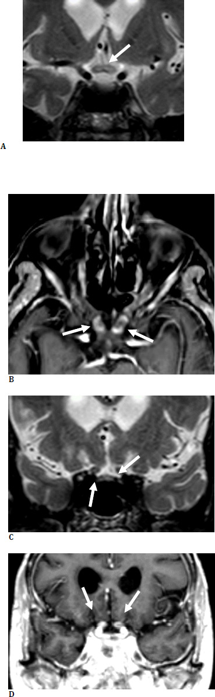
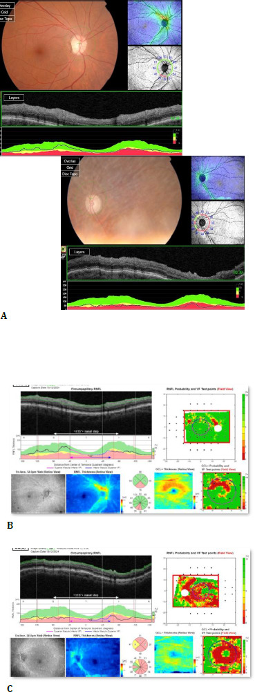
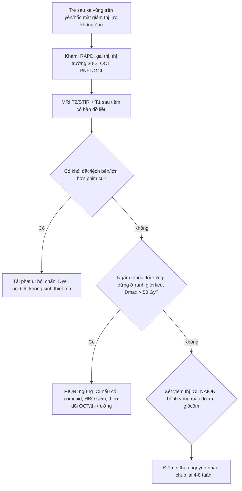
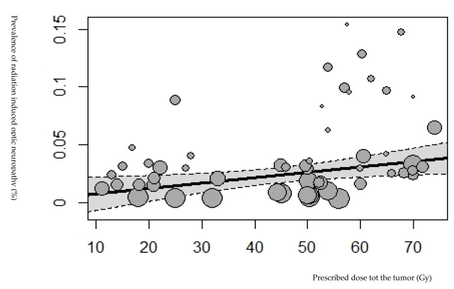

# 1458 — Bệnh thần kinh thị do xạ ở trẻ: ngấm thuốc giao thoa "giả u", mù muộn không hồi phục / Radiation-induced optic neuropathy (RION) in children

**Tags:** `pattern:teo-thi` `pattern:ngam-thuoc-day-thi` `pattern:mat-thi-luc-sau-xa` `vung:than-kinh-thi` `vung:mat` `vung:giao-thoa-thi` `protocol:MRI-hoc-mat` `protocol:OCT-RNFL` `protocol:thi-truong` `protocol:VEP` `score:PENTEC` `incidentaloma:khong`

**Mức chắc chắn (certainty):** tổng hợp y văn (literature synthesis) — ghép **ca nguyên văn người lớn 66 Gy → mù hai mắt, có MRI + OCT** (Benetti et al. 2026, **PMC13453118**, CC BY 4.0), **đoàn hệ proton 89 bệnh nhân có 39 ca RION** (Thariat et al. 2026, **PMC13583721**, CC BY 4.0), **phân tích gộp 225 bài RION** (Thariat et al. 2026, **PMC13742046**), **tổng quan 70 nghiên cứu** (Kinaci-Tas et al. 2023, **PMC10093581**, CC BY 4.0), **đoàn hệ trẻ sống sót u cơ vân đầu cổ 74 mắt** (Morfouace et al. 2026, **PMC13330630**, CC BY-NC-ND 4.0) và **tổng quan độc tính mắt của xạ** (Arturi et al. 2025, **PMC12384690**). Nhóm **không có bệnh nhân của mình**; số liệu trẻ em còn mỏng — phần lớn ngưỡng liều suy từ người lớn + PENTEC.

> **Câu chốt:** sau xạ vùng trên yên/hốc mắt, dây thị và giao thoa có thể **phì đại + tăng tín hiệu T2/STIR + ngấm thuốc** — hình ảnh **giống hệt u tái phát** — rồi **teo dần**; bệnh nhân **mất thị lực không đau, một bên rồi sang bên kia, trung vị 16–30 tháng sau xạ**. Chốt chẩn đoán **không phải** hình ảnh đơn thuần mà là **bản đồ liều**: tổn thương **nằm gọn trong trường chiếu, đối xứng, liều > 50 Gy** và **không có khối**. Xạ **57 Gy → 5%**, **64 Gy → 50%** nguy cơ (PENTEC). Gọi nhầm thành tái phát u → **mổ/xạ lại oan trên một dây thị đã kiệt**; gọi nhầm thành viêm thị → **corticoid kéo dài vô ích**.

## 1. Tổng quan bệnh học – cơ chế hình ảnh (TẠI SAO)

### 1.1 Tổn thương mạch → thiếu máu → chết sợi trục, không phải "viêm"
- Dây thị là **chất trắng trung ương** (myelin do tế bào ít nhánh), **không có tế bào Schwann**, **không tái sinh**; nuôi dưỡng bằng **động mạch trung tâm võng mạc + nhánh màng não** — mật độ mao mạch **thấp hơn võng mạc**.
- Xạ gây **tổn thương tế bào nội mô** → **viêm mạch tắc nghẽn** + gốc tự do → **thiếu máu cục bộ sợi trục**. Lessell mô tả bộ ba **giảm mạch máu (hypovascularity) – giảm tế bào đệm (hypocellularity) – thiếu ôxy (hypoxia)**: mạch nhỏ dần bị xóa, tế bào thần kinh đệm và mạch đỡ mất, vi môi trường thiếu ôxy mạn → chuyển hóa sợi trục sụp.
- Thí nghiệm trên động vật (20 Gy/2 lần) cho thấy **30 tuần sau xạ giảm mạnh protein vận chuyển sợi trục (dynein-1, kinesin-1/2)** trong khi **α/β-tubulin và SMI 31 không đổi** → **hỏng vận chuyển sợi trục** là cơ chế sớm, **không phải hỏng khung xương tế bào**. Vì vậy tổn thương **chức năng đứng trước tổn thương cấu trúc**: thị lực mất **trước** khi MRI teo.

### 1.2 Vì sao MRI ngấm thuốc — và vì sao dễ gọi nhầm u
- **Hàng rào máu–dây thị bị phá vỡ** ở đoạn chiếu xạ → **T1 sau tiêm ngấm thuốc**; phù sợi trục + tăng nước nội bào → **T2/STIR tăng tín hiệu**, kèm **phì đại từng đoạn**. Đây là **phản ứng mô**, không phải khối tân sinh: **bờ mờ, theo trục dây thị, đối xứng hai bên, dừng đúng ranh giới trường chiếu**.
- Giai đoạn muộn: sợi trục chết → **teo**: dây thị **mảnh**, **mất ngấm thuốc**, **RNFL/GCL mỏng trên OCT**, gai thị **nhợt**. Trên MRI **teo không hồi phục**, còn ngấm thuốc **có thể thoái triển**.
- Vì sao **trẻ** khác người lớn: (1) **đường thị vẫn đang myelin hóa/lớn** nên cùng liều, **phân liều lớn hơn** gây tổn thương nhiều hơn (**α/β ≈ 2–3 Gy** — mô đáp ứng muộn); (2) khối u trẻ (craniopharyngioma, glioma đường thị, medulloblastoma, u cơ vân đầu cổ, retinoblastoma) **nằm sát đường thị** nên khó né; (3) trẻ **không tự báo** ám điểm → phát hiện muộn, teo đã thành lập; (4) trẻ có **cửa sổ ngôn ngữ/thị giác** nên mù một bên = **nhược thị** cộng thêm.

### 1.3 Ngưỡng định lượng (bắt buộc nhớ)

| Tham số | Con số | Nguồn |
|---|---|---|
| Ngưỡng liều "an toàn" kinh điển | **< 50 Gy** (phân liều < 2 Gy): nguy cơ gần như không đáng kể | PMC13742046, PMC13453118 |
| PENTEC — dây thị/giao thoa | **57 Gy → 5%**; **64 Gy → 50%** | PMC12384690 (dẫn PENTEC) |
| QUANTEC — 3D-CRT | **Dmax < 55 Gy → < 3%**; **Dmax > 60 Gy → 7–20%** | PMC12384690 |
| SRS đơn phân liều | **Dmax < 12 Gy → < 10%** | PMC12384690 |
| Trẻ u cơ vân đầu cổ (n = 74 mắt) | RION **chỉ xuất hiện khi Dmax > 53 GyEQD2** vào dây thị | PMC13330630 |
| Nghiên cứu 514 u sọ hầu | **< 59 Gy: 1%**; **≥ 60 Gy: 5,8%** | PMC12384690 |
| Tỷ lệ chung | **2,0%** (70 nghiên cứu); **4,5% khi > 50 Gy** vs **1,7% khi < 50 Gy** | PMC10093581 |
| Phân tích gộp 2026 | u **trong mắt: 17,0%**; ngoài mắt **4,7%** (phân liều thường) / **2,1%** (giảm phân liều); **u hệ TKTW: 2,77%** | PMC13742046 |
| Retinoblastoma xạ áp (plaque) | **15,59%** (186 mắt, theo dõi 3,83 năm) và **20,90%** (134 mắt, 5 năm) | PMC13742046 |
| Thời gian tiềm tàng | **trung vị 16–30 tháng**; trung bình **36 tháng** (3–108 tháng); cá biệt **> 10 năm** | PMC13742046, PMC12384690 |
| Yếu tố làm nặng | **liều mỗi phân liều > 2 Gy**, tăng huyết áp, hút thuốc, đái tháo đường, tuổi lớn | PMC12384690 |

- **Điểm chết người về ngưỡng:** RION **vẫn xảy ra dưới 55 Gy** (nhất là SRS < 12 Gy) ở người có **tăng huyết áp/hút thuốc** — nên "liều thấp" **không loại trừ**, và ngược lại **> 64 Gy không có nghĩa chắc chắn mù** (phụ thuộc phân liều, thể tích, mô lành còn lại).

## 2. Mẫu hình + chẩn đoán phân biệt theo vị trí (Gamut)

**Mẫu hình khởi điểm:** trẻ **giảm thị lực không đau, tiến triển vài tuần**, **RAPD dương**, **gai thị phù nhẹ rồi nhợt**, **thị trường ám điểm trung tâm/đường giữa**, **không sốt, không đau khi liếc** — sau xạ **3 tháng–3 năm**.

Chia gamut theo **vị trí tổn thương nhìn thấy trên MRI** (không theo triệu chứng):

| Vị trí | Thực thể | Điểm phân biệt cốt lõi |
|---|---|---|
| **Dây thị trong hốc mắt (prechiasmal)** | **RION** · viêm thị do **ức chế điểm kiểm soát miễn dịch (ICI)** · NAION/AION · u xâm lấn dây thị · viêm màng não ung thư | RION: ngấm thuốc **đoạn trong trường chiếu**, không đau; ICI: **đau khi liếc**, ngấm **quanh dây (perineuritis)**; NAION: **gai phù + khiếm khuyết nửa trên/dưới**, ngấm **ít/không** |
| **Giao thoa thị (chiasmal)** | **RION** · **tái phát craniopharyngioma** · glioma đường thị tiến triển · di căn màng não · **giãn não thất cấp** · apoplexy tuyến yên | RION: **đối xứng, không khối, dừng ở ranh giới liều**; tái phát: **khối lệch, có nang/vôi, xâm lấn mô xung quanh**, kèm **suy tuyến yên/não úng thủy** |
| **Võng mạc–hoàng điểm** | **Bệnh võng mạc do xạ + phù hoàng điểm** · tắc nhánh tĩnh mạch · xuất huyết dịch kính | Đáy mắt **thấy tổn thương** (xuất tiết, phù, thiếu máu cục bộ); OCT **phù nang**; không giải thích được RAPD đơn thuần |
| **Đầu dây thị (đĩa)** | **Teo thị do glôcôm sau xạ** (bài 1450) · bệnh thần kinh thị do thiếu máu · teo sau viêm | **IOP cao**, **C/D lớn**, góc đóng/tân mạch; cần đo nhãn áp **trước** khi quy cho RION |

- **Mnemonic 4R cho "mù sau xạ":** **R**adiation (RION) – **R**ecurrence (u tái phát) – **R**etinopathy (bệnh võng mạc do xạ) – **R**x–immune (viêm thị do ICI/liệu pháp miễn dịch). Thêm **I**schaemic (NAION/AION) khi bệnh nhân lớn tuổi/có mạch máu.

*RION sau xạ 66 Gy: (A, C) T2/STIR — giao thoa và đoạn trước giao thoa **dày + tăng tín hiệu**; (B, D) T1 sau tiêm — **ngấm thuốc đối xứng** cả hai dây thị. Ảnh nguyên bản: Benetti et al. 2026 (PMC13453118), CC BY 4.0.*

## 3. Bảng so sánh phân biệt (ma trận đối chiếu)

| Thực thể | Hình ảnh điển hình (MRI + OCT) | Chốt vào (rule-in) | Chốt loại (rule-out) | Gợi ý xác nhận |
|---|---|---|---|---|
| **RION** | Ngấm thuốc **đoạn dây thị/giao thoa trong trường chiếu**, T2/STIR tăng, phì đại nhẹ **đối xứng**, **không khối**; muộn: teo + RNFL mỏng | **Liều Dmax > 50 Gy + tiềm tàng 3 tháng–3 năm + tổn thương dừng đúng ranh giới liều + không có khối** | Có **khối đặc/lệch bên**, xâm lấn mô quanh, hoặc ngấm thuốc **ngoài trường chiếu** → không phải RION đơn thuần | Đối chiếu **bản đồ liều** trên kế hoạch xạ; OCT/VEP theo dõi; **không sinh thiết** |
| **Tái phát u tại giao thoa** (craniopharyngioma/glioma) | Khối **lệch bên**, có **nang/vôi hóa**, xâm lấn, **DWI hạn chế khuếch tán** (u đặc tế bào), giao thoa **dày không đều** | **Khối mới/lớn lên so phim cũ + hiệu ứng khối + suy tuyến yên/não úng thủy** | Ngấm thuốc **đối xứng, dừng ở ranh giới chiếu, không lớn lên sau 3–6 tháng** → không phải tái phát | So **phim cũ cùng chuỗi**, đo 2 chiều, hội chẩn xạ trị–nội tiết |
| **Viêm thị do ICI** | Ngấm thuốc **quanh dây (vỏ dây thị)**, **khu trú trong hốc mắt**, có thể một bên; gai phù | **Đang dùng anti-PD1/CTLA4 + đau khi liếc + ngấm vỏ dây thị** | Ngấm thuốc **đối xứng cả giao thoa, không đau** → nghiêng RION | Ngừng ICI thử, corticoid; đáp ứng một phần **gợi ý ICI** |
| **NAION/AION** | Gai phù, **không/tăng ngấm rất ít** dây thị, đĩa "chật" | **Khởi phát giờ–ngày, khiếm khuyết thị trường ngang/dọc, đau ít, tuổi lớn, yếu tố mạch máu** | Tiến triển **tuần–tháng**, đối xứng, có tiền sử xạ > 50 Gy → nghiêng RION | CRP/ESR nếu nghi AION; theo dõi thị trường |
| **Bệnh võng mạc do xạ (kèm phù hoàng điểm)** | Xuất tiết, xuất huyết, **phù hoàng điểm trên OCT (nang)**, thiếu máu cục bộ trên FA | **Tổn thương đáy mắt khớp bản đồ liều + OCT phù nang** | OCT **không phù**, RNFL mỏng đơn thuần + MRI ngấm giao thoa → RION | FA/OCTA; anti-VEGF nếu phù hoàng điểm (bài 1409/1418) |
| **Teo thị do glôcôm sau xạ** | **C/D lớn**, IOP cao, góc đóng/tân mạch; MRI dây thị **teo nhưng không ngấm** | **IOP > 21 mmHg (trẻ: theo tuổi) + C/D lớn + RAPD** | IOP bình thường, góc mở, MRI ngấm thuốc giao thoa → không phải glôcôm | Đo IOP nhiều lần, soi góc, UBM (bài 1450) |

- **Ảnh OCT minh họa hậu quả:** RNFL mỏng **không đối xứng** — mắt bệnh **mỏng ưu thế vùng dưới**, mắt còn lại **mỏng lan tỏa**; GCL **teo gần như toàn bộ**. Đây là **dấu chứng muộn**, không phải dấu chốt chẩn đoán.

*(A) RNFL hai mắt; (B, C) mặt cắt RNFL + GCL. Ảnh nguyên bản: Benetti et al. 2026 (PMC13453118), CC BY 4.0.*

### 3.1 Dấu hiệu "giả u" cần đọc đúng
- **Ngấm thuốc theo trục, bờ mờ, không có bờ khối** — u thật thường **bờ rõ, lệch bên, có nang/vôi**.
- **Dừng ở ranh giới trường chiếu** (so bản đồ liều): dấu mạnh nhất, nhưng **không tuyệt đối** vì LIQ/ánh xạ có thể lan ngoài.
- **Đối xứng hai bên** ở giao thoa: u giao thoa hiếm khi **đối xứng hoàn hảo**; RION hay gặp vì cả hai dây thị nằm trong cùng trường.
- **Có phì đại mà không có hiệu ứng khối** (không chèn bể quanh giao thoa, không giãn não thất).

## 4. Protocol chụp + hệ phân độ/điểm chuẩn hóa

### 4.1 Chụp — làm gì, dày bao nhiêu
- **MRI 1,5–3 T**, gồm: **T2/STIR fat-sat hốc mắt + giao thoa lát 2–3 mm** (trục + coronal vuông góc dây thị), **T1 fat-sat trước và sau gadolinium** (lát 1–3 mm), **DWI/ADC** khi cần loại u đặc tế bào; **FLAIR toàn não** để tìm di căn màng não/tái phát.
- **Bắt buộc đọc kèm:** kế hoạch xạ (bản đồ liều EQD2 vào dây thị/giao thoa) + phim MRI **trước xạ** (baseline) — **không có baseline thì không được kết luận "mới"**.
- **Trước xạ (khuyến nghị):** chụp MRI baseline + **đo thị lực, thị trường 30-2, OCT RNFL/GCL, VEP P100** để có mốc so sánh — đoàn hệ proton 89 bệnh nhân dùng đúng bộ này lặp lại theo lịch, và **thị trường (MD/PSD) là chỉ số mạnh nhất** phát hiện RION (độ chính xác **75–79%**; mô hình đa phương thức **81,7%**).
- **Khi có triệu chứng:** MRI ngay + khám thần kinh nhãn khoa trong **24–48 giờ**; nếu MRI âm tính mà lâm sàng mạnh → **chụp lại sau 4–8 tuần** (ngấm thuốc có thể xuất hiện muộn).

### 4.2 Ngưỡng liều & phân độ
- **Mục tiêu lập kế hoạch:** **Dmax dây thị/giao thoa ≤ 54 Gy EQD2** (dưới ngưỡng 5% của PENTEC là 57 Gy), **ưu tiên ≤ 50 Gy**; **phân liều ≤ 2 Gy/lần**; **SRS: Dmax < 10–12 Gy**; khi khối sát đường thị → **proton/xạ điều biến** để cắt liều.
- **Phân độ CTCAE (thần kinh thị):** độ 2 = giảm thị lực có triệu chứng, hạn chế hoạt động; **độ 3 = thị lực ≤ 20/200 ở mắt bị ảnh hưởng**; độ 4 = mù mắt. Ghi **cả thị lực + thị trường + RNFL** vì CTCAE dựa thị lực **bỏ sót tổn thương sớm**.

### 4.3 Điều trị — trung thực về bằng chứng
- **Không có điều trị chuẩn.** Tổng quan hệ thống cho thấy **tiêm nội nhãn anti-VEGF** và **oxy cao áp (HBO) sớm** là hai hướng có triển vọng nhất; **kháng đông hệ thống, bevacizumab toàn thân và corticoid không chứng minh hiệu quả**.
- **HBO** có lợi nhất khi bắt đầu **trong 48–72 giờ** và **trước khi gai thị nhợt**; ca nguyên văn 66 Gy thất bại với **corticoid + HBO + IVIG** và đi tới **mù hai mắt** — nhấn mạnh **dự phòng bằng liều** quan trọng hơn điều trị.
- **Nếu đang dùng ICI:** ngừng tạm + corticoid là phép thử chẩn đoán–điều trị (viêm thị do ICI có thể hồi phục một phần).
- **Theo dõi:** OCT RNFL/GCL + thị trường mỗi **3–6 tháng** trong 2 năm đầu, sau đó **6–12 tháng**; teo tiến triển = tổn thương đã cố định, **không tăng liều xạ lại vì "MRI còn ngấm"**.

## 5. Biến thể bình thường và cạm bẫy

- **"Dây thị dày" do vỏ bao dịch não tủy:** trên T2, khoang dưới nhện quanh dây thị sáng — đo trên **T1 sau tiêm** và **coronal vuông góc**, đừng đo trên trục (partial volume).
- **Ngấm thuốc sinh lý màng não quanh dây thị** ở trẻ nhỏ/gadolinium liều cao — đối chiếu bên đối diện và dùng **fat-sat**.
- **Bẫy "satisfaction of search":** thấy u cũ ổn định là dừng, bỏ qua **giao thoa ngấm thuốc** — phải đọc **dây thị → giao thoa → đường thị sau** thành một chuỗi liên tục.
- **Bẫy "MRI bình thường":** giai đoạn sớm có thể **chưa ngấm thuốc**; bệnh nhân **vẫn mù**. Không loại trừ RION bằng MRI âm tính.
- **Bẫy "teo = đã ổn":** teo thị xuất hiện **sau** khi thị lực đã mất; thấy teo không có nghĩa bệnh ngừng tiến triển — **mắt bên kia có thể mù sau vài tháng** (ca nguyên văn: mắt trái rồi mắt phải).
- **Bẫy trẻ em:** trẻ **không than ám điểm**, chỉ **lé mắt/kém theo dõi/học kém**; phải đo thị lực **theo tuổi** và **so hai mắt**; nhược thị có thể che một RION một bên.
- **Bẫy gọi "tái phát" trên MRI:** ngấm thuốc tồn tại **nhiều tháng–năm**; chỉ gọi tái phát khi có **khối/lớn dần/kèm dấu hiệu mới**, không dựa vào "còn ngấm".

## 6. Tự lượng giá — Blind Quiz

**Ca 1 — Nữ 73 tuổi, u hắc tố niêm mạc mũi, xạ hậu phẫu 66 Gy/33 lần. 10 tháng sau: mờ mắt trái rồi mù, sau đó mờ mắt phải. Không đau.**

- Câu hỏi: Tổn thương ở đâu? Ngấm thuốc đối xứng hay lệch? Nêu 3 chẩn đoán phân biệt và dấu hiệu nào **loại** u tái phát?

<b>Bấm để hiện đáp án (findings + chẩn đoán)</b>

- **Dấu hiệu:** giao thoa và **đoạn trước giao thoa hai bên** dày, **tăng tín hiệu T2/STIR**, **ngấm thuốc T1 sau tiêm đối xứng**; không có khối lệch bên, không xâm lấn mô quanh.
- **Chẩn đoán:** **RION** sau xạ **66 Gy** — liều **> 64 Gy (PENTEC 50%)**, tiềm tàng **10 tháng** (trong khoảng trung vị 16–30 tháng), tiến triển **tuần tự hai mắt**.
- **Loại u tái phát vì:** **đối xứng + không khối + không hiệu ứng khối**; nhưng phải so **bản đồ liều** và **phim trước xạ** mới chắc.
- **Diễn biến:** thất bại với corticoid + HBO + IVIG → **mù hai mắt**; RNFL mỏng, GCL teo.
- Nguồn ảnh: Benetti et al. 2026 (PMC13453118), CC BY 4.0.

**Ca 2 — Bé gái 8 tuổi, u cơ vân đầu cổ đã xạ proton, 14 tháng sau kém nhìn mắt phải, không đau, RAPD (+).**

- Câu hỏi: OCT cho thấy gì? OCT có **chẩn đoán** được nguyên nhân không? Bước tiếp theo?

<b>Bấm để hiện đáp án (findings + chẩn đoán)</b>

- **Dấu hiệu:** RNFL **mỏng ưu thế vùng dưới** ở mắt phải, **mỏng lan tỏa** ở mắt trái; **teo GCL**.
- **Trả lời:** OCT chỉ cho thấy **mất sợi trục/ganglion** — **không phân biệt nguyên nhân** (RION, glôcôm, viêm thị, chèn ép). Đây là **hậu quả**, không phải chốt.
- **Bước tiếp:** MRI có **bản đồ liều** + thị trường 30-2 + VEP; đo IOP/soi góc để loại glôcôm; so phim **trước xạ**.
- **Trong đoàn hệ trẻ u cơ vân (74 mắt)**: RION **chỉ xuất hiện khi Dmax > 53 GyEQD2** vào dây thị — dưới ngưỡng này phải tìm nguyên nhân khác.
- Nguồn ảnh: Benetti et al. 2026 (PMC13453118), CC BY 4.0 (ảnh minh họa hậu quả OCT; bối cảnh ca 2 là tình huống dựng theo số liệu PMC13330630).

**Ca 3 — Hội chẩn xạ trị: bệnh nhi medulloblastoma, khối u sát giao thoa. Bác sĩ hỏi "xạ bao nhiêu thì mù?".**

- Câu hỏi: Đọc biểu đồ; vì sao **liều u** không phải **liều dây thị**? Trả lời ngưỡng nào cho gia đình?

<b>Bấm để hiện đáp án (findings + chẩn đoán)</b>

- **Biểu đồ:** tỷ lệ RION tăng theo **liều u được chỉ định**; trung bình **< 1% ở 10–30 Gy** và khoảng **3–5% ở 70 Gy**, **phân tán rất rộng** (0–15%) — vì trục hoành là **liều u**, không phải liều dây thị.
- **Vì sao:** cùng liều u, dây thị có thể nhận **5 Gy hay 60 Gy** tùy khoảng cách/kỹ thuật; ngưỡng thật là **liều EQD2 vào dây thị/giao thoa**.
- **Trả lời:** **57 Gy → 5%**, **64 Gy → 50%** (PENTEC); mục tiêu **Dmax ≤ 54 Gy EQD2**, tốt nhất **≤ 50 Gy**; trẻ có khối sát đường thị → **proton** để hạ liều dây thị.
- Nguồn ảnh: Kinaci-Tas et al. 2023 (PMC10093581), CC BY 4.0.

## Bài liên quan chéo
- [400 – Tổng quan Mắt & thị giác](../400-tong-quan-mat-thi-giac/lesson.md)
- [1450 – Glôcôm sau xạ trị ở trẻ](../1450-glaucom-sau-xa-tri-o-tre/lesson.md) (teo thị do glôcôm sau xạ — phải loại trước)
- [1419 – Bệnh võng mạc do xạ ở trẻ sau xạ trị u não/retinoblastoma](../1419-vong-mac-xa-tre-sau-xa-tri/lesson.md)
- [1409 – Bệnh võng mạc do xạ sau xạ trị u nội nhãn/hốc mắt](../1409-benh-vong-mac-do-xa-sau-xa-tri/lesson.md)
- [431 – U thần kinh thị](../431-u-than-kinh-thi/lesson.md) (khối dây thị thật — phân biệt với "giả u" do xạ)
- [432 – Vùng yên](../432-vung-yen/lesson.md) (craniopharyngioma tái phát tại giao thoa)
- [1459 – Đục thể thủy tinh do xạ sau retinoblastoma](../1459-duc-the-thuy-tinh-do-xa-sau-retinoblastoma/lesson.md) (cùng trường xạ, cùng lịch theo dõi)

## Ảnh
- `images/1458_optic-nerve_MRI_PMC13453118-Fig2.jpg` — MRI 4 bình diện, **CC BY 4.0**, nguyên bản (không crop/ghép).
- `images/1458_rnfl_OCT_PMC13453118-Fig1.jpg` — OCT RNFL/GCL, **CC BY 4.0**, nguyên bản.
- `images/1458_dose-response_Chart_PMC10093581-Fig3.jpg` — biểu đồ bong bóng tỷ lệ RION theo liều, **CC BY 4.0**, nguyên bản.
- Chi tiết nguồn + giấy phép: `images/CREDITS.md`; link bài gốc: `sources.md`.

> Không dùng để chẩn đoán độc lập khi chưa có người hướng dẫn.
