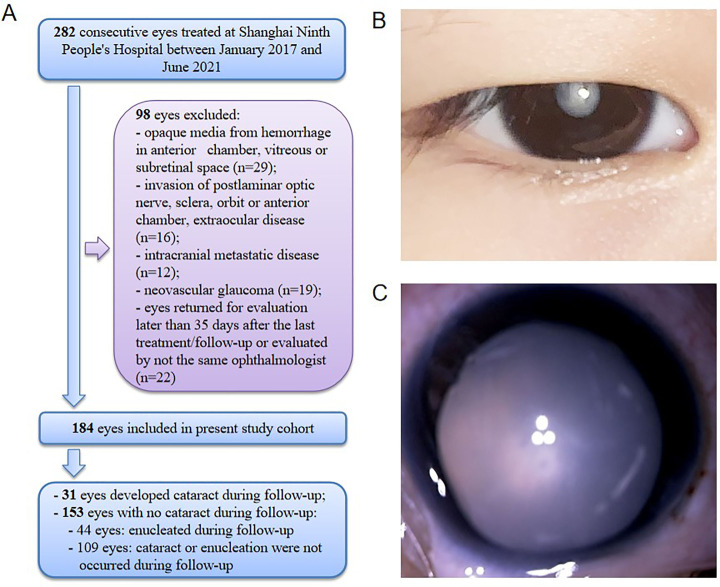
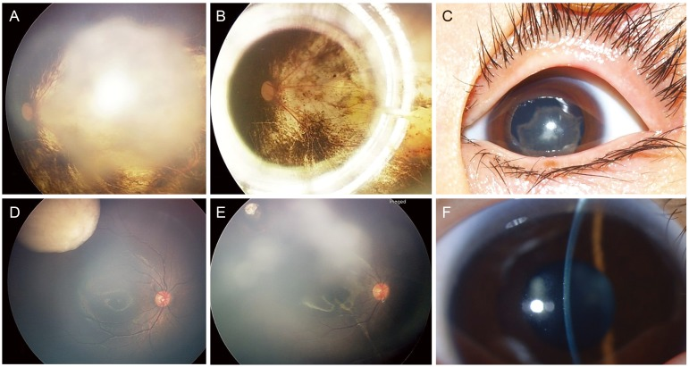
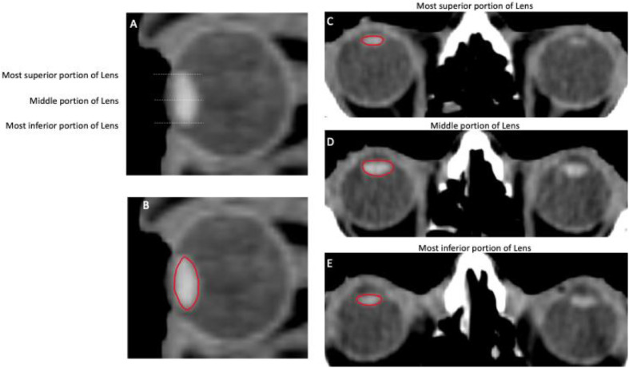
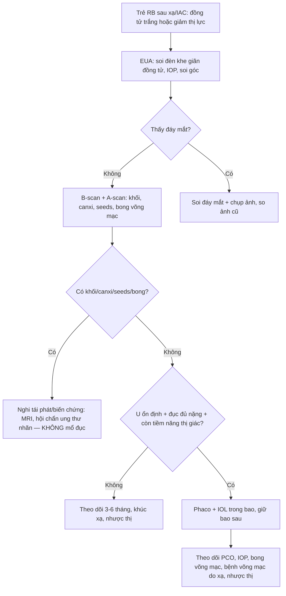
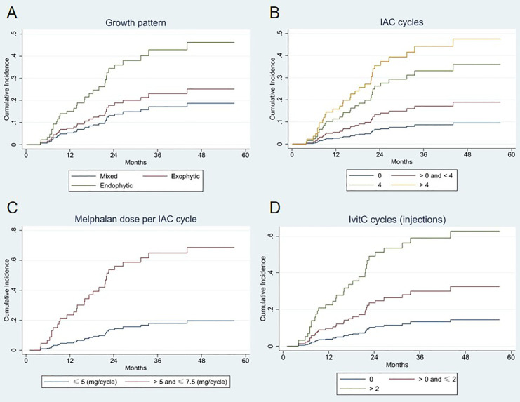

# 1459 — Đục thể thủy tinh do xạ ở trẻ sau retinoblastoma: khi nào mổ, chọn IOL và cái bẫy "đục che tái phát" / Radiation-induced cataract after retinoblastoma

**Tags:** `pattern:duc-the-thuy-tinh` `pattern:duc-duoi-bao-sau` `vung:the-thuy-tinh` `vung:mat` `vung:tien-phong` `protocol:slit-lamp` `protocol:B-scan` `protocol:sinh-hieu-giac-mac` `score:LOCS-III` `score:PENTEC` `incidentaloma:khong`

**Mức chắc chắn (certainty):** tổng hợp y văn (literature synthesis) — ghép **đoàn hệ 184 mắt RB điều trị bảo tồn** (Jia et al. 2024, **PMC10958276**, CC BY-NC), **2 loạt phẫu thuật đục TTT sau RB** (Kim et al. 2017 **PMC5327175**, CC BY-NC 3.0; Bayraktar et al. 2018 **PMC6032962**, CC BY), **loạt 28 mắt RB xạ ngoài 45 Gy** (Yousef et al. 2020, **PMC7852425**, CC BY-NC-SA 4.0), **tổng quan tạo đục TTT do xạ + hướng dẫn contour thể thủy tinh** (Grosinger et al. 2026, **PMC13315199**, CC BY 4.0) và **tổng quan độc tính mắt của xạ** (Arturi et al. 2025, **PMC12384690**). Nhóm **không có bệnh nhân của mình**; các loạt phẫu thuật **rất nhỏ (5–6 mắt)** nên kết luận về an toàn ung thư phải thận trọng.

> **Câu chốt:** thể thủy tinh là **cấu trúc không mạch, không sửa chữa** — tế bào biểu mô ở **vùng sinh sản xích đạo** bị xạ tổn thương DNA, **di chuyển sai và biệt hóa lệch** thành sợi trục bất thường, kết đạm và **đục dưới bao sau (PSC)**. Ngưỡng **0,5 Gy** (ICRP); **PENTEC: 50% đục khi liều trung bình thể thủy tinh 9 Gy**; tiềm tàng **2–5 năm** ở liều cao, **5–10 năm** ở liều thấp. Ở trẻ RB, đục TTT **không chỉ do xạ**: **melphalan truyền động mạch (IAC) và tiêm nội nhãn** cũng gây đục **theo liều** (16,8% trong 184 mắt). Cái bẫy chết người: **đục dày che mất tái phát/u gieo** — **B-scan trước mọi ca mổ**; và **không mổ khi u còn hoạt động**.

## 1. Tổng quan bệnh học – cơ chế hình ảnh (TẠI SAO)

### 1.1 Vì sao thể thủy tinh "nhớ" liều xạ suốt đời
- Thể thủy tinh: **vỏ collagen**, **biểu mô dưới bao**, **sợi trục** xếp lớp; **không có mạch máu, không có thần kinh** → **không viêm, không tái sinh, không thải chất chết**. Kích thước người lớn **~10 mm đường kính xích đạo × 4–5 mm trước–sau**.
- Tế bào biểu mô ở **vùng sinh sản (germinative zone) xích đạo** phân chia suốt đời. Xạ gây **đứt DNA** ở nhóm này → **rối loạn nguyên phân, di chuyển sai ra sau**, biệt hóa thành **sợi trục bất thường + kết đạm (protein aggregate)** → tăng tán xạ ánh sáng → **đục**.
- **Vì sao PSC là kiểu điển hình:** tế bào biểu mô tổn thương **trôi ra sau dọc vỏ bao** và tích tụ ở **cực sau** — nơi có ít sợi trục lành che chắn — nên **đục hạt/vacuole dưới bao sau xuất hiện trước**, rồi lan ra vỏ và nhân. **Không có mạch** nên tổn thương **tích lũy**, không hồi phục và **tiến triển dù đã ngừng xạ**.
- Hệ quả hình ảnh: **PSC chỉ thấy khi soi đèn khe / soi đáy mắt có giãn đồng tử**; trên **CT/MRI** thể thủy tinh chỉ là cấu trúc **tăng đậm/tăng tín hiệu**, **không phân biệt được đục** — nên **chẩn đoán là lâm sàng**, hình ảnh chỉ để **lập kế hoạch xạ** và **loại tái phát**.

### 1.2 Ngưỡng định lượng (bắt buộc nhớ)

| Tham số | Con số | Nguồn |
|---|---|---|
| Ngưỡng đục thể thủy tinh | **0,5 Gy** (ICRP) — có nghiên cứu cho ngưỡng thấp hơn | PMC13315199 |
| PENTEC — liều trung bình thể thủy tinh | **9 Gy → 50% đục** (bác sĩ nhãn khoa chẩn đoán); tự khai **5% ở 12 Gy**, **50% ở > 40 Gy** | PMC12384690 |
| Trẻ sống sót u cơ vân đầu cổ | liều trung bình **> 6 GyEQD2** → **> 20%** đục (mọi độ) | PMC13330630 |
| RB xạ ngoài **45 Gy** | đục TTT **16/28 = 57%**; biến chứng chung **68%** | PMC7852425 |
| RB điều trị bảo tồn hiện đại (IAC/tiêm nội nhãn) | đục **31/184 = 16,8%** (theo dõi trung bình **27,6 tháng**) | PMC10958276 |
| Trẻ sống sót RB (xạ) — phân tích cũ | **cataract extraction tăng 6 lần** ở liều **5–22 Gy** so với **< 2,5 Gy** | PMC13315199 (dẫn Chodick) |
| Đục thứ phát sau điều trị RB (loạt Hàn Quốc) | **17/208 = 8,2%**; tuổi hình thành trung vị **97 tháng**; RB → đục **79 tháng** (29–140) | PMC5327175 |
| Thời gian tiềm tàng | liều cao **2–5 năm**; liều thấp **5–10 năm hoặc hơn** | PMC13315199 |
| Yếu tố làm nặng | **tổng liều, phân liều, suất liều** (≥ 0,09 Gy/phút nặng hơn < 0,048 Gy/phút), corticoid, đái tháo đường | PMC13315199 |

- **Điểm cần nhớ cho trẻ RB:** trong kỷ nguyên IAC, **nguyên nhân đục TTT hàng đầu đã dịch từ xạ sang melphalan**; phân tích đa biến của 184 mắt cho thấy **IOP cao, liều melphalan mỗi chu kỳ cao và số chu kỳ tiêm nội nhãn nhiều** là yếu tố độc lập. Vì vậy **hỏi đúng phác đồ** (số chu kỳ, mg/kg) quan trọng như hỏi liều Gy.

*Bé gái **36 tháng**, RB mắt phải nhóm E (IOP **30 mmHg**), **5 chu kỳ IAC**, **9 tháng sau** xuất hiện đục TTT. (A) sơ đồ chọn mẫu 282 → 184 mắt. Ảnh nguyên bản: Jia et al. 2024 (PMC10958276), CC BY-NC.*

### 1.3 Vì sao trẻ khác người lớn
- **Thời gian phơi nhiễm dài:** thể thủy tinh trẻ **lớn dần và liên tục sinh sợi** → tổn thương biểu mô **tích lũy nhiều thập kỷ**, nên đục có thể xuất hiện **muộn sau tuổi trưởng thành** (sống sót ung thư nhi).
- **Nhãn cầu nhỏ, khoảng cách ngắn:** liều vào thể thủy tinh **cao hơn** với cùng liều u; xạ áp (plaque) và xạ toàn nhãn dễ cho **liều thể thủy tinh lớn**.
- **Hệ quả chức năng nặng hơn:** đục + **nhược thị** + tổn thương hoàng điểm do u = **mất thị giác hai bậc**, nên **thời điểm mổ** là quyết định chức năng, không chỉ giải phẫu.

## 2. Mẫu hình + chẩn đoán phân biệt theo vị trí (Gamut)

**Mẫu hình khởi điểm:** trẻ **đã điều trị RB**, sau **6 tháng–5 năm** xuất hiện **đồng tử trắng/xám**, **chói, kém theo dõi, lác mới**, **đồng tử còn phản xạ đỏ yếu**; **không đau, không đỏ**.

Chia gamut theo **vị trí "ánh trắng" nằm ở đâu**:

| Vị trí | Thực thể | Điểm phân biệt cốt lõi |
|---|---|---|
| **Trong thể thủy tinh** | **Đục do xạ** · **đục do melphalan IAC/tiêm nội nhãn** · **đục do corticoid** · đục chấn thương | Soi đèn khe: **PSC hạt/vacuole**; **không có khối**, **không có mạch máu**, **không canxi**; đục **đứng yên** khi đổi tư thế |
| **Ngay sau thể thủy tinh** | **Tái phát RB (khối sau thể thủy tinh)** · **u gieo dịch kính (seeds)** · **bong võng mạc tiết dịch** | **B-scan: khối đặc/canxi hóa, seeds lơ lửng, bong dạng vòm**; soi không thấy đáy mắt → **bắt buộc siêu âm** |
| **Toàn nhãn cầu** | **Glôcôm tân mạch** · **teo nhãn (phthisis)** · **bệnh võng mạc do xạ nặng** | **IOP cao + tân mạch mống mắt**; nhãn cầu teo nhỏ; đục là **hệ quả**, không phải bệnh chính |
| **Ngoài nhãn cầu** | U hốc mắt tái phát xâm lấn | Lồi mắt, hạn chế vận nhãn, khối trên MRI — **không giải thích bằng đục TTT** |

- **Mnemonic LENS cho "ánh trắng sau điều trị RB":** **L**ens (đục do xạ/thuốc/corticoid) – **E**ffusion (bong tiết dịch) – **N**eoplasm (tái phát/seeds) – **S**car/sequelae (bệnh võng mạc do xạ, glôcôm, teo nhãn).

## 3. Bảng so sánh phân biệt (ma trận đối chiếu)

| Thực thể | Hình ảnh điển hình | Chốt vào (rule-in) | Chốt loại (rule-out) | Gợi ý xác nhận |
|---|---|---|---|---|
| **Đục thể thủy tinh do xạ** | **PSC hạt + vacuole** ở cực sau, sau đó vỏ/nhân; **không khối**; một bên nếu xạ một bên | **Tiền sử xạ vào thể thủy tinh (liều trung bình > 6–9 Gy) + PSC + tiềm tàng 1–5 năm**; đục **nằm trong vùng chiếu** | Đục **không tương xứng vùng chiếu**, có khối sau thể thủy tinh, hoặc khởi phát **trong vài tuần** → nghĩ nguyên nhân khác | Soi đèn khe có giãn đồng tử; đối chiếu **bản đồ liều**; LOCS III |
| **Đục do melphalan (IAC/tiêm nội nhãn)** | Đục **vỏ sau/PSC**, thường **hai bên nếu tiêm hai mắt**; kèm **độc tính hắc–võng mạc** | **Nhiều chu kỳ IAC + liều melphalan cao + nhiều mũi tiêm nội nhãn**; đục xuất hiện **vài tháng sau chu kỳ** | Chỉ 1 chu kỳ, liều thấp, không có thay đổi hắc–võng mạc → ít nghĩ melphalan | Đếm **số chu kỳ + mg/kg**; B-scan; OCT khi còn thấy đáy mắt |
| **Đục do corticoid** | **PSC** (giống hệt đục do xạ) | **Dùng corticoid toàn thân/tiêm dưới Tenon kéo dài ≥ vài tháng**, hai bên | Ngừng corticoid mà **vẫn tiến triển** + có tiền sử xạ → nghiêng do xạ | Rà **mọi đường corticoid**; thử giảm liều |
| **Tái phát RB sau thể thủy tinh** | **Khối đặc** trước võng mạc/dịch kính, **canxi hóa**, **seeds**; B-scan có echo dày | **Khối mới/lớn lên trên B-scan + canxi + tăng tưới máu**, đục **không giải thích được** | Đục **đồng nhất, không khối**, B-scan **sạch** → không phải tái phát | **B-scan bắt buộc**; MRI/CT hốc mắt; so ảnh đáy mắt cũ |
| **Bong võng mạc tiết dịch (exudative)** | B-scan **bong dạng vòm, dịch di chuyển**, không canxi; đáy mắt mờ | **Bong + dịch dưới võng mạc + u/điều trị gần đây** | B-scan **không bong**, không dịch → loại | B-scan động; OCT/FA nếu thấy đáy mắt |
| **Xuất huyết dịch kính tổ chức hóa** | **Không phản xạ đỏ**, B-scan **echo mịn lơ lửng**, không khối | **Khởi phát sau chấn thương/phẫu thuật**, tiêu dần theo tuần | **Echo dày + canxi + lớn dần** → nghi u, không phải máu | B-scan lặp 2–4 tuần |

- **Dấu hiệu soi đèn khe đáng tin nhất:** PSC **hạt mịn, óng ánh, kèm vacuole**, **bờ không đều**, **không có mạch máu** — khác màng xơ sau thể thủy tinh (màng **có bờ rõ**, thường sau mổ/viêm).

*Cùng một mắt RB sau điều trị: (C) **đục toàn bộ** trước mổ — không thấy đáy mắt; (F) mắt khác có **đục dưới bao sau** dạng phiến với chùm sáng đèn khe. Ảnh nguyên bản: Kim et al. 2017 (PMC5327175), CC BY-NC 3.0.*

## 4. Protocol chụp/khám + hệ phân độ + thời điểm mổ

### 4.1 Khám — không có hình ảnh nào thay được đèn khe
- **Soi đèn khe có giãn đồng tử** (trẻ nhỏ: **khám dưới mê – EUA**), phân độ **LOCS III** (NO/NC/C/P), đo **IOP**, **soi góc** khi nghi glôcôm, **siêu âm B** khi không thấy đáy mắt.
- **B-scan 10 MHz — bắt buộc trước mổ:** kích thước **khối/canxi hóa**, **seeds dịch kính**, **bong võng mạc**, **độ dày hắc mạc**; **A-scan đo trục nhãn cầu** để tính công suất IOL.
- **MRI/CT hốc mắt** chỉ khi nghi tái phát/xâm lấn; **CT** nhạy với **canxi hóa** (RB), **MRI** đánh giá xâm lấn dây thị/hốc mắt và **không dùng iod** ở trẻ khi không cần.
- **Xạ trị — contour thể thủy tinh như OAR riêng:** CT lập kế hoạch lát **2 mm** (thể thủy tinh hiện trên **3–6 lát**), vẽ **toàn bộ thể thủy tinh** (xích đạo → cực trước/sau), cân nhắc **PRV +2 mm** vì thể thủy tinh **di động tới 2 mm** khi mắt nhìn thẳng; báo cáo **Dmax và Dmean** của thể thủy tinh.

*Thể thủy tinh **tăng đậm hơn dịch kính** trên CT, đường viền đỏ = contour; thể thủy tinh chỉ hiện trên **3–6 lát** tùy độ dày lát, nên **lát 2 mm** giúp vẽ đủ cực trên–dưới. Ảnh nguyên bản: Grosinger et al. 2026 (PMC13315199), CC BY 4.0.*

### 4.2 Ngưỡng liều & thời điểm mổ
- **Mục tiêu lập kế hoạch:** **Dmean thể thủy tinh < 6 GyEQD2** (dưới ngưỡng > 20% ở trẻ u cơ vân) và **càng xa 9 Gy càng tốt**; khi khối sát nhãn cầu → **proton**, **che chì**, hoặc **góc chùm** để né.
- **Chỉ mổ khi:** (1) u **đã thoái triển/ổn định**, không seeds hoạt động; (2) **B-scan sạch**; (3) đục **đủ nặng để giải thích mất thị lực**; (4) **còn tiềm năng thị giác** (hoàng điểm chưa bị u xâm lấn). Trong các loạt đã công bố, mổ được thực hiện **67,2 tháng** sau lần điều trị cuối (Bayraktar) và **79 tháng** sau chẩn đoán (Kim) — tức **rất thận trọng**, không mổ sớm.
- **Kỹ thuật:** **phaco/nhũ hóa hút** qua đường giác mạc trong suốt (trẻ nhỏ: **mở bao trước thủ công**), **đặt IOL acrylic gập trong bao**, **giữ nguyên bao sau**; cân nhắc **cắt dịch kính trước** nếu có dính; **nhắm khúc xạ đích theo tuổi** (để lại viễn thị nhẹ — không có con số chuẩn từ y văn RB).
- **Sau mổ:** **PCO gần như 100%** (trung bình **10,8 tháng**) → **Nd:YAG** khi cần (4/6 mắt, trung bình **70,7 tháng**); theo dõi **viêm màng bồ đào trước phòng (2/6 mắt)**, **IOP**, **bong võng mạc**, và **bệnh võng mạc do xạ** (phát hiện **sau khi hết đục**); **nhược thị** cần tập/che mắt.

### 4.3 Kết quả phẫu thuật — trung thực với cỡ mẫu nhỏ
- **Bayraktar 2018:** **6 mắt / 6 trẻ**, phaco + IOL; **không biến chứng trong mổ**; **viêm màng bồ đào 2/6**; **PCO 100%**; **YAG 4/6**; **không tăng IOP, không bong võng mạc, không tái phát** trong **105,8 tháng** theo dõi; thị lực **tăng ở mọi mắt nhưng bị giới hạn** vì **5/6 mắt có u hoàng điểm**.
- **Kim 2017:** **5 mắt / 5 trẻ**; **không biến chứng**; thị lực **tăng ở cả 5 mắt**; **không tái phát/di căn** trong **36 tháng**.
- **Cộng lại chỉ 11 mắt** → **không thể kết luận "mổ đục TTT sau RB an toàn tuyệt đối"**; điều có thể nói: **ở u đã thoái triển, không thấy tái phát trong các loạt nhỏ này**, và **lợi ích thị lực phụ thuộc hoàng điểm**.

## 5. Biến thể bình thường và cạm bẫy

- **PSC không đặc hiệu:** corticoid, đái tháo đường, viêm màng bồ đào, chấn thương đều gây PSC — **không được quy cho xạ chỉ vì có PSC**; phải có **tiền sử liều + vị trí tương ứng**.
- **Đục "che" tái phát:** đồng tử trắng ở trẻ RB **luôn** phải loại khối sau thể thủy tinh bằng **B-scan** trước khi hẹn mổ — bỏ qua = mổ vào mắt còn u hoạt động.
- **Đục nhẹ + thị lực kém không tương xứng:** tìm **bệnh võng mạc do xạ, phù hoàng điểm, teo thị do xạ (bài 1458), glôcôm** — mổ đục sẽ **không cải thiện**.
- **"Đục tái phát" sau mổ:** thực chất là **PCO** (màng sau IOL) hoặc **xơ co bao trước**, không phải đục thể thủy tinh mới — **YAG** chứ không mổ lại.
- **Bẫy ở trẻ nhỏ:** **IOL tính theo trục nhãn cầu đang lớn** → chọn công suất **khác người lớn**; **nhược thị** sau mổ là yếu tố quyết định thị lực cuối, **không phải độ trong của trục quang**.
- **Bẫy thời gian:** "đục xuất hiện 9 tháng sau 5 chu kỳ IAC" (ca trong ảnh) **không phải đục do xạ** — **đừng gán xạ** khi phác đồ chính là melphalan; hỏi **số chu kỳ và mg/kg**.
- **Bẫy hình ảnh:** **CT/MRI không chẩn đoán được đục thể thủy tinh**; đừng báo "thể thủy tinh bình thường" trên MRI để loại đục — **phải soi đèn khe**.

## 6. Tự lượng giá — Blind Quiz

**Ca 1 — Bé gái 3 tuổi, RB nhóm E mắt phải, IOP 30 mmHg, 5 chu kỳ IAC. 9 tháng sau: đồng tử trắng, không đau.**

- Câu hỏi: Chẩn đoán? Nguyên nhân **do xạ hay do thuốc**? Việc **bắt buộc** phải làm trước khi mổ?

<b>Bấm để hiện đáp án (findings + chẩn đoán)</b>

- **Dấu hiệu:** đục **toàn bộ** thể thủy tinh (không thấy đáy mắt), nhãn cầu **không viêm**, IOP **30 mmHg** lúc chẩn đoán.
- **Chẩn đoán:** **đục thể thủy tinh sau điều trị RB** — ở ca này **do melphalan IAC** (5 chu kỳ, xuất hiện **9 tháng** sau), **không phải** đục do xạ.
- **Bắt buộc trước mổ:** **B-scan** loại khối/canxi/seeds/bong võng mạc; đo IOP/soi góc (IOP 30 mmHg → loại glôcôm); **A-scan** để tính IOL.
- Nguồn ảnh: Jia et al. 2024 (PMC10958276), CC BY-NC.

**Ca 2 — Bé trai 9 tuổi, RB đã xạ 45 Gy 6 năm trước, nay mờ dần mắt trái. Đèn khe: phiến đục dưới bao sau.**

- Câu hỏi: Vì sao đục **dưới bao sau** lại là kiểu của xạ? Nêu 3 nguyên nhân khác gây PSC. Khi nào mổ?

<b>Bấm để hiện đáp án (findings + chẩn đoán)</b>

- **Cơ chế:** tế bào biểu mô vùng sinh sản bị xạ **di chuyển ra sau** và tạo sợi trục bất thường + kết đạm ở **cực sau** → **PSC**; thể thủy tinh không mạch nên **không sửa chữa**.
- **3 nguyên nhân khác:** **corticoid**, **đái tháo đường**, **viêm màng bồ đào** (thêm: chấn thương, tia hồng ngoại).
- **Khi mổ:** u **ổn định**, **B-scan sạch**, đục **đủ nặng**, **còn tiềm năng thị giác**; trong các loạt, mổ **67–96 tháng** sau điều trị/chẩn đoán.
- Nguồn ảnh: Kim et al. 2017 (PMC5327175), CC BY-NC 3.0.

**Ca 3 — Hội chẩn: "Bé RB sẽ xạ, làm sao để không bị đục?"**

- Câu hỏi: Đường cong nào dốc nhất? Với xạ, ngưỡng liều thể thủy tinh cần nhớ là bao nhiêu? Trả lời gia đình thế nào?

<b>Bấm để hiện đáp án (findings + chẩn đoán)</b>

- **Đọc hình:** nguy cơ tích lũy **tăng rõ theo số chu kỳ IAC (> 4)** và **liều melphalan mỗi chu kỳ (> 5–7,5 mg/kg)**, và theo **số mũi tiêm nội nhãn (> 2)** — thuốc **quan trọng ngang xạ** trong kỷ nguyên bảo tồn.
- **Ngưỡng xạ:** **0,5 Gy** là ngưỡng phát hiện đục (ICRP); **9 Gy trung bình → 50%** (PENTEC); trẻ u cơ vân **> 6 GyEQD2 → > 20%**.
- **Trả lời:** giữ **Dmean thể thủy tinh < 6 GyEQD2**, ưu tiên proton/che chì; hẹn **khám đèn khe mỗi 6–12 tháng**; nếu đục xuất hiện, **đa số mổ được và thị lực tăng**, nhưng **giới hạn bởi tổn thương hoàng điểm** — cần nói rõ **kỳ vọng**.
- Nguồn ảnh: Jia et al. 2024 (PMC10958276), CC BY-NC.

## Bài liên quan chéo
- [400 – Tổng quan Mắt & thị giác](../400-tong-quan-mat-thi-giac/lesson.md)
- [1458 – Bệnh thần kinh thị do xạ ở trẻ (RION)](../1458-benh-than-kinh-thi-do-xa-o-tre/lesson.md)
- [1450 – Glôcôm sau xạ trị ở trẻ](../1450-glaucom-sau-xa-tri-o-tre/lesson.md)
- [1419 – Bệnh võng mạc do xạ ở trẻ sau xạ trị u não/retinoblastoma](../1419-vong-mac-xa-tre-sau-xa-tri/lesson.md)
- [412 – U trong nhãn cầu](../412-u-trong-nhan-cau/lesson.md) (RB — tái phát sau thể thủy tinh)
- [1935 – Đục thể thủy tinh sau MIGS](../1935-duc-the-thuy-tinh-sau-migs/lesson.md) (PSC thật vs không bào — cùng nguyên tắc đọc đèn khe)

## Ảnh
- `images/1459_duc-thuy-tinh_Slitlamp_PMC10958276-Fig1.jpg` — ảnh đoạn trước + sơ đồ chọn mẫu, **CC BY-NC**, nguyên bản (không crop/ghép).
- `images/1459_duc-thuy-tinh_Chart_PMC10958276-Fig2.jpg` — nguy cơ tích lũy (competing risk), **CC BY-NC**, nguyên bản.
- `images/1459_hau-phau_AnteriorSegment_PMC5327175-Fig2.jpg` — đáy mắt + đoạn trước trước/sau mổ, **CC BY-NC 3.0**, nguyên bản.
- `images/1459_lens-CT_PMC13315199-Fig5.jpg` — contour thể thủy tinh trên CT, **CC BY 4.0**, nguyên bản.
- Chi tiết nguồn + giấy phép: `images/CREDITS.md`; link bài gốc: `sources.md`.

> Không dùng để chẩn đoán độc lập khi chưa có người hướng dẫn.
