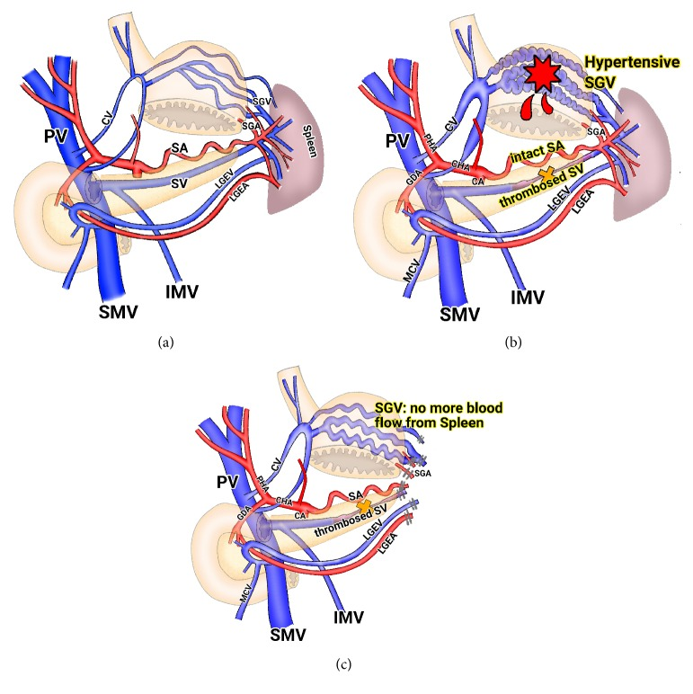
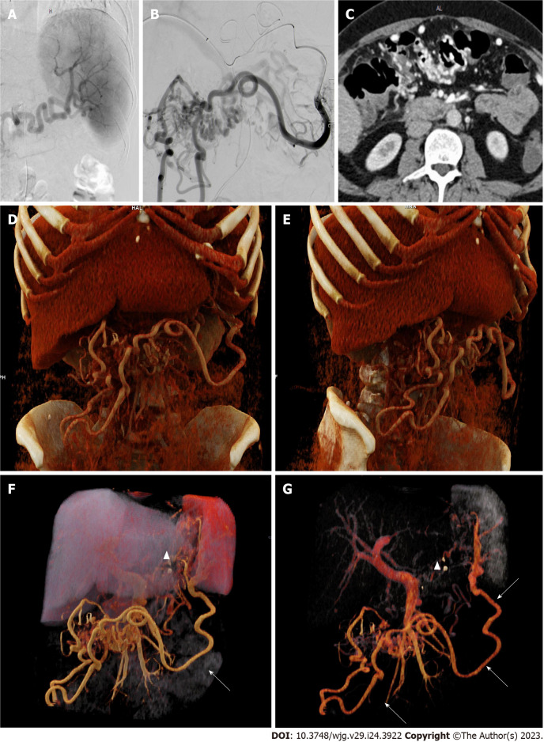
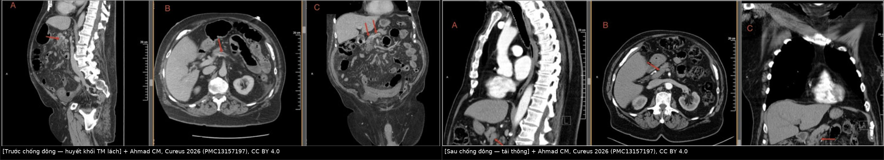
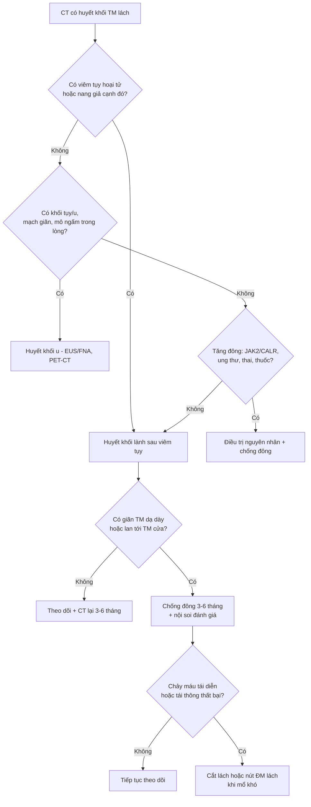
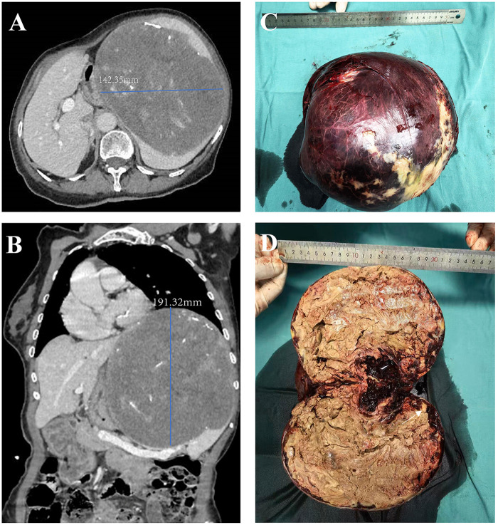
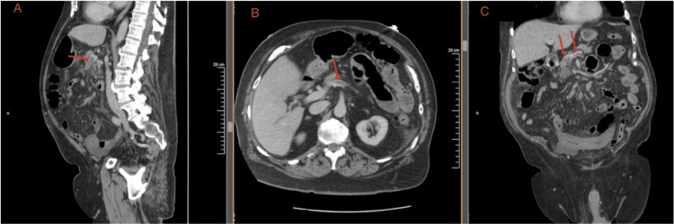
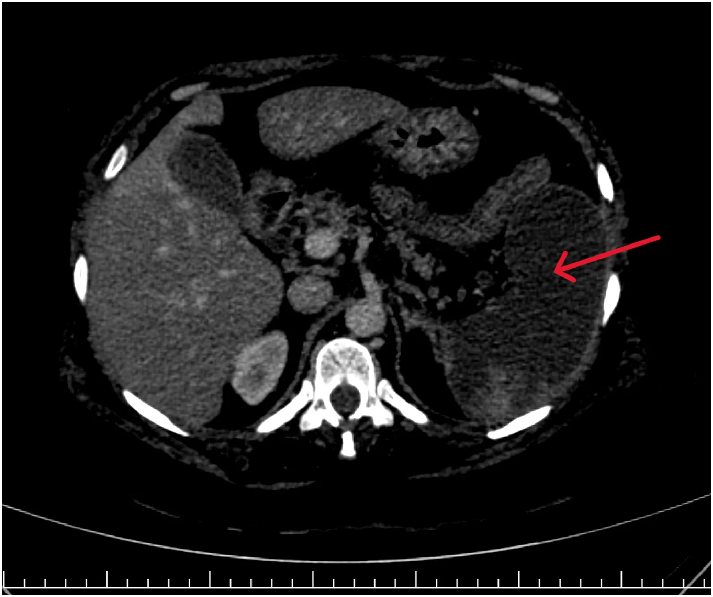
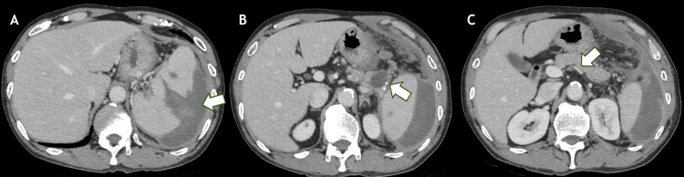

# 146 — Huyết khối tĩnh mạch lách & nhồi máu lách: tăng áp cửa bên trái, "giả u" và khi nào cắt lách / Splenic vein thrombosis & splenic infarction: sinistral portal hypertension, pseudotumour and when to splenectomise

**Tags:** `pattern:huyet-khoi-mach` `pattern:nhoi-mau-tang` `vung:lach` `vung:tuy` `protocol:CT-bung-da-thi`
**Mức chắc chắn (certainty):** tổng hợp y văn (literature synthesis) — tự biên từ y văn mở (World J Clin Cases 2022 PMC9372863; Langenbecks Arch Surg 2024 PMC11003905; Thromb J 2026 PMC13613679; Front Med 2026 PMC13590307; Radiol Case Rep 2026 PMC13672812; báo cáo ca Cureus/Front Cardiovasc Med 2026), số liệu lấy nguyên từ bài gốc.

> **Câu hỏi gốc của bài:** bệnh nhân **đau thượng vị/lách trái** trên nền **viêm tụy** hoặc **không rõ nguyên nhân**, CT thấy **khuyết thuốc trong tĩnh mạch lách** — đó là **huyết khối lành sau viêm tụy**, **huyết khối u** do ung thư tụy xâm lấn, **huyết khối mủ**, hay chỉ là **hiện tượng pha trộn dòng chảy**? Và khi **lách đã nhồi máu** (giảm đậm độ hình nêm) thì **cắt lách, nút mạch hay chỉ theo dõi**?
> **Điểm tựa giải phẫu:** tĩnh mạch lách (splenic vein) chạy **sau cổ–thân tụy**, không có van, đổ vào **tĩnh mạch mạc treo trên (SMV)** để tạo **tĩnh mạch cửa**. Vì nằm sát tụy, mọi **viêm/hoại tử/nang giả/khối u tụy** đều chèn hoặc xâm lấn trực tiếp tĩnh mạch này → huyết khối. Vì lách là **tạng có tuần hoàn tận (end-artery)** — chỉ một nguồn ĐM lách, gần như không có tuần hoàn bàng hệ trong nhu mô — nên **tắc mạch = nhồi máu hình nêm**, không có "vùng cứu" như gan.

## 1. Tổng quan bệnh học – cơ chế hình ảnh

**A. Huyết khối tĩnh mạch lách (splenic vein thrombosis – SVT): "bệnh của hàng xóm tụy"**
- **Cơ chế (tam giác Virchow tại chỗ):** (1) **tổn thương nội mô** do enzym tụy và viêm lan; (2) **ứ trệ** do tụy to/nang giả/hoại tử chèn ép; (3) **tăng đông tại chỗ** do cytokine và yếu tố mô từ tụy hoại tử (PMC9372863).
- **TẠI SAO hình ảnh là "khuyết thuốc":** huyết khối là **khối mô không có lòng mạch** → **không ngấm thuốc** ở thì tĩnh mạch cửa (60–70 giây), nằm trong lòng mạch **vẫn ngấm thuốc ở thành**. Huyết khối **cấp** có thể **tăng đậm độ nhẹ trên phim không cản quang** (hemoglobin cô đặc) — vì vậy **thu hẹp cửa sổ (narrow window)** giúp nhận diện trên CT không cản quang, nhưng **không có ngưỡng HU nào đủ tin** để chốt (PMC12078030).
- **Tần suất – ngưỡng định lượng:** SVT gặp ở **~50% viêm tụy hoại tử**, chỉ **1–17%** khi không có hoại tử (PMC9372863); ở viêm tụy mạn, **19,8% (37/187)** có SVT (PMC6482754).
- **Hậu quả 1 — tăng áp cửa bên trái (sinistral/left-sided portal hypertension):** máu lách không ra được theo TM lách → đi **tĩnh mạch vị ngắn (short gastric veins)** và **vị mạc nối trái** → **giãn tĩnh mạch dạ dày đáy vị**. Vì **tĩnh mạch vành vị (left gastric vein)** vẫn đổ về cửa, **giãn TM thực quản thường KHÔNG có**; chức năng gan bình thường, không báng. Đây là lý do "**giãn TM dạ dày đơn độc + lách to + gan lành**" phải đi tìm SVT.
- **Hậu quả 2 — chảy máu:** trong nhóm SVT do viêm tụy mạn, **18,9%** có chảy máu tiêu hóa có ý nghĩa lâm sàng; nguồn **giãn TM dạ dày 8,1%** (PMC6482754). Trong nhóm **SVT đơn độc** hiện đại (98 ca), chảy máu do giãn TM chỉ **3% (3/98)** — thấp hơn nhiều so với nỗi lo truyền thống (PMC11003905).
- **Hậu quả 3 — lan tới tĩnh mạch cửa/mạc treo:** huyết khối lan ngược dòng → huyết khối cửa (khi đó là bệnh cảnh khác, xem bài 163/124); tiến triển này **không giảm** khi dùng chống đông trong nghiên cứu 98 ca (p = 0,1495, OR 3,39; KTC 0,895–12,87) (PMC11003905).

*(a) Bình thường: máu lách → TM lách → TM cửa. (b) TM lách tắc: máu đi qua **tĩnh mạch vị ngắn (SGV)** → giãn TM dạ dày. (c) Sau khi cắt lách: SGV không còn nhận máu lách. Nguồn: Kim HJ, Case Rep Med 2016 (PMC5116513) Fig. 5, CC BY 4.0.*

**B. Nhồi máu lách (splenic infarction): "ổ giảm đậm độ hình nêm"**
- **Cơ chế:** tắc **ĐM lách hoặc nhánh** (thuyên tắc tim–ĐM chủ, bệnh tăng sinh tủy, xơ vữa, viêm mạch) hoặc tắc **tĩnh mạch lách** gây ứ huyết → thiếu máu nhu mô. Vì mạch tận, vùng thiếu máu **không ngấm thuốc** và có **đáy quay ra vỏ lách** (hình nêm — wedge), đỉnh quay về rốn lách.
- **TẠI SAO giảm đậm độ:** mô hoại tử **mất tưới máu** → không có iod cản quang; ở giai đoạn muộn, mô xơ/hoại tử hóa lỏng → đậm độ càng thấp. Ca nhồi máu gần toàn bộ có **ROI ~13 HU** trong vùng hóa lỏng, phù hợp hoại tử dịch hóa (PMC13672812).
- **Số liệu chuẩn (67 ca, 2014–2023):** tuổi trung bình **50,9 ± 16,3**, nam **64,2%**; **đau bụng 100%**, **sốt 40,3%**, **lách to 80,6%**; **CT có cản quang chẩn đoán 100%**, trong khi **siêu âm chỉ 29,9%** (PMC13613679). Căn nguyên: **huyết học 31,3%** (AML/CML/myelofibrosis/PV/MDS/PNH/SCD), **tim mạch 11,9%** (rung nhĩ, suy tim, hẹp ĐMC), bệnh hệ thống khác 32,8%, **không rõ 23,9%**; **JAK2 dương 4/16 ca được xét nghiệm** (PMC13613679).
- **Điều trị – kết cục:** **89,6% chỉ điều trị nội khoa**, **10,4% phải cắt lách** (vỡ lách, nhồi máu xuất huyết, áp-xe hóa lách), tử vong trong viện **6,0%** — đều ở bệnh nền nặng (ung thư/nhiễm khuẩn huyết) (PMC13613679).
- **Nhồi máu lách "do thầy thuốc":** sau tiêm keo nội soi cầm máu giãn TM dạ dày, **8,7% (16/183)** có nhồi máu lách trên CT, **93,8%** xử trí bảo tồn (PMC13590307). Đây là nguyên nhân **hay bị bỏ qua khi đọc CT kiểm tra sau thủ thuật**.

## 2. Mẫu hình + chẩn đoán phân biệt theo vị trí (gamut)

**Mẫu hình 1 — "khuyết thuốc trong lòng tĩnh mạch lách" (filling defect):**
- **Huyết khối lành sau viêm tụy** (thường gặp nhất; tụy hoại tử/nang giả kèm theo).
- **Huyết khối mủ (septic thrombophlebitis)** — sốt, cấy dương, ổ nhiễm lân cận.
- **Huyết khối u (tumour thrombus)** — ung thư tụy thân/đuôi xâm lấn, u thần kinh nội tiết tụy, RCC di căn; mạch **giãn to** và trong lòng có **mô ngấm thuốc**.
- **Chèn ép/ly giải sau mổ** — huyết khối "mõm cụt" sau **cắt tụy đuôi + cắt lách** là **bình thường**, không phải bệnh lý.
- **Huyết khối do tăng đông** — MPN (JAK2/CALR), ung thư, thai kỳ, thuốc tránh thai; thường kèm huyết khối ở chỗ khác.
- **Giả khuyết thuốc do pha trộn dòng chảy** tại chỗ đổ TM lách–SMV (flow mixing artifact).

**Mẫu hình 2 — "ổ giảm đậm độ hình nêm trong lách":**
- **Nhồi máu lách** (thuyên tắc tim/ĐM chủ, MPN, SCD, viêm mạch, sau nút mạch, sau tiêm keo).
- **Rách lách (laceration)** — có chấn thương, đường rách **không theo phân thùy**, kèm **máu tụ dưới bao/quanh lách**.
- **Áp-xe lách** — ổ dịch **có khí**, thành ngấm thuốc, sốt cao; hiếm khi khí trong nhồi máu vô khuẩn.
- **U/lách phụ, nang lách, lympho** — không theo hình nêm, bờ tròn.
- **Bất thường tưới máu thì sớm (mottled/tiger-stripe)** — biến thể bình thường, **mất ở thì tĩnh mạch cửa**.

**Mẫu hình 3 — "giãn TM dạ dày + lách to + gan lành":**
- **SVT** (nguyên nhân hàng đầu của tăng áp cửa bên trái).
- **Tăng áp cửa không xơ gan khác** (PSVD, sán máng, Caroli — bài 149/166).
- **Huyết khối cửa/mạc treo** (bài 163) — khi đó giãn TM thực quản cũng có.
- **U/giãn mạch dạ dày**, **giãn tĩnh mạch do tắc TM lách sau mổ**.

**Mnemonic cho "khuyết thuốc mạch lách" — SPLEEN:** **S**epticaemia/viêm tụy, **P**ancreatic tumour (u tụy), **L**igation/post-op (mõm cụt), **E**ndothelial/thrombophilia (MPN, thai), **E**xtrinsic compression (nang giả, khối), **N**o-flow artifact (pha trộn dòng).

*(A–C) Chụp mạch và CT; (D–G) dựng 3D cho thấy mạng bàng hệ lớn quanh dạ dày/lách khi tĩnh mạch lách tắc — tương ứng "tăng áp cửa bên trái" trên hình ảnh. Nguồn: Füssel LM, World J Gastroenterol 2023 (PMC10324528) Fig. 2, CC BY-NC 4.0 (giữ nguyên bản).*

## 3. Bảng so sánh phân biệt (ma trận đối chiếu)

| Thực thể (entity) | Hình ảnh điển hình (US/CT/MRI theo thì) | Chốt vào (rule-in) | Chốt loại (rule-out) | Gợi ý xác nhận |
|---|---|---|---|---|
| **SVT lành sau viêm tụy** | Khuyết thuốc trong TM lách, mạch **không giãn**, tụy hoại tử/nang giả cạnh đó; bàng hệ vị ngắn | **Bối cảnh viêm tụy + khuyết thuốc + tụy bệnh lý liền kề**; tái thông sau chống đông **46%** | Mạch **giãn > 2 lần** + mô ngấm trong lòng → nghĩ huyết khối u | CT 3 thì + coronal dọc TM lách; Doppler; theo dõi 3–6 tháng |
| **Huyết khối u (PDAC thân/đuôi)** | TM lách **giãn**, lòng có **mô ngấm thuốc**, khối tụy xâm lấn, hạch, teo tụy xa | **Mô trong lòng ngấm thuốc + khối tụy + hạch** | Khuyết thuốc **không ngấm**, mạch không giãn → lành | EUS–FNA, CA 19-9, PET/CT |
| **Huyết khối cửa–mạc treo (MVT)** | Khuyết thuốc **SMV/TM cửa**, phù mạc treo "lược", dày thành ruột | **Đau bụng + phù mạc treo + khuyết thuốc SMV** | Chỉ TM lách, tụy bình thường → SVT đơn độc | CTA; xem bài 163 |
| **Nhồi máu lách do thuyên tắc** | **Nêm giảm đậm độ, đáy ở vỏ**, không ngấm, có thể nhiều ổ; lách không to nhiều | **Nêm + đáy vỏ + bệnh nguồn thuyên tắc (rung nhĩ, van tim)** | Bờ tròn, có khí, thành ngấm → áp-xe/u | CECT thì TM cửa; siêu âm tim; **US chỉ 29,9%** |
| **Nhồi máu lách do MPN** | Lách **rất to**, nhồi máu nhiều ổ/tái phát, có ổ nhồi máu cũ | **Lách to + huyết khối tạng + JAK2/CALR** | Lách bình thường, một ổ đơn độc → nghĩ nguồn tim | CT 3 thì, JAK2 V617F, tủy đồ |
| **Rách lách** | Đường giảm đậm độ **không theo phân thùy**, máu tụ dưới bao/quanh lách, chấn thương | **Máu tụ quanh lách + đường rách + tiền sử chấn thương** | Không máu tụ, bờ nêm đều → nhồi máu | CECT; xem bài 140 (AAST) |
| **Nhồi máu lách mạn "giả u"** | Khối **giảm đậm độ lớn**, co kéo vỏ, vôi hóa, **không ngấm**, không to thêm | **Không ngấm + kích thước ổn định + bệnh tim nguồn** | Ngấm thuốc + to lên → u thật | So phim cũ nhiều năm; **tránh sinh thiết** |
| **Áp-xe lách** | Ổ dịch **có khí**, thành dày ngấm, nhiều ổ nhỏ; sốt cao, đau | **Khí trong ổ + thành ngấm + sốt** | Không khí, bờ nêm, không thành → nhồi máu | Siêu âm, cấy máu, dẫn lưu |
| **Vỡ lách tự phát sau SVT** | Máu tụ quanh lách + dịch ổ bụng, lách vỡ, SVT | **SVT + máu tụ + Hb tụt không chấn thương** | Máu tụ sau chấn thương → rách lách | CTA; cắt lách cấp cứu |

*Trái: khuyết thuốc trong tĩnh mạch (mũi tên đỏ) trước điều trị. Phải: kiểm tra sau chống đông — huyết khối tiêu biến/tái thông. Nguồn: Ahmad CM, Cureus 2026 (PMC13157197), CC BY 4.0. Ảnh ghép letterbox, giữ nguyên tỷ lệ.*

### Hai dấu hiệu quyết định "thái độ" (đọc chuẩn xác)
- **Sign 1 — mạch có giãn hay không:** huyết khối **lành** thường nằm trong mạch **kích thước bình thường**; **huyết khối u** làm mạch **giãn** vì mô u phát triển trong lòng. Đo đường kính TM lách trên coronal, so với tĩnh mạch cửa.
- **Sign 2 — có "mô trong lòng" ngấm thuốc không:** huyết khối lành **không ngấm** ở mọi thì; huyết khối u **ngấm** (thì ĐM hoặc thì cửa) và có thể thấy **nhánh mạch nuôi** vào trong khối.
- **Bẫy "tái thông một phần":** sau chống đông, lòng mạch có thể **ngấm không đều** do dòng chảy quanh huyết khối còn lại — đừng gọi là huyết khối u. So sánh với phim trước và dùng **coronal reformat**.

## 4. Protocol chụp + phân độ & thuật toán xử trí

**Protocol (bắt buộc đủ thì):**
- **CT bụng–chậu 3 thì:** không cản quang → **ĐM 35–40 giây** → **tĩnh mạch cửa 65–70 giây**; lát **≤ 1–2,5 mm**, tái tạo **coronal/oblique dọc trục tĩnh mạch lách–cửa** (curved planar). Vì huyết khối cấp có thể **tăng đậm độ** trên phim không cản quang, cần **cửa sổ hẹp** để không bỏ sót (PMC12078030).
- **Siêu âm Doppler:** rẻ, không xạ, nhưng **độ nhạy thấp với TM lách** do vị trí sau tụy (độ nhạy ~83% với TM cửa) — **không dùng để loại trừ** (PMC9372863).
- **MRI:** khi cần phân biệt huyết khối u và huyết khối lành (T1/T2, DWI, gadolinium động học); **MRCP** nếu nghi tổn thương đường mật kèm.
- **Nếu có giãn TM dạ dày:** nội soi để phân độ và đánh giá nguy cơ chảy máu; **không nội soi cầm máu đơn thuần rồi bỏ theo dõi**.
- **Theo dõi:** CT tĩnh mạch cửa lặp lại **3–6 tháng** sau chẩn đoán (đánh giá tái thông và bàng hệ) — mốc dùng trong nghiên cứu 98 ca (thời gian chống đông trung bình **~5 tháng**) (PMC11003905).

**Phân độ thực hành (không có RADS cho lách — dùng 2 trục):**

| Trục | Mức | Ý nghĩa xử trí |
|---|---|---|
| **Mức tắc mạch** | SVT đơn độc / SVT + giãn TM dạ dày / lan tới TM cửa–SMV | lan tới cửa–SMV = bệnh cảnh nặng hơn, cân nhắc chống đông tích cực |
| **Mức nhồi máu lách** | **< 30%** thể tích (khu trú) / **30–50%** / **> 50% hoặc gần toàn bộ** | < 30%: bảo tồn; > 50% + đau nhiều/sốt: theo dõi sát, cân nhắc can thiệp; **vỡ/áp-xe hóa → cắt lách** |

**Ngưỡng xử trí (bằng chứng hiện có):**
- **Chống đông:** nhóm có chống đông **tái thông 46%** so với **15%** (p = 0,0008; OR 4,7; KTC 1,775–11,72), **bàng hệ ít hơn** (OR 0,4; KTC 0,174–0,929), **không tăng chảy máu** (5% vs 2%, p = 0,695) và **không ca nào phải cắt lách** (PMC11003905). Tuy vậy **tử vong không khác** và huyết khối **lan tới TM cửa không giảm** → **chống đông không phải "chân lý cho mọi ca"**; hội đồng nên quyết định theo nguy cơ chảy máu + mức lan.
- **Cắt lách:** chỉ định **chắc chắn** khi **chảy máu do giãn TM dạ dày tái diễn** hoặc **nhồi máu/vỡ/áp-xe lách** không kiểm soát; đây vẫn là điều trị triệt để của tăng áp cửa bên trái (PMC5116513, PMC13613679).
- **Nút ĐM lách (SAE):** lựa chọn thay thế khi **mổ khó** (đã mổ Whipple, dính nhiều, bàng hệ phức tạp) — giảm kích thước giãn TM và cầm máu, chấp nhận **nhồi máu lách một phần** (PMC11481824, PMC5116513).

## 5. Biến thể bình thường và cạm bẫy

- **Rãnh/phân thùy lách (splenic cleft/lobulation):** đường **giảm đậm độ mảnh, bờ nhẵn, chạy từ vỏ vào**, **không có máu tụ**, không thấy ở thì ĐM→cửa khác biệt — khác **rách lách** (bờ nham nhở, máu tụ, chấn thương).
- **Tưới máu không đều thì ĐM (mottled enhancement):** lách ngấm **dạng vằn/da hổ** ở thì ĐM, **đồng nhất ở thì cửa** — **không được gọi nhồi máu** nếu chỉ có một thì. Luôn đọc thì tĩnh mạch cửa.
- **Lách phụ (accessory spleen) & splenosis:** nốt **cùng đậm độ lách**, ở rốn lách/đuôi tụy/mạc treo — đừng gọi u tụy hay hạch.
- **"Mõm cụt" sau cắt tụy đuôi–cắt lách:** huyết khối/nút thắt TM lách là **hệ quả phẫu thuật**, không phải huyết khối mới; đọc kỹ tiền sử.
- **Pha trộn dòng chảy tại chỗ đổ TM lách–SMV:** khuyết "giả" thay đổi giữa các thì/lát cắt; dùng **lát mỏng + coronal + thì cửa muộn**.
- **Nhồi máu lách mạn giả u:** ca 48 tuổi có khối **142 × 191 mm**, giảm đậm độ, co kéo, không ngấm, **không to thêm** trong nhiều năm; chẩn đoán cuối là **nhồi máu lách mạn** (PMC13433350) — **cấm sinh thiết mù** vì nguy cơ chảy máu và chẩn đoán sai.

*Khối lớn giảm đậm độ, co kéo vỏ, không ngấm thuốc; bệnh nhân có bệnh van tim — nguồn thuyên tắc. Nguồn: Tian W, Front Cardiovasc Med 2026 (PMC13433350), CC BY 4.0 (ảnh gốc có cả bệnh phẩm C–D; giữ nguyên bản).*

- **Cạm bẫy "nhồi máu = áp-xe":** sốt + nhồi máu lách có thể bị chẩn đoán áp-xe và **chọc hút/dẫn lưu oan**. Chốt: **khí trong ổ + thành ngấm + dịch mủ** mới là áp-xe; nhồi máu vô khuẩn **không có khí** (khí hiếm, gặp khi nhiễm khuẩn hóa).
- **Cạm bẫy "đã có SVT thì phải cắt lách":** sai. Đa số **không chảy máu** (3% trong 98 ca) và **không cần cắt lách** (PMC11003905).
- **Bắt buộc tìm bệnh nền của nhồi máu lách:** rung nhĩ/van tim, **MPN (JAK2)**, SCD, viêm mạch, COVID-19/nhiễm khuẩn — nhồi máu lách là **dấu hiệu của bệnh toàn thân**, không phải chẩn đoán cuối.

## 6. Tự lượng giá — Blind Quiz ngay trên trang tĩnh

**Ca 1 — Nam 40 tuổi, đau thượng vị kéo dài, tiền sử viêm tụy. CT bụng có cản quang.**

- Gợi ý lâm sàng: đau bụng, không sốt, không chảy máu.
- Câu hỏi: Dấu hiệu chính nằm ở mạch nào? Ba chẩn đoán phân biệt? Dấu hiệu nào phân biệt huyết khối lành với huyết khối u?

<b>Bấm để hiện đáp án (findings + chẩn đoán)</b>

- Dấu hiệu: **khuyết thuốc trong lòng tĩnh mạch mạc treo trên/tĩnh mạch lách** (mũi tên đỏ), thành mạch còn ngấm; không thấy mô ngấm trong lòng, mạch không giãn.
- Chẩn đoán: **huyết khối tĩnh mạch tạng (SVT/SMV) lành tính** — nên tìm yếu tố tăng đông (bệnh nhân ca gốc mang **đột biến prothrombin G20210A**). Điều trị: chống đông, kiểm tra lại sau 3–6 tháng.
- Chốt phân biệt: huyết khối **u** = mạch giãn + mô ngấm trong lòng + khối tụy; huyết khối **mủ** = sốt + ổ nhiễm + khí trong lòng.
- Nguồn ảnh: Ahmad CM, Cureus 2026 (PMC13157197) Fig. 1, CC BY 4.0.

**Ca 2 — Nữ 63 tuổi, đau hạ sườn trái, sốt nhẹ. CT có cản quang thì tĩnh mạch cửa.**

- Câu hỏi: Mô tả tổn thương? Vì sao không ngấm thuốc? Cần tìm gì trên lâm sàng và xử trí ra sao?

<b>Bấm để hiện đáp án (findings + chẩn đoán)</b>

- Dấu hiệu: **gần toàn bộ nhu mô lách giảm đậm độ, không ngấm thuốc** (mũi tên đỏ), chỉ còn mảnh nhu mô ngấm ở cực trên; ROI trong vùng tổn thương **~13 HU** (hoại tử dịch hóa).
- Chẩn đoán: **nhồi máu lách gần toàn bộ** do **huyết khối ĐM lách + TM lách** — nguyên nhân phải tìm: rung nhĩ/van tim, MPN (JAK2), bệnh tăng đông.
- Xử trí: **bảo tồn** nếu không vỡ/không áp-xe (89,6% ca trong 67 ca); cắt lách khi **vỡ, nhồi máu xuất huyết, áp-xe hóa** (10,4%).
- Nguồn ảnh: Nalla S, Radiol Case Rep 2026 (PMC13672812) Fig. 1, CC BY-NC-ND 4.0 (giữ nguyên bản).

**Ca 3 — Nam 45 tuổi, đau hạ sườn trái đột ngột, Hb giảm, không chấn thương.**

- Câu hỏi: Vì sao "không chấn thương" mà lách vỡ? Dấu hiệu nào trên ảnh C?

<b>Bấm để hiện đáp án (findings + chẩn đoán)</b>

- Dấu hiệu: **đường rách nhu mô + máu tụ dưới bao/quanh lách** (mũi tên trắng ở A, B); ảnh C có **khuyết thuốc trong tĩnh mạch lách** (mũi tên).
- Chẩn đoán: **vỡ lách tự phát trên nền huyết khối tĩnh mạch lách** do viêm tụy mạn — ứ huyết + nhồi máu làm nhu mô yếu, vỡ không cần chấn thương.
- Chốt: **SVT + máu tụ + Hb tụt** = chỉ định **CTA và cắt lách cấp cứu**, không chờ.
- Nguồn ảnh: Takenaka R, Cureus 2026 (PMC13087994) Fig. 1, CC BY 4.0.

## Bài liên quan chéo
- [100 – Tổng quan hệ Bụng](../100-tong-quan-he-bung/lesson.md)
- [135 – Viêm tụy cấp Atlanta 2012 & Balthazar](../135-viem-tuy-Atlanta/lesson.md) (nguyên nhân hàng đầu của SVT)
- [163 – Pylephlebitis & huyết khối tĩnh mạch mạc treo (MVT)](../163-pylephlebitis-huyet-khoi-tm-mac-treo/lesson.md) (khi huyết khối lan vào hệ cửa)
- [140 – Lách & chấn thương tạng đặc: AAST + thoát thuốc](../140-lach-tang-dac/lesson.md) (rách lách vs nhồi máu)
- [149 – Tăng áp cửa KHÔNG do xơ gan](../149-tang-ap-cua-khong-xo-gan/lesson.md) (chẩn đoán phân biệt của tăng áp cửa bên trái)
- [176 – TIPS/DIPS: theo dõi shunt](../176-tips-dips-theo-doi-shunt/lesson.md) (giãn TM dạ dày và can thiệp)
- [147 – Sốt kéo dài (FUO) & ổ nhiễm ẩn trong bụng](../147-sot-keo-dai-fuo-o-nhiem-an-trong-bung/lesson.md) (nhồi máu lách + sốt)

> Không dùng để chẩn đoán độc lập khi chưa có người hướng dẫn.
