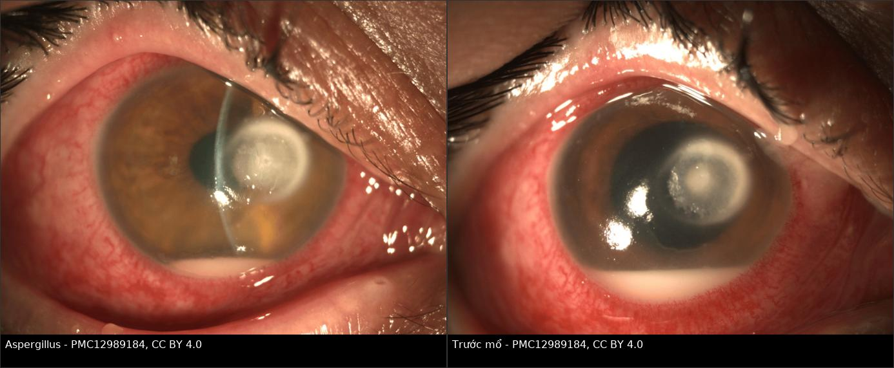
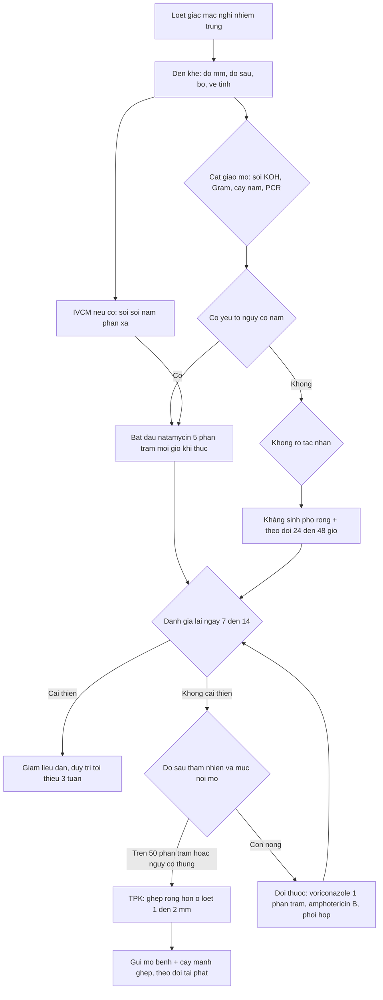
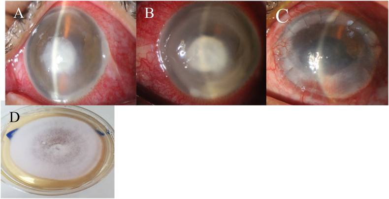
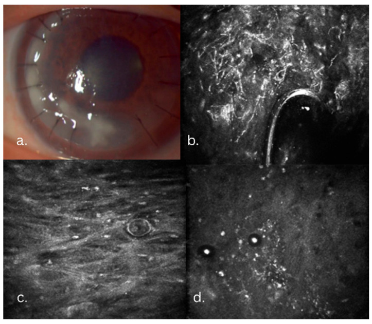
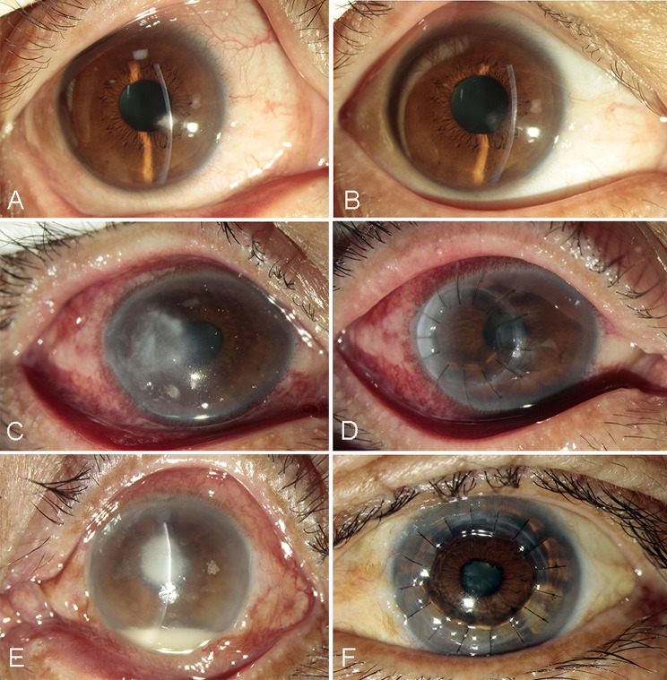
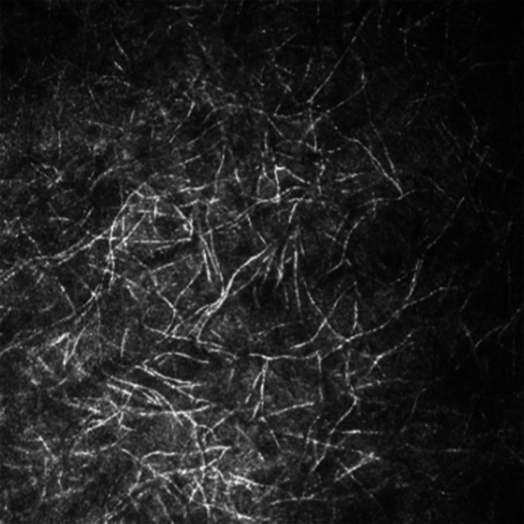

# 1460 — Viêm giác mạc do nấm: bờ lông vũ, vệ tinh, IVCM và natamycin 5% / Fungal keratitis (Fusarium, Aspergillus, Candida)

**Tags:** `pattern:o-loet-giac-mac` `pattern:tham-nhien-nhu-mo` `pattern:bo-long-vu` `pattern:ve-tinh` `pattern:mang-noi-mo` `vung:mat` `vung:giac-mac` `protocol:slit-lamp` `protocol:IVCM` `protocol:AS-OCT` `protocol:cam-mau-cay` `score:loet-giac-mac`

**Mức chắc chắn (certainty):** tổng hợp y văn (literature synthesis) — ước tính gánh nặng toàn cầu **1.051.787 ca/năm** (*Lancet Infect Dis* 2021, **PMID 33645500**); phân tích gộp **16 nghiên cứu châu Phi, 701/2.150 ca** (**PMC13711364**, CC BY-NC); thử nghiệm ngẫu nhiên **MUTT I** (323 ca, **PMC3769211**) và **MUTT II**; tổng quan IVCM (**PMID 35278721**); tổng quan điều trị mới (**PMC13313658** — lưu ý: bài này ghi giấy phép mâu thuẫn giữa CC BY-NC-ND và CC BY-NC-SA, nên **không dùng ảnh** của bài, chỉ dùng số liệu). Ca minh hoạ: **PMC11729674**, **PMC12989184**, **PMC12653982**, **PMC13335033** (CC BY / CC BY-NC-ND). Nhóm **không có bệnh nhân của mình**.

> **Câu chốt:** Viêm giác mạc do nấm **không phải "loét giác mạc nặng hơn loét vi khuẩn"** mà là **nhiễm trùng đi XUỐNG theo lá nhu mô**: sợi nấm mọc **trước** đám thâm nhiễm tế bào, tạo **bờ lông vũ (feathery margin)** và **ổ vệ tinh (satellite lesion)** — dấu hiệu trên đèn khe chính là **bản đồ lan theo giải phẫu**, không phải "viêm mạnh". Ba câu hỏi trước khi kê thuốc: **(1) có yếu tố nguy cơ nấm không (chấn thương thực vật, đeo kính tiếp xúc, suy giảm miễn dịch)? (2) tổn thương có điển hình không (bờ lông vũ, vệ tinh, mảng nội mô, mủ tiền phòng "vô khuẩn")? (3) đã dùng corticoid chưa?** Sai lầm chết người: **coi là herpes → cho corticoid** → loét bùng phát, thủng giác mạc.

## 1. Tổng quan bệnh học – cơ chế hình ảnh (TẠI SAO)

### 1.1 Gánh nặng và ngưỡng định lượng (số phải nhớ)

- **Toàn cầu: 1.051.787 ca/năm (95% CI 736.251–1.367.323)**; nếu coi mọi ca **cấy âm** là nấm thì **1.480.916 ca/năm**; tập trung ở **châu Á và châu Phi** (**PMID 33645500**).
- **Mất mắt:** **8–11%** ca phải **khoét bỏ/múc nội nhãn (evisceration/enucleation)** → **84.143–115.697 mắt/năm** (**PMID 33645500**).
- **Tỉ lệ trong viêm giác mạc nhiễm trùng:** ở vùng nhiệt đới, nấm chiếm **20–60%** ca cấy dương; phân tích gộp **169 nghiên cứu** cho tỉ lệ **23,6% (95% CI 20,4–27,1)** ở nhóm "nghi nhiễm trùng" và **17,9%** ở nhóm cấy xác nhận (dẫn trong **PMC13313658**).
- **Châu Phi (phân tích gộp 2026):** **33,6% (95% CI 23,6–44,4)** — 16 nghiên cứu, **701/2.150** ca; dao động rất rộng **5,6–61,9%**, **I² = 96,1%**, khoảng dự báo 95% **1,8–79,6%** (**PMC13711364**). Nghĩa là **không thể suy tỉ lệ từ nơi khác sang** — phải biết vi sinh của chính cơ sở.
- **Tác nhân:** **Fusarium 40%**, **Aspergillus 17%**, nấm sợi khác **43%** trong MUTT I (**PMC3769211**). Ở mắt **có kính tiếp xúc** hoặc **suy giảm miễn dịch**, **Candida** (nấm men) tăng tỉ lệ; ở vùng nông nghiệp, **Fusarium** đứng đầu.

### 1.2 TẠI SAO bờ "lông vũ", vệ tinh, mảng nội mô

- **Lan theo lá nhu mô (lamellar spread):** sợi nấm dài, mảnh, **mọc giữa các bó collagen** theo đường ít đề kháng; vì vậy **rìa thâm nhiễm không đều, toả tua** — chính là **bờ lông vũ**, trong khi phản ứng tế bào (bạch cầu) tạo **vùng đậm ở giữa**.
- **Vệ tinh (satellite):** các **ổ nấm thứ phát** tách khỏi ổ chính theo đường nhu mô — dấu hiệu **lan theo giải phẫu**, không phải "bội nhiễm".
- **Mảng nội mô (endothelial plaque):** nấm và tế bào viêm **lắng ở mặt sau giác mạc** — dấu hiệu **đã xuyên hết bề dày nhu mô**, tiên lượng nặng hơn và là lý do cân nhắc **ghép xuyên (TPK)**.
- **Mủ tiền phòng (hypopyon) "vô khuẩn":** phản ứng viêm **do nấm/độc tố**, **không** đồng nghĩa nhiễm khuẩn tiền phòng; nhưng **mủ lớn + fibrin** lại là dấu hiệu **nặng, dọa thủng** (xem ca Aspergillus dưới).
- **Vòng miễn dịch (immune ring / Wessely ring):** phức hợp kháng nguyên–kháng thể lắng trong nhu mô; **gặp ở cả nấm, vi khuẩn, Acanthamoeba** → **không dùng để phân biệt**, chỉ dùng để **đánh giá mức viêm**.
- **Vì sao dễ nhầm herpes:** tổn thương **hình nhánh (pseudodendrite)** do nấm lan theo đường thần kinh/khuyết biểu mô có thể **giả dạng đuôi gai**; khác biệt: herpes **đuôi gai có bóng tận cùng (terminal bulbs), bờ nham nhở, giác mạc giảm cảm giác**, còn nấm **bờ tua mềm, có vệ tinh, đáy nhu mô** — và **corticoid làm nấm bùng phát**, đây là **cạm bẫy nguy hiểm nhất** của bài.

### 1.3 Vật lý của ba phương thức "thấy nấm"

- **Đèn khe (slit-lamp):** phóng đại **10–40×**, ánh sáng khe tạo **lát cắt quang học** → thấy **độ sâu thâm nhiễm** và **bờ tổn thương**. Giới hạn: **không thấy sợi nấm** (đường kính **2–6 µm**, dưới độ phân giải của mắt + đèn khe thường quy).
- **IVCM (soi kính hiển vi đồng tiêu in vivo):** **độ phân giải ngang xấp xỉ 1 µm**, thu ánh sáng **phản xạ** từ vách nấm (chitin) → sợi nấm hiện thành **cấu trúc phản xạ mạnh, mảnh, phân nhánh** trong nhu mô; **không xâm lấn, kết quả trong vài phút**. Đây là lý do IVCM **bổ sung** cho cấy: thấy nấm **trước khi** cấy mọc **3–7 ngày** (**PMID 35278721**).
- **Học sâu trên IVCM:** hệ **ResNet** trên **2.088 ảnh** huấn luyện và **535 ảnh** kiểm tra đạt **AUC 0,9875**, **độ nhạy 0,9186**, **độ đặc hiệu 0,9834** (**PMID 32617326**) — cho thấy **giá trị của IVCM phụ thuộc mạnh vào người đọc**, và AI là hướng giảm phụ thuộc đó.
- **AS-OCT (OCT đoạn trước):** độ phân giải trục **xấp xỉ 5–10 µm**, đo **độ sâu và độ dày thâm nhiễm theo µm** → quyết định **đường kính và độ sâu mảnh ghép** khi phải mổ, và theo dõi **đáp ứng theo mm²/tháng** khách quan hơn ảnh chụp.
- **Cấy và soi:** tiêu chuẩn vàng nhưng **chậm (3–7 ngày)** và **không nhạy** — cấy âm **không loại trừ**; vì vậy **không được chờ cấy** mới điều trị khi lâm sàng điển hình.

## 2. Mẫu hình + chẩn đoán phân biệt theo vị trí và bối cảnh (gamut)

- **Nấm sợi (Fusarium, Aspergillus) — sau chấn thương thực vật/bụi:** ổ loét **bờ lông vũ**, **vệ tinh**, **thâm nhiễm sâu qua nhu mô**, có thể **giả đuôi gai**; tiền phòng mủ muộn.
- **Nấm men (Candida) — mắt có kính tiếp xúc/suy giảm miễn dịch/ghép giác mạc:** **ổ thâm nhiễm dưới biểu mô với biểu mô còn nguyên**, bờ **kém rõ**, ít vệ tinh; dễ bị gọi là "viêm giác mạc chấm nông" hoặc "bong mảnh ghép".
- **Nấm sợi không điển hình (Pythium insidiosum, Fusarium kháng thuốc):** **lan cực nhanh**, đau nhiều, bờ **như "bờ sông"**, **không đáp ứng azole** (Pythium **không có ergosterol**) → **phải mổ sớm**; đây là lý do **không được trì hoãn phẫu thuật** khi tổn thương vượt qua giới hạn điều trị nội khoa (**PMC13313658**).
- **Nhóm "không phải nấm" bắt buộc loại trừ:** **vi khuẩn** (bờ rõ, tiến triển nhanh, mủ đặc), **herpes** (đuôi gai, bóng tận cùng, giảm cảm giác), **Acanthamoeba** (đau nhiều hơn tổn thương, **vòng thần kinh**, tiền sử kính tiếp xúc/nước), **viêm giác mạc rìa (marginal)** do bệnh bề mặt, **loét do dinh dưỡng/thần kinh** (neurotrophic — khô, bờ tròn, không thâm nhiễm dày).
- **Gamut theo hình dạng bờ:** **bờ lông vũ/toả tua** → nấm sợi; **bờ tròn, đục đều, tiến triển theo giờ** → vi khuẩn; **bờ dạng đuôi gai có bóng** → herpes; **vòng bao quanh + đau dữ dội** → Acanthamoeba; **bờ "vách đứng" lan nhanh** → Pythium.

## 3. Bảng so sánh phân biệt (ma trận đối chiếu)

| Thực thể (entity) | Hình ảnh điển hình | Chốt vào (rule-in) | Chốt loại (rule-out) | Gợi ý xác nhận |
|---|---|---|---|---|
| Nấm sợi (Fusarium/Aspergillus) | Loét **bờ lông vũ**, **vệ tinh**, thâm nhiễm sâu, mảng nội mô; tiền sử chấn thương thực vật | **Bờ lông vũ + vệ tinh + IVCM thấy sợi phân nhánh** | Bờ tròn đều, tiến triển theo giờ → nghĩ vi khuẩn | Soi/cấy, IVCM, AS-OCT đo độ sâu |
| Nấm men (Candida) | Thâm nhiễm **dưới biểu mô**, biểu mô nguyên, bờ kém rõ, ở mắt có kính tiếp xúc/ghép | **Biểu mô nguyên + thâm nhiễm sâu + IVCM thấy cấu trúc tròn/nảy chồi** | Có vệ tinh rõ + bờ lông vũ → nghĩ nấm sợi | IVCM, cấy, PCR |
| Vi khuẩn (Staph/Pseudomonas) | Loét **bờ rõ**, mủ đặc, tiến triển **theo giờ**; Pseudomonas có thể thủng nhanh | **Tiến triển nhanh + bờ rõ + mủ đặc** | Bờ toả tua, vệ tinh, tiến triển chậm → nghĩ nấm | Nhuộm Gram, cấy |
| Herpes (HSV) | **Đuôi gai có bóng tận cùng**, bờ nham nhở, giảm cảm giác, tái phát | **Đuôi gai điển hình + giảm cảm giác + tiền sử tái phát** | Có vệ tinh/bờ tua mềm + đau nhiều → không phải herpes đơn thuần | PCR HSV, đáp ứng acyclovir |
| Acanthamoeba | **Đau nhiều hơn tổn thương**, vòng bao quanh, tiền sử kính/nước | **Đau không tương xứng + vòng + IVCM thấy nang** | Đau nhẹ, bờ lông vũ → nghĩ nấm | IVCM, cấy trên thạch E. coli |
| Pythium insidiosum | Loét lan **rất nhanh**, bờ dựng đứng, đau nhiều, kháng azole | **Lan nhanh + không đáp ứng azole + mô bệnh thấy sợi** | Đáp ứng natamycin, tiến triển chậm → nấm sợi thường | PCR/ITS, mô bệnh; **mổ sớm** |
| Viêm giác mạc rìa (marginal) | Thâm nhiễm **rìa**, **cách rìa 1–2 mm**, kèm viêm bờ mi, đau nhẹ | **Vị trí rìa + bệnh bề mặt + đáp ứng corticoid ngắn ngày** | Trung tâm, bờ tua, đau nhiều → nghĩ nhiễm trùng thật | Soi bờ mi, thử corticoid có kiểm soát |
| Loét thần kinh/dinh dưỡng | **Bờ tròn, khô, không thâm nhiễm dày**, giảm cảm giác | **Giảm cảm giác + bờ tròn + không mủ** | Thâm nhiễm dày + vệ tinh → nhiễm trùng | Test cảm giác giác mạc |

*Ảnh ghép letterbox (giữ nguyên tỉ lệ, không cắt) từ hai hình của cùng một ca *Tạp chí 2026* (**PMC12989184**, CC BY 4.0): **trái** — loét **4,0 × 4,0 mm** với **mảng nội mô, mủ tiền phòng và fibrin**, bờ **"khô" và không rõ/feathery**; **phải** — trước mổ loét lan **7,5 × 7,5 mm**, mủ tăng, fibrin từ chân mống mắt tới bờ đồng tử. Đây là tốc độ lan của nấm sợi khi chẩn đoán muộn.*

### Dấu hiệu cần đọc đúng trên từng phương thức

- **Đèn khe:** đo **đường kính ổ loét (mm)**, **độ sâu theo % bề dày nhu mô**, ghi **vị trí so với trục thị giác** (trung tâm/ngoại vi), mô tả **bờ** và **vệ tinh** bằng lời — đây là dữ liệu theo dõi chính.
- **IVCM:** tìm **sợi phản xạ mạnh, mảnh, phân nhánh** trong nhu mô; **phân biệt với dây thần kinh** (dây thần kinh **dày hơn, có hạt (beading), phân nhánh hình chữ Y**); ghi **độ sâu** nơi thấy sợi.
- **AS-OCT:** đo **độ sâu thâm nhiễm (µm)** và **độ dày giác mạc còn lại ở đáy ổ loét** — **mỏng < 100 µm** là nguy cơ thủng, phải chuẩn bị ghép.
- **Cấy/soi:** cạo **bờ và đáy ổ loét** (không chỉ trung tâm), cấy trên **Sabouraud/thạch máu**, nhuộm **Gram + KOH/Calcofluor**; **cấy âm không loại trừ**.

## 4. Protocol chẩn đoán – điều trị + thuật toán

### 4.1 Trình tự

- **Bước 1 — đèn khe + đo mm/độ sâu + tìm vệ tinh**, ghi **yếu tố nguy cơ** (chấn thương thực vật, kính tiếp xúc, corticoid đang dùng, đái tháo đường, suy giảm miễn dịch).
- **Bước 2 — cạo giác mạc** gửi **soi tươi (KOH/Calcofluor), Gram, cấy nấm + vi khuẩn, PCR nếu có**; **IVCM ngay** nếu có máy (không xâm lấn, kết quả trong phút).
- **Bước 3 — bắt đầu kháng nấm khi lâm sàng điển hình, KHÔNG chờ cấy:** **natamycin 5%** nhỏ **mỗi giờ khi thức** cho tới khi **biểu mô liền**, sau đó **4 lần/ngày, tối thiểu 3 tuần** (đúng phác đồ MUTT I — **PMC3769211**).
- **Bước 4 — đánh giá lại mỗi 24–48 giờ trong tuần đầu**, sau đó **3–7 ngày/lần**: đo lại **mm, độ sâu, mủ tiền phòng**; **không cải thiện sau 7–14 ngày** hoặc **nặng lên** → **đổi/ thêm thuốc và chuẩn bị mổ**.
- **Bước 5 — phẫu thuật:** **ghép xuyên giác mạc (TPK)** khi **thủng/doạ thủng (còn < 100 µm)**, **mảng nội mô lan**, **thâm nhiễm > 50% bề dày không đáp ứng**, hoặc **thủng thực sự**; ghép **lớn hơn ổ loét 1–2 mm** mỗi bên.

### 4.2 Thuốc và ngưỡng bằng chứng

- **Natamycin 5% là lựa chọn đầu tay cho nấm SỢI:** MUTT I (323 ca) — thị lực 3 tháng tốt hơn **0,18 logMAR** so với voriconazole (**95% CI 0,30–0,05; p = 0,006**); **thủng/TPK ít hơn — OR 0,42 (0,22–0,80), p = 0,009**; ở **Fusarium**, lợi ích lớn hơn nhiều (**0,41 logMAR; OR thủng 0,06 [0,01–0,28]**), còn **non-Fusarium** thì **không khác biệt** (**PMC3769211**). Kết luận của thử nghiệm: **voriconazole KHÔNG dùng đơn trị cho nấm sợi**.
- **Voriconazole 1% tại chỗ:** dùng khi **không có natamycin**, cho **nấm men**, hoặc **phối hợp**; **voriconazole uống không có lợi** (MUTT II) và **không được khuyến cáo** vì tác dụng phụ (**PMID 27787540**, tổng quan **PMID 28942073**).
- **Amphotericin B 0,15%:** chủ yếu cho **nấm men/Candida**, độc bề mặt nhiều hơn.
- **Kết cục vẫn kém:** trong **MUTT II**, **gần 50%** bệnh nhân **thủng toàn bề dày hoặc phải TPK** (dẫn trong **PMC13313658**) — con số này là lý do **phải theo dõi sát và mổ đúng lúc**, không "chờ thuốc".
- **Liệu pháp bổ trợ chưa đủ bằng chứng:** **PACK-CXL (cross-linking)**, **PDT**, **natamycin tan (solubilized)**, **amphotericin B liposome**, **tiêm nội nhu mô voriconazole** — kết quả sớm hứa hẹn nhưng **thiếu thử nghiệm ngẫu nhiên quy mô**, không thay thế phác đồ chuẩn (**PMC13313658**).
- **Corticoid:** **không dùng trước khi loại trừ nấm**; trong nấm, corticoid **làm tăng sinh sợi nấm và nguy cơ thủng** — khác với vi khuẩn (nơi SCT có vai trò ở một số nhóm).

### 4.3 Những con số dùng để giải thích cho bệnh nhân

| Câu hỏi của bệnh nhân | Trả lời có số |
|---|---|
| "Bệnh này hiếm không?" | **~1,05 triệu ca/năm** toàn cầu; ở vùng nhiệt đới nấm chiếm **20–60%** viêm giác mạc nhiễm trùng (**PMID 33645500**, **PMC13313658**) |
| "Có phải mổ không?" | **~50%** ca trong MUTT II phải **ghép hoặc thủng**; nhưng **natamycin tốt hơn voriconazole** (0,18 logMAR; OR thủng **0,42**) |
| "Bao lâu mới khỏi?" | Nhỏ **mỗi giờ khi thức** tới khi liền biểu mô, rồi **4 lần/ngày ≥ 3 tuần**; theo dõi tới khi **hết thâm nhiễm** |
| "Có mù không?" | **8–11%** mất mắt trong các loạt toàn cầu; nên **chẩn đoán sớm là yếu tố tiên lượng mạnh nhất** |

## 5. Biến thể bình thường và cạm bẫy

- **Cạm bẫy 1 — "đuôi gai nên là herpes":** nấm có thể tạo **nhánh giả (pseudodendrite)**. Nếu **không có bóng tận cùng**, **có vệ tinh**, **đau nhiều**, **giảm cảm giác không rõ** → **soi/cấy nấm trước khi cho corticoid**. Corticoid trong nấm là **yếu tố làm thủng giác mạc**.
- **Cạm bẫy 2 — "cấy âm nên không phải nấm":** cấy nấm **chậm và không nhạy**; lâm sàng điển hình + IVCM dương **đủ để điều trị**. Không bao giờ **ngừng kháng nấm** chỉ vì cấy âm.
- **Cạm bẫy 3 — đo tổn thương bằng "cảm giác":** phải **đo mm và độ sâu** mỗi lần; một ổ **5 mm sâu 60%** khác hoàn toàn **5 mm sâu 20%** về nguy cơ thủng và chỉ định ghép.
- **Cạm bẫy 4 — bỏ sót mắt còn lại và bệnh nền:** đái tháo đường, suy giảm miễn dịch, **đang dùng corticoid toàn thân**, **kính tiếp xúc** — mỗi yếu tố đổi tác nhân và tiên lượng; **khám mắt lành** và **soi bờ mi** luôn.
- **Cạm bẫy 5 — tưởng Pythium là nấm thường:** **lan rất nhanh, kháng azole vì không có ergosterol** → **mổ sớm** là yếu tố sống còn của mắt (**PMC13313658**).
- **Cạm bẫy 6 — "mủ tiền phòng là nhiễm khuẩn":** mủ trong nấm thường **vô khuẩn**; nhưng **mủ lớn + fibrin** là dấu hiệu **nặng**, chỉ định **ghép** chứ không phải "đổi kháng sinh".
- **Biến thể bình thường:** **dây thần kinh giác mạc** trên IVCM (dày, có hạt, phân nhánh chữ Y) **không phải sợi nấm**; **nếp gấp màng Descemet**, **mảnh biểu mô tróc** sau chấn thương, và **dellen** (giảm ẩm khu trú) đều **không phải ổ loét nhiễm trùng** — đừng cạo và đừng cho kháng nấm.

## 6. Tự lượng giá — Blind Quiz

**Ca 1 — Nông dân 45 tuổi, 5 ngày sau khi bị lá cây quệt vào mắt: đau tăng, nhìn mờ, có ổ trắng ở giác mạc.**

- Hỏi: mô tả (A): bờ tổn thương, có vệ tinh không? (B) cho thấy điều gì? Chẩn đoán phân biệt 3 thứ và xét nghiệm nào chốt?

<b>Bấm để hiện đáp án</b>

- **(A)** ổ thâm nhiễm nhu mô **7 × 7 mm, bờ lông vũ (feathery)**, màu xám trắng, **ở trung tâm** — điển hình nấm sợi sau chấn thương thực vật.
- **(B)** ngày thứ 12: **thâm nhiễm nhu mô sâu hơn, phù giác mạc lan, mủ tiền phòng** — nấm **đã xuyên qua nhu mô** dù đang điều trị.
- Phân biệt: **nấm sợi**, **vi khuẩn (Pseudomonas)**, **herpes** (đuôi gai), **Acanthamoeba** (đau nhiều, vòng). Chốt: **soi KOH + cấy nấm + IVCM**; ở ca này **Fusarium** mọc trên Sabouraud (D).
- **(C)** là mắt **4 tháng sau ghép xuyên (T-PKP)** — cho thấy đáp ứng phẫu thuật khi nội khoa thất bại.
- Nguồn ảnh: **PMC11729674**, CC BY 4.0.

**Ca 2 — Bệnh nhân đái tháo đường, loét giác mạc 4 mm, bờ "khô" và không rõ, có mảng nội mô và mủ tiền phòng.**

- Hỏi: vì sao bờ "khô, không rõ" lại gợi ý nấm sợi? Dấu hiệu nào cho biết đã xuyên hết bề dày? Khi nào phải mổ?

<b>Bấm để hiện đáp án</b>

- Bờ **khô, xù xì, không rõ** phản ánh **sợi nấm mọc trong nhu mô** (ít phản ứng tế bào ở rìa) — khác bờ **phù nề, ướt** của vi khuẩn.
- **Mảng nội mô + mủ tiền phòng + fibrin** = nấm đã **xuyên hết bề dày nhu mô** → nguy cơ **thủng** rất cao.
- Chỉ định mổ: **lan từ 4,0 → 7,5 mm** dù đã điều trị, **doạ thủng/mảng nội mô lan** → **TPK** (ghép lớn hơn ổ 1–2 mm mỗi bên).
- Nguồn ảnh: ghép từ **PMC12989184** (CC BY 4.0), ảnh nguyên bản, chỉ letterbox.

**Ca 3 — Bệnh nhân đeo kính tiếp xúc, thâm nhiễm dưới biểu mô, biểu mô còn nguyên; cấy âm 2 lần.**

- Hỏi: vì sao cấy âm vẫn có thể là nấm? IVCM ở (b) cho thấy gì? Cần làm gì tiếp?

<b>Bấm để hiện đáp án</b>

- **Cấy âm không loại trừ nấm:** cấy cần **mẫu đủ sâu**, môi trường phù hợp, và **3–7 ngày**; tổn thương **dưới biểu mô** dễ lấy **quá ít nấm** khi cạo bề mặt.
- **IVCM (b):** **cấu trúc phản xạ mạnh, mảnh, phân nhánh** (sợi nấm giả/ thật) cạnh **chỉ khâu** — trong ca gốc đây là **đồng nhiễm nấm + Acanthamoeba** (c và d: **nang Acanthamoeba** hình tròn, hai vách). Bài học: **một IVCM có thể thấy HAI tác nhân** — luôn tìm cả nang và sợi.
- Tiếp theo: **điều trị kháng nấm + kháng Acanthamoeba**, **AS-OCT đo độ sâu**, **theo dõi 24–48 giờ**; nếu nặng lên → **ghép**.
- Nguồn ảnh: **PMC12653982**, CC BY 4.0.

**Ca 4 — Bệnh nhân 30 tuổi, ổ loét nhỏ 2 × 2 mm nhưng có "màng sợi" trên bề mặt, sau 10 ngày loét lan 5 × 5 mm sâu hơn 1/2 bề dày.**

- Hỏi: điều gì trên IVCM khẳng định chẩn đoán nấm? Vì sao kích thước nhỏ ban đầu không đảm bảo tiên lượng tốt?

<b>Bấm để hiện đáp án</b>

- IVCM: **nhiều cấu trúc hình sợi mảnh, phân nhánh, phản xạ mạnh** — tương ứng **sợi nấm** trong nhu mô (khác dây thần kinh: dày hơn, có hạt).
- **Kích thước nhỏ ≠ nhẹ:** nấm đã **ăn sâu theo lá nhu mô**; ổ loét chỉ là **phần nổi trên bề mặt**. Từ **2 × 2 mm** lan **5 × 5 mm, sâu > 1/2 bề dày** trong **10 ngày** là tốc độ điển hình của nấm sợi khi chẩn đoán muộn.
- Nguồn ảnh: **PMC13335033**, CC BY-NC-ND 4.0 (dùng nguyên bản).

## Bài liên quan chéo
- [6132 – Viêm giác mạc do kính tiếp xúc](../6132-viem-giac-mac-kinh-tiep-xuc/lesson.md) — bối cảnh kính tiếp xúc, Pseudomonas/Acanthamoeba
- [463 – Viêm nội nhãn nội sinh do nấm](../463-viem-noi-nhan-noi-sinh-nam/lesson.md) — khi nấm đã vào nội nhãn
- [474 – Kháng nấm nội nhãn: chọn thuốc theo loài](../474-khang-nam-noi-nhan-chon-thuoc-theo-loai/lesson.md) — phổ thuốc, liều
- [495 – Viêm nội nhãn nấm ngoại sinh vs TASS](../495-viem-noi-nhan-nam-ngoai-sinh-vs-TASS/lesson.md) — phân biệt viêm vô khuẩn
- [1445 – Bong mảnh ghép sau ghép nội mô](../1445-bong-manh-ghep-dsaek-dmek-rebubble/lesson.md) — biến chứng sau ghép
- [400 – Tổng quan Mắt & thị giác](../400-tong-quan-mat-thi-giac/lesson.md) — bản đồ hệ và cách đọc

## Ảnh
- Nguồn và giấy phép từng ảnh: `images/CREDITS.md`. Một ảnh ghép được tạo bằng `tools/make_composite.py` từ **hai ảnh CC BY** (letterbox, giữ tỉ lệ, không cắt); các ảnh còn lại dùng **nguyên bản**.

> Không dùng để chẩn đoán độc lập khi chưa có người hướng dẫn.
