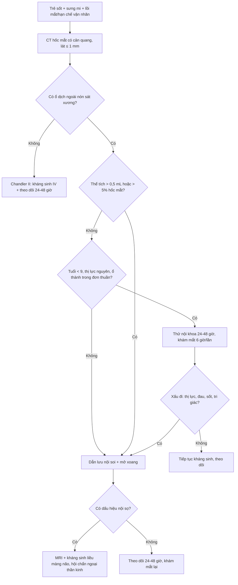
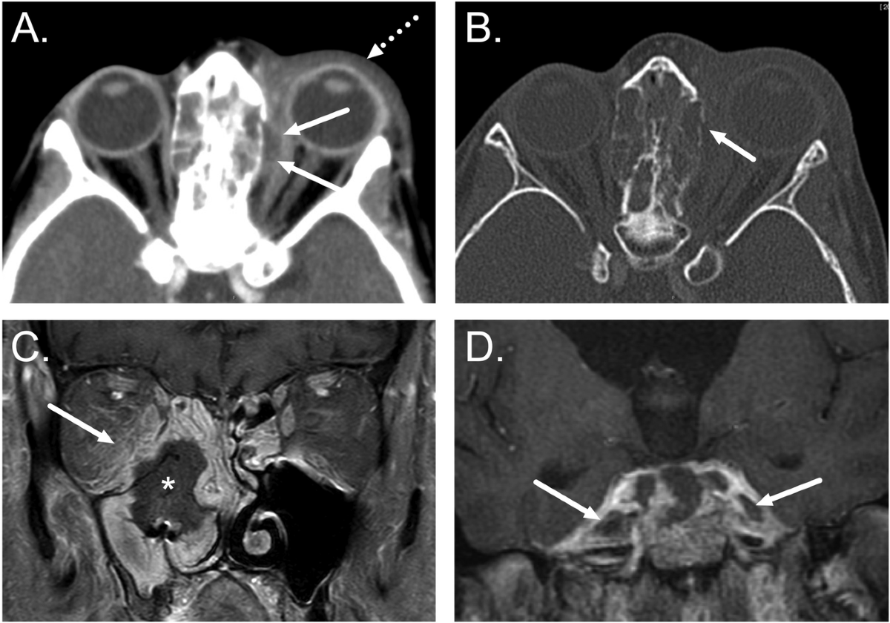
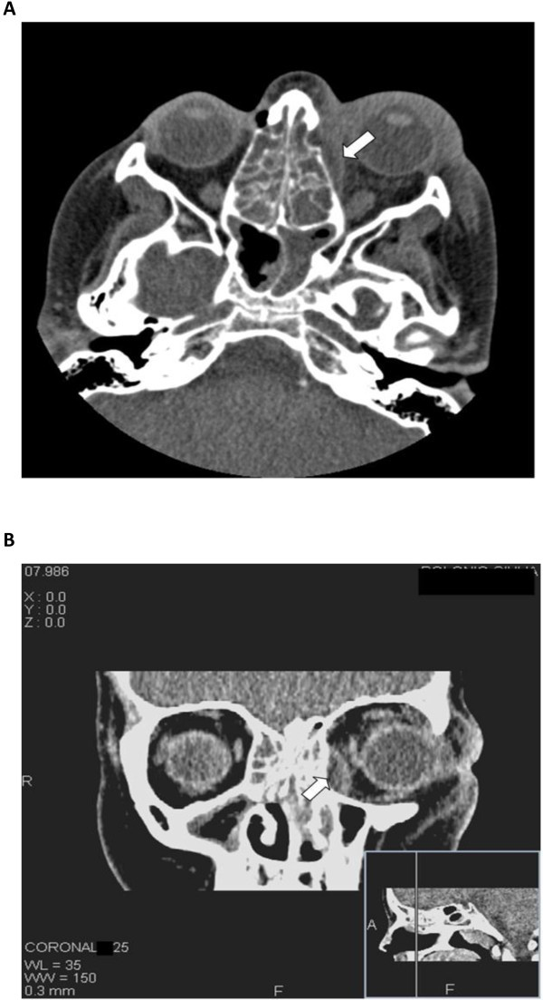
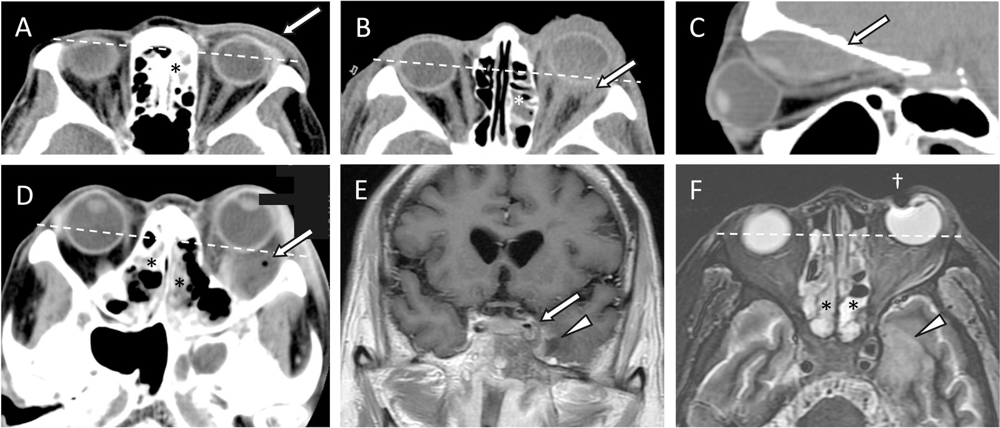

# 1461 — Áp-xe dưới màng xương hốc mắt ở trẻ: mủ nằm GIỮA xương và màng xương / Subperiosteal orbital abscess (SPOA)

**Tags:** `pattern:ap-xe` `pattern:o-dich-ngoai-non` `pattern:viem-xoang` `pattern:chèn-ép-thi-thần-kinh` `vung:mat` `vung:hoc-mat` `vung:xoang` `protocol:CT-hoc-mat` `protocol:MRI-hoc-mat` `score:Chandler` `incidentaloma:khong`

**Mức chắc chắn (certainty):** tổng hợp y văn (literature synthesis) — ghép **bộ 83 trẻ viêm mô tế bào hốc mắt có đo thể tích áp-xe** (*Int J Pediatr Otorhinolaryngol* 2015, **PMID 25529362**), **đoàn hệ 220 trẻ** (*J Pediatric Infect Dis Soc* 2022, **PMID 35438766**), **loạt 83 ca viêm xoang biến chứng 5 giai đoạn Chandler** (*PLoS One* 2017, **PMC5626037**, CC BY 4.0), **khuyến cáo hình ảnh ESR 2026** (*Eur Radiol*, **PMC12712113**, CC BY 4.0), **ca 15 tuổi do liên cầu nhóm A** (*Head Face Med* 2012, **PMC3517307**, CC BY 2.0) và **loạt 30 ca người lớn–trẻ** (*Orbit* 2015, **PMID 25867948**). Nhóm **không có bệnh nhân của mình**.

> **Câu chốt:** trong viêm xoang sàng, mủ **chui qua lamina papyracea** vào **khoang dưới màng xương** — một khoang **ảo**, giữa xương và màng xương — nên tạo ổ dịch **hình thấu kính, ép thằng vào mô mỡ hốc mắt** chứ không lan tự do. Câu hỏi sống còn không phải "có áp-xe hay không" mà là **"bao nhiêu mL, ở đâu, mắt có bị đe dọa và có lan nội sọ chưa"** — vì ngưỡng dẫn lưu nằm ở **> 0,5 mL (500 mm³)** hoặc **> 5% thể tích hốc mắt**, và **14,5%** ca biến chứng viêm xoang đã ở giai đoạn V (nội sọ) ngay lúc nhập viện.

## 1. Tổng quan bệnh học – cơ chế hình ảnh (TẠI SAO)

### 1.1 Giải phẫu quyết định hình dạng ổ dịch

- **Lamina papyracea** (vách xoang sàng–hốc mắt) là **xương mỏng nhất của thành hốc mắt** (cỡ **0,2–0,4 mm** theo giải phẫu kinh điển), có **nhiều lỗ mạch–thần kinh** xuyên qua. Vì vậy nó vừa **dễ vỡ vì áp lực**, vừa **là đường lan tự nhiên** của viêm xoang sàng sang hốc mắt (xoang sàng chiếm **75,6%** nguồn viêm trong loạt 83 ca, **PMC5626037**; **98%** trong loạt 41 trẻ, **PMID 16874168**).
- **Màng xương (periorbita)** bám chắc vào **bờ hốc mắt và các đường khớp xương**, chỉ lỏng lẻo ở **trung tâm thành**; mủ tụ ở đó bị **giới hạn bởi bờ bám** → ổ dịch **hình thấu kính (lentiform), bờ trong áp vào xương, bờ ngoài đẩy màng xương vào mỡ hốc mắt**. Đây là lý do **dấu hiệu chốt trên CT là "nâng màng xương" (periosteal elevation)** chứ không phải "khối trong hốc mắt".
- **TẠI SAO hướng lồi mắt lại có giá trị định vị:** ổ dịch **thành trong** đẩy nhãn cầu ra **trước và ra ngoài**; ổ **thành trên** (xoang trán) đẩy **xuống–ra ngoài** và có thể kèm **Pott's puffy tumor**; ổ **thành dưới** (xoang hàm, răng) đẩy **lên trên**. Trục lồi mắt trên lâm sàng **dự báo được vị trí ổ dịch** trước khi bấm máy.

### 1.2 Vì sao mủ "ép" gây mù: hốc mắt là khoang kín

- Hốc mắt là **hình nón xương kín 4 phía**, phía trước đóng bằng **vách hốc mắt** — **không giãn được**. Thể tích tăng thêm vài mL là **áp lực mô tăng rất nhanh** (quan hệ áp lực–thể tích dốc, kiểu Laplace: áp lực thành ∝ sức căng × bán kính).
- Hệ quả theo thứ tự: **lồi mắt → hạn chế vận nhãn → tăng nhãn áp (IOP tăng dần theo giai đoạn Chandler, PMC5626037) → thiếu máu thần kinh thị/động mạch trung tâm võng mạc → mù**. Cơ chế mù gồm **viêm thần kinh thị do lan kề cận**, **huyết khối tĩnh mạch không van** và **thiếu máu do chèn ép** (PMC5626037).
- **Tỉ lệ mù trong loạt 83 ca là 6,0%** (5/83) và **41,7%** trong số ca **giai đoạn V**; tử vong hiếm nhưng có (1 ca tử vong trong 15 ngày) — **PMC5626037**.

### 1.3 Vì sao trẻ là nhóm chính, và vì sao trẻ nhỏ khác trẻ lớn

- Viêm mũi xoang cấp là nguyên nhân của **60–80%** biến chứng hốc mắt ở trẻ (**PMC9052236**), và **xoang sàng** là ổ nhiễm khởi phát thường gặp nhất vì **sàng đã khí hóa ngay từ nhỏ** trong khi xoang trán chỉ phát triển từ 7–8 tuổi.
- **Áp-xe dưới màng xương gặp ở trẻ nhiều hơn người lớn rõ rệt: 81,3% vs 28,6%** (p = 0,008) trong loạt 30 ca (**PMID 25867948**) — vì **vách xương mỏng + màng xương dày và bám lỏng hơn**.
- **Nhưng "trẻ nhỏ thì chỉ cần kháng sinh" là nửa sự thật:** dữ liệu cho thấy **áp-xe sàng ở trẻ < 9 tuổi, thị lực còn nguyên, chưa có biến chứng** có thể điều trị nội khoa **nếu đáp ứng tiêu chí** (PMC5626037, trích Harris và các loạt nhi); **trẻ lớn, ổ dịch thành trên/kết hợp, hoặc thị lực giảm → dẫn lưu**.

### 1.4 Vật lý hình ảnh: đọc CT thế nào cho đúng

- **CT không cản quang:** mủ là **dịch đồng nhất ≈ 0–20 HU**, **không phân biệt được với bất kỳ ổ dịch nào khác** bằng HU — điểm phân biệt là **vị trí (ngoài nón, sát thành xương)** và **bờ cong theo màng xương**, không phải đậm độ.
- **CT có cản quang:** **viền ngấm thuốc mỏng, đều** ở mặt ngoài ổ dịch = **mô hạt/viêm quanh ổ**; **lòng ổ không ngấm** = hoại tử/mủ. Viền **dày, không đều, có nốt trong lòng** phải nghĩ **u/lymphoma** hơn là áp-xe.
- **Khí trong ổ dịch** (≈ **−1000 HU**) là dấu hiệu **mạnh** của áp-xe/hoại tử, nhưng **không có khí KHÔNG loại trừ** — đa số ổ mủ không có khí.
- **Cửa sổ xương bắt buộc:** tìm **khuyết lamina papyracea**, mảnh xương rời, và **vỡ thành xoang trán** (đường vào nội sọ). Hình **PMC12712113 Fig. 1** cho thấy đúng cặp đôi này: **ổ dịch dưới màng xương + khuyết xương thành trong**.
- **MRI** (khi nghi nội sọ hoặc ổ dịch nhỏ khó phân biệt): mủ **hạn chế khuếch tán (DWI sáng, ADC thấp)** vì **độ nhớt cao và nhiều tế bào viêm**; **T1 fat-sat sau tiêm** cho viền ngấm rõ và phân biệt **mô hạt với mỡ hốc mắt**; **T2 fat-sat** cho thấy phù lan tỏa.

### 1.5 Số liệu định lượng nằm lòng

| Đại lượng | Số liệu | Nguồn |
|---|---|---|
| Tỉ lệ áp-xe dưới màng xương trong viêm mô tế bào hốc mắt trẻ | **32/83 = 38,6%** (tuổi trung bình 4,5) | PMID 25529362 |
| Thể tích áp-xe trung bình / độ lồi mắt | **570 mm³** / **4,7 mm** | PMID 25529362 |
| Ngưỡng thể tích gắn với phẫu thuật | **> 500 mm³ (0,5 mL) hoặc > 5% thể tích hốc mắt → 100% được mổ**; dưới ngưỡng chỉ **30% / 39%** (p < 0,05) | PMID 25529362 |
| Ngưỡng lồi mắt | **> 4 mm → 57,9% mổ**; **2–4 mm → 29,4%**; **< 2 mm → 0%** | PMID 25529362 |
| Bề rộng áp-xe | **≥ 1,2 cm** gắn với tỉ lệ can thiệp cao hơn | PMC9052236 |
| Phân bố Chandler (83 ca viêm xoang) | I **39**, II **8**, III **16**, IV **8**, V **12** → **giai đoạn V = 14,5%** | PMC5626037 |
| Mù / tử vong | mù **6,0%** (5/83), **41,7%** ca giai đoạn V; 1 tử vong | PMC5626037 |
| Vi khuẩn (220 trẻ) | **MSSA 26,3%**, **MRSA 5,0%**; **39,5% được mổ**; corticoid **32,1%** không liên quan thất bại điều trị | PMID 35438766 |
| Mổ lại | **26,7%**; **2/3** là ổ **thành trên + thành trong kết hợp** tái tụ sau mổ nội soi đơn thuần | PMID 25867948 |
| Tỉ lệ mổ chung ở trẻ có biến chứng | **71%** trong loạt 41 trẻ (viêm xoang 100%, sàng 98%) | PMID 16874168 |

> **Đọc số cho đúng:** "**> 0,5 mL thì mổ**" là **kết luận của một loạt đơn trung tâm** (32 áp-xe), **không phải ngưỡng của hội đồng**; nó dùng để **đặt cạnh lâm sàng**, không thay lâm sàng. Bằng chứng ngược chiều có thật: loạt 30 ca thấy **thể tích không khác nhau có ý nghĩa** giữa nhóm mổ và không mổ (PMC9052236 nêu cùng vấn đề), nên **khám mắt "báo động" mới là yếu tố quyết định mạnh nhất**.

## 2. Mẫu hình + chẩn đoán phân biệt theo vị trí (Gamut)

- **Mẫu hình chung:** ổ dịch **ngoài nón (extraconal)**, **sát thành xương**, **bờ ngoài cong lồi vào mỡ hốc mắt**, **bờ trong phẳng theo xương**, có/không khí, **viền ngấm thuốc**; kèm **viêm xoang sàng cùng bên**, **lồi mắt**, **dày mô mỡ quanh nhãn cầu**.
- **Theo vị trí thành hốc mắt (gamut):**
  - **Thành trong (sàng) — thường gặp nhất:** lồi mắt ra ngoài, hạn chế dạng; nguy cơ **lan nội sọ qua trần sàng**.
  - **Thành trên (trán):** lồi mắt xuống–ra ngoài, **Pott's puffy tumor** (áp-xe dưới màng xương xương trán + viêm tủy xương), nguy cơ **áp-xe ngoài màng cứng**.
  - **Thành dưới (xoang hàm/răng):** lồi mắt lên trên, thường **nguồn răng (odontogenic)** — phải khám răng miệng, không chỉ mũi xoang.
  - **Thành ngoài (gò má/thái dương):** hiếm; nghĩ **chấn thương, nguồn răng, u** trước khi nghĩ viêm xoang.
- **Theo bản chất ổ dịch (bốn nhóm cần loại):** mủ (**áp-xe**) – máu (**tụ máu dưới màng xương**, sau chấn thương, **không viêm xoang**) – nang bẩm sinh (**dermoid**, bờ nhẵn, thành mỏng, không viêm) – mô đặc (**lymphoma, rhabdomyosarcoma, histiocytosis**: trẻ, khối **không đau, không sốt**, ngấm thuốc đồng nhất).

## 3. Bảng so sánh phân biệt (ma trận đối chiếu)

| Thực thể (entity) | Hình ảnh điển hình (CT/MRI) | Chốt vào (rule-in) | Chốt loại (rule-out) | Gợi ý xác nhận |
|---|---|---|---|---|
| **Áp-xe dưới màng xương (Chandler III)** | Ổ **ngoài nón, sát thành trong**, **hình thấu kính**, viền ngấm, ± khí, **khuyết lamina papyracea**, viêm sàng cùng bên | **Vị trí sát xương + bờ cong theo màng xương + viêm xoang kế cận + lồi mắt** | Không có ổ dịch, chỉ dày mỡ → giai đoạn II; ổ **trong nón** → áp-xe hốc mắt (IV) | CT ≤ 1 mm có cản quang + cửa sổ xương; MRI nếu nghi nội sọ |
| **Viêm mô tế bào hốc mắt (Chandler II)** | Dày mô mỡ, **dải mờ quanh nhãn cầu**, **không có ổ dịch khu trú**, xoang sàng mờ | **Không thấy ổ dịch + đáp ứng kháng sinh 24–48 giờ** | Thấy ổ dịch có viền → đã là III/IV | Theo dõi sát; chụp lại nếu xấu đi |
| **Áp-xe hốc mắt (Chandler IV)** | Ổ dịch **trong nón**, **quanh thần kinh thị/cơ**, bờ không đều, ± khí | **Ổ dịch nằm trong mỡ hốc mắt, không sát thành** | Ổ sát thành, bờ cong → dưới màng xương | MRI T1 fat-sat sau tiêm |
| **Tụ máu dưới màng xương** | Cùng hình thấu kính, **HU cao (50–90 HU)** ở máu tươi, **không viêm xoang**, **tiền sử chấn thương** | **Tiền sử chấn thương + HU cao + không có bệnh xoang** | Sốt, xoang sàng mờ, HU thấp → áp-xe | Hỏi chấn thương; theo dõi HU/ MRI |
| **Dermoid / nang bì** | Ổ **mỡ (−40 đến −120 HU)** ± vôi hóa, **bờ nhẵn, thành mỏng**, **không viêm** | **Có mỡ trong ổ + vôi hóa + không viêm** | Dịch thuần 0–20 HU, viêm xoang → áp-xe | CT cửa sổ mô mềm; MRI T1 sáng = mỡ |
| **U hốc mắt ở trẻ (lymphoma, rhabdomyosarcoma)** | **Khối đặc**, ngấm thuốc, **không có viêm xoang**, có thể **phá xương** | **Khối đặc + không sốt + không bệnh xoang** | Ổ dịch có viền + viêm xoang → áp-xe | MRI + sinh thiết, **không dẫn lưu mù** |
| **Huyết khối xoang hang (Chandler V)** | **Khuyết thuốc trong xoang hang**, giãn tĩnh mạch mắt trên, **lan hai bên**, tổn thương thần kinh sọ III–VI | **Liệt nhiều dây thần kin sọ + giãn TM mắt trên + sốt** | Chỉ một dây, không giãn TM → không phải xoang hang | **MRI có cản quang/MRV**, kháng sinh + kháng đông theo chỉ định |

- **Ảnh đối chiếu:** **`images/1461_ap-xe_CT_PMC12712113-Fig1.png`** (CT trục có cản quang: ổ dịch dưới màng xương thành trong + khuyết xương) và **`images/1461_hoc-mat_CT_PMC3517307-Fig1.jpg`** (CT **trục + tránh** cùng một ca: thấy rõ ổ dịch **ép vào mỡ hốc mắt** và **viêm sàng**).

### Dấu hiệu đọc theo thứ tự (5 bước trên một lát CT trục)

1. **Vị trí:** ổ dịch **sát thành xương (dưới màng xương)** hay **trong mỡ (áp-xe hốc mắt)**?
2. **Hình dạng:** **thấu kính, bờ trong phẳng** = dưới màng xương; **tròn, bờ không đều** = trong nón/áp-xe.
3. **Xương:** có **khuyết lamina papyracea** hay **vỡ thành trán** không? (bắt buộc xem cửa sổ xương)
4. **Lan nội sọ:** **xoang hang, ngoài màng cứng, nhu mô** — luôn đọc **hai lát cao nhất** và **hai bên**.
5. **Đo:** **thể tích theo công thức nửa ellipsoid V = 1/6 × π × a × b × c** (a = trước–sau, b = ngang, c = cao; **PMC9052236**) — ghi **mL** ngay trong báo cáo, vì **0,5 mL** là mốc bàn luận mổ.

## 4. Protocol chụp + hệ phân độ/điểm chuẩn hóa

### 4.1 Protocol

- **CT hốc mắt + xoang, có cản quang tĩnh mạch**, lát **≤ 1 mm**, **tái tạo trục + tránh + đứng dọc**, **cửa sổ xương riêng**; đây là khảo sát đầu tay vì **nhanh, có sẵn, thấy xương và khí tốt nhất** (**PMC12712113**).
- **Có cản quang là bắt buộc** khi nghi biến chứng: viền ngấm phân biệt **áp-xe/mô hạt** với **dịch đơn thuần**, và đánh giá **xoang hang, màng não**.
- **MRI hốc mắt** (T1 fat-sat sau tiêm + T2 fat-sat + DWI) khi: **thị lực giảm, nghi lan nội sọ, ổ dịch nhỏ < 0,5 mL mà lâm sàng nặng, hoặc nghi u** — MRI **nhạy hơn CT** với **huyết khối xoang hang, viêm màng não, viêm não** (**PMC5626037**: 11/12 ca giai đoạn V được chụp MRI).
- **Siêu âm hốc mắt** chỉ dùng khi không có CT và để **hướng dẫn chọc hút**; **không dùng để loại trừ** áp-xe sau vách.
- **Không chụp lại thường quy** nếu lâm sàng cải thiện; **chụp lại sau 24–48 giờ** khi sốt còn, đau tăng, thị lực giảm, hoặc **tri giác thay đổi**.

### 4.2 Phân độ Chandler + ngưỡng xử trí

- **Chandler I–V** (nền tảng phân loại, **PMC5626037**): I viêm trước vách; II viêm mô tế bào hốc mắt; **III áp-xe dưới màng xương**; IV áp-xe trong hốc mắt; V lan nội sọ (huyết khối xoang hang, viêm màng não, viêm não, áp-xe ngoài/trong màng cứng).
- **Ngưỡng thực hành (tổng hợp, ghi rõ nguồn gốc số):**

| Tình huống | Ngưỡng / hành động | Nguồn số |
|---|---|---|
| Ổ dịch lớn | **> 0,5 mL (500 mm³)** hoặc **> 5% thể tích hốc mắt** → **dẫn lưu** | PMID 25529362 |
| Lồi mắt | **> 4 mm** → tỉ lệ mổ **57,9%**; **< 2 mm** → **0%** | PMID 25529362 |
| Bề rộng ổ dịch | **≥ 1,2 cm** → can thiệp nhiều hơn | PMC9052236 |
| Tuổi | **< 9 tuổi + thị lực nguyên + ổ thành trong** → có thể **nội khoa có theo dõi** | PMC5626037 |
| Thất bại nội khoa | **24–48 giờ** không cải thiện (sốt, đau, vận nhãn) → **mổ** | PMC5626037, PMC9052236 |
| Ổ thành trên hoặc kết hợp trên–trong | **Mổ nội soi rộng** ngay; **mổ lại 26,7%**, 2/3 do bỏ sót thành phần thứ hai | PMID 25867948 |
| Có dấu hiệu nội sọ | **MRI + kháng sinh liều màng não**; **giai đoạn V = 14,5%** ca biến chứng | PMC5626037 |

- **Kháng sinh:** phủ **liên cầu, tụ cầu (kể cả MRSA theo dịch tễ địa phương), kỵ khí** — **MSSA 26,3%**, **MRSA 5,0%** (**PMID 35438766**); **không dùng corticoid để "giảm phù"** thay cho dẫn lưu khi có ổ dịch lớn (corticoid **không** gắn với thất bại điều trị trong loạt 220 trẻ, nhưng **không thay được nguồn mủ**).
- **Cấy:** **mủ ổ dịch + niêm mạc xoang** khi mổ; **không coi dịch mũi là đại diện** ổ mủ.

## 5. Biến thể bình thường và cạm bẫy

- **"Không thấy ổ dịch" trên CT không loại trừ giai đoạn III:** ổ **< 0,2 mL** có thể chỉ là **dày màng xương**; nếu lâm sàng nặng, **MRI** hoặc **chụp lại 24–48 giờ**.
- **Bẫy hài lòng tìm kiếm (satisfaction of search):** đã thấy áp-xe → **bỏ đọc nội sọ**. **14,5%** ca biến chứng viêm xoang ở giai đoạn V; **mù 41,7%** trong nhóm này (**PMC5626037**). Luôn đọc **xoang hang + màng não + nhu mô** và **hai bên**.
- **Nhầm vách hốc mắt với màng xương:** vách hốc mắt là **mô mềm trước**, màng xương **sát xương**; ổ **trước vách** (Chandler I) **không đe dọa thị lực** nhưng dễ bị gọi nhầm là "áp-xe" khi sưng mi nhiều.
- **Tụ máu dưới màng xương sau chấn thương nhẹ ở trẻ:** hình dạng **giống hệt** áp-xe; khác ở **HU cao (50–90)**, **không viêm xoang**, **không sốt**. Dẫn lưu mù một tụ máu không nhiễm **không sai về kỹ thuật** nhưng **bỏ kháng sinh đúng** thì sai.
- **Nguồn răng bị bỏ qua:** ổ **thành dưới/thành ngoài** ở trẻ lớn — hỏi **đau răng, sâu răng, viêm quanh răng**; không điều trị nguồn răng thì ổ tái phát.
- **Khí trong ổ dịch không đồng nghĩa kỵ khí:** có thể do **hoại tử mô** hoặc **thủ thuật trước đó**; quyết định dựa vào **lâm sàng + cấy**.
- **Dẫn lưu qua da/qua mi không được xem là "ít xâm lấn" ở ổ thành trong:** đường vào dễ **làm tổn thương cơ/tĩnh mạch mi**, và **không mở được xoang sàng** là nguồn mủ — **nội soi mũi–xoang** là chuẩn.
- **Tái tụ sau mổ:** **26,7%** phải mổ lại, **2/3** do ổ **thành trên + thành trong kết hợp** chỉ được mở một đường (**PMID 25867948**) → **mổ đủ các thành phần**, không chỉ "chọc hút ổ lớn nhất".
- **Đừng quên tầm soát nội sọ ở trẻ có *dấu hiệu thần kinh mơ hồ*:** đau đầu dữ dội, nôn, liệt dây VI, tri giác thay đổi — **MRI ngay**, không chờ CT.

## 6. Tự lượng giá — Blind Quiz

**Ca 1 — Bé gái 5 tuổi, sốt 4 ngày, sưng mi trái, mắt lồi ra ngoài, hạn chế liếc vào trong.**

- Gợi ý lâm sàng: chảy mũi mủ, không chấn thương; nhiệt độ 38,9 °C; vận nhãn **hạn chế dạng**, thị lực khó đo vì trẻ nhỏ.
- Câu hỏi: (1) Ổ dịch nằm ở khoang nào — ngoài nón hay trong nón, dưới màng xương hay trong mỡ? (2) Dấu hiệu xương nào giải thích đường lan? (3) Ba yếu tố quyết định mổ ngay?

<b>Bấm để hiện đáp án (findings + chẩn đoán)</b>

- **Dấu hiệu:** (A) ổ dịch **thấu kính, sát thành trong hốc mắt trái**, đẩy mỡ hốc mắt ra ngoài, **lồi mắt** (đường chấm); (B) **cửa sổ xương: khuyết lamina papyracea** — chính là đường mủ từ sàng vào khoang dưới màng xương.
- **Chẩn đoán:** **áp-xe dưới màng xương (Chandler III)** do **viêm xoang sàng** — mủ nằm **giữa xương và màng xương**, nên bờ trong phẳng, bờ ngoài cong.
- **Vì sao:** vách xương mỏng **0,2–0,4 mm** + nhiều lỗ mạch → mủ xuyên qua dễ; màng xương bám chặt ở bờ hốc mắt nên ổ dịch **bị giới hạn thành hình thấu kính**.
- **Chốt định vị:** **ánh mắt lồi ra ngoài** = ổ **thành trong**; nếu lồi **xuống–ra ngoài** phải nghĩ **thành trên (xoang trán)**.
- Nguồn ảnh: *Eur Radiol* 2026, **PMC12712113**, Fig. 1 (**CC BY 4.0**) — ảnh minh họa từ tổng quan ESR, **không phải một ca lâm sàng cụ thể**; nguyên bản, không crop/ghép.

**Ca 2 — Nam 15 tuổi, đau họng rồi sốt cao, sưng mi trái tăng nhanh trong 2 ngày, nhìn đôi và nhìn mờ nhiều.**

- Gợi ý: viêm họng do **liên cầu nhóm A** trước đó; **viêm đa xoang**; thị lực giảm nặng; được mổ nội soi xoang chức năng (FESS).
- Câu hỏi: (1) Vì sao 15 tuổi mà vẫn có áp-xe dưới màng xương? (2) Thị lực giảm đổi thái độ điều trị thế nào? (3) Cấy mủ thường ra gì?

<b>Bấm để hiện đáp án</b>

- **Dấu hiệu:** (A) **ổ dịch dưới màng xương thành trong** trái, **lồi mắt**; (B) **mặt phẳng tránh**: ổ dịch ép vào mỡ hốc mắt, **viêm đa xoang** hai bên.
- **Chẩn đoán:** **áp-xe dưới màng xương do viêm đa xoang sau viêm họng liên cầu nhóm A**; cấy mủ **Streptococcus pyogenes**, điều trị **meropenem** theo kháng sinh đồ + **FESS**.
- **Vì sao 15 tuổi vẫn bị:** tiêu chí "**< 9 tuổi, thị lực nguyên**" chỉ là **điều kiện để *thử* nội khoa**, không phải "trên 9 tuổi là luôn mổ"; ở ca này **thị lực giảm nặng + viêm đa xoang** → **mổ là bắt buộc**.
- **Vì sao mù trong viêm hốc mắt:** viêm thần kinh thị kề cận + **huyết khối tĩnh mạch không van** + **thiếu máu do áp lực** trong hốc mắt kín (**PMC5626037**); **giải ép sớm** là cách duy nhất có thể cứu thị lực.
- Nguồn ảnh: *Head Face Med* 2012, **PMC3517307**, Fig. 1 (**CC BY 2.0**), Costantinides F và cs; nguyên bản, không crop/ghép.

**Ca 3 — Bốn bệnh nhi viêm xoang, bốn kiểu hình trên CT/MRI: hãy gọi tên giai đoạn Chandler.**

- Câu hỏi: (1) Ô nào là **áp-xe dưới màng xương** và vì sao? (2) Ô nào chứng minh **lan nội sọ**? (3) Dấu hiệu nào trên (D) khiến nó **không thể** là giai đoạn III?

<b>Bấm để hiện đáp án</b>

- **Dấu hiệu:** (A) dày mô mềm **trước vách** = **I**; (B) dày mỡ hốc mắt, **không ổ dịch** = **II**; (C) **ổ dịch hình thấu kính sát thành** trên lát **đứng dọc** = **III**; (D) **ổ dịch trong mỡ hốc mắt + bọng khí nhỏ** = **IV**; (E–F) **khuyết thuốc xoang hang** và **ổ viêm não** = **V**.
- **Chẩn đoán:** phân độ **Chandler I–V** — phân độ này **đổi chỉ định**: I–II **nội khoa**, III **cân nhắc theo thể tích/lâm sàng**, IV–V **mổ + điều trị nội sọ**.
- **Vì sao (D) không thể là III:** ổ dịch nằm **trong mỡ hốc mắt**, **không áp sát thành xương** và **không có bờ cong theo màng xương**; khí trong ổ chỉ nói lên **hoại tử/nhiễm kỵ khí**, không nói vị trí.
- Nguồn ảnh: *PLoS One* 2017, **PMC5626037**, Fig. 4 (**CC BY 4.0**); chỉ **đổi định dạng PNG→JPG và thu nhỏ**, không crop/ghép.

## Bài liên quan chéo
- [400 – Tổng quan Mắt & thị giác](../400-tong-quan-mat-thi-giac/lesson.md)
- [422 – Viêm giả u hốc mắt (idiopathic orbital inflammation)](../422-viem-gia-u/lesson.md)
- [236 – Viêm tai xương chũm và biến chứng nội sọ](../236-viem-tai-xuong-chum-bien-chung-noi-so/lesson.md)
- [1688 – Siliconoma lan xa ngoài vú (khối mô mềm hốc mắt)](../1688-siliconoma-lan-xa-ngoai-vu/lesson.md)

## Ảnh
- `1461_ap-xe_CT_PMC12712113-Fig1.png` — CT trục có cản quang, ổ dịch dưới màng xương + khuyết lamina papyracea (*Eur Radiol* 2026, **PMC12712113**, **CC BY 4.0**).
- `1461_hoc-mat_CT_PMC3517307-Fig1.jpg` — CT trục + tránh, ca 15 tuổi (*Head Face Med* 2012, **PMC3517307**, **CC BY 2.0**).
- `1461_phan-do-chandler_CT-MRI_PMC5626037-Fig4.jpg` — sáu ô phân độ Chandler I–V (*PLoS One* 2017, **PMC5626037**, **CC BY 4.0**).
- Nguồn + giấy phép từng ảnh: `images/CREDITS.md`. Không tạo ảnh ghép: các hình gốc đã là **panel nhiều ô**, ghép thêm sẽ **cắt mất dải attribution**.

> **Không dùng để chẩn đoán độc lập khi chưa có người hướng dẫn.**
