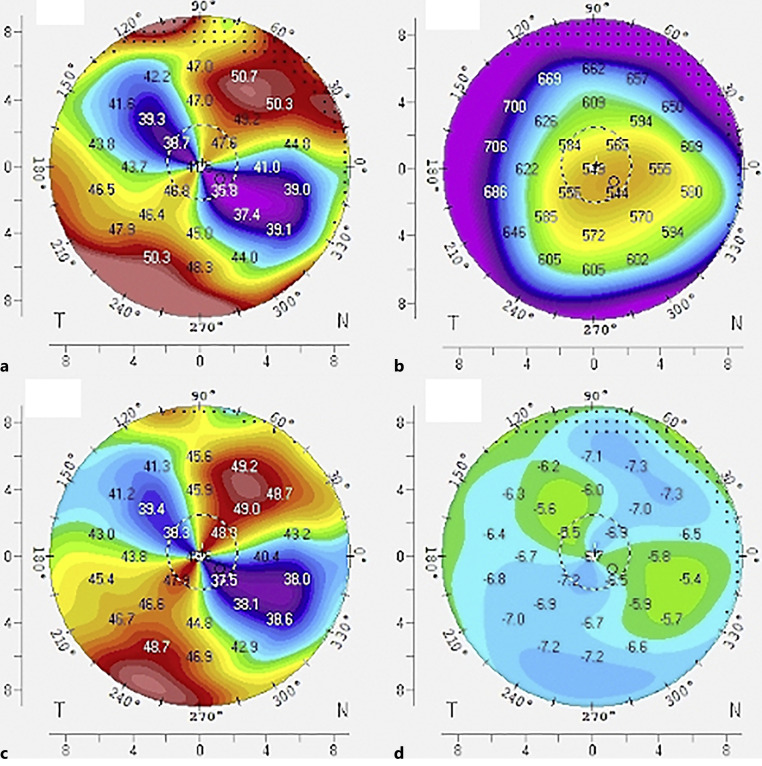
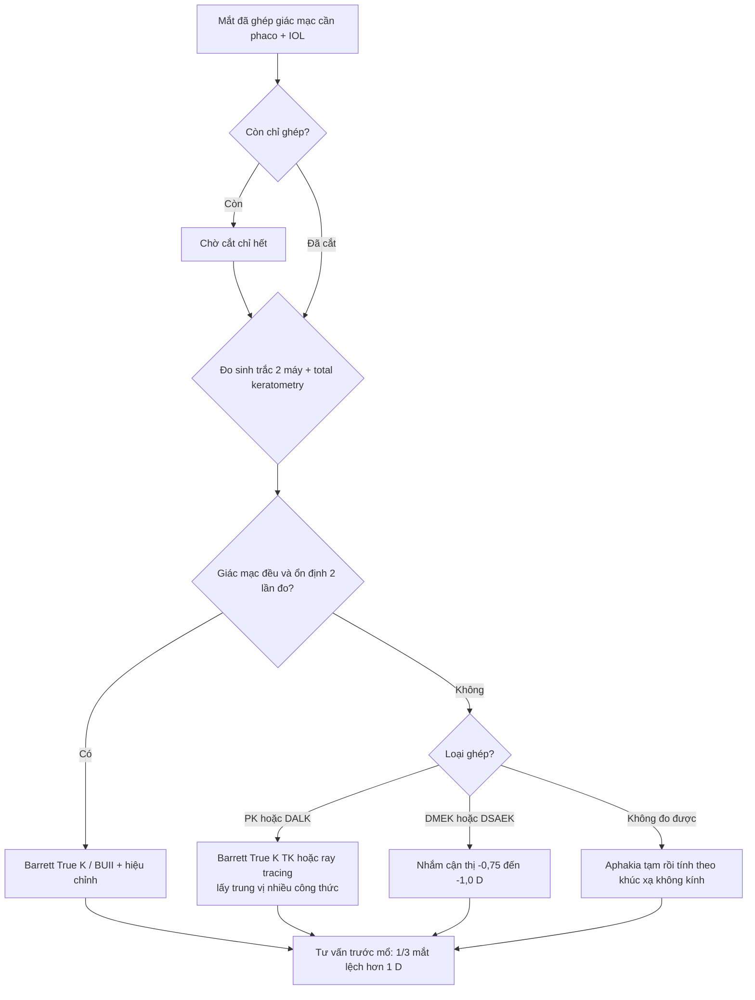
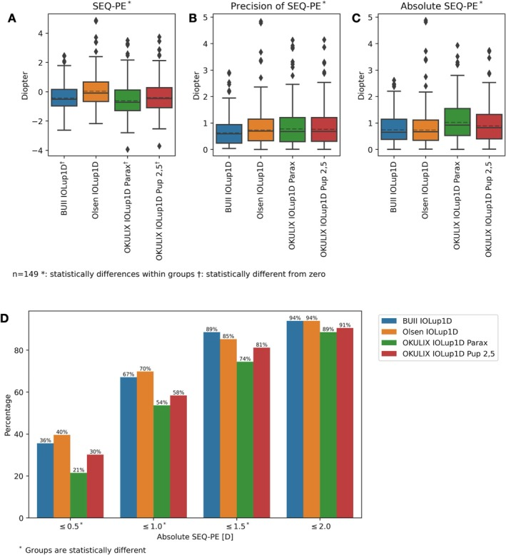

# 1462 — Sinh trắc và tính công suất IOL ở mắt đã ghép giác mạc / IOL power calculation in the post-keratoplasty eye

**Tags:** `pattern:giac-mac-khong-deu` `pattern:loan-thi-khong-deu` `pattern:lo-an-cau` `vung:mat` `vung:giac-mac` `vung:the-thuy-tinh` `vung:tien-phong` `anatomy:giac-mac` `protocol:Pentacam` `protocol:IOLMaster` `protocol:AS-OCT` `protocol:sinh-trac` `score:Barrett-True-K`
**Mức chắc chắn (certainty):** tổng hợp y văn (literature synthesis) — **90 mắt** PK/DALK trước–sau cắt chỉ (PMC13673811), **149 mắt** triple DMEK so 4 công thức (CC BY, PMC13462375), **111 mắt** loạn thị không đều so 2 máy đo (PMC12802219), bài tổng quan tính công suất IOL ca khó (PMC12685263) và **1 ca nguyên văn** có ảnh (PMC10359674). Câu nào là suy luận được ghi **[suy luận]**.

> **Vì sao bài này quan trọng:** [1454](../1454-dat-iol-mat-phacolytic/lesson.md) đã chốt **đặt IOL ở đâu** khi mất bao; câu hỏi trước đó một bước là **chọn công suất bao nhiêu** — và ở mắt đã ghép giác mạc, **mọi công thức cổ điển đều dựa trên một giả định đã bị phá vỡ**: tỷ lệ **bán kính mặt trước/mặt sau giác mạc là hằng số**. Cắt chỉ xong, công suất IOL tính lại **giảm trung bình 4,67 D** ở PK (PMC13673811) — tức là đo sai thời điểm **sai gần 5 độ**, đủ để biến một mắt "thành công" thành **lệch khúc xạ không thể chấp nhận**.

## 1. Tổng quan bệnh học – cơ chế hình ảnh

- **Giác mạc là hệ 2 mặt khúc xạ.** Máy đo giác mạc (keratometer) chỉ đo **bán kính mặt trước** rồi quy đổi ra công suất bằng **chiết suất quy ước 1,3375**, ngầm giả định **tỷ lệ mặt trước/mặt sau cố định 1,21** và **bề dày – chiết suất đồng nhất**. Ghép giác mạc phá cả ba giả định: mảnh ghép **dày hơn**, **mặt sau đổi cong độc lập** với mặt trước, và ở DALK/DSAEK còn có **mặt phân cách (interface)** tạo bậc khúc xạ.
- **Hai nguồn sai số độc lập** [suy luận từ cơ chế]: (1) **sai công suất giác mạc** (K đọc sai vì bỏ qua mặt sau); (2) **sai vị trí hiệu dụng của thấu kính (ELP)**, vì công thức thế hệ 3–4 ước tính ELP **từ chính K** — K sai thì ELP sai theo. Công thức **hai mặt phẳng (two-surface)** hoặc **ray tracing** cắt được vòng lặp này.
- **TẠI SAO cắt chỉ làm thay đổi lớn:** chỉ ghép giữ mảnh ghép ở tư thế **dẹt/ căng**; khi cắt hết chỉ, **mô ghép bung về hình dạng nội tại** → mặt trước **dốc lên** (Km tăng), **tiền phòng sâu hơn**, trong khi **trục nhãn cầu không đổi**.
  - **PK (n = 44):** Km trước **41,99 ± 4,84 → 46,37 ± 4,37 D** (p < 0,0001); loạn thị trước **6,22 ± 3,54 → 5,09 ± 2,72 D** (p = 0,049); loạn thị sau **1,24 ± 0,68 → 0,78 ± 0,62 D** (p < 0,0001); **AL 23,51 mm không đổi** (p = 0,361); **ACD 3,31 → 3,53 mm** (p < 0,0001); **công suất IOL 22,40 ± 5,13 → 17,73 ± 5,60 D**, mức giảm **−4,67 ± 5,42 D**.
  - **DALK (n = 46):** giảm **−2,49 ± 4,65 D** (PK vs DALK, p = 0,019); loạn thị trước **và sau đều không đổi** → **DALK ổn định hơn PK**, đúng vì mặt sau (nội mô chủ) được giữ nguyên.
  - **Yếu tố dự báo mức đổi công suất (hồi quy đa biến):** **Km trước trước khi cắt chỉ** và **chênh lệch đường kính mảnh ghép–giường ghép (host–donor disparity)** — hai biến này độc lập dự báo thay đổi công suất (PMC13673811).
- **TẠI SAO ghép nội mô (DMEK/DSAEK) lại gây viễn thị:** mảnh ghép nội mô làm **giác mạc dẹt đi** sau mổ; mức dẹt **tỷ lệ với độ dốc trước mổ** và **nghịch với tỷ lệ công suất mặt trước/mặt sau**. Vì vậy khi ghép đồng thời với phaco (triple DMEK), nên **nhắm cận thị −0,75 đến −1,0 D** để bù (PMC12685263).
- **Định lượng độ chính xác thực tế (triple DMEK, n = 149; PMC13462375):** **Barrett Universal II (BUII)** MAE **0,74 ± 0,65 D**, MedAE **0,60 D**, **72% mắt trong ± 1,00 D**; **Olsen ray tracing 1,06 ± 1,02 D**; **OKULIX 0,91–0,92 D**; chỉ **OKULIX paraxial** không lệch hệ thống (p = 0,450), ba phương pháp còn lại đều lệch có ý nghĩa. Sau hiệu chỉnh hồi cứu IOLup1D: trong **± 0,5 D** là **36% (BUII) / 40% (Olsen) / 21% / 30%**; trong **± 1,0 D** là **67% / 70% / 54% / 58%** — **1/3 mắt vẫn lệch > 1 D** dù dùng công thức tốt nhất.
- **TẠI SAO loạn thị không đều là bài toán riêng:** IOL toric chỉ sửa **thành phần đều (regular)** của loạn thị; phần không đều nằm lại. Trong **111 mắt** loạn thị không đều, nhóm **không đều vùng trung tâm (trong 3 mm)** có **loạn thị khúc xạ sau mổ lớn hơn** nhóm ngoại vi (3–7 mm), và **SimK từ sinh trắc quang học (IOLMaster 700) dự báo tốt hơn Pentacam** ở nhóm trung tâm — ưu thế này **không** có ở nhóm ngoại vi (PMC12802219).

## 2. Mẫu hình + chẩn đoán phân biệt theo vị trí (gamut)

**Câu hỏi trung tâm không phải "dùng công thức nào" mà "giác mạc này có đo được không".** Xếp theo **loại ghép × thời điểm**:

- **A. PK, chỉ còn / vừa cắt:** mặt trước **dốc, loạn thị không đều cao**, mặt sau đổi → **không dùng K quy ước**; ưu tiên **Barrett True K với total keratometry**, Haigis, hoặc **ray tracing**; nếu chỉ **vừa cắt chỉ < 1 tháng** → **đo lại** trước khi đặt IOL.
- **B. DALK:** mặt sau giữ nguyên → sai số **chủ yếu ở ELP**; công thức chuẩn chấp nhận được hơn PK nhưng vẫn **lệch cận thị trung bình** (Pellegrini: cả 8 công thức đều cho **prediction error cận thị**) (PMC12685263).
- **C. DSAEK/DMEK (đơn thuần hoặc triple):** **viễn thị không dự báo** là kiểu sai điển hình; ghép đồng thời → **nhắm −0,75 đến −1,0 D**; ghép nội mô **hai thì** (đã có IOL) → tính lại khúc xạ sau khi giác mạc ổn định, không vội đổi IOL.
- **D. Giác mạc biến dạng không do ghép** (keratoconus, sẹo, loạn dưỡng, sau LASIK/PRK/RK): cùng nguyên lý "mặt sau ≠ mặt trước" nhưng **hướng sai khác** — KC cho **kết quả cận thị** và độ chính xác **kém khi K ≥ 50,0 D**; sau LASIK/PRK/RK cho **viễn thị** (đo non công suất giác mạc).
- **E. Mắt đã có IOL, giác mạc ghép để lại loạn thị cao:** IOL trong bao **không đổi được công suất** → xử lý **thành phần đều** bằng **add-on toric IOL rãnh thể mi** hoặc **mổ khúc xạ trên giác mạc ghép** (ca nguyên văn: **−9,8 D @ 140°** sau cắt chỉ chọn lọc → add-on toric **+11,0 D @ 50°** → khúc xạ cuối **+1,0 −2,0 × 105**, **SE 0,0 D**, BCVA **20/25** sau 1 năm) (PMC10359674).

**Gamut "vì sao công suất tính ra vẫn sai"** [suy luận]: K mặt trước sai do bỏ mặt sau; ELP sai vì K dùng trong công thức; AL đo xuyên mảnh ghép đục/sẹo; loạn thị không đều làm **SimK phụ thuộc vùng đo** (3 mm vs 4 mm); trục toric đặt sai ở giác mạc méo; công thức chọn **không có số hạng mặt sau**.

## 3. Bảng so sánh phân biệt (ma trận đối chiếu)

| Thực thể (entity) | Hình ảnh/chỉ định điển hình | Chốt vào (rule-in) | Chốt loại (rule-out) | Gợi ý xác nhận |
|---|---|---|---|---|
| **PK, chỉ đã cắt hết** | Km trước **dốc, tăng sau cắt chỉ** (41,99 → 46,37 D), loạn thị **6,22 → 5,09 D**, ACD tăng, **AL không đổi** | **Đường ghép + chỉ + Km trước tăng ≥ 4 D sau cắt chỉ** | AL đổi theo → nghĩ **đo AL sai** hoặc **mắt đang thay đổi thể tích**, không phải hình dạng ghép | Pentacam AXL + IOLMaster 700, chụp lại **1 tháng sau cắt chỉ** (PMC13673811) |
| **DALK** | Mặt sau **không đổi** (loạn thị sau 1,13 → 1,12 D), Km trước tăng, công suất **−2,49 D** | **Mặt phân cách nông + mặt sau nguyên + Km trước tăng sau cắt chỉ** | Loạn thị sau **giảm rõ** → nghi tổn thương nội mô/mảnh ghép xuyên, không phải DALK thuần | AS-OCT mặt phân cách, so loạn thị sau 2 lần đo |
| **Triple DMEK** | Giác mạc **dẹt dần** sau mổ, **viễn thị không dự báo**, MAE BUII **0,74 D**, **72% trong ± 1 D** | **Ghép nội mô + phaco cùng thì + giác mạc dốc trước mổ** | Nếu **cận thị nhiều** sau mổ → nghi **công thức dùng K quá cao** hoặc **mảnh ghép bong** (bài 1445) | Pentacam AXL đo **total keratometry**, chọn Barrett True K TK |
| **Loạn thị không đều vùng trung tâm (≤ 3 mm)** | Bản đồ **không đều trong 3 mm**, loạn thị khúc xạ sau mổ **lớn hơn** nhóm ngoại vi | **Bất thường trong 3 mm trên bản đồ hiệu lực khúc xạ** | Bất thường **3–7 mm** đơn thuần → **không** kết luận kém chính xác theo máy | So **SimK IOLMaster** vs **Pentacam**; ưu tiên SimK ở nhóm trung tâm (PMC12802219) |
| **Keratoconus chưa ghép** | K **≥ 50,0 D** → sai số tăng rõ; **cận thị** là kiểu sai | **K ≥ 50,0 D + bản đồ chóp** | K < 50,0 D và bản đồ đều → dùng công thức chuẩn | Barrett True K (KC), Kane KC (PMC12685263) |
| **Sau LASIK/PRK/RK** | **Viễn thị không dự báo**, K đo **thấp hơn** công suất thật | **Tiền sử mổ khúc xạ + chênh K so với khúc xạ trước mổ** | Bản đồ đều + tiền sử âm → không cần công thức hậu khúc xạ | ASCRS calculator, Barrett True-K TK, Hoffer QST (PMC12685263) |
| **Mắt pseudophakic + loạn thị ghép cao** | **−9,8 D @ 140°** sau cắt chỉ chọn lọc, IOL trong bao không đổi được | **Loạn thị đều ≥ 3–4 D, giác mạc trong, trục ổn định** | Loạn thị **không đều chiếm ưu thế** → add-on toric **không** hiệu quả [suy luận] | Add-on toric rãnh thể mi theo khúc xạ chủ quan (PMC10359674) |

*Mắt pseudophakic sau PK, loạn thị cao: (a) công suất khúc xạ toàn giác mạc, (b) bề dày, (c) độ cong trục trước, (d) độ cong trục sau. Trục trước lệch tâm và không đối xứng, trục sau không "đi kèm" trục trước — đúng lý do K quy ước sai. Nguồn: Cid-Bertomeu P et al., Case Rep Ophthalmol 2023 (PMC10359674), CC BY-NC.*

### Dấu hiệu cần đọc trên từng bản đồ

- **Bản đồ hiệu lực khúc xạ toàn giác mạc (total corneal refractive power):** dùng số **trung bình vùng 3–4 mm**, không lấy điểm cao nhất — đây là con số đưa vào công thức.
- **Bản đồ độ cong trục sau:** nếu trục sau **không cùng hướng** với trục trước → **thành phần không đều** đang chi phối; IOL toric chỉ sửa được phần đều.
- **Bề dày – mặt phân cách:** mặt phân cách dày/ lệch làm **bậc khúc xạ**; AS-OCT xác nhận vị trí mảnh ghép trước khi tin số đo.

## 4. Protocol chụp + hệ phân độ/điểm chuẩn hóa

**Thời điểm (quan trọng hơn thiết bị):**
1. **Ghép hai thì:** cắt chỉ → chờ **1 tháng** rồi đo sinh trắc (mốc của PMC13673811), và lý tưởng là **2 lần cách nhau 1 tháng cho khúc xạ/ Km ổn định** trước khi đặt IOL; với PK nhiều chỉ, có thể cần **3–12 tháng** sau cắt chỉ cuối [suy luận].
2. **Ghép đồng thời (triple):** sinh trắc **trước mổ** bằng **2 thiết bị** (Scheimpflug + SS-OCT), dùng **total keratometry**; nhắm **−0,75 đến −1,0 D** với DMEK.
3. **Không đo được đáng tin** (giác mạc quá đục, loạn thị cực cao): cân nhắc **để aphakia** rồi tính công suất từ **khúc xạ không kính (aphakic refraction)** — phương pháp mô hình giác mạc 2 mặt cho thấy sai số phụ thuộc chủ yếu vào **ELP** (PMC13396038).

**Thiết bị:** SS-OCT biometer (IOLMaster 700 / Argos / Anterion) **+** Scheimpflug (Pentacam AXL) — **hai máy, hai nguyên lý**; AS-OCT khi cần xác nhận mảnh ghép/mặt phân cách.

**Chọn công thức (thứ tự thực hành):**

| Bối cảnh | Công thức ưu tiên | Vì sao |
|---|---|---|
| PK / DALK, giác mạc không đều | **Barrett True K + TK**, Haigis, Holladay 2; **ray tracing (OKULIX, Olsen, PhacoOptics)** | Ray tracing mô phỏng tia qua **2 mặt**, không cần K quy ước; OKULIX paraxial không lệch hệ thống ở 149 mắt triple DMEK |
| Triple DMEK/DSAEK | Barrett True K TK, BUII + hiệu chỉnh; **nhắm −0,75 đến −1,0 D** | Giác mạc dẹt sau mổ; BUII MAE **0,74 D** |
| KC (K ≥ 50 D) | **Barrett True K (KC)**, Kane KC | Công thức riêng cho chóp; 72%/71%/60% trong ± 0,5 D |
| Sau LASIK/PRK/RK | **ASCRS calculator**, Barrett True-K TK, Pearl-DGS, EVO 2.0, Hoffer QST | Có số hạng **mặt sau**; ASCRS > 1 triệu lượt dùng/năm |
| Không tin được sinh trắc | **Aphakic refraction** | Bỏ hẳn bước ước tính K |

**Phân tầng kỳ vọng để tư vấn (dùng số, không hứa):** triple DMEK — **72%** trong ± 1,00 D; PK — công suất **thay đổi 4,67 D** chỉ vì cắt chỉ; loạn thị không đều trung tâm — **kém chính xác hơn** nhóm ngoại vi. Nếu bệnh nhân **một mắt**, **nghề cần thị lực không kính**, hoặc **đã có loạn thị không đều lớn**, hãy chọn **để lại cận thị nhẹ có chủ đích** thay vì đuổi "chính thị" [suy luận].

## 5. Biến thể bình thường và cạm bẫy

- **Biến thể bình thường:** mặt phân cách DALK/DSAEK **mảnh, đều, không ngấm** không làm sai công suất đáng kể; **đường ghép xa trục thị giác** ít ảnh hưởng K trung tâm.
- **Cạm bẫy 1 — đo trước khi cắt chỉ:** sai **gần 5 D** ở PK; "đo rồi mổ luôn" là nguyên nhân lệch khúc xạ phổ biến nhất [suy luận từ PMC13673811].
- **Cạm bẫy 2 — dùng SimK của máy đo giác mạc:** bỏ qua mặt sau; ở giác mạc ghép, **sai số mặt sau không còn bù trừ** như giác mạc nguyên vẹn.
- **Cạm bẫy 3 — AL đo xuyên sẹo/ phù:** bỏ sót **AL ngắn giả**; kiểm bằng **AL hai mắt** và **chiều sâu tiền phòng**.
- **Cạm bẫy 4 — toric IOL trên giác mạc méo:** đặt trục trên **thành phần đều**, không đặt theo **trục bản đồ**; nếu **không đều chiếm ưu thế**, lựa chọn đúng là **IOL phi toric + phục hồi thị lực bằng kính tiếp xúc cứng** [suy luận].
- **Cạm bẫy 5 — satisfaction of search:** thấy khúc xạ lệch sau ghép rồi **đổi IOL**, trong khi nguyên nhân là **mảnh ghép bong/ lệch trục** (bài [1445](../1445-bong-manh-ghep-dsaek-dmek-rebubble/lesson.md)).
- **Cạm bẫy 6 — "máy mới là đủ":** cùng một giác mạc, **IOLMaster và Pentacam cho SimK khác nhau**; ở loạn thị không đều trung tâm, chênh này **đổi kết quả phẫu thuật** (PMC12802219).

## 6. Tự lượng giá — Blind Quiz

**Ca 1 — nam 79 tuổi, mắt phải đã phaco + DSAEK thất bại → PK, nay giác mạc trong**

- Gợi ý lâm sàng: đã có IOL trong bao, sau cắt chỉ chọn lọc còn **loạn thị cao**, giác mạc trong.
- Câu hỏi: Bản đồ (a)–(d) nói gì về **mặt sau**? Vì sao **không** tính lại công suất IOL trong bao? Hai cách xử lý khả dĩ?

<b>Bấm để hiện đáp án (findings + chẩn đoán)</b>

- Dấu hiệu: **công suất khúc xạ toàn giác mạc lệch tâm** (a), **trục trước dốc không đối xứng** (c), **trục sau không cùng hướng** (d) — hình dạng ghép méo, không phải "giác mạc nguyên vẹn có loạn thị đều".
- Chẩn đoán: **loạn thị cao sau PK ở mắt pseudophakic**; IOL trong bao **không thay đổi công suất được** → xử lý **thành phần đều**.
- Xử trí trong ca gốc: **add-on toric IOL rãnh thể mi** +11,0 D @ 50° tính theo **khúc xạ chủ quan**; kết quả **+1,0 −2,0 × 105**, **SE 0,0 D**, **BCVA 20/25** sau 1 năm.
- Nguồn ảnh: Cid-Bertomeu P et al., Case Rep Ophthalmol 2023;14:307–313 (PMC10359674), **CC BY-NC**.

**Ca 2 — 149 mắt Fuchs được phaco + DMEK cùng thì: công thức nào đáng tin?**

- Gợi ý lâm sàng: giác mạc Fuchs dốc trước mổ, ghép nội mô đồng thời.
- Câu hỏi: Đọc panel D — trong **± 0,5 D** và **± 1,0 D**, phương pháp nào tốt nhất? Vì sao "tốt nhất" vẫn chưa đủ để hứa chính thị?

<b>Bấm để hiện đáp án (findings + chẩn đoán)</b>

- Dấu hiệu (panel D): trong **± 0,5 D** — BUII **36%**, Olsen **40%**, OKULIX paraxial **21%**, OKULIX 2,5 mm **30%**; trong **± 1,0 D** — **67% / 70% / 54% / 58%**; trong **± 1,5 D** — **89% / 85% / 74% / 81%**; trong **± 2,0 D** — **94% / 94% / 89% / 91%**.
- Panel A–C: **Olsen lệch dương (viễn thị) rõ** (trung vị ~+0,6 D), BUII và OKULIX paraxial **không lệch hệ thống**.
- Kết luận: **BUII MAE 0,74 ± 0,65 D**, MedAE 0,60 D, **72% trong ± 1,00 D** (toàn bộ mắt); **1/3 mắt lệch > 1 D** → phải nói trước mổ, và **nhắm cận thị nhẹ −0,75 đến −1,0 D**.
- Nguồn ảnh: Weber JO et al., Clin Exp Ophthalmol 2026;54:769–778 (PMC13462375), **CC BY 4.0**.

**Ca 3 — 90 mắt PK/DALK: cắt chỉ xong có phải đo lại?**

- Gợi ý lâm sàng: bệnh nhân đã ghép 1 năm, chỉ còn 4 mũi, đang chờ phaco; sinh trắc đo **trước** khi cắt chỉ.
- Câu hỏi: Nếu vẫn dùng số đo cũ, xu hướng sai là gì và bao nhiêu độ? Yếu tố nào dự báo mức sai?

<b>Bấm để hiện đáp án (findings + chẩn đoán)</b>

- Dấu hiệu: sau cắt chỉ, **Km trước tăng** (PK **41,99 → 46,37 D**), **ACD tăng** (3,31 → 3,53 mm), **AL không đổi** (23,51 mm).
- Chẩn đoán/hệ quả: công suất IOL tính lại **giảm −4,67 ± 5,42 D** ở PK và **−2,49 ± 4,65 D** ở DALK → dùng số cũ sẽ **cận thị nặng** (đặt công suất cao hơn cần thiết).
- Yếu tố dự báo: **Km trước trước khi cắt chỉ** và **chênh đường kính mảnh ghép–giường ghép**.
- Nguồn: Sahutoglu E et al., BMC Ophthalmol 2026;26:658 (PMC13673811), CC BY-NC-ND.

## Bài liên quan chéo

- [1454 – Đặt IOL ở mắt đã phacolytic: chọn vị trí IOL theo tình trạng bao–zonule](../1454-dat-iol-mat-phacolytic/lesson.md)
- [1445 – Bong mảnh ghép DSAEK/DMEK: phân biệt "giác mạc phù do bong" với "khúc xạ lệch do công thức"](../1445-bong-manh-ghep-dsaek-dmek-rebubble/lesson.md)
- [1452 – Glôcôm do thể thủy tinh chưa mổ: khi nào phải lấy thể thủy tinh](../1452-glaucom-do-the-thuy-tinh-chua-mo/lesson.md)
- [1451 – Keratoconus: CXL và bản đồ giác mạc](../1451-vkc-keratoconus-cxl/lesson.md)

## Ảnh

- `1462_sinh-trac-iol_Pentacam-post-PKP_CaseRep2023-F2.jpg` — Cid-Bertomeu P et al. (PMC10359674), **CC BY-NC**, nguyên bản không cắt.
- `1462_sinh-trac-iol_PE-formulas-DMEK_ClinExpOph2026-F2.jpg` — Weber JO et al. (PMC13462375), **CC BY 4.0**, nguyên bản không cắt.
- Chi tiết giấy phép từng ảnh: `images/CREDITS.md`.

> Không dùng để chẩn đoán độc lập khi chưa có người hướng dẫn.
