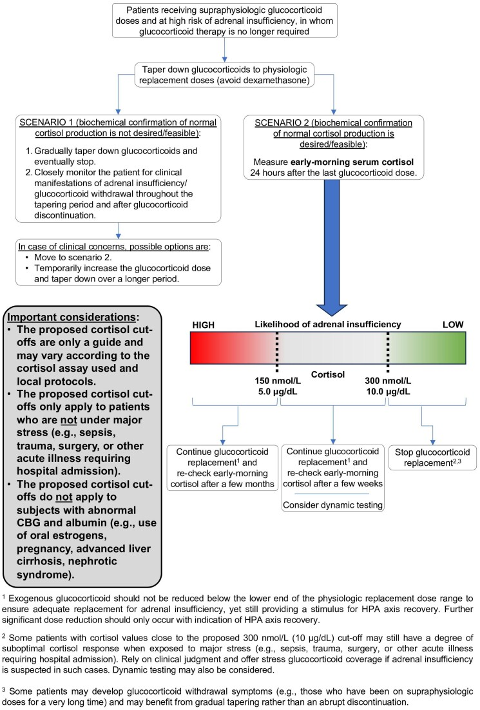
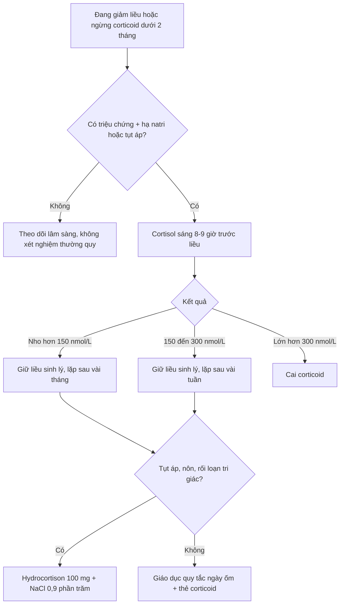
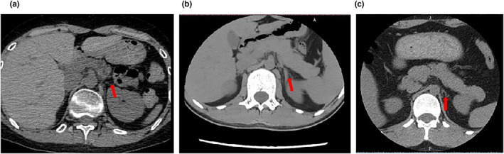
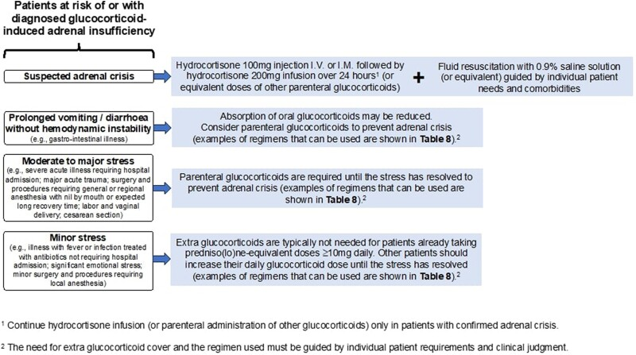

# 1463 — Suy thượng thận thứ phát do corticoid kéo dài: ngưỡng cortisol, lịch giảm liều và cạm bẫy "tuyến thượng thận teo" / Glucocorticoid-induced adrenal insufficiency

**Tags:** `pattern:suy-thuong-than` `pattern:teo-tuyen` `pattern:ha-natri` `vung:hau-phuc-mac` `protocol:CT-thuong-than` `protocol:MRI-tuyen-yen` `score:cosyntropin-250mcg`

**Mức chắc chắn (certainty):** tổng hợp y văn (literature synthesis) — số liệu lấy từ **hướng dẫn chung ESE–Endocrine Society 2024** (PMC11180513, CC BY-NC 4.0), **đoàn hệ 371 bệnh nhân cơn suy thượng thận** (PMC11685088, CC BY), **đoàn hệ giảm liều prednisolone 2019–2024** (PMC12811712, CC BY 4.0), **đoàn hệ nhi khoa 92 ca** (PMC9798323, CC BY) và **ca teo thượng thận trên CT** (PMC10265046, CC BY). Nhóm **không có bệnh nhân của mình**.

> **Câu chốt:** đây là chẩn đoán **sinh hóa, không phải chẩn đoán hình ảnh** — trên CT/MRI tuyến thượng thận của bệnh nhân suy do corticoid **thường chỉ teo nhẹ, đối xứng, không có ngưỡng mm nào phân biệt được với người bình thường**. Bốn con số phải thuộc: **(1)** nguy cơ chỉ đáng kể khi dùng **≥ 3–4 tuần** với liều **trên ngưỡng sinh lý** (hydrocortison 15–25 mg/ngày; prednisolon 4–6 mg; dexamethason 0,25–0,5 mg); **(2)** cortisol sáng **> 300 nmol/L (10 µg/dL)** → cai được; **150–300** → giữ liều sinh lý, **lặp sau vài tuần**; **< 150 nmol/L (< 5 µg/dL)** → giữ liều, **lặp sau vài tháng**; **(3)** test cosyntropin **250 µg** đỉnh **< 500 nmol/L (18,1 µg/dL)** = suy; **(4)** cơn suy thượng thận: **hydrocortison 100 mg** tĩnh mạch/bắp rồi **200 mg/24 giờ** + **NaCl 0,9%**.

## 1. Tổng quan bệnh học – cơ chế hình ảnh

### 1.1 Vì sao corticoid ngoại sinh làm tuyến teo — và vì sao aldosteron vẫn bình thường

- **Trục HPA bình thường:** hạ đồi tiết CRH → tuyến yên tiết ACTH → vỏ thượng thận tiết cortisol. Cortisol **ức chế ngược** lên cả hạ đồi và tuyến yên; đây là vòng điều hòa âm.
- **Corticoid ngoại sinh** gắn thụ thể glucocorticoid ở hạ đồi–tuyến yên mạnh hơn cortisol nội sinh, nên **CRH và ACTH bị khóa ở mức thấp** ngay từ ngày đầu. Khi ACTH thấp kéo dài, **zona fasciculata và zona reticularis teo** (giảm khối tế bào, giảm mao mạch xoang) → tuyến **mảnh, nhỏ, đối xứng**.
- **TẠI SAO không tăng kali:** aldosteron do **hệ renin–angiotensin–aldosteron** điều khiển, không phụ thuộc ACTH. Vì vậy suy thượng thận **thứ phát** có **hạ natri** nhưng **kali bình thường**, khác hẳn bệnh Addison (suy nguyên phát: **hạ natri + tăng kali + tăng sắc tố**).
- **TẠI SAO hạ natri:** cortisol thiếu làm **ADH tăng** (mất ức chế trực tiếp) và giảm mức lọc cầu thận → giữ nước tự do → **hạ natri pha loãng**, không phải mất muối qua thận.
- **TẠI SAO hạ đường huyết và tăng bạch cầu ái toan:** cortisol là hormone **tăng đường huyết** (tân tạo đường) và **giảm bạch cầu ái toan**; thiếu cortisol → đường huyết đói thấp, **bạch cầu ái toan tăng** — dấu hiệu này xuất hiện trong đoàn hệ 371 ca và là một trong các biến số độc lập dự báo cơn suy thượng thận (PMC11685088).
- **TẠI SAO teo tuyến thấy được trên CT chứ không chẩn đoán được:** ACTH thấp làm **giảm thể tích vỏ thượng thận** sau nhiều tháng, nhưng tuyến bình thường vốn đã **mảnh vài mm**, và ngưỡng teo **chồng lấp hoàn toàn** với người gầy, người cao tuổi. Hình ảnh chỉ trả lời câu hỏi **"có nguyên nhân khác không"** (xuất huyết, di căn, lao, u tuyến yên), **không trả lời "có suy thượng thận không"**.

### 1.2 Các con số quyết định (ngưỡng liều – thời gian – tỷ lệ)

- **Định nghĩa "dùng kéo dài" (ESE/ES 2024):** **> 3–4 tuần** với liều **trên ngưỡng sinh lý**. Ngưỡng sinh lý/ngày: **hydrocortison 15–25 mg**, **prednison/prednisolon 4–6 mg**, **methylprednisolon 3–5 mg**, **dexamethason 0,25–0,5 mg** (PMC11180513).
- **Dưới 3–4 tuần:** không cần giảm liều từ từ và không cần test trục, **bất kể liều** (khuyến cáo 2.1).
- **Tỷ lệ suy thượng thận do corticoid (gộp phân tích):** đường **uống 48,7%** (KTC 95%: 36,9–60,6), **tiêm trong khớp 52,2%** (40,5–63,6), **đường mũi 4,2%** (0,5–28,9) (PMC11180513).
- **Hồi phục theo thời gian:** nhóm dùng ngắn (141 bệnh nhân) suy giảm từ **38,7%** xuống **14,9%** sau **4 tuần**; nhóm dùng dài (174 bệnh nhân) từ **56,4%** xuống **25,3%** sau **6 tháng** (PMC11180513 dẫn Broersen và cs).
- **Giảm liều ở vùng sinh lý có tác dụng thật:** mỗi **1 mg prednisolon giảm** làm cortisol nền **tăng 48,8 nmol/L** (KTC 95%: 30,6–67,0); **38/47 (81%)** bệnh nhân cai được hoàn toàn; liều trung vị lúc chuyển chuyên khoa **5 mg**, thời gian dùng trung vị **23 tháng** (PMC12811712).
- **Trẻ em:** cortisol sáng **< 144 nmol/L** dự báo suy thượng thận với **độ đặc hiệu 94%**; **> 317 nmol/L** dự báo trục bình thường với **độ nhạy 95%** → có thể bỏ **~50%** test động (PMC9798323). Test **liều thấp 1 µg** dùng cortisol đỉnh **< 500 nmol/L** làm ngưỡng.
- **Cơn suy thượng thận:** trong **371** bệnh nhân suy do corticoid nhập viện (đoàn hệ hồi cứu một trung tâm tại Vân Nam, 2014–2023), **13,75%** có cơn suy thượng thận trong đợt nằm viện; tử vong nội viện **62,75%** so với **44,06%** ở nhóm không có cơn (PMC11685088). **Nhiễm trùng, triệu chứng tâm thần, natri máu, albumin, NLR, ELR** là yếu tố độc lập.

## 2. Mẫu hình + chẩn đoán phân biệt theo bối cảnh (gamut)

Mẫu hình lâm sàng–xét nghiệm cần nhận ra: **mệt – chóng mặt khi đứng – buồn nôn – hạ natri – hạ đường huyết – tăng bạch cầu ái toan**, xuất hiện **khi đang giảm liều hoặc trong 1–2 tháng sau ngừng corticoid**, ở người có tiền sử dùng corticoid ≥ 3–4 tuần.

- **Theo thời điểm:** (a) **đang giảm liều trong vùng trên sinh lý** → phần lớn là **hội chứng cai corticoid**, chưa phải suy thượng thận; (b) **đang ở liều sinh lý hoặc đã ngừng < 2 tháng** → vùng suy thượng thận thật; (c) **> 1 năm sau ngừng** → hiếm, nhưng có thể còn suy nếu dùng liều cao rất dài.
- **Theo mức độ:** **nhẹ** (chỉ mệt, cortisol 150–300) → **trung bình** (hạ natri, tụt áp khi đứng) → **cơn suy thượng thận** (tụt áp, nôn, rối loạn tri giác, sốc).
- **Theo cơ chế khác cần loại trừ:** **nhiễm trùng huyết** (nguyên nhân hạ áp hay gặp nhất và cũng là yếu tố khởi phát cơn), **suy thượng thận nguyên phát** (Addison, xuất huyết thượng thận, di căn, lao), **suy tuyến yên** (u tuyến yên, sau xạ sọ, sau mổ, hội chứng Sheehan), **SIADH**, **suy giáp**, **bệnh lí tuyến yên sau xạ toàn sọ**.

## 3. Bảng so sánh phân biệt (ma trận đối chiếu)

| Thực thể (entity) | Hình ảnh / xét nghiệm điển hình | Chốt vào (rule-in) | Chốt loại (rule-out) | Gợi ý xác nhận |
|---|---|---|---|---|
| **Suy thượng thận do corticoid (GIAI)** | CT: tuyến thượng thận **mảnh, đối xứng**, không khối; cortisol sáng thấp; ACTH **thấp hoặc bình thường thấp** | **Tiền sử ≥ 3–4 tuần corticoid trên ngưỡng sinh lý** + cortisol sáng **< 150 nmol/L** hoặc đỉnh cosyntropin **< 500 nmol/L** | Kali **bình thường**, không tăng sắc tố, aldosteron–renin bình thường → không phải Addison | cortisol sáng 8–9 giờ **trước liều**, test cosyntropin **250 µg**, ACTH |
| **Suy thượng thận nguyên phát (Addison)** | CT: tuyến **nhỏ, có vôi hóa** (lao, xuất huyết cũ) hoặc **to–không đồng nhất** (di căn, nấm, xuất huyết) | **Hạ natri + TĂNG kali**, tăng sắc tố, ACTH **tăng cao**, renin tăng | Kali bình thường + ACTH thấp → không phải nguyên phát | ACTH, renin, aldosteron, kháng thể 21-hydroxylase, CT thượng thận |
| **Suy tuyến yên (nhiều trục)** | MRI: u tuyến yên, hội chứng **yên rỗng**, sau xạ/mổ, ngấm thuốc bất thường | Thiếu **≥ 2 trục** (TSH/FSH/GH), cortisol thấp, ACTH **thấp** | Chỉ một trục cortisol + tiền sử corticoid rõ → GIAI | MRI tuyến yên có/không cản quang, các hormone nền |
| **Hội chứng cai corticoid** | Hình ảnh **bình thường**; cortisol có thể **bình thường** vì liều còn trên sinh lý | Triệu chứng khi **giảm liều nhưng tổng liều vẫn trên sinh lý** (prednisolon **> 5 mg**) | Cortisol thấp + đang ở ngưỡng sinh lý → là suy thật, không phải cai | Đánh giá lại **sau khi giảm chậm**, không tăng liều mù |
| **Sốc nhiễm khuẩn** | CT: ổ nhiễm, tuyến thượng thận có thể **xuất huyết hai bên** (rìa tăng đậm, không ngấm) | Sốt, CRP/PCT cao, ổ nhiễm rõ, lactate cao | Không ổ nhiễm + cortisol thấp + tiền sử corticoid → nghĩ GIAI | Cấy máu, CT ổ nhiễm, cortisol **khi sốc** (không chờ) |

*Hình 2 của hướng dẫn ESE–Endocrine Society 2024: giảm liều đến ngưỡng sinh lý rồi đo cortisol sáng **24 giờ sau liều cuối**; 150–300 nmol/L giữ liều và lặp sau vài tuần, < 150 lặp sau vài tháng. Nguồn: Beuschlein F et al, *J Clin Endocrinol Metab* 2024 (PMC11180513), CC BY-NC 4.0.*

## 4. Protocol chụp – xét nghiệm – lịch giảm liều và xử trí cơn

### 4.1 Xét nghiệm (quyết định chẩn đoán)

1. **Cortisol sáng 8–9 giờ**, lấy **trước liều corticoid**, tốt nhất **24 giờ sau liều cuối** nếu đang dùng liều một lần/ngày (PMC11180513).
2. **Ngưỡng đọc:** **> 300 nmol/L (10 µg/dL)** = trục đủ → **cai được**; **150–300 nmol/L** = giữ liều sinh lý, **lặp sau vài tuần**; **< 150 nmol/L (< 5 µg/dL)** = giữ liều, **lặp sau vài tháng**.
3. **Test cosyntropin 250 µg** (Synacthen): cortisol **đỉnh 30–60 phút < 500 nmol/L (18,1 µg/dL)** = suy thượng thận; đây là ngưỡng của cả suy nguyên phát và thứ phát (PMC11180513).
4. **Trẻ em:** dùng **test liều thấp 1 µg** với ngưỡng cortisol **< 500 nmol/L sau 20 phút**; cortisol sáng **< 144 nmol/L** đủ gợi ý, **> 317 nmol/L** loại trừ (PMC9798323).
5. **ACTH nền:** thấp trong GIAI, **tăng cao** trong Addison — đây là xét nghiệm rẻ nhất để phân biệt thứ phát/nguyên phát.
6. **Không làm test động thường quy** cho người đang giảm liều (khuyến cáo 2.8): kết quả dễ gây tăng liều oan.

### 4.2 Lịch giảm liều (hai pha)

- **Pha trị liệu:** giảm nhanh khi liều còn cao (**> 30 mg prednisolon/ngày**), vì mục tiêu là kiểm soát bệnh nền.
- **Pha nội tiết:** khi đã về **4–6 mg prednisolon**, **giảm chậm, từng 1 mg**, và **không giảm dưới ngưỡng thay thế** (hydrocortison **15–25 mg/ngày**) để vừa đủ thay thế vừa còn kích thích trục hồi phục (PMC11180513). Mỗi 1 mg giảm cho **+48,8 nmol/L** cortisol nền (PMC12811712).
- **Đổi thuốc:** **dexamethason/betamethason dài tác** → chuyển sang **hydrocortison hoặc prednison** trước khi giảm, vì khó hiệu chỉnh liều và ức chế trục mạnh (khuyến cáo 2.5).
- **Giáo dục bệnh nhân:** thẻ corticoid, dấu hiệu suy thượng thận, **quy tắc ngày ốm**, không tự ngừng.

### 4.3 Liều khi stress (bắt buộc biết)

- **Cơn suy thượng thận:** **hydrocortison 100 mg** tĩnh mạch/bắp, sau đó **200 mg/24 giờ** (truyền hoặc chia liều) + **NaCl 0,9%** theo huyết áp/natri; **không chờ kết quả cortisol** (PMC11180513).
- **Nôn kéo dài/tiêu chảy, không sốc:** cân nhắc **corticoid đường tiêm** vì hấp thu uống giảm.
- **Stress vừa–nặng** (nhiễm trùng nhập viện, mổ lớn, chấn thương): **corticoid thêm cho đến khi hết stress**.
- **Stress nhẹ** (sốt, nhiễm trùng điều trị ngoại trú, thủ thuật nhỏ): **không cần thêm** nếu đang dùng **≥ 10 mg prednisolon/ngày**; nếu thấp hơn thì **tăng liều tạm** đến khi hết stress.

### 4.4 Protocol hình ảnh (khi nào chụp, chụp gì)

- **Mặc định: KHÔNG chụp** để chẩn đoán GIAI — hình ảnh không đủ đặc hiệu.
- **CT thượng thận lát mỏng ≤ 2 mm, có cản quang** khi: hạ natri + **tăng kali** (gợi ý nguyên phát), đau hố thận, sốc nhiễm khuẩn, tiền sử ung thư (di căn thượng thận), lao.
- **MRI tuyến yên có/không cản quang** khi: thiếu **trục khác**, đau đầu/thị trường, sau xạ sọ, prolactin cao, hoặc cortisol thấp mà **không có tiền sử corticoid**.
- **Đo mật độ:** tuyến thượng thận bình thường **30–40 HU** chưa cản quang; **xuất huyết cấp 50–90 HU**; **mỡ −40 đến −120 HU**; **di căn thường 20–45 HU** và **ngấm thuốc** — dùng để phân biệt nguyên nhân cấu trúc, không dùng để chẩn đoán GIAI.
- **Không dùng PET/CT thường quy** cho tuyến thượng thận: FDG sinh lý **SUVmax 0,83–0,95** chồng lấp với tổn thương lành tính (PMC11919078).

## 5. Biến thể bình thường và cạm bẫy

- **"Tuyến thượng thận teo" không phải chẩn đoán.** Teo nhẹ, đối xứng gặp ở người gầy, cao tuổi, sau dùng corticoid kéo dài, và trong **giảm sản thượng thận bẩm sinh** — không có ngưỡng mm chuẩn hóa. Ảnh dưới là ca **giảm sản thượng thận liên kết X (NR0B1)**: tuyến teo ở tuổi 25 nhưng còn dày ở tuổi 17 — chứng minh **kích thước thay đổi theo thời gian**, không phải dấu chẩn đoán một thời điểm.

*Ba lát CT: (a) bệnh nhân 1 — tuyến thượng thận teo; (b) bệnh nhân 2 lúc 17 tuổi — tuyến còn dày; (c) cùng bệnh nhân lúc 25 tuổi — đã teo (mũi tên đỏ). Nguồn: Jiang Y et al, *Mol Genet Genomic Med* 2023 (PMC10265046), CC BY 4.0.*

- **Nhầm hội chứng cai với suy thượng thận:** khi tổng liều còn **trên sinh lý**, triệu chứng mệt/đau khớp là **cai corticoid**, không phải thiếu cortisol; tăng liều lại sẽ làm trục tiếp tục bị khóa.
- **Cortisol "bình thường cao" giả:** prednisolon phản ứng chéo với một số **immunoassay cortisol** → cortisol đo được cao giả trong khi trục vẫn khóa. Hỏi phòng xét nghiệm và ưu tiên **LC–MS/MS** khi nghi ngờ.
- **CBG/albumin thay đổi:** dùng **estrogen, có thai, xơ gan, hội chứng thận nhiễm mỡ** làm cortisol toàn phần sai lệch — hướng dẫn 2024 loại các nhóm này khỏi ngưỡng 150/300 (PMC11180513).
- **Yên rỗng trên MRI là bất thường tình cờ:** gặp ở 5–35% người bình thường, **không chứng minh suy tuyến yên**; chỉ có giá trị khi kèm thiếu trục khác.
- **Suy thượng thận do corticoid + nhiễm trùng:** bệnh nhân vừa dùng dexamethason liều cao (ví dụ phác đồ ICANS sau CAR-T) vừa sốt — **nhiễm trùng và suy thượng thận cùng tồn tại**; đừng vì "còn corticoid trong người" mà loại trừ cơn suy thượng thận (khuyến cáo 3.2).
- **Sau ngừng corticoid 1–2 tháng:** tỷ lệ tử vong tăng rõ trong **2 tháng đầu** rồi giảm nhanh (đoàn hệ 70.638 người dùng corticoid uống, PMC11180513 dẫn) — đây là cửa sổ nguy hiểm cần theo dõi.

*Hình 3 của hướng dẫn 2024: cơn suy thượng thận, nôn/tiêu chảy, stress vừa–nặng và stress nhẹ. Nguồn: Beuschlein F et al (PMC11180513), CC BY-NC 4.0.*

## 6. Tự lượng giá — Blind Quiz

**Ca 1 — Nữ 55 tuổi, hen nặng, prednisolon 20 mg/ngày 8 tháng, nay giảm còn 5 mg. Mệt nhiều, natri 128 mmol/L, kali 4,0 mmol/L.**

- Hỏi: bốn chẩn đoán phân biệt? Xét nghiệm đầu tay? Có phải Addison không, vì sao?

<b>Bấm để hiện đáp án</b>

- Phân biệt: **suy thượng thận do corticoid**, **hội chứng cai corticoid**, **SIADH do thuốc/bệnh phổi**, **suy giáp**.
- Cortisol sáng trước liều: nếu **< 150 nmol/L** → suy thượng thận, giữ liều sinh lý và lặp sau vài tháng; nếu **150–300** → lặp sau vài tuần.
- **Không phải Addison** vì **kali bình thường** và không tăng sắc tố; aldosteron còn nguyên do trục renin–angiotensin độc lập ACTH.
- Nguồn: PMC11180513 (ngưỡng 150/300), PMC11685088 (hạ natri là yếu tố độc lập của cơn suy thượng thận).

**Ca 2 — Nam 62 tuổi, sau CAR-T có đợt dexamethason liều cao 3 tuần, ngừng 10 ngày. Sốt 39 °C, nôn, huyết áp 80/50 mmHg.**

- Hỏi: chẩn đoán nghĩ tới? Làm gì trong 30 phút đầu? Vì sao không chờ cortisol?

<b>Bấm để hiện đáp án</b>

- **Cơn suy thượng thận** (khởi phát bởi nhiễm trùng), phải loại trừ sốc nhiễm khuẩn song song — hai bệnh **cùng tồn tại**.
- **Hydrocortison 100 mg** tĩnh mạch/bắp + **NaCl 0,9%**, cấy máu, kháng sinh theo ổ nhiễm; lấy cortisol **trước liều hydrocortison** nếu không làm chậm điều trị.
- **Không chờ cortisol** vì ngưỡng chẩn đoán không được dùng để trì hoãn corticoid khi có tụt áp + nôn (khuyến cáo 3.1–3.2, PMC11180513); tử vong nội viện trong đoàn hệ 371 ca là **62,75%** ở nhóm có cơn.

**Ca 3 — Bệnh nhân 30 tuổi, suy thượng thận nguyên phát đã biết. CT bụng vì đau bụng.**

- Hỏi: hình ảnh này chứng minh gì? Có dùng để chẩn đoán suy thượng thận được không? Cần tìm gì thêm trên CT?

<b>Bấm để hiện đáp án</b>

- Hình ảnh cho thấy **tuyến thượng thận mảnh, đối xứng** — phù hợp **teo vỏ do ACTH thấp** hoặc **giảm sản bẩm sinh**, nhưng **không có ngưỡng mm** để phân biệt với người bình thường.
- **Không chẩn đoán** suy thượng thận bằng kích thước tuyến; chẩn đoán bằng **cortisol + ACTH**.
- Trên CT cần tìm **nguyên nhân cấu trúc**: vôi hóa (lao/xuất huyết cũ), khối **> 4 cm**, mật độ **> 10 HU** chưa cản quang, ngấm thuốc mạnh, xuất huyết hai bên.
- Nguồn ảnh: Jiang Y et al, *Mol Genet Genomic Med* 2023 (PMC10265046), CC BY 4.0 — ca **giảm sản thượng thận liên kết X**, không phải suy do corticoid; dùng để minh họa **giới hạn của hình ảnh**.

## Bài liên quan chéo
- [155 – U thượng thận tình cờ](../155-thuong-than-tinh-co/lesson.md) (đọc mật độ/ngấm thuốc thượng thận)
- [1430 – Độc thần kinh sau CAR-T (ICANS)](../1430-icans-doc-tinh-than-kinh-sau-car-t/lesson.md) (bối cảnh dùng dexamethason liều cao)
- [1699 – Bệnh Cushing ở trẻ em](../1699-benh-cushing-tre-em/lesson.md)
- [1748 – Cushing tái phát sau mổ xuyên bướm](../1748-cushing-tai-phat-sau-mo-xuyen-buom/lesson.md)
- [1710 – Đái tháo nhạt trung ương sau mổ tuyến yên](../1710-dai-thao-nhat-trung-uong-sau-mo-tuyen-yen/lesson.md)
- [1722 – Hạ natri muộn sau mổ tuyến yên](../1722-ha-natri-muon-sau-mo-tuyen-yen/lesson.md)
- [245 – U tuyến yên chảy máu/nhồi máu (pituitary apoplexy)](../245-u-tuyen-yen-chay-mau-nhoi-mau-pituitary-apoplexy/lesson.md)

## Ảnh
- `images/1463_suy-thuong-than_Fig_PMC11180513.jpg`, `images/1463_con-suy-thuong-than_Fig_PMC11180513.jpg` — CC BY-NC 4.0 (**phi thương mại**, ghi công; không sửa).
- `images/1463_teo-thuong-than_CT_PMC10265046.jpg` — CC BY 4.0.
- Nguồn + giấy phép từng ảnh: `images/CREDITS.md`.

> Không dùng để chẩn đoán độc lập khi chưa có người hướng dẫn.
