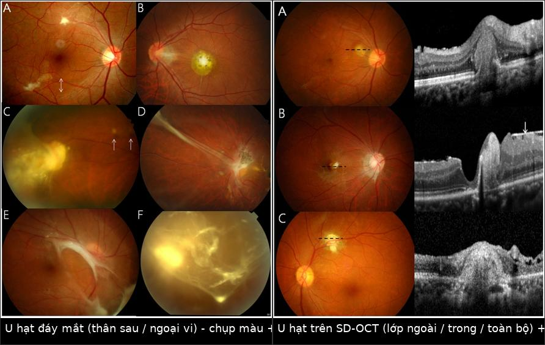
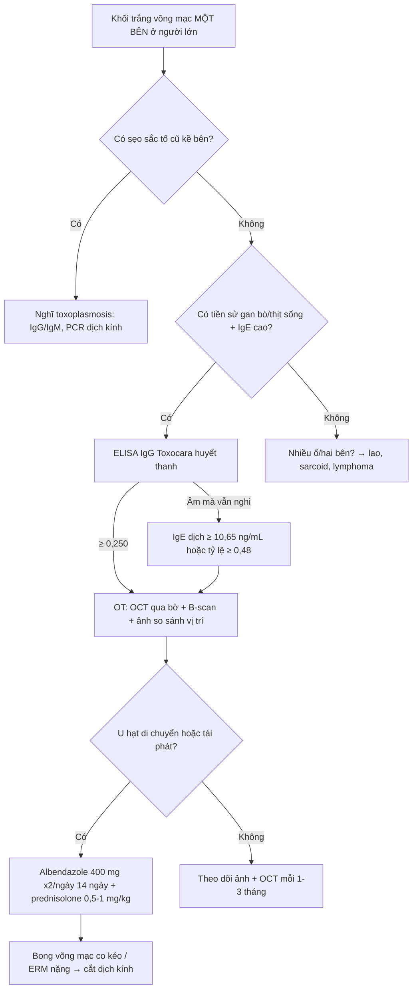
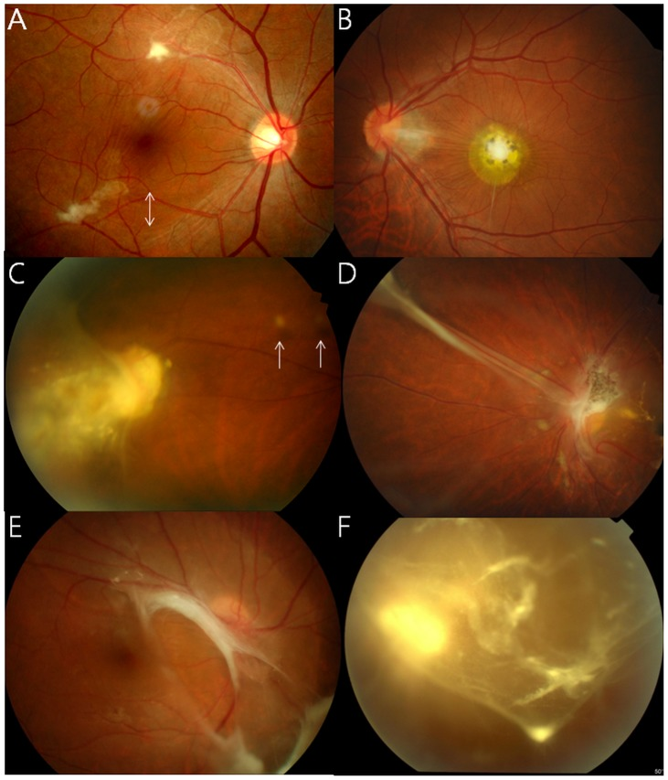
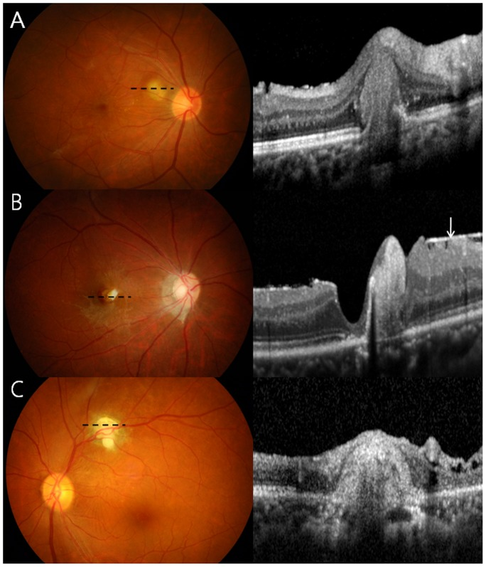
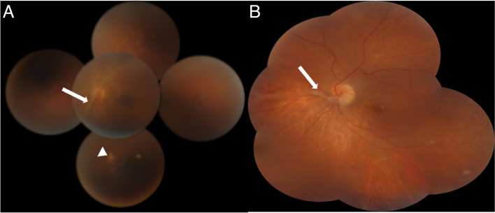
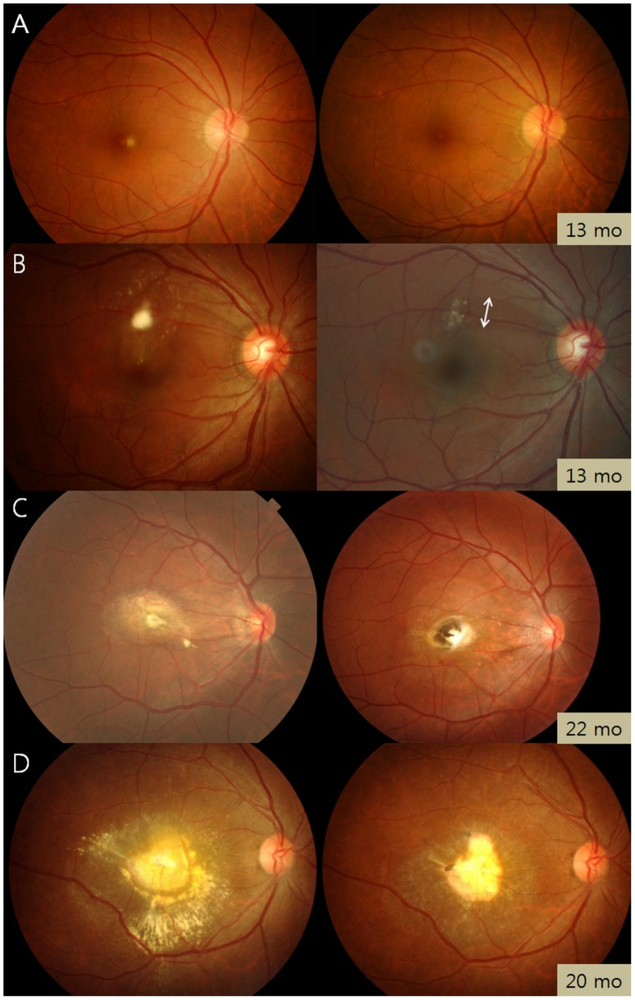

# 1464 — Toxocariasis nội nhãn ở NGƯỜI LỚN: u hạt võng mạc muộn / Adult ocular toxocariasis

**Tags:** `pattern:u-hat-vong-mac` `pattern:viem-trung-gian` `pattern:mat-mot-ben` `pattern:day-xo-dich-kinh` `vung:vong-mac` `vung:dich-kinh` `vung:hoang-diem` `vung:mat` `score:IgG-ELISA` `protocol:OCT` `protocol:FA` `protocol:sieu-am-B-scan` `protocol:MRI-hoc-mat` `protocol:Goldmann-Witmer` `protocol:albendazole`

**Mức chắc chắn (certainty):** tổng hợp y văn (literature synthesis) — số liệu chính từ **đoàn hệ 101 người lớn** (PMC4055477, PLoS Negl Trop Dis 2014), **nghiên cứu 76 ca + 64 ca chứng về IgE dịch nội nhãn** (PMC12302778, 2025), **3 báo cáo ca/loạt ca có ảnh** (PMC4055477, PMC10397159) và bài tổng quan (PMC4116038). Chỗ suy luận được đánh dấu **[suy luận]**.

> **Vì sao phải có bài riêng cho người lớn:** [466](../466-toxocariasis-noi-nhan/lesson.md) mô tả toxocariasis nội nhãn (ocular toxocariasis — OT) ở trẻ, nơi bệnh cảnh kinh điển là **leukocoria / viêm nội nhãn do giun**. Ở người lớn, OT **không giống vậy**: tuổi trung bình **51,7 ± 12,6** (21–77), **75,2% nam**, và **92,1% đến với một u hạt võng mạc đơn độc** chứ không phải viêm nội nhãn (PMC4055477). Vì thế người lớn thường bị dán nhãn **"viêm màng bồ đào sau/trung gian không rõ nguyên nhân"** rồi theo dõi nhiều năm — trong khi chỉ cần **một xét nghiệm huyết thanh** và **một câu hỏi về thịt/tạng sống** là chẩn đoán sáng tỏ.

## 1. Tổng quan bệnh học – cơ chế hình ảnh

- **Bệnh học (pathology):** người nuốt **trứng đã phôi thai** của *Toxocara canis/cati* (đất nhiễm) hoặc **ấu trùng L3 sống** trong mô vật chủ trung gian nấu chưa chín. Ấu trùng xuyên ruột → máu → **dừng lại ở mao mạch võng mạc/hắc mạc** (mắt là "ngõ cụt" miễn dịch) → không lớn thành giun trưởng thành, chỉ **di chuyển chậm vài trăm µm/tháng** rồi chết hoặc bị bao bọc. Mô phản ứng tạo **u hạt giàu bạch cầu ái toan → xơ hóa**; xơ co kéo sinh **màng trước võng mạc (ERM)** và **dải xơ dịch kính–võng mạc** (PMC4055477).
- **Con đường nhiễm ở người lớn — đây là điểm dịch tễ quan trọng nhất:** trong 101 ca, **80,8% có tiền sử ăn gan bò sống** và **71,2% ăn thịt sống/tái**, cao hơn hẳn nhóm chứng (PMC4055477); cùng nhóm tác giả ghi nhận ở Hàn Quốc **60–90%** ca toxocariasis toàn thân có tiền sử ăn gan bò sống (PMC4116038). **Không hỏi tiền sử ăn gan bò/thịt tái = bỏ mất manh mối rẻ nhất.**
- **TẠI SAO u hạt trắng và TẠI SAO OCT thấy khối tăng phản xạ có bóng lưng (posterior shadowing):** khối u hạt là **tế bào viêm + xơ + sắc tố tập trung**, mật độ quang học cao hơn võng mạc bình thường → trên **SD-OCT** hiện **khối tăng phản xạ đặc, phá vỡ lớp, che ánh sáng phía sau (shadowing)**; vì tế bào/hạt sắc tố **tán xạ và hấp thụ** ánh sáng cận hồng ngoại nên các lớp bên dưới **không đọc được** — đây là lý do phải **đo kích thước và độ sâu trên khung cắt qua bờ tổn thương**, không qua tâm (PMC4055477, Hình 2–3). Trên ảnh màu, khối **trắng–xám, bờ không rõ, có thể có sắc tố quanh bờ** vì hắc bào bị kích thích.
- **Số liệu mô tả u hạt (101 người lớn — dùng làm ngưỡng đọc):** u hạt **92,1%**; vị trí **cực sau 50,5%**, **ngoại vi 44,1%**, **hoàng điểm 17,2%**, **đầu thị 2,2%**, **phối hợp 5,4%**. U hạt **cực sau** đi kèm **khuyết sợi thần kinh võng mạc (RNFL) 53,2% vs 7,3%** ở u hạt ngoại vi (P < 0,001) và **ERM 40,4% vs 14,6%** (P = 0,007); u hạt **ngoại vi** đi kèm **đục dịch kính 31,7% vs 12,8%** (P = 0,031) — nghĩa là **vị trí u hạt dự báo trước biến chứng**, không cần chờ biến chứng xuất hiện.
- **Di chuyển nội nhãn — dấu hiệu gần như đặc hiệu:** u hạt **đổi vị trí** giữa các lần chụp ở **15/93 ca (16,1%)** — xảy ra khi ấu trùng **còn sống** (PMC4055477). Không u nào khác trong mắt "tự đi"; đây là dấu **chốt vào** mạnh nhất trên lâm sàng.
- **Toàn thân không hề "sạch":** trong số ca được chụp, **u hạt gan 17,6%** (3/17 trên CT bụng), **u hạt phổi 42,9%** (6/14 trên CT ngực) nhưng **chỉ 5,6% trên X-quang ngực** (4/72) — **X-quang ngực bình thường không loại trừ** thể nội tạng; **u hạt não 8,3%** (1/12) (PMC4055477).
- **Xét nghiệm — vì sao người lớn khó hơn trẻ:** **IgE huyết thanh > 100 UI/mL** gặp ở **39/56 (69,6%)**, **tăng bạch cầu ái toan (> 500/µL hoặc ≥ 10%) chỉ 10/86 (11,6%)** → **bạch cầu ái toan bình thường là chuyện thường**, đừng dùng nó để loại trừ. **ELISA IgG Toxocara huyết thanh** dương tính khi **≥ 0,250** (đơn vị OD, ngưỡng theo lab) (PMC4055477). Ở **dịch nội nhãn**, ngưỡng mới: **IgE dịch ≥ 10,65 ng/mL** (Se **77,6%**, Sp **98,4%**), **tỷ lệ IgE dịch/huyết thanh ≥ 0,48** (Se **78,4%**, Sp **98,4%**) — nhưng **độ nhạy ở người lớn chỉ 66,7%** so với **82,7% ở trẻ**; **hệ số Goldmann–Witmer (GWC) có AUC chỉ 0,527** trong đoàn hệ này (PMC12302778). **[suy luận]** Người lớn đã có **IgG lưu hành do phơi nhiễm nhiều lần** nên tỷ lệ sản xuất kháng thể tại chỗ bị "pha loãng" — **GWC thấp không loại trừ OT ở người lớn**, trái với thói quen đọc xét nghiệm ở trẻ.
- **Kết cục thị lực:** BCVA trung bình **0,51 logMAR (≈ 20/64) → 0,45 logMAR (≈ 20/56)** sau **15,0 ± 17,1 tháng**; **mất thị lực nặng (< 20/200) 16,8% lúc đầu → 13,9% lúc cuối** — tức **một phần đáng kể không hồi phục**, lý do phải điều trị và theo dõi chứ không "chờ tự khỏi".

## 2. Mẫu hình + chẩn đoán phân biệt theo vị trí (gamut)

- **U hạt cực sau/hoàng điểm (50,5%):** khối trắng–xám **< 1 đường kính đĩa (disc diameter)**, bờ không rõ, **không có sẹo sắc tố cũ kề bên**; kèm **khuyết RNFL** và **ERM**. Gamut: **OT**, **toxoplasmosis** (sẹo cũ + "headlight in the fog"), **u hạt lao**, **u hạt sarcoid**, **melanoma hắc mạc nhỏ**, **drusen lớn**, **di vật nội nhãn giữ lại**.
- **U hạt ngoại vi (44,1%) + dải xơ về đĩa thị:** dải trắng chạy **từ ngoại vi tới đầu thị**, co kéo võng mạc, có thể **bong võng mạc co kéo** (12,9%). Gamut: **OT**, **FEVR người lớn**, **bệnh Coats**, **PHPV tồn tại**, **vảy võng mạc do viêm**, **sẹo sau chấn thương**.
- **Viêm nội nhãn giả u (nematode endophthalmitis) — 8 ca (7,9%):** môi trường đục, **không thấy u hạt**; chẩn đoán chỉ đặt được **sau khi cắt dịch kính làm trong môi trường** (2 ca xác nhận như vậy). Gamut: **OT**, **viêm nội nhãn nội sinh**, **lymphoma nội nhãn**, **bong võng mạc toàn bộ**.
- **Mnemonic theo bước chẩn đoán — "GRANULOMA":** **G**an bò/thịt sống (tiền sử), **R**etina một bên, **A**morphous khối trắng (bờ mờ), **N**goại vi + dải xơ, **U** hạt **di chuyển**, **L**ab: IgG ELISA ≥ 0,250 + IgE > 100, **O**CT tăng phản xạ + shadowing, **M**igration ghi lại bằng ảnh so sánh, **A**lbendazole + corticoid.
- **Ngưỡng phân biệt theo kích thước và bối cảnh:** u hạt OT **thường < 1 DD (≈ 1,5 mm)** và **đơn độc một bên**; khối **> 2 DD**, nhiều ổ hai bên, kèm hạch/sốt → nghĩ **lao, sarcoid, di căn, lymphoma**. Trẻ < 5 tuổi có **leukocoria + vôi hóa thô** → **retinoblastoma**, không phải OT; ở người lớn, khối sắc tố lớn phải loại **melanoma hắc mạc** ([448](../448-u-hac-mac/lesson.md)).

## 3. Bảng so sánh phân biệt (ma trận đối chiếu)

| Thực thể (entity) | Hình ảnh điển hình (màu / OCT / B-scan) | Chốt vào (rule-in) | Chốt loại (rule-out) | Gợi ý xác nhận |
|---|---|---|---|---|
| **OT — u hạt cực sau (người lớn)** | Khối trắng–xám **< 1 DD**, bờ mờ, **không sẹo sắc tố kề bên**; OCT: khối **tăng phản xạ + shadowing**, phá lớp ngoài; kèm **khuyết RNFL 53,2%**, **ERM 40,4%** | **Đơn độc, một bên, tiền sử gan bò/thịt tái + IgG ELISA ≥ 0,250** | **Sẹo sắc tố cũ liền kề** → toxoplasmosis; **vôi hóa thô** → retinoblastoma (trẻ); **> 2 DD + nhiều ổ** → lao/sarcoid/lymphoma | ELISA IgG Toxocara, IgE > 100 UI/mL, OCT qua bờ tổn thương |
| **OT — u hạt ngoại vi + dải xơ** | **Dải trắng từ ngoại vi → đầu thị**, co kéo, đục dịch kính **31,7%**, bong võng mạc co kéo **12,9%** | **Dải xơ một bên + u hạt ở đầu dải** | Dải xơ **hai bên, đối xứng** → FEVR; **vôi hóa/dây xơ thể thủy tinh** → PHPV | Siêu âm B-scan 10–20 MHz, FA (rò mạch ở u hạt) |
| **U hạt di chuyển** | U hạt **đổi vị trí** giữa 2 lần chụp (16,1% ca) | **Ảnh so sánh cùng mắt, cùng vùng, khác vị trí** | U hạt cố định + bờ xơ dày → u thật/sarcoid | Lưu ảnh màu + OCT từng lần, đo khoảng cách tới đĩa thị |
| **Toxoplasmosis võng mạc** | **Sẹo sắc tố cũ + nốt mới ở bờ sẹo** ("headlight in the fog"), viêm dịch kính mạnh | **Nốt vệ tinh sát bờ sẹo cũ** | Không sẹo cũ, u hạt đơn độc lạnh lẽo → OT | IgG/IgM Toxoplasma, PCR dịch kính |
| **U hạt sarcoid / lao hắc mạc** | Nhiều u hạt **vàng–trắng**, dọc mạch, hai bên; OCT: khối **trong hắc mạc** làm dày choroid | **Nhiều ổ, hai bên, kèm hạch/phổi** | Một ổ đơn độc < 1 DD, không tổn thương toàn thân → OT | ACE, CT ngực, IGRA, sinh thiết nếu cần |
| **Melanoma hắc mạc** | Khối **dưới võng mạc dày**, sắc tố **cam (lipofuscin)**, B-scan **nội phản xạ THẤP (hollowness)** | **B-scan giảm phản xạ trong lòng khối + T1 sáng/T2 tối** | **B-scan tăng phản xạ đều, không hollowness** → u hạt | B-scan + MRI hốc mắt, theo dõi kích thước |
| **DUSN ([425](../425-dusn-au-trung-di-dong-duoi-vong-mac/lesson.md))** | **Đốm xám–trắng ngoại võng mạc di chuyển nhanh**, thấy **ấu trùng** ở 25–40%; muộn: **teo thị** | **Nhìn thấy ấu trùng** hoặc đốm di chuyển + ERG âm | U hạt cố định, có dải xơ → OT | Soi đáy mắt nhiều lần, ERG, OCT |

*Trái: u hạt trắng–xám ở cực sau/ngoại vi, khuyết sợi thần kinh (mũi tên). Phải: u hạt trên SD-OCT — khối tăng phản xạ phá lớp ngoài/trong kèm bóng lưng. Nguồn: Ahn SJ et al., PMC4055477, CC BY 4.0. Ảnh ghép letterbox, không crop.*

## 4. Protocol chụp + thang đo/xét nghiệm chuẩn hóa

- **Chụp ảnh đáy mắt màu (color fundus) toàn vùng:** bắt buộc **cùng góc, cùng máy** mỗi lần để phát hiện **di chuyển u hạt**; chụp **7 hướng hoặc ultra-widefield** vì u hạt ngoại vi 44,1% nằm ngoài ảnh 45°.
- **OCT (SD-OCT, cắt 5–7 µm):** cắt **qua bờ u hạt** để đo **độ dày võng mạc, mức phá lớp, ERM, dịch dưới võng mạc**; tránh cắt đúng tâm vì **shadowing che mất lớp bên dưới**. OCT **EDI** khi nghi u hạt nằm trong hắc mạc (phân biệt sarcoid/lao).
- **Siêu âm B-scan 10–20 MHz:** đầu dò **qua mí/tiếp xúc**, công suất thấp; mục tiêu: **khối đặc tăng phản xạ vừa–cao, không hollowness**, dải xơ dịch kính, bong võng mạc co kéo, và **không có vôi hóa**. Khi **môi trường đục** (viêm nội nhãn giả u) B-scan là **bắt buộc trước khi cắt dịch kính**.
- **FA / FA-ICGA:** FA cho thấy **tăng huỳnh quang ở u hạt + rò (leakage) thì muộn**, và **vùng giảm tưới máu** quanh dải xơ; ICGA để loại **hemangioma hắc mạc** và đánh giá tổn thương hắc mạc sâu.
- **MRI hốc mắt (T1 + T2 fat-sat + sau tiêm, lát ≤ 3 mm):** chỉ khi **B-scan không kết luận** hoặc nghi melanoma/khối hắc mạc lớn. U hạt OT: **T1 đồng–giảm, T2 giảm tín hiệu (xơ), ngấm thuốc**; melanoma: **T1 tăng, T2 giảm, hollowness trên B-scan**.
- **Xét nghiệm theo thứ tự (không làm cả loạt ngay):**
  1. **ELISA IgG Toxocara huyết thanh** — dương khi **≥ 0,250** (OD, ngưỡng theo lab).
  2. **IgE toàn phần huyết thanh** — **> 100 UI/mL** (69,6% ca); **bạch cầu ái toan KHÔNG dùng để loại trừ** (chỉ 11,6% tăng).
  3. **IgE + IgG dịch tiền phòng/dịch kính** khi huyết thanh không kết luận: **IgE dịch ≥ 10,65 ng/mL**, **tỷ lệ IgE dịch/huyết ≥ 0,48** (Sp 98,4%); nhớ **Se chỉ 66,7% ở người lớn**.
  4. **GWC ≥ 3** kinh điển cho sản xuất kháng thể tại chỗ, nhưng **AUC 0,527** trong OT người lớn → **âm tính không loại trừ** (PMC12302778).
- **Điều trị và mốc theo dõi:** **albendazole 400 mg × 2 lần/ngày × 14 ngày** + **prednisolone uống 0,5–1 mg/kg/ngày**; tỷ lệ **tái phát 6 tháng 17,4%** so với **54,5%** khi chỉ dùng corticoid (P = 0,045). Tái khám **1 tháng/lần trong 3 tháng đầu**, rồi **3 tháng/lần đến 1 năm**; **chụp ảnh + OCT mỗi lần** để bắt di chuyển/tái phát (PMC4055477).
- **Khi nào mổ:** **bong võng mạc co kéo (12,9%)**, **ERM nặng/màng trước võng mạc**, **đục dịch kính kéo dài**, hoặc **môi trường đục không chẩn đoán được** (cắt dịch kính chẩn đoán — 2 ca chỉ thấy u hạt sau khi làm trong môi trường).

## 5. Biến thể bình thường và cạm bẫy

- **U hạt "lạnh" nhỏ < 1 DD ở cực sau dễ bị đọc là drusen hoặc sẹo cũ** — drusen **hai bên, đối xứng, không khuyết RNFL**; OT **một bên, có khuyết RNFL 53,2%**.
- **Cạm bẫy 1 — "GWC âm nên loại OT":** sai ở người lớn (AUC 0,527; Se IgE dịch chỉ 66,7%). Huyết thanh ELISA + tiền sử ăn là chốt.
- **Cạm bẫy 2 — bạch cầu ái toan bình thường:** chỉ **11,6%** ca tăng; đừng chờ eosinophilia.
- **Cạm bẫy 3 — u hạt di chuyển bị đọc là "tổn thương mới/xuất hiện thêm":** nếu **không lưu ảnh cùng góc**, lần sau sẽ tưởng bệnh tiến triển và cân nhắc sinh thiết mắt oan. **Luôn chụp lại đúng vùng, đúng góc.**
- **Cạm bẫy 4 — X-quang ngực bình thường:** u hạt phổi chỉ **5,6% trên X-quang** nhưng **42,9% trên CT** → **không loại trừ thể nội tạng** bằng X-quang.
- **Cạm bẫy 5 — gọi là "viêm màng bồ đào trung gian vô căn":** **67,9%** ca OT có viêm trung gian; bệnh nhân trẻ–trung niên **một bên + vitritis + u hạt ngoại vi** phải nằm trong gamut OT trước khi làm "viêm vô căn".
- **Cạm bẫy 6 — nhầm với melanoma khi khối lớn:** melanoma có **hollowness (giảm phản xạ trong lòng) trên B-scan**, **lipofuscin cam**, **T1 tăng**; u hạt OT **tăng phản xạ đều** và **không vôi hóa**. Chọc kim qua khối nghi melanoma là **chống chỉ định**.
- **Biến thể bình thường dễ nhầm:** **drusen thị (optic disc drusen)** — tăng phản xạ, **vôi hóa trên B-scan**, không có u hạt võng mạc; **dải xơ bẩm sinh/PHPV** ở người trẻ một bên nhưng **không có u hạt hoạt động** và không đáp ứng corticoid.

## 6. Tự lượng giá — Blind Quiz

**Ca 1 — Nam 52 tuổi, nhìn mờ mắt trái 3 tuần, không đau. Đáy mắt: một khối trắng nhỏ ở cực sau.**

- Câu hỏi: Khối nằm ở lớp nào? Có sẹo sắc tố kề bên không? Ba chẩn đoán phân biệt và **một câu hỏi tiền sử** quyết định?

<b>Bấm để hiện đáp án (findings + chẩn đoán)</b>

- Dấu hiệu: **u hạt trắng–xám bờ mờ < 1 DD ở cực sau**, kèm **khuyết sợi thần kinh võng mạc (mũi tên)**; các panel khác của hình cho thấy u hạt ngoại vi + **mảnh vụn dịch kính tròn**, **nếp võng mạc co kéo** và **bong võng mạc co kéo**.
- Chẩn đoán: **toxocariasis nội nhãn (OT) người lớn** — khối là u hạt viêm–xơ, không phải sẹo hoại tử; **không có sẹo sắc tố cũ kề bên** nên ít nghĩ toxoplasmosis.
- Chốt: hỏi **ăn gan bò/thịt tái** (80,8%/71,2%) + **ELISA IgG Toxocara ≥ 0,250**; thêm **IgE > 100 UI/mL**.
- Nguồn: Ahn SJ et al., *PLoS Negl Trop Dis* 2014, PMC4055477 Fig. 1, CC BY 4.0.

**Ca 2 — Cùng bệnh nhân, OCT qua tổn thương. Vì sao không đọc được lớp bên dưới?**

- Câu hỏi: Khối nằm ở lớp ngoài, lớp trong hay toàn bộ? Vì sao có **bóng lưng**? Dấu hiệu nào giúp phân biệt với melanoma?

<b>Bấm để hiện đáp án</b>

- Dấu hiệu: **khối tăng phản xạ đặc** phá lớp võng mạc — panel A **lớp ngoài**, B **lớp trong**, C **toàn bộ**; bờ khối làm **biến dạng võng mạc**, kèm **màng trước võng mạc**.
- Vì sao shadowing: tế bào viêm + xơ + sắc tố **tán xạ/hấp thụ** ánh sáng OCT → **không có tín hiệu trả về từ hắc mạc**; vì vậy phải **cắt qua bờ** tổn thương để đo độ dày.
- Phân biệt melanoma: B-scan melanoma **giảm phản xạ trong lòng (hollowness)** và **T1 tăng**; u hạt OT **tăng phản xạ đều**.
- Nguồn: Ahn SJ et al., PMC4055477 Fig. 2, CC BY 4.0.

**Ca 3 — Nữ 20 tuổi, mắt phải nhìn mờ nhiều tháng; thấy dải trắng chạy từ ngoại vi vào đầu thị.**

- Câu hỏi: Dải xơ đi từ đâu tới đâu? Chẩn đoán phân biệt ở người trẻ một bên? Cần chụp gì để tìm "đầu kia" của dải?

<b>Bấm để hiện đáp án</b>

- Dấu hiệu: **dải xơ dịch kính–võng mạc chạy từ ngoại vi tới đầu thị (mũi tên trắng)** ở bệnh nhân 12 tuổi (A) và 20 tuổi (B); kèm **nang võng mạc ngoại vi** trong cùng bệnh cảnh (bài gốc mô tả bằng soi 3 gương và **UBM: nang 2,6 mm thành mỏng**).
- Chẩn đoán: **OT thể ngoại vi** — dải xơ là di chứng co kéo của u hạt ngoại vi; phân biệt **FEVR** (hai bên, đối xứng), **PHPV**, **Coats**.
- Việc cần làm: **soi toàn võng mạc/ultra-widefield + B-scan 10–20 MHz** tìm u hạt ở **đầu ngoại vi của dải**, và **chụp ảnh lưu** để phát hiện di chuyển.
- Nguồn: Maamouri R et al., *J Ophthalmic Inflamm Infect* 2023, PMC10397159 Fig. 1, CC BY 4.0.

**Ca 4 — Cùng bệnh, bốn kiểu kết cục: so cột trái (lúc chẩn đoán) với cột phải (lần khám cuối).**

- Câu hỏi: Bốn kiểu tiến triển (A–D) khác nhau ở điểm nào? Kiểu nào khiến bệnh nhân **không hồi phục thị lực**?

<b>Bấm để hiện đáp án</b>

- Dấu hiệu: cột trái = **lúc chẩn đoán**, cột phải = **lần khám cuối**: (A) **tan hoàn toàn**, (B) **tan một phần**, (C) **tan một phần + sẹo sắc tố**, (D) **co kéo/bong võng mạc**.
- Ý nghĩa: **kiểu D (co kéo)** là nhóm **mất thị lực không hồi phục** — tương ứng **bong võng mạc co kéo 12,9%** và **ERM 26,7%**; đây là nhóm cần **cắt dịch kính** sớm.
- Nguồn: Ahn SJ et al., PMC4055477 Fig. 4, CC BY 4.0.

## Bài liên quan chéo

- [466 – Toxocariasis nội nhãn ở trẻ](../466-toxocariasis-noi-nhan/lesson.md) (thể trẻ: leukocoria/viêm nội nhãn)
- [425 – DUSN & ấu trùng di động dưới võng mạc](../425-dusn-au-trung-di-dong-duoi-vong-mac/lesson.md) (chẩn đoán phân biệt "ấu trùng nhìn thấy được")
- [447 – Đốm trắng võng mạc](../447-dom-trang-vong-mac/lesson.md) (gamut đốm trắng: OT nằm trong nhóm này)
- [448 – U hắc mạc](../448-u-hac-mac/lesson.md) (melanoma: hollowness trên B-scan, T1 tăng)
- [452 – Hoại tử võng mạc ARN/CMV](../452-hoai-tu-vong-mac-ARN-CMV/lesson.md) (viêm võng mạc một bên ở người lớn)
- [1425 – Viêm nội nhãn sau tiêm nội nhãn](../1425-viem-noi-nhan-sau-tiem-noi-nhan/lesson.md) (viêm nội nhãn cấp — phân biệt với thể giả u)
- [6132 – Viêm giác mạc nhiễm khuẩn liên quan kính tiếp xúc](../6132-viem-giac-mac-kinh-tiep-xuc/lesson.md) (mắt đỏ + giảm thị lực cấp)

## Ảnh

- `1464_toxo_PMC4055477-F1.jpg` — ảnh đáy mắt màu 6 panel (u hạt cực sau/ngoại vi, mảnh vụn dịch kính, bong võng mạc co kéo).
- `1464_toxo_PMC4055477-F2.jpg` — SD-OCT: u hạt lớp ngoài/lớp trong/toàn bộ + shadowing.
- `1464_toxo_PMC4055477-F4.jpg` — diễn tiến u hạt (A–D): tan hoàn toàn → co kéo.
- `1464_toxo_PMC10397159-F1.jpg` — dải xơ dịch kính–võng mạc từ ngoại vi tới đĩa thị (12 và 20 tuổi).
- `composite_toxo_day-mat-vs-OCT.jpg` — ảnh ghép letterbox (F1 + F2), tạo bằng `tools/make_composite.py`.
- Nguồn + giấy phép từng ảnh: `images/CREDITS.md`.

> Không dùng để chẩn đoán độc lập khi chưa có người hướng dẫn.
