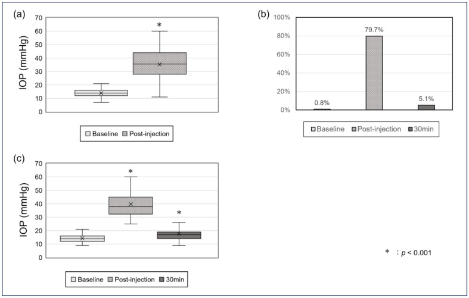
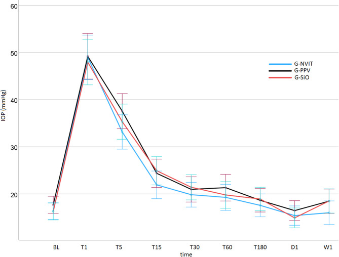
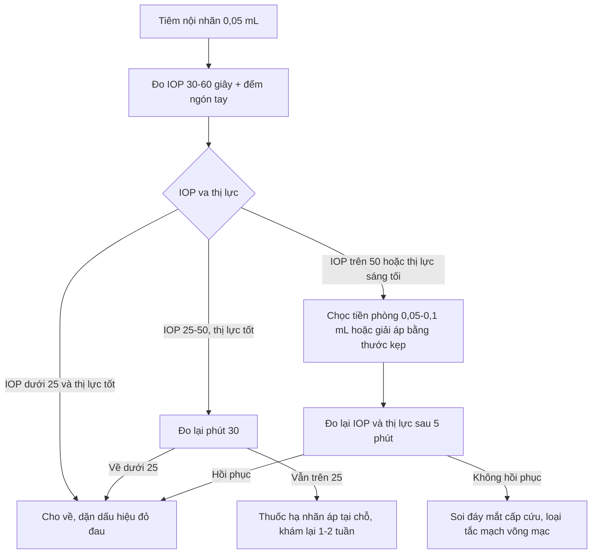
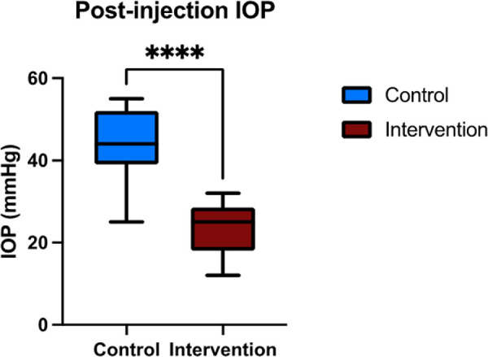
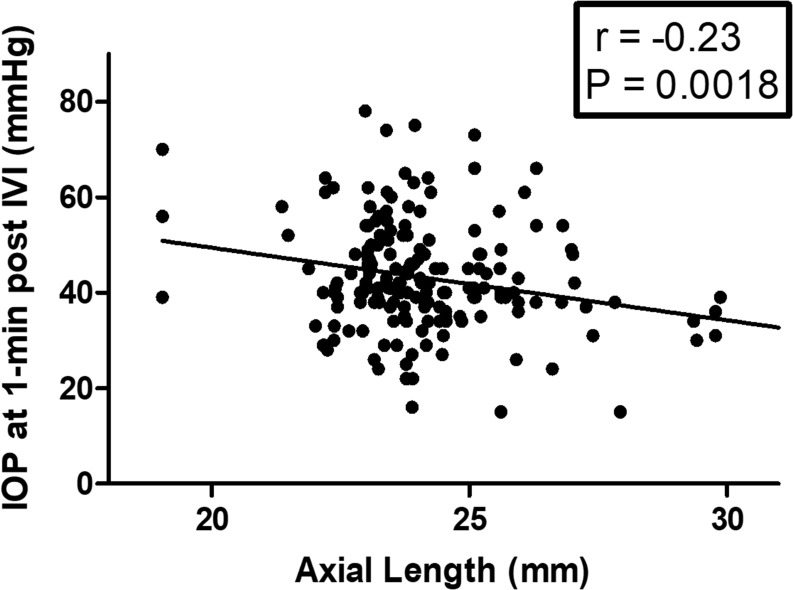
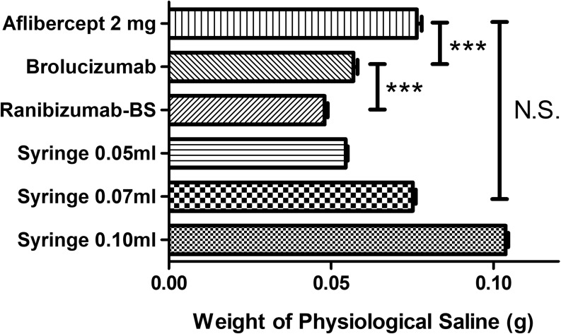

# 1465 — Tăng nhãn áp cấp sau tiêm nội nhãn (IOP spike): đỉnh ở **30 giây**, về bình thường trong **30 phút** — khi nào chọc tiền phòng

**Tags:** `pattern:tang-nhan-ap` `pattern:glaucom-thu-phat` `pattern:tiem-noi-nhan` `pattern:bien-chung` `vung:mat` `vung:tien-phong` `vung:goc-tien-phong` `protocol:tiem-noi-nhan` `protocol:do-nhan-ap` `protocol:sinh-hieu-giac-mac` `score:IOP` `incidentaloma:khong`

**Mức chắc chắn (certainty):** tổng hợp y văn (literature synthesis) — ghép **loạt 118 mắt đo IOP ngay sau tiêm** (*J Clin Med* 2025, **PMC12295815**, CC BY 4.0), **loạt 40 mắt so sánh aflibercept 8 mg và 2 mg** (*Sci Rep* 2026, **PMC13454566**, CC BY-NC-ND 4.0), **loạt 67 mắt dịch kính–dầu silicon** (*Sci Rep* 2026, **PMC13000209**, CC BY 4.0), **loạt 175 mắt + đo thể tích bơm tiêm** (*Clin Ophthalmol* 2026, **PMC12967582**, CC BY-NC 4.0), **thử nghiệm giải áp tiền phòng bằng thước kẹp vô khuẩn** (*Transl Vis Sci Technol* 2024, **PMC11636662**, CC BY-NC-ND 4.0) và **ca loạt mất thị lực thoáng qua sau bơm tiêm đóng sẵn** (**PMC9541561**). Nhóm **không có bệnh nhân của mình**.

> **Câu chốt:** tiêm **0,05 mL** vào một **nhãn cầu kín** là bơm thêm **~1% thể tích mắt** vào một khoang **rất kém đàn hồi** — nên IOP vọt lên **50–60 mmHg trong 30 giây** rồi **tự về bình thường trong 30 phút** nhờ thoát thủy dịch qua bè củng mạc. Vì vậy câu hỏi thực hành **không phải "có tăng IOP không"** (đa số đều tăng, **79,7% ≥ 25 mmHg**) mà là: **(1) mắt có tưới máu đủ trong lúc IOP cao không, (2) IOP có tự xuống trong 30 phút không, (3) đây là đợt cấp hay đã thành tăng nhãn áp kéo dài**.

## 1. Tổng quan bệnh học – cơ chế (TẠI SAO)

### 1.1 Nhãn cầu là khoang kín, đàn hồi thấp: 50 µL là rất nhiều

- Thể tích tiền phòng **~0,25 mL**, thể tích dịch kính **~4 mL** — tổng **~4,5 mL**. Một mũi tiêm chuẩn **0,05 mL** = **~1,1%** thể tích mắt, nhưng củng mạc–giác mạc **rất cứng** so với độ giãn cần thiết, nên phần lớn thể tích đó **chuyển thành áp lực** chứ không thành giãn thành.
- **TẠI SAO đỉnh xuất hiện ở 30 giây, không phải sau vài phút:** bơm xong là áp lực đạt ngay mức tương ứng thể tích; không có "thời gian thấm". Đo ở **30 giây**: **59,0 ± 17,4 mmHg** (aflibercept 8 mg) và **60,1 ± 20,8 mmHg** (2 mg) ở bệnh nhân phù hoàng điểm đái tháo đường (PMC13454566).
- **TẠI SAO tự xuống trong 30 phút:** thủy dịch thoát qua **bè củng mạc** với hệ số thoát lưu **C ≈ 0,2–0,3 µL/phút/mmHg**. Với chênh áp 30–40 mmHg, lưu lượng thoát **~6–12 µL/phút**, nên **50 µL cần ~5–10 phút** — khớp với đường cong thực đo: **14,6 ± 4,6 mmHg** và **16,6 ± 6,7 mmHg** ở phút 30 (PMC13454566); loạt 118 mắt: **39,2 ± 12,4 mmHg** trong 1 phút đầu → **17,7 ± 6,5 mmHg** ở phút 30 (PMC12295815).
- **Tỉ lệ gặp:** **79,7%** mắt có IOP **≥ 25 mmHg** ngay sau tiêm (PMC12295815); **55%** mắt tăng **≥ 10 mmHg** ở phút 10 (phép đo Corvis, PMC12373209); trong loạt tiêm **hai mắt cùng ngày** chỉ **17/1.418 buổi** được ghi nhận tăng IOP thoáng qua (PMC7567572, dẫn qua bài [1427](../1427-tiem-anti-vegf-hai-mat-cung-ngay/lesson.md)) — khác biệt vì **cách đo**: đo ngay bằng máy là thấy, chỉ ghi khi có triệu chứng là bỏ sót.

### 1.2 TẠI SAO mất thị lực thoáng qua: áp lực tưới máu, không phải "thuốc độc"

- **Áp lực tưới máu mắt (OPP) = huyết áp động mạch trung bình − IOP.** Với MAP **75 mmHg** và IOP **60 mmHg**, OPP chỉ còn **15 mmHg** — dưới ngưỡng tự điều hòa của võng mạc → **thiếu máu võng mạc–thần kinh thị cấp** trong vài chục giây.
- Đây chính là cơ chế của **16 biến cố "thị lực ≤ đếm ngón tay/sáng tối" ngay sau tiêm** trong loạt bơm tiêm đóng sẵn aflibercept; **4 ca phải chọc tiền phòng** để hạ IOP và hồi phục thị lực (PMC9541561). Lực bơm của bơm tiêm đóng sẵn **cao hơn** bơm tiêm 1 mL ở mọi tốc độ bơm (p < 0,0001).
- **Hệ quả thực hành:** mất thị lực ngay sau tiêm **không đồng nghĩa tắc động mạch võng mạc vĩnh viễn** — hạ IOP kịp thời là điều trị. Nhưng **chờ 30 phút để "xem có tự hết"** ở mắt chỉ còn sáng tối là **mất cửa sổ**.

### 1.3 Số liệu định lượng nằm lòng

| Đại lượng | Số liệu | Nguồn |
|---|---|---|
| IOP đỉnh sau tiêm (30 giây) | **59,0 ± 17,4** / **60,1 ± 20,8 mmHg** (8 mg / 2 mg) | PMC13454566 |
| IOP ngay sau tiêm (< 1 phút) | **13,9 ± 3,3 → 39,2 ± 12,4 mmHg** | PMC12295815 |
| Tỉ lệ IOP ≥ 25 mmHg ngay sau tiêm | **79,7%** | PMC12295815 |
| IOP phút 30 | **17,7 ± 6,5** / **14,6–16,6 mmHg** | PMC12295815, PMC13454566 |
| Tỉ lệ tăng ≥ 10 mmHg (đo Corvis, phút 10) | **55%** | PMC12373209 |
| IOP phút 1 cao nhất theo thuốc | **aflibercept 2 mg: 52,8 mmHg** | PMC12967582 |
| Thể tích thực bơm ra của bơm tiêm đóng sẵn aflibercept 2 mg | **~0,076 mL** ≈ **1,5×** liều dự kiến **0,05 mL** | PMC12967582 |
| Tương quan IOP phút 1 với trục nhãn cầu | **r = −0,23** (p = 0,001) — mắt cận thị dài tăng ít hơn | PMC12967582 |
| Giải áp tiền phòng bằng thước kẹp | **23,52 ± 5,98** vs chứng **44,08 ± 8,48 mmHg**; **0** mắt > 25 mmHg | PMC11636662 |
| Yếu tố nguy cơ (đa biến) | IOP nền cao, **tiền sử glôcôm**, **chưa cắt dịch kính**, dùng **aflibercept** | PMC12295815 |
| Dự báo tăng IOP bằng giác mạc | **DA Ratio MAX ≤ 4,936**: Se **81,8%**, Sp **42,9%**, **AUC 0,739** | PMC12373209 |

> **Đọc số cho đúng:** "**79,7% ≥ 25 mmHg**" **không** phải "79,7% biến chứng" — đó là **sinh lý bình thường của một mũi tiêm 0,05 mL**. Biến chứng là phần **không tự hồi phục**: mất thị lực do thiếu tưới máu, hoặc tăng IOP **kéo dài** (xem 1.4).

### 1.4 Tăng IOP "kéo dài" là bệnh khác, không phải đỉnh 30 giây

- **Do corticoid nội nhãn:** đáp ứng ở **~4–8 tuần**, cơ chế **tăng sức cản bè** (thay đổi chất nền ngoại bào), không phải thể tích — xem bài [1411](../1411-tang-nhan-ap-do-corticoid-noi-nhan/lesson.md).
- **Sau nhiều đợt tiêm:** tổn thương bè do viêm/hồng cầu/dầu silicon; loạt **34 mắt** tăng IOP dai dẳng sau tiêm (IOP **28,1 ± 6,0 mmHg** khi đã dùng tối đa thuốc) được điều trị bằng **mở góc trong + trabeculotomy** đạt **giảm 46%**, thành công **71%** ở **15,3 ± 9,8 tháng** (PMC13016382). Con số này cho thấy **tăng IOP kéo dài là thực thể riêng**, cần theo dõi dọc chứ không phải "spike".
- **Tăng IOP thoáng qua lặp lại** mỗi mũi tiêm ở mắt **giảm đàn hồi** (trục nhãn cầu ngắn, viễn thị, củng mạc dày) → tích lũy tổn thương thần kinh thị dù mỗi lần đều "hồi phục".

## 2. Mẫu hình + chẩn đoán phân biệt theo thời điểm (Gamut)

- **Nhóm A — đỉnh thể tích (giây–phút):** IOP **40–60 mmHg**, mắt **không đau nhiều**, có thể **nhìn mờ/thấy quầng**, **giác mạc hơi phù**, tiền phòng sâu; tự về bình thường **< 30 phút**. Đây là thể **thường gặp nhất**.
- **Nhóm B — thiếu tưới máu (giây):** IOP rất cao + **thị lực ≤ đếm ngón tay/sáng tối**, **đồng tử giãn**, có thể **thấy mảng trắng võng mạc**; cần **hạ áp ngay** (chọc tiền phòng) — thể **cấp cứu** của cùng cơ chế.
- **Nhóm C — tăng IOP kéo dài (tuần–tháng):** IOP **> 21 mmHg** ở các lần khám sau, **không liên quan thời điểm tiêm**; do corticoid, tổn thương bè, **tế bào ma** (bài [1457](../1457-glaucom-te-bao-hong-cau-sau-xuat-huyet-dich-kinh/lesson.md)), **dầu silicon** (bài [1864](../1864-dau-silicone-nang-bien-chung-phia-duoi/lesson.md)).
- **Nhóm D — viêm/nhiễm (ngày):** **đau tăng dần**, **đỏ**, **giảm thị lực tiến triển**, **tiền phòng có tế bào/fibrin/mủ** — **viêm nội nhãn** (bài [1425](../1425-viem-noi-nhan-sau-tiem-noi-nhan/lesson.md)); khác hẳn spike vì **spike không đau nhiều, không có viêm**.
- **Nhóm E — nguyên nhân khác của "mờ ngay sau tiêm":** **bọt khí/buồng khí trong dịch kính** (di chuyển, tự hết), **xuất huyết dịch kính**, **bong võng mạc**, **xước giác mạc do speculum** (fluorescein +), **phản ứng vasovagal**.
- **Nhóm F — mắt đặc biệt:** **mắt đã cắt dịch kính** (thể tích đệm ít → dung tích dự trữ khác), **mắt bơm dầu silicon**, **mắt có van lọc/đã mổ glôcôm** — đo IOP vẫn phải làm, nhưng **diễn giải đường cong** cần biết mắt thuộc nhóm nào (PMC13000209: đường cong hồi phục **tương tự** ở 3 nhóm, dầu silicon nhũ hóa **không** làm khác).

**Ba câu hỏi định vị:** (1) **Mờ/thị lực giảm xuất hiện ngay hay vài ngày sau?** (2) **Mắt có đau, đỏ, tiền phòng có viêm không?** (3) **IOP đo lại ở phút 30 có xuống không?**

## 3. Bảng so sánh phân biệt (ma trận đối chiếu)

| Thực thể (entity) | Hình ảnh / lâm sàng điển hình | Chốt vào (rule-in) | Chốt loại (rule-out) | Gợi ý xác nhận |
|---|---|---|---|---|
| **Đỉnh thể tích sau tiêm** | IOP **40–60 mmHg** trong 30 giây, giác mạc hơi phù, tiền phòng sâu, **không viêm** | **IOP cao ngay + tự giảm < 30 phút + không đau/không viêm** | IOP không giảm ở phút 30 → tìm nguyên nhân khác | Đo IOP phút 1 và phút 30, đếm ngón tay |
| **Thiếu tưới máu (CRAO thoáng qua)** | Thị lực **≤ đếm ngón tay** cùng lúc IOP rất cao, đồng tử giãn, võng mạc nhợt | **IOP > 50 mmHg + mất thị lực ngay** | Thị lực bình thường dù IOP 60 → chỉ theo dõi | Soi đáy mắt ngay, đo lại sau hạ áp |
| **Viêm nội nhãn** | **Đau tăng**, đỏ, **tế bào/fibrin/mủ tiền phòng**, thị lực giảm dần **ngày 1–3** | **Đau + viêm tiền phòng + giảm thị lực tiến triển** | Không đau, không tế bào, IOP về bình thường → không phải | Soi đèn khe, cấy thủy dịch (bài 1425) |
| **Tăng IOP do corticoid** | IOP tăng **4–8 tuần** sau tiêm corticoid, **không đau**, góc mở | **Tiền sử corticoid + IOP tăng muộn + đáp ứng thuốc hạ áp** | IOP chỉ cao trong 30 phút → đỉnh thể tích | Nhật ký IOP theo tuần (bài 1411) |
| **Tế bào ma (ghost cell)** | Tế bào **kaki, không flare**, góc mở, **tiền sử xuất huyết dịch kính** | **Tế bào bạc màu + không viêm + IOP tăng muộn** | Có flare/KP → viêm | Gonioscopy, cytology (bài 1457) |
| **Dầu silicon trong tiền phòng** | **Giọt dầu** lơ lửng, tiền sử bơm dầu, IOP tăng | **Thấy giọt dầu + mắt đã bơm dầu** | Tiền phòng trong, không giọt dầu | Soi đèn khe (bài 1864) |
| **Bọt khí / thuốc trong dịch kính** | **Bóng tròn di động**, "màn che" di chuyển, tự hết **giờ–ngày** | **Bóng khí di chuyển + IOP bình thường** | IOP cao kèm mất thị lực → không phải | Soi đáy mắt, nghiệm pháp tư thế |

*Đường cong IOP trước tiêm – ngay sau tiêm – phút 30 ở 118 mắt. Nguồn: PMC12295815, CC BY 4.0.*

*Ba nhóm dịch kính có đường cong hồi phục tương tự nhau. Nguồn: PMC13000209, CC BY 4.0.*

## 4. Protocol & ngưỡng xử trí

### 4.1 Trước – trong – sau tiêm

| Bước | Việc làm | Ngưỡng / số liệu |
|---|---|---|
| Trước tiêm | Đo IOP **hai mắt**, ghi IOP nền; hỏi **glôcôm**, đếm số mũi tiêm đã nhận | IOP nền cao = yếu tố nguy cơ độc lập |
| Trong tiêm | 30G, **0,05 mL**, chậm; kiểm tra **vạch bơm tiêm đóng sẵn** (aflibercept 2 mg có thể bơm **0,076 mL**) | Thể tích thừa **1,5×** làm tăng đỉnh |
| Ngay sau tiêm (30–60 giây) | Đo IOP, **đếm ngón tay/sáng tối**, soi đáy mắt nếu thị lực giảm | **IOP ≥ 25 mmHg: 79,7%** — bình thường |
| Phút 30 | Đo lại nếu IOP ≥ 25 mmHg hoặc có triệu chứng | Về **~15–18 mmHg** là đúng sinh lý |
| Xử trí | IOP **> 50 mmHg kèm mất thị lực** → **chọc tiền phòng 0,05–0,1 mL** qua rìa 30G; hoặc **giải áp bằng thước kẹp vô khuẩn** | Giải áp: **23,52 vs 44,08 mmHg**; **0** ca > 25 mmHg |
| Sau về | Hẹn đo IOP **1–2 tuần** nếu có glôcôm/tăng IOP kéo dài; dặn **đau tăng/đỏ = quay lại ngay** | Tăng IOP do corticoid xuất hiện **4–8 tuần** |

### 4.2 Sơ đồ quyết định

### 4.3 Theo dõi dọc: phân biệt đỉnh và bệnh

- **Ghi vào hồ sơ:** IOP nền → IOP đỉnh → IOP phút 30. Ba số này là bằng chứng phân biệt **đỉnh thể tích** với **tăng IOP kéo dài** ở lần sau.
- **Mỗi 3–6 tháng** ở mắt nhận tiêm lặp lại: đo IOP, soi góc, **chụp OCT thần kinh thị** nếu IOP ≥ 22 mmHg — vì tổn thương thần kinh thị do các đỉnh lặp lại là **tích lũy**.
- **Không dùng chọc tiền phòng thường quy:** chỉ định theo **triệu chứng + ngưỡng**, vì thủ thuật có nguy cơ **viêm nội nhãn, tổn thương thể thủy tinh, hypotony**.

## 5. Biến thể bình thường & cạm bẫy

- **"Tăng IOP sau tiêm" là bình thường:** **79,7%** mắt vượt 25 mmHg — coi mọi đỉnh là biến chứng sẽ **chọc tiền phòng quá tay**.
- **Cạm bẫy thời điểm:** đo **quá sớm** (trong 10 giây, khi chưa bơm xong) hoặc **quá muộn** (sau 30 phút) đều làm mất đỉnh thật.
- **Cạm bẫy máy đo:** **rebound tonometry (iCare)** kém chính xác khi IOP **rất cao**; với IOP > 40 mmHg nên đối chiếu **Goldmann** (PMC13000209).
- **Cạm bẫy "mắt nhìn mờ" do thuốc:** bóng khí/buồng khí hoặc **thuốc đục nhẹ** gây mờ **không kèm đau**, IOP bình thường — đừng hạ áp.
- **Cạm bẫy "hết đau là hết bệnh":** **viêm nội nhãn** khởi đầu có thể chỉ **đau nhẹ + thấy mờ** ngày 2–3; hỏi lại triệu chứng, đừng gán cho "spike đã qua".
- **Cạm bẫy trục nhãn cầu:** mắt **cận thị dài** tăng IOP **ít hơn** (r = −0,23) nhưng **không miễn nhiễm**; mắt **viễn thị/trục ngắn** là nhóm cần thận trọng hơn.
- **Cạm bẫy mắt đã cắt dịch kính/bơm dầu:** đường cong hồi phục **tương tự** mắt nguyên vẹn (PMC13000209) — **không** được coi là "an toàn vì đã cắt dịch kính".

## 6. Tự lượng giá — Blind Quiz

**Ca 1 — Bệnh nhân phù hoàng điểm đái tháo đường, IOP trước tiêm 14 mmHg. Nhìn đường cong, mô tả trước.**

- Hỏi: IOP đỉnh ở thời điểm nào, khoảng bao nhiêu? Sau bao lâu thì về gần nền? Đỉnh này có phải biến chứng?

<b>Bấm để hiện đáp án</b>

- Đỉnh **ngay sau tiêm (< 1 phút)**, trung bình **39,2 ± 12,4 mmHg**; **79,7%** mắt vượt **25 mmHg**; về **17,7 ± 6,5 mmHg** ở **phút 30**.
- Đây là **đỉnh thể tích sinh lý**, **không phải biến chứng** — chỉ xử trí khi **mất thị lực** hoặc **không giảm ở phút 30**.
- Nguồn: *J Clin Med* 2025, **PMC12295815**, CC BY 4.0.

**Ca 2 — Cùng bệnh nhân, IOP 1 phút là 62 mmHg, chỉ đếm được ngón tay. Hai cách hạ áp được so sánh trong hình:**

- Hỏi: Hai nhóm khác nhau ở đâu? Cơ chế? Có ca nào còn > 25 mmHg ở nhóm can thiệp?

<b>Bấm để hiện đáp án</b>

- **Giải áp tiền phòng bằng thước kẹp vô khuẩn**: IOP sau tiêm **23,52 ± 5,98 mmHg** so với chứng **44,08 ± 8,48 mmHg**; **không ca nào > 25 mmHg** ở nhóm can thiệp.
- Cơ chế: **lấy bớt 0,05–0,1 mL thể tích** → giảm ngay áp lực, không phụ thuộc bè củng mạc; hiệu quả **không phụ thuộc thể thủy tinh**.
- Nguồn: *Transl Vis Sci Technol* 2024, **PMC11636662**, CC BY-NC-ND 4.0 (ảnh nguyên bản, không ghép).

**Ca 3 — Mắt viễn thị trục ngắn 22,1 mm, bơm tiêm đóng sẵn aflibercept 2 mg.**

- Hỏi: Vì sao mắt này nguy cơ cao hơn? Con số nào chứng minh thể tích bơm không đúng 0,05 mL?

<b>Bấm để hiện đáp án</b>

- **Trục nhãn cầu ngắn** → độ đàn hồi thấp hơn → cùng thể tích bơm, **IOP tăng nhiều hơn**; tương quan **r = −0,23** (p = 0,001) giữa trục nhãn cầu và IOP phút 1, IOP cao nhất ở nhóm **aflibercept 2 mg (52,8 mmHg)**.
- Bơm tiêm đóng sẵn aflibercept 2 mg bơm ra **~0,076 mL** thay vì **0,05 mL** (**1,5×**) — đủ để đẩy đỉnh lên cao hơn ở mắt kém đàn hồi.
- Nguồn: *Clin Ophthalmol* 2026, **PMC12967582**, CC BY-NC 4.0.

## Bài liên quan chéo
- [1425 – Viêm nội nhãn sau tiêm nội nhãn](../1425-viem-noi-nhan-sau-tiem-noi-nhan/lesson.md) (đau + viêm tiền phòng, khác spike)
- [1427 – Tiêm anti-VEGF hai mắt cùng ngày](../1427-tiem-anti-vegf-hai-mat-cung-ngay/lesson.md) (đo IOP cả hai mắt trước khi về)
- [1404 – Biến chứng mạn của anti-VEGF](../1404-bien-chung-man-anti-vegf/lesson.md) (tăng IOP kéo dài)
- [1411 – Tăng nhãn áp do corticoid nội nhãn](../1411-tang-nhan-ap-do-corticoid-noi-nhan/lesson.md) (đáp ứng 4–8 tuần)
- [1457 – Glôcôm tế bào hồng cầu "ma"](../1457-glaucom-te-bao-hong-cau-sau-xuat-huyet-dich-kinh/lesson.md) (tăng IOP muộn, tế bào kaki)
- [1864 – Dầu silicon nang và biến chứng phía dưới](../1864-dau-silicone-nang-bien-chung-phia-duoi/lesson.md) (dầu trong tiền phòng)
- [400 – Tổng quan Mắt & thị giác](../400-tong-quan-mat-thi-giac/lesson.md)

> Không dùng để chẩn đoán độc lập khi chưa có người hướng dẫn.
