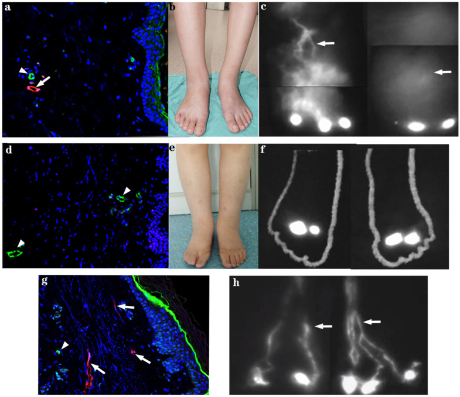
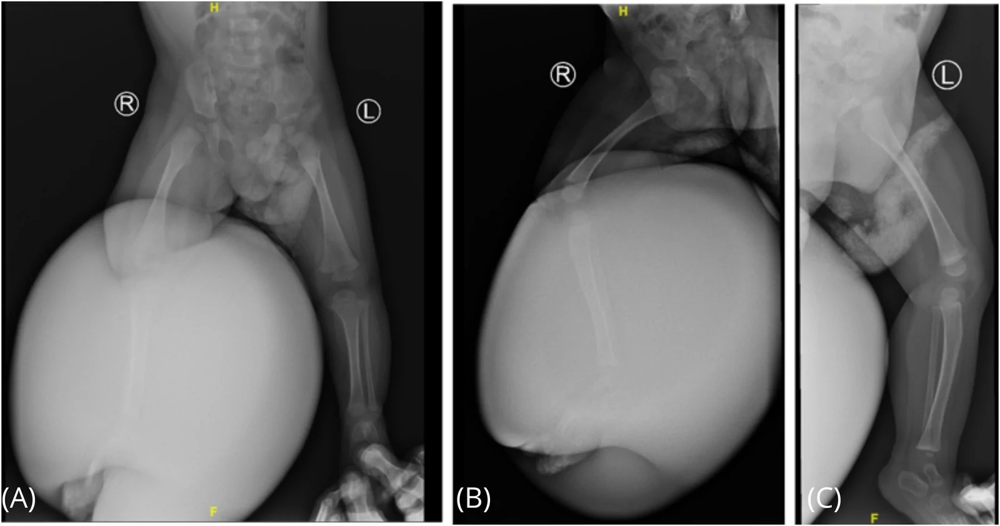
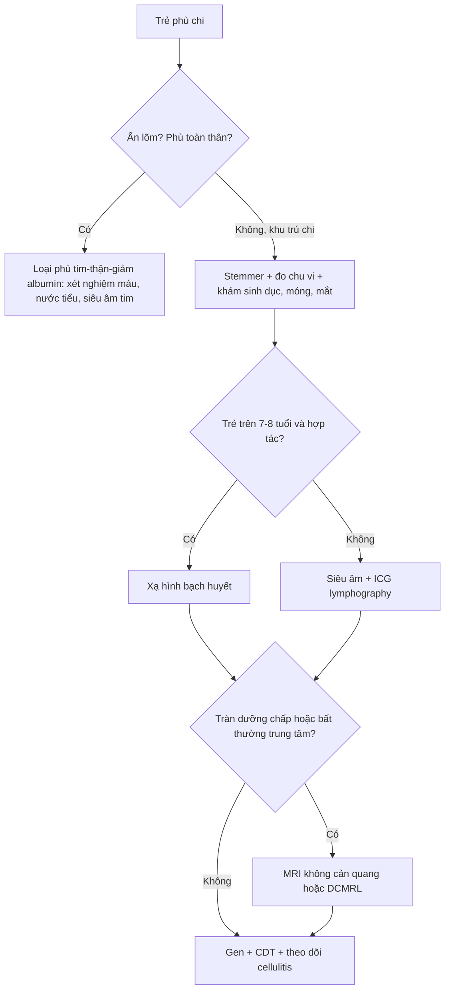
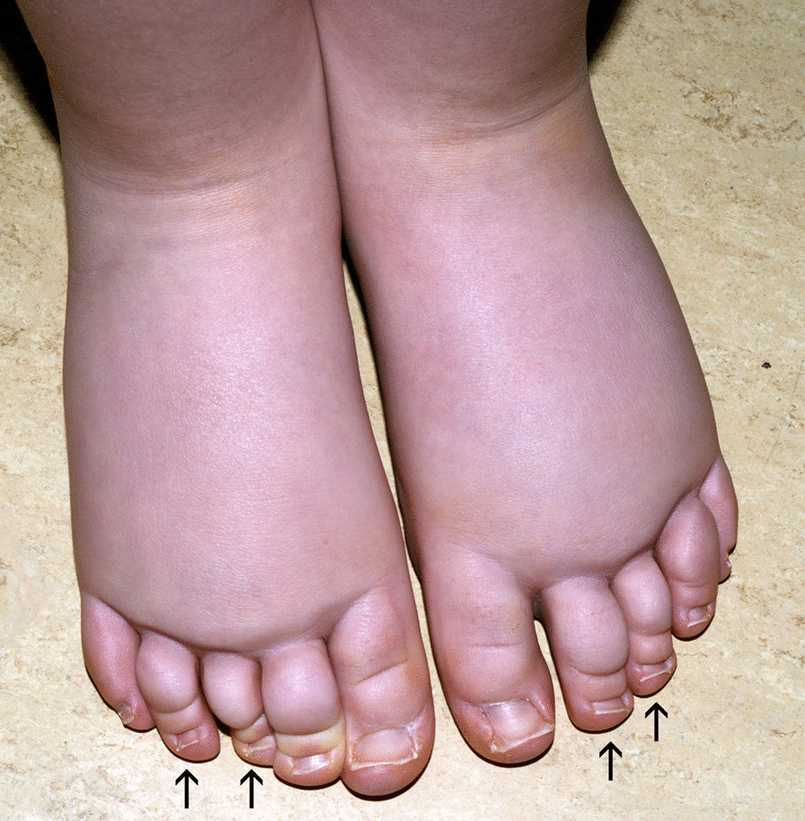
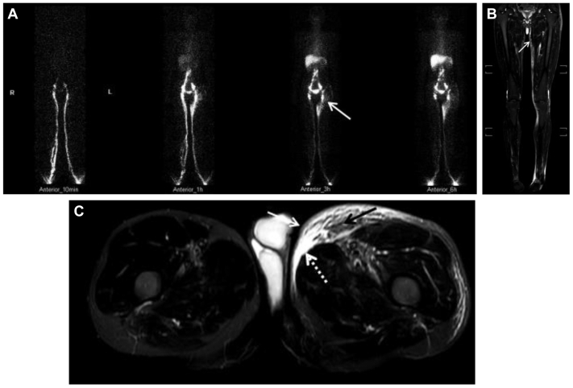

# 1466 — Phù bạch huyết bẩm sinh ở trẻ (Milroy – Meige): chẩn đoán hình ảnh và khi nào can thiệp

**Tags:** `pattern:phu-chi` `pattern:phu-mot-ben` `pattern:day-mo-duoi-da` `vung:chi-duoi` `vung:bach-huyet` `vung:nhi` `protocol:lymphoscintigraphy` `protocol:ICG-lymphography` `protocol:MRI` `protocol:CDT` `score:MDACC`

**Mức chắc chắn (certainty):** tổng hợp y văn (literature synthesis) — số liệu chính từ **bài tổng quan nhi khoa** (PMC12640678), **khuyến cáo quốc gia Pháp về phù bạch huyết nguyên phát** (PMC7789008), **đoàn hệ 29 bệnh nhân Milroy có ICG** (PMC8535675), **nghiên cứu 94 bệnh nhân phù chi dưới nguyên phát đối chiếu MRI – xạ hình** (PMC11523316), **bài tổng quan cơ chế – điều trị** (PMC12631335) và **nghiên cứu ICG – siêu âm hạch** (PMC13008088). Chỗ suy luận được đánh dấu **[suy luận]**.

> **Vì sao phải có bài riêng:** [1858](../1858-ghep-hach-bach-huyet-vlnt/lesson.md) nói về **ghép hạch bạch huyết ở người lớn**, [6157](../6157-tran-duong-trap-mang-tim-tre/lesson.md) về **tràn dưỡng trấp màng tim**, [1822](../1822-dcmrl-bach-huyet/lesson.md) về **DCMRL**. Nhưng **trẻ phù chi từ nhỏ** là một bệnh cảnh khác: khởi phát **< 1 tuổi**, tổn thương thường **hai bên**, và **nguy cơ tràn dưỡng chấp màng phổi – ổ bụng** đe dọa tính mạng. Điểm chết người là **1/4 trẻ phù chi dưới bị chẩn đoán nhầm** không phải phù bạch huyết (PMC12640678) — và ngược lại, phù do tim/thận bị điều trị như phù bạch huyết nhiều năm.

## 1. Tổng quan bệnh học – cơ chế hình ảnh

- **Bệnh học (pathology):** phù bạch huyết là **suy giảm vận chuyển bạch huyết** → dịch **giàu protein** ứ trong mô kẽ → **viêm, xơ hóa, phì đại mô mỡ** (PMC12631335). Ở thể nguyên phát, mạch bạch huyết **bất sản (aplasia), giảm sản (hypoplasia), hoặc giãn – giảm nhu động**; mạch còn nhưng **không bơm được** gọi là **"bất sản chức năng" (functional aplasia)** (PMC8535675).
- **TẠI SAO phù KHÔNG ấn lõm (non-pitting) và TẠI SAO da dày:** dịch kẽ **nồng độ protein cao** hơn phù do tim/thận → thu hút nguyên bào sợi, **lắng collagen** và **tăng sinh mô mỡ**; sau nhiều tháng mô dưới da **xơ hóa** nên **không còn "hố ấn"**, da dày, có thể **papillomatosis**. Đây là lý do **siêu âm thấy lớp dưới da dày, tăng phản âm** chứ không chỉ "phù".
- **Dấu Stemmer — ngưỡng lâm sàng:** **không thể nhấc (pinch) da ở gốc ngón chân thứ 2**; **độ nhạy 92%, độ đặc hiệu 57%** (PMC12640678) — nghĩa là **rất tốt để nghi ngờ, nhưng dương tính không chứng minh được nguyên nhân**.
- **Dịch tễ:** phù bạch huyết nguyên phát gặp **1/100.000 trẻ** (Mỹ) (PMC12640678). Trong các series gần đây **58–70% là nữ** (series cũ tới 80%); **bé trai khởi phát lúc sinh hoặc trong năm đầu**, **bé gái thường 9–11 tuổi** (PMC7789008). Trễ chẩn đoán trung bình **~10 năm** từ lúc khởi phát đến lần khám chuyên khoa đầu tiên (PMC7789008).
- **Di truyền — bảng tối thiểu cần nhớ:** **Milroy (phù bạch huyết bẩm sinh type 1A) = đột biến trội *FLT4/VEGFR3***; **Meige (type 2) = *FOXC2***; **GJC2** (Meige khởi phát muộn), **KIF11** (hội chứng đầu nhỏ – phù bạch huyết – bệnh võng mạc), **EPHB4** (phù thai), **PIEZO1**, **TIE1** (thể khởi phát muộn), **CCBE1** (Hennekam) (PMC12640678; PMC12631335; PMC11245153).
- **Milroy — số liệu kiểu hình và hình ảnh:** 29 bệnh nhân, **28 biến thể *FLT4*** (26 missense), tuổi trung bình **14,1**, **14 nam/15 nữ**; làm **ICG lymphography ở 23 người** thấy **mạch bạch huyết ngoằn ngoèo, thuốc lên chậm tới cổ chân/đầu gối ở 15/23 (65%)** (PMC8535675).
- **TẠI SAO khởi phát < 1 tuổi là dấu hiệu nặng:** ở nhóm này **tần suất biến chứng bạch huyết (tràn dưỡng chấp màng phổi, dưỡng chấp ổ bụng) lên tới 75%** (PMC12640678) — tức bệnh không chỉ ở chân.
- **Phù bộ phận sinh dục:** gặp ở **8–18% trẻ** phù bạch huyết nguyên phát, đa số là bé trai, thường kèm chi dưới (PMC12640678) — **phải khám và hỏi, vì trẻ không tự nói**.
- **Hình ảnh là để TRẢ LỜI 3 CÂU:** (1) có đúng là phù bạch huyết không? (2) mạch **bất sản/giảm sản/giãn**? (3) có **dịch ổ bụng – màng phổi – màng tim** kèm theo không?

*Hình: trên – bệnh nhân nữ Milroy đơn thuần: (a) mạch bạch huyết trung bì (mũi tên) và mao mạch máu; (b) phù hai chân; (c) mạch bạch huyết **ngoằn ngoèo, không đều**. Dưới – bệnh nhân khác: (d) mạch bạch huyết trung bì thưa; (e) phù; (f) mạch ngoằn ngoèo tới cổ chân; (g,h) mạch bất thường hai bên. Nguồn: Genes (Basel) 2021, PMC8535675, Fig. 2, CC BY 4.0.*

## 2. Mẫu hình + chẩn đoán phân biệt theo tuổi khởi phát (gamut)

- **Bẩm sinh – khởi phát < 1 tuổi:** **Milroy** (*FLT4*), **MCLMR** (*KIF11*), **Hennekam** (*CCBE1*), **Turner/Noonan**, **EPHB4** (phù thai/hydrops). Đặc điểm: **hai bên, đối xứng, từ bàn chân lên**, kèm **móng mọc ngược (upslanting nails)**, **ngắn móng (brachyonychia)** ở Milroy (PMC7789008).
- **Trẻ em 1–12 tuổi:** tiếp tục Milroy biểu hiện muộn; thể **nguyên phát đơn thuần**; cân nhắc **lipedema** nếu trẻ gái dậy thì, **bàn chân không phù**.
- **Vị thành niên 13–21:** **Meige** (*FOXC2*, **GJC2**), **lipedema** khởi phát dậy thì, **phù do thuốc/obesity**.
- **Người lớn > 21:** thể khởi phát muộn (**TIE1**, *GJC2*), và **phù bạch huyết thứ phát** (sau nạo hạch, xạ, nhiễm ký sinh trùng).
- **Theo hình thái/khu trú:** **hai chi dưới đối xứng** (Milroy/Meige); **một chi** (dị dạng bạch huyết khu trú, Klippel–Trenaunay); **bộ phận sinh dục** (8–18%); **mặt/cổ** (hiếm, gợi ý hội chứng); **phù toàn thân** (phù thai, Hennekam, Turner).
- **Dấu hiệu gợi ý thể hội chứng (phải tìm):** móng vàng, **distichiasis** (hàng lông mi thứ hai — *FOXC2*), nhiều hạt cộm da, dị dạng mạch máu, **chênh lệch chiều dài chi**, dị dạng mặt, chậm phát triển (PMC7789008; PMC12640678).
- **Bộ ba phân biệt sát nhất ở trẻ:** **lipedema** (đau, dễ bầm, **bàn chân không phù**, ranh giới cổ chân), **phù do tim/thận/giảm albumin** (hai bên, mềm, ấn lõm, toàn thân), **huyết khối tĩnh mạch sâu** (một bên, đau, cấp).

*Hình: X-quang thẳng (A) và nghiêng (B) hai chi dưới ở trẻ 6 tháng với phù bạch huyết bẩm sinh khổng lồ: **mô mềm phì đại rõ bên phải**, xương không tổn thương. Nguồn: Front Surg 2026, PMC13718031, Fig. 2, CC BY 4.0.*

### Vì sao vẫn chụp X-quang dù biết là bệnh mô mềm
- X-quang **loại trừ** nguyên nhân xương (loạn sản, gãy bệnh lý, viêm xương) và cho thấy **mức phì đại mô mềm** — hữu ích khi trẻ **không hợp tác MRI**; nhưng **không đo được mạch bạch huyết** và **không phân biệt** được phù bạch huyết với phù khác. **Không dùng X-quang để chẩn đoán.** [suy luận]

## 3. Bảng so sánh phân biệt (ma trận đối chiếu)

| Thực thể (entity) | Hình ảnh / lâm sàng điển hình | Chốt vào (rule-in) | Chốt loại (rule-out) | Gợi ý xác nhận |
|---|---|---|---|---|
| **Milroy (type 1A, *FLT4*)** | Phù **hai chân từ lúc sinh/năm đầu**, **móng mọc ngược**, ngắn móng; xạ hình: **bất sản/giảm sản mạch + trễ vận chuyển** | **Khởi phát < 1 tuổi + hai bên + tiền sử gia đình trội + *FLT4*** | Phù một bên, khởi phát muộn, không móng bất thường → nghĩ khác | Xạ hình bạch huyết; ICG; panel gen |
| **Meige / distichiasis–lymphedema (*FOXC2*)** | Phù **khởi phát dậy thì**, thường nữ, có thể **distichiasis**, móng vàng | **Distichiasis + phù chi dưới khởi phát 13–21 tuổi** | Khởi phát sơ sinh → Milroy | Khám mắt **tìm hàng mi thứ hai**, gen *FOXC2* |
| **MCLMR (*KIF11*)** | **Đầu nhỏ + chậm phát triển + phù bạch huyết + bệnh võng mạc** | **Chu vi đầu nhỏ + phù + tổn thương võng mạc** | Phù đơn thuần, phát triển bình thường | Đo vòng đầu, soi đáy mắt, gen |
| **Turner / Noonan / phù thai** | **Hydrops fetalis**, phù toàn thân, cổ ngắn, dị dạng | **Phù thai + dị dạng + karyotype** | Phù chi dưới đơn thuần | Siêu âm thai, karyotype, siêu âm tim |
| **Lipedema** | Trẻ gái dậy thì, **đau, dễ bầm**, mỡ hai chân đối xứng, **bàn chân KHÔNG phù** | **Bàn chân không phù + ranh giới cổ chân + đau** | Phù cả bàn chân, không đau → phù bạch huyết | Nghiệm pháp Stemmer **âm tính**, không cần hình ảnh mạch |
| **Phù do tim/thận/giảm albumin** | **Hai bên, mềm, ấn lõm**, phù quanh hốc mắt, toàn thân | **Ấn lõm + bệnh tim/thận + albumin thấp** | Phù cứng, không lõm, khu trú chi → bạch huyết | Albumin, TSH, creatinine, siêu âm tim |
| **Dị dạng bạch huyết / Klippel–Trenaunay** | **Một chi**, bớt mạch máu, **chi dài/to**, nang bạch huyết trên MRI | **Bớt + phì đại chi + nang/dị dạng trên MRI** | Hai chi đối xứng, không bớt → nguyên phát | MRI có/không cản quang, siêu âm |

## 4. Protocol chẩn đoán + hệ phân độ ICG và ngưỡng điều trị

- **Lâm sàng (làm trước mọi hình ảnh):** **Stemmer**, chu vi/thể tích chi, **khám bộ phận sinh dục**, móng, mắt (distichiasis), dị dạng, **tiền sử gia đình**, đếm **đợt viêm mô tế bào (cellulitis)**.
- **Xét nghiệm tối thiểu:** **albumin, TSH, creatinine, urê, AST/ALT, công thức máu, tổng phân tích nước tiểu** để loại phù toàn thân (PMC12640678).
- **Siêu âm:** đo **độ dày da/mô dưới da**, tìm **mạch bạch huyết giãn**; ngưỡng bất thường trên siêu âm hạch bạch huyết là **giãn ≥ 0,3 mm** (PMC13008088). Siêu âm **không đau, không bức xạ** → lựa chọn đầu tay ở trẻ nhỏ.
- **Xạ hình bạch huyết (lymphoscintigraphy):** **chuẩn vàng**, **độ nhạy 92%, độ đặc hiệu 100%**; **thường làm sau 7–8 tuổi** vì cần hợp tác (PMC12640678). Dấu hiệu: **trễ vận chuyển, trào ngược trung bì (dermal backflow), bất đối xứng hạch, mạch bàng hệ**; phân biệt được **bất sản/giảm sản vs tăng sản** nhưng **không phải lúc nào cũng suy ra nguyên nhân** (PMC12640678).
- **ICG lymphography (huỳnh quang cận hồng ngoại):** thời gian thực, **không bức xạ**, chỉ thấy **mạch nông tới độ sâu ~1,5 cm**; **tương đương xạ hình về đánh giá độ nặng**, an toàn ở trẻ (PMC12640678; PMC12631335). Phân độ **MD Anderson (MDACC)**: **thấy mạch thẳng liên tục = giai đoạn 0–I** (còn mạch thu), khi bệnh tiến triển mạch **bị ngắt/không thấy** và thay bằng **dermal backflow từng đoạn hoặc lan tỏa** (PMC13329518). Dạng **splash** xuất hiện sớm, **stardust** đi kèm thay đổi cấu trúc và dày da nhiều hơn (PMC13008088).
- **MRI không cản quang:** dùng khi trẻ nhỏ/không hợp tác xạ hình, hoặc cần **quy hoạch phẫu thuật**. Các dấu hiệu được chuẩn hóa: **dày da rõ, dấu đường song song (parallel line), dấu lưới (grid), dấu tổ ong (honeycomb), dấu dải (band), hồ bạch huyết (lymph lake), dấu liềm (crescent)**; **dấu viền trung bì (dermal rim sign, DRS) = dày da + lưới/tổ ong + dải** — dự báo **dermal backflow** với **Se 82%, Sp 64%, độ chính xác 77%** trên **94 bệnh nhân** (PMC11523316).
- **DCMRL (chụp bạch mạch bằng MRI tiêm hạch):** khi cần đánh giá **ống ngực/trung tâm** và tràn dưỡng chấp — xem [1822](../1822-dcmrl-bach-huyet/lesson.md).
- **Di truyền:** chỉ định khi **khởi phát bẩm sinh, có biểu hiện nội tạng (dưỡng chấp, phù thai), dị dạng, chậm phát triển, tiền sử gia đình** (PMC12640678).

- **Điều trị:** **liệu pháp giải ứ toàn diện (complete decongestive therapy, CDT)** là chuẩn — giai đoạn 1 **băng ít đàn hồi 24/24 trong 5 ngày – 3 tuần** + dẫn lưu bạch huyết bằng tay + chăm sóc da; giai đoạn 2 **tất/vòng nén ban ngày**; **giảm thể tích 30–60%** tùy cách đo (PMC7789008). **Phẫu thuật** (nối mạch bạch huyết – tĩnh mạch LVA, ghép hạch VLNT, cắt bỏ mô thừa) chỉ **sau khi CDT thất bại** và **khi còn mạch thu**; xem [1858](../1858-ghep-hach-bach-huyet-vlnt/lesson.md).
- **Theo dõi:** thể tích chi mỗi 3–6 tháng, **số đợt cellulitis**, tăng trưởng, chất lượng sống; **điều trị cellulitis sớm** vì mỗi đợt làm phù nặng thêm (PMC12631335).

## 5. Biến thể bình thường và cạm bẫy

- **Cạm bẫy #1 — chẩn đoán nhầm là phổ biến:** **1/4 trẻ phù chi dưới được chẩn đoán là phù bạch huyết nhưng thực ra không phải**, và ngược lại nhiều trẻ phù bạch huyết bị gọi là "béo/phù sinh lý" (PMC12640678). → **Không chẩn đoán chỉ dựa vào "chân to"**.
- **Cạm bẫy #2 — phù hai bên là bệnh toàn thân cho đến khi chứng minh khác:** luôn loại **tim, thận, giảm albumin, suy giáp** trước khi gắn nhãn "bẩm sinh".
- **Cạm bẫy #3 — xạ hình bình thường không loại trừ bệnh sớm:** trong giai đoạn đầu, bất thường có thể **khu trú từng đoạn**; **ICG nhạy hơn ở giai đoạn chức năng sớm**, còn **thay đổi cấu trúc (giãn mạch ≥ 0,3 mm) xuất hiện muộn hơn** (PMC13008088). → **Xạ hình âm tính + nghi ngờ cao → làm ICG/MRI.**
- **Cạm bẫy #4 — ICG chỉ thấy mạch nông:** độ sâu tối đa **~1,5 cm**; mạch sâu và ống ngực **không đánh giá được** — cần MRI/DCMRL (PMC12631335).
- **Cạm bẫy #5 — dấu viền trung bì trên MRI KHÔNG đồng nghĩa trào ngược trung bì:** **Sp chỉ 64%** → dương tính giả đáng kể; dùng để **gợi ý/theo dõi**, không thay xạ hình (PMC11523316).
- **Cạm bẫy #6 — "chỉ phù chân" là đọc thiếu:** khởi phát **< 1 tuổi** có **tới 75% biến chứng dưỡng chấp** (màng phổi, ổ bụng) — phải **siêu âm ngực/bụng** khi trẻ khó thở, bụng to (PMC12640678).
- **Cạm bẫy #7 — móng mọc ngược bị chẩn đoán là nấm móng:** ở Milroy, **upslanting nails/brachyonychia** là dấu **hội chứng**, không phải nhiễm nấm; điều trị nấm nhiều năm mà không ai khám mạch bạch huyết.
- **Cạm bẫy #8 — phù bộ phận sinh dục bị bỏ qua:** **8–18%** trẻ có, đa số trai; trẻ không tự nói và phụ huynh không nhìn — **phải khám chủ động** (PMC12640678).
- **Biến thể bình thường:** **phù nhẹ bàn chân ở trẻ sơ sinh** sau sinh vài ngày, **phù "béo" hai chân ở trẻ dậy thì** không đau, Stemmer âm tính → **không phải phù bạch huyết**.

*Hình: phù hai chân ở trẻ gái 4 tuổi, phù có từ lúc sinh, kèm **móng mọc ngược (upslanting nails)** và **ngắn móng (brachyonychia, mũi tên)** — dấu gợi ý thể bẩm sinh/di truyền. Nguồn: Orphanet J Rare Dis 2021, PMC7789008, Fig. 3, CC BY 4.0.*

## 6. Tự lượng giá — Blind Quiz

**Ca 1 — Bé trai 6 tháng, chân phải to dần từ lúc sinh, không đau, không sốt. Mẹ cho biết ông ngoại cũng "chân to từ nhỏ".**

- Câu hỏi: Bất thường chính trên phim? Nghĩ 3 chẩn đoán? Xét nghiệm/hình ảnh nào chốt?

<b>Bấm để hiện đáp án</b>

- **Bất thường:** **phì đại mô mềm khổng lồ** chi dưới phải, **xương bình thường**.
- **Nghĩ:** **Milroy (*FLT4*)**, dị dạng bạch huyết/Klippel–Trenaunay, phù do nguyên nhân toàn thân (ít khả năng vì một bên).
- **Chốt:** **xạ hình bạch huyết** (nếu hợp tác) hoặc **ICG**; **siêu âm bụng/ngực** tìm dưỡng chấp; **panel gen *FLT4*** vì có tiền sử gia đình trội. Khởi phát < 1 tuổi → **nguy cơ dưỡng chấp tới 75%**.
- Nguồn: Front Surg 2026, PMC13718031, Fig. 2, CC BY 4.0; số liệu PMC12640678.

**Ca 2 — Bé gái 12 tuổi, hai chân phù từ nhỏ, không đau. Khám: Stemmer dương, móng mọc ngược. Bác sĩ chỉ định ICG lymphography.**

- Câu hỏi: Mô tả bất thường trên ICG? Thuốc này nhìn được sâu bao nhiêu? Vì sao không thấy ống ngực?

<b>Bấm để hiện đáp án</b>

- **Bất thường:** mạch bạch huyết **ngoằn ngoèo, không đều, lên rất chậm** tới cổ chân/đầu gối; một số đoạn **mất liên tục** — phù hợp tổn thương **giảm sản/bất sản chức năng** ở Milroy (15/23 bệnh nhân trong đoàn hệ có hình ảnh này).
- **Độ sâu:** ICG chỉ thấy **mạch nông tới ~1,5 cm** dưới da.
- **Vì sao không thấy ống ngực:** ống ngực nằm **sâu trong trung thất** → cần **MRI/DCMRL** nếu nghi tràn dưỡng chấp.
- Nguồn: Genes (Basel) 2021, PMC8535675, Fig. 2, CC BY 4.0; giới hạn độ sâu: PMC12631335.

**Ca 3 — Bé gái 16 tuổi, phù chân trái 6 tháng. Xạ hình: mạch bạch huyết trái **không hiện**, có **trào ngược trung bì ở cẳng chân**; không thấy hạch bẹn trái.**

- Câu hỏi: Mô tả hai loại hình ảnh? Nghĩ nguyên nhân? Bước tiếp theo?

<b>Bấm để hiện đáp án</b>

- **Xạ hình (A):** mạch bạch huyết chi trái **không/ít hiện**, **trào ngược trung bì (dermal backflow) ở đùi/cẳng chân trái** (mũi tên) — phù hợp **phù bạch huyết nguyên phát** thể **giảm sản/bất sản**.
- **MRI không cản quang (B,C):** **dày da và mô dưới da**, hình **lưới/tổ ong** và **dải** — tương ứng **dermal rim sign**, dự báo trào ngược trung bì (Se 82%, Sp 64%).
- **Nghĩ:** phù bạch huyết nguyên phát (Meige/nguyên phát) — **không phải DVT** vì phù mạn, không đau cấp.
- **Tiếp theo:** CDT + nén; **siêu âm/hỏi biến chứng**; cân nhắc **gen** nếu có dị dạng/dậy thì sớm; **không** dùng kháng sinh dự phòng dài hạn trừ khi cellulitis tái phát.
- Nguồn: J Vasc Surg Venous Lymphat Disord 2024, PMC11523316, Fig. 3, CC BY-NC-ND 4.0 (dùng nguyên bản).

## Bài liên quan chéo
- [1858 – Ghép hạch bạch huyết (VLNT)](../1858-ghep-hach-bach-huyet-vlnt/lesson.md)
- [1822 – DCMRL: chụp bạch mạch bằng MRI](../1822-dcmrl-bach-huyet/lesson.md)
- [6157 – Tràn dưỡng trấp màng tim ở trẻ](../6157-tran-duong-trap-mang-tim-tre/lesson.md)
- [6158 – Phù bạch huyết ở trẻ (PLE)](../6158-ple-bach-huyet-tre/lesson.md)
- [921 – Nút mạch bạch huyết điều trị PLE](../921-nut-mach-bach-huyet-ple/lesson.md)

> Không dùng để chẩn đoán độc lập khi chưa có người hướng dẫn.
