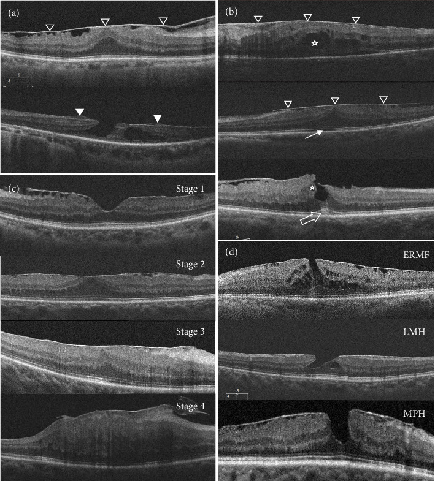
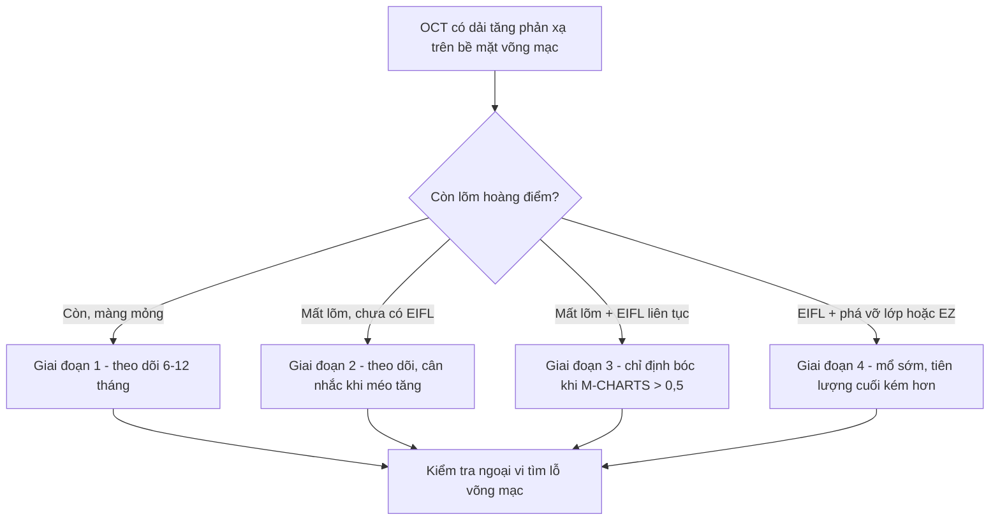
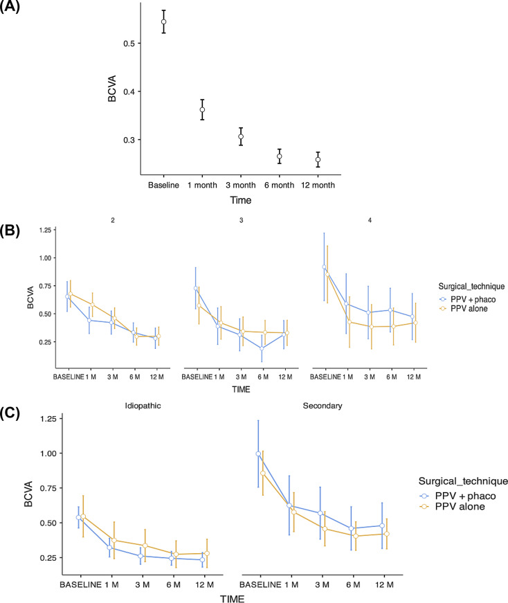
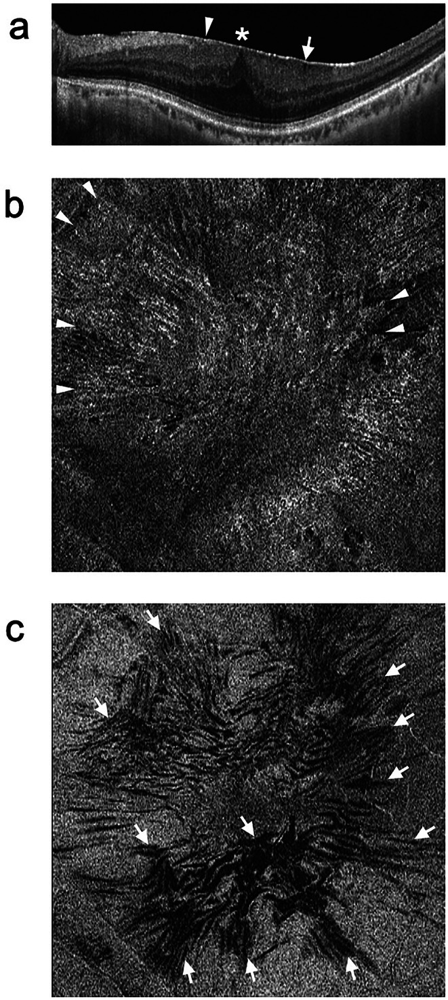

# 1467 — Màng trước võng mạc (ERM): đọc OCT theo 4 giai đoạn Govetto và quyết định bóc màng

**Tags:** `pattern:mang-truoc-vong-mac` `pattern:co-keo-vong-mac` `pattern:mat-mot-ben` `pattern:day-vong-mac` `vung:hoang-diem` `vung:vong-mac` `vung:mat` `score:Govetto` `protocol:OCT` `protocol:OCT-en-face` `protocol:PPV` `protocol:ILM-peeling` `protocol:M-CHARTS` `score:M-CHARTS`

**Mức chắc chắn (certainty):** tổng hợp y văn (literature synthesis) — số liệu chính từ **đoàn hệ 340 mắt** bóc màng 12 tháng (PMC13234982), **phân loại Govetto gốc 194 mắt** (PMID 27993592), **đoàn hệ 635 mắt** đối chiếu ERM vô căn – thứ phát (PMC12077978), **nghiên cứu 46 mắt** diễn tiến tự nhiên (PMC12404372) và bài tổng quan OCT – phẫu thuật (PMC11607056). Chỗ suy luận được đánh dấu **[suy luận]**.

> **Vì sao phải có bài riêng:** [1455](../1455-anti-vegf-mat-da-cat-dich-kinh/lesson.md) trả lời "vì sao mắt đã cắt dịch kính vẫn còn dịch" nhưng **quy cho thuốc**; còn **màng trước võng mạc (epiretinal membrane, ERM)** là nguyên nhân **cơ học** — màng co kéo **không đáp ứng anti-VEGF**, và **bóc màng** mới là điều trị. Đọc sai ERM thành "phù hoàng điểm kháng thuốc" dẫn tới **tiêm lặp vô ích nhiều tháng** trong khi thị lực mất dần do tế bào hạch và tế bào quang thụ bị kéo giãn.

## 1. Tổng quan bệnh học – cơ chế hình ảnh

- **Bệnh học (pathology):** ERM là **màng xơ – tế bào không có mạch** nằm trên **màng giới hạn trong (internal limiting membrane, ILM)**. Tế bào chính: **tế bào thần kinh đệm võng mạc (Müller), hyalocyte, tế bào biểu mô sắc tố (RPE), nguyên bào sợi cơ (myofibroblast)** (PMC11607056). Hai giả thuyết sinh bệnh: (1) **PVD** gây rách ILM → tế bào Müller di chuyển lên bề mặt; (2) **vỏ dịch kính tồn dư (vitreoschisis)** → hyalocyte được cytokine (bFGF, NGF) kích thích → biệt hóa thành myofibroblast (PMC11607056).
- **TẠI SAO trên OCT màng là một ĐƯỜNG TĂNG PHẢN XẠ (hyperreflective line):** màng là **collagen đặc + tế bào + sợi cơ**, chiết suất cao hơn dịch kính và võng mạc bình thường nên **tán xạ ngược mạnh**; vì màng **mỏng (hàng chục µm)** nên chỉ hiện thành **một dải sáng sát bề mặt**, khác với **dịch dưới võng mạc** (vùng **giảm phản xạ**, không có dải sáng) hay **mảng xơ dưới võng mạc** (dải sáng **nằm dưới** biểu mô sắc tố) (PMC11607056, Hình 1).
- **TẠI SAO có nếp võng mạc (retinal folds):** myofibroblast co rút tạo **lực kéo tiếp tuyến (tangential traction)** → võng mạc **gấp nếp**. Trên **OCT en face cắt 30 µm dưới ILM**, nếp hiện thành **đường giảm phản xạ dạng tuyến** — đây là dấu khách quan của co kéo, thấy được cả khi B-scan chưa rõ (PMC11607056, Hình 1).
- **TẠI SAO nhìn méo (metamorphopsia) mà thị lực còn tốt:** 3 cơ chế — (1) **bất thường tế bào quang thụ** do kéo giãn, (2) **tổn thương lớp nhân trong (inner nuclear layer, INL)** chứa tế bào Müller/horizontal/bipolar, (3) **tế bào Müller bị di lệch** dẫn ánh sáng sang tế bào quang thụ "sai địa chỉ" (PMC11607056). Vì vậy **thị lực là thước đo tồi để quyết định mổ**: méo xuất hiện **trước** khi thị lực giảm, và **không bị nhiễu bởi đục thể thủy tinh** như thị lực.
- **TẠI SAO có "lớp trong lạc chỗ (ectopic inner foveal layers, EIFL)":** khi **mất lõm hoàng điểm**, các lớp trong **trượt vào và bắc cầu qua hõm** → tạo **dải tăng/giảm phản xạ liên tục** vắt ngang hõm, dày **50–250 µm** ở trung tâm; EIFL là **dấu của giai đoạn muộn**, gắn với thị lực kém hơn (PMC13234982).
- **Phân loại OCT Govetto (194 mắt, 172 bệnh nhân) — ngưỡng để phân giai đoạn** (PMID 27993592): **GĐ 1 = 22,1%** (màng mỏng, **còn lõm hoàng điểm**); **GĐ 2 = 45,4%** (**mất lõm** + dày lớp nhân ngoài); **GĐ 3 = 26,3%** (**EIFL liên tục** vắt qua hõm); **GĐ 4 = 6,2%** (màng dày + EIFL + **các lớp võng mạc bị phá vỡ**). **EIFL gặp ở 32,5%**; thị lực **giảm dần từ GĐ 1 → 4 (P < 0,001)**.
- **Dịch tễ:** ERM gặp **4–11,8%** dân số, tăng theo tuổi (PMC11607056); tổng hợp khác ghi **6–11%** và **tới 15% ở người > 70 tuổi** (PMC13234982).
- **Độ dày hoàng điểm tăng theo giai đoạn — dùng làm ngưỡng đọc:** trong 340 mắt, **CMT trung bình 457,5 ± 81,4 µm** (trung vị 449,5), và **trung vị theo giai đoạn là 423 µm (G2) → 482 µm (G3) → 514 µm (G4)**, tương quan **rho = 0,346** với giai đoạn (PMC13234982). CMT đo ở **ô 1 mm trung tâm theo lưới ETDRS**.
- **Kết cục sau mổ (340 mắt, 12 tháng):** thị lực **0,54 ± 0,44 logMAR (≈ 20/70) → 0,26 logMAR (≈ 20/36)**, **trung vị giảm 0,23 logMAR ≈ 11–12 chữ ETDRS**. Theo giai đoạn: **G2 0,519 → 0,256 (Δ −0,263)**; **G3 0,553 → 0,268 (Δ −0,285)**; **G4 0,933 → 0,345 (Δ −0,588)** — **giai đoạn càng muộn, mức lời càng lớn nhưng trần thị lực cuối càng thấp** (PMC13234982).

## 2. Mẫu hình + chẩn đoán phân biệt theo cơ chế và hình thái (gamut)

- **Theo cơ chế:** (a) **vô căn (idiopathic)** — 82,9% trong đoàn hệ 340 mắt; (b) **thứ phát** — 17,1%: sau **bong võng mạc (retinal detachment, RD)**, sau **phẫu thuật đục thể thủy tinh**, **võng mạc đái tháo đường (DR)**, **tắc nhánh/tĩnh mạch trung tâm (RVO)**, **viêm màng bồ đào (uveitis)**, **chấn thương** (PMC13234982).
- **Theo hình thái trên OCT — 5 kiểu cần phân biệt trước khi mổ:**
  1. **ERM "cellophane"/sớm:** màng mỏng, **còn lõm hoàng điểm**, ít co kéo → **theo dõi**.
  2. **Macular pucker:** màng dày, nếp rõ, **mất lõm**, CMT tăng → **chỉ định bóc khi méo/thị lực ảnh hưởng**.
  3. **Lỗ hoàng điểm giả (macular pseudohole, MPH):** bờ hõm **dốc đứng**, **không có khuyết toàn chiều**, gần như **không có dịch nội võng mạc**, CMT **gần bình thường** (tiêu chuẩn Hubschman: tiêu chí tùy chọn là **microcyst trong INL** + **CMT trung tâm gần bình thường**) (PMC11607056).
  4. **ERM foveoschisis:** tách lớp trong hõm do kéo — **phải phân biệt với lỗ hoàng điểm thật** vì thị lực có thể còn tốt.
  5. **Lỗ hoàng điểm lớp (lamellar macular hole, LMH) kèm tăng sinh trước võng mạc (LHEP):** bờ hõm **lởm chởm, bị bào mòn (undermined edges)**, màng xám dai **bám chặt bờ hõm** — **không phải ERM điển hình**; bóc LHEP ở đáy hõm mỏng có thể **gây lỗ hoàng điểm toàn chiều** (PMC11607056).
- **Theo vị trí — ngưỡng ảnh hưởng chức năng:** nếp võng mạc **ngoài vùng trung tâm bán kính 1,5 mm (đường kính 3 mm)** **không** làm giảm thị lực/không gây méo (PMC11607056) → **đừng chỉ định mổ vì "OCT có nếp" ở ngoại vi**.
- **Gợi nhớ 3 câu hỏi trước mọi ERM:** **(1) còn lõm hoàng điểm không? (2) có EIFL/DRIL không? (3) lớp ngoài (đường ellipsoid, EZ) còn nguyên không?** — ba câu này chính là GĐ 1→4 và là yếu tố tiên lượng.

## 3. Bảng so sánh phân biệt (ma trận đối chiếu)

| Thực thể (entity) | Hình ảnh điển hình (OCT / en face) | Chốt vào (rule-in) | Chốt loại (rule-out) | Gợi ý xác nhận |
|---|---|---|---|---|
| **ERM vô căn** | Dải **tăng phản xạ mỏng sát ILM** toàn hoàng điểm, nếp tỏa nan hoa, CMT tăng, **EIFL ở GĐ 3–4** | **Dải sáng trên bề mặt + nếp en face 30 µm dưới ILM** | Không có dải sáng mặt trên → nghĩ phù/dịch | SD-OCT 2 trục + en face; đo CMT ô 1 mm ETDRS |
| **ERM thứ phát sau bong võng mạc** | Màng **dày, xơ hơn**, thường **GĐ 4 (65%)**; kèm **tổn thương EZ**, dấu laser/cryo cũ | **Tiền sử mổ RD + màng xuất hiện 1–3 tháng sau** (91% ca) | Màng mỏng, không can thiệp RD trước đó → vô căn | Soi bờ võng mạc ngoại vi, OCT theo dõi 1–3 tháng |
| **Lỗ hoàng điểm giả (MPH)** | Bờ hõm **dốc đứng**, **không khuyết toàn chiều**, CMT **gần bình thường**, có thể microcyst INL | **Không có khuyết võng mạc toàn chiều trên mọi lát cắt** | Có khuyết toàn chiều + viền dịch dưới võng mạc → **lỗ thật** | Cắt OCT ngang **và dọc**, cắt mỏng qua tâm |
| **LMH + LHEP** | Bờ hõm **bào mòn**, **màng xám dai bám bờ**, mất lớp trong tại hõm | **Bờ undermined + vật liệu tăng phản xạ dính bờ hõm** | Màng mỏng trải đều mặt trên → ERM | Đánh giá độ dày đáy hõm trước khi bóc |
| **ERM foveoschisis** | **Tách lớp trong** dạng khoang tại hõm, kéo từ màng mặt trên | **Khoang tách lớp trong + màng co kéo** | Dịch dưới võng mạc đơn thuần → không phải schisis | OCT cắt mỏng, đối chiếu thị lực |
| **Màng dưới võng mạc do CNV (AMD)** | **Vật liệu dưới RPE/võng mạc**, kèm dịch dưới võng mạc, xuất huyết | **Tổn thương dưới RPE + dịch dưới võng mạc + FA/ICGA** | Dải sáng **trên** bề mặt → ERM | FA/ICGA, OCT-A |

*Hình: (a) ERM điển hình (tam giác đen) và tăng sinh trước võng mạc (tam giác trắng); (b) khuyết đường nối IS/OS, dịch nội võng mạc (sao), dấu "cotton ball" (mũi tên rỗng); (c) **phân loại Govetto GĐ 1–4**; (d) ERM foveoschisis, LMH, lỗ hoàng điểm giả. Nguồn: J Ophthalmol 2025, PMC12077978, Fig. 1, CC BY 4.0.*

### Dấu hiệu quyết định trên từng giai đoạn
- **GĐ 1–2:** lõm hoàng điểm **còn/mất** là mốc; màng mỏng, chưa EIFL → **theo dõi 6–12 tháng** nếu triệu chứng nhẹ.
- **GĐ 3:** **EIFL liên tục** vắt qua hõm — bắt đầu có **mất tương ứng võng mạc**; méo thường rõ, là lúc **cân nhắc mổ**.
- **GĐ 4:** EIFL + **phá vỡ lớp** (DRIL, tổn thương EZ) — thị lực nền kém nhất nhưng **mức lời sau mổ lớn nhất**.

## 4. Protocol chụp + hệ phân giai đoạn và ngưỡng xử trí

- **OCT hoàng điểm (SD-OCT):** B-scan **qua tâm theo 2 trục ngang + dọc**, cắt mỏng; **en face cắt 30 µm dưới ILM** để thấy nếp; đo **CMT ô 1 mm trung tâm ETDRS** và **ghi mm/µm**. Đây là bộ tối thiểu để phân giai đoạn (PMC11607056; PMC13234982).
- **Định lượng triệu chứng:** **M-CHARTS** (19 đường chấm, khoảng chấm **0,2–2,0 độ thị giác**); **điểm ≥ 0,5 là mức ảnh hưởng sinh hoạt**. Ngưỡng thời điểm mổ được đề xuất: **M-CHARTS trước mổ > 0,5 và sau mổ < 0,5**, tương ứng **độ sâu nếp võng mạc quanh hoàng điểm (MDRF) 69–118 µm** (PMC11607056).
- **Phẫu thuật:** **PPV 23G/25G + bóc ERM ± bóc ILM**, nhuộm **Brilliant Blue G** để kiểm soát diện bóc, **bơm khí (air/SF₆)** khi cần (PMC11607056; PMC12905464). Trong đoàn hệ 340 mắt, **75,3% mổ phối hợp phaco + IOL (PPV+PHACO)** (PMC13234982).
- **Bóc ILM: lợi và giá** — **tái phát ERM 2,0% khi bóc ERM + ILM vs 11,0% khi chỉ bóc ERM**; đổi lại có **DONFL (dissociated optic nerve fibre layer)** và tranh cãi về thị lực (PMC11607056).
- **Nguy cơ nhiễm trùng:** sau mổ ERM, **viêm nội nhãn 52/14.545 (0,36%)** so với **20/14.545 (0,14%)** sau mổ lỗ hoàng điểm — **RR 2,60 (95% CI 1,55–4,35)** (PMC13675174).
- **ERM sau bong võng mạc — thời điểm bóc:** **91% (50/55) màng được chẩn đoán trong 1–3 tháng** sau mổ RD; bóc **< 6 tháng** cho thị lực cuối **0,31 logMAR** so với **0,63** khi bóc **≥ 6 tháng** (P = 0,005); phân bố giai đoạn **GĐ 4 65%, GĐ 3 24%, GĐ 2 11%** (PMC12081393).

- **Khung quyết định thực hành:** **theo dõi** khi GĐ 1–2 + M-CHARTS < 0,5 + thị lực tốt; **mổ** khi **M-CHARTS > 0,5**, hoặc **MDRF 69–118 µm**, hoặc thị lực giảm **do màng** (không do đục thể thủy tinh); **mổ sớm** ở ERM sau RD (bóc < 6 tháng) (PMC11607056; PMC12081393).

*Hình: đường cong thị lực (logMAR) sau PPV bóc ERM — (A) toàn bộ 12 tháng, (B) theo giai đoạn Govetto và kỹ thuật, (C) theo căn nguyên và kỹ thuật. Nguồn: Int J Retina Vitreous 2026, PMC13234982, Fig. 2, CC BY 4.0.*

## 5. Biến thể bình thường và cạm bẫy

- **Cạm bẫy #1 — "ERM vô căn" thực ra là thứ phát do lỗ võng mạc ngoại vi:** trong **635 mắt** được mổ với chẩn đoán ban đầu là ERM vô căn, **115 mắt (18,1%) có lỗ võng mạc ngoại vi** và được đổi chẩn đoán thành ERM thứ phát. Trên OCT, **hai nhóm gần như không khác nhau** (CMT, khuyết IS/OS, dịch nội võng mạc, cotton ball, phân giai đoạn) — **chỉ có mất cân xứng độ dày cạnh hoàng điểm trái–phải là khác** (PMC12077978). → **Bắt buộc soi đáy mắt ngoại vi/ảnh góc rộng trước khi gọi là vô căn.**
- **Cạm bẫy #2 — màng "teo nhỏ" không phải là đang tốt lên:** ở 46 mắt ERM thị lực tốt (≥ 20/25) theo dõi ≥ 2 năm, nhóm **mất ≥ 2 dòng thị lực** có **diện tích màng giảm 34,2%** so với **11,7%** ở nhóm ổn định (P < 0,001); **giảm diện tích màng 7,66% tại 6 tháng** dự báo mất thị lực với **Se 81,8%, Sp 82,6%** (PMC12404372). → Đừng đọc "màng nhỏ lại" là lui bệnh.
- **Cạm bẫy #3 — lỗ hoàng điểm giả vs lỗ thật:** chỉ một lát cắt qua tâm **không đủ**; khuyết toàn chiều chỉ được chẩn đoán khi thấy **trên cả trục ngang và dọc**, kèm **viền dịch dưới võng mạc** ở lỗ thật.
- **Cạm bẫy #4 — LHEP không phải ERM:** bóc "màng" dính bờ hõm ở LMH có đáy rất mỏng có thể **tạo lỗ hoàng điểm toàn chiều**; kỹ thuật đúng là **gài (embedding) LHEP** vào bờ hõm (PMC11607056).
- **Cạm bẫy #5 — DONFL sau bóc ILM:** các "hố" giảm phản xạ xếp dọc sợi thần kinh **không phải tái phát** và thường **không ảnh hưởng thị lực**; đừng mổ lại.
- **Cạm bẫy #6 — quy thị lực giảm cho màng khi có đục thể thủy tinh:** thị lực bị nhiễu bởi cataract; dùng **M-CHARTS** và **OCT** để quyết định; ở người sắp mổ, **phaco + PPV** thường được chọn.
- **Cạm bẫy #7 — "giai đoạn 4 thì không mổ":** GĐ 4 có **thị lực nền kém nhất (0,933 logMAR)** nhưng **mức lời tuyệt đối lớn nhất (Δ −0,588)**; tiên lượng *cuối* kém hơn, không phải *không có lợi* (PMC13234982).
- **Biến thể bình thường:** **phản xạ ánh sáng (cellophane reflex)** ở mắt trẻ không kèm dày võng mạc/nếp trên en face thường **không phải ERM thực thụ**; và **đường viền ILM** đôi khi tạo dải mảnh tự nhiên — phân biệt bằng **nếp en face + CMT**.

## 6. Tự lượng giá — Blind Quiz

**Ca 1 — Nam 68 tuổi, nhìn đường kẻ bị cong 6 tháng, thị lực 20/40, không đục thể thủy tinh đáng kể.**

- Câu hỏi: Dấu hiệu chính nằm ở lớp nào? Có mấy dấu hiệu của co kéo? Giai đoạn Govetto và nên làm gì tiếp?

<b>Bấm để hiện đáp án</b>

- **Dấu hiệu:** dải **tăng phản xạ mỏng nằm TRÊN bề mặt võng mạc** (mũi tên), kèm **nếp võng mạc** thấy rõ trên **en face cắt 30 µm dưới ILM** (đường giảm phản xạ dạng tuyến); CMT tăng, lõm hoàng điểm bị kéo.
- **Chẩn đoán:** **ERM có co kéo** (macular pucker). Vì màng là mô xơ–tế bào mỏng nên chỉ tạo **một dải sáng**, khác dịch dưới võng mạc (vùng tối).
- **Xử trí:** đo **M-CHARTS**; nếu > 0,5 và chưa có EIFL → **bóc màng ± ILM** (cân nhắc phối hợp phaco). Nếu M-CHARTS < 0,5 → theo dõi 6 tháng.
- Nguồn: Jpn J Ophthalmol 2024, PMC11607056, Fig. 1, CC BY 4.0.

**Ca 2 — Nữ 60 tuổi, 3 tháng sau mổ bong võng mạc, nhìn mờ tăng dần. OCT: màng dày, mất lõm, EIFL, đường ellipsoid bị phá vỡ.**

- Câu hỏi: Đây là giai đoạn nào? Có nên chờ thêm không? Vì sao?

<b>Bấm để hiện đáp án</b>

- **Giai đoạn 4** (màng dày + EIFL + phá vỡ lớp/EZ) — tương ứng hình (c) "Stage 4".
- **Không nên chờ:** ERM sau bong võng mạc thường **xuất hiện 1–3 tháng** sau mổ (91%) và **bóc < 6 tháng cho thị lực cuối 0,31 logMAR so với 0,63** khi bóc muộn (P = 0,005); GĐ 4 chiếm **65%** trong nhóm ERM sau RD.
- **Lưu ý tiên lượng:** GĐ 4 có **mức lời lớn nhất (Δ −0,588 logMAR)** nhưng **trần thị lực cuối thấp nhất**.
- Nguồn: PMC12077978 Fig. 1 (CC BY 4.0); số liệu PMC12081393; PMC13234982.

**Ca 3 — Nam 55 tuổi, OCT thấy "lỗ" ở hoàng điểm, bờ dốc đứng, không có dịch dưới võng mạc, CMT 250 µm.**

- Câu hỏi: Đây là lỗ hoàng điểm thật hay giả? Cần thêm gì để chốt? Có chỉ định mổ ngay không?

<b>Bấm để hiện đáp án</b>

- **Lỗ hoàng điểm giả (macular pseudohole)** — hình (d) nhóm "MPH": bờ dốc đứng, **không khuyết toàn chiều**, CMT **gần bình thường**, không có viền dịch dưới võng mạc.
- **Cần:** cắt OCT mỏng qua tâm **cả trục ngang và dọc**, tìm **microcyst INL** (tiêu chí tùy chọn Hubschman); kiểm tra **EZ** còn nguyên không.
- **Chưa mổ ngay:** theo dõi nếu thị lực tốt; mổ khi **M-CHARTS > 0,5** hoặc CMT/nếp tiến triển. Nếu là **lỗ thật** (khuyết toàn chiều + dịch) thì xử trí khác hoàn toàn.
- Nguồn: PMC12077978 Fig. 1, CC BY 4.0; tiêu chuẩn MPH: PMC11607056.

## Bài liên quan chéo
- [1455 – Vì sao mắt đã cắt dịch kính còn dịch (đáp ứng anti-VEGF)](../1455-anti-vegf-mat-da-cat-dich-kinh/lesson.md)
- [1865 – Bong võng mạc tái phát sau tháo dầu](../1865-bong-vong-mac-tai-phat-sau-thao-dau/lesson.md)
- [1410 – Lấy dầu silicone và dầu tồn lưu](../1410-lay-dau-silicone-va-dau-ton-luu/lesson.md)
- [1465 – Tăng nhãn áp sau tiêm nội nhãn](../1465-tang-nhan-ap-sau-tiem-noi-nhan/lesson.md)
- [1464 – Toxocariasis nội nhãn ở người lớn](../1464-toxocariasis-noi-nhan-nguoi-lon/lesson.md) (u hạt co kéo gây ERM)

> Không dùng để chẩn đoán độc lập khi chưa có người hướng dẫn.
