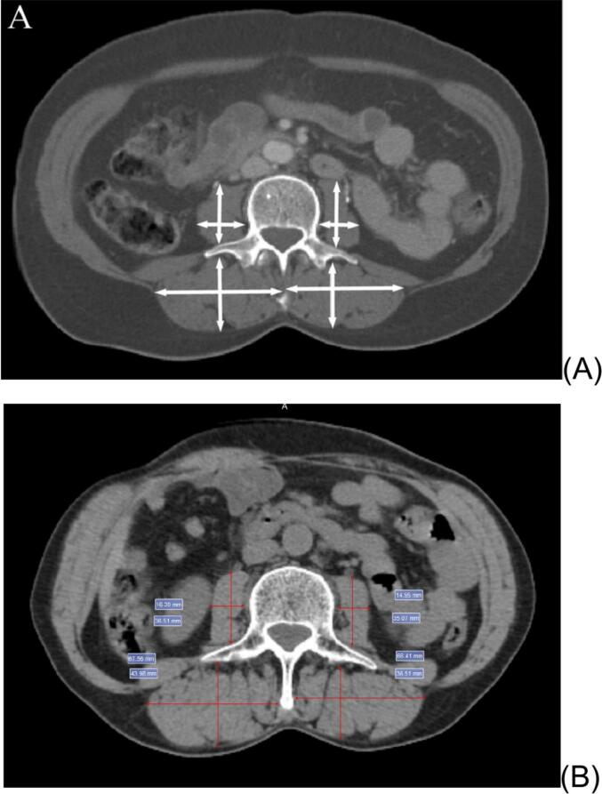
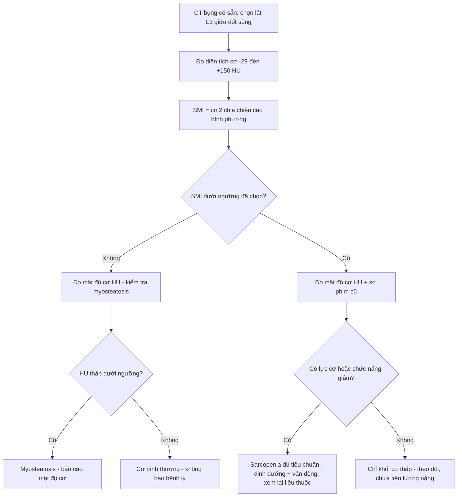
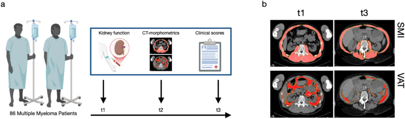
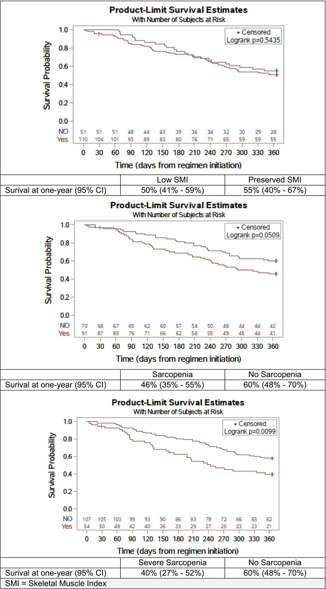

# 1468 — Suy mòn & sarcopenia trên CT ở bệnh nhân ung thư: SMI tại L3, mật độ cơ và "dùng ngưỡng nào" / Cancer-related sarcopenia on CT

**Tags:** `pattern:teo-co` `pattern:mat-khoi-co` `pattern:giam-mat-do-co` `vung:bung` `score:SMI` `score:Martin` `protocol:CT-bung` `incidentaloma:sarcopenia`

**Mức chắc chắn (certainty):** tổng hợp y văn (literature synthesis) — ghép **phân tích thứ cấp RCT ở 161 người ≥ 70 tuổi ung thư giai đoạn muộn** (Mattick và cs. 2026, *J Cachexia Sarcopenia Muscle* 17:e70388, **PMC13602984**, CC BY 4.0), **đoàn hệ 210 phụ nữ ung thư cổ tử cung** (de Araujo Resende và cs. 2026, *Gynecol Oncol Rep* 66:102174, **PMC13453474**, CC BY-NC), **nghiên cứu dọc 86 ca đa u tủy có tổn thương cột sống** (Kylies và cs. 2026, *Brain Spine* 6:106153, **PMC13355679**, CC BY) và **tổng quan phương pháp luận về ngưỡng** (Byrne & Gomez 2026, *Nutr Clin Pract* 41:1020–1047, **PMC13419016**, CC BY-NC-ND), cộng **tổng quan 18 nghiên cứu ung thư đại–trực tràng** (Chen & Gao 2026, *Cancer Manag Res* 18:564390, **PMC13044798**, CC BY-NC). Nhóm **không có bệnh nhân của mình**; các nghiên cứu đều **hồi cứu hoặc phân tích thứ cấp**, ngưỡng SMI **khác nhau giữa các bài** — mọi tỷ lệ dưới đây phải đọc kèm định nghĩa đã dùng.

> **Câu chốt:** Trên CT bụng **đã có sẵn** (không cần chụp thêm), đo **diện tích cơ tại một lát cắt L3** rồi chuẩn hóa theo chiều cao (**SMI, cm²/m²**) và **mật độ cơ (HU)**. Nhưng **khối cơ một mình không đủ**: ở 161 người cao tuổi ung thư, **SMI thấp đơn thuần không dự báo tử vong (log-rank p = 0,54)**, trong khi **sarcopenia đủ tiêu chuẩn (khối lượng + lực cơ) làm tử vong 1 năm tăng gấp đôi (HR 2,12)** và **độc tính độ 3–5 tăng gấp đôi (OR 2,24)**. Báo cáo phải ghi **ngưỡng đã dùng**, **HU mật độ cơ**, và **so với lần chụp trước** — không ghi "teo cơ" chung chung.

## 1. Tổng quan bệnh học – cơ chế hình ảnh (TẠI SAO)

### 1.1 Vì sao CT đo được khối cơ — vật lý HU, không phải "cảm giác teo"
- **Cơ vân 30–60 HU** (dày đặc protein co kéo), **mỡ dưới da/mỡ trong cơ −50 đến −190 HU**, **nước 0 HU**, **xương > 200 HU**. Vì khoảng HU của cơ **tách hẳn** khỏi mỡ và khí, phần mềm có thể **đếm điểm ảnh (pixel)** trong một khoảng ngưỡng chuẩn: **cơ −29 đến +150 HU**; mỡ dưới da/mỡ trong cơ **−190 đến −30 HU**; mỡ nội tạng **−150 đến −50 HU** (ngưỡng dùng trong phần mềm SliceOmatic, trích trong PMC13419016). Diện tích (cm²) × độ dày lát cắt cho **thể tích**; chỉ cần **diện tích lát cắt** là đủ cho chỉ số.
- **TẠI SAO chọn L3:** lát cắt ngang L3 chứa **đồng thời** cơ thắt lưng, cơ cạnh sống, cơ thành bụng và cơ vuông thắt lưng — tức **đại diện cho khối cơ toàn thân** trong một lát; vì vậy **SMI tại L3** là mốc được dùng nhiều nhất trong 18 nghiên cứu ung thư đại–trực tràng (một số bài dùng **L3 psoas index** hoặc **L4**, và **các mốc này không hoán đổi được cho nhau**).
- **TẠI SAO mật độ cơ (HU) quan trọng ngang khối lượng:** mỡ len giữa các sợi cơ (**myosteatosis**) làm **giảm trung bình HU** dù diện tích không đổi; mật độ cơ tham chiếu ở L3 khoảng **52 HU (nữ) / 56 HU (nam)** ở người trẻ khỏe, và **giảm theo tuổi** xuống **25 HU (nữ) / 31 HU (nam)** ở nhóm ≥ 75 tuổi (bảng tham chiếu trong PMC13419016). Vì vậy **diện tích bình thường + HU thấp** vẫn là cơ "kém chất lượng".

### 1.2 Vì sao mất cơ lại đổi số phận bệnh nhân ung thư
- Cơ là **kho dự trữ protein**: khi viêm hệ thống/khối u tăng chuyển hóa, cơ bị **phân giải** để cấp acid amin cho phản ứng viêm và cho gan tạo protein cấp tính → **giảm dự trữ** khiến **nhiễm trùng, độc tính thuốc và mất chức năng** nặng hơn.
- **Thể tích phân bố thuốc** phụ thuộc khối cơ ít mỡ: bệnh nhân **ít cơ, nhiều mỡ** có nồng độ thuốc/đơn vị cân nặng cao hơn → **độc tính huyết học và thần kinh** nhiều hơn; đồng thời **giảm dự trữ** làm **giảm liều** → giảm hiệu quả.
- **Sarcopenia ≠ suy dinh dưỡng đơn thuần:** béo phì vẫn có thể sarcopenic (**BMI bình thường che mất**), nên **cân nặng/BMI không thay thế được CT**.

### 1.3 Số liệu trụ cột (bắt buộc nhớ)

| Đại lượng | Con số | Nguồn |
|---|---|---|
| **Người cao tuổi ung thư giai đoạn muộn (≥ 70 tuổi, n = 161)** | **57% (91/161)** đủ tiêu chuẩn sarcopenia; trong đó **59% (54/91) là sarcopenia nặng** | PMC13602984 |
| Độc tính không huyết học độ 3–5 | **64% vs 44%** (có vs không sarcopenia); **OR 2,24** (KTC 95% 1,12–4,47) | PMC13602984 |
| Tử vong 1 năm | **46% vs 60%** sống; điều trị **đầu tay: HR 2,12** (1,14–3,93); **sarcopenia nặng: 40% vs 60%, HR 2,08** (1,18–3,65); **SMI thấp đơn thuần: p = 0,54 — không có ý nghĩa** | PMC13602984 |
| **Ung thư cổ tử cung (n = 210)** | **37,6% (79/210)** sarcopenia trước xạ; **PFS HR 1,70** (1,15–2,51), **OS HR 1,75** (1,11–2,75) ở phân tích đơn biến; **đa biến: chỉ đáp ứng điều trị là yếu tố độc lập** | PMC13453474 |
| Ung thư đại–trực tràng (18 nghiên cứu) | Tỷ lệ sarcopenia **12–60%**; biến chứng hậu phẫu **OR 3,12** (1,14–8,49) ở giai đoạn IV; **1.924 ca giai đoạn I–III: HR 2,15** (1,59–2,92) khi cả khối cơ và mật độ cơ giảm | PMC13044798 |
| Nút mạch cửa trước cắt gan (gộp 7 nghiên cứu, 599 ca) | Gan còn lại **tăng ít hơn 10,87%** (KTC 95% 3,45–18,30) ở nhóm sarcopenia | PMC13263961 |
| **Ngưỡng SMI (Martin, hay dùng nhất)** | **Nữ < 41**; **nam BMI < 25: < 43**; **nam BMI ≥ 25: < 53** cm²/m² | trích trong PMC13602984 |
| Ngưỡng khác cùng tồn tại | Fearon: **< 55 (nam) / < 39 (nữ)**; Derstine: **≤ 45,4 (nam) / ≤ 34,4 (nữ)**; tham chiếu người khỏe L3: **51,0 nam / 43,9 nữ** | PMC13419016 |
| **Mức độ hỗn loạn ngưỡng** | **17 bộ ngưỡng khác** cho sarcopenia và **32 ngưỡng** cho myosteatosis trong **73 nghiên cứu** | PMC13419016 |

- **Điểm chết người về ngưỡng:** cùng một bệnh nhân có thể **"có sarcopenia"** theo Martin nhưng **"không"** theo Derstine — vì vậy **con số trong báo cáo chỉ có nghĩa khi ghi kèm ngưỡng**.

## 2. Mẫu hình + chẩn đoán phân biệt theo kiểu hình (Gamut)

**Mẫu hình khởi điểm:** một lát cắt CT bụng ngang L3; câu hỏi là **diện tích cơ bao nhiêu** và **mật độ cơ bao nhiêu**.

- **Kiểu A — khối cơ thấp, mật độ bình thường:** mất cơ "sạch" (suy dinh dưỡng, tăng chuyển hóa, sau đợt bệnh cấp). **Đáp ứng nhất với can thiệp dinh dưỡng – vận động.**
- **Kiểu B — khối cơ thấp + mật độ thấp:** **myosteatosis**, gặp ở người già, béo bụng, kháng insulin, corticoid kéo dài; tiên lượng xấu hơn kiểu A ở nhiều ung thư.
- **Kiểu C — khối cơ "bình thường" nhưng mật độ thấp, BMI cao:** **sarcopenic obesity ẩn** — dễ bị bỏ qua vì cân nặng không giảm; cần ngưỡng SMI theo BMI.
- **Kiểu D — mất cơ MỘT BÊN, không đối xứng:** teo do **bất động/thần kinh** (sau đột quỵ, sau mổ háng, liệt chi), không phải sarcopenia hệ thống — đọc đối xứng hai bên.
- **Kiểu E — diện tích cơ giảm "giả tạo":** phù, truyền dịch, cổ trướng làm **tăng cân và pha loãng HU**, khiến bệnh nhân trông "nặng" nhưng cơ vẫn thấp.

**Gamut theo bối cảnh:** ung thư (hóa trị, xạ, sau mổ lớn), **xơ gan/cổ trướng**, **bệnh thận mạn/lọc máu**, **ICU – bệnh nặng cấp**, **người già đa bệnh**, **sau ghép tạng**. Trong ung thư, sarcopenia là **biến số tiên lượng độc lập với giai đoạn u** ở nhiều bộ môn — nhưng **không phải ở mọi bộ môn** (xem PMC13453474: mất ý nghĩa khi vào đa biến).

## 3. Bảng so sánh phân biệt (ma trận đối chiếu)

| Thực thể (entity) | Hình ảnh điển hình | Chốt vào (rule-in) | Chốt loại (rule-out) | Gợi ý xác nhận |
|---|---|---|---|---|
| **Sarcopenia do ung thư (kiểu A)** | L3: cơ **mảnh, ranh giới rõ, mật độ cơ còn tốt (≈ 40–55 HU)**; mỡ nội tạng có thể ít | **SMI dưới ngưỡng đã chọn** + **giảm so với lần chụp trước** + lực cơ/chức năng giảm | SMI trên ngưỡng **và** mật độ cơ bình thường → không gọi sarcopenia | Đo SMI, so phim cũ 3–6 tháng; đo lực nắm/chủ động đứng lên 5 lần |
| **Myosteatosis (kiểu B)** | Cơ **"lốm đốm tối"**, HU trung bình **< ~33–41 HU** tùy ngưỡng, dải mỡ len giữa các bó cơ | **Mật độ cơ thấp dưới ngưỡng** dù diện tích có thể bình thường | HU ≥ 45–50 và không có dải mỡ trong cơ → không myosteatosis | Vẽ ROI trong cơ thắt lưng/cạnh sống, đọc HU trung bình ± SD; đối chiếu pha cản quang |
| **Sarcopenic obesity (kiểu C)** | BMI ≥ 25–30, mỡ nội tạng nhiều, **cơ mỏng so với cân nặng** | **SMI dưới ngưỡng theo BMI** + mỡ nội tạng cao | BMI thấp + cơ mỏng = suy dinh dưỡng thuần, không phải "béo sarcopenic" | Dùng ngưỡng riêng theo BMI/giới, không dùng một ngưỡng chung |
| **Teo cơ bất động/một bên (kiểu D)** | **Bất đối xứng rõ** cơ thắt lưng–cạnh sống hai bên; ± thay đổi mỡ trong cơ bên teo | **Chênh bên > ~10%** + tiền sử liệt/bất động/mổ khớp háng | Đối xứng hai bên → teo hệ thống | So sánh trái–phải trên cùng lát; MRI/EMG nếu cần nguyên nhân thần kinh |
| **"Giả" giảm mật độ do phù/dịch (kiểu E)** | Thành bụng **dày, phù**, dịch tự do, cơ **nhạt màu lan tỏa** (không có dải mỡ khu trú) | **Phù/cổ trướng/truyền dịch trong 1–2 tuần** + HU giảm **lan tỏa** cả cơ và tạng | Có **dải mỡ trong cơ** + HU giảm khu trú → myosteatosis thật | Đọc lại phim cũ trước đợt phù; cân nặng/thể tích dịch |
| **Người khỏe/VDV** | Cơ dày, **HU cao (≥ 50–60)**, mỡ nội tạng ít | SMI **trên** ngưỡng + HU cao | — | Không báo bệnh lý; dùng làm mốc so sánh |

*Hình: (A) sơ đồ hướng đo **cơ thắt lưng hai bên + cơ cạnh sống** tại L3; (B) thước đo trên mặt cắt CT thật (đơn vị mm). de Araujo Resende LS và cs., *Gynecol Oncol Rep* 2026;66:102174 (**PMC13453474**), Fig. 1, **CC BY-NC** — nguyên bản, không crop/ghép.*

### 3.1 Ba bước đọc chuẩn (theo thứ tự, tránh overcall)
1. **Chọn đúng lát:** L3 giữa đốt sống, **thấy cả hai mỏm ngang và toàn bộ cơ thắt lưng**; nếu lát bị lệch lên L2/xuống L4, SMI **không so sánh được** với lần trước.
2. **Đo diện tích trong ngưỡng −29…+150 HU**, rồi **sửa tay**: loại ruột, mạch máu, hạch, xương; kiểm tra **không "dính" mỡ dưới da** vào cơ.
3. **Đo mật độ (HU trung bình)** trong ROI cơ thắt lưng/cạnh sống; **ghi cả diện tích và mật độ** — một mình diện tích bỏ sót nhóm myosteatosis.

## 4. Protocol chụp + cách báo cáo + ngưỡng xử trí

### 4.1 Protocol (dùng lại CT có sẵn — không chụp thêm)
- **Nguồn ảnh:** CT bụng–chậu chẩn đoán **đã có** (không cần thêm liều); **lát 5 mm**, cửa sổ mô mềm **W 400 / L 40**.
- **Mốc:** **L3 giữa đốt sống**; ghi rõ nếu buộc dùng **L4/T12** (không hoán đổi ngưỡng).
- **Pha cản quang:** ưu tiên **không cản quang** hoặc **luôn cùng một pha** khi so sánh dọc; cản quang làm **tăng HU cơ** → đừng so phim có/không cản quang.
- **Đo:** diện tích cơ toàn bộ tại L3 (−29…+150 HU, sửa tay) → **SMI = cm² / (chiều cao m)²**; thêm **mật độ cơ (HU)** và (tùy bài toán) **mỡ nội tạng/mỡ dưới da**.
- **Thời điểm:** **trước điều trị (baseline)** và **mỗi 3–6 tháng** hoặc trước mỗi dòng điều trị; **trước mổ lớn ≥ 2 tuần** để kịp "prehabilitation".

### 4.2 Cách báo cáo cho bác sĩ điều trị (5 dòng)
1. **SMI = ... cm²/m²** tại L3, **ngưỡng dùng: Martin/Fearon/Derstine** → **dưới/trên ngưỡng**.
2. **Mật độ cơ = ... HU** → **myosteatosis có/không**.
3. **So với lần chụp ... (ngày):** thay đổi **... cm²/m² (....%)**.
4. **Kiểu hình:** A/B/C/D/E (mục 2).
5. **Đề xuất:** đánh giá lực cơ – chức năng; **dinh dưỡng + vận động**; cân nhắc **giảm liều/đổi phác đồ** khi sarcopenia nặng; **không** dùng SMI đơn thuần để quyết định ngừng điều trị.

### 4.3 Ngưỡng xử trí thực hành
- **Sarcopenia nặng (khối lượng + lực + chức năng giảm):** hội chẩn dinh dưỡng – phục hồi chức năng **trước khi** bắt đầu dòng điều trị mới; xem lại **liều theo độc tính** chứ không giảm liều mù.
- **Myosteatosis đơn thuần:** báo cáo như **yếu tố nguy cơ**, không phải chẩn đoán; theo dõi cùng SMI.
- **Giảm SMI ≥ 5–10% giữa hai lần chụp** dù chưa dưới ngưỡng: coi là **tín hiệu cảnh báo sớm**, đánh giá lại dinh dưỡng/độc tính.

## 5. Biến thể bình thường và cạm bẫy

- **Biến thể bình thường:** người **cao, gầy, trẻ** có SMI cao; **người châu Á** có SMI thấp hơn người da trắng cùng tuổi → **ngưỡng châu Á thường thấp hơn**; **vận động viên** có mật độ cơ rất cao. Không overcall theo ngưỡng phương Tây mà không ghi nguồn.
- **Cạm bẫy 1 — "một ngưỡng cho mọi người":** 17 bộ ngưỡng sarcopenia + 32 ngưỡng myosteatosis trong 73 nghiên cứu (PMC13419016) → **luôn ghi tên ngưỡng**; đổi ngưỡng là đổi tỷ lệ mắc bệnh, không đổi bệnh nhân.
- **Cạm bẫy 2 — dùng psoas index thay SMI:** PI dễ đo nhưng **bỏ sót cơ cạnh sống/thành bụng** và **kém tương quan** với khối cơ toàn thân; một số nghiên cứu dùng **L4 PI** — **không so trực tiếp** với L3 SMI.
- **Cạm bẫy 3 — so phim khác pha cản quang/khác lát:** HU thay đổi theo pha và theo mức lát; so sánh chỉ có giá trị khi **cùng pha, cùng mốc, cùng phần mềm**.
- **Cạm bẫy 4 — phù/truyền dịch:** làm **nhạt màu cơ lan tỏa** và tăng cân → đọc là "teo nặng" hoặc "béo" sai; đối chiếu phim trước đợt phù.
- **Cạm bẫy 5 — kết luận từ SMI đơn thuần:** chính PMC13602984 cho thấy **SMI thấp không dự báo tử vong (p = 0,54)** trong khi **sarcopenia đủ tiêu chuẩn thì có** — đừng biến một chỉ số thành tiên lượng tuyệt đối.
- **Cạm bẫy 6 — "teo cơ" trên báo cáo không có số:** ghi **cm²/m² + HU + ngày chụp trước**; báo cáo định tính không dùng lại được cho nghiên cứu hay quyết định liều.

## 6. Tự lượng giá — Blind Quiz

**Ca 1 — CT bụng, cần đo khối cơ: đo ở đâu và đo cái gì?**

- Gợi ý lâm sàng: phụ nữ ung thư cổ tử cung, CT mô phỏng xạ trị trước điều trị.
- Câu hỏi: Lát cắt ở mức nào? Đo **cơ nào**, theo **hướng nào**? Nếu chỉ đo cơ thắt lưng (psoas) mà bỏ cơ cạnh sống thì sai lệch gì?

<b>Bấm để hiện đáp án (findings + chẩn đoán)</b>

- Dấu hiệu: (A) sơ đồ đo **cơ thắt lưng hai bên** (đường ngang + dọc) và **cơ cạnh sống**; (B) thước đo trên ảnh thật với số mm.
- Chẩn đoán/ý nghĩa: đo tại **L3**, lấy **diện tích cơ** (không chỉ một đường kính) để tính **SMI = cm²/m²**; bỏ cơ cạnh sống sẽ **đánh giá thấp khối cơ** và làm SMI không so sánh được với y văn dùng "total skeletal muscle area at L3".
- Nguồn ảnh: de Araujo Resende LS và cs., *Gynecol Oncol Rep* 2026;66:102174 (PMC13453474), Fig. 1, **CC BY-NC**.

**Ca 2 — hai lần CT cách nhau vài tháng ở bệnh nhân đa u tủy: cái gì đã thay đổi?**

- Gợi ý lâm sàng: đa u tủy có tổn thương cột sống, suy thận tiến triển, chụp toàn thân 3 lần trong nhiều năm.
- Câu hỏi: Hai hàng ảnh (SMI, VAT) khác nhau ở điểm nào? Vì sao **cùng một bệnh nhân** mà "teo cơ" lại đi kèm **mỡ nội tạng** thay đổi? Điều gì trên xét nghiệm giải thích tốc độ mất cơ?

<b>Bấm để hiện đáp án (findings + chẩn đoán)</b>

- Dấu hiệu: (b) mặt nạ đo **SMI** (hàng trên) và **VAT – mỡ nội tạng** (hàng dưới) tại thời điểm **t1** và **t3**; khối cơ (đỏ) **mỏng đi** theo thời gian, mỡ nội tạng thay đổi song song.
- Chẩn đoán: **sarcopenia tiến triển** trong bệnh lý ác tính mạn — nhóm có **eGFR giảm/albumin thấp** mất SMI **nhanh hơn** có ý nghĩa; đây là lý do phải **đo lặp lại** chứ không chỉ một lần.
- Cơ chế: viêm hệ thống + giảm albumin + urê máu cao → **tăng phân giải protein cơ**; mỡ nội tạng tăng thay thế khối cơ đã mất.
- Nguồn ảnh: Kylies J và cs., *Brain Spine* 2026;6:106153 (PMC13355679), Fig. 1, **CC BY**.

**Ca 3 — ba đường sống còn trên cùng một nhóm bệnh nhân: đọc thế nào?**

- Gợi ý lâm sàng: 161 người ≥ 70 tuổi, ung thư giai đoạn muộn, bắt đầu phác đồ mới.
- Câu hỏi: Panel nào **không** có ý nghĩa thống kê? Vì sao **thêm lực cơ** lại làm khác biệt rõ hơn **chỉ khối cơ**? Kết luận thực hành cho báo cáo CT là gì?

<b>Bấm để hiện đáp án (findings + chẩn đoán)</b>

- Dấu hiệu: panel trên (chỉ **SMI thấp**): **p = 0,5435**, sống 1 năm **50% vs 55%**; panel giữa (**sarcopenia**): **p = 0,0509**, **46% vs 60%**; panel dưới (**sarcopenia nặng**): **p = 0,0099**, **40% vs 60%**.
- Chẩn đoán: **chỉ khối cơ không đủ** — khi thêm **lực cơ** và **chức năng**, nhóm nguy cơ mới tách ra; đa biến: sarcopenia **HR 2,12** (điều trị đầu tay), sarcopenia nặng **HR 2,08**.
- Thực hành: báo cáo **SMI + mật độ cơ**, và **đề nghị đo lực cơ/chức năng** thay vì kết luận tiên lượng từ SMI.
- Nguồn ảnh: Mattick LJ và cs., *J Cachexia Sarcopenia Muscle* 2026;17:e70388 (PMC13602984), Fig. 3, **CC BY 4.0**.

## Bài liên quan chéo
- [100 – Tổng quan hệ Bụng](../100-tong-quan-he-bung/lesson.md)
- [101 – Protocol bụng](../101-protocol-bung/lesson.md)
- [1430 – Độc tính thần kinh sau CAR-T (ICANS)](../1430-icans-doc-tinh-than-kinh-sau-car-t/lesson.md)
- [1440 – Hội chứng Parkinson sau CAR-T (MNT)](../1440-mnt-parkinsonism-sau-car-t-bcma/lesson.md)

## Ảnh
- `1468_l3-psoas-ct_Diagram_PMC13453474-Fig1.jpg` — Fig. 1, PMC13453474, CC BY-NC.
- `1468_ct-morphometry_CT_PMC13355679-Fig1.jpg` — Fig. 1, PMC13355679, CC BY.
- `1468_km-song-con_Chart_PMC13602984-Fig3.jpg` — Fig. 3, PMC13602984, CC BY 4.0 (chuyển từ webp sang jpg, không crop).
- Nguồn + giấy phép từng ảnh: `images/CREDITS.md`.

> Không dùng để chẩn đoán độc lập khi chưa có người hướng dẫn.
