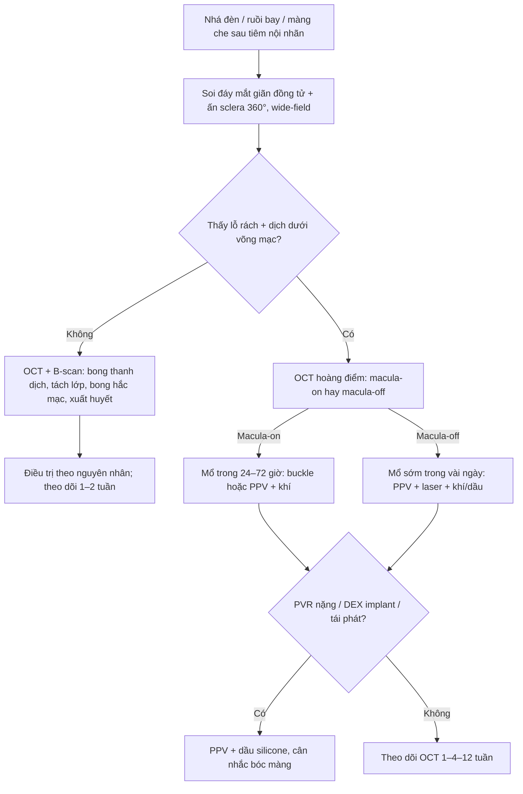
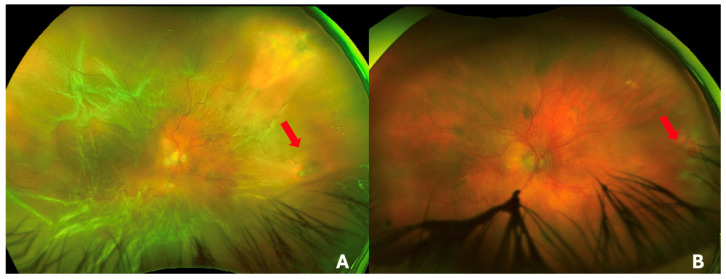
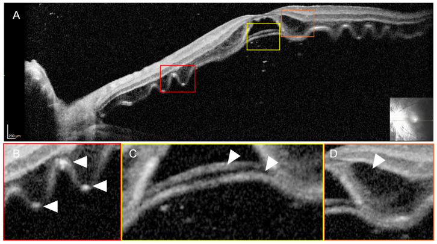
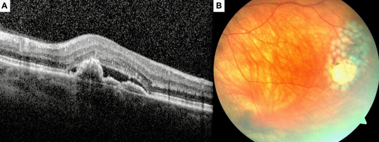

# 1469 — Bong võng mạc có lỗ sau tiêm nội nhãn / Rhegmatogenous retinal detachment after intravitreal injection (IVARD)

**Tags:** `pattern:bong-vong-mac` `pattern:lo-rach-vong-mac` `pattern:dich-duoi-vong-mac` `pattern:co-keo-pvr` `pattern:tiem-noi-nhan` `pattern:bien-chung` `vung:vong-mac` `vung:hoang-diem` `vung:dich-kinh` `score:PVR` `protocol:OCT` `protocol:widefield` `protocol:sieu-am-B-scan` `protocol:PPV` `incidentaloma:khong`

**Mức chắc chắn (certainty):** tổng hợp y văn (literature synthesis) — dựng từ **đoàn hệ 52 mắt/52 bệnh nhân ở 2 trung tâm châu Âu** (*Graefes Arch Clin Exp Ophthalmol* 2021, **PMC8589788**, CC BY 4.0), **tổng quan hình ảnh tiền phẫu bong võng mạc bong hoàng điểm** (*Diagnostics* 2026, **PMC13256988**, CC BY 4.0), **ca lỗ rách 7 tuần sau mũi tiêm thứ 8** (*Med Hypothesis Discov Innov Ophthalmol* 2026, **PMC13135659**, CC BY-NC) và **ca bong võng mạc hoàng điểm trên vết rách hình thoi** (*Cureus* 2026, **PMC13088649**, CC BY 4.0). Nhóm **không có bệnh nhân của mình**; chỗ chưa đủ chắc ghi "chưa rõ". **Không ghi tên tác giả** — attribution dùng tạp chí + năm + PMCID.

> **Câu chốt:** Bong võng mạc có lỗ sau tiêm nội nhãn (IVARD) **hiếm nhưng là biến chứng mù không hồi phục**, và điều nguy hiểm nhất là **bị quy cho "nhá đèn do tiêm"** rồi khám lại muộn. Ba con số phải thuộc: **(1)** tỉ lệ **~0,02%/mũi với anti-VEGF** (95% CI 0,010–0,037) nhưng **0,134%/mũi với implant dexamethasone** (95% CI 0,044–0,312) — **cao gấp ~6,7 lần**; **(2)** trong 52 mắt IVARD, **63,5% (33/52) đã bong hoàng điểm** khi đến viện, triệu chứng trung bình **6,5 ± 7,8 ngày**; **(3)** mổ **một lần dính 83%**, **lần hai 96%**, nhưng **PVR gặp 8/9 mắt có implant dexamethasone** và thị lực cuối **vẫn kém vì bệnh hoàng điểm nền**. Chẩn đoán không nằm ở OCT mà ở **soi đáy mắt có ấn sclera tìm lỗ rách** — OCT chỉ trả lời "hoàng điểm còn dính hay không".

## 1. Tổng quan bệnh học – cơ chế hình ảnh

### 1.1 TẠI SAO một mũi tiêm 30 G lại gây bong võng mạc

- **Đường kim là đường vào của lỗ rách:** kim **30–31 G** (đường kính ngoài ~0,3 mm) xuyên **3,5–4,0 mm sau rìa giác mạc**, tức là **qua pars plana vào thẳng vùng đáy (ora serrata) – võng mạc ngoại vi**. Ba cơ chế:
  1. **Rách trực tiếp:** đầu kim chạm võng mạc ở mắt **nhãn cầu nhỏ, mắt đã cắt dịch kính trước đó, hoặc võng mạc sa ra trước** (không có dịch kính đỡ) → lỗ tại chỗ tiêm.
  2. **Giam giữ dịch kính (vitreous incarceration):** sợi dịch kính bị kéo vào vết kim, tạo **dây co kéo** cố định vào lỗ; dòng dịch qua lỗ duy trì bong.
  3. **Khơi phát PVD:** thay đổi thể tích/áp lực trong nhãn cầu có thể làm **bong dịch kính sau (PVD)** đột ngột ở mắt còn dịch kính → rách hình móng ngựa ở vùng hoàng điểm/ngoại vi.
- **Vì sao dexamethasone implant nguy hiểm hơn:** implant **0,7 mg** dùng **kim 22 G** (lớn hơn hẳn 30 G) và đưa **dụng cụ cứng vào pars plana**; đồng thời corticoid tại chỗ ức chế lành vết thương và **thúc đẩy PVR**. Trong đoàn hệ: **8/9 mắt nhận DEX có PVR** (PMC8589788).
- **Vì sao cận thị nặng là nền quan trọng:** **13/52 (25%)** mắt có **cận thị > 6 D** — võng mạc mỏng, thoái hóa dạng lưới, vùng ora xa hơn; **không chứng minh được nhân quả** với mũi tiêm, nhưng đây là nhóm phải khám kỹ trước và sau tiêm.

### 1.2 TẠI SAO hình ảnh trông như vậy (vật lý OCT – siêu âm – đáy mắt)

- **Soi đáy mắt/ảnh wide-field — vì sao võng mạc bong lại "trắng đục":** võng mạc bong khỏi biểu mô sắc tố **mất nguồn nuôi từ hắc mạc**, các tế bào thần kinh **phù nội bào** → võng mạc **mất trong suốt**, trắng xám, **mất hình ảnh mạch hắc mạc** bên dưới; bề mặt **gấp nếp (corrugated)**. Lỗ rách là **vùng đỏ** vì nhìn thấy hắc mạc qua lỗ, bờ **cuộn tròn** (rolled edge). Đây là lý do ảnh wide-field là **chuẩn để đánh giá mức lan**, còn OCT **không thấy được lỗ ngoại vi**.
- **OCT — vì sao dịch dưới võng mạc "đen":** OCT dùng **giao thoa ánh sáng có độ kết hợp thấp**, đo **hồi phản xạ** với độ phân giải trục **5–7 µm**. **Dịch dưới võng mạc là nước trong** → **không phản xạ** → khoang **giảm tín hiệu (hyporeflective)**; võng mạc bong nằm phía trên như **dải tăng phản xạ liên tục**. Trong bong hoàng điểm mạn/áp lực cao, OCT thấy:
  - **nếp gấp võng mạc ngoài (outer retinal corrugations — ORC)**: các nếp của lớp hạt ngoài;
  - **bong lớp thanh mạch (bacillary layer detachment)**: tách ngay trên **đường nối đoạn trong–đoạn ngoài tế bào cảm quang** do dịch áp lực;
  - **nang trong võng mạc** và **màng trước võng mạc**.
  Ba dấu này **dự báo phục hồi thị lực kém hơn** dù mổ dính (PMC13256988).
- **Vì sao OCT không thay được soi đáy mắt:** OCT chỉ chụp **hoàng điểm và cực sau**; lỗ rách sau tiêm thường ở **vùng tiêm ngoại vi**. Vì vậy **"OCT hoàng điểm bình thường" không loại trừ bong võng mạc ngoại vi** — đây là cạm bẫy hay gặp nhất.
- **Siêu âm B-scan — khi đục môi trường:** đầu dò **10 MHz** cho hình cắt **2 chiều**; võng mạc bong là **màng tăng âm dày, liên tục với đĩa thị hai đầu**, **di động** khi mắt đảo; màng dịch kính **mỏng hơn, tăng âm kém, ít dính đĩa**; **bong hắc mạc** có hình **vòm, không dính đĩa thị**, thường kèm **nhãn áp thấp**.

### 1.3 Ngưỡng định lượng nằm lòng

| Chỉ số | Ngưỡng / giá trị | Nguồn |
|---|---|---|
| Tỉ lệ IVARD — anti-VEGF | **0,02%/mũi** (95% CI 0,010–0,037); y văn lớn ~**0,013%** | PMC8589788 |
| Tỉ lệ IVARD — implant dexamethasone | **0,134%/mũi** (0,044–0,312); chênh **+0,114%** so với anti-VEGF (p = 0,0001) | PMC8589788 |
| Số mũi trước khi bong | trung bình **4,3 ± 5,0** (1–26) | PMC8589788 |
| Khoảng cách mũi cuối → bong | trung bình **11,2 ± 14,3 tháng** (0–60) — nguy cơ **tích lũy**, không chỉ vài ngày | PMC8589788 |
| Thời gian triệu chứng → mổ | trung bình **6,5 ± 7,8 ngày** (1–30) | PMC8589788 |
| Hoàng điểm còn dính khi đến | **19/52 (36,5%)** — đến sớm hơn: **2,6 ± 1,5 ngày** vs **8,7 ± 9,0 ngày** ở nhóm bong hoàng điểm | PMC8589788 |
| Cận thị > 6 D | **13/52 (25%)** | PMC8589788 |
| Kết quả giải phẫu | dính sau 1 mổ **83% (43/52)**; sau 2 mổ **96% (50/52)** | PMC8589788 |
| PVR | **8/9 mắt nhận DEX**; 3/3 mắt viêm màng bồ đào | PMC8589788 |
| Thị lực cuối | cải thiện **28**, không đổi **16**, xấu đi **8**/52 | PMC8589788 |

## 2. Mẫu hình + chẩn đoán phân biệt theo vị trí (gamut)

- **Mẫu hình (pattern):** **dịch dưới võng mạc + võng mạc trắng đục, gấp nếp** ở một phần hoặc toàn bộ võng mạc, **có lỗ rách** (thường ngoại vi, vùng tiêm), **mất vùng nhìn** tương ứng; kèm **mảnh dịch kính** hoặc **xuất huyết nhẹ** ở đáy.
- **Gamut theo vị trí:**
  - **Vùng tiêm (3,5–4,0 mm sau rìa, thường 8–10 giờ hoặc 2–4 giờ):** lỗ do kim — **vị trí hay bị bỏ sót nhất** vì nằm sát ora, khó thấy nếu không ấn sclera.
  - **Vùng hoàng điểm/thái dương trên:** rách hình móng ngựa do PVD; hay bong hoàng điểm sớm.
  - **Vùng dưới (6 giờ):** bong **thấp, khu trú**, dễ bị bỏ qua khi bệnh nhân nằm.
  - **Toàn bộ võng mạc:** bong hình phễu, PVR — tiên lượng xấu, cần dầu silicone.
- **Gamut theo cơ chế (mnemonic "LỖ – THANH DỊCH – CO KÉO – TÁCH LỚP – HẮC MẠC"):**
  1. **LỖ (rhegmatogenous):** IVARD, rách do PVD, lỗ teo ở cận thị/lattice, lỗ do chấn thương.
  2. **THANH DỊCH (exudative):** bệnh hoàng điểm tân mạch (nAMD) đang điều trị, CSCR, viêm màng bồ đào, u nội nhãn — **không có lỗ**.
  3. **CO KÉO (tractional):** đái tháo đường tăng sinh, võng mạc sinh non, PVR — **màng co kéo, không lỗ** (hoặc lỗ do co kéo).
  4. **TÁCH LỚP (schisis):** bong võng mạc bẩm sinh/cận thị — **tách trong võng mạc**, không có dịch dưới võng mạc thật.
  5. **HẮC MẠC (choroidal detachment):** sau mổ, nhãn áp thấp, viêm — **vòm, không dính đĩa thị**.

## 3. Bảng so sánh phân biệt (ma trận đối chiếu)

| Thực thể (entity) | Hình ảnh điển hình | Chốt vào (rule-in) | Chốt loại (rule-out) | Gợi ý xác nhận |
|---|---|---|---|---|
| **IVARD (bong có lỗ sau tiêm)** | Võng mạc trắng đục gấp nếp, **lỗ rách ngoại vi**, dịch dưới võng mạc; OCT hoàng điểm bong/còn dính | **Tiền sử tiêm nội nhãn + lỗ rách thấy được khi ấn sclera + dịch dưới võng mạc**; triệu chứng nhá đèn/màng che | Không có lỗ, dịch khu trú quanh tổn thương hoàng điểm, không lan ngoại vi → không phải RRD | Soi đáy mắt giãn đồng tử + ấn sclera; wide-field; B-scan nếu đục |
| **Bong thanh dịch do thuốc/bệnh nền (exudative)** | Dịch dưới võng mạc **nhẵn, vòm**, **không lỗ**, có CNV/viêm bên dưới; **dịch di chuyển theo tư thế** | **Không tìm được lỗ + bệnh nền hoàng điểm đang hoạt động**; đáp ứng anti-VEGF/corticoid | Có lỗ rách hoặc võng mạc gấp nếp lan rộng → RRD | OCT (CNV, dịch), FA/ICGA nếu cần; theo dõi 4–8 tuần |
| **Bong co kéo (TRD)** | Màng xơ mạch **co kéo**, võng mạc **hình lều**, dính chắc, **không lỗ** hoặc lỗ trong vùng xơ | **Đái tháo đường tăng sinh/xuất huyết dịch kính cũ + màng co kéo** | Có lỗ rách đơn độc + dịch lan tự do → RRD | Siêu âm + OCT; đánh giá màng trước võng mạc |
| **Tách lớp võng mạc (retinoschisis)** | **Tách trong võng mạc**, bề mặt nhẵn, **không dịch dưới võng mạc**, thường cận thị nặng | **Tách lớp trong + không lỗ + thị trường ổn định nhiều năm** | Có lỗ + dịch dưới võng mạc thật → RRD | OCT (tách lớp), soi đáy mắt; theo dõi |
| **Bong hắc mạc** | **Vòm nhẵn**, **không dính đĩa thị**, nhãn áp **thấp**, tiền phòng nông | **Nhãn áp thấp + vòm hắc mạc + không dính đĩa** | Dính đĩa thị hai đầu + gấp nếp → võng mạc | B-scan; đo nhãn áp |
| **Xuất huyết dịch kính** | Đỏ đục, **không thấy võng mạc**, B-scan có hạt lơ lửng | **Máu trong dịch kính + không màng** | Có màng tăng âm dính đĩa → bong võng mạc | B-scan; theo dõi tan máu |
| **Viêm nội nhãn sau tiêm** | Mủ tiền phòng, viêm dịch kính, **đau tăng**; có thể kèm bong | **Đau + giảm thị lực nhanh + mủ tiền phòng** ngày 3–7 sau tiêm | Không đau, không mủ, chỉ nhá đèn → nghĩ bong | Chọc dịch kính/cấy; B-scan; xem [1425](../1425-viem-noi-nhan-sau-tiem-noi-nhan/lesson.md) |

- **Ảnh ghép đối chiếu:** không tạo composite — ảnh từ 2 bài khác nhau, khác bệnh nhân và khác modality; ghép sẽ làm mất chú giải gốc (CC BY-NC phải giữ nguyên bản).

## 4. Protocol chụp + hệ phân độ/điểm chuẩn hóa

### 4.1 Protocol trước – trong – sau tiêm

- **Trước tiêm:** đo thị lực, nhãn áp; **soi đáy mắt giãn đồng tử** ghi nhận **lattice, lỗ teo, vùng thoái hóa, tiền sử bong mắt bên kia**; OCT hoàng điểm nếu có bệnh hoàng điểm. **Cận thị > 6 D** và **mắt đã cắt dịch kính/pseudophakia** là nhóm ghi chú riêng.
- **Khi tiêm:** đánh dấu **3,5–4,0 mm** sau rìa (giác mạc trong), tránh vùng có lỗ/thoái hóa nhìn thấy; **không qua vùng pars plana có mảnh dịch kính**; dùng kim 30–31 G cho anti-VEGF, **22 G cho implant DEX** (đường vào lớn hơn — cảnh báo bệnh nhân).
- **Ngay sau tiêm:** kiểm tra **cảm nhận ánh sáng**, nhãn áp, đáy mắt nếu bệnh nhân than nhìn mờ/nhá đèn; dặn rõ **4 dấu cần quay lại ngay**: nhá đèn tăng, **màng che/ruồi bay mới**, **mất vùng nhìn**, đau tăng.
- **Nhóm nguy cơ cao:** khám lại **1–2 tuần** (soi đáy mắt + OCT) — **chưa có RCT** chứng minh lịch này, nhưng đây là thực hành hợp lý vì 63,5% đến viện đã bong hoàng điểm (PMC8589788); ghi rõ "thực hành, bằng chứng mức thấp".
- **Khi nghi bong:** soi đáy mắt **ấn sclera 360°**, **wide-field**, **OCT hoàng điểm** (dính/bong), **B-scan** nếu đục môi trường; **phân loại macula-on vs macula-off** là bước quyết định thời gian mổ.

### 4.2 Phân độ và sơ đồ quyết định

- **Phân loại thực hành quan trọng nhất:** **macula-on** (hoàng điểm còn dính — mổ **trong 24–72 giờ**) vs **macula-off** (bong hoàng điểm — mổ **sớm nhất có thể, trong vài ngày**; chờ lâu làm mất tế bào cảm quang).
- **PVR:** phân độ theo **Retina Society** (I–IV) hoặc phân loại mới **CP/CA**; PVR nặng → cân nhắc **PPV + dầu silicone** thay vì khí.
- **Chọn phẫu thuật:** **scleral buckle ± cryo** cho lỗ nhỏ ngoại vi, không PVR, dịch kính còn; **PPV + laser + khí/dầu** cho lỗ lớn, PVR, bong hoàng điểm lâu, đục môi trường.

- **Vì sao DEX cần thận trọng hơn:** **8/9 mắt** nhận DEX có PVR trong đoàn hệ → khi bong ở mắt có implant DEX, **đừng chọn khí đơn thuần** nếu đã có dấu PVR; chuẩn bị tâm lý **mổ lặp**.

## 5. Biến thể bình thường và cạm bẫy

- **"Nhìn mờ sau tiêm" không phải lúc nào cũng là bong:** có thể do **thuốc thoáng qua, bong dịch kính sau, xuất huyết nhẹ, tăng nhãn áp** (xem [1465](../1465-tang-nhan-ap-sau-tiem-noi-nhan/lesson.md)) — nhưng **không được bỏ qua** triệu chứng màng che/mất vùng nhìn.
- **OCT hoàng điểm bình thường không loại trừ bong ngoại vi:** ảnh OCT chỉ tới cực sau; lỗ ở **vùng tiêm sát ora** chỉ thấy khi **ấn sclera** hoặc **wide-field**.
- **Cận thị nặng + lỗi B-scan:** **staphyloma sau** tạo bờ cong giả "màng bong"; so sánh với **đĩa thị** và **độ dày màng**.
- **Pseudophakia/aphakia:** không có thể thủy tinh đỡ, **lỗ ở ora dễ hình thành và khó thấy**; cần soi **360°** và hạ thấp ngưỡng chụp B-scan.
- **Bong thanh dịch "tự hết" bị mổ oan:** dịch dưới võng mạc quanh CNV **nhẵn, không lỗ**, có thể giảm sau anti-VEGF; **mổ một võng mạc không rách** làm mất thị lực và tạo rách thật.
- **Đau tăng ngày 3–7 = viêm nội nhãn, không phải bong:** phân biệt bằng **mủ tiền phòng, viêm dịch kính**; bong đơn thuần **không đau**.
- **"Satisfaction of search" sau khi thấy một lỗ:** rách có thể **nhiều lỗ** (đặc biệt cận thị/lattice) — luôn soi toàn bộ 360° trước khi quyết định chỉ buckle một vùng.

## 6. Tự lượng giá — Blind Quiz ngay trên trang tĩnh

**Ca 1 — Nữ 72 tuổi, tiêm anti-VEGF mũi thứ 9 vì nAMD mắt trái; 4 ngày sau thấy màng che phía trên. Ảnh wide-field:**

- Gợi ý lâm sàng: không đau, nhãn áp 14 mmHg, thị lực 20/200.
- Câu hỏi: Mô tả vùng bong? Có lỗ không? Ba chẩn đoán phân biệt? Dấu nào chốt?

<b>Bấm để hiện đáp án (findings + chẩn đoán)</b>

- **Dấu hiệu:** (A) võng mạc **trắng đục, gấp nếp**, bong ở nhiều góc phần tư, **mất hình ảnh mạch hắc mạc** dưới vùng bong, bờ bong rõ; (B) sau mổ võng mạc **áp lại**, thấy rõ mạch hắc mạc và sẹo laser.
- **Chẩn đoán:** **bong võng mạc có lỗ (RRD)**, nhiều khả năng liên quan mũi tiêm — lỗ ở vùng tiêm/ngoại vi.
- **Phân biệt:** bong thanh dịch do nAMD (không lỗ, nhẵn), bong co kéo (màng xơ), bong hắc mạc (vòm, không dính đĩa).
- **Chốt:** **tìm được lỗ rách khi ấn sclera** + võng mạc gấp nếp lan rộng.
- Nguồn ảnh: *Diagnostics* 2026, **PMC13256988**, Fig. 3, **CC BY 4.0** (nguyên bản).

**Ca 2 — Nam 66 tuổi, bong võng mạc 6 ngày, OCT hoàng điểm trước mổ:**

- Câu hỏi: Hoàng điểm còn dính hay đã bong? Ba dấu OCT trong ảnh là gì? Chúng nói gì về tiên lượng?

<b>Bấm để hiện đáp án</b>

- **Dấu hiệu:** **dịch dưới võng mạc (giảm tín hiệu)** dưới hoàng điểm = **bong hoàng điểm**; (B) **nếp võng mạc ngoài (ORC)**; (C) **bong lớp thanh mạch (bacillary layer detachment)** — tách ngay trên đường nối đoạn trong–ngoài tế bào cảm quang; (D) **nang trong võng mạc**.
- **Vì sao:** dịch là nước trong nên **không phản xạ**; áp lực dịch tách lớp thanh mạch và gấp lớp hạt ngoài.
- **Tiên lượng:** ORC, BALAD và nang **liên quan phục hồi thị lực kém hơn** dù võng mạc dính; cần tư vấn trước mổ.
- **Cạm bẫy:** OCT này **không cho biết lỗ ở đâu** — vẫn phải soi đáy mắt 360°.
- Nguồn ảnh: *Diagnostics* 2026, **PMC13256988**, Fig. 1, **CC BY 4.0** (nguyên bản).

**Ca 3 — Nữ 57 tuổi, nAMD, sau mũi ranibizumab thứ 8 (7 tuần) thấy nhá đèn; ảnh OCT trước tiêm (A) và đáy mắt (B):**

- Câu hỏi: Dấu hiệu ở (B)? Vì sao lỗ xuất hiện muộn 7 tuần sau tiêm? Cần làm gì tiếp?

<b>Bấm để hiện đáp án</b>

- **Dấu hiệu:** (A) OCT trước tiêm có **bong biểu mô sắc tố + dịch dưới võng mạc** (bệnh nAMD); (B) **lỗ rách võng mạc** cạnh vùng tăng sắc tố ở **võng mạc thái dương ngoại vi**, xung quanh có **sẹo laser**.
- **Vì sao muộn:** lỗ có thể do **dây dịch kính bị giam ở vết kim** co kéo dần, hoặc PVD tiến triển — **không phải lúc nào cũng xảy ra ngay ngày đầu**.
- **Cần làm:** soi đáy mắt 360° + ấn sclera, **B-scan/OCT hoàng điểm**, **mổ (laser/buckle/PPV) theo vị trí và tình trạng hoàng điểm**; theo dõi mắt còn lại.
- **Phản biện:** đây là **ca đơn lẻ**, không chứng minh nhân quả tuyệt đối giữa mũi tiêm và lỗ — nhưng thời điểm và vị trí phù hợp với IVARD.
- Nguồn ảnh: *Med Hypothesis Discov Innov Ophthalmol* 2026, **PMC13135659**, Fig. 5, **CC BY-NC** (nguyên bản, không chỉnh sửa).

## Bài liên quan chéo
- [1465 – Tăng nhãn áp cấp sau tiêm nội nhãn](../1465-tang-nhan-ap-sau-tiem-noi-nhan/lesson.md) (biến chứng **ngay** trong 30 phút; phân biệt với bong muộn vài ngày)
- [1425 – Viêm nội nhãn sau tiêm nội nhãn](../1425-viem-noi-nhan-sau-tiem-noi-nhan/lesson.md) (đau + mủ tiền phòng; B-scan trước khi kết luận)
- [1402 – Bong võng mạc sau viêm nội nhãn](../1402-bong-vong-mac-sau-viem-noi-nhan/lesson.md) (cơ chế lỗ hoại tử vs màng co kéo)
- [1865 – Bong võng mạc tái phát sau tháo dầu](../1865-bong-vong-mac-tai-phat-sau-thao-dau/lesson.md) (PVR, laser 360°, chọn dầu/khí)
- [1875 – Phù hoàng điểm sau phacovitrectomy trên mắt bơm dầu](../1875-phu-hoang-diem-dang-nang-mat-bom-dau/lesson.md) (theo dõi hoàng điểm sau mổ)
- [411 – Siêu âm nhãn cầu](../411-sieu-am-nhan-cau/lesson.md) (B-scan: màng bong vs màng dịch kính)
- [400 – Tổng quan Mắt & thị giác](../400-tong-quan-mat-thi-giac/lesson.md)

## Ảnh
- Tên file theo quy ước `1469_rrd_<Modality>_<PMCID>-f<so>.jpg`; nguồn + giấy phép từng ảnh ở `images/CREDITS.md`.
- 2 ảnh từ *Diagnostics* 2026 (**PMC13256988**, **CC BY 4.0**); 1 ảnh từ *Med Hypothesis Discov Innov Ophthalmol* 2026 (**PMC13135659**, **CC BY-NC**) — tải từ PMC CDN, **nguyên bản** (không crop, không đổi nhãn).

> Không dùng để chẩn đoán độc lập khi chưa có người hướng dẫn.
