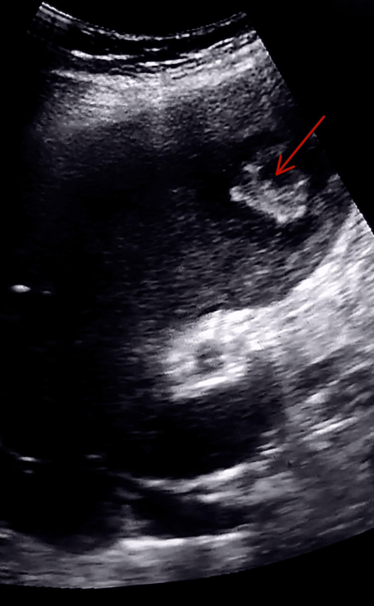
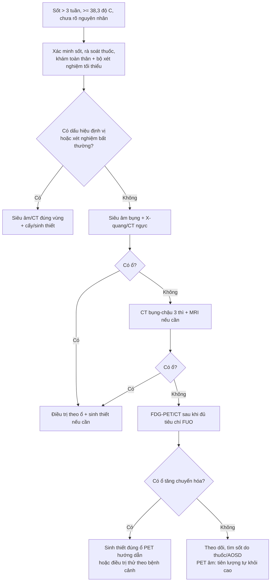
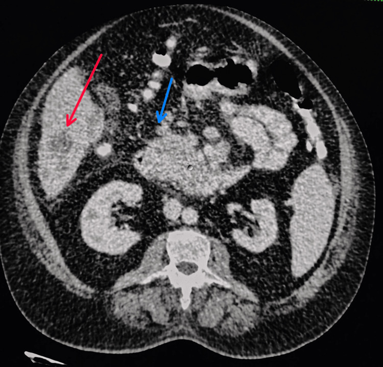
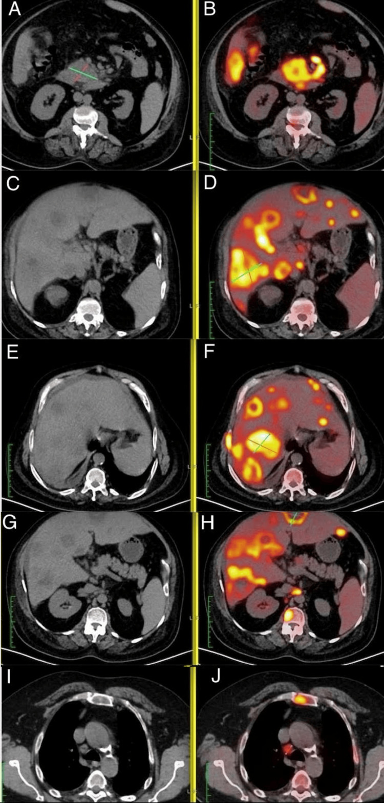
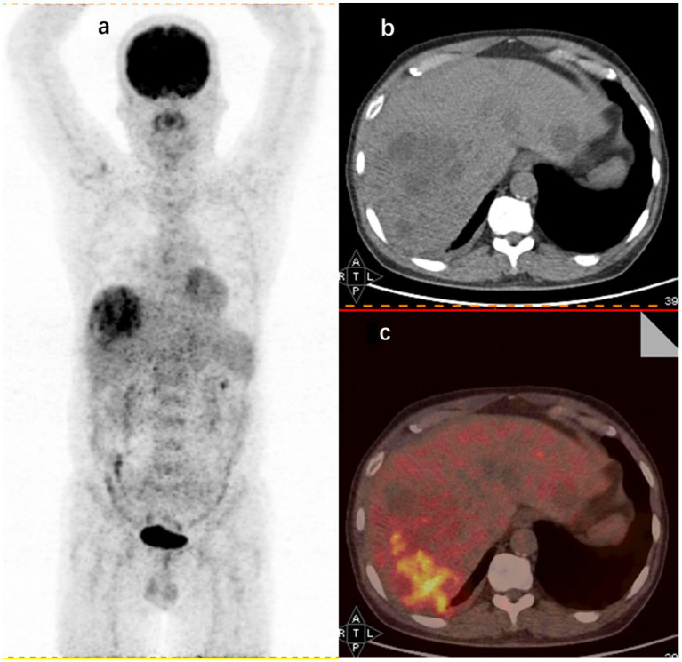
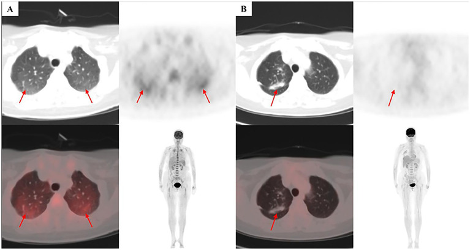

# 147 — Sốt kéo dài không rõ nguyên nhân (FUO) & ổ nhiễm ẩn trong bụng: tiếp cận hình ảnh theo bậc / Fever of unknown origin and occult abdominal infection: a stepwise imaging approach

**Tags:** `pattern:o-nhiem-an` `vung:bung` `protocol:FDG-PET-CT` `protocol:CT-bung-da-thi`
**Mức chắc chắn (certainty):** tổng hợp y văn (literature synthesis) — tự biên từ y văn mở (Clin Infect Dis 2026 PMC13341253; J Clin Med 2026 PMC13258763; Front Med 2024 PMC11847851; Biomed Rep 2024 PMC11428087; J Clin Med 2026 PMC13206891; Mol Cell Pediatr 2026 PMC13319292), số liệu lấy nguyên từ bài gốc.

> **Câu hỏi gốc của bài:** bệnh nhân **sốt ≥ 38,3 °C nhiều đợt, kéo dài > 3 tuần**, đã làm xét nghiệm cơ bản mà **không tìm ra ổ** — hình ảnh nên đi theo **bậc nào** (siêu âm → CT → MRI → FDG-PET/CT), **khi nào được phép bỏ cuộc**, và **khi nào phải sinh thiết**? Cụ thể trong bụng: **áp-xe gan** thật hay **di căn ung thư tụy giả áp-xe**? **Lao phúc mạc**, **bệnh Crohn**, **áp-xe cơ thắt lưng chậu** hay **u lympho**?
> **Điểm tựa giải phẫu – sinh lý:** sốt là **đáp ứng trung tâm** (PGE2 ở vùng dưới đồi) nên **không chỉ điểm vị trí**; ổ nhiễm ẩn thường nằm ở **khoang kín, ít triệu chứng** (sau phúc mạc, dưới hoành, cơ thắt lưng chậu, tiểu khung) hoặc **trong tạng đặc** (gan, lách, thận) — nơi không có niêm mạc để "tự dẫn lưu". Vì vậy nguyên tắc là: **tìm ổ bằng hình ảnh toàn thân, nhưng đọc theo giải phẫu khoang**, không đọc "một phim bụng".

## 1. Tổng quan bệnh học – cơ chế hình ảnh

**A. FUO — định nghĩa và dịch tễ (con số dùng trong thực hành)**
- **Định nghĩa cổ điển (Petersdorf–Beeson 1961):** sốt **> 38,3 °C** nhiều lần, bệnh **> 3 tuần**, **chưa chẩn đoán được sau 1 tuần nằm viện**.
- **Định nghĩa đồng thuận Delphi 2024 (dùng hiện nay):** sốt **> 3 tuần**, **≥ 38,3 °C trên > 3 lần**, **chưa rõ nguyên nhân sau khi hoàn thành bộ xét nghiệm tối thiểu**, ở **người lớn miễn dịch bình thường** (PMC13341253). Điểm mới: tiêu chí **"định tính"** (bắt buộc đã làm đủ bộ xét nghiệm tối thiểu) thay vì chỉ đếm ngày.
- **Vì sao tiêu chí định tính quan trọng:** phân tích gộp 2024 cho thấy nhóm dùng tiêu chí định tính có **tỉ lệ ca không chẩn đoán được tăng tương đối 15,3%** (KTC 2,3–28,3; p = 0,021) so với nhóm chỉ dựa thời gian — tức là **định nghĩa đổi cả "mẫu bệnh"** (PMC13341253).
- **Tần suất:** **2,0–2,9%** bệnh nhân nằm viện trong 2 nghiên cứu hồi cứu (Nhật, Ý; 9.830 ca) (PMC13341253).
- **Phân bố nguyên nhân (788 ca, 21 quốc gia, 2023):** **nhiễm khuẩn 51,6%**; trong nhiễm khuẩn: **lao (Mtb) 34,3%**, **brucella 9,7%**, **viêm nội tâm mạc 7,5%**, **áp-xe 7,3%**, CMV/EBV 7,2%, viêm phổi 6,5%, nhiễm khuẩn tiết niệu 6,5%, thương hàn 4,8% (PMC13341253).
- **Bệnh viêm không nhiễm trùng (NIIID):** viêm khớp tự phát người lớn (AOSD) **58,5%**, lupus **26,7%**, viêm đa cơ thấp **5,6%**; trong viêm mạch, **viêm động mạch tế bào khổng lồ 68,9%**; trong u hạt, **sarcoidosis 61,9%** (PMC13341253).
- **Ung thư:** **huyết học 57,9%**; u lympho **70,1%**, bạch cầu **25,2%**, myeloma 3,4%, MDS 1,3% (PMC13341253).
- **Nhóm khác:** **sốt do thuốc 18,4%**, bệnh tuyến giáp 16,5%, tăng thân nhiệt thói quen 10,7%, **huyết khối tĩnh mạch 2,9%** (PMC13341253).
- **TẠI SAO sốt mà không có ổ rõ:** cytokine (IL-1, IL-6, TNF) → **PGE2 ở vùng dưới đồi** → **tăng điểm đặt nhiệt độ** → sốt, **bất kể ổ ở đâu**. Vì vậy **kiểu sốt (liên tục/dao động) có giá trị định vị rất kém**; chỉ **thăm khám + hình ảnh + xét nghiệm** mới định vị được (PMC13258763).

**B. Vì sao FDG-PET/CT "nhìn thấy" ổ nhiễm ẩn — và vì sao nó không đặc hiệu**
- **Cơ chế:** tế bào viêm (bạch cầu trung tính, đại thực bào) và tế bào u **tăng biểu hiện GLUT-1/GLUT-3** và **tăng hexokinase** → bắt giữ **¹⁸F-FDG** (một chất tương tự glucose nhưng **bị giữ lại trong tế bào** vì không chuyển hóa tiếp). Vì vậy **nhiễm khuẩn, viêm vô khuẩn và ung thư đều "nóng"** — FDG **không phân biệt bản chất**, chỉ định vị **nơi có chuyển hóa cao**.
- **Hệ quả thực hành:** giá trị lớn nhất của PET/CT là **phát hiện ổ mà CT thường bỏ sót** và **hướng dẫn sinh thiết đúng chỗ**, không phải "chẩn đoán bệnh".
- **Số liệu "thật" về hiệu quả:** nhóm 284 bệnh nhân FUO, PET/CT **chỉ đúng vào chẩn đoán cuối ở 47,9%**, **Se 79,5% – Sp 61,1% – PPV 75,6% – NPV 66,3%**, nhưng **thay đổi điều trị ở 44,0%** (PMC11847851). Nhóm 105 bệnh nhân khác: **dương thật 49%**, **dương giả 23%**, **âm thật 9,5%**, **âm giả 19%**, **Se 72% – Sp 29% – độ chính xác 58%** (PMC11428087).
- **Vì sao các bài tổng quan nói "84–98%"?** Con số cao đó là **"diagnostic yield" theo nghĩa can thiệp/góp phần chẩn đoán**, không phải "tỉ lệ dương thật". Cùng một phương thức, hai cách đếm cho hai con số rất khác — **phải đọc định nghĩa trước khi trích** (PMC13341253 vs PMC11847851). Đây là điểm phản biện bắt buộc khi tư vấn.
- **Giá trị tiên lượng của PET âm:** PET/CT âm tính liên quan **tự khỏi sốt cao gấp ~5,6 lần** (RR 5,6; KTC 3,4–9,2; p < 0,001) so với PET dương — một thông tin hữu ích để trấn an và ngừng xét nghiệm (PMC13341253).

**C. Vì sao "ổ nhiễm ẩn" hay nằm trong bụng**
- **Giải phẫu:** ổ bụng có **nhiều khoang kín** (dưới hoành, dưới gan, cạnh lách, hố chậu, sau phúc mạc) và **tạng đặc** (gan, lách, thận) — ổ mủ ở đây **không có đường thoát tự nhiên**, chỉ biểu hiện bằng sốt.
- **Đường lây theo mạch:** ổ nhiễm ở vùng dẫn lưu **tĩnh mạch cửa** (ruột thừa, túi thừa, ruột non) → **pylephlebitis** → **áp-xe gan nhỏ rải rác** (bài 163). Đây là lý do khi thấy **áp-xe gan "không rõ nguồn"** phải đi tìm ổ ở ruột.
- **Cơ quan "im lặng":** **áp-xe cơ thắt lưng chậu (psoas)** chỉ đau khi đi lại/duỗi háng; **áp-xe dưới hoành** chỉ đau vai; **nhiễm trùng túi phình/endograft ĐMC** chỉ sốt + đau lưng.
- **Số liệu trong bụng:** trong phân tích Thổ Nhĩ Kỳ, **áp-xe trong ổ bụng là nguyên nhân nhiễm khuẩn phổ biến thứ hai** của FUO và **áp-xe gan là dạng ổ khu trú hay gặp nhất**; các nhóm khác: **bệnh ruột viêm, bệnh gan–mật–tụy, lao phúc mạc, u tiêu hóa** (PMC13258763).
- **Số liệu hình ảnh theo bậc (73 ca, tiến cứu đa trung tâm):** **X-quang ngực 60%**, **CT ngực 82%**, **siêu âm bụng 86%**, **CT bụng 92%** độ nhạy chẩn đoán; **MRI toàn thân cho yield 71%** và **thay đổi xử trí ~50%** (PMC13341253).

## 2. Mẫu hình + chẩn đoán phân biệt theo vị trí (gamut)

**Theo khoang giải phẫu — "đọc bụng theo 8 ngăn":**

- **Gan – đường mật:** áp-xe gan sinh mủ (kể cả *Klebsiella*), **áp-xe amip**, **microabscess nấm** (candida, nhiều ổ 2–5 mm), **viêm đường mật**, **lao gan**, **nang sán bội nhiễm**, **hoại tử u** (HCC/di căn — **giả áp-xe**), **pylephlebitis**.
- **Lách:** **nhồi máu lách** (thường gây sốt nhẹ), **áp-xe lách**, lao lách, lymphoma — xem bài 146.
- **Tụy:** viêm tụy cấp/mạn, **nang giả bội nhiễm**, **ung thư tụy hoại tử** (giả áp-xe).
- **Hồi manh tràng:** **viêm ruột thừa (kể cả thể mạn)**, **bệnh Crohn**, **lao hồi manh tràng**, Yersinia/actynomycosis, lymphoma, carcinoid.
- **Đại tràng:** **viêm túi thừa + áp-xe**, ung thư đại tràng, viêm đại tràng giả mạc.
- **Sau phúc mạc:** **áp-xe cơ thắt lưng chậu**, **áp-xe quanh thận**, **nhiễm trùng túi phình/endograft ĐMC**, lao thượng thận, di căn.
- **Tiểu khung:** **áp-xe phần phụ (TOA)**, viêm vùng chậu, áp-xe sau mổ/lưới, dị vật.
- **Ổ bụng tự do:** **lao phúc mạc**, carcinomatosis, áp-xe sau thủng tạng rỗng.

**Theo cơ chế (khi chưa định vị được) — mnemonic VITAMIN:** **V**ascular (huyết khối, viêm mạch, giả phình), **I**nfection (lao, áp-xe, nội tâm mạc, brucella), **T**rauma/foreign body (dị vật, lưới, endograft), **A**utoimmune (AOSD, lupus, GCA, sarcoidosis), **M**alignancy (lymphoma, IVLBCL, leukemia, ung thư đặc), **I**ntoxication/drugs (sốt do thuốc), **N**eurogenic/khác (tăng thân nhiệt thói quen, cường giáp).

**Mẫu hình hình ảnh cần nhận diện:**
- **Ổ dịch có khí + thành ngấm** → áp-xe (khí không bắt buộc).
- **Nhiều ổ nhỏ ngoại vi gan (2–5 mm)** ở bệnh nhân giảm bạch cầu/đặt catheter → **microabscess nấm**.
- **Nốt/tổn thương ngấm viền + dấu "đích"** → di căn hoặc áp-xe; **bờ ngoài nhẵn + phù quanh + sốt** nghiêng áp-xe.
- **Dày phúc mạc lan tỏa + cổ trướng + hạch** → lao phúc mạc/carcinomatosis (bài 141).
- **Dày thành hồi manh tràng + hạch + nốt vệ tinh** → lao/Crohn/lymphoma.
- **Tăng chuyển hóa lan tỏa không ổ** trên PET → lymphoma/IVLBCL, bệnh hệ thống, hoặc **dương giả**.

## 3. Bảng so sánh phân biệt (ma trận đối chiếu)

| Thực thể (entity) | Hình ảnh điển hình (US/CT/MRI/PET) | Chốt vào (rule-in) | Chốt loại (rule-out) | Gợi ý xác nhận |
|---|---|---|---|---|
| **Áp-xe gan sinh mủ** | Ổ dịch **giảm đậm độ, thành ngấm**, có thể **khí**, phù gan quanh; thường một ổ > 3 cm | **Sốt + đau hạ sườn phải + ổ dịch thành ngấm + phù quanh** | Bờ ngoài nhẵn, không phù, ngấm kiểu "đích" → nghĩ di căn | Cấy máu, chọc hút; **chọc hút/dẫn lưu khi ổ lớn (ngưỡng thường dùng ≥ 5 cm) hoặc không đáp ứng kháng sinh** |
| **Áp-xe amip** | Ổ lớn thùy phải, **bờ nhẵn**, không khí, không thành dày | **Bối cảnh dịch tễ + huyết thanh amip + đáp ứng metronidazole** | Thành dày nham nhở + khí + bạch cầu tăng → vi khuẩn | Huyết thanh/PCR amip |
| **Microabscess nấm** | **Nhiều ổ nhỏ 2–5 mm** rải rác gan–lách–thận, ngấm viền | **Sốt dai dẳng + giảm bạch cầu hạt + catheter + cấy nấm** | Một ổ lớn đơn độc → áp-xe vi khuẩn | Cấy máu, (1,3)-β-D-glucan, sinh thiết |
| **Di căn/ung thư hoại tử (giả áp-xe)** | Nhiều tổn thương **ngấm viền không đều**, **dấu đích**, có khối nguyên phát tụy/đại tràng | **Khối nguyên phát + hạch + nhiều tổn thương + LDH/CA 19-9** | Bờ đều, phù quanh, đáp ứng kháng sinh → áp-xe | Sinh thiết tổn thương **dễ tiếp cận nhất**; PET/CT |
| **Lao phúc mạc** | **Dày phúc mạc + cổ trướng + hạch hoại tử**, dày mạc treo; CT/MRI | **Cổ trướng dịch tiết + ADA cao + hạch hoại tử** | Cổ trướng trong, không dày phúc mạc → xơ gan/tim | **Sinh thiết phúc mạc nội soi**; PCR lao |
| **Lao hồi manh tràng** | Dày thành **hồi manh tràng + hạch + nốt vệ tinh**, có thể hẹp | **Vị trí + hạch hoại tử + IGRA dương** | Tổn thương chỉ ở đại tràng trái → nghĩ Crohn/viêm túi thừa | Nội soi + sinh thiết, PCR |
| **Bệnh Crohn** | Dày thành **từng đoạn**, **dấu "bàn chải"**, áp-xe/đường rò, hạch viêm | **Tổn thương bỏ nhảy + đường rò + đáp ứng corticoid/sinh học** | Dày liên tục + hạch hoại tử → lao/lymphoma | MRI ruột non, nội soi, sinh thiết |
| **Viêm ruột thừa thể mạn/áp-xe** | Ruột thừa **> 6 mm**, thâm nhiễm mỡ, **appendicolith**, áp-xe hố chậu | **> 6 mm + thâm nhiễm mỡ + đau hố chậu phải** | Không thấy ruột thừa bệnh lý + hạch lan tỏa → lymphoma | CT/US; xem bài 161/163 |
| **Áp-xe cơ thắt lưng chậu** | Cơ **psoas to, ổ dịch trong cơ**, mất mặt phẳng mỡ; **đau khi duỗi háng** | **Sốt + đau lưng/háng + ổ dịch trong cơ psoas** | Cơ to đối xứng, không dịch → chấn thương/thuốc | CT/MRI; dẫn lưu |
| **Nhiễm trùng túi phình/endograft** | Khí/tụ dịch quanh túi phình, **thành dày ngấm**, giả phình; PET dương quanh mảnh ghép | **Sốt + đau lưng + khí/tụ dịch quanh mảnh ghép** | Mảnh ghép ổn định, không khí, không dịch → theo dõi | CT 3 thì, **PET/CT**, cấy máu |
| **Lymphoma/IVLBCL** | Hạch **lớn, ngấm đồng nhất**, lách to, tổn thương ngoài hạch; PET **lan tỏa, SUV cao** | **Hạch > 1,5–2 cm + nhiều ổ + LDH/ferritin rất cao** | Hạch nhỏ, phản ứng, không có tổn thương ngoài hạch | **Sinh thiết hạch/da/tủy**; PET hướng dẫn |
| **AOSD (bệnh Still)** | **Không có ổ đặc hiệu**; hạch nhỏ, lách to, tràn dịch; PET có thể dương nhẹ lan tỏa | **Sốt cao dao động + ban + đau khớp + ferritin rất cao** | Có ổ đặc hiệu/khối → không phải AOSD | Loại trừ nhiễm/u; ferritin, IL-18 |
| **Sốt do thuốc** | **Không có tổn thương** trên CT/PET ngoài phản ứng nhẹ | **Bắt đầu thuốc 1–3 tuần trước + eosinophil + hết sốt sau ngừng 48–72 giờ** | Có ổ nhiễm/khối → không phải | Ngừng thuốc nghi ngờ, theo dõi |

*Siêu âm là bước đầu tiên: nhiều tổn thương tăng âm hai thùy gan + gan to, gợi ý "áp-xe". Chẩn đoán cuối của ca này **không phải áp-xe** — xem quiz ca 1. Nguồn: Pakal YK, Cureus 2026 (PMC13136653) Fig. 1, CC BY 4.0.*

## 4. Protocol chụp + thuật toán chẩn đoán theo bậc

**Bộ xét nghiệm tối thiểu trước khi được gọi là FUO (Delphi 2024) — theo PMC13341253:**
- **Huyết học – sinh hóa:** công thức máu, điện giải/thận, **canxi**, men gan, **ESR, CRP, ferritin, TSH**.
- **Miễn dịch:** **RF, ANCA, ANA**.
- **Nhiễm:** **HIV 1/2**, tổng phân tích nước tiểu, **IGRA/tuberculin**, **3 bộ cấy máu**; huyết thanh viêm gan khi men gan bất thường.
- **Hình ảnh tối thiểu:** **siêu âm bụng** + **X-quang ngực thẳng/nghiêng** (hoặc **CT ngực–bụng–chậu** nếu có chỉ định).

**Bậc hình ảnh (bằng chứng về độ nhạy):**

| Bậc | Phương thức | Độ nhạy / yield | Ghi chú thực hành |
|---|---|---|---|
| 1 | Siêu âm bụng | **86%** (73 ca) | Rẻ, không xạ; **yếu ở sau phúc mạc, ruột, tủy xương** |
| 2 | CT bụng–chậu có cản quang | **92%** | **3 thì** nếu nghi gan/tụy/mạch; lát ≤ 2,5 mm |
| 2 | CT ngực | **82%** (X-quang chỉ 60%) | Bỏ sót lao/hạch/nấm nếu chỉ chụp X-quang |
| 3 | MRI (bụng, ruột non, toàn thân, DWI) | **MRI toàn thân yield 71%**, đổi xử trí ~50% | Tốt cho tủy xương, cơ, thần kinh, thai phụ/trẻ |
| 4 | **¹⁸F-FDG PET/CT** | Dương thật **47,9%** (Se 79,5/Sp 61,1); nhóm khác Se 72/Sp 29 | **Chỉ sau khi đã đủ tiêu chí FUO** (đồng thuận mạnh của Delphi) — không thay thế CT/US |

**Chuẩn bị PET/CT:** nhịn ăn **≥ 6 giờ**, kiểm tra đường huyết trước tiêm theo quy trình EANM của đơn vị; tránh vận động mạnh/tiêm tĩnh mạch cùng bên tổn thương nghi ngờ; ghi lại **thuốc kháng sinh/corticoid đã dùng** (làm giảm yield); đọc **MIP + hợp nhất + CT** và **so sánh với CT trước** — không đọc SUV đơn thuần.

**Sinh thiết — "chốt hạ" khi hình ảnh không đủ:**
- **Hạch:** sinh thiết cho chẩn đoán **36,4%** (88/242) ca FUO có hạch; yếu tố dự báo dương: **nam (OR 2,47)**, **không có ban (OR 3,53)**, **chỉ số hình dạng hạch (OR 8,57)**, **giảm albumin (OR 3,37)** (PMC13206891).
- **Tủy xương:** cho chẩn đoán **23,8%** (31/130), chủ yếu bệnh máu ác tính (80,6%) (PMC13341253).
- **Sinh thiết gan:** cho chẩn đoán **8,8%** (3/34) (PMC13341253).
- **Nguyên tắc:** sinh thiết **tổn thương dễ tiếp cận nhất và an toàn nhất**, ưu tiên tổn thương **mới xuất hiện/tiến triển**; tránh sinh thiết **nhồi máu lách mạn giả u** (bài 146) và tránh sinh thiết mù khi chưa loại trừ rối loạn đông.

**Ngưỡng "dừng" và theo dõi:** nếu PET/CT âm và không có dấu hiệu báo động, **theo dõi lâm sàng** là hợp lý — PET âm liên quan **tự khỏi cao gấp ~5,6 lần**; nhưng **không được bỏ theo dõi** vì tỉ lệ **âm giả 19%** (lao, brucella, thương hàn, lymphoma, AOSD) (PMC11428087, PMC13341253).

## 5. Biến thể bình thường và cạm bẫy

- **PET "nóng" không phải chẩn đoán:** sinh lý bình thường ở **não, tim, gan, thận–bàng quang, ruột, tủy xương, tuyến lệ/tuyến nước bọt**, **mỡ nâu**, **cơ sau vận động/rét run**; **viêm sau mổ, sau sinh thiết** cũng dương. Luôn đọc **hình thái trên CT** đi kèm, không dựa vào SUV.
- **Âm giả 19%:** lao, brucella, thương hàn, viêm nội tâm mạc, lymphoma, AOSD — **PET âm không loại trừ**. Đặc biệt **lao** và **AOSD** có thể chỉ dương rất nhẹ/lan tỏa.
- **Thuốc làm giảm yield:** **73,2%** bệnh nhân trong nhóm 284 ca đã dùng **kháng sinh theo kinh nghiệm** trước PET, **12,0%** dùng glucocorticoid — cấy và PET đều kém nhạy hơn (PMC11847851). Nếu an toàn, **ngừng kháng sinh trước khi lấy mẫu**.
- **"Áp-xe" giả do ung thư:** ca điển hình — nhiều tổn thương gan **ngấm viền** + **khối tụy móc câu giảm đậm độ**; chẩn đoán cuối là **ung thư biểu mô tụy di căn**, không phải áp-xe (PMC13136653). Chốt: **tìm khối nguyên phát + hạch + CA 19-9**, và **PET/CT** khi CT không phân biệt được.
- **PDC gây nhiễu:** trong một loạt 167 ca, **81% "dấu hiệu gợi ý chẩn đoán" (PDC) là sai hướng** (so với 48% ở loạt khác) — đừng để một dấu hiệu nhỏ lái cả cuộc điều tra (PMC13341253).
- **Cạm bẫy mặt cắt — cổ trướng hay tràn dịch màng phổi:** trên CT ngang, dịch **trước cơ hoành/crus** là **cổ trướng**; dịch **sau crus**, đẩy crus ra sau, là **tràn dịch màng phổi**; **dấu bare area** (dịch không vào được vùng gan trần) xác nhận cổ trướng. Đây là bước bắt buộc khi đánh giá "lao phúc mạc vs tràn dịch màng phổi" (bài 141).
- **Sốt giả (factitious)/tăng thân nhiệt thói quen:** phải **xác minh nhiệt độ** bằng nhiệt kế chuẩn, ghi nhật ký sáng/chiều; **không đưa bệnh nhân đi PET/CT** khi chưa xác minh sốt (khuyến cáo Delphi).
- **Bệnh nhân không ổn định:** **không đẩy thẳng lên PET/CT** — ưu tiên **siêu âm/CT** để tìm ổ cần dẫn lưu cấp (áp-xe, thủng, túi phình nhiễm trùng).
- **Trẻ em khác người lớn:** định nghĩa nhi dùng **sốt ≥ 38,5 °C ít nhất 5/10 ngày liên tiếp**; trong 113 trẻ, **63,7%** tìm được nguyên nhân, **nhiễm khuẩn 23,1%**, **viêm khớp tự phát thể hệ thống/Still 27,4%** — vì vậy ở trẻ, **siêu âm + xét nghiệm viêm** và **theo dõi sát** thường có giá trị hơn chạy theo PET sớm (PMC13319292).

## 6. Tự lượng giá — Blind Quiz ngay trên trang tĩnh

**Ca 1 — Nam 58 tuổi, sốt 6 tuần, sụt cân, đau thượng vị nhẹ. Siêu âm gan có "nhiều ổ áp-xe".**

- Câu hỏi: Vì sao "áp-xe" mà **không có khí và không có phù quanh rõ**? Dấu hiệu nào trên ảnh gợi ý chẩn đoán khác? Nên làm gì tiếp?

<b>Bấm để hiện đáp án (findings + chẩn đoán)</b>

- Dấu hiệu: **nhiều tổn thương gan ngấm viền** (mũi tên đỏ) + **khối giảm đậm độ ở móc câu tụy** (mũi tên xanh), không thấy khí trong ổ.
- Chẩn đoán: **ung thư biểu mô tụy di căn gan** — các tổn thương gan **giả áp-xe**. Chẩn đoán "áp-xe" trên siêu âm là **bẫy kinh điển**.
- Bước tiếp: **PET/CT** (xem ca 2) + **CA 19-9**, sinh thiết tổn thương dễ tiếp cận; **không dẫn lưu mù**.
- Nguồn ảnh: Pakal YK, Cureus 2026 (PMC13136653) Fig. 2, CC BY 4.0.

**Ca 2 — Cùng bệnh nhân, PET/CT toàn thân.**

- Câu hỏi: PET/CT thay đổi chẩn đoán như thế nào? Có bao nhiêu "ổ" và ổ nào là nguyên phát?

<b>Bấm để hiện đáp án (findings + chẩn đoán)</b>

- Dấu hiệu: **ổ tăng chuyển hóa mạnh ở móc câu tụy** (A, B), **nhiều ổ gan tăng chuyển hóa** (C–H), **ổ xương** (I, J).
- Chẩn đoán: **ung thư tụy di căn gan + xương** — PET/CT xác định **khối nguyên phát** và **lan toàn thân**, đổi hoàn toàn hướng điều trị (từ "dẫn lưu áp-xe" sang ung thư học).
- Bài học: khi "áp-xe" **không đáp ứng kháng sinh/dẫn lưu** và có **khối tụy**, PET/CT là bước đúng.
- Nguồn ảnh: Pakal YK, Cureus 2026 (PMC13136653) Fig. 3, CC BY 4.0.

**Ca 3 — Nam 60 tuổi, sốt 4 tuần, CRP cao, CT bụng không thấy ổ rõ. PET/CT được chỉ định.**

- Câu hỏi: Mô tả ổ tăng chuyển hóa? Chẩn đoán khả năng nhất? Vì sao vẫn phải cấy/chọc hút?

<b>Bấm để hiện đáp án (findings + chẩn đoán)</b>

- Dấu hiệu: **đám tăng chuyển hóa dạng "cụm" ở gan phải** trên MIP (a), tương ứng **ổ giảm đậm độ có viền** trên CT (b) và hợp nhất PET/CT (c).
- Chẩn đoán: **áp-xe gan** — PET/CT định vị ổ khi CT thường không rõ, và **hướng dẫn chọc hút/dẫn lưu**.
- Vì sao vẫn cần vi khuẩn học: PET **không cho biết tác nhân**; cấy/dẫn lưu quyết định kháng sinh và nguồn nhiễm (đường mật, pylephlebitis, ruột thừa).
- Nguồn ảnh: Yu X, Front Med 2024 (PMC11847851) Fig. 2, CC BY 4.0.

**Ca 4 (nâng cao) — Nữ 62 tuổi, sốt 10 tháng, ferritin và LDH rất cao, nhiều lần sinh thiết âm.**

- Câu hỏi: PET dương **lan tỏa, không ổ** gợi ý gì? Vì sao sinh thiết mù thất bại?

<b>Bấm để hiện đáp án (findings + chẩn đoán)</b>

- Dấu hiệu: **tăng FDG lan tỏa hai phổi, đậm hơn ở thùy trên (SUVmax 3,0)** (A); sau R-CHOP **hết hoàn toàn** (B).
- Chẩn đoán: **u lympho tế bào B lớn trong lòng mạch (IVLBCL)** — tế bào u **nằm trong lòng mạch**, nên sinh thiết mô thường **âm**; PET dương lan tỏa là manh mối.
- Bài học: **PET dương lan tỏa không ổ** + **ferritin/LDH/IL-10 rất cao** → nghĩ bệnh máu ác tính, cần **sinh thiết đúng vị trí PET dẫn** (ở ca này là phổi sau soi lại PET).
- Nguồn ảnh: Chen Y, Front Med 2026 (PMC13152796) Fig. 3, CC BY 4.0.

## Bài liên quan chéo
- [100 – Tổng quan hệ Bụng](../100-tong-quan-he-bung/lesson.md)
- [163 – Pylephlebitis & huyết khối tĩnh mạch mạc treo](../163-pylephlebitis-huyet-khoi-tm-mac-treo/lesson.md) (ổ nhiễm ruột → áp-xe gan)
- [161 – Viêm ruột thừa cấp: CT/siêu âm, ngưỡng 6 mm](../161-viem-ruot-thua-cap/lesson.md) (nguồn nhiễm ẩn hay gặp)
- [146 – Huyết khối TM lách & nhồi máu lách](../146-huyet-khoi-tm-lach-va-nhoi-mau-lach/lesson.md) (sốt + tổn thương lách)
- [141 – Phúc mạc: cổ trướng, carcinomatosis vs lao](../141-phuc-mac/lesson.md) (lao phúc mạc)
- [124 – Bệnh mạch máu gan: Budd-Chiari, PVT](../124-benh-mach-mau-gan/lesson.md) (huyết khối là nguyên nhân FUO)
- [135 – Viêm tụy cấp Atlanta 2012](../135-viem-tuy-Atlanta/lesson.md) (nang giả bội nhiễm, ung thư tụy giả áp-xe)

> Không dùng để chẩn đoán độc lập khi chưa có người hướng dẫn.
