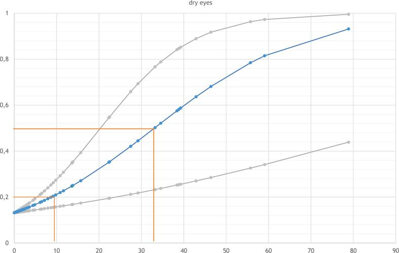
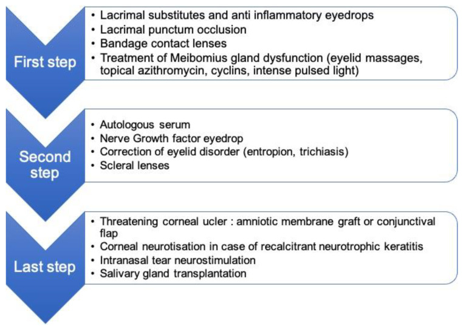
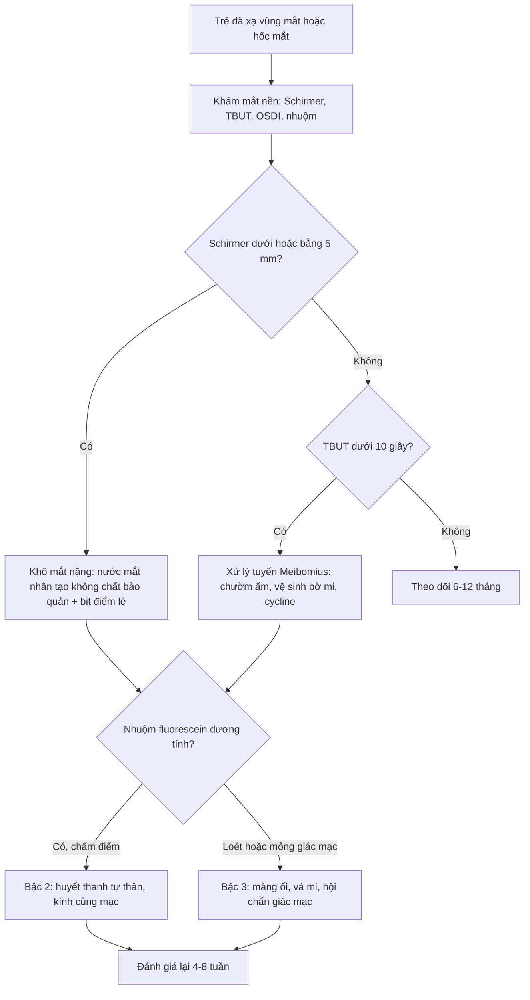

# 1470 — Khô mắt và bệnh bề mặt nhãn cầu do xạ ở trẻ / Radiation-induced dry eye and ocular surface disease in children

**Tags:** `pattern:kho-mat` `pattern:loet-giac-mac` `pattern:teo-tuyen-le` `vung:be-mat-nhan-cau` `vung:hoc-mat` `vung:mat` `protocol:Schirmer` `protocol:OSDI` `score:CTCAE`

**Mức chắc chắn (certainty):** tổng hợp y văn (literature synthesis) — số liệu chính lấy từ **một nghiên cứu cắt ngang quốc tế 74 mắt của 38 trẻ sống sót sau ung thư cơ vân đầu–cổ**, thời gian theo dõi trung vị **9 năm**, có **đo liều trên kế hoạch xạ trị gốc** (Clin Transl Radiat Oncol 2026 — **PMC13330630**), **một bài tổng quan về biến chứng không do ung thư của xạ vùng mắt–hốc mắt** (Cancers 2022 — **PMC8909862**) và **một nghiên cứu liều–đáp ứng trên 25 chó xạ trị u mũi xoang** làm dữ liệu bổ trợ về ngưỡng tuyến lệ (J Vet Intern Med 2020 — **PMC7096656**). Cơ chế tế bào gốc của tuyến lệ và phần suy luận được ghi rõ.

> **Câu chốt:** tuyến lệ là **cơ quan nguy cấp (organ at risk) nhạy nhất** trong trường xạ sọ–mặt ở trẻ, với ngưỡng thấp hơn nhiều so với thể thủy tinh và võng mạc: trong 74 mắt được đo liều, **liều trung bình > 10 GyEQD2 vào tuyến lệ đã cho xác suất khô mắt > 20%** ở lần theo dõi (trung vị 9 năm), trong khi **đục thể thủy tinh** chỉ xuất hiện đáng kể khi **> 6 Gy** vào thủy tinh và **lệch nhãn cầu** khi **> 40 Gy** vào hốc mắt (PMC13330630). Khô mắt ở trẻ **không được báo** vì trẻ không than đau — hậu quả là **loét giác mạc, thủng, sẹo giác mạc và mù**, những thứ có thể phòng được nếu tuyến lệ được **khoanh (contour) và đặt ràng buộc liều** ngay từ kế hoạch.

## 1. Tổng quan bệnh học – cơ chế hình ảnh (TẠI SAO)

### 1.1 Vì sao tuyến lệ là "điểm yếu" của trường xạ sọ–mặt

- **Giải phẫu:** tuyến lệ chính nằm ở **hốc mắt phần trên–ngoài**, ngay **dưới trần hốc mắt** và **sát thành ngoài**, chỉ cách **da mi trên 5–10 mm** — nghĩa là nó nằm **trong đường vào của gần như mọi chùm tia** hướng tới u hốc mắt, xoang, hố sau, hoặc thậm chí u não cận đường giữa.
- **Mô học:** tuyến lệ là tuyến **nang thanh dịch (serous acinar)**; tế bào nang **không phân chia** nhưng **tiết rất mạnh** và có **nhu cầu oxy cao**. Tia xạ gây **chết tế bào theo chương trình (apoptosis)** ở tế bào nang, **tổn thương vi mạch** và **xơ hóa ống tuyến** → mất đơn vị tiết, **không có nang tuyến mới thay thế** (khả năng tái sinh nang tuyến ở tuyến lệ trưởng thành rất hạn chế). Vì vậy tổn thương là **vĩnh viễn và tiến triển**, không "hồi phục sau vài tháng" như niêm mạc. *(Phần tái sinh: suy luận từ mô bệnh học; nghiên cứu trích dẫn chỉ đo liều–biến chứng, không đo tế bào gốc.)*
- **Ba lớp phim nước mắt cùng hỏng một lúc:** tuyến lệ (lớp nước) + **tuyến Meibomius** ở bờ mi (lớp lipid, dễ tổn thương do xạ mặt) + **tế bào đài kết mạc** (lớp nhầy). Vì vậy khô mắt do xạ **không đáp ứng đơn thuần với nước mắt nhân tạo** nếu không xử lý viêm bờ mi và tế bào đài.
- **Ngưỡng (số liệu người, trẻ):** 74 mắt / 38 trẻ sống sót ung thư cơ vân đầu–cổ, theo dõi **trung vị 9 năm**, liều quy đổi **GyEQD2**:

| Cơ quan | Ngưỡng liều trung bình / tối đa | Biến chứng với xác suất > 20% |
|---|---|---|
| **Tuyến lệ** | **Dmean > 10 GyEQD2** | **Khô mắt** |
| Hốc mắt | **Dmean > 40 GyEQD2** | **Lệch nhãn cầu (globe displacement)** |
| Thể thủy tinh | **Dmean > 6 GyEQD2** | **Đục thể thủy tinh (mọi độ)** |
| Võng mạc | **Dmax > 40 GyEQD2** | Bệnh võng mạc do xạ |
| Thần kinh thị | **Dmax > 53 GyEQD2** | Bệnh thần kinh thị do xạ |

*(PMC13330630; đây là mô tả liều–độc tính đầu tiên cho nhiều cơ quan nguy cấp ở trẻ dựa trên đánh giá lâm sàng, không phải mô hình từ dữ liệu người lớn.)*

- **Dữ liệu bổ trợ trên thú (đọc để hiểu hình dạng đường cong, không dùng làm ngưỡng người):** 25 chó xạ trị u mũi xoang, **5 (20%)** khô mắt; liều trung bình tuyến lệ **33,08 Gy** ở mắt khô so với **10,33 Gy** ở mắt chứng (p < 0,001); **liều thấp nhất gây khô 23,75 Gy**; **0/… mắt** nhận < 20 Gy bị khô so với **5/7 (71%)** nhận > 20 Gy; khô xuất hiện **trung vị 111 ngày** (84–122) sau xạ (PMC7096656).

### 1.2 Hình ảnh học nói gì — và KHÔNG nói gì

- **Khô mắt do xạ là chẩn đoán lâm sàng**, không phải chẩn đoán hình ảnh: chẩn đoán dựa trên **Schirmer, thời gian vỡ phim lệ (TBUT), nhuộm fluorescein, OSDI**. Hình ảnh **không đo được lượng nước mắt**.
- Tuy nhiên hình ảnh có ba vai trò thật:
  1. **Lập kế hoạch:** khoanh tuyến lệ trên **CT lập kế hoạch** (lát ≤ 1 mm) — tuyến lệ là cấu trúc **mô mềm nhỏ, ở góc trên–ngoài**, dễ bị bỏ sót khi khoanh; bỏ sót = **không có ràng buộc liều = khô mắt**.
  2. **Biến chứng muộn:** **teo tuyến lệ, thay mỡ** trên CT/MRI; **loét giác mạc**, **mỏng/hủy nhuyễn giác mạc**, **sẹo kết mạc** (symblepharon) trên đèn khe và trên ảnh chụp bề mặt.
  3. **Loại trừ nguyên nhân khác:** khối hốc mắt tái phát chèn ép, giãn hốc mắt sau xạ, hở mi do xạ (lagophthalmos).
- **Vật lý:** trên **CT**, tuyến lệ bình thường **~30–40 HU** (mô mềm), nằm **trong mỡ hốc mắt (−80 đến −100 HU)** nên dễ thấy nếu cửa sổ mô mềm đúng; sau xạ, tuyến **teo và thay mỡ** → khó thấy hơn, đừng kết luận "tuyến lệ bình thường" khi không tìm thấy. Trên **MRI**, tuyến lệ **T1 trung gian, T2 trung gian–cao**, **ngấm thuốc mạnh**; sau xạ **giảm thể tích, tăng tín hiệu T1 do mỡ thay thế** — dấu hiệu **teo tuyến**, tương ứng mất chức năng tiết.

### 1.3 Vì sao trẻ nguy hiểm hơn người lớn cùng liều

- Trẻ có **thời gian sống còn dài** để biến chứng tiến triển (theo dõi 9 năm vẫn còn thấy tăng), **hốc mắt nhỏ** nên tuyến lệ **gần u hơn** theo tỉ lệ, và **không tự báo triệu chứng**: trẻ khô mắt nặng thường chỉ **dụi mắt, sợ ánh sáng, chảy nước mắt phản xạ** — dễ bị coi là bình thường.
- Vì vậy **cùng một liều**, trẻ có **cửa sổ phòng ngừa** rộng hơn (proton, điều biến liều, AMORE) và **cửa sổ theo dõi** dài hơn (khám mắt định kỳ nhiều năm).

### 1.4 Ngưỡng định lượng dùng ngay (lâm sàng)

| Đại lượng | Ngưỡng | Ý nghĩa |
|---|---|---|
| **Schirmer I** (không gây tê) | **≤ 5 mm/5 phút** | Khô mắt nặng (thiếu lớp nước) |
| Schirmer I | **6–10 mm/5 phút** | Khô mắt nhẹ–trung bình, cần đối chiếu triệu chứng |
| **TBUT** | **< 10 giây** | Bất ổn định phim lệ (thường kèm rối loạn tuyến Meibomius) |
| **Nhuộm fluorescein** | Tổn thương biểu mô dạng chấm (SPK) | Tổn thương bề mặt do khô, tính theo thang Oxford |
| **OSDI** | **0–100**; **≥ 13** = có triệu chứng khô mắt | Công cụ tự khai, dùng được cho trẻ lớn |
| **CTCAE v5** độ khô mắt | Độ 1 triệu chứng nhẹ; **độ 2** cần can thiệp; **độ 3** giảm thị lực do khô | Phân độ để báo cáo và theo dõi |

## 2. Mẫu hình + chẩn đoán phân biệt theo vị trí (gamut)

- **Mẫu hình 1 — khô mắt "ướt":** trẻ **chảy nước mắt** nhiều nhưng vẫn khô (chảy nước mắt phản xạ do bề mặt viêm) → **đừng loại trừ khô mắt chỉ vì mắt ướt**.
- **Mẫu hình 2 — khô mắt "khô":** kết mạc đỏ mạn, **sợi nhầy**, **nhuộm fluorescein dương tính ở 1/3 dưới giác mạc** — nơi phim lệ mỏng nhất và chịu ánh sáng.
- **Mẫu hình 3 — tổn thương giác mạc:** loét **hình bầu dục/bờ cuộn**, có thể **vô khuẩn** (do khô, hở mi) hoặc **bội nhiễm**; ở trẻ sau xạ, **loét vô khuẩn do khô** là nguyên nhân hay bị điều trị nhầm bằng kháng sinh kéo dài mà **không bù nước mắt**.
- **Mẫu hình 4 — hở mi do xạ:** da mi co kéo, **mi trên không khép kín khi ngủ** → khô **nửa dưới giác mạc** buổi sáng; xử trí **khác hẳn** khô do tuyến lệ (cần **ghép da/vá mi**, không chỉ nước mắt nhân tạo).
- **Gamut theo vị trí (đọc từ ngoài vào):** **bờ mi** (viêm tuyến Meibomius, hở mi, lông xiêu) → **kết mạc** (sẹo dính, thiếu tế bào gốc vùng rìa) → **giác mạc** (SPK, loét, mỏng, thủng) → **tuyến lệ** (teo, thay mỡ) → **hốc mắt** (lệch nhãn cầu, xơ hóa) → **thần kinh giác mạc** (giác mạc thần kinh dưỡng).
- **Mnemonic "DREAM"** cho khô mắt sau xạ ở trẻ: **D**ose (liều tuyến lệ > 10 Gy), **R**eflex tearing (chảy nước mắt phản xạ), **E**pithelium (nhuộm fluorescein), **A**cini loss (teo tuyến trên MRI), **M**eibomius (bờ mi).

## 3. Bảng so sánh phân biệt (ma trận đối chiếu)

| Thực thể (entity) | Hình ảnh / xét nghiệm điển hình | Chốt vào (rule-in) | Chốt loại (rule-out) | Gợi ý xác nhận |
|---|---|---|---|---|
| **Khô mắt do xạ (tuyến lệ)** | Tuyến lệ **teo/thay mỡ**; Schirmer **≤ 5 mm**, TBUT **< 10 s**, SPK 1/3 dưới | **Tiền sử xạ có tuyến lệ trong trường + Dmean > 10 GyEQD2 + Schirmer thấp** | Schirmer bình thường, chỉ đỏ mi → nghĩ bờ mi/dị ứng | Đo liều từ kế hoạch, Schirmer, OSDI |
| **Rối loạn tuyến Meibomius (MGD)** | Bờ mi dày, đỏ, **dầu đục**, TBUT ngắn **nhưng Schirmer bình thường** | **TBUT < 10 s + Schirmer > 10 mm** | Schirmer rất thấp → có thành phần thiếu nước | Đèn khe bờ mi, meibography |
| **Thiếu tế bào gốc vùng rìa (LSCD)** | **Vùng rìa mất sắc tố**, kết mạc mọc vào giác mạc, nhuộm dương tính lan tỏa | **Kết mạc hóa giác mạc + tiền sử xạ/hóa chất** | Giác mạc trong, chỉ chấm điểm → không phải LSCD | Nhuộm rose bengal, tế bào học |
| **Giác mạc thần kinh dưỡng** | Loét **bờ nhẵn, không đau**, cảm giác giác mạc giảm | **Mất cảm giác giác mạc (test sợi) + loét không đau** | Đau nhiều, cảm giác bình thường → không phải | Test cảm giác, soi đèn khe |
| **Loét do vi khuẩn/nấm** | Thâm nhiễm đặc, **mủ tiền phòng**, đau tăng nhanh | **Thâm nhiễm + phản ứng tiền phòng + tiến triển 24–48 giờ** | Bờ nhẵn, không thâm nhiễm, tiến triển chậm → vô khuẩn | Cạo giác mạc nhuộm/cấy **trước** kháng sinh |
| **Khô mắt do thuốc (hóa trị, kháng histamin)** | Bề mặt khô nhưng tuyến lệ **không teo**, hồi phục sau ngừng thuốc | **Trùng thời điểm dùng thuốc, cải thiện khi ngừng** | Teo tuyến trên MRI → do xạ | Rà soát thuốc, thử ngừng |
| **GVHD bề mặt (sau ghép tế bào gốc)** | Kết mạc viêm, **sẹo dính**, khô nặng | **Tiền sử ghép + tổn thương đa cơ quan** | Chỉ khô đơn thuần sau xạ → do xạ | Sinh thiết kết mạc nếu cần |

*Đường cong liều–độc tính cho **khô mắt** theo **liều trung bình tuyến lệ (GyEQD2)** ở 74 mắt trẻ; đường giữa là mô hình logistic, hai đường ngoài là khoảng tin cậy. Đường ngang 20% cắt trục liều ở **~10 Gy**; đường 50% ở **~32–33 Gy**. Nguồn: PMC13330630 Fig. 2B — **CC BY-NC-ND** (nguyên bản, không cắt).*

*Ba bậc điều trị khô mắt do xạ: **bậc 1** nước mắt nhân tạo + chống viêm + bịt điểm lệ + kính tiếp xúc băng + xử lý tuyến Meibomius; **bậc 2** huyết thanh tự thân, NGF nhỏ mắt, sửa mi, kính củng mạc; **bậc 3** loét giác mạc đe dọa → **màng ối/vạt kết mạc**, thần kinh hóa giác mạc, kích thích thần kinh lệ qua mũi, ghép tuyến nước bọt. Nguồn: Cancers 2022, PMC8909862 Fig. 2 — **CC BY 4.0**.*

## 4. Protocol chụp + hệ phân độ/điểm chuẩn hóa

### 4.1 Trước xạ — phần quyết định tất cả

- **CT lập kế hoạch hốc mắt–sọ, lát ≤ 1 mm, không cản quang** (hoặc có cản quang nếu cần phân biệt mạch): **khoanh riêng tuyến lệ** hai bên như một **OAR độc lập**, không gộp vào "hốc mắt".
- **Ràng buộc liều gợi ý từ dữ liệu trẻ:** giữ **Dmean tuyến lệ < 10 GyEQD2** nếu có thể (ngưỡng mà xác suất khô mắt vượt 20%); với u cần liều cao, ghi rõ **liều dự kiến vào tuyến lệ** và **đưa vào phần đồng thuận với gia đình** (PMC13330630).
- **Kỹ thuật giảm liều:** **proton (PBT)** giảm mạnh liều ra ngoài đích so với photon; **brachytherapy** (chiến lược AMORE, phẫu thuật + áp nguồn) gần như không chiếu vào tuyến lệ nếu u khu trú; **VMAT/cung điều biến** cần kiểm tra **liều tuyến lệ trong kế hoạch** vì có thể tăng liều thấp lan tỏa.
- **Mốc so sánh nội bộ:** trong cùng một kế hoạch, kiểm tra **tuyến lệ, thể thủy tinh, võng mạc, thần kinh thị, hốc mắt** — vì ngưỡng chênh nhau rất lớn (**6 Gy** thủy tinh, **10 Gy** tuyến lệ, **40 Gy** hốc mắt/võng mạc, **53 Gy** thần kinh thị).

### 4.2 Sau xạ — theo dõi và phân độ

- **Lịch khám:** khám mắt **trước xạ** (nền), **3–6 tháng** sau xạ, sau đó **hằng năm kéo dài ít nhất 10 năm** — vì biến chứng mắt muộn vẫn xuất hiện sau cửa sổ 5 năm của phác đồ ung thư (bài về ung thư cơ vân hốc mắt 2026 ghi **đục thể thủy tinh** ở **45%**, trung vị **39,1 tháng**, muộn nhất **95,1 tháng** — PMC13204557).
- **Phân độ để ghi hồ sơ:** dùng **CTCAE v5** cho khô mắt + **thang Oxford** cho tổn thương biểu mô; ghi **liều tuyến lệ Dmean** cạnh phân độ để lượt sau so sánh được.

## 5. Biến thể bình thường và cạm bẫy

- **Chảy nước mắt ở trẻ không loại trừ khô mắt:** phản xạ tiết nước mắt vẫn còn khi tuyến lệ còn một phần; trẻ **chảy nước mắt + dụi mắt** có thể đang **khô nặng**.
- **Schirmer ở trẻ nhỏ:** khó phối hợp, khóc khi làm → **kết quả cao giả**; hãy làm **sau khi nhỏ tê** (Schirmer I cải tiến) hoặc dựa vào **nhuộm fluorescein + TBUT**.
- **Loét "vô khuẩn" bị điều trị như nhiễm khuẩn:** nếu bờ loét **nhẵn, không thâm nhiễm, không mủ tiền phòng**, tiến triển **chậm** → nghĩ **khô/hở mi**; điều trị chính là **bù nước mắt + vá mi**, không phải nâng kháng sinh.
- **Bỏ sót hở mi khi ngủ:** khô **nửa dưới giác mạc** buổi sáng, nhuộm dương tính **dải dưới** — dấu hiệu này chỉ thấy khi **hỏi kỹ giấc ngủ** hoặc **quan sát lúc ngủ**.
- **Tuyến lệ không thấy trên CT ≠ tuyến lệ bình thường:** sau xạ tuyến **teo/thay mỡ**, cùng đậm độ với mỡ hốc mắt; hãy đọc **MRI** hoặc so sánh **hai bên**.
- **Cạm bẫy "thỏa mãn tìm kiếm":** đã thấy di căn/tái phát u thì dừng — trong khi **khô mắt + loét** mới là nguyên nhân **giảm thị lực** ở trẻ sống sót.
- **Tương tác thuốc:** hóa trị (đặc biệt **cytosine arabinoside**, **5-FU**), isotretinoin, kháng histamin, thuốc nhỏ mắt có **benzalkonium** đều làm khô nặng thêm — luôn rà soát **trước khi quy hết cho xạ**.

## 6. Tự lượng giá — Blind Quiz (bấm để hiện đáp án)

**Ca 1 — bé gái 7 tuổi, xạ 45 Gy sau mổ u cơ vân hốc mắt trái, khám lại sau 6 năm**

- Gợi ý lâm sàng: mẹ kể bé **dụi mắt, sợ ánh sáng**, đôi khi **chảy nước mắt**; Schirmer mắt trái 4 mm/5 phút, phải 15 mm.
- Câu hỏi: (1) Đọc đường cong: ở liều tuyến lệ nào xác suất khô mắt vượt 20% và 50%? (2) Vì sao mắt **chảy nước mắt** mà vẫn khô? (3) Bước xử trí đầu tiên và điều gì **không** nên làm?

<b>Bấm để hiện đáp án (findings + chẩn đoán)</b>

- **Đọc đường cong:** đường **20%** cắt trục liều ở khoảng **10 GyEQD2**; đường **50%** ở khoảng **32–33 GyEQD2** (PMC13330630).
- **Chảy nước mắt vẫn khô:** đó là **chảy nước mắt phản xạ** do bề mặt viêm; lượng nước mắt **cơ bản** vẫn thiếu (Schirmer 4 mm).
- **Chẩn đoán:** **khô mắt do xạ + loét/biểu mô tổn thương** — cần **nhuộm fluorescein** để xác nhận mức tổn thương.
- **Bước đầu:** nước mắt nhân tạo **không chất bảo quản** + **bịt điểm lệ** + xử lý bờ mi; **không** dùng corticoid kéo dài khi chưa loại trừ nhiễm và **không** chỉ tăng kháng sinh nếu loét vô khuẩn.
- **Nguồn ảnh:** PMC13330630 Fig. 2B — **CC BY-NC-ND**, nguyên bản.

**Ca 2 — bé trai 5 tuổi, xạ hốc mắt 2 năm trước, nay đỏ mắt – sợ ánh sáng – nhìn kém dần**

- Gợi ý lâm sàng: Schirmer 3 mm, TBUT 4 giây, nhuộm fluorescein **dương tính 1/3 dưới**, không mủ tiền phòng.
- Câu hỏi: (1) Xếp bậc điều trị nào và gồm gì? (2) Khi nào chuyển bậc 3? (3) Dấu hiệu nào khiến phải nghĩ **loét nhiễm khuẩn** thay vì khô đơn thuần?

<b>Bấm để hiện đáp án (findings + chẩn đoán)</b>

- **Bậc 1 (bậc đầu):** nước mắt nhân tạo + chống viêm, **bịt điểm lệ**, kính tiếp xúc băng nếu cần, **xử lý tuyến Meibomius** (chườm ấm, vệ sinh bờ mi).
- **Bậc 2:** **huyết thanh tự thân**, NGF nhỏ mắt, **sửa mi** (hở mi/lông xiêu), **kính củng mạc**.
- **Bậc 3 (khi loét đe dọa):** **màng ối hoặc vạt kết mạc**, thần kinh hóa giác mạc, kích thích thần kinh lệ qua mũi, ghép tuyến nước bọt.
- **Nghĩ nhiễm khuẩn khi:** **thâm nhiễm đặc**, **mủ tiền phòng**, đau tăng nhanh, tiến triển trong **24–48 giờ** — khi đó **cạo giác mạc nhuộm/cấy trước** khi dùng kháng sinh.
- **Nguồn ảnh:** Cancers 2022, PMC8909862 Fig. 2 — CC BY 4.0.

## Bài liên quan chéo
- [1458 – Bệnh thần kinh thị do xạ ở trẻ (RION)](../1458-benh-than-kinh-thi-do-xa-o-tre/lesson.md)
- [1459 – Đục thể thủy tinh do xạ](../1459-duc-the-thuy-tinh-do-xa-sau-retinoblastoma/lesson.md)
- [1456 – Bỏng hóa chất giác mạc](../1456-bong-hoa-chat-mat/lesson.md)
- [1460 – Viêm giác mạc do nấm](../1460-viem-giac-mac-do-nam/lesson.md)
- [1472 – Viêm giác mạc do Acanthamoeba](../1472-viem-giac-mac-acanthamoeba/lesson.md)
- [1419 – Võng mạc trẻ sau xạ trị](../1419-vong-mac-xa-tre-sau-xa-tri/lesson.md)

## Ảnh
- `images/1470_duong-cong-lieu-tuyen-le_Bang_PMC13330630-Fig2B.jpg` — đường cong liều–khô mắt, **CC BY-NC-ND** (nguyên bản).
- `images/1470_bac-dieu-tri-kho-mat_Bang_PMC8909862-Fig2.jpg` — bậc thang điều trị, **CC BY 4.0**.
- Nguồn + giấy phép từng ảnh: `images/CREDITS.md`.

> Không dùng để chẩn đoán độc lập khi chưa có người hướng dẫn.
