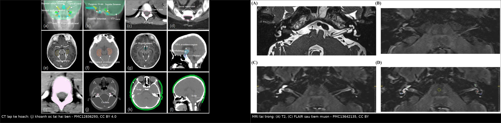
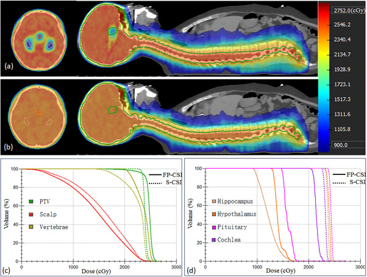
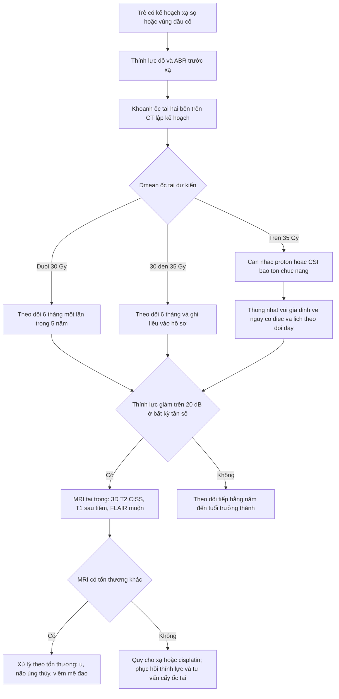

# 1471 — Điếc tiếp nhận do xạ ở trẻ sau xạ sọ / Radiation-induced sensorineural hearing loss in children

**Tags:** `pattern:diec-tiep-nhan` `pattern:mat-tin-hieu-t2-oc-tai` `vung:oc-tai` `vung:tai` `protocol:MRI-CISS` `protocol:CT-xuong-thai-duong` `score:SIOP-Boston` `anatomy:oc-tai`

**Mức chắc chắn (certainty):** tổng hợp y văn (literature synthesis) — ngưỡng liều lấy từ **phân tích gộp PENTEC 2024** (19 nghiên cứu, 4 nghiên cứu đủ dữ liệu mô hình hoá, **457 ốc tai xạ đơn thuần + 398 ốc tai có hoá trị**, PMID 37855793), **nghiên cứu St. Jude 78 trẻ/155 tai không dùng bạch kim** (Int J Radiat Oncol Biol Phys 2008, PMID 18395355), **đoàn hệ 340 tai/171 bệnh nhi** (J Clin Oncol 2021, PMID 34570616), **đoàn hệ 58 bệnh nhi medulloblastoma/116 tai** (Strahlenther Onkol 2025, PMID 39455453) và **96 trẻ/161 tai xạ + cisplatin** (PMID 33677052). Hình ảnh lấy từ **nghiên cứu lập kế hoạch CSI bảo tồn chức năng ở 8 trẻ medulloblastoma** (PMC12836293) và **một ca u dây VIII ở người lớn dùng làm mẫu đọc MRI tai trong** (PMC13642135). Phần cơ chế mô bệnh học dựa trên mô hình động vật — được ghi rõ là suy luận.

> **Câu chốt:** ốc tai là **cơ quan nguy cấp (organ at risk) song song** nằm sát thân não, và tổn thương do xạ **không hồi phục** vì tế bào lông không tái sinh. Ba con số định khung: **Dmean ốc tai ≤ 35 Gy → nguy cơ điếc < 5%**, nhưng **50 Gy → 30%** (PENTEC 2024); trẻ **< 5 tuổi** có nguy cơ **25–40%** so với **~10%** ở trẻ lớn; và **thời điểm khởi phát trung bình 3,6 năm** sau xạ, muộn nhất **13,2 năm** (PENTEC 2024). Vì vậy **thính lực đồ nền trước xạ + khoanh ốc tai trên CT lập kế hoạch** là hai việc rẻ tiền nhất quyết định trẻ có nghe được suốt đời hay không.

## 1. Tổng quan bệnh học – cơ chế hình ảnh (TẠI SAO)

### 1.1 Giải phẫu chức năng: vì sao "mất tần số cao trước" và "mất là mất luôn"

- **Ốc tai** là ống xương xoắn **2,5 vòng**, chiều dài khai triển **~35 mm**, nằm trong **vỏ xương đặc (otic capsule)** — loại xương đặc nhất cơ thể, **không có tủy xương**, nên trên CT xương thái dương nó hiện thành **vòng xoắn trắng đồng nhất**, còn lòng ốc tai chứa **dịch ngoại lymph/nội lymph** nên có đậm độ thấp hơn xương.
- **Bản đồ tần số:** **vòng đáy (basal turn)** — nơi gần cửa sổ tròn và **ống tai trong** nhất — mã hoá **tần số cao (4–20 kHz)**; **đỉnh ốc tai (apex)** mã hoá tần số thấp. Vì vậy mọi tổn thương ốc tai lan từ đáy lên (xạ, cisplatin, aminoglycoside, viêm mê đạo) đều **bắt đầu bằng mất 4–8 kHz** — đúng tần số quan trọng nhất cho **nghe trong ồn và phân biệt phụ âm**.
- **Ba "lớp" dễ tổn thương:**
  1. **Tế bào lông ngoài (outer hair cells)** — khuếch đại cơ học, **~15.000 tế bào** mỗi tai, **không tái sinh** ở người trưởng thành;
  2. **vân mạch (stria vascularis)** — tạo **điện thế nội ốc tai ~+80 mV**; tổn thương vi mạch làm mất điện thế này trước khi tế bào lông chết;
  3. **tế bào hạch xoắn (spiral ganglion cells)** — **~30.000** sợi trục, là "dây dẫn" cho cấy ốc tai; mất nhiều thì **cấy ốc tai vẫn kích thích được nhưng kết quả kém**.
- **Hệ quả hình ảnh:** CT/MRI **nhìn được vỏ xương, dịch trong ốc tai, dây thần kinh trong ống tai trong** — nhưng **không nhìn được tế bào lông**. Một MRI "bình thường" ở trẻ điếc do xạ là **kết quả mong đợi**, không phải bằng chứng loại trừ.

### 1.2 Bốn cơ chế xạ làm điếc — và vì sao biểu hiện muộn nhiều năm

| Cơ chế | Điều gì xảy ra | Hệ quả lâm sàng – hình ảnh |
|---|---|---|
| **Tổn thương vi mạch vân mạch** | Xơ hoá mao mạch nội ốc tai, giảm tưới máu → **mất điện thế nội ốc tai** | Điếc tiến triển **nhiều năm**, không có dấu hiệu trên CT |
| **Chết tế bào lông (apoptosis)** | Tổn thương DNA + stress oxy hoá; **tế bào lông ngoài vòng đáy chết trước** | **Mất 4–8 kHz trước**, PTA (trung bình 3 tần số) có thể còn "bình thường" |
| **Mất tế bào hạch xoắn** | Thoái hoá sợi trục sau khi tế bào lông chết ("thoái hoá ngược dòng") | Giảm **phân biệt lời nói** nặng hơn mức mất ngưỡng; ảnh hưởng kết quả cấy ốc tai |
| **Xơ hoá/loạn sản xương ốc tai** | Xơ hoá khoang dịch (scala tympani) → **mất tín hiệu dịch trên T2**, có thể canxi hoá muộn | **Khó chèn điện cực**, cần MRI trước cấy; CT thấy **dày/đặc vòng đáy** |

- **Vì sao muộn:** tế bào lông và tế bào hạch chết dần theo **từng đợt**, và **xơ mạch tiến triển chậm** — nên đường cong thính lực **dốc dần trong 3–10 năm**. Đây là lý do PENTEC ghi nhận khởi phát **trung bình 3,6 năm**, khoảng **0,4–13,2 năm**, và nghiên cứu St. Jude thấy khởi phát **3–5 năm** (PMID 37855793, 18395355).
- **Vì sao trẻ nhỏ nặng hơn:** ốc tai trẻ **< 5 tuổi** đang trong giai đoạn **trưởng thành và tinh chỉnh synap**; cùng một liều, mô đang phân chia và **hàng rào máu–mê đạo non** chịu tổn thương nhiều hơn. PENTEC: nguy cơ **25–40%** ở trẻ **< 5 tuổi** so với **~10%** ở trẻ lớn; để đạt **cùng mức điếc nặng**, trẻ **< 3 tuổi** cần liều **thấp hơn 18,3 Gy** so với trẻ **> 3 tuổi** (PMID 37855793).

### 1.3 Ngưỡng liều — bảng dùng ngay khi duyệt kế hoạch

| Nguồn (thiết kế) | Dân số | Ngưỡng liều | Nguy cơ điếc |
|---|---|---|---|
| **PENTEC 2024** (gộp 19 nghiên cứu; PMID 37855793) | 457 ốc tai xạ đơn thuần + 398 ốc tai có hoá trị | **Dmean ≤ 35 Gy** / **50 Gy** | **< 5%** / **30%** |
| **Hua 2008** St. Jude (78 trẻ, 155 tai, không bạch kim; PMID 18395355) | U não nhi | **≤ 30 Gy** thấp; tăng rõ **> 40–45 Gy** | **11%** tai; khuyến nghị **< 35 Gy** khi xạ 54–59,4 Gy/30–33 phân liều |
| **Keilty 2021** JCO (340 tai, 171 bệnh nhi; PMID 34570616) | U hệ TKTƯ và đầu cổ | **> 30 Gy** | **≥ 50%** mất tần số cao **trong 5 năm**; mục tiêu **≤ 30 Gy**, **20–25 Gy** nếu có bạch kim |
| **Cohen-Cutler 2021** (96 trẻ, 161 tai; PMID 33677052) | Xạ + cisplatin | **liều ốc tai TỐI THIỂU** là biến số dự báo tốt nhất | **OR 1,64 mỗi 10 Gy**; ghép tủy tự thân **HR 10,47** |
| **Troschel 2025** (58 bệnh nhi medulloblastoma, 116 tai; PMID 39455453) | CSI + hoá trị bạch kim | **Dmean EQD2 ≥ 40 Gy** | Điếc **≥ MS2b**: **69,2%** (phân liều thường) vs **89,5%** (siêu phân liều), p = 0,017 |
| **Huang 2002** (26 trẻ; PMID 11849779) | Medulloblastoma | IMRT **36,7 Gy** vs xạ thường **54,2 Gy** vào bộ máy thính giác | Độ 3–4: **13%** vs **64%** (p < 0,014) |
| **Moeller 2011** (19 trẻ, 35 tai; PMID 21635776) | Proton | Dmean **30 Gy(RBE)** (19–43) | Độ 3–4 sau 1 năm: **5%** |

- **Đọc bảng này đúng cách:** **35 Gy** là "cửa" của xạ **đơn thuần**; khi có **cisplatin**, ngưỡng an toàn tụt xuống **20–30 Gy**. PENTEC định lượng: **300 mg/m² cisplatin làm đường cong dịch sang phải 7 Gy** (tức nguy cơ tương đương một liều xạ cao hơn 7 Gy); Keilty: **OR 1,48 mỗi 100 mg/m² cisplatin** và **1,41 mỗi 1.000 mg/m² carboplatin**, **không có hiệu ứng hiệp lực** (p = 0,53) — tức **cộng dồn, không nhân** (PMID 37855793, 34570616).
- **Liều dùng để so sánh phải là EQD2** (liều quy đổi 2 Gy/phân liều) với photon; proton ghi **Gy(RBE)** với **RBE = 1,1**. Trộn hai đơn vị là lỗi kinh điển khiến kế hoạch "trông đạt" mà thực tế không.

### 1.4 Hình ảnh nói gì — và KHÔNG nói gì

- **CT xương thái dương (≤ 1 mm, thuật toán xương):** thấy **vỏ xương, vòng xoắn, cửa sổ tròn/bầu dục, ống tai trong**; dùng để **khoanh ốc tai** trên CT lập kế hoạch và phát hiện **xơ/đặc khoang dịch muộn**. Không thấy dây thần kinh, không thấy tế bào lông.
- **MRI 3D T2 CISS/FIESTA (lát 0,5–0,8 mm):** dịch nội/ngoại lymph **sáng**, xương **tối**, dây VIII là **khuyết tối** trong "đường hầm sáng" ống tai trong — đây là chuỗi xung **bắt buộc** khi trẻ điếc một bên hoặc nghi bất sản dây thần kinh ốc tai (bài 1971).
- **MRI T1 sau tiêm + 3D-FLAIR muộn:** ốc tai bình thường **không ngấm thuốc** vì có **hàng rào máu–mê đạo (blood–labyrinth barrier)**. Khi hàng rào vỡ (viêm mê đạo, u, sau xạ), **FLAIR sau tiêm muộn** nhạy hơn T1 thường: hình dưới cho thấy **giảm tín hiệu T2 trong ốc tai bên tổn thương** (mất dịch/xơ) và **tăng tín hiệu trên FLAIR sau tiêm muộn** (vỡ hàng rào) — cơ chế "**mất nước → mất T2; vỡ hàng rào → bắt FLAIR**" là chìa khoá đọc MRI tai trong.
- **Giới hạn cốt tử:** hình ảnh **không đo được thính lực** và **không phân biệt được điếc do xạ với điếc do cisplatin** — cả hai đều để lại ốc tai "bình thường" trên CT/MRI giai đoạn sớm. Phân biệt nằm ở **bản đồ liều + phác đồ hoá trị + kiểu thính lực đồ**.

## 2. Mẫu hình + chẩn đoán phân biệt theo vị trí (gamut)

### 2.1 Năm mẫu hình lâm sàng–hình ảnh

- **Mẫu 1 — đối xứng, mất tần số cao, tiến triển chậm:** điển hình **CSI (craniospinal irradiation)** cho medulloblastoma, xạ toàn não. Hai tai **gần như nhau**, PTA có thể còn < 25 dB trong 1–2 năm đầu; **4–8 kHz xuống trước**.
- **Mẫu 2 — một bên, cùng bên trường xạ liều cao:** u **hốc mũi–họng, u cơ vân vùng màng não (parameningeal)**, u cầu não/góc cầu tiểu não. Điếc **không đối xứng** phản ánh **bất đối xứng liều** — đây là dấu hiệu đọc trên **bản đồ liều**, không phải trên MRI.
- **Mẫu 3 — điếc đột ngột một bên:** **KHÔNG điển hình của xạ** (xạ gây mất dần). Phải loại trừ **u ống tai trong/dây VIII, viêm mê đạo, nhồi máu mê đạo, rò ngoại lymph, nhiễm trùng** — đây là chỉ định **MRI tai trong cấp**.
- **Mẫu 4 — điếc dẫn truyền hoặc hỗn hợp:** **tràn dịch tai giữa** (thường gặp sau xạ vòm), **hẹp/hoại tử ống tai ngoài do xạ**, rách màng nhĩ. Khi có thành phần dẫn truyền, **PTA đánh giá thấp mức điếc tiếp nhận** — phải đo **đường xương**.
- **Mẫu 5 — "nghe bình thường mà vẫn kém":** PTA bình thường nhưng **mất tần số cao + giảm phân biệt lời nói trong ồn**. Đây là mẫu **bị bỏ sót nhiều nhất** ở trẻ sau CSI.

### 2.2 Gamut theo vị trí (đọc từ ngoài vào trong)

- **Ống tai ngoài:** hoại tử xương do xạ, hẹp ống tai, viêm màng sụn — gây **điếc dẫn truyền**.
- **Tai giữa:** tràn dịch, viêm tai giữa mạn, xẹp nhĩ, xơ xương con — **dẫn truyền**; sau xạ vòm rất thường gặp.
- **Tai trong (ốc tai – mê đạo):** **xạ**, **cisplatin/carboplatin**, **aminoglycoside/furosemide**, **viêm mê đạo** (MRI bắt thuốc), **vôi hoá/xơ hoá ốc tai**, **bệnh Meniere** (trẻ ít).
- **Ống tai trong – dây VIII:** **u dây VIII/NF2** (điếc một bên, T2 khuyết tật), **bất sản/giảm sản dây ốc tai** (bài 1971), viêm thần kinh.
- **Thân não – hệ thống:** **tái phát u nền sọ/thân não**, **hoại tử sau xạ**, **não úng thủy sau xạ hố sau** (điếc + đau đầu + phù gai), **bệnh chất trắng sau xạ**.
- **Mnemonic "COCHLEA":** **C**isplatin, **O**titis media with effusion, **C**ochlear fibrosis/ossification, **H**ydrocephalus, **L**abyrinthitis, **E**ighth nerve tumor, **A**minoglycoside/loop diuretic — cộng thêm **tuổi < 5** và **liều ốc tai** như hai biến số nền.

## 3. Bảng so sánh phân biệt (ma trận đối chiếu)

| Thực thể (entity) | Hình ảnh / thính lực điển hình | Chốt vào (rule-in) | Chốt loại (rule-out) | Gợi ý xác nhận |
|---|---|---|---|---|
| **Điếc do xạ** | Ốc tai **bình thường** trên CT/MRI sớm; mất **4–8 kHz** đối xứng hoặc cùng bên trường xạ; tiến triển **3–10 năm** | **Dmean ốc tai ≥ 35 Gy** (≥ 30 Gy nếu có bạch kim) + **khởi phát muộn, tiến triển** + không có tổn thương khác trên MRI | MRI có u/viêm mê đạo rõ; điếc đột ngột → không phải xạ đơn thuần | Đọc **bản đồ liều** + thính lực đồ nối tiếp |
| **Ngộ độc cisplatin/carboplatin** | Ốc tai **hoàn toàn bình thường**; mất **đối xứng, tần số cao**, khởi phát **sớm hơn** (trong/ngay sau hoá trị) | **Tổng liều cisplatin ≥ 300 mg/m²** + mất tần số cao đối xứng + **không tương quan liều xạ** | Chỉ một bên, đúng bên liều cao → thành phần xạ | Thính lực đồ **trước mỗi chu kỳ**, đối chiếu liều tích luỹ |
| **Aminoglycoside / furosemide** | Ốc tai bình thường; điếc **đột ngột hoặc nhanh**, có thể kèm **ù tai, chóng mặt** | **Tiền sử thuốc trong 4–8 tuần** + nồng độ đỉnh/đáy bất thường | Không có tiền sử thuốc, tiến triển chậm nhiều năm → nghĩ xạ | Rà soát đơn thuốc, nồng độ thuốc |
| **Viêm mê đạo (labyrinthitis)** | **T1 sau tiêm/FLAIR muộn: ốc tai – tiền đình ngấm thuốc**; T2 có thể giảm tín hiệu; **một bên** | **Điếc đột ngột + ngấm thuốc mê đạo + triệu chứng tiền đình** | Ngấm thuốc **đối xứng nhẹ** ở trẻ không triệu chứng → không kết luận | MRI tai trong **trước và sau điều trị**; PCR/ECPH nếu nghi |
| **Xơ/vôi hoá ốc tai** | **HRCT 0,6 mm**: dày/đặc **vòng đáy**, hẹp khoang dịch; **T2 mất tín hiệu dịch** khu trú | **Mất tín hiệu dịch trên T2 đúng vị trí** + CT đặc xương trong ốc tai | T2 mất tín hiệu **lan tỏa do partial volume** ở lát dày → không kết luận | MRI 3D T2 0,5 mm + CT xương thái dương trước cấy ốc tai |
| **U dây VIII / NF2** | **Khối khuyết tín hiệu T2 trong ống tai trong**, ngấm thuốc; điếc **một bên, tiến triển**; có thể **ù tai** | **Khối trong ống tai trong/góc cầu tiểu não** + điếc một bên | Ống tai trong sạch, dây VIII đủ 4 bó → loại u | MRI 3D T2 + T1 sau tiêm; tầm soát NF2 nếu trẻ |
| **Não úng thủy sau xạ** | **Giãn não thất** trên MRI/CT; điếc + **đau đầu, nôn, phù gai**, có thể **liệt dây VI** | **Giãn não thất + triệu chứng tăng áp lực nội sọ** | Não thất bình thường, không đau đầu → loại | MRI sọ có cắt qua não thất; khám đáy mắt |
| **Tràn dịch tai giữa sau xạ** | Mờ xương chũm/tai giữa trên CT; **màng nhĩ dày, dịch**; **khoảng trống khí–xương > 10 dB** | **Đường xương tốt hơn đường khí ≥ 10 dB** + hình ảnh tai giữa | Đường xương = đường khí (điếc tiếp nhận thuần) | Nội soi tai + nhĩ lượng đồ; đặt ống thông khí nếu cần |

*Trái: **CT lập kế hoạch CSI ở trẻ medulloblastoma** — panel (j) là **ốc tai hai bên được khoanh (hồng)** ngay trước ống tai trong; các panel khác là CTV và cơ quan nguy cấp khác (hồi hải mã, trục hạ đồi–yên). Phải: **MRI tai trong** — (A) T2: khối **giảm tín hiệu trong ống tai trong phải** kèm **giảm tín hiệu ốc tai phải**; (C) **FLAIR sau tiêm muộn**: ốc tai phải **tăng tín hiệu** so với bên trái, tức **vỡ hàng rào máu–mê đạo**. Nguồn: PMC12836293 Fig. 1 (CC BY 4.0) và PMC13642135 Fig. 2 (CC BY) — ảnh MRI là **ca người lớn u dây VIII**, dùng làm mẫu đọc, không phải ca trẻ trong bài; ghép bằng `tools/make_composite.py` (letterbox, không crop/kéo giãn).*

## 4. Protocol chụp + hệ phân độ/điểm chuẩn hóa

### 4.1 Hình ảnh: ba câu hỏi, ba protocol

1. **Trước xạ — "ốc tai nằm ở đâu và nhận bao nhiêu liều?"** → **CT lập kế hoạch không cản quang, lát ≤ 1 mm, thuật toán mô mềm + xương**; khoanh **ốc tai hai bên như OAR độc lập** (không gộp vào "xương thái dương" hay "thân não"), ghi **Dmean, Dmax, D2%**.
2. **Nghi điếc một bên, điếc đột ngột, hoặc trước cấy ốc tai — "có tổn thương khác không, dây VIII còn không?"** → **MRI 1,5–3 T**: **3D T2 CISS/FIESTA lát 0,5–0,8 mm** qua ống tai trong + **T1 sau tiêm 1 mm** + **3D-FLAIR sau tiêm muộn (10–20 phút)** + **DWI** (loại nhồi máu/áp-xe).
3. **Nghi xơ/vôi hoá ốc tai (trước cấy, hoặc điếc tiến triển nặng thêm bất thường)** → **HRCT xương thái dương 0,6 mm**, dựng đa bình diện theo trục ốc tai.

- **Mẹo kỹ thuật:** đặt **cửa sổ hẹp (bone window)** khi đo xương, **cửa sổ rộng** khi so dịch ốc tai; luôn so **hai bên** cùng lát cắt — bất đối xứng mới là dấu hiệu, còn "mất tín hiệu" đơn độc thường do **partial volume**.

### 4.2 Thính lực: lịch và phân độ

- **Trước xạ:** thính lực đồ **đường khí + đường xương** (nếu trẻ hợp tác) hoặc **ABR (auditory brainstem response)** nếu **< 3–4 tuổi**; ghi **ngưỡng 0,5–8 kHz** và **phân biệt lời nói** nếu làm được.
- **Sau xạ:** **mỗi 6 tháng trong 5 năm đầu**, sau đó **hằng năm đến hết tuổi trưởng thành** — vì PENTEC có khởi phát muộn tới **13,2 năm**.
- **Phân độ:** **SIOP-Boston 0–4** (dùng trong các đoàn hệ xạ + cisplatin) và **Münster MS0–MS4** (dùng trong đoàn hệ medulloblastoma); ngưỡng "có ý nghĩa" theo PENTEC là **> 20 dB ở bất kỳ tần số nào**. Ghi **cả ngưỡng lẫn phân độ** để lượt sau so sánh được.

### 4.3 Ràng buộc liều đề nghị (dùng khi duyệt kế hoạch)

| Tình huống | Mục tiêu Dmean ốc tai | Căn cứ |
|---|---|---|
| Xạ **đơn thuần** | **≤ 35 Gy** (lý tưởng **≤ 30 Gy**) | PENTEC: < 5% ở ≤ 35 Gy; Hua: < 35 Gy |
| Có **cisplatin/carboplatin** | **≤ 30 Gy**, cân nhắc **20–25 Gy** | Keilty 2021; PENTEC: +7 Gy dịch đường cong với 300 mg/m² |
| CSI medulloblastoma | Giữ **EQD2 < 40 Gy**; ưu tiên kỹ thuật **bảo tồn chức năng (FP-CSI)** hoặc proton | Troschel 2025: EQD2 ≥ 40 Gy là yếu tố nguy cơ |
| Trẻ **< 5 tuổi** | Hạ thêm một bậc so với ngưỡng trên | PENTEC: 25–40% vs ~10% |

- **Kỹ thuật:** **proton** giảm liều ra ngoài đích (Moeller: Dmean 30 Gy(RBE), độ 3–4 chỉ **5%** sau 1 năm); **IMRT/VMAT** giảm so với xạ thường (36,7 vs 54,2 Gy; độ 3–4 **13% vs 64%**) nhưng vẫn có **liều thấp lan toả** — phải kiểm tra DVH ốc tai chứ không tin "kỹ thuật hiện đại là đủ".

*Trên: phân bố liều **FP-CSI (a)** và **CSI chuẩn (b)** trên cùng một bệnh nhi — thang **900–2.752 cGy**. Dưới: DVH — (c) PTV, da đầu, cột sống; (d) **hồi hải mã, trục hạ đồi–yên, tuyến yên và ốc tai**. Đường DVH **ốc tai nằm sát trục tung** (liều thấp) ở cả hai kỹ thuật, nhưng kỹ thuật bảo tồn chức năng giảm thêm liều cho hồi hải mã (**12,4 vs 23,9 Gy**), hạ đồi (**14,7 vs 23,9 Gy**) và tuyến yên (**15,4 vs 24,1 Gy**, p < 0,01). Nguồn: PMC12836293 Fig. 3 — **CC BY 4.0**.*

### 4.4 Luồng xử trí một lượt

### 4.5 Báo cáo của bác sĩ CĐHA cần có 4 dòng

1. **Có/không có tổn thương thay thế** (u ống tai trong, giãn não thất, ngấm thuốc mê đạo, xơ/vôi hoá ốc tai).
2. **Tín hiệu dịch ốc tai hai bên** trên T2 (đối xứng? mất khu trú?).
3. **Ngấm thuốc mê đạo** (có/không, một bên/hai bên) trên FLAIR muộn.
4. **Đề nghị**: "đối chiếu bản đồ liều ốc tai và thính lực đồ" — câu này biến MRI từ "bình thường" thành **một mắt xích trong chẩn đoán**, thay vì câu "không thấy bất thường" kết thúc cuộc.

## 5. Biến thể bình thường và cạm bẫy

- **"Mất tín hiệu T2 ốc tai" trên lát 1 mm thường là partial volume**, không phải xơ hoá: kiểm tra bằng **lát 0,5 mm** và **so bên đối diện**; chỉ gọi xơ khi mất tín hiệu **khu trú đúng vòng** và **có bất đối xứng**.
- **Ngấm thuốc mê đạo nhẹ hai bên** có thể gặp ở người không triệu chứng trên **FLAIR sau tiêm muộn** — luôn đọc **bất đối xứng + bối cảnh lâm sàng**, đừng gọi viêm mê đạo hàng loạt.
- **PTA bình thường không loại trừ điếc do xạ:** PTA trung bình 3 tần số (0,5–1–2 kHz) **che mất** mất 4–8 kHz; phải xem **tần số cao và phân biệt lời nói**.
- **Đường khí kém vì tràn dịch tai giữa** làm "điếc nặng thêm" giả tạo; đo **đường xương** trước khi kết luận tiến triển.
- **Điếc đột ngột ở trẻ đã xạ không được mặc định là "do xạ"**: xạ gây mất **từ từ**. Đột ngột = **MRI cấp** để loại u, viêm mê đạo, nhồi máu, rò ngoại lymph.
- **Quy hết cho xạ khi trẻ đã nhận cisplatin liều cao** là bẫy thường gặp: hai nguyên nhân **cộng dồn**, và **ngưỡng hành động khác nhau** (giảm liều xạ ở lần xạ sau vs đổi phác đồ/liều cisplatin).
- **"MRI bình thường" bị dùng để trấn an:** với điếc do xạ, MRI bình thường là **bình thường thật** — nhưng câu trả lời đúng là "**không có tổn thương thay thế; cần đối chiếu liều và thính lực**", không phải "tai bình thường".
- **Trẻ < 3 tuổi:** không đo được PTA thường quy → **ABR** là chuẩn; đừng ghi "không đánh giá được" rồi bỏ qua — đây đúng là nhóm **nguy cơ cao nhất**.

## 6. Tự lượng giá — Blind Quiz (bấm để hiện đáp án)

**Ca 1 — bé trai 7 tuổi, medulloblastoma nguy cơ trung bình, CSI 36 Gy + boost hố sau, cisplatin tổng liều 300 mg/m²**

- Gợi ý lâm sàng: 4 năm sau xạ, mẹ thấy bé **phải bật tivi to**, **nghe kém khi có tiếng ồn**; PTA 0,5–1–2 kHz = 22 dB, nhưng **4 kHz = 45 dB, 8 kHz = 55 dB**.
- Câu hỏi: (1) Đọc DVH: đường **ốc tai** nằm ở đâu so với PTV và nó nói gì? (2) Với liều và thời điểm này, chẩn đoán nào hợp lý nhất và vì sao PTA "bình thường" vẫn là điếc? (3) Bước tiếp theo cần làm gì — và **không** nên làm gì?

<b>Bấm để hiện đáp án (findings + chẩn đoán)</b>

- **Đọc DVH:** đường **ốc tai** dốc đứng sát trục tung, tức **gần như toàn bộ thể tích ốc tai nhận liều thấp** (dưới ~1.000–1.500 cGy trong kế hoạch này), cách xa PTV; nhưng DVH chỉ là **kế hoạch** — phải đọc **Dmean thực của ca** trong hồ sơ.
- **Chẩn đoán:** **điếc tiếp nhận do xạ (và/hoặc cisplatin)**, mất **tần số cao** trước. PTA 3 tần số thấp–trung bình **bỏ qua 4–8 kHz**, đúng nơi vòng đáy ốc tai tổn thương đầu tiên; PENTEC lấy ngưỡng **> 20 dB ở bất kỳ tần số** là có điếc.
- **Bước tiếp:** đo lại **đường xương + phân biệt lời nói**, đối chiếu **Dmean ốc tai**; **MRI tai trong** để loại tổn thương thay thế (u, xơ hoá); tư vấn **phục hồi thính lực (máy trợ thính, FM trong lớp)** và **theo dõi tiếp vì còn tiến triển**.
- **Không nên:** kết luận "thính lực bình thường" theo PTA; hoặc gọi ngay "cấy ốc tai" khi chưa đo phân biệt lời nói và chưa loại nguyên nhân khác.
- **Nguồn ảnh:** PMC12836293 Fig. 3 — CC BY 4.0.

**Ca 2 — bé gái 11 tuổi, u cơ vân vùng màng não bên phải, xạ 50 Gy; 3 năm sau điếc tai phải, tai trái bình thường**

- Gợi ý lâm sàng: không ù tai, không chóng mặt, màng nhĩ bình thường; đường xương tai phải kém 40 dB so với trái; MRI không thấy khối trong ống tai trong.
- Câu hỏi: (1) Trên CT panel (j), cấu trúc nào là ốc tai và vì sao phải khoanh **hai bên**? (2) Vì sao điếc **một bên** lại phù hợp với xạ? (3) Trên MRI, dấu hiệu nào giúp phân biệt **mất dịch do xơ** với **viêm mê đạo**?

<b>Bấm để hiện đáp án (findings + chẩn đoán)</b>

- **Panel (j):** hai cấu trúc **hồng, dạng vòng xoắn** nằm trong xương đá, ngay **trước ống tai trong** — đó là **ốc tai hai bên**. Khoanh **hai bên** vì (a) để so sánh liều, (b) nhiều kế hoạch CSI/IMRT có liều **không đối xứng** do u lệch bên, (c) làm **dữ liệu nền** khi trẻ điếc về sau.
- **Vì sao một bên:** trường xạ **lệch phải** → ốc tai phải nhận liều cao hơn hẳn; tổn thương xạ **theo liều**, nên điếc cùng bên, đối xứng với bất đối xứng liều. Đây là điểm **khác cisplatin** (thường đối xứng).
- **Phân biệt trên MRI:** **xơ hoá** = **mất tín hiệu dịch trên T2** trong ốc tai, **không ngấm thuốc**; **viêm mê đạo** = **ngấm thuốc mê đạo trên T1/FLAIR muộn**, T2 có thể còn dịch. Ở ca này: T2 mất tín hiệu khu trú vòng đáy, không ngấm thuốc → **xơ hoá sau xạ**; nếu ngấm thuốc mạnh một bên → nghĩ **viêm** và điều trị.
- **Nguồn ảnh:** PMC12836293 Fig. 1 (CC BY 4.0) + PMC13642135 Fig. 2 (CC BY); ghép bằng `tools/make_composite.py`.

## Bài liên quan chéo
- [497 – Theo dõi sau cấy ốc tai ở trẻ](../497-theo-doi-sau-cay-oc-tai-tre/lesson.md)
- [1971 – Bất sản/giảm sản dây thần kinh ốc tai](../1971-bat-san-giam-san-day-than-kinh-oc-tai/lesson.md)
- [478 – Điếc tiếp âm/ANSD ở trẻ](../478-diec-tiep-am-ansd-tre/lesson.md)
- [692 – Microtia – hẹp ống tai ngoài: phục hồi thính lực](../692-microtia-atresia-phuc-hoi-thinh-luc/lesson.md)
- [1458 – Bệnh thần kinh thị do xạ ở trẻ](../1458-benh-than-kinh-thi-do-xa-o-tre/lesson.md)
- [1459 – Đục thể thủy tinh do xạ](../1459-duc-the-thuy-tinh-do-xa-sau-retinoblastoma/lesson.md)

## Ảnh
- `images/composite_1471_oc-tai_CT-MRI.jpg` — ghép CT lập kế hoạch (khoanh ốc tai) + MRI tai trong, **CC BY 4.0** (CT) và **CC BY** (MRI), tạo bằng `tools/make_composite.py`.
- `images/1471_dinh-vien-oc-tai_CT_PMC12836293-Fig1.jpg` — CT lập kế hoạch CSI, panel (j) ốc tai, **CC BY 4.0**.
- `images/1471_bieu-do-lieu-oc-tai_DVH_PMC12836293-Fig3.jpg` — phân bố liều + DVH, **CC BY 4.0**.
- `images/1471_mri-tai-trong_T2-FLAIR_PMC13642135-Fig2.jpg` — MRI tai trong T2/FLAIR (ca người lớn), **CC BY**.
- Nguồn + giấy phép từng ảnh: `images/CREDITS.md`.

> Không dùng để chẩn đoán độc lập khi chưa có người hướng dẫn.
