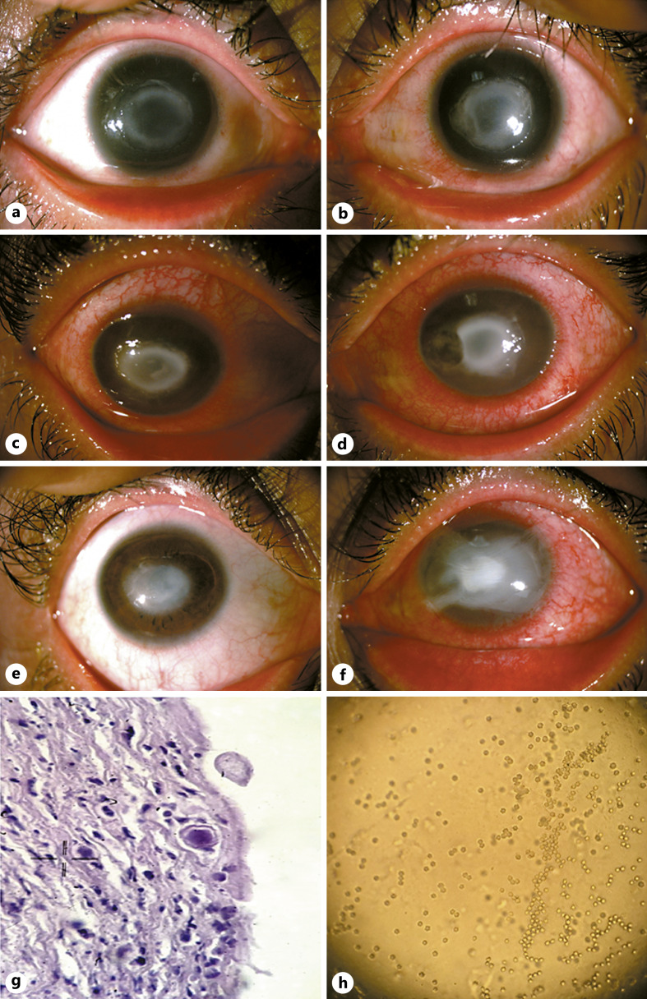
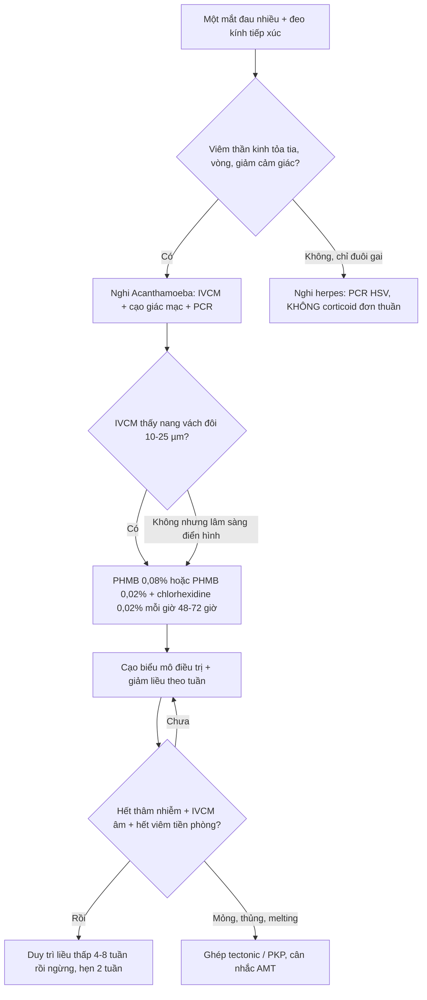
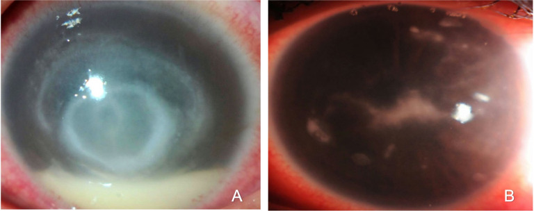
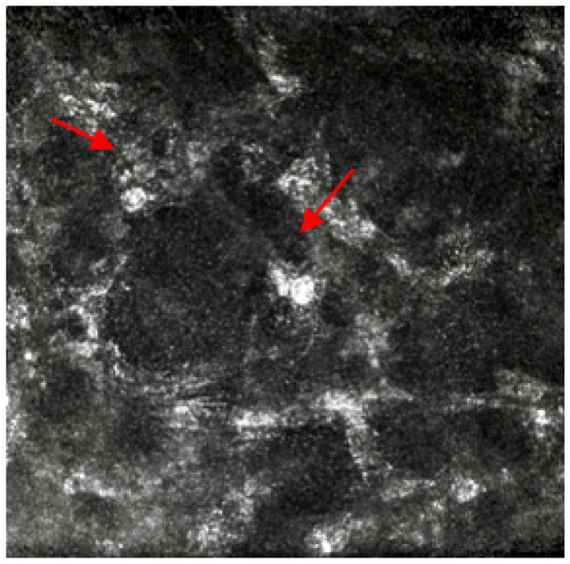
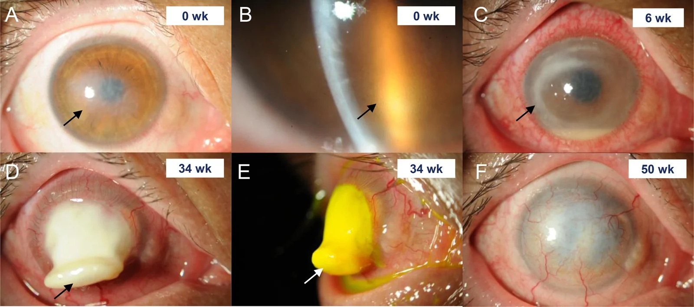

# 1472 — Viêm giác mạc do Acanthamoeba: đau nhiều hơn tổn thương, viêm thần kinh tỏa tia, nang vách đôi trên IVCM / Acanthamoeba keratitis

**Tags:** `pattern:viem-than-kinh-toa-tia` `pattern:vong-mien-dich` `pattern:o-loet-giac-mac` `pattern:tham-nhien-nhu-mo` `pattern:mang-noi-mo` `vung:mat` `vung:giac-mac` `protocol:slit-lamp` `protocol:IVCM` `protocol:AS-OCT` `protocol:cam-mau-cay`

**Mức chắc chắn (certainty):** tổng hợp y văn (literature synthesis) — tỉ lệ mắc từ tổng quan sinh học bệnh (**PMID 33221372**) và nghiên cứu thuần tập Scotland (**PMID 16303406**); đặc điểm lâm sàng lấy từ loạt 134 mắt viêm giác mạc nhiễm trùng (24–26 mắt Acanthamoeba) tại King Khaled (**PMC10931457**, CC BY 4.0, **PMID 38470877**); độ chính xác IVCM từ phân tích gộp 14 nghiên cứu/1.950 mắt (**PMID 36977847**); kết cục thị lực từ loạt 51 mắt PCR (+) (**PMID 38220498**); điều trị từ tổng quan Cochrane (**PMID 25710134**), thử nghiệm ngẫu nhiên PHMB 0,08% so sánh gián tiếp (**PMID 40659372**) và thử nghiệm pilot voriconazole (**PMID 32719525**); hình thái nang/trophozoite từ nghiên cứu siêu cấu trúc (**PMID 19176099**) và IVCM giai đoạn sớm (**PMID 23499062**). Ca minh hoạ: **PMC10601850** (CC BY-NC 4.0), **PMC10931457** (CC BY 4.0), **PMC10059758** (CC BY 4.0), **PMC13550268** (CC BY 4.0). Nhóm **không có bệnh nhân của mình**.

> **Câu chốt:** Acanthamoeba không phải "loét giác mạc nặng hơn loét vi khuẩn" mà là **ký sinh trùng ăn keratocyte và đi DỌC THEO DÂY THẦN KINH GIÁC MẠC** — nên dấu hiệu sớm nhất là **viêm thần kinh tỏa tia (radial keratoneuritis)** ở một mắt **đau rất nhiều nhưng đèn khe chưa thấy gì tương xứng**, tiền sử **kính tiếp xúc + nước máy/hồ bơi**. Ba câu hỏi trước khi kê thuốc: **(1) có đeo kính tiếp xúc và có rửa kính/nước vào mắt không? (2) đau có vượt xa tổn thương không? (3) đã dùng corticoid chưa?** Sai lầm chết người: **gọi là herpes → cho corticoid** → nang bùng phát, thâm nhiễm lan, chảy mủ nhu mô (melting), mất mắt.

## 1. Tổng quan bệnh học – cơ chế hình ảnh (TẠI SAO)

### 1.1 Ngưỡng định lượng (số phải nhớ)

- **Tỉ lệ mắc:** **< 33 ca/1 triệu người đeo kính tiếp xúc/năm** ở Hoa Kỳ (**PMID 33221372**); thuần tập Scotland ghi **1,49/10.000 người đeo kính mềm** (≈ **149/triệu**) — cao hơn hẳn, và **không gặp ca nào khi không đeo kính** trong loạt đó (**PMID 16303406**). Acanthamoeba chiếm khoảng **5%** viêm giác mạc liên quan kính tiếp xúc (dẫn trong **PMC10931457**).
- **Ai mắc:** trong loạt 26 mắt AK, **96,1% đeo kính tiếp xúc**, **73% ≤ 39 tuổi**, **73% nữ** (p < 0,001); thời gian từ khởi phát đến khám **trung vị 9 ngày** (2–60 ngày) (**PMC10931457**).
- **Dấu hiệu khi đã đến tuyến chuyên khoa:** khuyết biểu mô **100%**, **mảng nội mô/sau giác mạc 69,2%**, **viêm thần kinh tỏa tia 46,2%**, **vòng thâm nhiễm 53,8%**, **bệnh biểu mô (epitheliopathy) 23,1%**, hình sao **23,1%** (**PMC10931457**).
- **Kết cục nếu chẩn đoán muộn:** 51 mắt PCR (+): thị lực tốt **60,8%**, thị lực xấu (≥ 1 logMAR) **39,2%**, **khoét bỏ/múc nội nhãn 23,5%**; **chẩn đoán ≤ 14 ngày: OR 19,78** (95% CI 2,07–189,11) cho kết cục tốt, **cạo biểu mô điều trị: OR 19,02** (3,27–110,57) (**PMID 38220498**).
- **Sinh học tác nhân:** **trophozoite 15–45 µm** (thể hoạt động, ăn keratocyte); **nang (cyst) 10–25 µm, vách đôi** (ectocyst + endocyst) — thể **kháng thuốc/kháng khô** (**PMID 19176099**). Chính nang là lý do phải điều trị **hàng tháng**, không phải hàng tuần.

### 1.2 TẠI SAO "đau nhiều hơn tổn thương"

- Trophozoite **bám lectin vào glycoprotein mannose trên biểu mô** rồi xuyên qua vi khuyết do kính tiếp xúc → vào nhu mô và **đi dọc bao sợi thần kinh**.
- Đau do **viêm quanh thần kinh (perineural inflammation)** chứ không do độ lớn của ổ loét — vì vậy **mức đau không tương xứng với diện thâm nhiễm**, và **giảm cảm giác giác mạc** xuất hiện sớm (đối lập với herpes: herpes cũng giảm cảm giác nhưng có **đuôi gai bóng tận cùng**).

### 1.3 TẠI SAO có "viêm thần kinh tỏa tia" — và vì sao nó BIẾN MẤT

- Trên đèn khe, thâm nhiễm **hình nan hoa men theo các nhánh thần kinh** từ rìa vào trung tâm = **radial keratoneuritis**; tần suất y văn **10–65,9%**.
- **Thời điểm là tất cả:** trong loạt KKESH, **viêm thần kinh tỏa tia (RK) có ở 46,2%** và chỉ **tồn tại trung bình 12,85 ± 11,09 ngày (7–40 ngày)**, tan sau **7–45 ngày (trung bình 27,85)**; dấu hiệu **viêm quanh thần kinh (perineuritis — thâm nhiễm quanh dây thần kinh, khác RK)** xuất hiện **76,9% ngay lần khám đầu**, **91,9% trong 7 ngày**, tồn tại **trung bình 30,65 ± 11,09 ngày (8–55)**. Y văn dẫn trong bài còn ghi **tần suất RK giảm gần một nửa ở ca chẩn đoán muộn**, và tỉ lệ RK chung dao động **10–65,9%** (**PMC10931457**).
- **Cơ chế quan trọng cho IVCM:** ở AK giai đoạn sớm, **nang 10–20 µm nằm ở lớp tế bào biểu mô ĐÁY**, còn ở nhu mô chỉ thấy **keratocyte hoạt hoá xếp hình tổ ong quanh dây thần kinh** — **không có nang xâm nhập dây thần kinh** (**PMID 23499062**). Nghĩa là: *sợi tỏa tia là phản ứng viêm, không phải ấu trùng nằm trong dây thần kinh* → **khi soi IVCM phải quét lớp biểu mô đáy trước**, đừng chỉ tìm trong nhu mô sâu rồi kết luận âm.

### 1.4 TẠI SAO có "vòng miễn dịch" và vì sao corticoid làm mất nó

- Vòng thâm nhiễm = **vòng Wessely**: phức hợp **kháng nguyên–kháng thể–bổ thể + bạch cầu đa nhân** lắng trong nhu mô; xuất hiện **trong tháng đầu ở 20–50%** ca, tăng dần theo thời gian; trong loạt trên **53,8%** ca AK có vòng, **14/15 vòng (93,3%)** là AK, tồn tại **trung bình 37 ngày (7–120)** (**PMC10931457**).
- Vì là phản ứng **miễn dịch**, **corticoid làm vòng mờ đi** (giảm tần suất) và vòng có thể **xuất hiện lại trong 2 ngày sau khi ngừng corticoid** — nên "vòng mất sau corticoid" **không** phải bằng chứng lành, mà là bằng chứng đang che một nhiễm trùng.
- **Vòng KHÔNG đặc hiệu:** gặp ở nấm, vi khuẩn, Pythium, và cả herpes — giá trị nằm ở **bối cảnh + dấu hiệu đi kèm**, không ở bản thân vòng.

### 1.5 Vật lý của các phương tiện "thấy Acanthamoeba"

- **Đèn khe:** phóng đại 10–40×, ánh sáng khe cho **lát cắt quang học** → đo **diện thâm nhiễm (mm)**, độ sâu, tế bào tiền phòng. Giới hạn: **không thấy nang 10–25 µm**.
- **IVCM (soi đồng tiêu in vivo):** độ phân giải ngang **≈ 1 µm**, thu **ánh sáng phản xạ** → **vách nang cellulose phản xạ mạnh**: hình **tròn/bầu dục, vách đôi, 10–25 µm** (trên lâm sàng giai đoạn sớm đo được **10–20 µm** ở biểu mô đáy — **PMID 23499062**). Phân tích gộp 14 nghiên cứu/1.950 mắt: **Se 94%, Sp 87%, PPV 89%, NPV 92%** (**PMID 36977847**); trong loạt KKESH, **19,2% ca chỉ IVCM dương** (cấy/nhuộm âm) (**PMC10931457**).
- **AS-OCT:** độ phân giải trục **5–10 µm** → đo **độ dày/độ sâu thâm nhiễm theo µm**, phát hiện **mảng nội mô** (dấu hiệu đã xuyên hết nhu mô) và theo dõi **đáp ứng** khách quan.
- **Cạo giác mạc:** tiêu chuẩn vàng nhưng **chậm (3–7 ngày)** và **độ nhạy thấp** — nhuộm **calcofluor white/Giemsa**, cấy trên **thạch không dinh dưỡng có phết E. coli**, **PCR 18S rRNA**. **Cấy âm không loại trừ** → không được chờ cấy mới điều trị.

## 2. Mẫu hình + chẩn đoán phân biệt theo giai đoạn (gamut)

- **Giai đoạn sớm (0–4 tuần) — "đau >> dấu chứng":** bệnh biểu mô dạng **giả đuôi gai (pseudodendrite)**, **viêm thần kinh tỏa tia**, giác mạc **giảm cảm giác**, thâm nhiễm **nummular** dưới biểu mô. Ở bước này **chẩn đoán phân biệt khó nhất là herpes**.
- **Giai đoạn trung gian (1–3 tháng):** **vòng miễn dịch**, thâm nhiễm nhu mô lan, **mảng nội mô/sau giác mạc (69,2%)**, **mủ tiền phòng "vô khuẩn"**, phù giác mạc. Ở bước này **bắt chước nấm**.
- **Giai đoạn muộn (> 3 tháng):** **chảy mủ/hoại tử nhu mô (corneal melting)**, mỏng–thủng, **củng mạc viêm**, cataract, glôcôm, teo nhãn — đúng diễn tiến của ca **PMC13550268** (0 → 6 → 34 → 50 tuần).
- **Gamut theo cơ chế tổn thương:**
  - *Nhiễm trùng:* **Acanthamoeba**, **Pseudomonas** (nhanh, mủ xanh, vành lan), **nấm sợi** (bờ lông vũ, vệ tinh), **HSV/VZV** (đuôi gai thật, bóng tận cùng), **Pythium** (bờ "bờ sông", tiến triển cực nhanh, **không có ergosterol** nên azole vô hiệu).
  - *Không nhiễm trùng:* **viêm giác mạc do dung dịch bảo quản/kính (CLARE/toxicity)**, **viêm giác mạc chấm nông**, **loét thần kinh dưỡng (neurotrophic)**, **bệnh mắt khô nặng**, **phản ứng thấu kính**.
- **Gợi nhớ AK:** **A**canthamoeba = **A**nh sáng khe + **K**ính tiếp xúc + **đau** (mnemonic tự biên, không phải chuẩn y văn).

## 3. Bảng so sánh phân biệt (ma trận đối chiếu)

| Thực thể (entity) | Hình ảnh điển hình (đèn khe / IVCM / AS-OCT) | Chốt vào (rule-in) | Chốt loại (rule-out) | Gợi ý xác nhận |
|---|---|---|---|---|
| **Acanthamoeba** | Bệnh biểu mô **giả đuôi gai** + **viêm thần kinh tỏa tia** + **vòng Wessely** + **mảng nội mô**; IVCM **nang vách đôi 10–25 µm** ở biểu mô đáy; AS-OCT thấy thâm nhiễm sâu | **Đeo kính + tiếp xúc nước máy/hồ bơi + đau >> tổn thương + viêm thần kinh tỏa tia (46,2%) hoặc vòng (53,8%)**; IVCM dương | **Đuôi gai thật có bóng tận cùng + đáp ứng kháng virus trong 7–10 ngày** → herpes; **bờ lông vũ + vệ tinh** → nấm | IVCM (Se **94%**) + PCR 18S; cạo biểu mô điều trị (OR **19,02** kết cục tốt) |
| **Herpes (HSV)** | **Đuôi gai thật, bóng tận cùng**, bờ nham nhở, giảm cảm giác; ít viêm thần kinh tỏa tia; **không mảng nội mô kiểu AK** | **Đuôi gai điển hình + tiền sử herpes + đáp ứng acyclovir** | **Không có đuôi gai, đau vượt xa tổn thương, có vòng + mảng nội mô** → nghĩ AK | PCR HSV dịch/ổ loét; **không dùng corticoid đơn thuần khi chưa loại AK** |
| **Nấm sợi (Fusarium/Aspergillus)** | **Bờ lông vũ, vệ tinh**, thâm nhiễm nhu mô sâu, mảng nội mô; IVCM **sợi 2–6 µm phân nhánh** | **Chấn thương thực vật/bụi + bờ lông vũ + vệ tinh** | **Nang tròn vách đôi (không phải sợi) + tiền sử kính** → AK | Cạo + cấy Sabouraud, IVCM; xem bài [1460](../1460-viem-giac-mac-do-nam/lesson.md) |
| **Vi khuẩn (Pseudomonas)** | Thâm nhiễm **đặc, vành lan nhanh**, mủ tiền phòng, **đau tương xứng**, tiến triển **giờ** | **Khởi phát < 24–48 giờ, mủ xanh, vành lan** | **Diễn tiến nhiều ngày–tuần, đau vượt xa tổn thương** → không phải vi khuẩn điển hình | Nhuộm Gram + cấy; **không chờ** |
| **Pythium insidiosum** | **Vòng thâm nhiễm + bờ như bờ sông**, lan **cực nhanh**, đau nhiều | **Tiến triển tính bằng ngày + vòng + không đáp ứng azole** | Đáp ứng tốt với biguanide + thời gian dài → AK | Cấy/PCR; **phải mổ sớm khi vượt giới hạn nội khoa** |
| **Bệnh biểu mô do dung dịch/kính (toxicity)** | Chấm nông **đối xứng**, **ngừng kính là đỡ trong 48–72 giờ**, không thâm nhiễm nhu mô | **Ngừng kính + đổi dung dịch → hết trong 2–3 ngày** | **Không đỡ sau 72 giờ hoặc có thâm nhiễm nhu mô/vòng** → không phải toxicity | Thử ngừng kính có kiểm soát |

*Ca hai mắt: (a) mắt phải — thâm nhiễm nhu mô từng đám kèm **viêm thần kinh tỏa tia**; (b) mắt trái — khuyết biểu mô + **vòng thâm nhiễm** + viêm thần kinh tỏa tia + phù nhu mô; (c–f) diễn tiến 1 tháng → 8–15 tuần; (g) mô bệnh; (h) cấy. Nguồn: **Case Reports in Ophthalmology 2023 (PMC10601850)**, CC BY-NC 4.0 — nguyên bản, không cắt.*

## 4. Protocol chụp/khám + hệ phân độ & điều trị

### 4.1 Trình tự khám (không được đảo)

1. **Đèn khe + fluorescein:** đo **diện thâm nhiễm (mm)**, ghi **độ sâu theo 1/3 nhu mô**, tế bào/ flare tiền phòng, **nhãn áp**, **lật mi** tìm hạt/dị vật, **cảm giác giác mạc** (sợi bông).
2. **Hỏi 5 câu bắt buộc:** loại kính (mềm/ortho-K), **ngủ/tắm/bơi với kính**, **rửa kính bằng nước máy**, dung dịch đang dùng, **thời gian từ lúc khởi phát** (ngưỡng vàng **≤ 14 ngày**).
3. **IVCM ngay** (nếu có máy): quét **biểu mô → biểu mô đáy → Bowman → nhu mô trước/giữa/sâu** ở **≥ 4 góc phần tư**; tìm **nang tròn vách đôi 10–25 µm**, trophozoite, tế bào viêm; **ghi ảnh từng lớp** để so sánh lượt sau.
4. **AS-OCT:** đo **độ dày giác mạc (µm)**, độ sâu thâm nhiễm, **mảng nội mô**, khoảng trống giữa mảng và nội mô (giúp phân biệt mảng do nấm lan từ ổ chính).
5. **Cạo giác mạc** (sau khi lấy bệnh phẩm mới được nhỏ thuốc): **3 tiêu bản** (Gram, Giemsa, calcofluor white) + **cấy thạch không dinh dưỡng phết E. coli** + **PCR 18S rRNA** + cấy vi khuẩn/nấm; **cấy kính + dung dịch + hộp đựng**.

### 4.2 Điều trị (số liệu, không "theo kinh nghiệm")

- **Nền tảng: biguanide ± diamidine.** Thử nghiệm ngẫu nhiên duy nhất (Cochrane, **PMID 25710134**): **chlorhexidine 0,02%** vs **PHMB 0,02%** — lành **86% vs 78%**, **thời gian điều trị 51–145 ngày**.
- **PHMB 0,08%** (đã được EMA phê duyệt): lành không cần mổ trong 12 tháng **84,8%** (n = 66) vs **55,0%** (PHMB 0,02% + diamidine) vs **43,6%** (mọi phác đồ kháng amip khác) (**PMID 40659372**) — khác biệt tuyệt đối **+29,9%** so với PHMB 0,02% + diamidine.
- **Nhịp nhỏ:** **mỗi giờ cả ngày và đêm trong 48–72 giờ đầu**, sau đó giãn theo đáp ứng; **tổng thời gian tính bằng tháng (thường 3–12 tháng)**, và **chỉ ngừng khi hết thâm nhiễm + IVCM âm + hết viêm tiền phòng**; giảm nhanh → tái phát.
- **Phối hợp:** **diamidine (propamidine/hexamidine 0,1%)** luân phiên; **voriconazole 1%** đơn trị trong thử nghiệm pilot **tương đương** phối hợp biguanide (giảm diện thâm nhiễm từ **5,7 mm → 1 mm**, **PMID 32719525**) nhưng cỡ mẫu nhỏ; **miltefosine uống** và **PACK-CXL** chỉ là **hỗ trợ**, không thay thuốc.
- **Cạo biểu mô điều trị (therapeutic epithelial debridement):** giảm tải nang + tăng thấm thuốc — gắn với kết cục tốt **OR 19,02** (**PMID 38220498**).
- **Corticoid:** **không dùng trước khi xác định/chưa có che phủ kháng amip đầy đủ** — corticoid liên quan **chẩn đoán muộn và tiên lượng xấu**, và **làm nang kết cụm** (dễ nhầm tổ ong của nấm) (**PMC10931457**). Nếu phải dùng vì viêm nội nhãn nặng: **sau ≥ 2–4 tuần che phủ hiệu quả, liều thấp, giảm rất chậm, khám lại 48–72 giờ**.
- **Mổ:** ghép giác mạc **tectonic/therapeutic (PKP/DALK)** khi mỏng–thủng hoặc sẹo đục sau lành; **23,5%** mắt trong nhóm kết cục xấu phải **khoét bỏ/múc nội nhãn** (**PMID 38220498**) — con số dùng để tư vấn, không để trấn an.

## 5. Biến thể bình thường và cạm bẫy

- **Viêm thần kinh tỏa tia KHÔNG đặc hiệu:** trong loạt KKESH, **12/13 mắt có dấu hiệu này là AK**, nhưng **1 ca là herpes PCR (+)** và y văn ghi nhận cả nấm/vi khuẩn → **không chốt một mình**.
- **Vòng miễn dịch bị corticoid "chữa lành" giả tạo:** vòng mờ đi trong 1–2 tuần rồi **bùng lại trong 2 ngày sau khi ngừng** → dễ kết luận "viêm đã đỡ, tiếp tục corticoid".
- **Đuôi gai giả (pseudodendrite) của AK** vs đuôi gai herpes: AK **không có bóng tận cùng**, bờ mềm, **đau nhiều**, kèm **thâm nhiễm dưới biểu mô**; herpes **bóng tận cùng rõ**, bờ nham nhở, giảm cảm giác.
- **IVCM âm không loại trừ:** phụ thuộc người đọc và **vị trí quét** (nang ở **biểu mô đáy** — **PMID 23499062**), tổn thương sâu/nang thưa → **Se 94%** nghĩa là **6% âm giả**.
- **Nang kết cụm sau corticoid** dễ nhầm **tổ ong của bạch cầu trong nấm**; phân biệt bằng **vách đôi rõ + kích thước 10–25 µm** và bờ tổn thương trên đèn khe.
- **Cạo biểu mô lấy bệnh phẩm sai thứ tự:** nhỏ thuốc kháng amip/kháng sinh **trước** khi cạo làm giảm tỉ lệ dương.
- **Ortho-K và kính qua đêm** là bối cảnh kinh điển nhưng dễ bị bỏ qua khi bệnh nhân nói "chỉ đeo ban ngày".
- **Cạm bẫy "thỏa mãn tìm kiếm":** thấy **mảng nội mô** là nghĩ nấm và dừng lại — AK cũng có mảng nội mô ở **69,2%**.

## 6. Tự lượng giá — Blind Quiz (ảnh ngoài, đáp án trong)

**Ca 1 — Nam 24 tuổi, đeo kính mềm, đau mắt phải 5 ngày, đèn khe chỉ thấy "hơi mờ". Nhìn 2 mắt (a, b) trước.**

- Gợi ý lâm sàng: đau nhiều, sợ ánh sáng, **rửa kính bằng nước máy**.
- Câu hỏi: dấu hiệu nào **không phải** "mờ đều"? Dấu hiệu đó đi theo cấu trúc giải phẫu nào? 3 chẩn đoán phân biệt và xét nghiệm chốt?

<b>Bấm để hiện đáp án</b>

- **Findings:** (a) mắt phải — **thâm nhiễm nhu mô từng đám** + các **đường tỏa tia men theo dây thần kinh** từ rìa vào trung tâm (**radial keratoneuritis**); (b) mắt trái — **khuyết biểu mô + vòng thâm nhiễm** + tỏa tia + phù nhu mô.
- **Chẩn đoán:** **viêm giác mạc do Acanthamoeba hai mắt**. Tỏa tia = **viêm quanh dây thần kinh**, không phải ấu trùng trong dây.
- **Vì sao:** nang **10–25 µm, vách đôi**; trophozoite **15–45 µm** ăn keratocyte → thâm nhiễm men theo thần kinh; đau do viêm quanh thần kinh.
- **Loại trừ:** herpes (đuôi gai **có bóng tận cùng**, đáp ứng kháng virus), nấm (bờ lông vũ + vệ tinh), vi khuẩn (mủ đặc, tiến triển giờ).
- **Chốt:** **IVCM** (Se **94%**) + **PCR 18S** + cạo biểu mô; **không corticoid**.
- Nguồn: **Case Reports in Ophthalmology 2023 (PMC10601850)**, CC BY-NC 4.0.

**Ca 2 — Nữ 31 tuổi, đeo kính, đau 3 tuần, đã nhỏ "thuốc chống viêm" ở tuyến trước. Nhìn (A) và (B).**

- Câu hỏi: (A) gọi tên dấu hiệu và cơ chế; (B) tổn thương nằm ở lớp nào và nói lên điều gì về độ sâu? Vì sao **không được** kết luận "đỡ" khi vòng mờ đi?

<b>Bấm để hiện đáp án</b>

- **Findings:** (A) **vòng thâm nhiễm (vòng Wessely)** trong nhu mô; (B) **mảng nội mô / mảng sau giác mạc (retrocorneal plaque)**.
- **Cơ chế:** (A) phức hợp **kháng nguyên–kháng thể–bổ thể + bạch cầu đa nhân**; (B) tế bào viêm + tác nhân **lắng ở mặt sau giác mạc** → đã xuyên hết nhu mô.
- **Số liệu:** vòng gặp **53,8%** ca AK, tồn tại **trung bình 37 ngày (7–120)**; mảng nội mô **69,2%**; **14/15 vòng (93,3%)** trong loạt là AK.
- **Vì sao không "đỡ":** corticoid **làm mờ vòng** (giảm phản ứng miễn dịch) và vòng có thể **bùng lại trong 2 ngày sau ngừng** — mờ vòng **không** đồng nghĩa hết ký sinh trùng.
- Nguồn: **PLOS ONE 2024 (PMC10931457)**, CC BY 4.0.

**Ca 3 — Cùng bệnh nhân ca 2, máy IVCM: đây là gì?**

- Câu hỏi: mô tả hình dạng/kích thước/vách; vì sao phải quét **biểu mô đáy** trước; độ chính xác của IVCM?

<b>Bấm để hiện đáp án</b>

- **Findings:** nhiều cấu trúc **tròn/bầu dục, phản xạ mạnh, VÁCH ĐÔI**, đường kính **10–25 µm** (mũi tên đỏ) = **nang Acanthamoeba**; cạnh đó là cấu trúc bầu dục phản xạ mạnh (thể trophozoite/khối tế bào).
- **Vì sao biểu mô đáy:** ở AK sớm nang nằm ở **lớp tế bào biểu mô đáy (10–20 µm)**, nhu mô chỉ có **keratocyte hình tổ ong quanh dây thần kinh** (**PMID 23499062**). Quét nhu mô sâu rồi kết luận âm là **âm giả**.
- **Độ chính xác:** gộp 14 nghiên cứu/1.950 mắt — **Se 94%, Sp 87%, PPV 89%, NPV 92%** (**PMID 36977847**); **19,2%** ca chỉ IVCM dương (**PMC10931457**).
- Nguồn: **Life 2023 (PMC10059758)**, CC BY 4.0.

**Ca 4 — Bệnh nhân được chẩn đoán "viêm nội mô do virus" và dùng corticoid toàn thân; xem chuỗi 0 → 6 → 34 → 50 tuần.**

- Câu hỏi: ở tuần 0 (A, B) dấu hiệu gì **đánh lạc hướng**? Điều gì xảy ra ở tuần 6 và 34? Bài học điều trị?

<b>Bấm để hiện đáp án</b>

- **Tuần 0:** **phù nhu mô lan + mờ giác mạc + nếp gấp màng Descemet + tủa lắng nội mô mịn** → bắt chước **viêm nội mô do virus**; **không có vòng, không có tỏa tia rõ** ở bước này.
- **Tuần 6:** khuyết biểu mô ngoại vi + **vòng thâm nhiễm tiến triển** + **mủ tiền phòng** → mới nghĩ AK và bắt đầu chlorhexidine.
- **Tuần 34:** **hoại tử nhu mô, chảy mủ (melting)**, mô hoại tử lồi ra; **tuần 50**: sẹo mạch máu hoá.
- **Bài học:** (1) **corticoid trước chẩn đoán** làm mờ dấu hiệu và đẩy nhanh hoại tử; (2) **chẩn đoán ≤ 14 ngày cho OR 19,78** kết cục thị lực tốt, **39,2%** ca chẩn đoán muộn có thị lực xấu và **23,5%** mất mắt (**PMID 38220498**).
- Nguồn: **Journal of Ophthalmic Inflammation and Infection 2026 (PMC13550268)**, CC BY 4.0.

## Bài liên quan chéo
- [400 – Tổng quan Mắt & thị giác](../400-tong-quan-mat-thi-giac/lesson.md)
- [1460 – Viêm giác mạc do nấm](../1460-viem-giac-mac-do-nam/lesson.md) (bờ lông vũ, vệ tinh, mảng nội mô — hàng phân biệt sát nhất)
- [1456 – Bỏng hóa chất mắt](../1456-bong-hoa-chat-mat/lesson.md) (khuyết biểu mô + mất mạch rìa)
- [1445 – Bong mảnh ghép DSAEK/DMEK](../1445-bong-manh-ghep-dsaek-dmek-rebubble/lesson.md) (phù giác mạc sau ghép — bối cảnh IVCM/AS-OCT)

## Ảnh
- `1472_acanthamoeba_AnhSang_PMC10601850.jpg` — hai mắt: thâm nhiễm từng đám + viêm thần kinh tỏa tia; **Case Reports in Ophthalmology 2023, PMC10601850**, **CC BY-NC 4.0**, nguyên bản.
- `1472_acanthamoeba_AnhSang_PMC10931457.jpg` — (A) vòng thâm nhiễm, (B) mảng nội mô; **PLOS ONE 2024, PMC10931457**, **CC BY 4.0**, nguyên bản.
- `1472_acanthamoeba_IVCM_PMC10059758.jpg` — IVCM nang vách đôi; **Life 2023, PMC10059758**, **CC BY 4.0**, nguyên bản.
- `1472_acanthamoeba_AnhSang_PMC13550268.jpg` — chuỗi 0/6/34/50 tuần; **J Ophthalmic Inflamm Infect 2026, PMC13550268**, **CC BY 4.0**, nguyên bản.
- Không tải: Radiopaedia (chỉ dẫn link từng ca), AuntMinnie (paywall).

> Không dùng để chẩn đoán độc lập khi chưa có người hướng dẫn.
