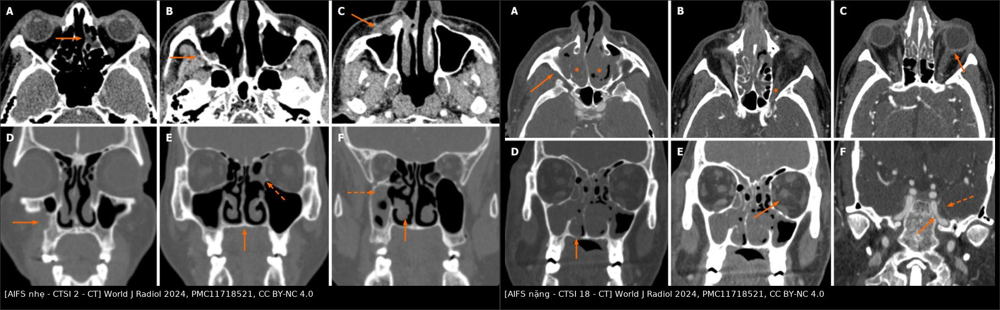
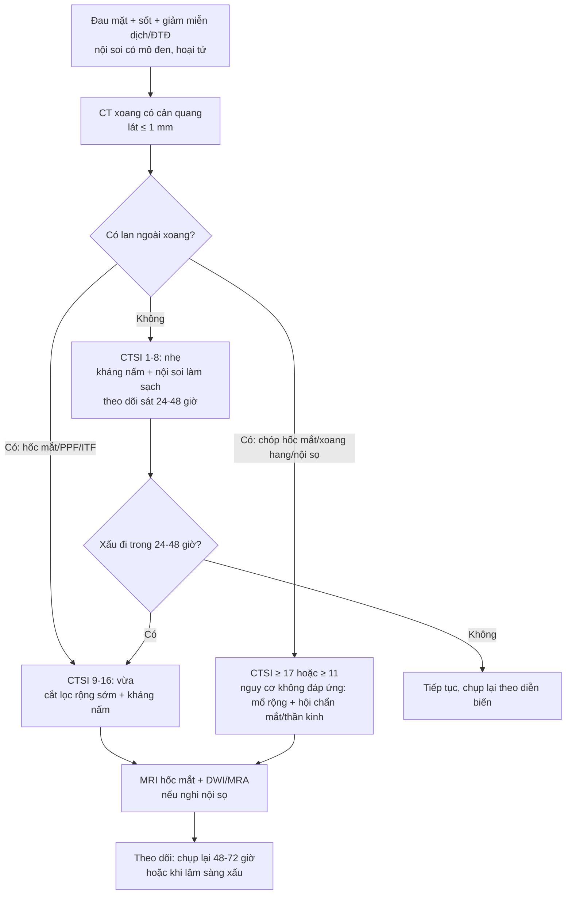
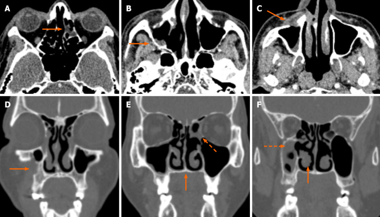
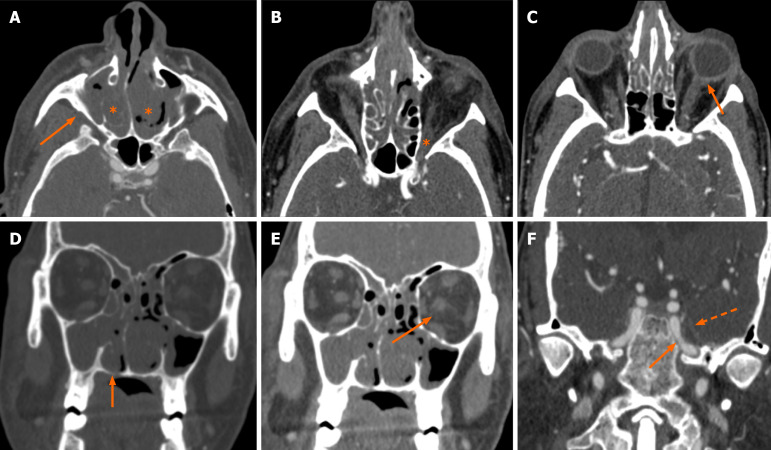
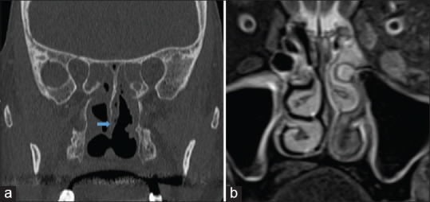
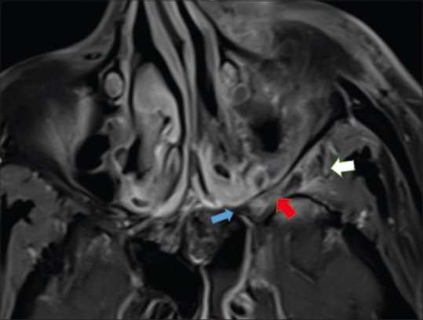
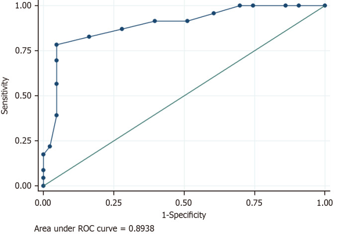

# 1473 — Viêm xoang nấm xâm lấn cấp lan hốc mắt (AIFS) / Acute invasive fungal rhinosinusitis with orbital invasion

**Tags:** `pattern:dac-xoang` `pattern:huy-xuong` `pattern:lan-hoc-mat` `vung:xoang` `vung:hoc-mat` `protocol:CT-xoang-lat-mong` `protocol:MRI-hoc-mat`
**Mức chắc chắn (certainty):** tổng hợp y văn (literature synthesis) — số liệu từ một đoàn hệ 66 bệnh nhân có **chỉ số nặng trên CT (CTSI)** đề xuất 2024, một bài tổng quan hình ảnh 2025 và một bài về **dấu turbinate đen**; nhóm tự tổng hợp, không có ca nguyên văn riêng.

## 1. Tổng quan bệnh học – cơ chế hình ảnh

### 1.1 Vì sao nấm "ăn" xoang rồi vào hốc mắt

- Tác nhân chính: **Mucorales (Rhizopus, Mucor)** và ***Aspergillus***. Bào tử hít vào xoang ở người **mất hàng rào miễn dịch** — đái tháo đường mất kiểm soát/nhiễm toan ceton, dùng corticoid liều cao, giảm bạch cầu hạt, ghép tạng, và (trong đại dịch) **COVID-19 nặng có dùng corticoid**.
- Cơ chế then chốt: nấm **xâm lấn mạch (angioinvasion)** → **huyết khối lòng mạch** → **thiếu máu và hoại tử mô** không có mủ. Đó là lý do hình ảnh khác hẳn "viêm xoang vi khuẩn": **không có mủ tiền phòng kiểu áp-xe**, mà là **mô chết ít ngấm thuốc**.
- Lan theo **đường giải phẫu**, không theo đường ngẫu nhiên (mục 2): qua **lamina papyracea** vào hốc mắt; qua **lỗ bướm–khẩu cái (sphenopalatine foramen)** vào **hố pterygopalatine (PPF) → hố dưới thái dương (ITF)**; qua **xoang bướm/trần sàng** vào **xoang hang và nội sọ**.
- Hậu quả lâm sàng: khi đã có **biến chứng hốc mắt/nội sọ**, tử vong được báo cáo **50–80%**. Đây là lý do bài này tồn tại: **chẩn đoán hình ảnh sớm đổi số phận bệnh nhân**, và **gọi nhầm thành "viêm xoang" là chậm cắt lọc**.

### 1.2 Vì sao hình ảnh trông như vậy (vật lý + mô bệnh)

| Dấu hiệu | Vì sao (cơ chế) |
|---|---|
| **Đặc xoang, KHÔNG mức khí–dịch** | Mô hoại tử + nấm lấp đầy xoang; vi khuẩn tạo mủ lỏng nên có mức ngang — nấm tạo khối đặc nên **mất mức khí–dịch** |
| **Xoang "đặc" nhưng ít ngấm thuốc (MRI)** | Huyết khối mạch nuôi + hoại tử đông vón → **không có tưới máu để ngấm thuốc**, dù trông "đầy" trên T1 |
| **Turbinate đen (black turbinate) trên T1 sau tiêm** | Niêm mạc cuốn mũi **thiếu máu/hoại tử** không ngấm thuốc; trên T2 **tối** vì **hoại tử đông vón (ít nước) + lắng đọng sắt/mangan** trong mô chết |
| **Hủy xương vỏ (lamina papyracea, thành xoang)** | Xâm lấn mạch → thiếu máu xương + viêm quanh mạch; xương mỏng như giấy nên **mất vỏ là dấu sớm** |
| **Chuỗi mỡ quanh xoang (retroantral fat stranding)** | Phù/viêm lan qua màng xương — **dấu sớm trước khi hủy xương rõ** |
| **Nốt tăng đậm trong xoang trên CT không cản quang** | Thành phần nấm chứa **calci, mangan, sắt, lưu huỳnh** → cản tia hơn mô mềm; gặp ở cả mycetoma lành tính nên **không đủ để gọi xâm lấn** |

### 1.3 Ngưỡng định lượng của bài

| Đại lượng | Con số | Ý nghĩa |
|---|---|---|
| Tử vong khi có biến chứng hốc mắt/nội sọ | **50–80%** | Cấp cứu, không chờ cấy |
| **CTSI (CT severity index)** — thang 1–25 | **nhẹ 1–8; vừa 9–16; nặng ≥ 17** | Phân tầng trước khi quyết định cắt lọc rộng |
| **Ngưỡng CTSI dự báo không đáp ứng điều trị** | **≥ 11**: độ nhạy **78,26%**, độ đặc hiệu **95,35%** | Điểm cao = cân nhắc cắt lọc sớm/rộng hơn |
| CTSI trung bình: đáp ứng vs không đáp ứng | **6,3 vs 12,9** (p<0,001) | Chênh gần **2 lần** |
| Bệnh **hai bên** | **9,09%** ca; liên quan tử vong **p=0,004** | Hai bên = tiên lượng xấu |
| **Turbinate đen ở người KHÔNG bệnh** | **30%** số MRI | Cạm bẫy: không được chẩn đoán chỉ bằng dấu này |

## 2. Mẫu hình + chẩn đoán phân biệt theo vị trí (gamut)

### 2.1 Mẫu hình 1 — xoang một bên đặc + hủy xương

Gamut theo **cơ chế**:

- **Nhiễm nấm xâm lấn cấp (AIFS):** người giảm miễn dịch/đái tháo đường, triệu chứng **ngày–tuần**, đau mặt, **tê môi/má**, mũi tắc + **đen niêm mạc**, sốt nhẹ.
- **Ung thư biểu mô xoang (SCC):** người lớn tuổi, **chảy máu mũi một bên**, hủy xương **thô**, mô mềm lớn hơn phần xương bị phá.
- **Lymphoma NK/T:** thanh niên, **loét giữa mũi**, thủng vách, sốt, EBV+.
- **GPA (Wegener):** thủng vách, viêm mũi xuất huyết, **tổn thương phổi/thận** kèm, cANCA+.
- **Nhiễm khuẩn (áp-xe dưới màng xương):** trẻ, **sưng mí + sốt cao**, có **mức khí–dịch**, ổ dịch dưới màng xương — bài [1461](../1461-ap-xe-duoi-mang-xuong-hoc-mat-o-tre/lesson.md).

### 2.2 Mẫu hình 2 — "viêm xoang" đã lan ra ngoài xoang

Định vị theo **đường lan** (chính là checklist đọc phim):

1. **Hốc mắt:** mỡ quanh nhãn cầu, **cơ trực** (dày không đều), **chóp hốc mắt**, **dây thị giác**.
2. **PPF → ITF:** chuỗi mỡ sau thành sau xoang hàm **mất đậm độ mỡ**; hố dưới thái dương có mô mềm.
3. **Nội sọ:** **xoang hang** (khuyết thuốc, giãn tĩnh mạch mắt trên), **động mạch cảnh trong hẹp/tắc**, màng não, nhồi máu.

Gợi nhớ đường lan **"3 cửa"**: **L**amina papyracea (hốc mắt), **P**terygopalatine fossa (sau), **S**phenoid roof (nội sọ) — **LPS**.

## 3. Bảng so sánh phân biệt (ma trận đối chiếu)

| Thực thể (entity) | Hình ảnh điển hình | Chốt vào (rule-in) | Chốt loại (rule-out) | Gợi ý xác nhận |
|---|---|---|---|---|
| **AIFS (Mucor/Aspergillus)** | Xoang **đặc hoàn toàn, không mức khí–dịch**, **mất vỏ xương** (lamina papyracea), **chuỗi mỡ sau xoang**, mô mềm hốc mắt/PPF; turbinate **không ngấm thuốc** | **Bệnh cảnh giảm miễn dịch + đau mặt/tê + lan ngoài xoang trong ngày–tuần**; **mất ngấm thuốc niêm mạc** | **Mức khí–dịch rõ + mủ + sốt cao đơn thuần** → nghĩ vi khuẩn; **khối lớn, xương phá thô, không đau cấp** → nghĩ u | Nội soi + **sinh thiết/sinh thiết tức thì**, cấy nấm, PCR; **không chờ kết quả mới mổ** |
| **Áp-xe dưới màng xương do vi khuẩn (trẻ)** | Ổ dịch **dưới màng xương thành trong hốc mắt**, mức khí–dịch trong xoang, viêm xoang sàng | **Sưng mí cấp + sốt**, ổ dịch khu trú, **không lan PPF/ITF** | Turbinate đen/hoại tử, lan hốc dưới thái dương → loại vi khuẩn | Siêu âm/CT, dẫn lưu + kháng sinh (bài 1461) |
| **SCC xoang hàm** | Khối mô mềm **một bên**, hủy xương **thô, bờ nham nhở**, ngấm thuốc không đều | **Chảy máu mũi tái diễn + khối trong xoang**; không sốt | **Lan nhanh ngày, hoại tử mô mềm ngoài xoang** → loại u | Sinh thiết qua nội soi; MRI để đánh giá xâm lấn |
| **GPA / u hạt Wegener** | **Thủng vách mũi**, dày niêm mạc dai dẳng, tổn thương phổi/thận | **Thủng vách + cANCA + tổn thương đa hệ** | Đặc xoang hoàn toàn cấp + hoại tử → loại GPA | cANCA, sinh thiết, CT ngực |
| **Mycetoma / nấm mũi xoang dị ứng (AFS)** | Xoang **giãn rộng**, **nốt tăng đậm**, có thể **mòn xương do chèn ép** | **Nốt tăng đậm trong xoang giãn rộng, bệnh nhân không giảm miễn dịch** | **Hoại tử niêm mạc, lan hốc mắt, đau cấp** → loại mycetoma | MRI (nốt tối trên T2), mô bệnh |
| **Thay đổi sau mổ/xạ xoang** | Mất vách xoang theo kế hoạch, vạt niêm mạc, mô hạt | **Tiền sử mổ đúng vùng, không lan mới** | **Lan mới ra ngoài xoang so với phim cũ** → loại | So phim cũ, MRI |

*Trái: **AIFS nhẹ — CTSI 2** ở bệnh nhân đái tháo đường (HbA1c 8,5): dày niêm mạc xoang/sàn mũi, ứ đọng, **chưa lan hốc mắt** (mũi tên). Phải: **AIFS nặng — CTSI 18** (HbA1c 12,2) có **mất thị lực mắt trái và liệt dây thần kinh sọ**: đặc xoang lan **hốc mắt, chóp hốc mắt, xoang hang**. Hai ảnh cùng chuỗi (CT có cản quang) đặt cạnh nhau để thấy **cùng một bệnh, hai điểm cuối**. Nguồn: *World J Radiol* 2024, **PMC11718521**, **CC BY-NC 4.0**; ảnh ghép letterbox, không crop/kéo giãn.*

## 4. Protocol chụp + hệ phân độ/điểm chuẩn hóa

### 4.1 Protocol

- **CT xoang có cản quang (CECT), lát ≤ 1 mm**, dựng **cửa sổ xương + mô mềm**; kỹ thuật **split-bolus một thì** được dùng trong nghiên cứu chỉ số nặng (đủ thấy cả mạch và niêm mạc trong một lần tiêm).
- **MRI hốc mắt – xoang** khi nghi lan nội sọ/hốc mắt hoặc CT không kết luận: **T1 không tiêm + T2 fat-sat + T1 fat-sat sau tiêm**, thêm **DWI** (ổ hoại tử/áp-xe) và **MRA** nếu nghi xoang hang/động mạch cảnh trong.
- **Đọc theo 4 vùng, ghi điểm từng vùng** (bảng 4.2) rồi cộng — cách này buộc người đọc **nhìn chủ động** các đường lan, tránh bỏ sót PPF/chóp hốc mắt (satisfaction of search khi chỉ nhìn xoang hàm).
- **Không có "chỉ định chụp để loại trừ" ở bệnh nhân đúng bệnh cảnh:** đau mặt + giảm miễn dịch + nội soi có mô hoại tử → **nội soi + sinh thiết song song với CT**, không chờ hình ảnh.

### 4.2 Chỉ số nặng trên CT (CTSI, thang 1–25)

| Vùng | Mục | Điểm |
|---|---|---|
| **Giới hạn trong mũi/xoang** | Bệnh niêm mạc trong xoang | 1 |
| | Bệnh niêm mạc trong ổ mũi và vòm họng | 1 |
| **Xâm lấn mô kế cận** | Mòn khẩu cái cứng | 1 |
| | Xâm lấn mỡ trước/sau thành xoang | 1 |
| | Lan tới **PPF / khe ổ mắt trên / khe ổ mắt dưới / chóp hốc mắt / ITF** | 2 |
| | Bệnh **hai bên** đáng kể | 2 |
| **Hốc mắt** | Mô mềm/mỡ/cơ/ống lệ đạo | 1 |
| | **Mòn xương** | 2 |
| | **Lan trong nhãn cầu / dây thị giác** | 3 |
| **Nội sọ** | Xâm lấn/mòn nền sọ | 2 |
| | **Xoang hang** | 3 |
| | **Hẹp/tắc động mạch cảnh trong** | 3 |
| | Biến chứng nội sọ (viêm màng não, viêm não, áp-xe, nhồi máu) | 3 |

- Phân tầng: **nhẹ 1–8 / vừa 9–16 / nặng ≥ 17**. Trong đoàn hệ 66 ca: nhẹ **51,52%**, vừa **42,42%**, nặng **6,06%**; **CTSI ≥ 11** dự báo **không đáp ứng** với độ nhạy **78,26%**, độ đặc hiệu **95,35%**.

### 4.3 Thuật toán xử trí dựa trên hình ảnh

### 4.4 Điều trị song song (để hiểu vì sao "không chờ")

- **Cắt lọc ngoại khoa sớm, rộng** (bao gồm mô hoại tử cho tới mô còn chảy máu) là yếu tố sống còn; khi đã có tổn thương hốc mắt nặng có thể phải **cắt bỏ hốc mắt (exenteration)**.
- **Kháng nấm toàn thân liều cao:** amphotericin B liposomal **5–10 mg/kg/ngày** là lựa chọn đầu tay cho mucormycosis (khuyến cáo ECMM/ISHAM 2019); kiểm soát **đường huyết/nhiễm toan ceton** song song.
- **Giảm ức chế miễn dịch** khi có thể; **không dùng corticoid** như "viêm xoang thông thường".

## 5. Biến thể bình thường và cạm bẫy

- **Turbinate đen không đặc hiệu:** **30%** MRI ở người **không** có bệnh nấm cũng có vùng cuốn mũi không ngấm thuốc, thường ở **phần sau cuốn mũi dưới** (Han & Escott, *AJNR* 2019). Chỉ có giá trị khi **kèm bệnh cảnh + lan ngoài xoang**; dấu này **không đứng một mình**.
- **"Chỉ là viêm xoang" là sai lầm chết người:** viêm xoang vi khuẩn **có mức khí–dịch**, đáp ứng kháng sinh trong **48–72 giờ**; AIFS **mất mức khí–dịch, đau tăng, tê má/môi, mắt đỏ đau**. Nếu nghi, **nội soi + sinh thiết ngay**, không "thử kháng sinh rồi chụp lại".
- **Nốt tăng đậm trong xoang ≠ xâm lấn:** mycetoma và AFS cũng có; **không có hoại tử niêm mạc/lan hốc mắt** thì không phải AIFS.
- **Bệnh hai bên hiếm nhưng nặng:** **9,09%** trong đoàn hệ, gắn với tử vong **p=0,004** — đừng vì "hai bên đối xứng" mà loại trừ nấm.
- **Đừng bỏ sót đường lan sau:** hố **PPF → ITF** là cửa vào hay bị bỏ qua nhất; mất đậm độ mỡ sau thành sau xoang hàm trên CT **là dấu sớm**, trước khi hủy xương rõ.
- **Sau cắt lọc, hình ảnh luôn "xấu" hơn:** đừng đọc thay đổi sau mổ là tiến triển; so với phim ngay sau mổ và đọc theo **mô mềm mới lan ngoài vùng mổ**.

## 6. Tự lượng giá — Blind Quiz

**Ca 1 — Nam 67 tuổi, đái tháo đường, đau mặt phải 5 ngày, nội soi có mô đen ở khe giữa. Nhìn CT, mô tả trước.**

- Gợi ý lâm sàng: HbA1c 8,5; không nhìn mờ, không hạn chế vận nhãn.
- Câu hỏi: (1) Mô tả tổn thương theo 4 vùng; (2) tổn thương này **đã lan ngoài xoang** chưa; (3) vì sao **không** được gọi là "viêm xoang thông thường"?

<b>Bấm để hiện đáp án (findings + chẩn đoán)</b>

- Dấu hiệu (findings): hình A–C (axial): **dày niêm mạc và ứ đọng trong xoang hàm/sàng phải**, mũi tên chỉ **dày niêm mạc thành trong** và **mô đặc trong ổ mũi**; hình D–F (coronal): **dày niêm mạc sàn mũi/xoang hàm**, **không thấy mòn lamina papyracea**, **không có mô mềm trong hốc mắt**, không có tổn thương chóp/xoang hang → **CTSI 2 = nhẹ**.
- Chẩn đoán (diagnosis): **AIFS nhẹ** — đặc xoang **không mức khí–dịch** + bệnh cảnh đái tháo đường + mô đen nội soi. Bệnh nấm không tạo mủ lỏng nên **không có mức ngang**, khác viêm xoang vi khuẩn.
- Vì sao quan trọng: CTSI 2 thuộc nhóm **nhẹ** — vẫn cần **kháng nấm + làm sạch nội soi**, và **đánh giá lại 24–48 giờ** vì điểm thấp không loại trừ tiến triển nhanh.
- Nguồn ảnh: *World J Radiol* 2024, **PMC11718521**, Fig. 2; **CC BY-NC 4.0**.

**Ca 2 — Cùng bệnh cảnh nhưng mắt trái mất thị lực, liệt dây thần kinh sọ. Nhìn CT, tìm đường lan.**

- Gợi ý lâm sàng: HbA1c 12,2, đau quanh ổ mắt trái, nhìn mờ rồi mất thị lực, sụp mi.
- Câu hỏi: (1) Kể tên **3 đường lan** thấy trên ảnh; (2) tính CTSI tối thiểu; (3) vì sao **MRI** cần thêm ở ca này?

<b>Bấm để hiện đáp án</b>

- Dấu hiệu: **A–C (axial):** đặc xoang sàng/hàm trái, **mòn thành trong xoang hàm và lamina papyracea**, mô mềm lan **hốc mắt ngoài nón** và **đỉnh hốc mắt** (mũi tên cam); **D–F (coronal):** mô mềm lan **sàn mũi/khẩu cái** (mũi tên), **chóp hốc mắt**, và **xoang hang** (mũi tên đứt).
- Chẩn đoán: **AIFS nặng — CTSI 18** (đặc xoang 1–2 + mỡ quanh xoang 1–2 + lan chóp hốc mắt 2 + mòn xương hốc mắt 2 + xoang hang 3 + …), tương ứng nhóm **≥ 17 = nặng**; nguy cơ **không đáp ứng cao** (ngưỡng **11**: nhạy 78,26%, đặc hiệu 95,35%).
- Vì sao MRI: cần xác định **mất ngấm thuốc niêm mạc/cuốn mũi**, **huyết khối xoang hang**, **hẹp động mạch cảnh trong**, và **nhồi máu/nhiễm trùng nội sọ** — CT chỉ thấy xương và mô mềm.
- Nguồn ảnh: *World J Radiol* 2024, **PMC11718521**, Fig. 3; **CC BY-NC 4.0**.

**Ca 3 — Hai hình của cùng bệnh nhân: CT coronal và MRI T1 sau tiêm có bão hòa mỡ (axial).**

- Gợi ý lâm sàng: đái tháo đường, sốt, chảy mũi mủ, đau mặt; nội soi thấy **vùng niêm mạc nhợt ở cuốn mũi**.
- Câu hỏi: (1) Dấu mũi tên xanh trên CT là gì? (2) Trên MRI, vì sao cuốn mũi **tối/không ngấm thuốc**? (3) Dấu này có đủ chẩn đoán không?

<b>Bấm để hiện đáp án</b>

- Dấu hiệu: (a) CT coronal: **mòn/thủng vách mũi** (mũi tên xanh) + dày niêm mạc sàng hai bên; (b) MRI: **cuốn mũi mất tín hiệu/không ngấm thuốc** — dấu **"black turbinate"**.
- Chẩn đoán: **AIFS** với **hoại tử niêm mạc cuốn mũi** do huyết khối mạch nuôi; mô hoại tử mất nước nên **T2 tối**, mất tưới máu nên **không ngấm thuốc**.
- Cạm bẫy: **30%** MRI ở người không bệnh cũng có vùng cuốn mũi không ngấm thuốc (thường **phần sau cuốn dưới**) → dấu chỉ có giá trị **khi kèm bệnh cảnh + lan ngoài xoang**; chẩn đoán xác định vẫn là **sinh thiết/mô học**.
- Nguồn ảnh: *J Family Med Prim Care* 2023, **PMC10451586**, Fig. 2; **CC BY-NC-SA 4.0**.

**Ca 4 — Đường lan sau xoang hàm trên MRI.**

- Câu hỏi: ba mũi tên (xanh, đỏ, trắng) tương ứng ba khoang nào? Vì sao **mất đậm độ mỡ** ở đây là dấu nguy hiểm?

<b>Bấm để hiện đáp án</b>

- Mũi tên xanh: **lỗ bướm–khẩu cái (sphenopalatine foramen)**; đỏ: **hố pterygopalatine (PPF)**; trắng: **hố dưới thái dương (ITF)**.
- Ý nghĩa: mô mềm thay mỡ ở PPF/ITF nghĩa là bệnh **đã ra khỏi xoang**, theo đúng đường mạch – thần kinh; từ đây có thể tới **chóp hốc mắt, xoang hang, nền sọ** — mỗi bước làm tăng điểm CTSI và giảm khả năng cứu mắt.
- Nguồn ảnh: *J Family Med Prim Care* 2023, **PMC10451586**, Fig. 4; **CC BY-NC-SA 4.0**.

**Ca 5 — Đọc biểu đồ: điểm CTSI và đáp ứng điều trị.**

- Câu hỏi: ngưỡng nào được chọn, và nó nói gì với bạn khi điểm bệnh nhân là **12**?

<b>Bấm để hiện đáp án</b>

- Ngưỡng **CTSI 11**: độ nhạy **78,26%**, độ đặc hiệu **95,35%** để phân biệt **đáp ứng vs không đáp ứng**; trung bình nhóm đáp ứng **6,3** so với **12,9** ở nhóm không đáp ứng (p<0,001).
- Điểm **12** nằm trên ngưỡng → **nguy cơ cao không đáp ứng**: cần **cắt lọc rộng sớm**, hội chẩn mắt/thần kinh, cân nhắc can thiệp hốc mắt và theo dõi hình ảnh sát.
- Lưu ý phản biện: chỉ số này xây trên **66 ca COVID-19** — chưa được kiểm chứng ngoài nhóm này; dùng để **phân tầng**, không thay thế đánh giá lâm sàng/nội soi.
- Nguồn ảnh: *World J Radiol* 2024, **PMC11718521**, Fig. 5; **CC BY-NC 4.0**.

## Bài liên quan chéo
- [1461 – Áp-xe dưới màng xương hốc mắt ở trẻ](../1461-ap-xe-duoi-mang-xuong-hoc-mat-o-tre/lesson.md) (hàng phân biệt vi khuẩn)
- [422 – Viêm giả u hốc mắt](../422-viem-gia-u/lesson.md) (dày cơ/cân hốc mắt)
- [236 – Viêm xương chũm biến chứng nội sọ](../236-viem-tai-xuong-chum-bien-chung-noi-so/lesson.md) (lan nội sọ từ đầu cổ)
- [710 – Giải phẫu CT mũi xoang](../710-sinonasal-ct-anatomy/lesson.md) (mốc giải phẫu, đường lan)
- [400 – Tổng quan Mắt & thị giác](../400-tong-quan-mat-thi-giac/lesson.md)
- [700 – Tổng quan Đầu Cổ](../700-head-neck-overview/lesson.md)

## Ảnh
- `images/1473_aifs-nhe_CT_PMC11718521.jpg` — *World J Radiol* 2024, Fig. 2, **PMC11718521**, CC BY-NC 4.0.
- `images/1473_aifs-nang_CT_PMC11718521.jpg` — *World J Radiol* 2024, Fig. 3, **PMC11718521**, CC BY-NC 4.0.
- `images/1473_aifs-roc_PMC11718521.jpg` — *World J Radiol* 2024, Fig. 5, **PMC11718521**, CC BY-NC 4.0.
- `images/1473_aifs-mri-xoanang_MRI_PMC10451586.jpg` — *J Family Med Prim Care* 2023, Fig. 2, **PMC10451586**, CC BY-NC-SA 4.0.
- `images/1473_aifs-lan-PPF_MRI_PMC10451586.jpg` — *J Family Med Prim Care* 2023, Fig. 4, **PMC10451586**, CC BY-NC-SA 4.0.
- `images/composite_1473_aifs-nhe-vs-nang.jpg` — ảnh ghép letterbox từ 2 ảnh CT (`tools/make_composite.py`).

> Không dùng để chẩn đoán độc lập khi chưa có người hướng dẫn.
