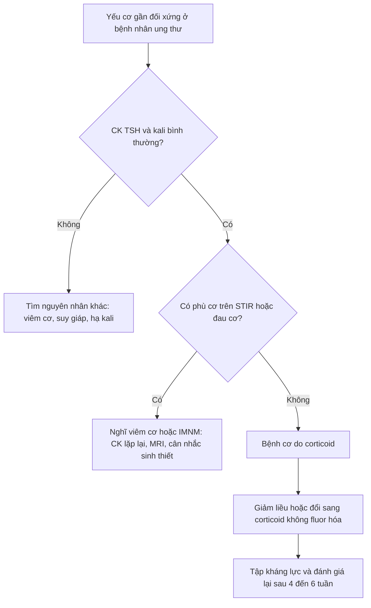
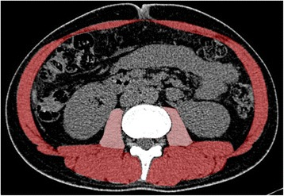
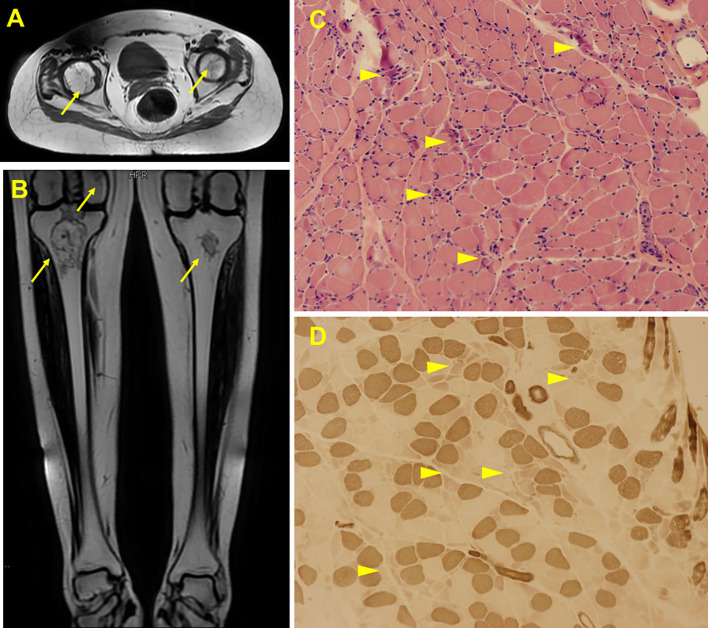

# 1474 — Bệnh cơ do corticoid ở bệnh nhân ung thư: yếu cơ gần, CK bình thường, teo cơ và thay mỡ / Glucocorticoid-induced myopathy in cancer patients

**Tags:** `pattern:teo-co` `pattern:thay-mo-co` `pattern:giam-mat-do-co` `vung:co-chan` `vung:co-xuong` `score:SMI` `score:Martin` `protocol:CT-bung` `protocol:MRI-co` `protocol:SA-co` `incidentaloma:teo-co`

**Mức chắc chắn (certainty):** tổng hợp y văn (literature synthesis) — ghép **hai đoàn hệ ung thư** (15 bệnh nhân dùng corticoid, Batchelor 1997, DOI 10.1212/wnl.48.5.1234; 216 bệnh nhân u não dùng dexamethasone, Dropcho 1991, DOI 10.1212/wnl.41.8.1235), **một đoàn hệ 139 bệnh nhân bệnh bọng nước tự miễn** (He 2025, **PMC11761005**), **một nghiên cứu CT dọc ở L3** (Nawata 2018, **PMC5872524**, CC BY 4.0), **một ca có mô bệnh** (Hu 2022, **PMC9585659**, CC BY 4.0) và **hai nghiên cứu siêu âm cơ nhỏ**. Nhóm **không có bệnh nhân của mình**; các đoàn hệ ung thư **cỡ mẫu nhỏ, hồi cứu/quan sát**, nên tỷ lệ dưới đây phải đọc kèm định nghĩa yếu cơ và mức liều đã dùng.

> **Câu chốt:** Ở bệnh nhân ung thư đang dùng corticoid, **yếu cơ gần đối xứng, không đau, tiến triển vài tuần đến vài tháng, CK bình thường** là bệnh cơ do corticoid (glucocorticoid-induced myopathy, GIM) cho đến khi chứng minh khác. **Ba con số phải thuộc:** **60% (9/15)** bệnh nhân ung thư dùng corticoid bị yếu cơ gần, **8/9 khởi phát trong 15 ngày** (Batchelor 1997); **10,6% (23/216)** bệnh nhân u não dùng dexamethasone, **2/3 trong tuần 9–12** (Dropcho 1991); và trên CT tại **đuôi L3**, diện tích cơ **giảm 25,6%** ở nhóm viêm cơ và **12,6%** ở nhóm chứng sau một đợt corticoid liều cao, kèm **tăng tỷ lệ mật độ cơ thấp** (Nawata 2018). **Hình ảnh chốt:** teo + **thay mỡ** trên T1/CT, **KHÔNG phù** trên STIR, **KHÔNG ngấm thuốc** — khác viêm cơ ở chỗ **CK rất cao + phù cơ**.

> **Phân biệt phạm vi với [1774](../1774-benh-co-corticoid-va-icu/lesson.md):** 1774 bàn **bệnh cơ do corticoid trong ICU**, đặt cạnh **bệnh cơ bệnh nặng (CIM/CIP)** và các thuật toán hồi sức. Bài này bàn **bệnh nhân ung thư ngoại trú** — nơi câu hỏi thực tế là "yếu này do **tiến triển u**, do **suy mòn**, do **ức chế miễn dịch**, hay do **dexamethasone**?" và quyết định là **cắt/đổi corticoid** chứ không phải cai máy.

## 1. Tổng quan bệnh học – cơ chế hình ảnh

### 1.1 Bệnh học: teo sợi typ II, không viêm, không hoại tử

- **GIM là bệnh cơ nhiễm độc–chuyển hóa (toxic-metabolic myopathy), không viêm:** sinh thiết điển hình cho **teo chọn lọc sợi typ II (typ IIb, sợi nhanh–glycolytic)**, **không thâm nhiễm bạch cầu**, **không hoại tử sợi** (Hu 2022, **PMC9585659** — ATPase cho teo sợi typ II; H&E chỉ teo rải rác).
- **Lâm sàng:** yếu **gốc chi, đối xứng, không đau**, khởi phát **âm thầm**; chi dưới trước rồi lên vai; **teo cơ thấy muộn**; phản xạ gân xương **bình thường**, cảm giác **bình thường**, không liệt dây sọ.
- **Vì sao ung thư là bối cảnh đặc biệt:** corticoid dùng **liều cao, kéo dài** để chống phù quanh u não, trong phác đồ đa u tủy/lymphoma, sau CAR-T, và để kiểm soát độc tính miễn dịch — đúng nhóm **đã có sẵn suy mòn, bất động và viêm hệ thống**, nên yếu cơ rất dễ bị quy cho "tiến triển u" hoặc "suy mòn".

### 1.2 TẠI SAO hình ảnh trông như vậy — vật lý và mô bệnh

- **TẠI SAO teo mà không phù:** corticoid gắn thụ thể glucocorticoid trong bào tương cơ → chuyển vào nhân → **tăng phiên mã atrogene (MuRF1, atrogin-1/FBXO32)** qua FoxO, **ức chế mTORC1/IGF-1–Akt**, **giảm vận chuyển acid amin** và **tăng tự thực bào (autophagy)**. Kết quả là **phân giải protein > tổng hợp** → sợi cơ nhỏ lại. Vì **màng sợi cơ không vỡ**, **nước nội bào không tăng** → **STIR/T2 fat-sat KHÔNG sáng**, **không ngấm thuốc** — đây là điểm **loại trừ viêm cơ** mạnh nhất trên MRI.
- **TẠI SAO CK bình thường:** CK thoát ra khi **màng sợi cơ tổn thương/hoại tử** (như trong viêm cơ, bệnh cơ hoại tử miễn dịch, chấn thương). GIM **teo chứ không hoại tử** → CK **bình thường hoặc tăng rất nhẹ**; điện cơ có thể **bình thường** hoặc chỉ **myopathic nhẹ**. Ngoại lệ có thật: ca ICU dùng **methylprednisolon 240 mg/ngày** có **enzym cơ tăng** (BMJ Case Rep 2015, **PMC4458626**) — nên "CK bình thường" là **quy tắc**, không phải điều kiện tuyệt đối.
- **TẠI SAO chọn sợi typ II:** sợi typ II phụ thuộc **glycolysis**, ít mao mạch và ít chịu được stress oxy hóa; **cơ gốc chi** (đùi, mông, vai) có tỷ lệ typ II cao hơn → **yếu gần** là dấu hiệu định khu, không phải "yếu toàn thân".
- **TẠI SAO mỡ thay cơ làm đổi HU và tín hiệu:** cơ 30–60 HU, mỡ **−50 đến −190 HU**. Khi sợi cơ teo và **mỡ len giữa bó cơ (myosteatosis)**, đậm độ trung bình của vùng cơ **tụt xuống**; Nawata đo vùng **−29…+30 HU** là "mật độ cơ thấp" và thấy tỷ lệ này **tăng +7,3%** (viêm cơ) / **+5,4%** (chứng) sau corticoid. Trên MRI, mỡ có **T1 ngắn** → **sáng trên T1**, và **bị bão hòa trên STIR/T2 fat-sat** → **tối**; vì vậy **STIR âm + T1 sáng = thay mỡ mạn**, còn **STIR sáng = phù/viêm đang hoạt động**.
- **TẠI THỜI ĐIỂM NÀO đo được:** siêu âm cho thấy **độ hồi âm cơ tăng trước khi độ dày giảm** — ở 33 bệnh nhân Cushing, nhóm **đang hoạt động** có hồi âm cao hơn nhóm lui bệnh (p < 0,05) **dù độ dày cơ và khối cơ BIA tương đương** (Minetto 2019, DOI 10.1007/s40618-018-0979-9). Nói cách khác, **chất lượng cơ đổi trước khối lượng**; đừng chờ "teo thấy được bằng mắt".

### 1.3 Số liệu nền (bắt buộc thuộc)

| Đại lượng | Con số | Nguồn |
|---|---|---|
| **Bệnh nhân ung thư dùng corticoid (n = 15, tiến cứu)** | **60% (9/15)** yếu cơ gần; **6** nặng ảnh hưởng sinh hoạt; **8/9 trong 15 ngày**; liên quan **liều tích lũy** | Batchelor 1997 |
| Hô hấp trong cùng đoàn hệ | **8/9 có yếu cơ** giảm chức năng hô hấp vs **2/6 không yếu**; **4 ca khó thở có triệu chứng** | Batchelor 1997 |
| **U não nguyên phát dùng dexamethasone ≥ 2 tuần (n = 216)** | **10,6% (23/216)** bệnh cơ; **2/3 trong tuần 9–12**; **phenytoin làm giảm nguy cơ** | Dropcho 1991 |
| **Bệnh bọng nước tự miễn (n = 139)** | **47,5%** có yếu cơ; khởi phát **trung vị 97,5 ngày (28–1005)**; hồi phục **trung vị 107,5 ngày (45–189)** | PMC11761005 |
| **Ngưỡng liều tích lũy (đoàn hệ trên)** | **> 0,75 mg/kg/ngày tăng ~3 lần** so với **0,5–0,75 mg/kg/ngày**; prednison **> 40 mg/ngày: 64%** yếu cơ gấp háng (trích Bowyer) | PMC11761005 |
| **Yếu tố nguy cơ (đa biến)** | Tuổi **50–65: OR 2,39** (1,45–3,91); **nam: OR 2,03** (1,27–3,24); **BMI > 30: OR 2,64** (1,38–5,07) | PMC11761005 |
| **CT tại đuôi L3 sau corticoid liều cao** | Diện tích cơ **−25,6 ± 14,4%** (viêm cơ) và **−12,6 ± 14,6%** (chứng); mật độ cơ thấp **+7,3 ± 8,5%** và **+5,4 ± 6,6%**; nhóm **viêm cơ có ung thư: −38,1 ± 9,8%** | PMC5872524 |
| **Ca mô bệnh điển hình** | Methylprednisolon **tích lũy ~20 g** trong 2,5 năm; **MRC 4** chi dưới gần; **teo sợi typ II, không viêm**; kèm **hoại tử xương hai bên** | PMC9585659 |

## 2. Mẫu hình + chẩn đoán phân biệt theo vị trí (Gamut)

**Mẫu hình:** *yếu cơ gần, đối xứng, không đau* **+** *teo cơ và thay mỡ trên CT/MRI* **+** *CK bình thường* **+** *tiền sử corticoid liều cao/kéo dài*.

- **Theo vị trí:** cơ **đùi trước và cơ mông** (dấu hiệu sớm, ảnh hưởng đứng lên/ngồi xuống), **cơ vai–cánh tay** (giơ tay lên đầu), **cơ dựng sống** (khó đứng thẳng, đau lưng cơ học), **cơ hoành và cơ liên sườn** (khó thở khi gắng sức, giảm chức năng hô hấp — Batchelor).
- **Theo thời gian:** **cấp < 1 tháng** (liều cao, đặc biệt dexamethasone — yếu có thể trong **15 ngày**); **bán cấp 1–3 tháng** (teo bắt đầu thấy); **mạn > 3 tháng** (thay mỡ rõ, hồi phục chậm **hàng tháng**).
- **Theo cơ chế phối hợp ở bệnh nhân ung thư:** GIM **± suy mòn do ung thư** **± bất động** **± bệnh cơ do thuốc khác (statin, taxane)** **± viêm cơ do ức chế điểm kiểm soát miễn dịch** **± suy giáp do xạ/ức chế miễn dịch** **± hạ kali do thuốc**.
- **Gợi nhớ "STEROID":** **S**tatin, **T**hyroid (suy giáp), **E**lectrolyte (hạ K, Mg, phospho), **R**heumatologic/viêm cơ, **O**ncology (suy mòn, tiến triển u), **I**CU (CIM/CIP), **D**examethasone/glucocorticoid (GIM).

## 3. Bảng so sánh phân biệt (ma trận đối chiếu)

| Thực thể (entity) | Hình ảnh điển hình (US/CT/MRI) | Chốt vào (rule-in) | Chốt loại (rule-out) | Gợi ý xác nhận |
|---|---|---|---|---|
| **Bệnh cơ do corticoid (GIM)** | Teo + **thay mỡ** cơ gần trên T1/CT; **STIR âm**, không ngấm thuốc; diện tích cơ L3 giảm, HU giảm | **Yếu gần đối xứng, không đau + CK bình thường + STIR âm + tiền sử corticoid liều cao/kéo dài** | **Phù cơ trên STIR + CK > 10× ULN + đau** → không phải GIM đơn thuần | Giảm/đổi corticoid → cải thiện trong **4–12 tuần**; sinh thiết chỉ khi chẩn đoán còn mơ hồ |
| **Viêm cơ/da cơ và bệnh cơ hoại tử miễn dịch (IMNM)** | **STIR/T2 tăng, phù cơ, ngấm thuốc**, phù quanh cân; teo muộn | **CK rất cao (> 1.000 U/L) + đau + yếu tiến triển vài tuần + phù cơ** | **CK bình thường + STIR âm + không đau** → ít khả năng viêm cơ | Tự kháng thể, điện cơ, sinh thiết; xem [1685](../1685-benh-co-do-statin-imnm/lesson.md) |
| **Bệnh cơ bệnh nặng (CIM/CIP)** | **Phù cơ lan tỏa, đối xứng** giai đoạn cấp; sau đó teo; **không thay mỡ sớm** | **Bối cảnh ICU/nhiễm khuẩn huyết + thở máy + yếu đối xứng + CMAP giảm, SNAP bình thường** | **Ngoại trú, không bệnh nặng, không thở máy** → ít khả năng | Điện cơ; xem [1774](../1774-benh-co-corticoid-va-icu/lesson.md) |
| **Suy mòn do ung thư (cancer cachexia)** | **Mất cơ toàn thân + mất mỡ**, SMI thấp; **không chọn lọc gốc chi**; không thay mỡ khu trú | **Sụt cân tiến triển + viêm hệ thống (CRP/albumin) + SMI thấp** | **Yếu gần chọn lọc + corticoid liều cao + STIR âm** → nghĩ GIM hơn | CT L3 lặp lại; xem [1468](../1468-suy-mon-sarcopenia-ct-ung-thu/lesson.md) |
| **Bệnh cơ do statin / IMNM do statin** | CK tăng; MRI có thể phù cơ; teo muộn | **Khởi phát sau khởi trị/tăng liều statin; CK tăng; cải thiện khi ngừng** | **Không dùng statin; CK bình thường** | Ngừng thuốc thử; kháng thể anti-HMGCR nếu nghi |
| **Bệnh cơ do suy giáp** | CK tăng nhẹ–vừa; **không thay mỡ chọn lọc**; phù niêm; chậm thư giãn | **TSH cao + FT4 thấp + chậm thư giãn + đau cơ** | **TSH/FT4 bình thường** | Điều trị levothyroxine → hồi phục |
| **Bệnh cơ do hạ kali/magiê/phospho** | Không teo mỡ; có thể phù cơ nhẹ | **K < 3,0 mmol/L (hoặc Mg/phospho thấp) + yếu cấp + bù điện giải → hồi phục nhanh** | **Điện giải bình thường** | Xét nghiệm điện giải trước/sau bù |
| **Hoại tử xương do corticoid (đau, khập khiễng)** | **Dải tối T1 dưới sụn + đường đôi T2**, phù tủy; **không phải yếu cơ** | **Đau khớp háng/gối + MRI có AVN** | **Yếu không đau, không đau khớp** | MRI khớp; xem [6105](../6105-hoai-tu-xuong-o-tre-dieu-tri-ALL/lesson.md) |
| **Bất động/suy dinh dưỡng đơn thuần** | Teo toàn thể, không chọn lọc; mỡ cơ thể giảm | **Bất động kéo dài + ăn uống kém + phục hồi chức năng** | **Corticoid liều cao + yếu gần chọn lọc** → thêm GIM | Đánh giá dinh dưỡng, phục hồi chức năng |

**Ba dấu hiệu hình ảnh cốt lõi:** (1) **teo cơ gần đối xứng** trên CT/MRI; (2) **thay mỡ** (T1 sáng, HU thấp); (3) **KHÔNG phù, KHÔNG ngấm thuốc**. Chỉ cần (3) dương tính là **đã đủ để quay lại tìm nguyên nhân khác** thay vì tăng corticoid.

## 4. Protocol chụp + thuật toán

### 4.1 Tận dụng CT đã có (không chụp thêm)

- **CT bụng/tổng quát có sẵn** ở bệnh nhân ung thư: đo tại **đuôi L3**, thì **tĩnh mạch cửa**, cùng độ dày lát cắt và cùng mức giải phẫu với lần trước. Ngưỡng phân đoạn: **cơ −29…+150 HU**; **mật độ cơ thấp −29…+30 HU** (PMC5872524).
- **Báo cáo 3 con số:** **diện tích cơ (cm²)**, **SMI (cm²/m²)** và **tỷ lệ mật độ cơ thấp (%)**; so với lần chụp trước và ghi rõ **khoảng thời gian**. Ngưỡng SMI tham chiếu (Martin) ở [1468](../1468-suy-mon-sarcopenia-ct-ung-thu/lesson.md): **nữ < 41**; **nam BMI < 25: < 43**; **nam BMI ≥ 25: < 53 cm²/m²**.
- **Chưa có ngưỡng "giảm bao nhiêu % là bệnh cơ do corticoid"** — dùng **thay đổi tuyệt đối + bối cảnh liều** thay vì một cut-off duy nhất; ghi rõ đây là **chỉ dấu hỗ trợ**, không phải tiêu chuẩn chẩn đoán.

### 4.2 MRI cơ khi cần chốt chẩn đoán

- **Chỉ định:** yếu tiến triển nhanh, **đau cơ**, **CK tăng**, nghi viêm cơ/IMNM, hoặc cần phân biệt với tiến triển u chèn ép.
- **Chuỗi xung tối thiểu:** **T1 TSE** (đánh giá thay mỡ) + **STIR hoặc T2 fat-sat** (đánh giá phù) ± **Dixon/chemical shift** (định lượng mỡ) ± **T1 sau tiêm** nếu nghi viêm. Mặt cắt **ngang**, độ dày **5 mm**, phủ **giữa đùi** và **cơ mông**; so **hai bên**.
- **Đọc:** thay mỡ **đối xứng, gốc chi, không phù** → GIM/di chứng; **phù + ngấm thuốc + không đối xứng** → viêm cơ/IMNM. **STIR âm không loại trừ bệnh cơ** (chỉ loại trừ đợt viêm đang hoạt động).

### 4.3 Siêu âm cơ để theo dõi (không bức xạ)

- Đầu dò **linear 5–12 MHz**, bệnh nhân nằm ngửa, gối duỗi, **cùng một mốc** (giữa cơ thẳng đùi), đo **3 lần** rồi lấy trung bình: **độ dày (mm)**, **độ hồi âm (grayscale 0–255)** và **góc chéo cơ (pennation angle)**.
- **Độ hồi âm tăng là dấu hiệu sớm** (Minetto 2019; Wu 2024); ghi **cùng mốc, cùng góc đầu dò, cùng áp lực** — nếu không, sai số lớn hơn thay đổi bệnh lý.

### 4.4 Thuật toán quyết định

- **Xét nghiệm tối thiểu trước khi kết luận:** **CK, TSH/FT4, kali, magiê, phospho, glucose/HbA1c**; khi chuẩn bị giảm liều corticoid kéo dài → **cortisol sáng** (xem [1463](../1463-suy-thuong-than-do-corticoid/lesson.md)).
- **Điều trị:** **giảm liều tới mức thấp nhất kiểm soát được bệnh nền**, **đổi dexamethasone (fluor hóa) sang prednison/prednisolon** khi lâm sàng cho phép, **tập kháng lực 2–3 lần/tuần** + dinh dưỡng đủ đạm; **không có thuốc nào được chứng minh đảo ngược GIM ở người** trong tổng quan 2025 (DOI 10.1007/s00415-025-13482-6).

## 5. Biến thể bình thường và cạm bẫy

- **CK bình thường không loại trừ, CK tăng không chứng minh viêm cơ:** GIM thường CK bình thường, nhưng ca liều rất cao ở ICU có thể tăng enzym cơ (**PMC4458626**). Ngược lại, **viêm cơ do ức chế miễn dịch** có thể xuất hiện **trong lúc đang dùng corticoid** — nếu CK cao + phù cơ + đau, đừng tăng corticoid mù.
- **Cân nặng/BMI bình thường che mất mất cơ:** béo phì làm **tăng nguy cơ GIM (OR 2,64)** và đồng thời **che teo cơ**; phù/nước giữ do corticoid cũng làm cân nặng không đổi. **Đo cơ, đừng cân.**
- **Yếu ở bệnh nhân u não: tuần 9–12 là cửa sổ của GIM** (2/3 ca trong 216 bệnh nhân — Dropcho 1991), nhưng **vẫn phải loại trừ tiến triển u/chèn ép** bằng hình ảnh thần kinh trước khi quy cho thuốc.
- **Yếu cơ hô hấp có thể xuất hiện khi chi vẫn khỏe:** 8/9 ca có yếu cơ chi giảm chức năng hô hấp, 4 ca khó thở (Batchelor) — đừng chỉ khám tay chân.
- **Sau khi giảm liều, yếu có thể nặng lên vì suy thượng thận** (không phải vì bệnh cơ tiến triển) — phân biệt bằng huyết áp, natri, cortisol (xem [1463](../1463-suy-thuong-than-do-corticoid/lesson.md)).
- **Corticoid hít không giải thích yếu chi:** tổng quan hệ thống ở người hen **không thấy khác biệt** lực cơ hô hấp với người khỏe; chỉ **11–36%** người dùng corticoid tĩnh mạch đợt cấp có yếu cơ chi trong/sau ICU (DOI 10.1080/02770903.2021.1926488) — đừng đổ lỗi cho thuốc hít.
- **Thuốc tương tác làm lệch liều thực:** **phenytoin** cảm ứng enzym → giảm nồng độ dexamethasone và **giảm nguy cơ bệnh cơ** trong đoàn hệ u não; đây là **yếu tố gây nhiễu**, không phải "phòng bệnh cơ".
- **Cạm bẫy mặt cắt:** đo khác **thì cản quang**, khác **độ dày lát cắt** hoặc khác **mức L3/L4** sẽ tạo "teo giả"; L3, L4 và psoas index **không hoán đổi cho nhau**.
- **Hoại tử xương đi kèm:** đau khớp háng/gối + khập khiễng ở người dùng corticoid là **AVN**, không phải yếu cơ — MRI khớp (ca 2 dưới đây là ví dụ).

## 6. Tự lượng giá — Blind Quiz

**Ca 1 — Nữ 58 tuổi, ung thư vú di căn não, dexamethasone 16 mg/ngày được 10 tuần, yếu hai đùi khi đứng lên, không đau, CK 82 U/L.**

> Bệnh cảnh **minh họa** (không phải bệnh nhân trong bài gốc); ảnh CT lấy từ nghiên cứu Nawata 2018.

- Gợi ý lâm sàng: yếu **gần**, **không đau**, **CK bình thường**, đang dùng corticoid liều cao kéo dài.
- Câu hỏi: Mặt nạ đỏ đang đo cái gì? Nếu so với CT 4 tháng trước thấy diện tích cơ **giảm 18%** và **tỷ lệ mật độ cơ thấp tăng**, bạn nghĩ gì? Ba chẩn đoán phân biệt và bước tiếp theo?

<b>Bấm để hiện đáp án (findings + chẩn đoán)</b>

- Dấu hiệu (findings): mặt cắt tại **đuôi L3**; vùng đỏ = cơ thắt lưng, cơ cạnh sống, cơ thành bụng được phân đoạn trong ngưỡng **−29…+150 HU**; phần **mỡ trong cơ** nằm ngoài ngưỡng cơ và làm **mật độ cơ trung bình giảm**.
- Chẩn đoán (diagnosis): **bệnh cơ do corticoid** (GIM) là khả năng hàng đầu — yếu gần đối xứng, không đau, CK bình thường, teo + thay mỡ trên CT, bối cảnh dexamethasone **16 mg/ngày trong 10 tuần** (đúng cửa sổ tuần 9–12 của đoàn hệ u não).
- Phân biệt: **tiến triển u/chèn ép** (cần MRI não nếu có dấu hiệu thần kinh mới), **suy mòn do ung thư** (mất cơ toàn thân, sụt cân, CRP cao), **viêm cơ do ức chế miễn dịch** (CK rất cao, phù cơ, đau).
- Bước tiếp: kiểm tra CK/TSH/kali, giảm dexamethasone tới liều thấp nhất kiểm soát phù não hoặc đổi sang prednison, tập kháng lực, **đo lại CT L3/MRI cơ sau 3 tháng**; không tăng corticoid vì "yếu hơn".
- Nguồn ảnh: Nawata T và cs. 2018, *BMC Musculoskelet Disord* 19:93, **PMC5872524**, Fig. 1, **CC BY 4.0**.

**Ca 2 — Nữ 22 tuổi, pemphigus vulgaris, methylprednisolon tích lũy ~20 g trong 2,5 năm, yếu cơ gần chi dưới MRC 4, đau khớp háng hai bên.**

- Gợi ý lâm sàng: dùng corticoid rất lâu, **vừa yếu cơ vừa đau khớp**, enzym cơ chỉ tăng nhẹ.
- Câu hỏi: Hai tổn thương nào cùng tồn tại trên hình? Vì sao CK không tăng cao? Điều gì trên mô bệnh xác nhận nguyên nhân do thuốc?

<b>Bấm để hiện đáp án (findings + chẩn đoán)</b>

- Dấu hiệu (findings): (A, B) **MRI có ổ hoại tử xương** ở chỏm đùi, đầu dưới xương đùi và đầu trên xương chày hai bên (mũi tên) — nguyên nhân **đau khớp**; (C) H&E **teo sợi cơ rải rác**, **không thâm nhiễm bạch cầu**; (D) ATPase **teo chọn lọc sợi typ II** — nguyên nhân **yếu cơ**.
- Chẩn đoán (diagnosis): **bệnh cơ do corticoid + hoại tử xương do corticoid** trên cùng một bệnh nhân; hai biến chứng **không loại trừ nhau** và phải xử lý song song.
- Vì sao CK không cao: GIM **teo sợi cơ, không hoại tử màng sợi** → CK thoát ít; khác viêm cơ/IMNM nơi CK tăng hàng nghìn.
- Xử trí: giảm liều corticoid từng bước, phục hồi chức năng, theo dõi khớp háng; **không dùng corticoid liều cao kéo dài khi không còn chỉ định**.
- Nguồn ảnh: Hu Y, Lu C, Lin H. 2022, *Front Endocrinol* 13:1016687, **PMC9585659**, Fig. 2, **CC BY 4.0**.

## 7. Câu hỏi nghiên cứu & điểm chưa đồng thuận (tính đến 11/2026)

1. **[Tranh cãi] Ở bệnh nhân ung thư dùng corticoid, đo định lượng cơ (CT L3 hoặc siêu âm) có phát hiện bệnh cơ sớm hơn và làm thay đổi quyết định giảm liều so với chỉ đánh giá lực cơ?**
   - **Đã biết:** độ hồi âm siêu âm tăng ở nhóm Cushing đang hoạt động **dù độ dày cơ tương đương**; CT L3 giảm **25,6%** diện tích cơ sau corticoid liều cao.
   - **Chưa rõ:** **ngưỡng thay đổi** nào là "bệnh lý", và liệu can thiệp theo ngưỡng đó có cải thiện chức năng.
   - **Hướng nghiên cứu:** đoàn hệ tiến cứu có ngưỡng định trước, so với lực cơ và biến cố (té ngã, nhiễm trùng, tử vong).
   - **Nguồn:** PMC5872524 (2018); DOI 10.1007/s40618-018-0979-9 (2019).

2. **[Khoảng trống] Chưa có định nghĩa vận hành và hướng dẫn riêng cho bệnh cơ do corticoid, nên chẩn đoán chủ yếu bằng loại trừ.**
   - **Đã biết:** tổng quan 2018 nêu rõ **chưa có guideline** và đề xuất đo phối hợp khối lượng + lực + chức năng; tổng quan 2025 vẫn ghi **thiếu biomarker nhạy**.
   - **Chưa rõ:** tiêu chuẩn nào (CK, điện cơ, MRI, siêu âm) đủ để chẩn đoán xác định mà không cần sinh thiết.
   - **Hướng nghiên cứu:** đồng thuận Delphi + nghiên cứu độ chính xác chẩn đoán ở nhiều trung tâm.
   - **Nguồn:** DOI 10.1007/s12020-017-1472-5 (2018); DOI 10.1007/s00415-025-13482-6 (2025).

3. **[Khác biệt thực hành] Ở u não, khi xuất hiện yếu cơ trong lúc dùng dexamethasone, nên giảm liều/đổi sang corticoid không fluor hóa ngay hay tiếp tục liều kiểm soát phù não?**
   - **Đã biết:** bệnh cơ xuất hiện **10,6%** và tập trung **tuần 9–12**; tác giả đề nghị **đổi sang corticoid không fluor hóa** nếu không cai được; yếu cơ **có thể hồi phục** sau giảm/ngừng thuốc.
   - **Chưa rõ:** đánh đổi giữa **kiểm soát phù não** và **hồi phục cơ** chưa được thử nghiệm; chưa có ngưỡng liều "an toàn" cho từng bệnh nhân.
   - **Hướng nghiên cứu:** registry u não ghi liều tích lũy + lực cơ + hình ảnh, tiến tới thử nghiệm chiến lược giảm liều.
   - **Nguồn:** DOI 10.1212/wnl.41.8.1235 (1991); DOI 10.1212/wnl.48.5.1234 (1997).

## Bài liên quan chéo
- [300 – Tổng quan hệ Cơ – Xương – Khớp](../300-tong-quan-he-co-xuong-khop/lesson.md)
- [1774 – Bệnh cơ do corticoid & bệnh cơ bệnh nặng ở ICU](../1774-benh-co-corticoid-va-icu/lesson.md)
- [1685 – Bệnh cơ do statin & IMNM](../1685-benh-co-do-statin-imnm/lesson.md)
- [1468 – Suy mòn & sarcopenia trên CT ở bệnh nhân ung thư](../1468-suy-mon-sarcopenia-ct-ung-thu/lesson.md)
- [1463 – Suy thượng thận do corticoid kéo dài](../1463-suy-thuong-than-do-corticoid/lesson.md)
- [6105 – Hoại tử xương ở trẻ điều trị ALL](../6105-hoai-tu-xuong-o-tre-dieu-tri-ALL/lesson.md)

## Ảnh
- `1474_benh-co-corticoid_CT-PMC5872524-Fig1.jpg` — Fig. 1, **PMC5872524**, CC BY 4.0 (CT L3 + mặt nạ cơ).
- `1474_benh-co-corticoid_MRI-PMC9585659-Fig2.jpg` — Fig. 2, **PMC9585659**, CC BY 4.0 (MRI hoại tử xương + mô bệnh cơ).
- Nguồn + giấy phép từng ảnh: `images/CREDITS.md`.

> Không dùng để chẩn đoán độc lập khi chưa có người hướng dẫn.
