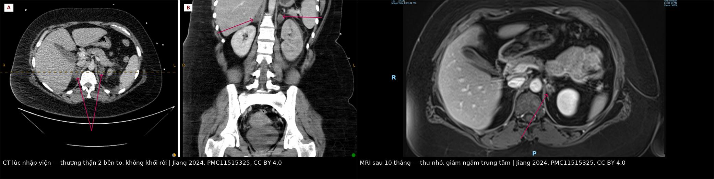
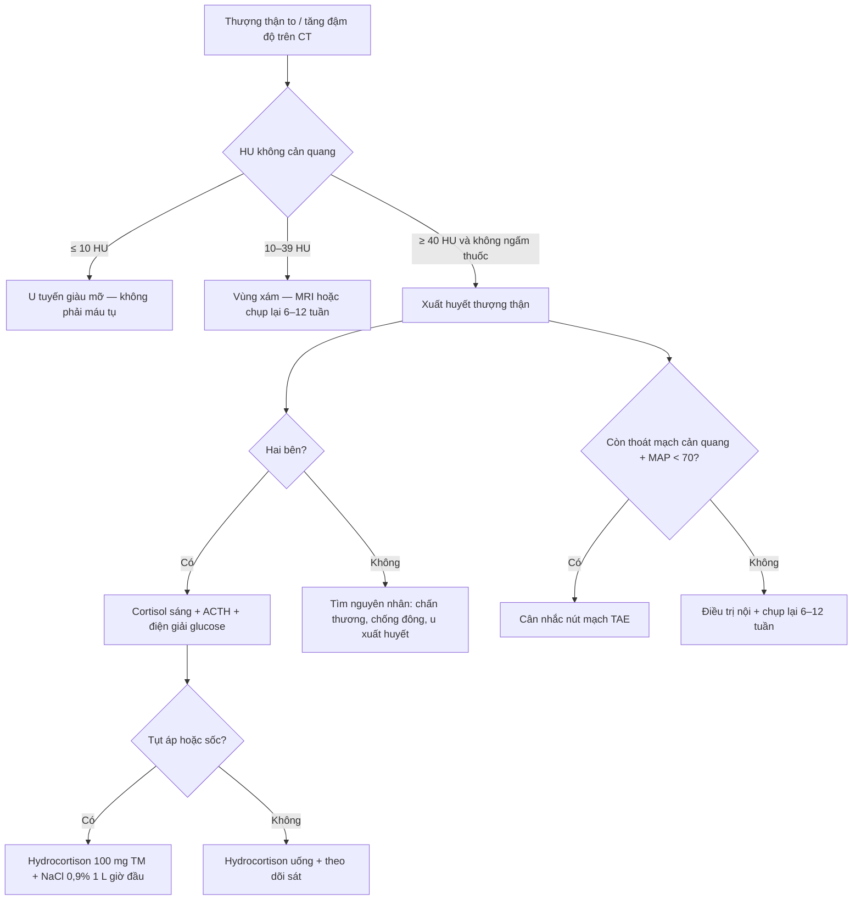
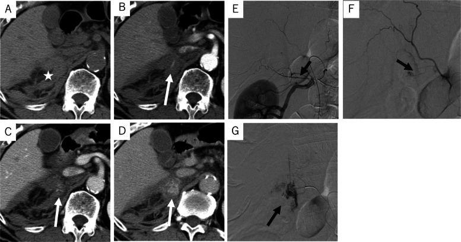
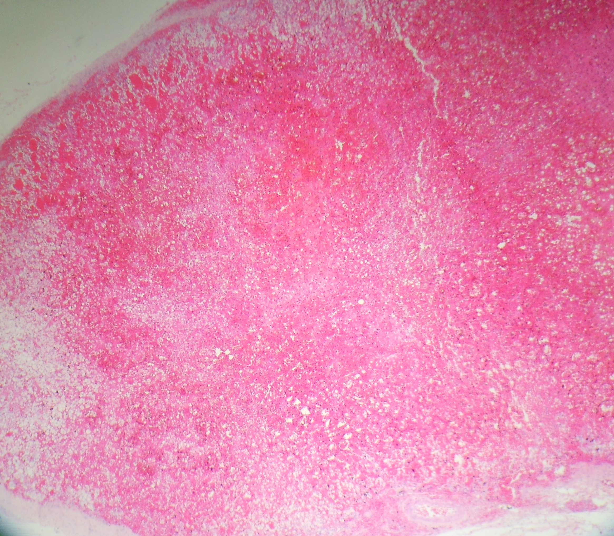

# 1475 — Xuất huyết thượng thận hai bên (bilateral adrenal hemorrhage): "đập thủy lợi" mạch máu, ngưỡng 40 HU và cơn suy thượng thận cấp / Waterhouse–Friderichsen syndrome

**Tags:** `pattern:khoi-thuong-than` `pattern:xuat-huyet` `pattern:khong-ngam-thuoc` `pattern:to-thuong-than` `vung:thuong-than` `vung:hau-phuc-mac` `anatomy:thuong-than` `protocol:CT-ba-thi` `protocol:MRI-thuong-than` `incidentaloma:thuong-than`

**Mức chắc chắn (certainty):** tổng hợp y văn (literature synthesis) — số liệu ghép từ **tổng quan 34 bài về xuất huyết thượng thận hai bên (BAH) trong SLE/APS** (Cureus 2025, PMC12779288, CC BY 4.0), **loạt 1.373 ca đa chấn thương chụp CT dựng lại** (Endocrine 2025, PMC12464106, CC BY 4.0), **loạt 6 ca xuất huyết thượng thận tự phát có định lượng HU** (Radiol Bras 2019, PMC6383530, CC BY-NC-ND 4.0), **loạt 8 ca can thiệp nút mạch do chấn thương** (CVIR Endovasc 2026, PMC13469033, CC BY 4.0), **ca BAH sau sinh có CT + MRI theo dõi** (J Med Case Rep 2024, PMC11515325, CC BY 4.0) và **ca BAH do COVID-19 có test Synacthen bình thường** (BMJ Case Rep 2020, PMC7705581). Nhóm **không có bệnh nhân của mình**.

> **Câu hỏi thực hành:** nam **78 tuổi**, ngã đập bụng, tụt áp; CT bụng có **khối thượng thận phải to, đậm độ cao, không ngấm thuốc**, còn **ổ ngấm thuốc nhỏ hơn trên thì muộn**. Hoặc nữ **27 tuổi**, **17 ngày sau sinh**, sốt – đau hông lưng – tụt áp, CT thấy **hai thượng thận to nhưng không có khối rời**. Câu hỏi: **máu tụ hay u? có phải suy thượng thận? truyền corticoid trước hay chờ xét nghiệm?**
> Bài chốt **bốn con số**: **(1)** máu tụ cấp trên CT không cản quang **≥ 40 HU** và **không ngấm thuốc**; u tuyến **≤ 10 HU**; **(2)** trong **1.373 ca đa chấn thương**, máu tụ thượng thận gặp **5,0%**, **10% hai bên**, **77% bên phải** — và **42% máu tụ một bên không được báo cáo**; **(3)** tổn thương thượng thận do chấn thương có tử vong **10–33%**, nhưng **thoát mạch đơn thuần chưa đủ chỉ định can thiệp** — cần thêm **MAP < 70 mmHg**; **(4)** cơn suy thượng thận: **hydrocortison 100 mg tĩnh mạch** rồi **50–100 mg mỗi 6–8 giờ**, **NaCl 0,9% 1 L trong giờ đầu** — **không chờ kết quả cortisol**.

## 1. Tổng quan bệnh học – cơ chế hình ảnh

### 1.1 Vì sao thượng thận là nơi dễ "nhồi máu chảy máu": hiệu ứng đập thủy lợi (vascular dam)

- **Cấu trúc mạch máu bất đối xứng:** tuyến chỉ **4–6 g** nhưng nhận **ba nguồn động mạch** — **động mạch thượng thận trên** (từ động mạch hoành dưới), **giữa** (trực tiếp từ động mạch chủ), **dưới** (từ động mạch thận) — mỗi nguồn chia **50–60 nhánh** đổ vào vỏ tuyến xốp. Trong khi đó **chỉ có MỘT tĩnh mạch trung tâm** thoát máu: bên phải đổ **trực tiếp vào tĩnh mạch chủ dưới** bằng một đoạn rất ngắn, bên trái đổ vào **tĩnh mạch thận trái**.
- **TẠI SAO hệ thống này dễ vỡ:** lưu lượng vào lớn, lưu lượng ra qua một ống nhỏ → khoang giữa mao mạch và tĩnh mạch là "đập thủy lợi". Khi **áp lực tĩnh mạch chủ dưới tăng** (thở máy áp lực cao, suy tim phải, chèn ép), khi **tĩnh mạch thận bị huyết khối**, hoặc khi **vi huyết khối trong DIC** bịt mao mạch, máu ứ lại trong tủy → **nhồi máu xuất huyết** (hemorrhagic infarction), không phải "vỡ mạch đơn thuần".
- **TẠI SAO bên phải nhiều hơn:** thượng thận phải **kẹp giữa gan và cột sống**, tĩnh mạch ngắn đổ thẳng vào tĩnh mạch chủ dưới → chịu **tăng áp tĩnh mạch đột ngột** và lực **cắt (shear)** khi giảm tốc rõ hơn bên trái. Loạt đa chấn thương: **77% máu tụ một bên ở bên phải** (PMC12464106); loạt xuất huyết tự phát: **4/6 ca** (PMC6383530).
- **TẠI SAO hai bên mới gây suy thượng thận:** vỏ thượng thận có **dự trữ chức năng rất lớn** — cắt một bên hoặc xuất huyết một bên **hầu như không gây suy**; phải phá hủy **phần lớn cả hai vỏ** mới làm cortisol tụt. Đây là lý do **hình ảnh một bên không được phép kết luận suy thượng thận**, còn **hai bên + sốc** thì phải điều trị ngay.

### 1.2 Vì sao cục máu tụ "tăng đậm độ mà không ngấm thuốc" — vật lý của HU

- **Máu tụ cấp** là **hồng cầu co cục + huyết thanh bị ép ra**: nồng độ hemoglobin và protein cao → **hấp thụ tia X nhiều hơn mô mềm** → **40–90 HU** trên CT không cản quang, so với **cơ ~40–50 HU**, **gan ~55–65 HU**. Định nghĩa dùng trong loạt 6 ca: **xuất huyết = tổn thương đặc có mật độ trước tiêm ≥ 40 HU HOẶC không ngấm thuốc ở các thì sau tiêm**; các ca thực tế đo **65 HU, 45 HU, 53 HU** (PMC6383530).
- **TẠI SAO không ngấm thuốc:** cục máu đông **không có mao mạch** — thuốc cản quang không có đường vào. **Ngấm thuốc là bằng chứng của mô sống**, kể cả mô u; một khối **tăng đậm độ trước tiêm + đứng yên sau tiêm** là máu, không phải u.
- **TẠI SAO vẫn có "viền ngấm thuốc":** lớp **vỏ tuyến còn sống bị ép ra ngoài** tạo viền mỏng ngấm thuốc; viền này **không phải bao u** — nhầm nó thành "vỏ u" là bẫy thường gặp.
- **TẠI SAO thoát mạch cản quang là dấu nặng:** khi máu còn chảy, thuốc cản quang **tụ dần và lan rộng trên thì muộn** (pooling) trong ổ máu tụ — khác **giả phình** (giữ nguyên hình, đậm bằng động mạch) và khác **mô u** (ngấm rồi thải). Đây là dấu để chọn **nút mạch** ở bệnh nhân chấn thương (PMC13469033).
- **MRI — vì sao T1 sáng:** hemoglobin thoái hóa thành **methemoglobin** ở giai đoạn bán cấp, chất này **rút ngắn T1** → **T1 sáng**; T2 thay đổi theo giai đoạn (deoxyhemoglobin T2 tối, methemoglobin ngoại bào T2 sáng, hemosiderin T1/T2 tối). Vì vậy **MRI nhạy hơn CT trong phát hiện xuất huyết sớm** — ca có CT "không thấy khối" nhưng MRI thấy hai tuyến to do xuất huyết (PMC4417992), và ca sau sinh có **MRI xác nhận giảm ngấm trung tâm do xuất huyết** (PMC11515325).

### 1.3 Con số dịch tễ và tiên lượng (ngưỡng định lượng)

- **Chấn thương:** tổn thương thượng thận **0,5–4%** ca chấn thương kín nhập viện, nhưng **tới 26%** ca tử vong do chấn thương ngực–bụng nặng khi mổ tử thi — tức phần lớn **bị bỏ sót khi còn sống**; tử vong chung của nhóm này **10–33%** (PMC13469033).
- **Đoàn hệ CT đa chấn thương 1.373 ca:** **máu tụ thượng thận 5,0%** (68/1.373; **10% hai bên**, **77% bên phải**); **tổn thương dạng u 2,7%** (37/1.373; **22% hai bên**); **chỉ 27% tổn thương dạng u được ghi trong báo cáo**, và **42% máu tụ một bên không được nhắc**; theo dõi trung bình **75 tháng** không ca nào phải mổ, **6%** được xét hormone (đều bình thường) (PMC12464106).
- **Bệnh tự miễn:** trong **hội chứng kháng phospholipid (APS)**, **0,4%** bệnh nhân phát triển suy thượng thận nguyên phát trong theo dõi; trong **APS thể bão táp (catastrophic APS)**, tỷ lệ này tăng lên **10–26%** (PMC12779288).
- **Waterhouse–Friderichsen (WFS):** sốc nhiễm khuẩn + DIC + **xuất huyết thượng thận hai bên**; tác nhân không chỉ **não mô cầu** mà còn **phế cầu**, **Capnocytophaga canimorsus** (vết cắn chó), liên cầu — **nguy cơ cao ở người cắt lách**; thể bệnh thường **tối cấp, tử vong cao** (PMC9947879; PMC39787974).
- **Suy thượng thận sau BAH có thể là VĨNH VIỄN:** ca theo dõi **10 tháng** thấy **máu tụ tiêu hết trên CT nhưng chức năng thượng thận vẫn suy** (PMC7294864); tổng quan APS/SLE kết luận **phần lớn người sống sót BAH phải thay thế hormone suốt đời** (PMC12779288). Ngược lại, **không phải mọi BAH đều suy** — ca COVID-19 có **test Synacthen bình thường** (PMC7705581).

## 2. Mẫu hình + chẩn đoán phân biệt theo vị trí (gamut)

Mẫu hình cần nhận: **tuyến thượng thận to, giữ hình "thượng thận" (adreniform), đậm độ cao đồng nhất hoặc hỗn hợp, không ngấm thuốc, ± chuỗi mỡ quanh tuyến (periadrenal stranding), ± máu tụ sau phúc mạc**.

- **Hai bên, adreniform, ≥ 40 HU, không ngấm — gamut hẹp:** **(a) nhiễm khuẩn huyết/DIC (WFS)**; **(b) chống đông** — heparin (kể cả **HIT**), warfarin, DOAC; **(c) APS/SLE do huyết khối tĩnh mạch thượng thận**; **(d) sau sinh, sau mổ lớn, bỏng, viêm tụy**; **(e) chấn thương (10% hai bên)**; **(f) nhiễm nặng khác — cúm, COVID-19**; **(g) huyết khối tĩnh mạch thận lan lên** (ca sau sinh có kèm huyết khối tĩnh mạch thận trái).
- **Một bên — ưu tiên chấn thương và chảy máu vào u:** chấn thương (phải nhiều hơn), chống đông, **u tủy thượng thận xuất huyết (pheochromocytoma)**, di căn xuất huyết, adenoma/u cơ mỡ mạch xuất huyết.
- **Hai bên nhưng NGẤM thuốc — nghĩ u hệ thống:** **di căn hai bên** (phổi, vú, melanoma), **lymphoma** (to, giữ hình, ngấm đồng nhất, PET dương), **pheo hai bên** (ngấm mạnh, metanephrine tăng), **lao thượng thận** (giai đoạn muộn **vôi hóa + teo**), **amyloidosis** (vôi hóa, thượng thận nhỏ).
- **Không ngấm nhưng KHÔNG tăng đậm độ — nghĩ nhồi máu:** **nhồi máu thượng thận** (APS, sau sốc, sau can thiệp) có mật độ **< 40 HU** và không ngấm; phân biệt với xuất huyết bằng **HU trước tiêm + MRI T1**.
- **Theo bối cảnh:** **sốc + ban xuất huyết + DIC → WFS**; **đau hông lưng + tụt áp + đang chống đông → BAH do thuốc**; **đau bụng sau sinh/sau mổ → BAH chu sản/hậu phẫu**; **chấn thương → hematoma**; **tình cờ, không triệu chứng → u/thượng thận tình cờ (bài 155)**.
- **Khác biệt với trẻ sơ sinh:** ở sơ sinh BAH thường **do stress chu sinh/chấn thương sinh**, phần lớn **tự tiêu trong 20–165 ngày** và hiếm suy thượng thận; ở người lớn **nguyên nhân hệ thống (nhiễm khuẩn, chống đông, APS) chiếm ưu thế** và **suy thượng thận thường vĩnh viễn** — xem [6112](../6112-xuat-huyet-thuong-than-so-sinh/lesson.md).

## 3. Bảng so sánh phân biệt (ma trận đối chiếu)

| Thực thể (entity) | Hình ảnh điển hình (CT/MRI) | Chốt vào (rule-in) | Chốt loại (rule-out) | Gợi ý xác nhận |
|---|---|---|---|---|
| **Xuất huyết thượng thận cấp (BAH)** | To giữ hình thượng thận, **≥ 40 HU trước tiêm**, **không ngấm**, chuỗi mỡ quanh; hai bên khi do hệ thống | **≥ 40 HU + không ngấm + giữ hình tuyến**; MRI **T1 sáng** khi bán cấp | **≤ 10 HU** (u tuyến giàu mỡ); **ngấm > 10 HU** (u); có **khối tròn rời** | HU trước tiêm, 4 thì; MRI T1/T2; cortisol–ACTH |
| **U tuyến (adenoma)** | Tròn/oval, bờ rõ, đồng nhất, **≤ 10 HU** | **≤ 10 HU** = lành, dừng chẩn đoán | **≥ 40 HU** hoặc tăng kích thước nhanh | Không cần thêm nếu ≤ 10 HU |
| **Di căn thượng thận** | Thường **> 10 HU**, ngấm thuốc, có thể hai bên, phá vỏ, hoại tử trung tâm | **Ngấm thuốc + tiền sử ung thư + tăng kích thước** | **Không ngấm + ổn định 6–12 tháng** | CT 3 thì, PET-CT, sinh thiết **sau khi loại pheo** |
| **Pheochromocytoma xuất huyết** | Khối lớn, ngấm mạnh, hoại tử/xuất huyết trong u; **không giữ hình tuyến** | **Metanephrine > 3 lần giới hạn trên** + ngấm mạnh | **Mật độ thấp, không ngấm toàn bộ** | Metanephrine/metanephrine tự do; **không chọc hút trước khi loại pheo** |
| **U cơ mỡ mạch (myelolipoma)** | **Mỡ −30 đến −120 HU**, có thể vôi hóa; xuất huyết trong u | **Mỡ đại thể trong tổn thương** | Không có mỡ → không phải myelolipoma | CT không cản quang (ROI mỡ) |
| **Áp-xe thượng thận** | Ổ dịch có **viền ngấm thuốc**, ± khí, chuỗi mỡ; thường một bên sau nhiễm huyết | **Viền ngấm + khí + sốt kéo dài** | **Đậm độ máu tụ đồng nhất, không viền** | Dẫn lưu/cấy; kháng sinh |
| **Nhồi máu thượng thận** | Không ngấm, **< 40 HU**, hình nêm/không đều; bối cảnh APS, sốc | **Không ngấm + mật độ thấp + bối cảnh huyết khối** | **≥ 40 HU** → xuất huyết | MRI T1 (máu), CTA tĩnh mạch thận/thượng thận |
| **Lao thượng thận** | Hai bên, **vôi hóa**, teo dần, có thể to giai đoạn đầu | **Vôi hóa hai bên + teo + bối cảnh lao** | **Máu tụ cấp ≥ 40 HU, không vôi hóa** | IGRA/PCR, MRI |

*Trái: hai thượng thận to, không có khối rời — hình "adreniform" điển hình của xuất huyết. Phải: sau 10 tháng tuyến nhỏ lại, giảm ngấm trung tâm (còn di chứng xuất huyết). Nguồn: J Med Case Rep 2024 (PMC11515325), CC BY 4.0; ảnh ghép letterbox bằng `tools/make_composite.py`.*

- **Đọc HU đúng cách:** đặt ROI (vùng quan tâm) ở **phần đặc nhất**, tránh viền vỏ và mỡ quanh; đo **cả hai bên**, ghi **HU + kích thước 3 chiều**; nếu **10–40 HU** thì phải làm **MRI hoặc chụp lại 6–12 tuần**, không kết luận.
- **Đọc "không ngấm" đúng cách:** so **cùng một ROI** giữa thì trước tiêm và thì cửa/muộn; **tăng < 10 HU** được coi là không ngấm; **tăng > 20 HU** là mô sống.

## 4. Protocol chụp + ngưỡng xử trí

- **CT bụng–tiểu khung:** lớp **≤ 2 mm**, **không cản quang trước**, rồi **thì động mạch 35–40 giây**, **thì cửa 70 giây**, **thì muộn 3–5 phút** khi nghi chảy máu hoạt động. Ghi rõ: kích thước, HU trước tiêm, mức ngấm, **thoát mạch**, máu tụ quanh thượng thận/sau phúc mạc, tổn thương phối hợp (gan, lách, thận, tĩnh mạch thận).
- **Ngưỡng định lượng:** **≤ 10 HU** → u tuyến giàu mỡ, **loại xuất huyết**; **10–40 HU** → **vùng xám**, cần MRI/PET/theo dõi; **≥ 40 HU + không ngấm** → **xuất huyết**; **thoát mạch cản quang** → đang chảy máu.
- **MRI thượng thận** khi CT không kết luận hoặc cần định tuổi máu: **T1 in/out-phase** (loại mỡ), **T2 fat-sat**, **DWI**, **T1 sau tiêm**. **T1 sáng** = methemoglobin (bán cấp); **T2 rất tối + T1 tối** = hemosiderin (mạn).
- **Chụp lại:** **6–12 tuần** sau đợt cấp; máu tụ phải **nhỏ lại/giảm đậm độ**. **To thêm, ngấm thuốc mới, hoặc còn khối sau 6–12 tháng** → coi là u, làm **CT 3 thì/PET**, cân nhắc sinh thiết **chỉ sau khi metanephrine âm tính**.
- **Xét nghiệm nội tiết (làm song song, không chờ):** **cortisol sáng 8 giờ + ACTH** (lấy máu **trước** hydrocortison nếu bệnh nhân ổn định), **điện giải (Na⁺, K⁺)**, **glucose**, **renin/aldosterone** (khi nghi suy nguyên phát). **Test Synacthen 250 µg**: đỉnh cortisol **< 500 nmol/L (18 µg/dL)** = suy.
- **Cơn suy thượng thận cấp (không chờ kết quả):** **hydrocortison 100 mg tĩnh mạch**, sau đó **50–100 mg mỗi 6–8 giờ** (hoặc **200 mg/24 giờ** truyền liên tục); **NaCl 0,9% 1 L trong giờ đầu**, tiếp theo theo huyết áp/natri; **glucose** nếu hạ đường huyết; **fludrocortison 0,1 mg** khi còn mất muối sau 24–48 giờ. Điều trị **nguyên nhân** (kháng sinh, ngừng thuốc, xử lý chảy máu) (PMC12779288; hướng dẫn Endocrine Society 2016, DOI 10.1210/jc.2015-1710).
- **Chống đông — quyết định khó nhất:** trong APS/SLE, **ngừng chống đông vĩnh viễn không phải lựa chọn** vì nguy cơ huyết khối; **khởi động lại khi huyết động ổn và hết chảy máu hoạt động**; **warfarin (INR 2–3) được ưu tiên hơn DOAC** ở APS **ba kháng thể dương** do DOAC tái phát cao hơn (PMC12779288). Với **HIT**, dùng thuốc **không chứa heparin** (argatroban, bivalirudin).
- **Can thiệp nút mạch (TAE):** chỉ định **cá thể hóa** — **thoát mạch cản quang + MAP < 70 mmHg** là ngưỡng được nhắc nhiều nhất, nhưng **có ca MAP ≥ 70 vẫn phải nút mạch muộn**; nguồn mạch thượng thận **biến thiên mạnh** (động mạch giữa có thể xuất phát từ động mạch hoàng điểm/thận) nên phải **chụp chọn lọc từng nhánh** (PMC13469033). **Mổ** chỉ dành cho chảy máu không kiểm soát, áp-xe hóa, hoặc chẩn đoán không rõ sau theo dõi.

## 5. Biến thể bình thường và cạm bẫy

- **Kích thước bình thường:** trụ thượng thận thường **≤ 5 mm**, thân **≤ 10 mm** — nhưng đây là **ngưỡng tham chiếu**, không có bằng chứng mạnh phân biệt tuyến bình thường với tuyến "hơi to"; **so với lần chụp cũ** quan trọng hơn đo tuyệt đối.
- **Cạm bẫy 1 — bỏ sót trong chấn thương:** **42% máu tụ một bên không được báo cáo** trong loạt 1.373 ca (PMC12464106). Vì vậy khi đọc CT đa chấn thương, phải **chủ động nhìn hai thượng thận** ở mọi ca, nhất là khi có **máu tụ sau phúc mạc, vỡ gan/lách, gãy xương sườn dưới**.
- **Cạm bẫy 2 — máu tụ bị gọi là u:** khối **≥ 40 HU** dễ bị đọc là "u thượng thận" rồi **chọc hút** — có thể **làm chảy máu nặng hơn** hoặc **gây cơn tăng huyết áp nếu là pheo**. Cách đúng: **chụp lại 6–12 tuần**, **MRI T1**, **metanephrine** trước mọi can thiệp.
- **Cạm bẫy 3 — pheo xuất huyết:** pheo có thể **xuất huyết tự phát** và trông y hệt máu tụ; metanephrine tăng **> 3 lần** giới hạn trên gợi ý mạnh, nhưng **xuất huyết thượng thận cũng có thể làm metanephrine tăng giả** — ca 39 tuổi có metanephrine tăng > 3 lần mà cuối cùng là máu tụ (JCEM Case Rep 2026, PMC13613214). Vì vậy **không chọc hút, không mổ ngay** khi chưa hội chẩn nội tiết.
- **Cạm bẫy 4 — một bên không phải suy:** đừng chỉ định hydrocortison thay thế dài hạn cho **máu tụ một bên** không có bằng chứng sinh hóa; ngược lại **đừng chờ xét nghiệm** ở bệnh nhân **hai bên + sốc**.
- **Cạm bẫy 5 — "CT bình thường" ở giai đoạn rất sớm:** máu tụ mới có thể **đồng đậm độ với mô** trong vài giờ đầu; **MRI T1** hoặc **chụp lại sau 24–48 giờ** mới thấy. Ca có CT thượng thận "bình thường" nhưng MRI thấy hai tuyến to do xuất huyết (PMC4417992).
- **Cạm bẫy 6 — không phải cứ BAH là suy:** ca COVID-19 có BAH nhưng **Synacthen bình thường** (PMC7705581). Ngược lại, **suy có thể xuất hiện muộn** dù máu tụ đã tiêu (PMC7294864) → phải **theo dõi chức năng 3–6 tháng/lần trong 2 năm đầu, sau đó hằng năm** (PMC12779288).
- **Cạm bẫy 7 — vôi hóa muộn ≠ lao:** vôi hóa sau xuất huyết xuất hiện ở giai đoạn mạn, **không đồng nghĩa lao**; cần bối cảnh + IGRA/PCR trước khi điều trị lao.
- **Cạm bẫy 8 — ngừng chống đông quá tay:** ở APS, **ngừng vĩnh viễn** gây huyết khối tái phát; quyết định phải phối hợp huyết học/nội tiết, **không tự ý ngừng** (PMC12779288; PMC9557315).
- **Cạm bẫy mặt cắt:** máu tụ thượng thận phải có thể **lan xuống quanh thận và sau phúc mạc**, trông như "khối sau phúc mạc"; dấu **"mất mặt phẳng mỡ giữa tuyến và cơ hoành"** giúp định vị; đừng nhầm với **máu tụ dưới bao gan** hoặc **máu tụ cơ thắt lưng**.

## 6. Tự lượng giá — Blind Quiz

**Ca 1 — Nam 78 tuổi, chấn thương bụng kín, tụt áp. Nhìn 4 thì, mô tả trước.**

- Gợi ý lâm sàng: chấn thương kín, đau hông lưng phải, huyết động không ổn định.
- Câu hỏi: dấu hiệu chính trên thì không cản quang và thì muộn? Ba chẩn đoán phân biệt? Dấu nào quyết định can thiệp?

<b>Bấm để hiện đáp án (findings + chẩn đoán)</b>

- Dấu hiệu: **khối thượng thận phải (dấu hoa thị) tăng đậm độ, không ngấm thuốc**, kèm **ổ ngấm thuốc lan rộng dần ở thì động mạch → cửa → muộn** (mũi tên) = **thoát mạch hoạt động**. Chụp mạch thấy máu từ **động mạch thượng thận giữa**.
- Chẩn đoán: **máu tụ thượng thận do chấn thương có chảy máu hoạt động** — đã nút mạch chọn lọc.
- Vì sao: cục máu đông **không có mao mạch** nên đứng yên, còn **thuốc cản quang tụ thêm** chứng tỏ còn dòng chảy.
- Phản biện: **thoát mạch đơn thuần chưa đủ chỉ định** — trong loạt này chỉ định dựa trên **huyết động (MAP < 70)** và diễn tiến; có ca MAP ≥ 70 vẫn phải nút mạch muộn.
- Nguồn: CVIR Endovasc 2026 (PMC13469033), CC BY 4.0.

**Ca 2 — Nữ 27 tuổi, 17 ngày sau sinh, sốt và đau hông lưng, tụt áp tư thế. Nhìn CT rồi ghép với MRI sau 10 tháng.**

- Gợi ý: sau sinh, có huyết khối tĩnh mạch thận trái và thuyên tắc phổi; CT đầu tiên được đọc là "thượng thận to không rõ nguyên nhân".
- Câu hỏi: vì sao **không có khối rời** mà vẫn là xuất huyết? Cần xét nghiệm gì trước khi truyền hydrocortison?

<b>Bấm để hiện đáp án (findings + chẩn đoán)</b>

- Dấu hiệu: **hai thượng thận to giữ hình tuyến, không có khối tròn**; MRI sau 10 tháng: **tuyến nhỏ lại, giảm ngấm trung tâm** — phù hợp **máu tụ tiêu dần** chứ không phải u.
- Chẩn đoán: **xuất huyết thượng thận hai bên sau sinh, kèm huyết khối tĩnh mạch thận và suy thượng thận nguyên phát**.
- Vì sao: tăng áp tĩnh mạch + tăng đông sau sinh làm **nhồi máu xuất huyết** cả hai tuyến; hình "adreniform" là dấu chốt, không cần khối.
- Xét nghiệm: **cortisol sáng + ACTH trước liều hydrocortison** nếu huyết động cho phép; sau đó **Synacthen** xác nhận; theo dõi **3–6 tháng/lần trong 2 năm**.
- Nguồn: J Med Case Rep 2024 (PMC11515325), CC BY 4.0; ảnh ghép letterbox.

**Ca 3 — Bệnh nhân sốc nhiễm khuẩn E. coli, ban xuất huyết, DIC, tử vong; mô học thượng thận.**

- Gợi ý: nhiễm khuẩn huyết nặng, tiểu cầu giảm, rối loạn đông máu.
- Câu hỏi: mô học mô tả gì? Vì sao sốc nhiễm khuẩn lại gây **xuất huyết hai bên**? Điều trị nào phải bắt đầu trước khi có kết quả?

<b>Bấm để hiện đáp án (findings + chẩn đoán)</b>

- Dấu hiệu: **hoại tử xuất huyết lan rộng vỏ và tủy thượng thận**, vi huyết khối trong mao mạch, mất cấu trúc tế bào vỏ.
- Chẩn đoán: **hội chứng Waterhouse–Friderichsen** — xuất huyết thượng thận hai bên trong sốc nhiễm khuẩn/DIC.
- Vì sao: DIC bịt **tĩnh mạch trung tâm duy nhất** + tăng áp tĩnh mạch do sốc → **nhồi máu xuất huyết**; vỏ bị phá hủy cả hai bên → **suy thượng thận cấp**.
- Điều trị: **hydrocortison 100 mg tĩnh mạch ngay** + hồi sức dịch/kháng sinh; không chờ cortisol.
- Nguồn: Wikimedia Commons, tác giả Sarahkayb, CC BY-SA 4.0 (ảnh mô học nguyên bản, không crop).

## 7. Câu hỏi nghiên cứu & điểm chưa đồng thuận (tính đến 11/2026)

1. **[Khác biệt thực hành] Ở bệnh nhân chấn thương có máu tụ thượng thận còn thoát mạch cản quang nhưng huyết động ổn định (MAP ≥ 70 mmHg), nút mạch sớm có giảm nhu cầu truyền máu so với theo dõi không?**
   - **Đã biết:** loạt 8 ca nút mạch và tổng quan cho thấy **thoát mạch + MAP < 70 mmHg** là ngưỡng can thiệp được nhắc nhiều nhất, nhưng **có ca MAP ≥ 70 mmHg vẫn phải nút mạch muộn** (PMC13469033).
   - **Chưa rõ:** ngưỡng huyết động nào đủ để **hoãn**, và **thoát mạch đơn thuần** có tự cầm ở bao nhiêu phần trăm.
   - **Hướng nghiên cứu:** registry đa trung tâm có **định nghĩa thoát mạch thống nhất** và outcome truyền máu/tử vong.
   - **Nguồn:** PMC13469033 (2026).

2. **[Tranh cãi] Ở bệnh nhân APS có xuất huyết thượng thận hai bên, khởi động lại kháng đông bằng warfarin (INR 2–3) có ít tái phát huyết khối hơn DOAC mà không tăng chảy máu tái phát không?**
   - **Đã biết:** tổng quan khuyến nghị **warfarin** hơn DOAC ở APS **ba kháng thể dương** vì DOAC có tỷ lệ tái phát cao hơn; khởi động lại khi huyết động ổn và hết chảy máu (PMC12779288).
   - **Chưa rõ:** **thời điểm** khởi động lại (ngay sau ổn định so với chờ 1–2 tuần) và **hiệu quả ở nhóm chỉ có BAH đơn thuần** — chưa có thử nghiệm riêng.
   - **Hướng nghiên cứu:** cohort tiến cứu APS + BAH, so sánh warfarin/DOAC và thời điểm; đăng ký quốc tế.
   - **Nguồn:** PMC12779288 (2025); PMC9557315 (2022).

3. **[Khoảng trống] Sau xuất huyết thượng thận hai bên, bao nhiêu phần trăm bệnh nhân hồi phục chức năng vỏ thượng thận, và lịch theo dõi 3–6 tháng/lần trong 2 năm có đủ để phát hiện suy muộn?**
   - **Đã biết:** ca theo dõi 10 tháng có **máu tụ tiêu hết nhưng chức năng vẫn suy** (PMC7294864); tổng quan cho rằng **phần lớn sống sót phải thay thế hormone suốt đời** (PMC12779288).
   - **Chưa rõ:** tỷ lệ hồi phục thật theo **nguyên nhân** (chấn thương so với APS/nhiễm khuẩn) và **mốc** nào được coi là không hồi phục.
   - **Hướng nghiên cứu:** cohort tiến cứu đo cortisol/ACTH định kỳ, phân tầng nguyên nhân và mức phá hủy trên CT.
   - **Nguồn:** PMC7294864 (2020); PMC12779288 (2025).

## Bài liên quan chéo
- [155 – Khối thượng thận tình cờ & washout](../155-thuong-than-tinh-co/lesson.md) (ngưỡng 10 HU, u tuyến so với di căn)
- [1463 – Suy thượng thận thứ phát do corticoid](../1463-suy-thuong-than-do-corticoid/lesson.md) (chẩn đoán suy là sinh hóa, không phải hình ảnh)
- [092 – Suy thượng thận quanh mổ](../092-suy-thuong-than-suy-tuyen-yen-quanh-mo/lesson.md) (dự phòng và xử trí cơn cấp)
- [6112 – Xuất huyết thượng thận ở trẻ sơ sinh](../6112-xuat-huyet-thuong-than-so-sinh/lesson.md) (khác biệt tuổi và tiên lượng)
- [6111 – Huyết khối tĩnh mạch thận sơ sinh](../6111-huyet-khoi-tinh-mach-than-so-sinh/lesson.md) (cơ chế tắc dòng ra)
- [168 – Pheochromocytoma & paraganglioma](../168-pheo-paraganglioma/lesson.md) (pheo xuất huyết, metanephrine)
- [100 – Tổng quan hệ Bụng](../100-tong-quan-he-bung/lesson.md)

## Ảnh
- `images/1475_xuat-huyet-thuong-than_CT-PMC13469033-F1.jpg` — CVIR Endovasc 2026 (PMC13469033), **CC BY 4.0**.
- `images/1475_xuat-huyet-thuong-than_CT-PMC11515325-F1.jpg` — J Med Case Rep 2024 (PMC11515325), **CC BY 4.0**.
- `images/1475_xuat-huyet-thuong-than_MRI-PMC11515325-F3.jpg` — J Med Case Rep 2024 (PMC11515325), **CC BY 4.0**.
- `images/1475_xuat-huyet-thuong-than_Sodo-PMC13469033-F4.jpg` — sơ đồ biến thiên động mạch thượng thận, CVIR Endovasc 2026 (PMC13469033), **CC BY 4.0**.
- `images/1475_xuat-huyet-thuong-than_Mo-hoc-Wikimedia-WFS-LP.jpg` — Wikimedia Commons (Sarahkayb), **CC BY-SA 4.0**, nguyên bản.
- `images/composite_1475_bah-cao-mau.jpg` — ảnh ghép từ hai ảnh PMC11515325, **CC BY 4.0**.
- Nguồn, giấy phép và ghi chú phái sinh từng ảnh: `images/CREDITS.md`.

> Không dùng để chẩn đoán độc lập khi chưa có người hướng dẫn.
