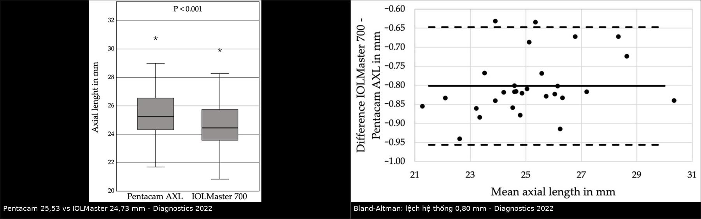
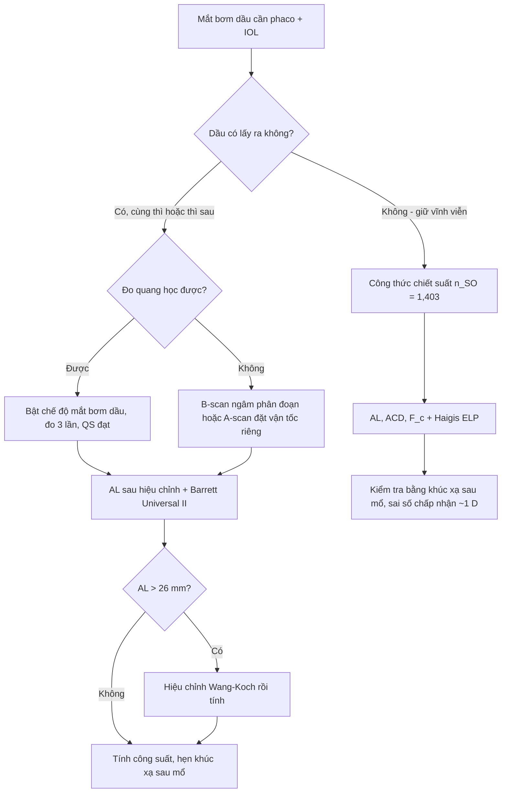
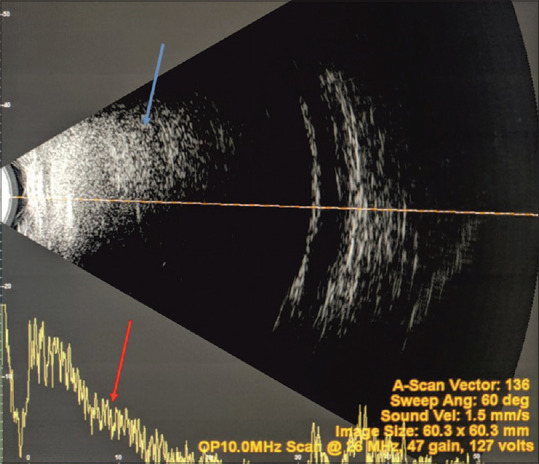
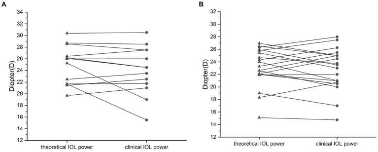
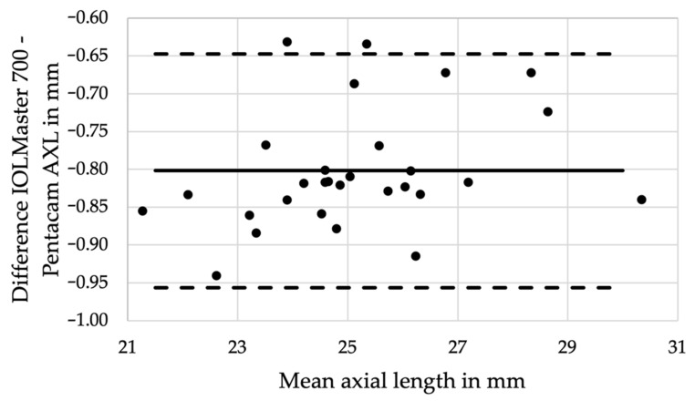

# 1477 — Đo trục nhãn cầu và tính công suất IOL ở mắt bơm dầu silicone / Axial length and IOL power in the silicone oil-filled eye

**Tags:** `pattern:lo-an-cau` `pattern:al-gia` `pattern:dau-silicone` `vung:mat` `vung:dich-kinh` `vung:the-thuy-tinh` `anatomy:dich-kinh` `protocol:IOLMaster` `protocol:sinh-trac` `protocol:sieu-am-A-scan` `protocol:B-scan-ngam` `score:Barrett-Universal-II`
**Mức chắc chắn (certainty):** tổng hợp y văn (literature synthesis) — **50 mắt** so A-scan 980 m/s với LENSTAR (PMC9672780), **50 mắt** dựng công thức hiệu chỉnh AL (PMC10417960), **29 + 12 mắt** hiệu chỉnh Pentacam AXL (PMC8775324), **72 mắt** IOLMaster 700 sau bơm dầu 5000 cSt (PMID 39034156), **77 mắt** so AL mắt bơm dầu với mắt bên (PMID 37845000), **67 mắt** cận thị rất cao đo B-scan ngâm phân đoạn (PMC9091887), **32 mắt** dầu tồn lưu vĩnh viễn với công thức chiết suất (PMC10626459). Câu nào là suy luận được ghi **[suy luận]**.

> **Vì sao bài này quan trọng:** [1462](../1462-sinh-trac-iol-sau-ghep-giac-mac/lesson.md) đã chốt nguyên tắc **giác mạc méo thì K sai**; bài này là mặt **sau** của cùng sai số: **môi trường trong khoang dịch kính bị đổi** thì **AL sai** — và ở mắt bơm dầu, sai số **lớn hơn một bậc** (hàng milimét, không phải 0,1 mm). Ở ngưỡng lan truyền **0,1 mm AL ≈ 0,28 D** khúc xạ sau mổ, một AL sai **0,80 mm** = **~2,2 D**; còn bơm dầu 1000 cSt mà máy để vận tốc mặc định **1532 m/s** thì AL có thể bị đọc **31,76 mm** trong khi trục thật **24,70 mm** (PMC10417960). Hậu quả không phải "kính hơi lệch" mà là **mổ lại để đổi IOL**.

## 1. Tổng quan bệnh học – cơ chế hình ảnh

- **Sinh trắc (biometry) là phép đo gián tiếp qua thời gian bay hoặc quang trình.** Siêu âm A-scan tính `d = v_assumed × t / 2`; sinh trắc quang (partial coherence interferometry — PCI, hoặc swept-source OCT — SS-OCT) tính quang trình rồi chia cho **chiết suất nhóm quy ước của dịch kính**. Cả hai đều **giả định khoang dịch kính chứa dịch kính/dịch (n = 1,336; v = 1532 m/s)**. Dầu silicone phá cả hai giả định, theo hai hướng **ngược nhau về bản chất nhưng cùng gây sai**.
- **TẠI SAO siêu âm đọc DÀI (overestimation):** vận tốc âm trong dầu **987 m/s ở dầu 1000 cSt**, thấp hơn dịch kính **1532 m/s** (PMC9672780). Cùng một khoảng cách hình học, xung đi **lâu hơn 1532/987 = 1,55 lần**; máy vẫn nhân với 1532 m/s nên **đoạn chứa dầu bị đọc dài thêm ~55%**. Đây là lý do một mắt có đoạn dầu ~13 mm có thể bị đọc **31,76 ± 3,09 mm** so với **24,70 ± 1,74 mm** của sinh trắc quang (PMC10417960) — chênh **7,05 ± 2,39 mm**, không phải sai số ngẫu nhiên.
- **TẠI SAO sinh trắc quang cũng đọc dài (nhưng ít hơn nhiều):** chiết suất dầu **n = 1,403** so với dịch kính **1,336** (PMC10626459); quang trình dài hơn theo tỷ lệ **1,403/1,336 = 1,050** — tức **+5,0%** trên riêng đoạn dầu. Với đoạn dầu ~16 mm: **+0,80 mm**, đúng bằng **lệch hệ thống 0,80 ± 0,08 mm** đo được giữa hai máy quang học trên cùng 29 mắt bơm dầu (Pentacam AXL **25,53 ± 1,94 mm** vs IOLMaster 700 **24,73 ± 1,97 mm**, r = 0,999; PMC8775324). **Con số 0,80 mm không phải lỗi của một hãng — nó là số học của 1,403/1,336.** [suy luận số học, khớp với đo đạc]
- **TẠI SAO phần trước mắt KHÔNG giải thích được sai số:** sau bơm dầu 5000 cSt, **K trung bình chỉ tăng 0,19 ± 0,51 D**, **ACD giảm 0,05 ± 0,13 mm**, **bề dày thể thủy tinh −0,03 mm**, **đường kính ngang giác mạc −0,02 mm** (72 mắt; PMID 39034156). Nghĩa là **toàn bộ sai số nằm ở đoạn sau** — ai chỉ "so K và ACD" sẽ bỏ qua nguồn sai chính.
- **Có sẵn công thức hiệu chỉnh AL cho máy SS-OCT:** IOLMaster 700 đọc **dài ~0,12 mm** ở mắt bơm dầu; áp **công thức hiệu chỉnh của Zhang (adjusted AL — aAL)** đưa sai số trung bình về **gần 0** và cải thiện dự báo công suất IOL **~0,3 D ở mắt > 25 mm** (Graefes Arch Clin Exp Ophthalmol 2026, CC BY 4.0). Đây là việc **phải làm trước khi tính**, không phải tùy chọn.
- **Định lượng sai số lan sang khúc xạ:** độ chính xác của A-scan thủ công là **100–120 µm**, tương ứng **0,28 D cho mỗi 100 µm** (PMC8775324 dẫn lại); độ phân giải dọc **200 µm**. Vì vậy: sai 0,1 mm → **0,28 D**; sai 0,3 mm → **0,84 D**; sai 0,80 mm → **~2,2 D**; sai 1,0 mm → **~2,8 D**.
- **Sau khi bơm dầu, AL thật cũng dài ra một phần:** so với trước bơm dầu, AL đo ở mắt bơm dầu dài hơn khoảng **0,48 mm** sau trung bình **4,85 tháng** (PMC10626459 dẫn Liu) — phần này **là thật**, không phải artifact, nên không được "trừ" toàn bộ chênh lệch [suy luận].
- **Vì sao đây là việc của CĐHA:** mọi quyết định **chụp B-scan/CT/MRI ở mắt đục, mắt bơm dầu** đều có thể trả lời câu hỏi "AL bao nhiêu" — và chính hình ảnh (siêu âm, B-scan ngâm, MRI) là **phương án dự phòng** khi sinh trắc quang thất bại; đọc sai trên ảnh = đặt sai IOL.

## 2. Mẫu hình + chẩn đoán phân biệt theo vị trí (gamut)

**Câu hỏi trung tâm không phải "dùng máy nào" mà "dầu có được lấy ra không".** Hai bệnh cảnh khác hẳn nhau:

- **A. Dầu sẽ lấy (cùng thì hoặc thì sau) → IOL phải đúng cho mắt SAU khi hết dầu.** Cần AL của **mắt đã về dịch kính**. Cách tốt nhất: **đo lại sau khi lấy dầu** (hai thì); nếu buộc phải tính trước, dùng **AL của chính mắt bơm dầu bằng máy quang học có chế độ mắt bơm dầu** (AL đã hiệu chỉnh về tương đương mắt chứa dịch) — **Barrett Universal II** trên AL đó cho **MedAE 0,42 D, 57% trong ±0,50 D** ở 77 mắt (PMID 37845000).
- **B. Dầu giữ vĩnh viễn (silicone oil-dependent) → IOL làm việc trong môi trường n = 1,403.** Công thức chuẩn (SRK/T, Hoffer, Haigis, BUII) **giả định mặt sau IOL tiếp xúc dịch kính n = 1,336** nên **sai hệ thống**; phải dùng công thức chiết suất: **F_IOL = 1,403/(AL − ELP) − 1,336·F_c/(1,336 − ELP·F_c)** (PMC10626459). Thói quen "cộng thêm +3 đến +5 D" đã thất bại với sai số khúc xạ **3,79 ± 2,48 D** (ca tệ nhất **8 D**).
- **C. Không đo quang học được** (đục giác mạc dày, đục thể thủy tinh nặng, không cố định được mắt, không có máy): **B-scan ngâm phân đoạn (immersion B-scan, segmented)** hoặc A-scan với **vận tốc đặt riêng cho dầu**. B-scan ngâm phân đoạn ở 31 mắt cận thị rất cao: AL trước **30,46 ± 1,63 mm** vs sau lấy dầu **30,42 ± 1,70 mm** (p = 0,542), **58,1% trong ±0,50 D / 83,9% trong ±1,00 D** (PMC9091887).
- **D. "Mượn" AL mắt bên** — phương án bị đánh giá thấp: chỉ nên là lựa chọn cuối, vì lệch khúc xạ **cận thị 0,64 ± 0,78 D** ngay trong nhóm được chọn (PMC8770769), và **MedAE 1,02–1,08 D** so với **0,42 D** khi dùng AL chính mắt dầu (PMID 37845000).

**Gamut "vì sao AL đo ra vẫn sai" (theo cơ chế):**

| Cơ chế | Dấu hiệu nhận ra | Hướng sai |
|---|---|---|
| Vận tốc âm mặc định 1532 m/s trên đoạn dầu | A-scan ra AL rất dài (31 mm ở mắt 24 mm), đỉnh võng mạc "xa" bất thường | **Dài giả** ~+55% đoạn dầu |
| Đặt vận tốc 980 m/s cho dầu đặc hơn (1300 cSt) | AL **ngắn hơn** AL sau lấy dầu 0–1,5 mm (trung vị 0,52 mm) | **Ngắn giả** |
| Chiết suất 1,403 vs 1,336 | Hai máy quang học lệch nhau ~0,80 mm trên cùng mắt | **Dài giả** +5% đoạn dầu |
| Nhũ tương hóa dầu (emulsification) | Nhiều hồi âm mạnh trong buồng dịch kính, A-scan có chuỗi đỉnh dày | Đỉnh võng mạc bị chọn sai |
| Dầu không đầy khoang (underfill) | Mặt phân cách dầu–dịch thấy trên B-scan | Sai số chỉ một phần đoạn |
| Đục môi trường / không cố định | Máy báo "QS" không đạt hoặc tự bỏ mắt | Không có số, nhưng dễ dùng nhầm AL mắt bên |

## 3. Bảng so sánh phân biệt (ma trận đối chiếu)

| Thực thể (entity) | Hình ảnh/chỉ số điển hình | Chốt vào (rule-in) | Chốt loại (rule-out) | Gợi ý xác nhận |
|---|---|---|---|---|
| **A-scan vận tốc mặc định (1532 m/s)** | AL dài bất thường so với mắt bên; đỉnh dày do dầu; màn hình ghi **Sound Vel 1,5 mm/µs** | **AL chênh mắt bên > 2 mm mà không có cận thị lệch** + tiền sử bơm dầu | AL khớp mắt bên ± 0,3 mm → khó quy cho dầu, tìm nguyên nhân khác | So AL **sau lấy dầu** hoặc với sinh trắc quang |
| **A-scan vận tốc 980–1000 m/s** | AL **ngắn hơn** AL thật 0–0,5 mm (1000 m/s) hoặc 0–1,5 mm (980 m/s) ở dầu 1300 cSt | **Đã đặt vận tốc riêng** + AL thấp hơn kỳ vọng | Vẫn dài > 1 mm so với mắt bên → chưa hiệu chỉnh đúng | Đo lại sau lấy dầu; đối chiếu B-scan ngâm |
| **Hệ số nhân 0,70–0,71 trên AL toàn phần** | AL sau hiệu chỉnh vẫn lệch **2,47 ± 1,69 mm** (n = 50) | Công thức **PAL = 14 + 0,3 × AL thủ công** (kiểm chứng: lệch **0,98 ± 1,67 mm**) | Vẫn lệch > 1 mm so với sinh trắc quang → bỏ cách nhân hệ số | Chỉ dùng khi không có bất kỳ phương án quang học nào |
| **Sinh trắc quang chế độ thường** | Hai máy lệch ~0,8 mm; máy đọc **dài** hơn AL sau lấy dầu | **Mắt bơm dầu + chưa bật chế độ dầu** | AL khớp AL sau lấy dầu ± 0,2 mm → có thể đã bật đúng chế độ | Bật chế độ mắt bơm dầu rồi đo lại 3 lần |
| **Sinh trắc quang chế độ mắt bơm dầu (đã hiệu chỉnh)** | Với IOLMaster 700 + hiệu chỉnh: lệch còn **0,12 ± 0,42 mm** (trước hiệu chỉnh), sau hiệu chỉnh **−0,002 ± 0,41 mm** | **AL ổn định 3 lần, QS đạt, khớp mắt bên ± 0,5 mm** | AL vẫn dài > 0,5 mm so với dự kiến → dầu nhũ tương/đục môi trường | Đo lại sau lấy dầu nếu có thể |
| **B-scan ngâm phân đoạn** | Đo riêng đoạn trước và đoạn dầu, chỉ đổi vận tốc cho đoạn dầu | **Không đo được quang học + đục thể thủy tinh nặng** | Đoạn dầu không xác định được bờ sau → không phân đoạn được | So AL trước/sau lấy dầu (p = 0,542 ở 31 mắt) |
| **Mắt bên (fellow eye)** | AL mắt bên **25,85 ± 2,16 mm** vs mắt dầu **26,08 ± 2,53 mm** | Chỉ khi **hai mắt cân xứng, không có băng/đai củng mạc** | Lệch khúc xạ khúc xạ **> 1 D**, cận thị một bên, đã đặt đai | Ưu tiên AL chính mắt dầu (MedAE 0,42 vs 1,02 D) |
| **Công thức chiết suất cho mắt giữ dầu vĩnh viễn** | Đường công suất lý thuyết **24,96 ± 3,29 D** vs thực tế **24,02 ± 4,14 D**, ICC 0,771 | **Dầu không lấy được** + AL/ACD/F_c đo được | Dầu sẽ lấy → **không** dùng công thức này (nó tính cho mắt ngậm dầu) | MAE **1,66 ± 2,09 D** (0,83 ± 0,62 D sau khi loại 2 mắt sai ≥ 2 D) |

*Trái: Pentacam AXL đọc **25,53 mm**, IOLMaster 700 đọc **24,73 mm** trên cùng 29 mắt (p < 0,001). Phải: Bland–Altman cho thấy lệch **0,80 ± 0,08 mm**, **không phụ thuộc AL** — tức là một hằng số quang học, không phải "máy A tốt hơn máy B". Nguồn: Auffarth GU et al., Diagnostics 2022;12:163 (PMC8775324), CC BY 4.0. Ảnh ghép letterbox, không crop.*

### Đọc đúng ba con số của bài này

- **0,80 mm** = chênh giữa hai máy quang học khi **cả hai** đang ở chế độ chưa hiệu chỉnh dầu → dùng để hiểu **độ lớn của hằng số quang học**, không dùng để chọn máy.
- **0,12 mm** = độ dài giả còn lại của IOLMaster 700 sau khi máy đã bật chế độ mắt bơm dầu (72 mắt, dầu 5000 cSt) → nhỏ hơn nhiều, nhưng **vẫn gây ~0,34 D** ở mắt AL > 25 mm (PMID 39034156).
- **0,42 D** = MedAE thực tế khi dùng **AL của chính mắt bơm dầu** + BUII → đây là **mức tốt nhất** đạt được hiện nay, không phải "sai số bằng 0".

## 4. Protocol chụp + hệ phân độ/điểm chuẩn hóa

### 4.1. Trình tự đo (bắt buộc theo thứ tự, không nhảy bước)

1. **Xác nhận tình trạng dầu:** loại dầu (1000/1300/5000 cSt), **đầy hay thiếu thể tích**, có **nhũ tương hóa**, **dầu trong tiền phòng**; ghi ngày bơm dầu ([1410](../1410-lay-dau-silicone-va-dau-ton-luu/lesson.md), [1432](../1432-thay-dau-silicone/lesson.md)).
2. **Sinh trắc quang trước** (IOLMaster 700 / Pentacam AXL / LENSTAR): bật **chế độ mắt bơm dầu**, đo **3 lần**, chỉ nhận khi **QS đạt**; ghi **AL, K, ACD, bề dày thể thủy tinh, đường kính ngang giác mạc**.
3. **Nếu AL không hợp lý** (lệch mắt bên > 0,5 mm, hoặc mắt bên không so được): **B-scan ngâm phân đoạn** (đầu dò 10 MHz, đo đoạn trước và đoạn dầu riêng, đặt vận tốc cho đoạn dầu) hoặc **A-scan** với vận tốc đặt riêng — và ghi rõ **vận tốc đã dùng** vào phiếu.
4. **Tính công suất** theo bệnh cảnh A/B ở mục 2; nếu máy là **IOLMaster 700**, áp **công thức Zhang** để có **AL hiệu chỉnh (aAL)** trước khi đưa vào công thức; nếu **AL > 26 mm** áp dụng thêm **hiệu chỉnh Wang–Koch** (PMC10626459 dùng cho mắt dầu tồn lưu).
5. **Hẹn đo lại** nếu mổ hai thì: AL sau lấy dầu là **chuẩn vàng**; ở mắt cận thị rất cao, chênh trung bình trước–sau lấy dầu chỉ **0,04 mm** (30,46 vs 30,42 mm).

### 4.2. Ngưỡng định lượng dùng để ra quyết định

| Chỉ số | Ngưỡng | Ý nghĩa thực hành |
|---|---|---|
| Sai số AL | **0,1 mm** | **0,28 D** khúc xạ — ngưỡng "không đáng kể" |
| Sai số AL | **0,3 mm** | **~0,8 D** — bắt đầu "khó chịu" với bệnh nhân |
| Sai số AL | **≥ 0,5 mm** | **≥ 1,4 D** — phải đo lại bằng phương pháp khác |
| Chênh AL hai mắt | **> 1,0 mm** | Nghi AL sai (hoặc cận thị lệch thật) — cần kiểm chứng |
| Tỷ lệ trong ± 0,50 D | **57%** (BUII + AL mắt dầu, 77 mắt) | Mức tốt nhất hiện có; tư vấn trước mổ |
| Tỷ lệ trong ± 1,00 D | **83,9%** (B-scan ngâm phân đoạn) | Mức chấp nhận được khi không có sinh trắc quang |
| AL > 26 mm | **Wang–Koch** | Hiệu chỉnh AL trước khi tính công suất |
| Dầu tồn lưu vĩnh viễn | MAE **1,66 D** (0,83 D sau loại 2 mắt) | Phải nói trước với bệnh nhân: **có thể lệch ~1 D** |

### 4.3. Sơ đồ quyết định

- **Không có hệ RADS cho sinh trắc.** Thước đo chất lượng thay thế là **tỷ lệ mắt trong ± 0,50 D và ± 1,00 D** (tiêu chuẩn báo cáo của y văn công suất IOL) — dùng đúng đơn vị này khi so các nghiên cứu, đừng so "MAE" của các quần thể khác nhau.
- **Bảng công thức theo bệnh cảnh** (chỉ nêu mức đã công bố, không suy diễn):

| Bệnh cảnh | Công thức/nghiên cứu | Kết quả công bố |
|---|---|---|
| Dầu sẽ lấy, AL mắt dầu | **Barrett Universal II** (n = 77) | MedAE **0,42 D**, **57%** trong ± 0,50 D |
| Dầu sẽ lấy, AL mắt bên | BUII / Kane / RBF 3.0 | MedAE **1,02–1,08 D**, **25,9–27,2%** trong ± 0,50 D |
| Dầu sẽ lấy, 6 công thức cổ điển | SRK/T, Holladay 1–2, Haigis, Hoffer Q, BUII (n = 47) | Sai số dự báo **−0,18 đến −0,05 D**; SE sau mổ **−0,6 ± 0,96 D** (AL thường), **−0,8 ± 1,52 D** (AL dài) |
| Cận thị rất cao, đục nặng | B-scan ngâm phân đoạn + Haigis (n = 31) | SE **−3,11 ± 0,65 D**, sai số tuyệt đối **0,589 ± 0,340 D** |
| Dầu giữ vĩnh viễn | Công thức chiết suất (n = 13 + 19) | MAE **1,66 ± 2,09 D**; ICC 0,771 |

## 5. Biến thể bình thường và cạm bẫy

- **Dầu không đầy khoang dịch kính (underfill):** sai số chỉ xảy ra trên **đoạn có dầu**; B-scan thấy **mặt phân cách dầu–dịch**. Đừng áp một hệ số cho toàn bộ AL — đây là lý do hệ số 0,70–0,71 thất bại (còn lệch **2,47 mm**).
- **Nhũ tương hóa dầu:** giọt dầu lơ lửng cho **nhiều hồi âm mạnh** và trên A-scan là **chuỗi đỉnh dày** — đỉnh võng mạc thật bị "chôn" trong chuỗi đỉnh giả. Trên ảnh màn hình, dải hồi âm dày phía sau nhãn cầu **không phải** tổn thương đặc; **đỉnh cao nhất không phải đỉnh võng mạc** [suy luận từ vật lý siêu âm].
- **Máy "tự trả lời" mà không cảnh báo:** khi sinh trắc quang thất bại, máy có thể **bỏ mắt** hoặc trả số ít tin cậy; nếu người đo không kiểm **QS**, AL sai được đưa thẳng vào công thức. Luôn **đối chiếu mắt bên ± 0,5 mm**.
- **Bẫy "dùng AL mắt bên cho nhanh":** nghe hợp lý nhưng trong nhóm được chọn, lệch khúc xạ vẫn **cận thị 0,64 ± 0,78 D** và MedAE **gấp 2,4 lần** cách đo trên chính mắt dầu. Mắt có **băng/đai củng mạc** hoặc **cận thị lệch** thì mắt bên **không đại diện**.
- **Bẫy "cộng bù bằng kinh nghiệm":** thêm **+3 đến +5 D** cho mắt giữ dầu vĩnh viễn từng cho sai số **3,79 ± 2,48 D**, cá biệt **8 D** — bài học: **bù mò không thay được công thức chiết suất**.
- **Bẫy mặt cắt/ảnh:** trên B-scan, **dầu** có thể tạo **dải hồi âm dày giả "khối"** phía sau; trên **CT**, dầu **tăng đậm độ so với dịch kính** nên dễ bị đọc nhầm là **xuất huyết dịch kính hoặc khối trong mắt**; trên **MRI**, dầu **T1 tăng tín hiệu, T2 giảm tín hiệu** (kèm hóa dịch chuyển), dễ bị đọc nhầm là máu/melanin. Không dùng CT/MRI để **đo AL** thay sinh trắc — chúng chỉ giúp loại trừ bong võng mạc/khối khi môi trường đục (Graefes Arch Clin Exp Ophthalmol 2026, CC BY 4.0).
- **Sai số kép:** vừa **AL sai** vừa **K sai do phù giác mạc sau bơm dầu** — K chỉ đổi **0,19 D** trung bình, nhưng ở mắt phù nhiều thì sai số K **cộng dồn** vào AL sai; đo lại khi giác mạc trong hơn.

## 6. Tự lượng giá — Blind Quiz

**Ca 1 — Mắt đã bơm dầu 1000 cSt, đục thể thủy tinh, chờ phaco + lấy dầu. Nhìn màn hình siêu âm trước, mô tả trước.**

- Gợi ý lâm sàng: bệnh nhân đã mổ bong võng mạc, dầu còn đủ, thị lực giảm vì đục thể thủy tinh.
- Câu hỏi: (1) Dải hồi âm dày trong buồng dịch kính là gì? (2) Vì sao A-scan ở mắt này **không** dùng để lấy AL? (3) Hai cách đo nào thay thế?

<b>Bấm để hiện đáp án (findings + chẩn đoán)</b>

- **Dấu hiệu:** trên B-scan, **nhiều hồi âm mạnh ("bão tuyết")** trong khoang dịch kính (mũi tên xanh); trên A-scan tương ứng là **chuỗi đỉnh dày** (mũi tên đỏ). Màn hình ghi **Sound Vel 1,5 mm/µs** — tức máy đang dùng **1532 m/s**, giả định dịch kính.
- **Vì sao A-scan sai:** dầu 1000 cSt có vận tốc **987 m/s**, xung đi lâu **~1,55 lần** → đoạn dầu bị đọc **dài thêm ~55%**; cộng thêm chuỗi đỉnh từ dầu làm **chọn sai đỉnh võng mạc**.
- **Thay thế:** (1) **sinh trắc quang chế độ mắt bơm dầu** (IOLMaster 700/Pentacam AXL), hoặc (2) **B-scan ngâm phân đoạn** với vận tốc đặt riêng cho đoạn dầu; chuẩn vàng vẫn là **đo lại sau khi lấy dầu**.
- **Nguồn ảnh:** Rajurkar K, DaCruz R, Thakar M, Indian J Ophthalmol 2022 (PMC9672780), **CC BY-NC-SA** — dùng nguyên bản.

**Ca 2 — Cùng một mắt bơm dầu, hai máy quang học cho hai con số. Chọn số nào?**

- Gợi ý lâm sàng: mắt đã bơm dầu **không thể lấy dầu** (võng mạc không ổn định), cần đặt IOL.
- Câu hỏi: (1) Mỗi đường nối là gì? (2) Nếu cộng thêm **+3 đến +5 D** như thói quen cũ thì sai bao nhiêu? (3) Vì sao công thức chuẩn không dùng được?

<b>Bấm để hiện đáp án (findings + chẩn đoán)</b>

- **Dấu hiệu:** mỗi đường nối **công suất lý thuyết → công suất thực tế** của một mắt; nhóm A (dầu tồn lưu, n = 13) và nhóm B (bơm dầu + đặt IOL thì đầu, n = 19). Lý thuyết **24,96 ± 3,29 D** vs thực tế **24,02 ± 4,14 D** (nhóm A), ICC 0,771.
- **Sai số của "cộng bù":** kinh nghiệm cộng **+3…+5 D** cho sai khúc xạ **3,79 ± 2,48 D**, cao nhất **8 D** — không chấp nhận được.
- **Vì sao:** công thức chuẩn giả định mặt sau IOL tiếp xúc **dịch kính n = 1,336**; trong dầu **n = 1,403** nên tổng công suất khúc xạ của mắt đổi → phải dùng **F_IOL = 1,403/(AL − ELP) − 1,336·F_c/(1,336 − ELP·F_c)**.
- **Nguồn ảnh:** Wang L et al., Front Med 2023;10:1271897 (PMC10626459), **CC BY 4.0** — dùng nguyên bản.

**Ca 3 — Cùng mắt, cùng ngày, hai lần đo chênh 0,8 mm: có nên tin "trung bình cộng"?**

- Gợi ý lâm sàng: mắt pseudophakic bơm dầu 5000 cSt, cần tính lại công suất khi thay IOL.
- Câu hỏi: (1) Đường liền và hai đường đứt nghĩa là gì? (2) 0,80 mm đổi ra bao nhiêu độ? (3) Có nên lấy trung bình hai máy?

<b>Bấm để hiện đáp án (findings + chẩn đoán)</b>

- **Dấu hiệu:** đường liền = **lệch trung bình 0,80 mm**; hai đường đứt = **giới hạn đồng thuận** (khoảng −0,65 đến −0,95 mm). Điểm rải đều theo AL → **lệch hệ thống hằng định**, không phải sai số ngẫu nhiên.
- **Quy đổi:** 0,80 mm × **0,28 D/0,1 mm** ≈ **2,2 D** — vượt xa ngưỡng chấp nhận.
- **Kết luận:** **không lấy trung bình**; phải biết **máy nào đang bật chế độ mắt bơm dầu** và **hiệu chỉnh về AL tương đương mắt chứa dịch**. Trung bình hai số sai khác hệ thống chỉ tạo ra một số sai "đẹp" hơn.
- **Nguồn ảnh:** Auffarth GU et al., Diagnostics 2022;12:163 (PMC8775324), **CC BY 4.0** — dùng nguyên bản.

## Bài liên quan chéo
- [400 – Tổng quan Mắt & thị giác](../400-tong-quan-mat-thi-giac/lesson.md)
- [411 – Siêu âm nhãn cầu: bong võng mạc vs xuất huyết dịch kính](../411-sieu-am-nhan-cau/lesson.md) (đọc B-scan cơ bản)
- [1410 – Lấy dầu silicone & biến chứng dầu tồn lưu](../1410-lay-dau-silicone-va-dau-ton-luu/lesson.md)
- [1417 – Khi nào giữ dầu silicone vĩnh viễn](../1417-giu-dau-silicone-vinh-vien/lesson.md) (bệnh cảnh B của bài này)
- [1432 – Thay dầu silicone](../1432-thay-dau-silicone/lesson.md)
- [1863 – Đục thể thủy tinh ở mắt bơm dầu: một thì hay hai thì](../1863-duc-the-thuy-tinh-mat-bom-dau-silicone/lesson.md) (quyết định thời điểm → quyết định cách đo AL)
- [1454 – Đặt IOL ở mắt đã phacolytic](../1454-dat-iol-mat-phacolytic/lesson.md)
- [1462 – Sinh trắc và công suất IOL ở mắt đã ghép giác mạc](../1462-sinh-trac-iol-sau-ghep-giac-mac/lesson.md) (sai số phía GIÁC MẠC)

## Ảnh
- `images/1477_sinh-trac-dau_US_Bscan-Ascan-IJO2022_PMC9672780-IJO-70-2851-g001.jpg` — B-scan/A-scan mắt bơm dầu, Rajurkar K et al., Indian J Ophthalmol 2022 (PMC9672780), CC BY-NC-SA.
- `images/1477_sinh-trac-dau_AL-boxplot_Diagnostics2022-F1.jpg`, `images/1477_sinh-trac-dau_BlandAltman_Diagnostics2022-F3.jpg`, `images/composite_1477_AL-hai-may.jpg` — Auffarth GU et al., Diagnostics 2022;12:163 (PMC8775324), CC BY 4.0.
- `images/1477_sinh-trac-dau_IOL-SO-FrontMed2023-F1.jpg` — Wang L et al., Front Med 2023;10:1271897 (PMC10626459), CC BY 4.0.
- Giấy phép từng file: `images/CREDITS.md`.

> Không dùng để chẩn đoán độc lập khi chưa có người hướng dẫn.
