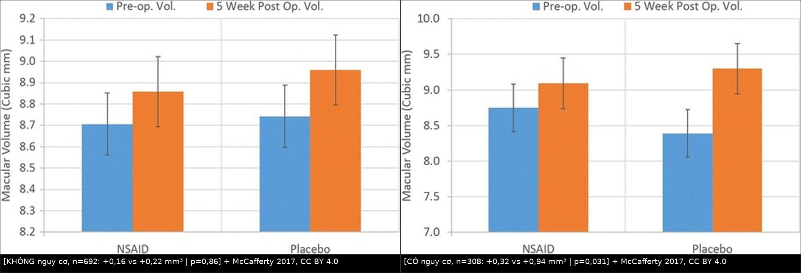
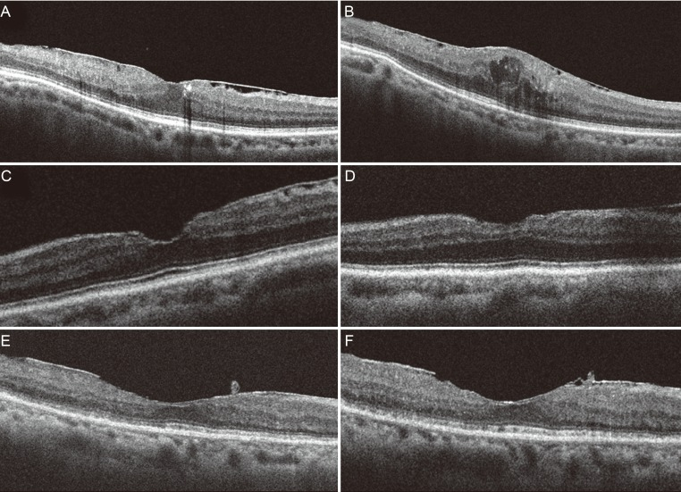
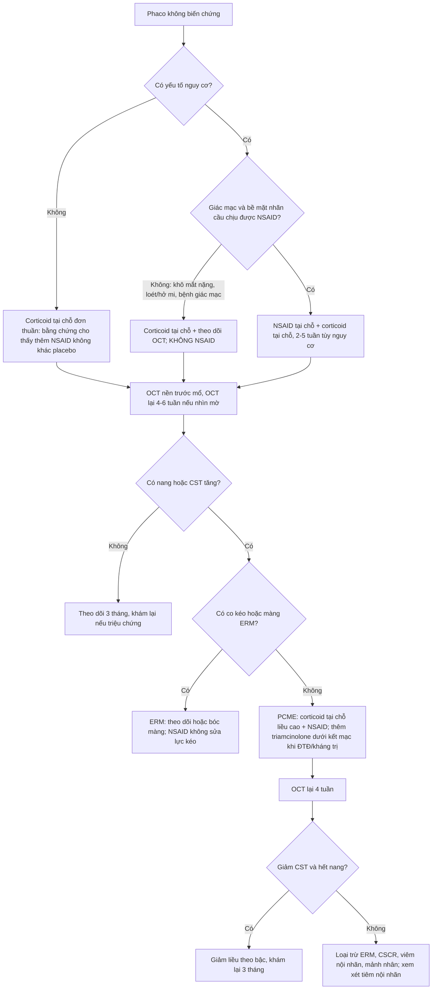
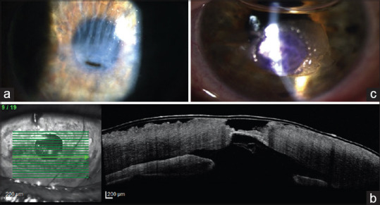

# 1478 — Dự phòng phù hoàng điểm sau phaco bằng NSAID tại chỗ: ai cần, dùng bao lâu, và giá phải trả / Topical NSAID prophylaxis of pseudophakic cystoid macular edema

**Tags:** `pattern:phu-hoang-diem` `pattern:nang-hoang-diem` `vung:hoang-diem` `vung:the-thuy-tinh` `vung:giac-mac` `protocol:OCT` `protocol:phaco` `protocol:NSAID` `score:CST`
**Mức chắc chắn (certainty):** tổng hợp y văn (literature synthesis) — ghép **1 tổng quan hệ thống Cochrane 34 RCT, > 5.000 người** (PMC6464900), **2 nhánh RCT ESCRS PREMED** (914 người không ĐTĐ; 213 người ĐTĐ — JCRS 2018), **1 RCT mù đôi 1.000 mắt** (PMC5319126, CC BY 4.0), **1 nghiên cứu 1.325 mắt phaco liên tiếp** (PMC13588649, CC BY 4.0), **1 nghiên cứu 226 mắt** (PMC13521450, CC BY 4.0), **1 đoàn hệ hồi cứu 1.349 ca / 81 mắt có ERM** (PMC5636715, CC BY-NC 3.0) và **1 ca tan giác mạc nguyên văn** (PMC8772489, CC BY-NC-SA 4.0). Bài **không** có RCT nào so sánh trực tiếp các **thời gian dùng** khác nhau — đây là điểm phản biện trung tâm.

> **Câu chốt:** **NSAID tại chỗ làm giảm phù hoàng điểm sau phaco trên OCT (RR 0,40; KTC 95% 0,32–0,49; 3.638 mắt/21 nghiên cứu), nhưng bằng chứng về cải thiện THỊ LỰC chỉ ở mức thấp (RR 0,41 cho "thị lực kém do phù"; 1.360 mắt/5 nghiên cứu).** Lợi ích tập trung ở mắt **có yếu tố nguy cơ**: trong 1.000 mắt RCT, phù hoàng điểm **8,77%** (có nguy cơ, n = 308) so với **2,17%** (không nguy cơ, n = 692), và NSAID chỉ khác placebo ở nhóm **có nguy cơ** (p = 0,031) chứ **không** ở nhóm không nguy cơ (p = 0,86) (PMC5319126). Vì vậy bài này dạy **chọn người**, không dạy "kê NSAID cho mọi ca phaco"; và dạy **hai bẫy**: **NSAID không thay thế corticoid**, và **NSAID có thể làm tan giác mạc**.

## 1. Tổng quan bệnh học – cơ chế hình ảnh: vì sao phaco làm rò huyết tương vào hoàng điểm, và vì sao NSAID chặn được

### 1.1 Chuỗi sự kiện từ dao mổ đến nang hoàng điểm

- **Khởi phát:** phẫu thuật (siêu âm nhũ tương hóa, tưới hút, IOL) làm **vỡ hàng rào máu–thủy dịch** và tạo **stress cơ học–viêm** ở mống mắt, thể mi và bao sau. Phospholipase A2 giải phóng **acid arachidonic** từ màng tế bào.
- **Ngã ba cyclooxygenase:** **COX-1/COX-2** biến acid arachidonic thành **prostaglandin E2, F2α, PGI2**. Chính các PG này **giãn mạch**, **tăng tính thấm** mao mạch quanh hố trung tâm và **mở junction nội mô** → **vỡ hàng rào máu–võng mạc trong (inner blood–retinal barrier, BRB)**.
- **Dịch đi đâu:** huyết tương thoát vào **lớp plexiform trong (OPL) và lớp hạch trong (INL)** — nơi mô lỏng nhất và là "khung" của tế bào Müller → tạo **khoang nang (cystoid spaces)**. Khi dịch vượt biểu mô sắc tố → **dịch dưới võng mạc (subretinal fluid, SRF)**.
- **Vì sao muộn 4–12 tuần:** nồng độ trung gian viêm tiền phòng đạt đỉnh vài tuần sau mổ; **phù có ý nghĩa thị lực đỉnh quanh 5 tuần** (dẫn từ PMC5319126), ca thực tế **trung vị 2 tuần** khi chỉ dùng NSAID và **2 tháng** khi có yếu tố nguy cơ viêm (PMC13588649). Cửa sổ cần cảnh giác: **1 tuần – 8 tháng**.
- **Vì sao OCT thấy nang:** nước **giảm hồi âm (hyporeflective)**; nang nằm giữa các cột Müller ở **INL/OPL**, khi lớn tạo **vách mỏng**. Đo **độ dày trung tâm hoàng điểm (central subfield thickness, CST, µm)** để theo dõi — không dùng "độ dày võng mạc" chung chung.
- **Vì sao NSAID chặn được:** ức chế **COX** → giảm tổng hợp PG → giữ junction nội mô và giảm rò. Đây là **cơ chế khác** với corticoid (ức chế phospholipase A2 và các yếu tố phiên mã viêm). Vì hai cơ chế **bổ sung nhau**, "NSAID thay corticoid" là kết luận sai về dược lý — và đúng là sai trên lâm sàng (mục 4.2, PREMED 1).

### 1.2 Các con số phải nhớ

- **Tần suất phù hoàng điểm sau phaco không biến chứng:** **2,0%** (27 mắt/1.325 mắt; 22 bệnh nhân) khi chẩn đoán bằng OCT có triệu chứng (PMC13588649); **phù có ý nghĩa thị lực 0,6–3,6%** với đỉnh **~5 tuần**; **phù trên chụp mạch huỳnh quang (FA) 9,1–25,5%** — nghĩa là **phần lớn phù là dưới lâm sàng** (dẫn trong PMC5319126).
- **Hiệu quả dự phòng (Cochrane 2016, PMC6464900):** phù hoàng điểm lúc 3 tháng **RR 0,40 (0,32–0,49)**, 3.638 mắt/21 nghiên cứu; "thị lực kém do phù" **RR 0,41 (0,23–0,76)**, 1.360 mắt/5 nghiên cứu; **chất lượng bằng chứng thấp** (nguy cơ sai lệch + xuất bản). **CST** lúc 3 tháng **không nhất quán** (I² = 87%; dao động **−30,9 µm** nghiêng NSAID đến **+7,44 µm** nghiêng corticoid).
- **NSAID đơn thuần so với corticoid đơn thuần (Cochrane):** phù hoàng điểm **RR 0,27 (0,18–0,41)**, 520 mắt/5 nghiên cứu; CST **−22,64 µm (−38,86 đến −6,43)**, 121 mắt/2 nghiên cứu — nhưng đây là so sánh **hai đơn trị**, không phải "NSAID thay được corticoid trong phác đồ phối hợp".
- **Ngưỡng OCT dùng trong nghiên cứu:** "phù có thể (possible CME)" = CST tăng **> 3 SD = ≥ 90,17 µm**; "phù chắc chắn (definite)" = **đổi đường viền võng mạc + có nang** (PMC5636715). Ghi ngưỡng này vào báo cáo để người đọc sau so sánh được.
- **Tác dụng phụ thường gặp nhất trong 34 RCT:** **rát/bỏng khi nhỏ thuốc**; không có biến cố bất lợi nặng trong các thử nghiệm (PMC6464900) — nhưng biến cố **hiếm và nặng** chỉ lộ ra trong ca lâm sàng (mục 5).

## 2. Mẫu hình + chẩn đoán phân biệt theo nguy cơ (gamut)

**Ba câu hỏi trước khi kê NSAID dự phòng:** **(1) mắt này có yếu tố nguy cơ nào? (2) giác mạc và bề mặt nhãn cầu có chịu được NSAID? (3) đã có corticoid trong phác đồ chưa?**

### 2.1 Tầng nguy cơ — dùng bảng odds ratio thay vì cảm tính

Từ **1.000 mắt RCT mù đôi** (PMC5319126; mỗi yếu tố phân bố đều giữa hai nhóm):

| Yếu tố nguy cơ | Tỉ lệ phù trong nhóm có yếu tố | OR (KTC 95%) |
|---|---|---|
| **Phù hoàng điểm ở mắt đã mổ đối bên** | **42,3%** | **19,5 (18,5–20,6)** |
| **Bệnh võng mạc đái tháo đường** | **28,4%** | **13,1 (12,3–13,9)** |
| **Tắc tĩnh mạch võng mạc (CRVO/BRVO)** | **27,3%** | **12,6 (9,0–16,2)** |
| **Lỗ hoàng điểm** | 16,7% | 7,7 (5,7–9,7) |
| **Màng trước võng mạc (ERM)** | 12,3% | 5,6 (4,7–6,8) |
| **Có ≥ 1 yếu tố nguy cơ** | **13,6%** | **6,3 (4,9–7,6)** |
| Dùng prostaglandin | 3,6% | **1,6 (0,1–3,2)** — **không** phải yếu tố nguy cơ đáng kể |
| Thoái hóa hoàng điểm | 3,1% | 1,4 (0,6–1,8) |

- **Hệ quả thực hành:** "phù hoàng điểm mắt đối bên" và "đái tháo đường có bệnh võng mạc" là **hai chỉ định mạnh nhất**; **prostaglandin không** nằm trong danh sách (khác với định kiến phổ biến — xem bài [1882](../1882-phu-hoang-diem-prostaglandin-sau-phaco/lesson.md)).
- **ERM là yếu tố nguy cơ thật, nhưng thêm corticoid uống không giúp:** 1.349 ca phaco, 81 mắt có ERM; tỉ lệ phù chắc chắn/có thể/có thể xảy ra ở nhóm ERM **cao hơn** toàn bộ đoàn hệ (1,26%/2,30%/4,32%; p = 0,048/0,032/0,038), trong khi **steroid uống 1 tuần không khác** nhóm không dùng (p = 0,694/0,603/0,625) (PMC5636715). Với ERM, **NSAID tại chỗ 1 tháng là nền**, không phải "thêm steroid uống".

### 2.2 Gamut theo hình thái OCT

- **Nang INL/OPL ± SRF, không co kéo, mắt phaco không biến chứng:** **PCME/Irvine–Gass** (bài này), **CME do thuốc** (PGA, EP2 agonist), **CME do viêm màng bồ đào**.
- **Nang + màng tăng phản xạ mặt trên + mất đường viền hố trung tâm:** **ERM co kéo** — NSAID **không** sửa được lực kéo; xem [1467](../1467-mang-truoc-vong-mac-erm/lesson.md).
- **SRF đơn thuần, không nang, dấu "mỏ chim" ở RPE:** **CSCR** — corticoid làm **nặng hơn**; đây là lý do phải đọc OCT trước khi "tăng corticoid vì phù".
- **Nang + xuất tiết cứng + vi phình mạch/bóng mạch:** **phù do đái tháo đường** — cần anti-VEGF, không chỉ NSAID.
- **Nang + tế bào tiền phòng/mủ + khởi phát 3–7 ngày:** **viêm nội nhãn** — cấp cứu, xem [1425](../1425-viem-noi-nhan-sau-tiem-noi-nhan/lesson.md).
- **Nang + mảnh nhân trong tiền phòng/dịch kính:** **mảnh nhân tồn lưu** — phải lấy mảnh, NSAID vô ích.

## 3. Bảng so sánh phân biệt (ma trận đối chiếu)

| Thực thể (entity) | Hình ảnh điển hình | Chốt vào (rule-in) | Chốt loại (rule-out) | Gợi ý xác nhận |
|---|---|---|---|---|
| **PCME/Irvine–Gass (bài này)** | OCT: **nang INL/OPL ± SRF**, CST tăng, **không co kéo**; FA: **rò cánh hoa** | Khởi phát **1 tuần–8 tháng** sau phaco **không biến chứng**; có **≥ 1 yếu tố nguy cơ** (bảng 2.1); **đáp ứng corticoid** | Có **co kéo/ERM**, có mủ tiền phòng, có mảnh nhân → **không** quy cho PCME | OCT + khám đèn khe; OCT lại 4 tuần |
| **Phù do đái tháo đường** | Xuất tiết cứng, vi phình mạch, bóng mạch, nang lan tỏa | **ĐTĐ + bệnh võng mạc nền**; phù **trước mổ đã có** | OCT trước mổ bình thường + phù xuất hiện sau mổ → nghi PCME | FA/OCTA; phối hợp anti-VEGF |
| **ERM co kéo** | **Màng tăng phản xạ mặt trên**, mất đường viền hố trung tâm, giả lỗ | **Màng rõ**, co kéo, **phù tái phát dù NSAID** | Không màng, không co kéo → loại | OCT; điều trị là **bóc màng**, không phải thuốc |
| **CSCR (do corticoid)** | **SRF không nang**, RPE gồ ghề, "mỏ chim"; FA **dò điểm** | **SRF đơn thuần** + đang dùng corticoid; nam trung niên, stress | Có nang + rò cánh hoa → CME | OCT + FA; **giảm/ngừng corticoid** |
| **CME do prostaglandin/EP2** | Cùng hình thái nang + SRF | **Bắt đầu/đổi thuốc glôcôm vài tuần–vài tháng trước**; hết sau ngừng thuốc | Không liên quan thuốc + có yếu tố nguy cơ khác | Xem bài [1882](../1882-phu-hoang-diem-prostaglandin-sau-phaco/lesson.md) |
| **Viêm nội nhãn** | Nang + **mủ tiền phòng**, dính mống mắt, đau | Khởi phát **3–7 ngày**, **giảm thị lực nhanh + đau** | Không tế bào tiền phòng, không đau → loại | Cấy dịch kính **trước** kháng sinh |
| **Tan/loét giác mạc do NSAID** | **Mờ giác mạc vùng rìa, mỏng dần, Seidel (+)**; AS-OCT thấy **mỏng/hở** | **Đang dùng NSAID + khô mắt/ĐTĐ/giác mạc nhạy cảm**; khởi phát **ngày 3–7** | Giác mạc trong, không mỏng → loại | Đèn khe + AS-OCT; **ngừng NSAID ngay** |

*Cùng một thuốc, hai kết quả: ở nhóm **không nguy cơ** (n = 692) NSAID +0,16 mm³ so với placebo +0,22 mm³ (**p = 0,86**); ở nhóm **có nguy cơ** (n = 308) NSAID +0,32 mm³ so với placebo **+0,94 mm³** (**p = 0,031**). Đây là lý do "dự phòng cho mọi ca" không có cơ sở. Nguồn: McCafferty 2017, *BMC Ophthalmol* (PMC5319126), CC BY 4.0 — ảnh ghép letterbox, nguyên bản từng ô.*

*Ba mức chẩn đoán trong cùng một nghiên cứu: **A/B** đổi đường viền + nang rõ; **C/D** nghi ngờ; **E/F** chỉ tăng CST ≥ 90,17 µm mà không có nang. Cùng một "phù" nhưng **ba ngưỡng khác nhau** — đọc kết quả nghiên cứu phải biết tác giả dùng ngưỡng nào. Nguồn: Kim S et al., *Korean J Ophthalmol* 2017 (PMC5636715), CC BY-NC 3.0 — nguyên bản, không crop.*

## 4. Protocol dự phòng + chọn thuốc, thời gian, theo dõi

### 4.1 Trước mổ: phân tầng, không phân tầng thì không có chỉ định

- **OCT hoàng điểm nền** khi có **bất kỳ** yếu tố ở bảng 2.1 (ĐTĐ có bệnh võng mạc, ERM, phù mắt đối bên, tắc tĩnh mạch võng mạc, lỗ hoàng điểm, viêm màng bồ đào) — vì "phù" chỉ có nghĩa khi biết **CST trước mổ**.
- **Khám giác mạc/bề mặt nhãn cầu bắt buộc:** khô mắt, hở mi, bệnh giác mạc, đái tháo đường lâu năm, bệnh tự miễn, dùng thuốc nhỏ có chất bảo quản nhiều năm. **Đây là chống chỉ định tương đối của NSAID**, không phải chi tiết phụ.
- **Hỏi thuốc glôcôm** (prostaglandin) nhưng **không** coi là lý do chính để kê NSAID (OR 1,6; PMC5319126).
- **Ghi rõ trên bệnh án:** có/không nguy cơ → có/không NSAID; thời điểm bắt đầu; ngày hẹn khám lại.

### 4.2 Chọn thuốc — bảng thực hành (liều theo nhãn, không theo thói quen)

| Hoạt chất | Nồng độ | Liều thường dùng | Thời gian trong bằng chứng | Ghi chú |
|---|---|---|---|---|
| **Bromfenac** | 0,07–0,09% | 1 giọt × 1–2 lần/ngày | **2 tuần** (PREMED 1), **1 tuần** (nghiên cứu 226 mắt) | Dung nạp tốt nhất trong so sánh 243 bệnh nhân (dính mắt **0%** vs nepafenac **13,8%**, diclofenac **10,3%**; PMC6048336) |
| **Nepafenac** | 0,1% | 3 lần/ngày | 2–5 tuần | Có dạng **0,3% × 1 lần/ngày** đã thử **5 tuần** trên 1.000 mắt (PMC5319126) |
| **Ketorolac** | 0,5% | 4 lần/ngày | **≤ 2 tuần** | Nhiều ca loét/thủng giác mạc nhất trong y văn — hạn chế ở **giác mạc nhạy cảm** |
| **Diclofenac** | 0,1% | 4 lần/ngày | ~2 tháng (PMC6048336) | Dung nạp trung bình |

- **Bắt buộc phối hợp corticoid:** PREMED 1 (914 người không ĐTĐ) so sánh bromfenac 0,09% × 2 tuần, dexamethasone 0,1% giảm liều, và **phối hợp**: CST 6 tuần **288,3 / 296,0 / 284,5 µm** (p = 0,006); phù có ý nghĩa lâm sàng ≤ 12 tuần **3,6% / 5,1% / 1,5%** (p = 0,043) → **phối hợp tốt nhất**, đơn trị kém hơn, **không có "NSAID thay corticoid"**.
- **Thời gian:** bằng chứng hiện có trải **1 tuần → 5 tuần → 2 tháng** mà **không có RCT so sánh trực tiếp**. Cochrane ghi nhận theo dõi **1–12 tháng**, chất lượng bằng chứng **thấp** (PMC6464900). Vì vậy: **chọn thời gian theo nguy cơ và theo dõi**, không tuyên bố "3 tháng là chuẩn".
- **Nghiên cứu ngắn nhất có kết quả:** 226 mắt, bromfenac 0,1% × 1 tuần + prednisolone → phù **5,1%** so với **16,2%** corticoid đơn thuần (OR 0,28; 0,11–0,72; p = 0,006), mức tăng CST **13,3 ± 13,0 µm** so với **27,0 ± 33,7 µm** (p = 0,002) (PMC13521450). Đây là nghiên cứu **hồi cứu**, không phải RCT — dùng để gợi ý, không để đổi chuẩn.
- **Đái tháo đường:** PREMED 2 (213 bệnh nhân ĐTĐ) cho **tất cả** dùng bromfenac + dexamethasone; thêm **triamcinolone 40 mg dưới kết mạc** cuối mổ → CST thấp hơn **12,3 µm** (6 tuần, p = 0,007) và **9,7 µm** (12 tuần, p = 0,014), **không ca nào phù** trong nhóm triamcinolone; **bevacizumab 1,25 mg nội nhãn không có tác dụng**. Bài học: ở ĐTĐ, **corticoid là mũi thứ hai**, không phải tăng NSAID.
- **Tính trung thực về nhãn thuốc:** tại thời điểm nghiên cứu 1.000 mắt (2017), **không NSAID nhỏ mắt nào có chỉ định trong nhãn để dự phòng PCME** (PMC5319126) — dùng dự phòng là **off-label** ở nhiều nước; kiểm tra nhãn tại nơi hành nghề trước khi kê.

### 4.3 Thuật toán

- **Theo dõi tối thiểu:** OCT lúc **4–6 tuần** nếu có triệu chứng (nhìn mờ, biến dạng) — không chụp OCT định kỳ cho mọi mắt phaco.
- **Cảnh báo giác mạc cho bệnh nhân:** đau, cộm, chảy nước mắt, nhìn mờ **tăng** trong 1–2 tuần đầu → khám ngay, **không tự tăng số lần nhỏ**.

## 5. Biến thể bình thường và cạm bẫy

- **"Phù OCT = phù có ý nghĩa" là sai:** FA cho thấy phù **9,1–25,5%** trong khi phù có ý nghĩa thị lực chỉ **0,6–3,6%**. Điều trị theo **triệu chứng + CST**, không điều trị con số trên máy.
- **"NSAID thay được corticoid":** sai về dược lý và sai trên RCT — phối hợp tốt hơn đơn trị (PREMED 1: phù có ý nghĩa **1,5%** so với **3,6%** và **5,1%**). Ngược lại, **bỏ corticoid quá sớm** vẫn gây nang dù đang dùng bromfenac: 14 mắt có yếu tố nguy cơ phát triển nang **trung vị 2 tháng** sau khi **ngừng phối hợp** (PMC13588649).
- **"Có NSAID thì không phù":** 13/27 mắt trong 1.325 ca phát triển nang khi **chỉ dùng bromfenac** (không corticoid), trung vị **2 tuần** (PMC13588649). NSAID **giảm**, không **xóa** nguy cơ.
- **"Không nguy cơ thì cũng nên dự phòng":** trong 1.000 mắt RCT, nhóm không nguy cơ **không khác placebo** (p = 0,86 về thể tích; p = 0,31 về tỉ lệ phù). Cochrane vẫn thấy RR 0,40 chung, nhưng **lợi ích tuyệt đối** ở người nguy cơ thấp rất nhỏ — cần cân với chi phí, số lần nhỏ thuốc và nguy cơ giác mạc.
- **Tan giác mạc là biến cố hiếm nhưng không thể bỏ qua:** nữ **84 tuổi, đái tháo đường, khô mắt mạn**, phaco không biến chứng; nhỏ **NSAID dự phòng + corticoid/kháng sinh** → **tan và thủng giác mạc ngày thứ 5**; đã dùng keo, màng ối, ghép xuyên, may mi mà vẫn **mất thị lực**, kết cục **giác mạc đục + may mi bán phần** (PMC8772489). Bài học: **NSAID không dành cho giác mạc nhạy cảm**, và **triệu chứng giác mạc trong tuần đầu phải được khám, không được "chờ đỡ"**.
- **Corticoid làm nặng CSCR bị bỏ sót:** SRF **không nang** + OCT có "mỏ chim" → **CSCR**; nếu đọc là PCME rồi tăng corticoid, bệnh nặng lên. Đọc OCT **trước** khi kê.
- **Prostaglandin không phải "tội phạm chính":** OR **1,6** cho phù hoàng điểm (PMC5319126), và 4 RCT không thấy PGA làm tăng phù (xem [1882](../1882-phu-hoang-diem-prostaglandin-sau-phaco/lesson.md)). Đừng đổi thuốc glôcôm chỉ vì lo phù hoàng điểm mà bỏ mất kiểm soát nhãn áp.
- **Bẫy bằng chứng:** phần lớn RCT trong Cochrane **do ngành tài trợ** (6 nghiên cứu công nghiệp, 7 phi công nghiệp, còn lại không báo) và **không nghiên cứu nào ở nguy cơ sai lệch thấp mọi lĩnh vực** — nên đọc con số RR 0,40 kèm nhãn "chất lượng thấp", đừng trình bày như chân lý.

*Mắt của bệnh nhân **84 tuổi, đái tháo đường, khô mắt mạn**: (a) tan giác mạc + thủng; (b) AS-OCT — màng ối và kính tiếp xúc băng, tiền phòng nông, thủng rõ; (c) keo + kính băng. Đây là **giá phải trả** của việc dự phòng không phân tầng. Nguồn: Ashena Z et al., *J Curr Ophthalmol* 2021 (PMC8772489), CC BY-NC-SA 4.0 — nguyên bản, không crop.*

## 6. Tự lượng giá — Blind Quiz

**Ca 1 — Nam 72 tuổi, phaco không biến chứng 5 tuần trước, đang dùng NSAID + corticoid giảm liều; nhìn mờ. OCT có 6 ô A–F.**

- Hỏi: (1) ô nào là **phù chắc chắn**, ô nào chỉ là **tăng CST đơn thuần**? (2) ngưỡng nào định nghĩa "phù có thể"? (3) bước tiếp theo?

<b>Bấm để hiện đáp án (findings + chẩn đoán)</b>

- **A/B = phù chắc chắn (definite):** đổi đường viền võng mạc **+ nang** rõ ở INL/OPL (B còn có màng trước võng mạc mảnh).
- **C/D = phù có thể (probable):** nghi ngờ nang/khe, chưa đủ tiêu chuẩn.
- **E/F = chỉ tăng CST:** không nang; "phù có thể xảy ra (possible)" định nghĩa bằng **CST tăng > 3 SD = ≥ 90,17 µm**.
- **Bước tiếp:** khám đèn khe (tế bào tiền phòng, mảnh nhân) → nếu không có nguyên nhân khác: **tăng corticoid tại chỗ + tiếp tục NSAID**, OCT lại **4 tuần**; đọc kỹ **mặt trên võng mạc** vì ERM làm phù không đáp ứng thuốc.
- Nguồn ảnh: Kim S et al., *Korean J Ophthalmol* 2017 (PMC5636715), CC BY-NC 3.0.

**Ca 2 — Hai bệnh nhân cùng phaco, cùng bromfenac 2 tuần: một người OCT 5 tuần gần như không đổi, một người hoàng điểm dày thêm rõ. Vì sao?**

- Hỏi: (1) đọc hai biểu đồ; (2) yếu tố nào tạo khác biệt? (3) có nên kê NSAID cho cả hai không?

<b>Bấm để hiện đáp án (findings + chẩn đoán)</b>

- **Trái (không nguy cơ, n = 692):** NSAID +0,16 mm³, placebo +0,22 mm³ — **p = 0,86**, không khác biệt.
- **Phải (có nguy cơ, n = 308):** NSAID +0,32 mm³, placebo **+0,94 mm³** — **p = 0,031**, khác biệt rõ.
- **Khác biệt nằm ở yếu tố nguy cơ**, không ở thuốc: phù mắt đối bên (OR **19,5**), bệnh võng mạc ĐTĐ (**13,1**), tắc tĩnh mạch võng mạc (**12,6**), ERM (**5,6**).
- **Trả lời:** dự phòng **có chỉ định** ở người có yếu tố nguy cơ; ở người không nguy cơ, thêm NSAID **không được chứng minh có lợi** và vẫn mang nguy cơ giác mạc.
- Nguồn: McCafferty 2017, *BMC Ophthalmol* (PMC5319126), CC BY 4.0.

**Ca 3 — Nữ 84 tuổi, đái tháo đường 20 năm, khô mắt mạn; phaco mắt thứ hai, được kê NSAID dự phòng. Ngày thứ 5: đau, chảy nước mắt, thị lực giảm mạnh.**

- Hỏi: (1) dấu hiệu trong (a) và (b)? (2) vì sao mắt này có nguy cơ cao? (3) xử trí ngay và bài học dự phòng?

<b>Bấm để hiện đáp án (findings + chẩn đoán)</b>

- **(a)** mờ đục + mỏng giác mạc trung tâm, **tan giác mạc có thủng**; **(b)** AS-OCT: **thủng giác mạc**, tiền phòng nông, màng ối + kính băng.
- **Nguy cơ:** **khô mắt mạn + đái tháo đường + tuổi cao** → biểu mô không lành, NSAID ức chế COX làm **giảm tái biểu mô hóa** và **tăng hoạt tính collagenase** → tan nhanh trong **vài ngày**.
- **Xử trí:** **ngừng NSAID ngay**, keo sinh học/màng ối/kính băng, kháng sinh, hội chẩn giác mạc; **ghép xuyên** khi cần — trong ca gốc vẫn để lại **giác mạc đục + may mi bán phần**.
- **Bài học:** trước khi kê NSAID **phải khám bề mặt nhãn cầu**; ở giác mạc nhạy cảm, chọn **corticoid tại chỗ + theo dõi OCT** thay vì NSAID.
- Nguồn ảnh: Ashena Z et al., *J Curr Ophthalmol* 2021 (PMC8772489), CC BY-NC-SA 4.0.

## Bài liên quan chéo
- [1882 – Phù hoàng điểm do prostaglandin sau phaco](../1882-phu-hoang-diem-prostaglandin-sau-phaco/lesson.md) (cùng hình thái OCT, khác cơ chế; prostaglandin **không** phải yếu tố nguy cơ lớn)
- [1875 – Phù hoàng điểm dai dẳng ở mắt bơm dầu](../1875-phu-hoang-diem-dang-nang-mat-bom-dau/lesson.md) (điều trị CME khi có dầu nội nhãn)
- [1467 – Màng trước võng mạc (ERM)](../1467-mang-truoc-vong-mac-erm/lesson.md) (yếu tố nguy cơ OR 5,6 nhưng phải bóc màng, không phải thuốc)
- [1425 – Viêm nội nhãn sau tiêm nội nhãn](../1425-viem-noi-nhan-sau-tiem-noi-nhan/lesson.md) (phân biệt "phù" với "mủ tiền phòng")
- [1873 – Bao sau đục thứ phát: YAG trên mắt bơm dầu](../1873-bao-sau-duc-thu-phat-mat-bom-dau-yag/lesson.md) (nguyên nhân khác của nhìn mờ sau phaco)
- [6132 – Viêm giác mạc nhiễm khuẩn liên quan kính tiếp xúc](../6132-viem-giac-mac-kinh-tiep-xuc/lesson.md) (mặt bệnh giác mạc khi bệnh nhân có kính/bề mặt nhãn cầu tổn thương)
- [400 – Tổng quan Mắt & thị giác](../400-tong-quan-mat-thi-giac/lesson.md)

## Ảnh
- `images/composite_the-tich-hoang-diem-theo-nguy-co.jpg` — ảnh ghép từ **PMC5319126** Fig. 1 + Fig. 2 (CC BY 4.0), tạo bằng `tools/make_composite.py` (letterbox, giữ aspect, dải đen attribution).
- `images/1478_du-phong-CME_OCT_PMC5636715-Fig2-CCBYNC.jpg` — **PMC5636715** Fig. 2, CC BY-NC 3.0, nguyên bản.
- `images/1478_du-phong-CME_Giac-mac-melt_PMC8772489-Fig1-CCBYNCSA.jpg` — **PMC8772489** Fig. 1, CC BY-NC-SA 4.0, nguyên bản.
- Không dùng ảnh Radiopaedia/AuntMinnie/EyeWiki/Retina Image Bank. Chi tiết giấy phép từng file: `images/CREDITS.md`.

> Không dùng để chẩn đoán độc lập khi chưa có người hướng dẫn.
