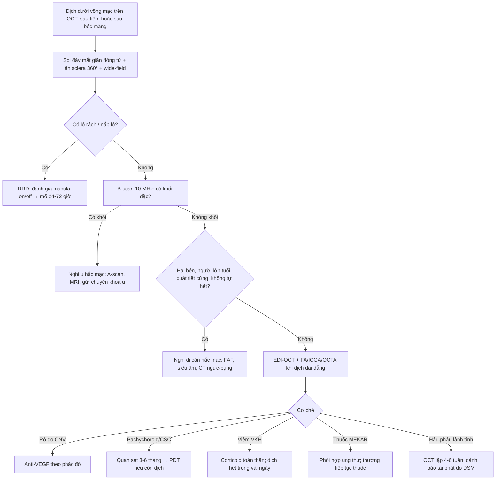
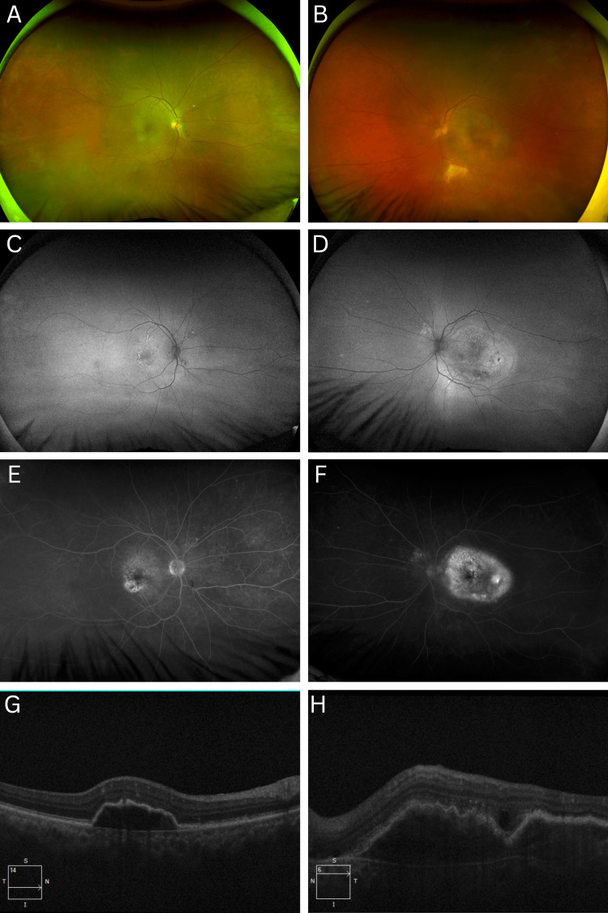
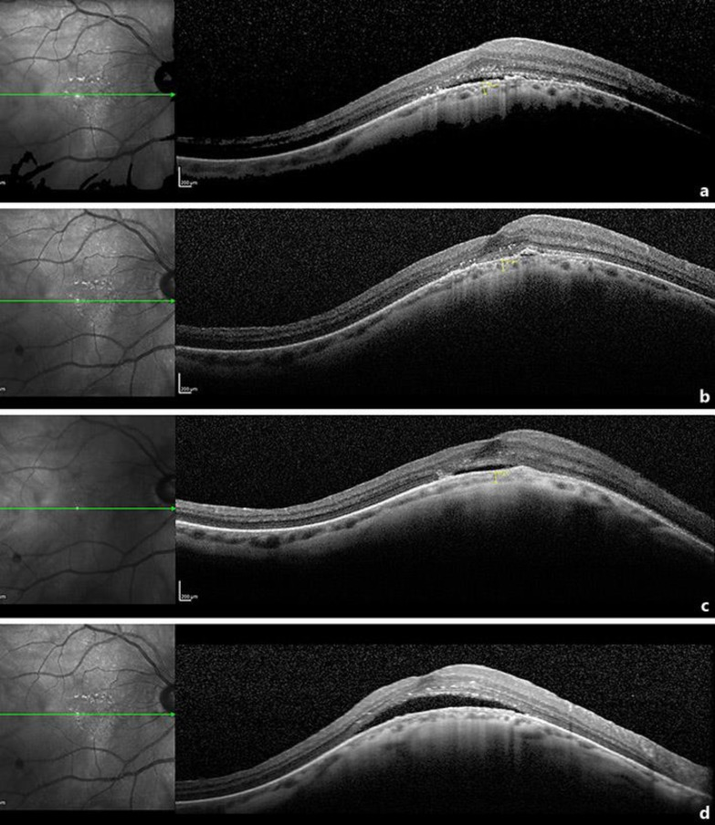
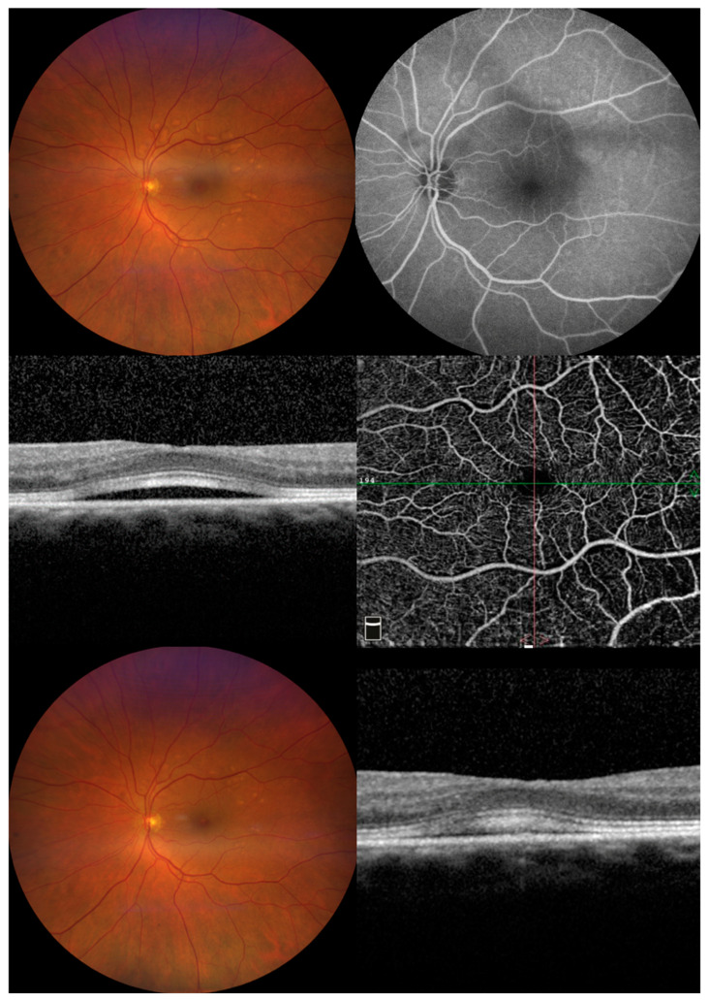

# 1479 — Bong võng mạc thanh dịch (không có lỗ) sau tiêm nội nhãn và sau bóc màng / Serous retinal detachment after intravitreal injection and membrane peeling

**Tags:** `pattern:dich-duoi-vong-mac` `pattern:bong-vong-mac` `pattern:bong-thanh-dich` `pattern:khong-lo-rach` `pattern:sau-tiem-noi-nhan` `pattern:sau-boc-mang` `pattern:mat-mot-ben` `vung:vong-mac` `vung:hoang-diem` `vung:hac-mac` `protocol:OCT` `protocol:EDI-OCT` `protocol:sieu-am-B-scan` `protocol:FA` `protocol:ICGA` `protocol:OCTA` `incidentaloma:khong`

**Mức chắc chắn (certainty):** tổng hợp y văn (literature synthesis) — dựng từ **1 nghiên cứu 207 mắt CSC quan sát 3–6 tháng** (*J Clin Med* 2025, **PMC11899871**, CC BY 4.0), **ca DSM + ERM bóc màng xong hết dịch 3 tháng rồi tái phát sau 1 năm** (*Case Rep Ophthalmol* 2017, **PMC5731175**, CC BY-NC 4.0), **ca u hắc mạc di căn hai bên bị chẩn đoán nhầm là CSC** (*Cureus* 2025, **PMC12507074**, CC BY 4.0), **ca u xương hắc mạc có dịch dưới võng mạc** (*Front Med* 2026, **PMC13630659**, CC BY 4.0), **nghiên cứu MEKAR – BRAF/MEK inhibitor** (*J Clin Med* 2023, **PMC9918243**, CC BY 4.0), **tổng quan OCT trong bong võng mạc** (*Diagnostics* 2025, **PMC11988441**, CC BY 4.0) và **ca VKH hai bên** (*SpringerPlus* 2016, **PMC4864801**, CC BY 4.0). Nhóm **không có bệnh nhân của mình**; chỗ chưa đủ chắc ghi "chưa rõ". **Không ghi tên tác giả** — attribution dùng tạp chí + năm + PMCID.

> **Câu chốt:** Bong võng mạc thanh dịch là **hậu quả chung của nhiều cơ chế**, không phải một bệnh — và câu hỏi sống còn luôn là **"có lỗ rách hay không"**, vì câu trả lời đảo ngược điều trị: **có lỗ = mổ**, **không lỗ = tìm nguyên nhân rồi theo dõi**. Ba con số phải thuộc: **(1)** dịch thanh dịch sau bóc màng/PPV **có thể hết trong 3 tháng** nhưng **vẫn tái phát sau 1 năm** nếu có **dome-shaped macula** nền (PMC5731175); **(2)** CSC thực hành **quan sát 3–6 tháng** trước khi can thiệp — 207 mắt/155 bệnh nhân (PMC11899871); **(3)** **50–90% người lớn dùng MEK inhibitor có dịch dưới võng mạc (MEKAR) mà không cần giảm liều** (PMC9164750, PMC9918243). Bẫy chết người: **dịch thanh dịch hai bên ở người lớn tuổi + không tự hết = di căn hắc mạc**, không phải CSC (PMC12507074).

## 1. Tổng quan bệnh học – cơ chế hình ảnh

### 1.1 TẠI SAO dịch đứng được dưới võng mạc mà KHÔNG có lỗ

Võng mạc cảm thụ **không có mạch máu nuôi riêng**; nó sống nhờ hắc mạc qua **biểu mô sắc tố (RPE)**. RPE là một lớp **bơm một chiều**: **Na⁺/K⁺-ATPase** ở màng đáy bơm Na⁺ ra phía hắc mạc, nước theo áp suất thẩm thấu → **hút dịch từ khoang dưới võng mạc về hắc mạc**. Khoang dưới võng mạc vì thế **không phải khoang trống mà là khoang "được hút khô liên tục"**.

Cân bằng đó vỡ theo ba hướng:

1. **Bơm RPE bị ức chế** — corticoid (toàn thân hoặc tại chỗ), **ức chế MEK/BRAF**, tổn thương RPE do viêm hoặc do ánh sáng → dịch ứ lại **dù không có lỗ và dù mạch máu hắc mạc bình thường**. Đây là cơ chế **CSC** và **MEKAR**: hình ảnh **giống hệt nhau trên OCT**, khác nhau ở **tiền sử thuốc**.
2. **Áp lực thủy tĩnh hắc mạc tăng** — hắc mạc dày (pachychoroid), tăng áp tĩnh mạch hắc mạc do **hẹp tĩnh mạch trung tâm/tĩnh mạch nhánh**, hoặc **tăng áp lực hệ thống** → nước bị **đẩy** qua RPE.
3. **Tính thấm mao mạch hắc mạc tăng** — viêm (VKH, viêm củng mạc sau), **tân mạch hắc mạc (CNV)** rò huyết tương, hoặc **u hắc mạc** (melanoma, hemangioma, osteoma, di căn) tiết dịch.

**Sau tiêm nội nhãn** và **sau bóc màng** là hai bối cảnh hay gặp nhất trên thực hành, nhưng dịch trong hai bối cảnh này **thường không do mũi tiêm hay do thao tác**:

- Sau tiêm: nếu kim gây **lỗ rách** → **bong có lỗ (RRD)** — tần suất **0,02%/mũi anti-VEGF** và **0,134%/mũi implant dexamethasone** (xem [1469](../1469-bong-vong-mac-co-lo-sau-tiem-noi-nhan/lesson.md), PMC8589788). Nếu **không có lỗ**, dịch là **bệnh nền đang hoạt động** (nAMD/PNV, CSC, viêm) hoặc **tác dụng thuốc** — không phải "biến chứng của mũi tiêm".
- Sau bóc màng: bóc màng **làm thay đổi cơ học và gây viêm nhẹ** ở lớp ngoài; đồng thời nhiều mắt có **dome-shaped macula (DSM)** hoặc **hắc mạc dày** nền — hai yếu tố này **tự sinh dịch** và **không mất đi khi bóc màng**. Vì vậy **dịch có thể hết sau mổ rồi tái phát** dù giải phẫu "thành công" (PMC5731175).

### 1.2 TẠI SAO hình ảnh trông như vậy (vật lý OCT – B-scan – FA)

- **OCT — vì sao dịch "đen":** OCT dùng **giao thoa ánh sáng có độ kết hợp thấp**, đo **hồi phản xạ** với độ phân giải trục **5–7 µm**. **Nước trong** gần như **không tán xạ ngược** → khoang dưới võng mạc là **vùng giảm tín hiệu (hyporeflective)**, phía trên là **dải tăng phản xạ liên tục** của võng mạc cảm thụ, phía dưới là **dải RPE–màng Bruch** liên tục. Ba dấu quyết định:
  - **Đường ellipsoid (EZ) còn nguyên trên dịch** = tế bào cảm quang chưa chết → **tiên lượng tốt**; EZ đứt đoạn = tổn thương không hồi phục dù dịch hết.
  - **Bờ dịch nhẵn, vòm, không có nếp gấp lớp ngoài (outer retinal corrugations)** = dịch **cấp, áp lực thấp**; **nếp gấp lớp ngoài là dấu của bong kéo dài** (điển hình bong có lỗ mạn — PMC11988441).
  - **"Photoreceptor shaggy"** (bờ ngoài tế bào cảm quang lởm chởm) = **dịch giàu fibrin/protein**, gặp trong VKH cấp và CSC cấp; **không phải artifact**.
- **B-scan — vì sao vẫn cần dù đã có OCT:** đầu dò **10 MHz** cho hình cắt 2 chiều, xuyên được **đục môi trường** (xuất huyết dịch kính, đục thể thủy tinh). Ba điểm phân biệt: **võng mạc bong luôn chạy tới đĩa thị hai đầu**; **bong thanh dịch** là **vòm nhẵn, không dính đĩa**; **bong hắc mạc** là **vòm dày, không dính đĩa, thường có nhãn áp thấp** và có thể "hôn nhau" (kissing choroidals). A-scan giúp **u**: melanoma **phản hồi nội bộ thấp–trung bình**, hemangioma **phản hồi cao** (quy ước kinh điển, chưa có số trong các nguồn của bài).
- **FA/ICGA — vì sao cần khi dịch dai dẳng:** FA trả lời **"có rò hay không"** — CNV rò thì **tăng huỳnh quang lan tỏa thì muộn**; CSC **điểm rò khu trú**; VKH **nhiều điểm tăng huỳnh quang nhỏ + đọng thuốc dạng hồ**; **MEKAR không rò trong vùng hoàng điểm** (FA chỉ "pooling" tại chỗ bong RPE) — đây là dấu **loại CSC** trong ca MEKAR (PMC9918243). ICGA cho **hắc mạc**: mảng giảm huỳnh quang trong VKH, mạch hắc mạc giãn (pachyvessels) trong pachychoroid.

### 1.3 Ngưỡng định lượng nằm lòng

| Chỉ số | Ngưỡng / giá trị | Nguồn |
|---|---|---|
| Thời gian quan sát CSC trước can thiệp | **3–6 tháng** (207 mắt, 155 bệnh nhân; đơn giản 164 mắt, phức tạp 43 mắt) | PMC11899871 |
| Tiêu chí CSC "phức tạp" | **teo RPE ≥ 2 diện đĩa thị** → tái phát nhiều hơn, cân nhắc **PDT sớm** | PMC11899871 |
| MEKAR (dịch dưới võng mạc do ức chế MEK) | **tới 90%** người lớn dùng MEK inhibitor; thường **không triệu chứng**, **tự hết không cần giảm liều** | PMC9164750 (tóm tắt hội nghị) |
| MEKAR — cơ chế | **RPE + giảm tỉ lệ light peak/dark trough (Arden)**; FA **không rò** vùng hoàng điểm | PMC9918243 |
| DSM + ERM: diễn tiến dịch sau bóc màng | hết dịch **3 tháng** sau mổ, **tái phát sau 1 năm**, **to hơn sau 2 năm**; độ lồi hoàng điểm **760 µm** | PMC5731175 |
| VKH: tốc độ đáp ứng corticoid | dịch **hết sau 4 ngày** (bệnh nhân 1) và **8 ngày** (bệnh nhân 2); FA còn điểm tăng huỳnh quang muộn | PMC4864801 |
| U xương hắc mạc có dịch | **36 tuổi**; ranibizumab ×3 giảm dịch, **tái phát ~40 tuần**; faricimab **6 mg** hết dịch; OCTA **không có CNV** | PMC13630659 |
| Di căn hắc mạc giả CSC | **72 tuổi**, **hai bên**, dịch **không tự hết** nhiều tháng; u phổi **3,0 × 2,4 × 1,7 cm**, T2aN1M1 | PMC12507074 |
| Bong có lỗ sau tiêm (để loại trừ) | **0,02%/mũi** anti-VEGF (0,010–0,037) vs **0,134%/mũi** implant DEX (0,044–0,312) | PMC8589788 (bài [1469](../1469-bong-vong-mac-co-lo-sau-tiem-noi-nhan/lesson.md)) |
| Dấu mạn tính trên OCT | **nếp gấp lớp ngoài (ORC) / undulation** = bong kéo dài, không phải dịch cấp | PMC11988441 |

## 2. Mẫu hình + chẩn đoán phân biệt theo vị trí (gamut)

**Mẫu hình (pattern):** trên OCT, **khoang giảm tín hiệu dưới võng mạc**, bờ võng mạc **vòm nhẵn**, **EZ còn nguyên** (thường), **không có lỗ rách** trên soi 360° + ấn sclera; võng mạc **trong suốt** (không trắng đục như bong có lỗ mạn) hoặc **hơi mờ** khi dịch giàu fibrin. Trên wide-field: **vùng mờ nhẹ, không có "nắp" lỗ**, không có đứt mạch hắc mạc kiểu bong có lỗ.

**Gamut theo vị trí:**

- **Khu trú hoàng điểm, một mắt** → CSC/pachychoroid, CNV (nAMD/PNV), dịch sau bóc màng, MEKAR (thường hai bên).
- **Hoàng điểm + lan ra ngoại vi nhưng KHÔNG tới ora** → viêm (VKH), u hắc mạc lớn, bong thanh dịch do tăng huyết áp/tăng áp tĩnh mạch.
- **Toàn bộ võng mạc (bong hình phễu nhẵn)** → u hắc mạc (melanoma) hoặc di căn, bệnh máu (tăng globulin), tiền sản giật/HELLP — **phải loại u trước khi theo dõi**.
- **Kèm hắc mạc dày lan tỏa** → pachychoroid spectrum, VKH, viêm củng mạc sau, tăng áp hệ thống.
- **Kèm xuất tiết cứng (hard exudates) và đốm vàng dưới võng mạc** → **u (di căn, osteoma, Coats)** hoặc bệnh mạch máu mạn — **không phải CSC cấp**.

**Gamut theo cơ chế (mnemonic "BƠM – ÁP – RÒ – U – LỖ"):**

1. **BƠM** (bơm RPE suy): CSC, corticoid, MEK/BRAF inhibitor, tổn thương RPE.
2. **ÁP** (áp lực hắc mạc): pachychoroid, tắc tĩnh mạch, tăng huyết áp, hạ nhãn áp (→ bong hắc mạc, khác thực thể).
3. **RÒ** (tính thấm): CNV, VKH, viêm củng mạc sau, u.
4. **U**: melanoma, hemangioma, osteoma, di căn, lymphoma.
5. **LỖ**: nếu có lỗ → **RRD**, không còn là "bong thanh dịch" — xem [1469](../1469-bong-vong-mac-co-lo-sau-tiem-noi-nhan/lesson.md).

## 3. Bảng so sánh phân biệt (ma trận đối chiếu)

| Thực thể (entity) | Hình ảnh điển hình | Chốt vào (rule-in) | Chốt loại (rule-out) | Gợi ý xác nhận |
|---|---|---|---|---|
| **Dịch thanh dịch sau bóc màng/PPV** | Dịch vòm nhẹ ở hoàng điểm, **EZ còn nguyên**, không lỗ; có thể kèm **dome-shaped macula** | **Mổ bóc màng/PPV gần đây + không lỗ + dịch giảm dần theo tuần** | Có lỗ rách, hoặc dịch **tăng nhanh** sau tuần 2 → không phải "dịch hậu phẫu lành tính" | OCT lặp 4–6 tuần; so sánh chiều cao dịch (µm) từng lần |
| **CSC / pachychoroid** | Dịch vòm, **hắc mạc dày**, FA **điểm rò khu trú**, ICGA mạch giãn | **Nam trung niên, một mắt, hắc mạc dày, FA có điểm rò**; tự hết trong 3–6 tháng | **Hai bên + không tự hết + xuất tiết cứng** → nghĩ u/hệ thống | FA + ICGA + EDI-OCT; theo dõi 3 tháng trước khi PDT |
| **MEKAR (thuốc ức chế MEK/BRAF)** | **Nhiều ổ dịch nhỏ hai bên**, bong RPE, **FA không rò** vùng hoàng điểm | **Đang dùng trametinib/cobimetinib/encorafenib**; dịch xuất hiện sau khởi trị, thường **không triệu chứng** | Có rò trên FA, hoặc một bên + hắc mạc dày khu trú → không phải MEKAR | FA (không rò) + phối hợp ung thư; thường **không cần ngừng thuốc** |
| **VKH cấp** | **Hai bên**, dịch vòm nhiều ổ, **"shaggy photoreceptors"**, hắc mạc rất dày, FA nhiều điểm + đọng hồ | **Hai bên + hắc mạc dày + FA nhiều điểm tăng huỳnh quang + đáp ứng corticoid trong vài ngày** | Một bên, không đáp ứng corticoid, có u → loại VKH | EDI-OCT (SFCT), FA/ICGA, xét lao/giang mai |
| **U hắc mạc (melanoma/hemangioma/osteoma)** | Khối **dày > 2 mm**, sắc tố/orange pigment, **B-scan khối đặc**, A-scan phản hồi khác nhau | **Khối đặc trên B-scan + dày > 2 mm + dịch trên bề mặt** | Chỉ có dịch, **không có khối** trên B-scan → không phải u | B-scan + A-scan; MRI hốc mắt nếu > 2 mm; gửi chuyên khoa u |
| **Di căn hắc mạc** | **Hai bên**, mảng kem nhạt, **da báo (leopard spot)** trên FAF, dịch **không tự hết** | **Người lớn tuổi + hai bên + tiền sử ung thư (hoặc sụt cân/ho)**; FAF da báo | Trẻ, một bên, tự hết → không nghĩ di căn | Siêu âm B-scan + CT ngực/bụng, phối hợp ung thư |
| **Bong có lỗ (RRD)** | Võng mạc **trắng đục, gấp nếp**, có **lỗ/nắp**, **nếp gấp lớp ngoài** khi mạn; dịch lan tới ora | **Lỗ thấy khi soi 360° + ấn sclera**, hoặc **nếp gấp lớp ngoài** trên OCT | Dịch vòm nhẵn, EZ nguyên, không lỗ, không nếp gấp → không phải RRD | Soi đáy mắt + wide-field; B-scan nếu đục (bài [1469](../1469-bong-vong-mac-co-lo-sau-tiem-noi-nhan/lesson.md)) |
| **Bong co kéo (TRD)** | Màng xơ **kéo võng mạc hình lều**, dính chắc, **không lỗ tự do** | **Đái tháo đường tăng sinh/xuất huyết dịch kính cũ + màng co kéo** | Dịch vòm tự do, không màng → không phải TRD | OCT + B-scan; đánh giá màng trước võng mạc |
| **Bong hắc mạc / tràn dịch hắc mạc** | **Vòm dày, không dính đĩa thị**, nhãn áp **thấp**, tiền phòng nông | **Nhãn áp thấp + vòm hắc mạc + không dính đĩa thị** (hoặc kissing choroidals) | Dính đĩa thị hai đầu → võng mạc | B-scan + đo nhãn áp; xem thêm [411](../411-sieu-am-nhan-cau/lesson.md) |
| **Tách lớp võng mạc cận thị (foveoschisis)** | **Tách trong võng mạc**, cột trụ (column), không dịch dưới võng mạc thật | **Cận thị nặng + tách lớp trong + thị trường ổn định** | Có dịch dưới võng mạc thật lan → không phải schisis đơn thuần | OCT; theo dõi hoặc phẫu thuật theo tiến triển |

- **Ảnh ghép đối chiếu:** không tạo composite — 4 ảnh đến từ 4 bài, 4 bệnh nhân, khác modality và khác license (CC BY và CC BY-NC); ghép sẽ làm mất chú giải gốc và không thêm thông tin.

## 4. Protocol chụp + hệ phân độ/điểm chuẩn hóa

### 4.1 Protocol "nhìn thấy dịch là phải trả lời 3 câu"

1. **Có lỗ không?** Soi đáy mắt **giãn đồng tử + ấn sclera 360°** (bắt buộc, kể cả khi OCT đẹp) + **wide-field**. Không thấy lỗ mới được gọi là bong thanh dịch.
2. **Có khối không?** **B-scan 10 MHz** ở mọi ca dịch **không giải thích được** hoặc **hai bên**; A-scan nếu thấy khối. Khối **> 2 mm** → MRI hốc mắt và gửi chuyên khoa u.
3. **Có rò không?** **FA ± ICGA** khi dịch **còn sau 3 tháng**, khi **hai bên**, hoặc khi **nghi CNV**. **OCTA** thay FA khi cần khảo sát CNV không xâm lấn.

**Thông số OCT tối thiểu:** raster hoàng điểm **6 × 6 mm**, khoảng cách lát **30 µm** (hoặc 19 lát theo máy), **EDI-OCT** để đo **độ dày hắc mạc dưới hoàng điểm (SFCT)**; ghi lại **chiều cao dịch tại hõm hoàng điểm (µm)**, **tình trạng EZ**, **có/không nếp gấp lớp ngoài**.

### 4.2 Lịch theo dõi và ngưỡng quyết định

| Thời điểm | Việc làm | Ngưỡng hành động |
|---|---|---|
| Ngay sau tiêm / sau mổ | Cảm nhận ánh sáng, nhãn áp, đáy mắt nếu bệnh nhân than mờ | Mất vùng nhìn/nhá đèn tăng → soi 360° ngay |
| **1–2 tuần** | Soi 360° + OCT hoàng điểm | Dịch **tăng** hoặc xuất hiện lỗ → chuyển mổ |
| **4–6 tuần** | OCT lặp, đo chiều cao dịch, EZ | Dịch **giảm ≥ 50%** hoặc hết → tiếp tục theo dõi thường quy |
| **3 tháng** | FA/ICGA/OCTA nếu còn dịch; B-scan nếu nghi khối | Dịch còn + có rò → điều trị theo nguyên nhân (anti-VEGF/PDT) |
| **3–6 tháng** | Quyết định can thiệp (khung CSC) | Dịch dai dẳng + hắc mạc dày → **PDT**; CSC phức tạp (teo RPE ≥ 2 DD) → can thiệp sớm |
| Bất kỳ lúc nào | Phát hiện **lỗ** hoặc **TRD đe dọa hoàng điểm** | Mổ **trong 24–72 giờ** (macula-on) |

### 4.3 Khi nào **KHÔNG** mổ

- Dịch **vòm nhẵn, không lỗ, EZ nguyên**, thị lực ổn định → **mổ không có gì để hàn**, chỉ thêm nguy cơ (viêm nội nhãn, đục thể thủy tinh, tăng nhãn áp — xem [1425](../1425-viem-noi-nhan-sau-tiem-noi-nhan/lesson.md), [1465](../1465-tang-nhan-ap-sau-tiem-noi-nhan/lesson.md)).
- **U hắc mạc** → điều trị **u** (xạ, anti-VEGF cho dịch do CNV thứ phát), **không** mổ bong.
- **VKH** → corticoid; mổ trong giai đoạn viêm làm **bùng phát** và tăng PVR.

## 5. Biến thể bình thường và cạm bẫy

- **"Dịch sau bóc màng là mổ thất bại"** — không đúng: dịch **giảm dần trong 3 tháng** là diễn tiến bình thường; nhưng nếu **tái phát sau 1 năm** thì phải tìm **DSM, CNV hoặc lỗ bị bỏ sót** (ca PMC5731175 tái phát đúng như vậy, kèm **FA/ICGA không rò**).
- **"OCT hoàng điểm bình thường = không bong"** — sai: raster 6 mm **không tới ora**; lỗ ở **vùng tiêm 3,5–4,0 mm** chỉ thấy khi **ấn sclera** (xem [1469](../1469-bong-vong-mac-co-lo-sau-tiem-noi-nhan/lesson.md)).
- **"Hai bên + tái phát = CSC mạn"** — đây là bẫy nguy hiểm nhất: ca **72 tuổi**, dịch hai bên **nhiều tháng không tự hết**, FAF da báo, cuối cùng là **di căn từ ung thư phổi** (PMC12507074). Quy tắc: **hai bên + lớn tuổi + xuất tiết cứng + sụt cân/ho → B-scan + CT ngực**.
- **"Dịch sau tiêm là do thuốc chưa đủ"** — dịch **có thể là bệnh nền hoạt động** (cần anti-VEGF tiếp) hoặc **lỗ rách mới** (cần mổ); tăng liều mù quáng trong ca có lỗ = **mất thời gian vàng**.
- **MEKAR bị đọc thành CSC**: hình OCT **gần như không phân biệt được**; khác biệt nằm ở **thuốc đang dùng** và **FA không rò** (PMC9918243). Đổi/ngừng thuốc ung thư vì "CSC" là **sai chỉ định**.
- **Corticoid gây CSC**: có ca **CSC xuất hiện sau implant dexamethasone nội nhãn** — corticoid tại chỗ **không miễn nhiễm** với cơ chế này (PMC5182243). Hỏi kỹ **corticoid toàn thân, tiêm ngoài màng cứng, kem bôi** trước khi kết luận "vô căn".
- **Ảo ảnh B-scan**: **màng dịch kính sau** dày thoáng qua bị đọc là "bong võng mạc" — phân biệt bằng **dính đĩa thị** và **di động khi mắt đảo**; **bong hắc mạc** không dính đĩa.
- **Satisfaction of search**: thấy dịch ở hoàng điểm rồi dừng lại — **quên soi ngoại vi tìm lỗ** và **quên B-scan tìm khối**.

## 6. Tự lượng giá — Blind Quiz ngay trên trang tĩnh

**Ca 1 — dịch hai bên ở người lớn tuổi**

- Gợi ý lâm sàng: nam **72 tuổi**, mờ mắt **hai bên** tiến triển nhiều tháng, không đau, **không tự cải thiện**; không tiền sử bệnh mắt.
- Câu hỏi: Mô tả dấu hiệu chính trên ảnh (A–H)? Ba chẩn đoán phân biệt? Dấu hiệu nào **buộc phải chụp thêm ngoài mắt**?

<b>Bấm để hiện đáp án (findings + chẩn đoán)</b>

- Dấu hiệu: **A/B** ảnh tiếp xúc rộng — mảng **giảm sắc tố dưới hoàng điểm** hai mắt, mắt trái có **bong hoàng điểm thanh dịch** + **xuất tiết cứng** dọc cung mạch dưới; **C/D** FAF — **hình da báo (leopard spot)**; **E/F** FA — tăng huỳnh quang dạng đốm/leopard, không có điểm rò đơn độc kiểu CSC; **G/H** OCT — **dịch dưới võng mạc** trên **tổn thương hắc mạc gồ ghề**, EZ bị đứt đoạn từng chỗ.
- Chẩn đoán: **di căn hắc mạc hai bên** (nguồn nguyên phát: **ung thư phổi tế bào vảy**, u **3,0 × 2,4 × 1,7 cm**, T2aN1M1) — ban đầu bị chẩn đoán nhầm là CSC.
- Vì sao: dịch **không tự hết**, **hai bên**, kèm **xuất tiết cứng** và **FA không có điểm rò khu trú** → cơ chế **rò từ khối u**, không phải bơm RPE suy. Chốt: **B-scan + CT ngực–bụng**.
- Nguồn ảnh: *Cureus* 2025 (PMC12507074), Fig. 1, CC BY 4.0.

**Ca 2 — dịch xuất hiện lại sau khi "mổ thành công"**

- Gợi ý lâm sàng: nữ cận thị, **màng trước võng mạc** trên **dome-shaped macula**, đã **bóc màng**. Thị lực cải thiện ban đầu, sau đó mờ lại.
- Câu hỏi: (a) Dịch nằm ở đâu và có lỗ không? (b) Vì sao dịch **hết rồi tái phát** dù màng đã bóc? (c) Có nên mổ lại ngay không?

<b>Bấm để hiện đáp án (findings + chẩn đoán)</b>

- Dấu hiệu: OCT ngang qua hoàng điểm **lồi ra trước (dome)**; **a** sau mổ 1 tháng — dịch giảm; **b** 3 tháng — **hết dịch**; **c** 1 năm — **dịch tái xuất**; **d** 2 năm — **dịch nhiều hơn**. Không có lỗ rách, không có co kéo còn lại.
- Chẩn đoán: **bong võng mạc thanh dịch trên dome-shaped macula**, tái phát sau bóc màng — **không phải thất bại phẫu thuật**.
- Vì sao: DSM là **biến dạng củng mạc–hắc mạc**; bóc màng chỉ giải quyết **thành phần co kéo**, còn **áp lực hắc mạc** vẫn còn → dịch quay lại. FA/ICGA **không rò**, loại CNV.
- Xử trí: **theo dõi** (OCT 3–6 tháng); mổ lại chỉ khi có **co kéo/lỗ mới** hoặc dịch đe dọa hoàng điểm kéo dài.
- Nguồn ảnh: *Case Rep Ophthalmol* 2017 (PMC5731175), Fig. 3, CC BY-NC 4.0.

**Ca 3 — dịch nhiều ổ hai bên ở người đang điều trị ung thư**

- Gợi ý lâm sàng: bệnh nhân **ung thư** đang dùng **ức chế BRAF/MEK**; khám sàng lọc **2 tuần** sau khởi trị, **không than mờ nhiều**.
- Câu hỏi: (a) Dịch dưới võng mạc ở đâu, có rò trên FA không? (b) Chẩn đoán? (c) Có phải ngừng thuốc ung thư không?

<b>Bấm để hiện đáp án (findings + chẩn đoán)</b>

- Dấu hiệu: ảnh màu — **nhiều ổ bong RPE nhỏ vùng cực sau**; **FA không rò** trong vùng hoàng điểm (chỉ **pooling** tại ổ bong RPE); OCT — **nhiều ổ dịch dưới võng mạc/bong RPE**, võng mạc cảm thụ còn nguyên; OCTA — mạch hắc mạc, không thấy mạng CNV; hàng dưới — **dịch tự hết** khi tiếp tục điều trị.
- Chẩn đoán: **MEKAR (bệnh võng mạc do ức chế MEK)** — "CSC giả" do thuốc.
- Vì sao: ức chế MEK làm **giảm chức năng bơm RPE** (giảm tỉ lệ Arden) → dịch ứ **dù không rò**. Gặp **tới 90%** người lớn dùng MEK inhibitor, thường **không triệu chứng** và **tự hết không cần giảm liều**.
- Xử trí: **phối hợp ung thư – theo dõi**, không tự ngừng thuốc; chỉ can thiệp khi dịch đe dọa hõm hoàng điểm kéo dài.
- Nguồn ảnh: *J Clin Med* 2023 (PMC9918243), Fig. 1, CC BY 4.0.

## Bài liên quan chéo

- [1469 – Bong võng mạc có lỗ sau tiêm nội nhãn (IVARD): **0,02%/mũi** anti-VEGF vs **0,134%/mũi** DEX; chốt bằng soi 360° + ấn sclera](../1469-bong-vong-mac-co-lo-sau-tiem-noi-nhan/lesson.md)
- [1467 – Màng trước võng mạc (ERM): 4 giai đoạn Govetto, ngưỡng mổ và kết quả bóc màng](../1467-mang-truoc-vong-mac-erm/lesson.md)
- [1465 – Tăng nhãn áp cấp sau tiêm nội nhãn (IOP spike)](../1465-tang-nhan-ap-sau-tiem-noi-nhan/lesson.md)
- [1425 – Viêm nội nhãn sau tiêm nội nhãn](../1425-viem-noi-nhan-sau-tiem-noi-nhan/lesson.md)
- [1436 – Bệnh Vogt–Koyanagi–Harada: bong thanh dịch hai bên + hắc mạc dày](../1436-benh-vogt-koyanagi-harada/lesson.md)
- [445 – Bong võng mạc: rách – co kéo – tiết dịch](../445-bong-vong-mac/lesson.md)
- [411 – Siêu âm nhãn cầu: phân biệt màng dịch kính – võng mạc – hắc mạc](../411-sieu-am-nhan-cau/lesson.md)
- [1865 – Bong võng mạc tái phát sau tháo dầu](../1865-bong-vong-mac-tai-phat-sau-thao-dau/lesson.md)
- [1441 – Bong võng mạc sau xạ trị u nội nhãn: thanh dịch vs TRLE vs co kéo](../1441-bong-vong-mac-xa-sau-xa-tri-u-noi-nhan/lesson.md)

## Ảnh

- Tên file: `1479_bong-vong-mac-thanh-dich_<Modality>_<PMCID>.jpg`. Nguồn + giấy phép từng ảnh trong `images/CREDITS.md`.
- 4 ảnh, tất cả **tải được** (CC BY 4.0 / CC BY-NC 4.0); ảnh `.webp` của Frontiers được **chuyển định dạng sang JPG** (giữ nguyên nội dung, không crop/ghép) — ghi rõ trong CREDITS.

> Không dùng để chẩn đoán độc lập khi chưa có người hướng dẫn.
