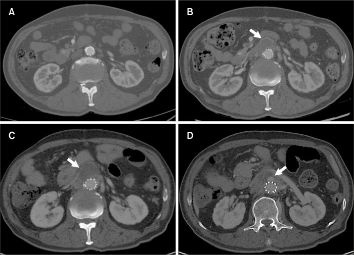
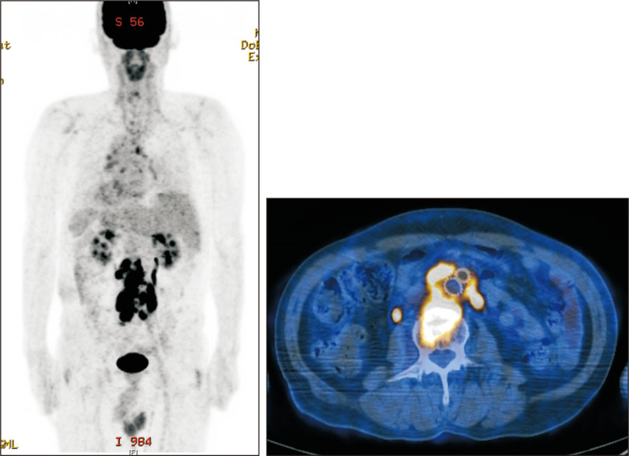
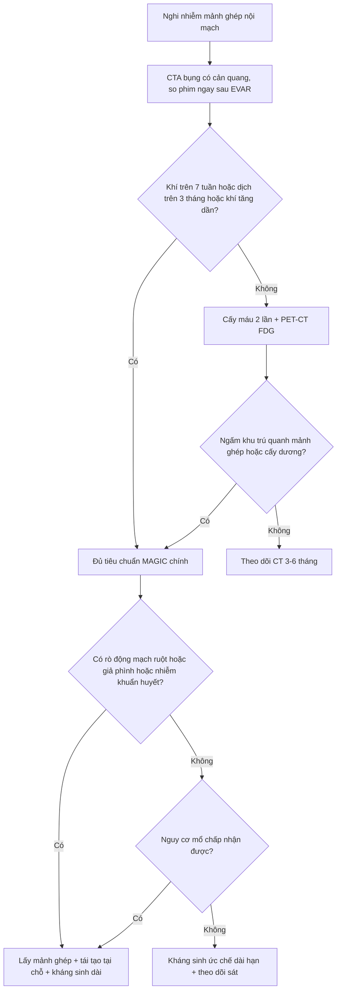

# 148 — Nhiễm trùng mảnh ghép nội mạch động mạch chủ: MAGIC, PET/CT và quyết định lấy hay giữ mảnh ghép / Aortic endograft infection: MAGIC criteria, FDG-PET/CT and the explant-versus-preserve decision

**Tags:** `pattern:tu-dich-quanh-manh-ghep` `pattern:khi-quanh-manh-ghep` `vung:dong-mach-chu` `score:MAGIC` `protocol:CTA-bung` `protocol:PET-FDG` `incidentaloma:tu-dich-quanh-manh-ghep`
**Mức chắc chắn (certainty):** tổng hợp y văn (literature synthesis) — tiêu chuẩn MAGIC + số liệu hình ảnh lấy từ bài tổng quan toàn văn (PMC10512004), phản biện từ meta-analysis (PMC10613822) và 2 cohort gần (PMC13376498, PMC13661717); kỹ thuật PET/CT từ nghiên cứu 152 ca (PMC10611872). **Ca trong quiz là ca nguyên văn**, giữ đúng mô tả hình gốc.

> **Câu chốt:** sau EVAR, **một ít khí và một ít dịch quanh mảnh ghép là BÌNH THƯỜNG** — chẩn đoán nhiễm trùng không dựa vào "có khí/có dịch" mà dựa vào **THỜI GIAN** (khí ≥ **7 tuần**, dịch ≥ **3 tháng** sau EVAR = tiêu chuẩn MAGIC **chính**) và **bối cảnh** (sốt, cấy máu, khí tăng dần, giả phình miệng nối). Điều trị chuẩn là **lấy mảnh ghép + tái tạo mạch**; **giữ mảnh ghép chỉ khi nguy cơ mổ không chấp nhận được và KHÔNG có rò động mạch–ruột**.

## 1. Tổng quan bệnh học – cơ chế hình ảnh (TẠI SAO)

- **Tần suất:** nhiễm mảnh ghép nội mạch (aortic endograft infection — AEI) khoảng **0,6%** sau EVAR (khoảng **0,2–8%** tuỳ tiêu chuẩn và thời gian theo dõi) (PMC10512004); gộp 23 nghiên cứu: **0,4%** sau EVAR và **1,0%** sau mổ hở (PMC10613822). Tuy hiếm nhưng **tử vong 1 năm 28,7%** ở nhóm lấy mảnh ghép (PMC10613822).
- **TẠI SAO nhiễm dai dẳng:** mảnh ghép Dacron/ePTFE là **dị vật không có mạch máu** → **bạch cầu và kháng sinh không vào được**, vi khuẩn sống trong **màng sinh học (biofilm)**. Vì thế bệnh cảnh thường **âm ỉ**: sốt nhẹ/kéo dài, gầy sút, CRP tăng, **cấy máu chỉ dương 54%** (PMC13376498) — khác nhiễm trùng cấp thông thường.
- **TẠI SAO "khí" không đủ để gọi nhiễm:** lúc đặt mảnh ghép, một ít khí bị bẫy trong túi phình và **tự tiêu trong vài tuần**. MAGIC lấy **mốc 7 tuần** — khí quanh mảnh ghép **≥ 7 tuần sau EVAR**, hoặc **tăng thể tích khí qua các lần chụp**, mới là **tiêu chuẩn chính** (PMC10512004).
- **TẠI SAO "dịch" cũng vậy:** sau EVAR có thể tồn tại **seroma** quanh mảnh ghép; MAGIC lấy **mốc 3 tháng** — dịch quanh mảnh ghép **≥ 3 tháng sau EVAR** là tiêu chuẩn **chính**. Dịch nhiễm thường **bờ dày, ngấm thuốc, có bọt khí**, và **to ra dù đã dùng kháng sinh**; máu tụ/seroma đơn thuần thì bờ mỏng, không khí, ổn định hoặc nhỏ dần.
- **TẠI SAO FDG-PET/CT hữu ích nhưng không hoàn hảo:** ổ viêm nhiễm có **đại thực bào hoạt hoá** → tăng tiêu thụ glucose → **ngấm FDG**. Tuy nhiên mảnh ghép gây **phản ứng hạt (granulomatous reaction)** quanh thành mạch, ngấm **đều dọc mảnh ghép**; đồng thời **không có ngưỡng SUVmax được chuẩn hoá**. Vì thế phải đọc **KIỂU NGẤM**: **khu trú/không đồng nhất quanh mảnh ghép = nghi nhiễm**, **đều–lan toả dọc thành = phản ứng lành**. Nghiên cứu 152 ca: **Se 91%, Sp 72%, độ chính xác 88%** (PMC10611872).
- **Dịch tễ – vi khuẩn:** **63%** khởi phát muộn (**≥ 3 tháng** sau can thiệp); **sốt 54%** (gần nửa **không sốt**), **nhiễm khuẩn huyết 48%**; **S. aureus** là tác nhân đơn loài hay gặp nhất (**24%**), **24%** đa loài (PMC13376498). Đa loài (35,7% trong 227 đợt) là yếu tố độc lập làm tăng tử vong: **HR 2,94 (1,60–5,41)** (PMC13661717).
- **Yếu tố nguy cơ đáng nhớ:** can thiệp **cấp cứu**, **nhiễm trùng vùng bẹn/truy cập**, **nhiễm trùng ở xa trong 3 tháng**, **thủ thuật lại (re-intervention)**, **nằm viện kéo dài trước mổ**, đái tháo đường/suy thận/dùng corticoid (PMC10512004). Trong ca 1 dưới đây, bệnh nhân đã **dùng kháng sinh 3 tuần vì sốt ngay trước EVAR** — đúng bối cảnh "đặt mảnh ghép vào vùng nghi nhiễm".

*Bệnh nhân EVAR nơi khác. **(A)** 1 tháng sau EVAR: không thấy nhiễm. **(B)** 7 tháng: sốt, **tụ dịch sau phúc mạc** quanh bộ phận cố định trên thận (mũi tên). **(C)** Sau 1 tháng kháng sinh: **dịch tăng**, không đáp ứng. **(D)** 1 tuần sau: xuất hiện **túi giả phình** (mũi tên) ngang mức tĩnh mạch thận trái. Nguồn: Kim YW, *Vasc Specialist Int* 2023;39:26 (PMC10512004), Fig. 1, CC BY-NC 4.0.*

## 2. Mẫu hình + chẩn đoán phân biệt theo hình thái quanh mảnh ghép (Gamut)

- **Khí quanh mảnh ghép:**
  - **Bình thường sớm sau EVAR** (khí bẫy trong túi, tự hết).
  - **Nhiễm mảnh ghép** — khí **tồn tại ≥ 7 tuần** hoặc **tăng dần**, kèm dịch bờ dày.
  - **Rò động mạch–ruột (aortoenteric fistula — AEF)** — khí trong túi + **dày ruột kề + mất lớp mỡ giữa ĐMC và ruột**, có thể kèm **chảy máu "báo trước" (sentinel bleed)**.
  - **Nhiễm trùng hoại tử do vi khuẩn sinh hơi** (hiếm, bệnh cảnh tối cấp).
- **Dịch quanh mảnh ghép:**
  - **Seroma lành** sau EVAR (< 3 tháng, bờ mỏng, không khí, nhỏ dần).
  - **Máu tụ (hematoma)** — đậm độ cao hơn, không ngấm thuốc, tự thoái triển.
  - **Dịch nhiễm** — bờ dày ngấm thuốc, có khí, **to ra dù kháng sinh**.
  - **Rò lưu lượng thấp** qua miệng nối (type I/III endoleak) — dịch giả "quanh mạch" nhưng thực chất là **máu lưu thông**.
- **Túi phình to ra sau EVAR:** **endoleak type I (miệng nối), type II (nhánh ngược dòng), type III (rách mảnh ghép)** · **nhiễm** (kèm khí/dịch) · **giả phình miệng nối** do nhiễm.
- **Giả phình miệng nối (anastomotic pseudoaneurysm):** cơ học hoặc nhiễm; **nhiễm là nguyên nhân phải nghĩ khi có khí/dịch** và khi xuất hiện **sau một đợt sốt**.
- **Viêm quanh mảnh ghép vô khuẩn (aseptic peri-graft inflammation):** ngấm FDG lan toả, không khí, cấy âm, không tiến triển — **không phải nhiễm**, tránh mổ oan.
- **Nhiễm lan tới cột sống:** **viêm đĩa–đốt sống (spondylodiscitis)** cùng mức, đau lưng + sốt.

## 3. Bảng so sánh phân biệt (ma trận đối chiếu)

| Thực thể (entity) | Hình ảnh điển hình (CT/PET) | Chốt vào (rule-in) | Chốt loại (rule-out) | Gợi ý xác nhận |
|---|---|---|---|---|
| Nhiễm mảnh ghép (AEI) | **Dịch bờ dày ngấm thuốc** + **khí** quanh mảnh ghép; khí/dịch **tăng dần**; FDG **khu trú** | **Khí ≥ 7 tuần hoặc dịch ≥ 3 tháng sau EVAR**; khí tăng; cấy máu/dịch (+) | Khí mất sau vài tuần, dịch nhỏ dần, FDG đều dọc thành → không nhiễm | MAGIC + cấy máu ×2, chọc hút dịch dưới hướng dẫn |
| Thay đổi lành sau EVAR | Ít dịch/khí **sớm**, bờ mỏng, không ngấm | **< 7 tuần (khí) / < 3 tháng (dịch)**, ổn định | **Khí tăng hoặc dịch to ra** → không phải lành | So phim cũ đúng bình diện |
| Endoleak type II | Túi còn **dịch/máu lưu thông**, **không khí mới**, nhánh nuôi ngược dòng | **Thấy nhánh nuôi + túi không nhỏ lại** | Có **khí + dịch bờ dày + sốt** → nghĩ nhiễm hơn endoleak | CTA các thì, DSA nếu cần |
| Rò động mạch–ruột (AEF) | **Khí trong túi** + **dày ruột kề**, mất mặt phẳng mỡ; **sentinel bleed** | **Khí + dày ruột + xuất huyết tiêu hoá** | Không có khí/dày ruột, không chảy máu → ít nghĩ AEF | CT + nội soi (cẩn thận), mổ cấp cứu khi chảy máu |
| Máu tụ/seroma lành | Khối dịch **bờ mỏng**, không khí, không ngấm; ổn định | **Không khí, không ngấm, nhỏ dần** | **Bờ dày ngấm + khí** → nghi nhiễm | Theo dõi CT 3–6 tháng |
| Viêm quanh mảnh ghép vô khuẩn | FDG **lan toả đều**, không dịch/khí, cấy âm | **Ngấm đều dọc thành + cấy âm + không tiến triển** | **Ngấm khu trú + khí/dịch** → nhiễm | PET/CT lặp lại, cấy mô |
| Nhiễm trùng huyết từ ổ khác | FDG **ập vào ổ ngoài mạch** (tiết niệu, phổi, cột sống), mảnh ghép bình thường | **Ổ ngoài mạch rõ** | Chỉ ngấm quanh mảnh ghép → nghĩ AEI | Cấy máu, PET toàn thân |

*PET/CT ở bệnh nhân nhiễm mảnh ghép sau EVAR: **ngấm FDG quanh mảnh ghép động mạch chủ** (trái: MIP; phải: mặt cắt axial fusion). Lưu ý **ngấm sinh lý ở đường tiết niệu** — đừng đọc thành ổ nhiễm thứ hai. Nguồn: Kim YW, *Vasc Specialist Int* 2023;39:26 (PMC10512004), Fig. 2, CC BY-NC 4.0.*

## 4. Protocol chụp + tiêu chuẩn MAGIC + thuật toán điều trị

### 4.1 Chụp
- **CTA động mạch chủ bụng** (lát ≤ 1 mm), **thì động mạch + thì tĩnh mạch/muộn** để phân biệt **dòng thuốc trong túi (endoleak)** với **dịch không ngấm**; đo **đậm độ dịch (HU)**, ghi **kích thước túi** và **bề dày/kiểu ngấm của bờ dịch**.
- **So sánh với phim ngay sau EVAR** — giá trị lớn nhất của CT nằm ở **động học**: khí/dịch **tăng** hay **giảm**.
- **FDG-PET/CT** khi CT chưa chốt, khi cấy âm, hoặc để tìm **ổ nhiễm ngoài mạch**; đọc theo **kiểu ngấm** (khu trú/không đồng nhất vs đều dọc thành) và **luôn đối chiếu với CT**, không dựa SUVmax đơn thuần (PMC10611872).
- **Xạ hình bạch cầu đánh dấu (labeled leukocyte SPECT/CT)** là lựa chọn thay thế khi PET không sẵn; hạn chế: mất thời gian (2–4 giờ và 20–24 giờ) và **tương tác với hoạt động sinh lý ở ruột/tủy xương** (PMC10512004).

### 4.2 Tiêu chuẩn MAGIC (Management of Aortic Graft Infection Collaboration, 2016)

| Nhóm | Tiêu chuẩn **chính (major)** | Tiêu chuẩn **phụ (minor)** |
|---|---|---|
| Lâm sàng/ngoại khoa | Mủ quanh mảnh ghép/túi khi mổ; vết mổ hở lộ mảnh ghép/đường rò; **rò (AEF/ABF)**; đặt mảnh ghép vào **vùng đã nhiễm** | Dấu hiệu viêm khu trú (đỏ, nóng, sưng, chảy mủ, đau); **sốt ≥ 38°C** |
| Hình ảnh | **Dịch quanh mảnh ghép ≥ 3 tháng sau EVAR**; **khí ≥ 7 tuần sau EVAR**; **khí tăng thể tích** trên phim nối tiếp | Khí/dịch/viêm mô quanh mảnh ghép nghi nhiễm; **túi to ra**; **giả phình**; dày ruột kề; viêm đĩa–đốt sống; **FDG-PET dương**; xạ hình bạch cầu dương |
| Xét nghiệm | Vi khuẩn từ **mảnh ghép lấy ra**, từ **mẫu mổ**, từ **chọc hút dịch dưới hướng dẫn** | **Cấy máu (+) không có ổ khác**; **ESR/CRP/bạch cầu tăng** với AEI là nguyên nhân khả dĩ nhất |

- **Nghi ngờ (suspected):** 1 tiêu chuẩn **chính** HOẶC 2 tiêu chuẩn **phụ** từ **2 nhóm khác nhau**.
- **Chẩn đoán (diagnosed):** **1 tiêu chuẩn chính + ít nhất 1 tiêu chuẩn khác** từ nhóm khác (PMC10512004).

### 4.3 Điều trị — số liệu để hội chẩn

| Chiến lược | Kết cục chính | Lưu ý phản biện |
|---|---|---|
| **Lấy mảnh ghép + tái tạo tại chỗ** (allograft/vein/prosthesis tẩm kháng sinh) | Tử vong chu phẫu **18–30%**; tái tạo bằng allograft/vein: tử vong 30 ngày **12,5%**, biến chứng nặng **45,8%** (PMC10512004) | Là **chuẩn**, nhưng bệnh nhân được chọn mổ thường **trẻ/khoẻ hơn** |
| **Giữ mảnh ghép + kháng sinh ức chế** | Chỉ định khi **nguy cơ mổ không chấp nhận được** và **KHÔNG có AEF**; trong cohort 46 ca: thành công **60%**, **tái phát 33%** (so với 16% ở nhóm mổ) (PMC13376498) | Nhóm "giữ" trong meta-analysis chỉ **40/873 (4,6%)** → **chọn lọc nặng**, so sánh trực tiếp bị **confounding** |
| So sánh gộp (meta-analysis) | Tử vong **30 ngày RR 0,98 (0,40–2,38)**; **1 năm RR 3,44 (1,60–7,42)** nghiêng về giữ mảnh ghép (PMC10613822) | **Không phải thử nghiệm ngẫu nhiên**; đừng đọc thành "giữ tốt hơn" cho mọi ca |
| Dự phòng | Kháng sinh dự phòng rộng phổ giảm **nhiễm vết mổ RR 0,25** và **nhiễm mảnh ghép sớm RR 0,31** (PMC10512004) | Loại bỏ **ổ nhiễm răng/miệng, tiết niệu, da** trước EVAR |

## 5. Biến thể bình thường và cạm bẫy

- **Khí sớm sau EVAR là bình thường** — đừng gọi nhiễm nếu chụp trong **7 tuần** đầu mà bệnh nhân không sốt, CRP không tăng. Ngược lại, **khí ở tháng thứ 7** như ca 1 là bất thường.
- **Dịch < 3 tháng** có thể là **seroma**; chỉ chọc hút khi có chỉ định (nghi nhiễm, cần cấy) — chọc bừa có thể **đưa vi khuẩn vào mảnh ghép**.
- **FDG ngấm đều dọc mảnh ghép** = phản ứng hạt quanh dị vật, **không** đồng nghĩa nhiễm; và **đường tiết niệu** luôn ngấm sinh lý (ca 2) — đọc trên fusion để tránh "ổ nhiễm thứ hai" giả.
- **Cấy máu âm không loại trừ** (dương chỉ **54%**); cần **cấy mô/chọc hút** hoặc **PCR 16S** khi lâm sàng vẫn nghi.
- **AEF là cấp cứu** — "chảy máu báo trước" rồi tạm ổn không được trì hoãn; **không điều trị bảo tồn khi có AEF** (PMC10512004).
- **Đừng bỏ sót ổ ngoài mạch:** viêm đĩa–đốt sống, nhiễm tiết niệu, viêm phổi — vì **24%** ca đa loài và một phần nhiễm khởi phát từ ổ xa (PMC13376498, PMC13661717).
- **Bẫy "túi to ra = endoleak"** — túi to kèm **khí/dịch bờ dày** phải nghĩ **nhiễm**, không chỉ đi tìm endoleak rồi can thiệp nội mạch lần hai (thêm dị vật vào ổ nhiễm).

## 6. Tự lượng giá — Blind Quiz ngay trên trang tĩnh

**Ca 1 — Bệnh nhân EVAR nơi khác, trước mổ đã dùng kháng sinh 3 tuần vì sốt. Bốn lát CT theo thời gian; hãy đọc theo trình tự A → D.**

- Gợi ý lâm sàng: 1 tháng sau EVAR không triệu chứng; tháng thứ 7 sốt trở lại.
- Câu hỏi: (1) Ở B có gì mới so với A? (2) Sau 1 tháng kháng sinh (C), đáp ứng hay không? (3) D xuất hiện gì và vì sao phải mổ?

<b>Bấm để hiện đáp án (findings + chẩn đoán)</b>

- **Findings:** (A) 1 tháng sau EVAR: không nhiễm. (B) 7 tháng, sốt: **tụ dịch sau phúc mạc** quanh bộ phận cố định trên thận (mũi tên). (C) Sau **1 tháng kháng sinh**: dịch **tăng**, không đáp ứng. (D) 1 tuần sau: **giả phình dạng túi** (mũi tên) + dịch, ngang tĩnh mạch thận trái.
- **Chẩn đoán:** **nhiễm mảnh ghép nội mạch** với **giả phình miệng nối** do nhiễm. Dịch **≥ 3 tháng sau EVAR** + khí/tăng dần + không đáp ứng kháng sinh = tiêu chuẩn MAGIC **chính**; giả phình là dấu hiệu **nguy cơ vỡ**, phải **lấy mảnh ghép**.
- **Vì sao "3 tuần kháng sinh trước EVAR" quan trọng:** đặt mảnh ghép vào **vùng nghi nhiễm** là tiêu chuẩn **chính** của MAGIC — đây là điểm mấu chốt trong tiền sử.
- **Phản biện:** ca đơn lẻ, không nêu vi khuẩn; nhưng diễn tiến A→D là **hình mẫu** của nhiễm mảnh ghép: **dịch xuất hiện muộn, không đáp ứng kháng sinh, tiến tới giả phình**.
- Nguồn: Kim YW, *Vasc Specialist Int* 2023;39:26 (PMC10512004), Fig. 1, CC BY-NC 4.0.

**Ca 2 — Cùng bệnh cảnh nghi nhiễm mảnh ghép, nhưng CT chưa chốt. Ảnh PET/CT dưới đây đọc thế nào?**

- Gợi ý: sốt dai dẳng, CRP tăng, cấy máu chưa dương.
- Câu hỏi: (1) Ổ ngấm chính ở đâu? (2) Có ổ thứ hai không, và đó là gì? (3) PET/CT thay được CT hay không?

<b>Bấm để hiện đáp án (findings + chẩn đoán)</b>

- **Findings:** **ngấm FDG quanh mảnh ghép động mạch chủ bụng** trên cả MIP và axial fusion; ngoài ra **ngấm ở hai đường tiết niệu** — đây là **bài tiết sinh lý của FDG qua thận–niệu quản–bàng quang**, không phải ổ nhiễm.
- **Chẩn đoán:** hình ảnh **phù hợp nhiễm mảnh ghép** (tiêu chuẩn MAGIC **phụ**: FDG-PET dương). Giá trị nằm ở **bối cảnh**: CT không chốt + cấy máu âm → PET giúp định hướng và tìm ổ ngoài mạch.
- **Bài học:** (1) đọc **kiểu ngấm** (khu trú/không đồng nhất quanh mảnh ghép) chứ không chỉ "sáng/không sáng"; (2) **không có ngưỡng SUVmax chuẩn hoá**, và phản ứng lành quanh mảnh ghép cũng ngấm (PMC10611872); (3) PET **không thay** CTA — cần CT để thấy **khí, dịch, giả phình, rò**.
- Nguồn: Kim YW, *Vasc Specialist Int* 2023;39:26 (PMC10512004), Fig. 2, CC BY-NC 4.0.

## Bài liên quan chéo
- [100 – Tổng quan hệ Bụng](../100-tong-quan-he-bung/lesson.md)
- [147 – Sốt & ổ nhiễm ẩn sau can thiệp mạch](../147-sot-keo-dai-fuo-o-nhiem-an-trong-bung/lesson.md)
- [170 – Phình động mạch chủ bụng](../170-phinh-DMC-bung/lesson.md)
- [171 – Bóc tách động mạch chủ bụng](../171-boc-tach-dong-mach-chu-bung-va-IMH/lesson.md)
- [172 – Theo dõi sau EVAR/TEVAR](../172-theo-doi-sau-can-thiep-boc-tach-dmc-bung/lesson.md)
- [932 – An toàn bức xạ trong can thiệp](../932-an-toan-buc-xa-ct-dsa/lesson.md)

## Ảnh
- `148_nhiem-manh-ghep_CT_PMC10512004-Fig1-CCBYNC.jpg` — Kim YW, *Vasc Specialist Int* 2023;39:26, Fig. 1, **CC BY-NC 4.0**.
- `148_nhiem-manh-ghep_PETCT_PMC10512004-Fig2-CCBYNC.jpg` — Kim YW, *Vasc Specialist Int* 2023;39:26, Fig. 2, **CC BY-NC 4.0**.
- Chi tiết giấy phép từng ảnh: `images/CREDITS.md`.

> Không dùng để chẩn đoán độc lập khi chưa có người hướng dẫn.
