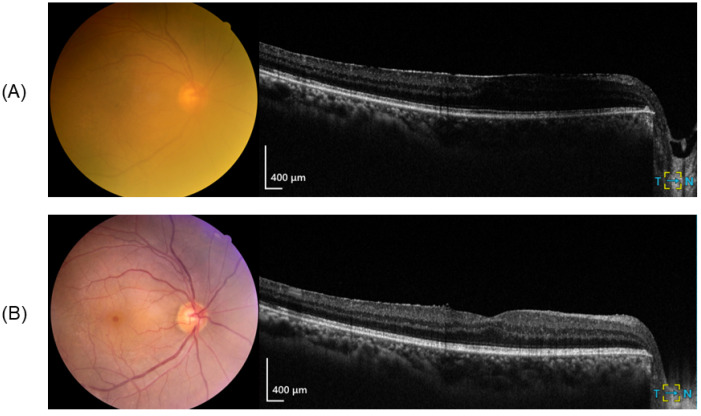
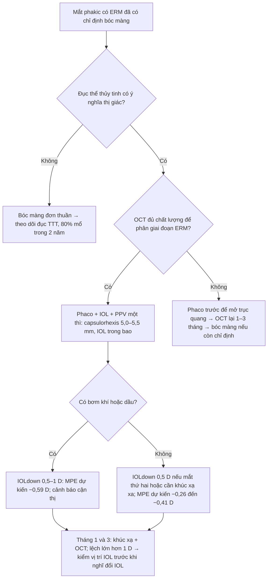
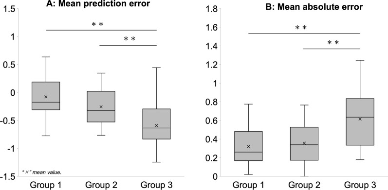
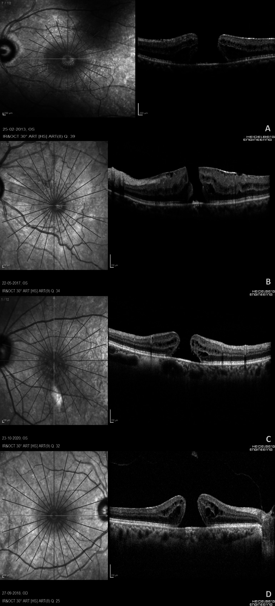

# 1480 — Đục thể thủy tinh sau bóc màng trước võng mạc: mổ phối hợp phaco–PPV hay hai thì, và tính công suất IOL thế nào / Cataract after epiretinal membrane peeling and phacovitrectomy

**Tags:** `pattern:duc-the-thuy-tinh` `pattern:duc-nhan` `pattern:duc-duoi-bao-sau` `pattern:myopic-shift` `pattern:sau-boc-mang` `pattern:mat-mot-ben` `vung:the-thuy-tinh` `vung:dich-kinh` `vung:hoang-diem` `vung:mat` `score:LOCS-III` `protocol:sinh-trac` `protocol:IOLMaster` `protocol:AS-OCT` `protocol:phaco` `protocol:PPV` `incidentaloma:khong`

**Mức chắc chắn (certainty):** tổng hợp y văn (literature synthesis) — dựng từ **phân tích gộp 584 mắt** phacovitrectomy ERM vs phaco đơn thuần (*J Vitreoretin Dis* 2025, **PMC11688671**, CC BY 4.0), **đoàn hệ 340 mắt** bóc màng 12 tháng (**PMC13234982**, CC BY 4.0), **43 mắt phacovitrectomy + 30 mắt phaco** theo dõi 2 năm (*J Clin Med* 2020, **PMC7692585**, CC BY 4.0), **104 mắt** đo vị trí IOL bằng AS-OCT (*Ophthalmol Ther* 2024, **PMC11246384**, CC BY-NC 4.0), **39 + 39 mắt** so công thức (*Yonsei Med J* 2015, **PMC4397453**, CC BY-NC 3.0), **401 mắt** so 10 công thức + hiệu chỉnh IOLdown (*Sci Rep* 2025, **PMC12006313**, CC BY 4.0), **561 mắt** phân loại đục TTT sau PPV (*BMC Ophthalmol* 2026, **PMC12980855**, CC BY-NC-ND 4.0), **427 mắt** một thì vs hai thì (**PMC9948424**, CC BY 4.0), **243 mắt** phù hoàng điểm sau đục TTT ở mắt đã mổ hoàng điểm (**PMC8859272**, CC BY-NC 3.0), **30 mắt ERM không triệu chứng** mổ phaco (**PMC11594931**, CC BY 4.0), **183 mắt** phacovitrectomy vs hai thì ở lỗ hoàng điểm (**PMC11624595**, CC BY 4.0). Nhóm **không có bệnh nhân của mình**; chỗ suy luận ghi **[suy luận]**. **Không ghi tên tác giả** — attribution dùng tạp chí + năm + PMCID (đối chiếu `authorString` Europe PMC ngày 2026-11-16).

> **Vì sao phải có bài riêng:** [1467](../1467-mang-truoc-vong-mac-erm/lesson.md) trả lời **"có bóc màng không, bóc lúc nào"**; [1863](../1863-duc-the-thuy-tinh-mat-bom-dau-silicone/lesson.md) và [1477](../1477-sinh-trac-iol-mat-bom-dau-silicone/lesson.md) trả lời câu hỏi đó **trong mắt bơm dầu**. Nhưng **đa số mắt bóc màng không có dầu** (256/340 = **75,3%** được mổ phối hợp phaco ngay từ đầu — PMC13234982), và đó là bệnh cảnh khác về vật lý: **không có dầu làm sai trục nhãn cầu**, nhưng **IOL lại ra trước** và **bề dày hoàng điểm thay đổi sau mổ** — hai nguồn sai số **ngược chiều nhau**, cộng lại thành **cận thị bất ngờ −0,3 đến −0,4 D** trên diện rộng (PMC11688671, PMC7692585). Bỏ qua điều này dẫn tới **mổ lại để đổi IOL**, hoặc tệ hơn: gọi **đục thể thủy tinh tiến triển** là **"màng tái phát"** rồi **bóc màng lần hai** trên một mắt chỉ cần phaco.

> **Câu chốt — ba con số phải thuộc:** **(1)** sau PPV, **tới 80% mắt còn thể thủy tinh cần mổ đục TTT trong 2 năm**, tốc độ đục **nhanh gấp ~6 lần** mắt không mổ (PMC11688671, PMC12980855); **(2)** phacovitrectomy ERM gây **cận thị hệ thống −0,41 ± 0,85 D** so với **+0,09 ± 0,45 D** ở phaco đơn thuần — chênh **0,50 D**, MAE chênh **0,10 D (95% CI 0,02–0,17; P = 0,01)** trên **584 mắt** (PMC11688671); **(3)** **trục nhãn cầu KHÔNG trôi** sau mổ (ICC **0,997**, CV **0,24%**, TRTSD **0,056 mm** ở 2 năm) — thủ phạm là **vị trí IOL ra trước 0,94–1,07 mm** và **bề dày hoàng điểm giảm**, không phải AL (PMC7692585, PMC11246384). Bẫy chết người về mặt **chẩn đoán**: **thị lực giảm sau bóc màng = đục thể thủy tinh cho tới khi chứng minh ngược lại** — không phải màng tái phát.

## 1. Tổng quan bệnh học – cơ chế hình ảnh

### 1.1 TẠI SAO cắt dịch kính làm đục thể thủy tinh — và tại sao gần như chắc chắn

- **Bình thường thể thủy tinh sống trong môi trường thiếu oxy:** dịch kính là **kho dự trữ chất chống oxy hóa** (acid ascorbic) và **tiêu thụ oxy**, nên **pO₂ trước thể thủy tinh rất thấp**; thể thủy tinh nhờ đó giữ protein ở dạng **hòa tan (crystallin)**.
- **Sau PPV:** kho dự trữ đó **bị lấy đi** → **pO₂ khoang sau nhãn cầu tăng**; **bơm khí/dầu làm tăng thêm** vì khí khuếch tán oxy mạnh hơn dịch kính. Oxy vào **thể thủy tinh** qua bao trước → **oxy hóa crystallin**, tạo **cụm protein kỵ nước** và **sắc tố vàng–nâu** (brunescence) → **đục nhân xơ (nuclear sclerosis, NS)**. Đó là lý do **NS là loại đục phổ biến nhất sau PPV** (561 mắt, PMC12980855) và **~80% phải mổ trong 2 năm** (PMC11688671).
- **Đục dưới bao sau (posterior subcapsular cataract, PSC)** có cơ chế **khác**: **tế bào biểu mô ở xích đạo thể thủy tinh di chuyển ra sau** và tạo **mảng dưới bao sau** — cơ chế **chưa rõ hoàn toàn** (PMC12980855). PSC **gây giảm thị lực sớm và mất tương xứng khi chói sáng** vì mảng nằm **đúng trên trục quang**, sát mặt phẳng nút.
- **Ai dễ PSC sau PPV (561 mắt):** **võng mạc đái tháo đường tăng sinh 67,6%**, **PCV 64,3%**, **bơm dầu silicone 63,6%**; tuổi cắt theo ROC là **54,5** (trẻ hơn = nguy cơ cao hơn); **thời gian mổ dài** cũng là yếu tố độc lập (PMC12980855). **Ai dễ NS:** tuổi cao, **bơm dầu**, **khoảng cách PPV → phaco dài** (PMC12980855).
- **Vì sao đây là việc của bác sĩ hình ảnh, không chỉ của phẫu thuật viên:** **chính ảnh OCT là thứ bị đục thể thủy tinh phá** — xem 1.2. Và **quyết định bóc màng** dựa trên **giai đoạn Govetto** (1467), mà giai đoạn đó **chỉ đọc được khi OCT còn tín hiệu tốt**.

### 1.2 TẠI SAO đục thể thủy tinh làm OCT "mù" — và tại sao không được đọc OCT kém chất lượng để kết luận tái phát

- OCT hoàng điểm dùng **ánh sáng cận hồng ngoại (840–1.050 nm)** chiếu qua **giác mạc → tiền phòng → thể thủy tinh → dịch kính**. Thể thủy tinh đục thêm **hai cơ chế mất tín hiệu**: **(a) tán xạ (scattering)** do cụm protein có kích thước **cỡ bước sóng** — ánh sáng bị bẻ hướng, không về đầu thu; **(b) hấp thụ** — nhân **vàng/nâu** hấp thụ mạnh vùng **xanh–tím**, làm **giảm biên độ tín hiệu** và **đổi màu** ảnh.
- Hệ quả **không đối xứng**: **lớp trong võng mạc (ILM, RNFL) mất tín hiệu trước**, còn **RPE** vẫn còn → máy **tự động vẽ đường phân cách sai**, hoặc **"bịa" lớp** (segmentation error). Vì vậy trên một mắt đục TTT vừa, OCT có thể **báo CMT mỏng giả** hoặc **dày giả**, và **dải tăng phản xạ trên bề mặt** có thể chỉ là **nhiễu do đục** chứ không phải ERM.
- **Bằng chứng định lượng:** **183 mắt** lỗ hoàng điểm cho thấy **chỉ số chất lượng ảnh OCT trước mổ KHÔNG phân biệt được độ đục thể thủy tinh và KHÔNG dùng được để chọn đường mổ** (*Int J Retina Vitreous* 2024, **PMC11624595**) → **đừng lấy "OCT vẫn đọc được" làm bằng chứng "đục nhẹ"**, và **đừng lấy "OCT xấu" làm bằng chứng "bệnh nặng hơn"**. Công cụ đúng để phân độ đục là **đèn khe + LOCS III**, không phải OCT.
- **[suy luận]** Vì vậy thứ tự đọc đúng là: **đèn khe phân độ đục (LOCS III) → OCT chỉ dùng khi tín hiệu đạt → nếu OCT kém, kết luận "không đánh giá được ERM" chứ không kết luận "ERM ổn định/tái phát"**.

### 1.3 TẠI SAO phacovitrectomy gây cận thị — ba nguồn sai số cộng lại

Đây là phần **bắt buộc giải thích bằng vật lý**, vì nó quyết định cách tính công suất IOL.

1. **IOL ra trước (effective lens position, ELP ngắn lại).** Công suất khúc xạ của IOL phụ thuộc **khoảng cách từ IOL tới võng mạc**: cùng một IOL, **đặt gần võng mạc hơn** thì **công suất hiệu dụng tăng** → **tiêu điểm trước võng mạc** → **cận thị**. Đo bằng **AS-OCT** ở **104 mắt**: IOL **ra trước 0,95 ± 0,16 mm** (phaco đơn thuần), **0,94 ± 0,12 mm** (phacovitrectomy ERM, không khí), **1,07 ± 0,20 mm** (phacovitrectomy + khí SF₆) — khác biệt **P < 0,01** (PMC11246384). Nguyên nhân: **mất giá đỡ dịch kính**, **co bao trước/bao sau**, **khí đẩy IOL ra trước** trong giai đoạn đầu.
2. **Bề dày hoàng điểm giảm sau bóc màng → AL "ngắn lại" về mặt hiệu dụng.** Sinh trắc đo **AL tới lớp RPE**; khi hoàng điểm **dày do ERM/co kéo**, AL đo được **dài hơn** so với "trục quang học thật" sau khi màng được bóc. Trong đoàn hệ 2 năm, **CMT giảm tới 66 µm**, tương ứng AL "thừa" **≈ 0,07 mm** → **≈ 0,2 D cận thị** (PMC7692585; quy đổi **0,1 mm AL = 0,28 D** theo cùng bài). Nghiên cứu 39 + 39 mắt cho kết quả **rất thực dụng**: hiệu chỉnh AL theo **bề dày hoàng điểm của mắt bên** **vẫn còn sai**; chỉ khi hiệu chỉnh theo **mức giảm CFT thực tế sau mổ** thì khúc xạ dự báo mới khớp khúc xạ thật (**p = 0,599**) — nghĩa là **hướng đúng nhưng không có con số cố định để "trừ"** (PMC4397453).
3. **Sai số dự báo vị trí IOL của công thức.** Công thức (SRK/T, Hoffer, Haigis, Barrett, Kane) đều dựa trên **hồi quy ELP từ ACD và bề dày thể thủy tinh**; ở mắt đã PPV, **ACD/ELP quan hệ bị lệch** — và đúng như vậy: **cận thị sau mổ rõ hơn ở mắt có tiền phòng NÔNG (p = 0,008) và thể thủy tinh DÀY (p = 0,025)**, tức là nhóm mà công thức dự báo ELP kém nhất (PMC7692585).

**Cộng ba nguồn lại — số đo thực tế:**

| Bệnh cảnh | MPE (khúc xạ thực − dự kiến) | Nguồn |
|---|---|---|
| Phaco đơn thuần | **−0,08 ± 0,37 D** | 104 mắt, Barrett Universal II (PMC11246384) |
| Phacovitrectomy ERM, **không** bơm khí | **−0,26 ± 0,32 D** | 104 mắt (PMC11246384) |
| Phacovitrectomy ERM (gộp 584 mắt, phân tích gộp) | **−0,41 ± 0,85 D** | PMC11688671 |
| Phacovitrectomy ERM, theo dõi **2 năm** | **−0,37 D** | 43 mắt (PMC7692585) |
| Phacovitrectomy + **khí SF₆** (bong võng mạc) | **−0,59 ± 0,34 D** | 104 mắt (PMC11246384) |

### 1.4 TẠI SAO KHÔNG phải "trục nhãn cầu trôi" — bài học để không mổ lại vô ích

- **Đo AL 3 lần trong 2 năm** trên 43 mắt phacovitrectomy: **ICC 0,997**, **CV 0,24%**, **TRTSD 0,056 mm** → **AL ổn định gần như tuyệt đối** (PMC7692585). Ở **401 mắt** phacovitrectomy, **AL, ACD, K và công suất IOL không khác** giữa nhóm phaco đơn thuần và nhóm ERM (PMC11246384).
- **Kết luận thực hành:** nếu khúc xạ sau mổ **lệch cận thị ~0,3–0,5 D**, nguyên nhân **không phải "máy đo sai"** và **không phải "mắt dài ra"** — đó là **ELP + bề dày hoàng điểm**. Vì vậy **đo lại AL 5 lần cũng không sửa được**, và **đổi IOL là quyết định nặng** chỉ nên đặt ra khi lệch **≥ 1 D** kèm triệu chứng, sau khi **đã loại trừ IOL lệch trục/không nằm trong bao**.

## 2. Mẫu hình + chẩn đoán phân biệt theo bối cảnh (gamut)

**Ba bối cảnh khác hẳn nhau — cùng một mắt, ba câu hỏi khác nhau.**

- **Bối cảnh A — mắt phakic vừa được chỉ định bóc màng, đục TTT nhẹ–trung bình:** chọn **(1) phối hợp một thì** (phaco + IOL + PPV + bóc màng), **(2) hai thì** (PPV + bóc màng trước, phaco khi đục tiến triển), **(3) phaco trước rồi PPV** (khi đục thể thủy tinh **che mất tầm nhìn** hoặc **OCT không đọc được ERM**). Dữ liệu: **75,3% (256/340)** mắt ERM trong đoàn hệ 5 năm được mổ **một thì**; **kết quả thị lực 12 tháng không khác** giữa một thì và PPV đơn thuần (**ΔlogMAR −0,27 vs −0,35; p = 0,517**) (PMC13234982).
- **Bối cảnh B — mắt đã bóc màng, thị lực giảm dần nhiều tháng sau mổ:** gamut theo **tần suất** — **đục thể thủy tinh tiến triển (NS/PSC)** ≫ **phù hoàng điểm (CME)** > **đục bao sau nhân tạo (PCO)** > **ERM tái phát** > **lỗ hoàng điểm mới** > **IOL lệch/tilt**. Định lượng: ERM tái phát **2,0%** (có bóc ILM) vs **11,0%** (không bóc ILM) — số liệu của [1467](../1467-mang-truoc-vong-mac-erm/lesson.md); **CME sau đục TTT ở mắt đã mổ hoàng điểm 9,1% (22/243)**, và **ERM là yếu tố nguy cơ mạnh nhất: OR 2,97 (p = 0,031)** (PMC8859272).
- **Bối cảnh C — đục thể thủy tinh DÀY, không đọc được ERM trước mổ:** câu hỏi không phải "màng ở giai đoạn mấy" mà **"có cần bóc màng cùng lúc không"**. Đây là chỗ **OCT trước mổ không giúp được** (PMC11624595) → quyết định dựa trên **đèn khe + thị lực + triệu chứng méo** và **kế hoạch mổ hai bước** (phaco → OCT lại sau 1–3 tháng → bóc màng nếu còn chỉ định).
- **Bốn câu hỏi trước mọi mắt ERM + đục TTT** (dùng như checklist): **(1) đục TTT có ý nghĩa thị giác? (2) OCT có đủ chất lượng để phân giai đoạn ERM? (3) có yếu tố đẩy IOL ra trước (khí, dầu, bao xơ, mắt thứ hai)? (4) bệnh nhân có "ngân sách khúc xạ" (nghề lái xe, một mắt còn lại, kính đa tròng) để chấp nhận cận thị −0,5 D?**

## 3. Bảng so sánh phân biệt (ma trận đối chiếu)

| Thực thể (entity) | Hình ảnh / chỉ số điển hình | Chốt vào (rule-in) | Chốt loại (rule-out) | Gợi ý xác nhận |
|---|---|---|---|---|
| **Đục nhân xơ (NS) sau PPV** | Đèn khe: **nhân vàng–nâu**, **red reflex mờ**, **LOCS III NO3–NO6**; OCT **tín hiệu giảm toàn bộ** nhưng còn phân giải được võng mạc | **Tiền sử PPV + đục tiến triển nhiều tháng + thị lực giảm không đau + OCT hoàng điểm không xấu đi** | OCT hoàng điểm **xấu đi kèm dải co kéo** → nghĩ ERM/CME, không phải chỉ đục | LOCS III + so OCT cũ cùng máy; đo lại sau khi giãn đồng tử tối đa |
| **Đục dưới bao sau (PSC)** | **Mảng dưới bao sau trên trục quang**, thấy rõ khi **chiếu ngược sáng**; **chói lóa mất tương xứng**; LOCS III **P1–P5**; nguy cơ: **PDR 67,6%**, **PCV 64,3%**, **dầu 63,6%**, **tuổi < 54,5** (PMC12980855) | **Chói + mảng dưới bao sau đúng trục + thị lực giảm khi nền sáng** | Chỉ **đục nhân**, không có mảng dưới bao → NS đơn thuần | Đèn khe ngược sáng + LOCS III; đo độ nhạy tương phản nếu cần |
| **ERM tái phát** | OCT: **dải tăng phản xạ MỚI trên ILM** + **CMT tăng** + nếp en face; **OCT phải đủ chất lượng** | **OCT chất lượng tốt cho thấy màng mới + CMT tăng so với mốc 1–3 tháng sau mổ** | **OCT kém do đục TTT** (chỉ số chất lượng thấp) → **không được kết luận** (PMC11624595) | Chụp lại sau phaco; đối chiếu CMT cùng máy, cùng vùng ETDRS |
| **Phù hoàng điểm sau mổ (CME)** | OCT: **nang nội võng mạc**, CMT tăng; **9,1%** sau đục TTT ở mắt đã mổ hoàng điểm, **ERM OR 2,97** (PMC8859272) | **Nang + CMT tăng trong 1–3 tháng sau phaco**, đáp ứng NSAID/corticoid tại chỗ | **Co kéo tiếp tuyến + màng mặt trên** → ERM, không phải CME đơn thuần | FA/OCT; theo dõi 4–12 tuần (nối [1478](../1478-du-phong-phu-hoang-diem-sau-phaco/lesson.md)) |
| **Đục bao sau nhân tạo (PCO)** | Đèn khe: **màng sau IOL**, "Elschnig pearls"; OCT **bão hòa tín hiệu** phía sau IOL | **Màng nằm SAU IOL + thị lực giảm dần sau phaco + YAG mở bao cải thiện ngay** | Màng **trước võng mạc** (trước ILM) → ERM | Soi đèn khe sau giãn; chụp OCT trước/sau YAG |
| **Cận thị bất ngờ sau phacovitrectomy** | Khúc xạ thật **−0,3 đến −0,4 D** so dự kiến; **AL tái đo ổn định** (ICC 0,997; CV 0,24%); AS-OCT **IOL ra trước 0,94 mm** (PMC7692585, PMC11246384) | **Sai số âm hệ thống + AL không đổi + IOL nằm trong bao, trục tốt** | **AL sai do dầu** (nối [1477](../1477-sinh-trac-iol-mat-bom-dau-silicone/lesson.md)) hoặc **IOL lệch trục/ra khỏi bao** → nguyên nhân cơ học, xử trí khác | AS-OCT vị trí IOL; đo lại AL cùng máy; so khúc xạ mắt bên |

*Hình: (A) trước mổ — ảnh đáy mắt + OCT với **CMT 381 µm**; (B) sau phaco + IOL đa tiêu điểm EDOF + bóc màng — **CMT 344 µm**. Lưu ý: mổ phối hợp **không** làm mất co kéo ngay lập tức, nhưng **giải phóng trục quang** để theo dõi. Nguồn: *J Clin Med* 2025, PMC11989836, Fig. 1, CC BY 4.0 (nguyên bản, không crop).*

### Dấu hiệu quyết định — đọc theo thứ tự
1. **Đèn khe trước, OCT sau:** độ đục (LOCS III) quyết định **OCT có giá trị hay không**; **chỉ số chất lượng OCT không thay được phân độ đục** (PMC11624595).
2. **So OCT cùng máy, cùng lưới ETDRS:** CMT chỉ có nghĩa khi **so với chính mắt đó** ở mốc 1–3 tháng sau mổ.
3. **Khúc xạ: so với dự kiến, không so với "0 D".** Mắt đích cận thị nhẹ là **kết quả chấp nhận được** nếu đã tư vấn trước; sai số **cùng dấu ở cả hai mắt** là dấu hiệu **lỗi hệ thống (ELP/AL)**, không phải biến chứng.

## 4. Protocol chụp – đo – mổ + hệ phân độ

### 4.1 Phân độ đục thể thủy tinh (bắt buộc trước khi quyết định)
- **LOCS III** (Lens Opacities Classification System III): **nhân NO1–NO6** (so ảnh chuẩn), **vỏ C1–C5**, **dưới bao sau P1–P5**. Ghi **rõ từng thành phần**, không ghi "đục độ 2" chung.
- **Đo khách quan bổ trợ:** **độ nhạy tương phản**, **thị lực chói (glare VA)**, **mật độ đục trên Scheimpflug** (Pentacam) khi cần đối chiếu theo dõi.
- **Ngưỡng thực hành:** đục **đủ che trục quang** hoặc **PSC đúng trục** → **mổ phaco**; đục nhẹ + ERM cần bóc → **cân nhắc mổ phối hợp** vì sau PPV **80% sẽ đục nặng trong 2 năm** (PMC11688671) — mổ phối hợp **tránh lần mổ thứ hai** nhưng **tăng sai số khúc xạ**; đây là **đánh đổi phải nói với bệnh nhân**.

### 4.2 Sinh trắc và chọn công suất IOL (phần "đắt tiền" nhất)
- **Máy quang học (PCI/SS-OCT) là chuẩn**, đo **3 lần**, lấy trung bình; ghi **AL, K, ACD, bề dày thể thủy tinh (LT), đường kính ngang giác mạc**. Nếu **tín hiệu kém** (đục dày, khô mắt, không cố định) → **A-scan** và ghi rõ phương pháp.
- **Công thức:** **Barrett Universal II** hoặc **Kane** cho mắt có AL bình thường; **không có công thức nào "đúng" cho phacovitrectomy** — trong 104 mắt, **4 công thức (SRK/T, Hill-RBF, Kane, BUII) không khác nhau có ý nghĩa** (P = 0,531 ở nhóm có khí) (PMC11246384).
- **Hiệu chỉnh "IOLdown" — bằng chứng mạnh nhất hiện có:** ở **401 mắt** phacovitrectomy, dùng dự báo cho **công suất IOL thấp hơn 0,5–1 D** so với công suất sẽ cấy ("IOLdown") cải thiện rõ: **Barrett IOLdown** có **sai số dự báo 0,03 D**, **MAE 0,40 D**, **MedAE 0,31 D**, **41,6% trong ± 0,25 D**; **Kane IOLdown 70,5% trong ± 0,50 D**; **Hill IOLdown 95,2% trong ± 1,00 D** (PMC12006313). **[suy luận]** Vì IOLdown = **cấy IOL yếu hơn 0,5 D**, đích khúc xạ dịch về **viễn thị nhẹ**, bù đúng chiều cận thị do ELP.
- **Ai cần IOLdown:** **mổ phối hợp** (đặc biệt **có khí/dầu**), **mắt thứ hai** (nếu mắt đầu đã cận thị bất ngờ), **bệnh nhân khó chấp nhận cận thị** (lái đêm, nhìn xa là nghề). **Ai không cần:** phaco đơn thuần, mắt không có yếu tố đẩy ELP, hoặc bệnh nhân **đã được hẹn cận thị để đọc sách**.
- **Đừng "cộng mò":** thói quen **+3 đến +5 D cho mắt bơm dầu** đã thất bại (sai **3,79 ± 2,48 D**, ca tệ nhất **8 D** — [1477](../1477-sinh-trac-iol-mat-bom-dau-silicone/lesson.md)); với mắt **không dầu**, "cộng mò" còn nguy hiểm hơn vì **sai số chỉ 0,3–0,4 D** — cộng 1 D là **quá tay gấp 2–3 lần**.

### 4.3 Thứ tự mổ phối hợp (một thì)
1. **Phaco trước, PPV sau:** **giữ tiền phòng ổn định**, **tránh IOL bị đẩy khi bơm khí**, và **nhìn rõ đáy mắt** sau khi bỏ thể thủy tinh đục.
2. **Capsulorhexis 5,0–5,5 mm** (đủ che mép IOL, **giảm co bao trước** — nguy cơ cao ở mắt đã PPV); **IOL trong bao (in-the-bag)**, **không đặt sulcus** trừ khi vỡ bao (đặt sulcus làm ELP ngắn thêm → **cận thị nặng hơn**).
3. **PPV 23–25G + bóc màng/ILM**, **bơm khí** nếu có chỉ định võng mạc; **khí làm ELP ra trước thêm 0,13 mm** và **MPE xuống −0,59 D** (PMC11246384) → **nếu biết trước sẽ bơm khí, phải tính IOLdown**.
4. **Kết thúc:** kiểm tra **IOL nằm trong bao**, **không sót dầu/OVD**, **nhãn áp**, và **ghi vào hồ sơ khúc xạ đích + công thức + phiên bản máy**.

### 4.4 Theo dõi sau mổ (lịch tối thiểu)
- **Ngày 1 và tuần 1:** thị lực, nhãn áp, **đèn khe** (phù giác mạc, mủ tiền phòng — loại viêm nội nhãn).
- **Tháng 1:** **khúc xạ khách quan (autorefract)** — mốc để **phát hiện lệch hệ thống**; **OCT hoàng điểm** (CME sớm).
- **Tháng 3:** **khúc xạ chốt**, **OCT** so mốc, **đèn khe tìm PCO**. Nếu **khúc xạ lệch ≥ 1 D** và **IOL trong bao, trục tốt** → **không mổ lại ngay**, đánh giá **mắt bên + nhu cầu** rồi quyết định.
- **Nếu thị lực đã cải thiện rồi giảm lại sau 3–12 tháng:** thứ tự loại trừ **PCO (YAG) → CME → ERM tái phát → lỗ hoàng điểm**; **đừng mặc định "màng tái phát"**.

## 5. Biến thể bình thường và cạm bẫy

- **Cạm bẫy số 1 — "thị lực giảm sau bóc màng = màng tái phát".** Đục TTT tiến triển là **nguyên nhân phổ biến nhất**, và ERM tái phát chỉ **2,0%** khi bóc ILM (1467). **Cách tránh:** khám **đèn khe trước**, phân độ **LOCS III**, chỉ kết luận ERM khi **OCT đủ chất lượng** và **CMT tăng so với mốc**.
- **Cạm bẫy số 2 — đọc OCT kém chất lượng rồi "thấy màng".** Nhiễu do đục nhân tạo **dải tăng phản xạ giả** trên bề mặt; **chỉ số chất lượng ảnh không phân độ được đục** (PMC11624595) → **luôn ghi "không đánh giá được" thay vì "bình thường"**.
- **Cạm bẫy số 3 — hứa "khúc xạ chính xác" ở mắt phacovitrectomy.** Sai số **−0,3 đến −0,4 D là mặc định**, không phải biến chứng (PMC11688671, PMC7692585). **Cách tránh:** tư vấn **trước mổ**, dùng **IOLdown**, và **ghi khúc xạ đích vào hồ sơ**.
- **Cạm bẫy số 4 — tưởng OCT trước mổ bình thường = ERM nhẹ.** Ở mắt đục thể thủy tinh, **OCT "đẹp" có thể do tín hiệu bị lọc mất lớp**; **và ngược lại**, đục nhẹ + OCT tốt mà ERM GĐ3 vẫn có thể **không thấy nếp** nếu chỉ chụp 1 lát. Luôn **chụp đủ lưới ETDRS + en face** (1467).
- **Cạm bẫy số 5 — mổ phaco trên mắt ERM "không triệu chứng" rồi lo CME.** Dữ liệu 30 mắt: **CMMT 342 ± 53 → 356 ± 57 µm** sau 3 tháng (tăng nhẹ, **p < 0,05**), **1 ca CME thoáng qua** — **phaco an toàn**, nhưng **phải theo dõi OCT** (PMC11594931). CME thật gặp **9,1%** ở mắt đã mổ hoàng điểm, **ERM OR 2,97** (PMC8859272).
- **Cạm bẫy số 6 — đặt IOL sulcus khi vỡ bao ở mắt đã PPV.** Không có số liệu riêng trong các bài đã đọc, nhưng **ELP ngắn hơn** là hệ quả cơ học chắc chắn → **cận thị nhiều hơn**; nếu buộc phải sulcus, **giảm công suất theo hướng dẫn và ghi rõ** [suy luận].
- **Biến thể bình thường:** **vòng Soemmering** và **mảnh vỏ mỏng** sau phaco **không phải** "mảnh thể thủy tinh sót" gây viêm (nối [1442](../1442-manh-the-thuy-tinh-con-sot/lesson.md)); **màng sau bao mỏng sớm** vài tuần đầu **chưa phải PCO** — chờ **≥ 3 tháng** trước YAG nếu thị lực ổn định.
- **Cạm bẫy về so sánh:** trong **427 mắt** so một thì vs hai thì, nhóm **hai thì (PPV → phaco)** có **CDVA tốt hơn** ở tháng 12 (**0,25 vs 0,53 logMAR, p = 0,04**), nhưng ở **phân nhóm ERM/dịch kính**, **khúc xạ (SEQ p = 0,09; RPE p = 0,13) không khác** (PMC9948424). Nghĩa là: **đừng trích "hai thì tốt hơn"** cho mọi bệnh nhân — **kết quả phụ thuộc bệnh nền**, và **một thì vẫn hợp lý** khi đục đã đáng kể.

## 6. Tự lượng giá — Blind Quiz

**Ca 1 — Nữ 68 tuổi, ERM GĐ3 (CMT 455 µm) + đục nhân NO3, thị lực 20/80, méo nhiều. Được mổ một thì: phaco + IOL + PPV + bóc màng. Tháng 1: thị lực 20/40, khúc xạ −0,75 D so với đích 0 D.**

- Câu hỏi: Nguyên nhân khúc xạ lệch là gì? Có nên mổ lại đổi IOL? Mắt thứ hai nên tính thế nào?

<b>Bấm để hiện đáp án (findings + chẩn đoán)</b>

- **Cận thị sau phacovitrectomy (ELP ra trước + bề dày hoàng điểm giảm)** — không phải "máy đo sai": AL tái đo **ổn định** (ICC 0,997), IOL **ra trước ~0,94 mm** (PMC7692585, PMC11246384).
- **Không mổ lại:** sai số **< 1 D**, IOL nằm trong bao; **tư vấn kính**. Chỉ cân nhắc đổi IOL khi **≥ 1 D + triệu chứng** và **đã loại trừ IOL lệch trục**.
- **Mắt thứ hai:** dùng **IOLdown 0,5 D** (Barrett IOLdown **MAE 0,40 D**, **41,6% trong ± 0,25 D** — PMC12006313) và **hẹn trước** khả năng cận thị nhẹ.
- Nguồn: *J Clin Med* 2025, PMC11989836, Fig. 1, CC BY 4.0; số liệu PMC7692585, PMC11246384, PMC12006313.

**Ca 2 — Cùng một phẫu thuật viên, ba nhóm mắt: phaco đơn thuần / phacovitrectomy ERM / phacovitrectomy + khí SF₆. Sai số dự báo khúc xạ (MPE) lần lượt là −0,08 / −0,26 / −0,59 D.**

- Câu hỏi: Nhóm nào lệch nhiều nhất và vì sao? Đổi công thức IOL có sửa được không? Yếu tố nào quyết định trong mổ?

<b>Bấm để hiện đáp án</b>

- **Nhóm có khí SF₆ lệch nhiều nhất (−0,59 ± 0,34 D)**, kế đó ERM **(−0,26 D)**, phaco đơn thuần gần đúng **(−0,08 D)**.
- **Vì sao:** IOL **ra trước 1,07 mm** (khí) vs **0,94 mm** (ERM) vs **0,95 mm** (phaco) — khí **đẩy IOL ra trước** và **co bao** sớm; AL **không khác** giữa nhóm 1 và 2.
- **Đổi công thức KHÔNG sửa được:** 4 công thức (SRK/T, Hill-RBF, Kane, BUII) **không khác nhau** (P = 0,531) ở nhóm có khí → phải **hiệu chỉnh bằng IOLdown 0,5–1 D**.
- Nguồn: *Ophthalmol Ther* 2024, PMC11246384, Fig. 1, CC BY-NC 4.0 (nguyên bản, không ghép).

**Ca 3 — Nam 72 tuổi, bóc màng 8 tháng trước (không mổ thể thủy tinh). Thị lực 6/10 → 6/20, chói khi đi đêm. OCT hôm nay mờ, lớp trong không đọc được, "không thấy màng".**

- Câu hỏi: Chẩn đoán nào phổ biến nhất? OCT này có giá trị gì? Cần làm gì tiếp và có chỉ định bóc màng lại không?

<b>Bấm để hiện đáp án</b>

- **Đục thể thủy tinh tiến triển (NS/PSC)** là nguyên nhân phổ biến nhất — **~80% mắt sau PPV phải mổ trong 2 năm**; ERM tái phát chỉ **2,0%** khi bóc ILM (PMC11688671; 1467).
- **OCT mờ không loại trừ và cũng không chứng minh tái phát:** chỉ số chất lượng ảnh **không phân độ được đục thể thủy tinh** và **không dùng để chọn đường mổ** (183 mắt, PMC11624595).
- **Việc cần làm:** khám **đèn khe phân độ LOCS III** (tìm **PSC đúng trục** — chói), **phaco + IOL**; **OCT lại sau mổ**; chỉ **bóc màng lại** nếu OCT sau phaco cho thấy **màng mới + CMT tăng**.
- Nguồn: *Int J Retina Vitreous* 2024, PMC11624595, Fig. 1, CC BY 4.0 (nguyên bản).

## Bài liên quan chéo
- [400 – Tổng quan Mắt & thị giác](../400-tong-quan-mat-thi-giac/lesson.md)
- [1467 – Màng trước võng mạc (ERM) và 4 giai đoạn Govetto](../1467-mang-truoc-vong-mac-erm/lesson.md) (bóc hay không, bóc lúc nào)
- [1863 – Đục thể thủy tinh ở mắt bơm dầu: một thì hay hai thì](../1863-duc-the-thuy-tinh-mat-bom-dau-silicone/lesson.md) (bệnh cảnh có dầu)
- [1477 – Sinh trắc và công suất IOL ở mắt bơm dầu silicone](../1477-sinh-trac-iol-mat-bom-dau-silicone/lesson.md) (AL sai do dầu)
- [1462 – Sinh trắc và IOL sau ghép giác mạc](../1462-sinh-trac-iol-sau-ghep-giac-mac/lesson.md) (K sai do giác mạc)
- [1478 – Dự phòng phù hoàng điểm sau phaco bằng NSAID](../1478-du-phong-phu-hoang-diem-sau-phaco/lesson.md) (CME sau phaco)
- [1455 – Vì sao mắt đã cắt dịch kính còn dịch](../1455-anti-vegf-mat-da-cat-dich-kinh/lesson.md)
- [1442 – Mảnh thể thủy tinh còn sót](../1442-manh-the-thuy-tinh-con-sot/lesson.md) (biến thể "mảnh trắng" sau phaco)

> Không dùng để chẩn đoán độc lập khi chưa có người hướng dẫn.
