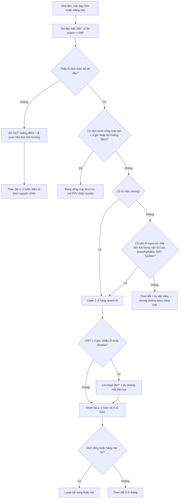
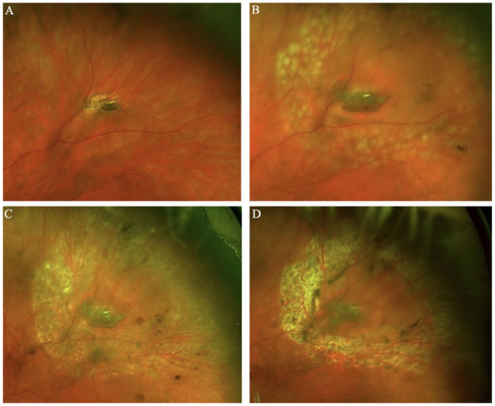
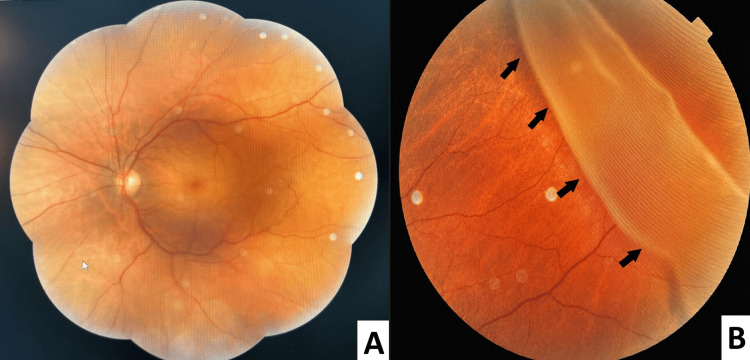
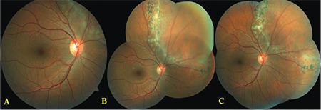

# 1481 — Lỗ rách võng mạc cấp chưa bong: laser dự phòng hay theo dõi / Acute retinal tear without detachment: prophylactic laser versus observation

**Tags:** `pattern:lo-rach-vong-mac` `pattern:horseshoe-tear` `pattern:operculated-hole` `pattern:lattice` `pattern:bong-duoi-lam-sang` `pattern:pvd` `pattern:giant-retinal-tear` `vung:vong-mac` `vung:ora-serrata` `score:nguy-co` `protocol:soi-day-mat-an-sclera` `protocol:UWF` `protocol:SS-OCT` `protocol:laser` `protocol:sieu-am-B-scan` `incidentaloma:lo-rach-tinh-co`

**Mức chắc chắn (certainty):** tổng hợp y văn (literature synthesis) — dựng từ **đoàn hệ 600 mắt/572 bệnh nhân** điều trị laser cho lỗ rách có triệu chứng (*J Vitreoretin Dis* 2026, **PMC13216110**, CC BY-NC 4.0), **tổng quan định hướng hình ảnh** về thoái hóa võng mạc ngoại vi (*Front Ophthalmol* 2026, **PMC13212168**, CC BY 4.0), **Cochrane 2014** về lỗ rách/lattice không triệu chứng (**PMC4423540**), **nghiên cứu UWF + SS-OCT** chọn bệnh nhân laser (*Bioengineering* 2025, **PMC12729268**, CC BY 4.0), **2 ca lỗ rách khổng lồ chưa bong điều trị laser** (*Cureus* 2026, **PMC13378882**, CC BY 4.0) và **21 mắt bong dưới lâm sàng** (*Turk J Ophthalmol* 2019, **PMC6961077**, CC BY 2.5). Nhóm **không có bệnh nhân của mình**; chỗ chưa đủ chắc ghi "chưa rõ". **Không ghi tên tác giả** — attribution dùng tạp chí + năm + PMCID.

> **Câu chốt:** Không phải mọi lỗ rách đều cần laser, nhưng **lỗ rách có triệu chứng đi kèm bong dịch kính sau (PVD) cấp thì gần như luôn cần** — vì khoảng **9,9%** mắt có PVD đã có sẵn lỗ rách/bong khi khám lần đầu, và laser quanh lỗ làm nguy cơ bong giảm xuống **< 5%**. Ngược lại, **lỗ rách/lattice không triệu chứng ở mắt không có bong mắt bên kia chỉ có nguy cơ bong ~0,5% trong 11 năm** — laser hàng loạt ở nhóm này là điều trị nhiều hơn bệnh. Ba con số phải thuộc: **(1)** laser quanh lỗ có triệu chứng: bong vẫn xảy ra **7,2% (43/600)**, cần laser thêm **11%**; **(2)** yếu tố làm bong sau laser: **nhiều lỗ OR 3,94**, **pseudophakia OR 3,15**, **xuất huyết dịch kính OR 2,31**; **(3)** lỗ rách khổng lồ (GRT) **≥ 90°** chưa bong có thể laser đơn thuần + **cerclage 360°**, và mắt bên kia phải dự phòng (**OR 0,14** cho bong mắt đối diện).

## 1. Tổng quan bệnh học – cơ chế hình ảnh

### 1.1 TẠI SAO PVD tạo ra lỗ rách — và tại sao laser bịt được lỗ

- **Trình tự cơ học:** tuổi tác làm dịch kính hóa lỏng (liquefaction) rồi **bong dịch kính sau (posterior vitreous detachment, PVD)**. Khi màng hyaloid sau co lại và tách khỏi võng mạc, nó **kết dính chắc ở một số điểm** — lattice, retinal tuft, quanh mạch máu, và **ora serrata** — nên lực kéo tập trung ở đó. Chỗ dính bị **xé rách toàn bộ bề dày** tạo **lỗ có nắp (horseshoe/flap tear)**: nắp là mảnh võng mạc bị lật ra trước, còn **lỗ là cửa cho dịch lỏng vào khoang dưới võng mạc**.
- **Vì sao phần lớn lỗ lại nằm ở vùng "trông bình thường":** khi PVD xảy ra, chỗ dính bất thường không nhất thiết nhìn thấy trước. Tổng quan lịch sử ghi nhận **70% lỗ rách sau PVD xuất hiện ở vùng võng mạc trông bình thường**, và **89% bong võng mạc ở mắt không điều trị có ≥ 2 yếu tố nguy cơ** cũng xuất phát từ những vùng đó (PMC13107472). Đây là lý do **soi 360° có ấn sclera** quan trọng hơn "chỉ soi quanh vùng bệnh nhân thấy".
- **Vì sao laser dự phòng có tác dụng:** laser quang đông gây **hoại tử nhiệt chọn lọc** lớp biểu mô sắc tố (RPE) và tế bào cảm quang quanh lỗ → viêm lành tính → **sẹo xơ dính hắc mạc–võng mạc (chorioretinal adhesion)** bịt kín bờ lỗ, chặn dòng dịch vào khoang dưới võng mạc. Thực nghiệm cho thấy võng mạc được laser **bền hơn 3–5 lần** so với không điều trị, đạt **sức bền tối đa sau khoảng 1 tháng** (PMC13107472) — nên **tuần đầu sau laser bệnh nhân vẫn có thể bong**, phải khám lại.
- **Vì sao laser không "bịt" lỗ theo nghĩa vá:** sẹo chỉ tạo **hàng rào quanh lỗ**, không lấp lỗ. Vì vậy ảnh sau laser vẫn thấy **lỗ mở** nhưng **võng mạc dính quanh lỗ**; đốt trực tiếp vào nắp/lỗ làm tăng nguy cơ chảy máu và không tăng hiệu quả.
- **Vì sao lỗ rách ở mắt cận thị/pseudophakia nguy hiểm hơn:** võng mạc mỏng hơn, chu vi xích đạo dài hơn, dịch kính hóa lỏng sớm và **không còn thể thủy tinh đỡ** (pseudophakia) → lỗ dễ hình thành hơn và **dịch dễ tích tụ ở vùng thấp** (inferotemporal), nơi trọng lực giữ dịch lâu (PMC13216110).

### 1.2 TẠI SAO hình ảnh trông như vậy (đáy mắt – OCT – siêu âm)

- **Ảnh đáy mắt màu/wide-field:** lỗ rách là **vùng đỏ** vì nhìn xuyên qua lỗ thấy **hắc mạc**; nắp võng mạc **xám trắng, gấp hoặc lật**, có thể **co rúm** sau vài tuần. Quanh lỗ có **viền dịch dưới võng mạc** → võng mạc mất trong suốt, **mất hình ảnh mạch hắc mạc** ở vùng bong. Đây là **chuẩn để đánh giá vị trí – kích thước – số lượng lỗ**, nhưng **không thấy lỗ sát ora nếu không ấn sclera**.
- **SS-OCT/UWF:** OCT bước sóng quét (swept-source) cho thấy **bờ lỗ mất liên tục toàn bộ bề dày**, **nang/nhão bờ lỗ**, và **dịch dưới võng mạc** dưới dạng khoang **giảm tín hiệu (hyporeflective)** vì dịch là nước trong, không phản xạ. OCT còn phát hiện **co kéo dịch kính–võng mạc (vitreoretinal traction)** trên lattice/snail-track — tiêu chí chọn laser mà soi đáy mắt đơn thuần bỏ sót.
- **Vì sao OCT làm thay đổi chỉ định:** trong **135 mắt** được soi đáy mắt "đủ chỉ định laser", **25,1% không còn đủ tiêu chuẩn** khi SS-OCT không thấy co kéo hoặc dịch dưới võng mạc (PMC12729268) — tức là **1/4 ca laser tiềm năng là không cần thiết** nếu chỉ dựa vào hình thái trên soi.
- **Siêu âm B-scan (10 MHz):** khi đục môi trường (xuất huyết dịch kính, đục thể thủy tinh), võng mạc bong là **màng tăng âm dày, dính đĩa thị hai đầu, di động khi mắt đảo**; màng dịch kính **mỏng, tăng âm kém, ít dính đĩa**; **bong hắc mạc** có hình **vòm, không dính đĩa**, thường kèm nhãn áp thấp. B-scan **không thấy lỗ** nhưng trả lời "có bong hay không" trước khi mổ.

### 1.3 Ngưỡng định lượng nằm lòng

| Chỉ số | Ngưỡng / giá trị | Nguồn |
|---|---|---|
| Mắt có PVD phát hiện lỗ rách/bong ngay lần khám đầu | **9,9%** | PMC12729268 (dẫn Nixon và cs) |
| Lỗ rách có triệu chứng được laser: bong võng mạc sau đó | **7,2% (43/600)**; **86,0%** trong số đó còn hoàng điểm | PMC13216110 |
| Cần laser bổ sung | **11% (66/600)**; **80,3%** cho chính lỗ ban đầu | PMC13216110 |
| Lỗ không triệu chứng, mắt bên kia không bong | **~0,5%** bong trong **11 năm** theo dõi | PMC12729268 |
| Lattice degeneration | **6–8%** dân số; **~30%** mắt bong võng mạc còn thể thủy tinh | PMC12729268 |
| Laser quanh lỗ có triệu chứng làm giảm bong | xuống **< 5%** | PMC12729268 |
| Lỗ rách khổng lồ (GRT) | **≥ 90°** chu vi (≥ 3 giờ đồng hồ) | PMC13378882 |
| Dự phòng mắt bên kia sau GRT | bong **14,5% → 2%**; meta **803 mắt, OR 0,14 (0,07–0,28)** | PMC13107472, PMC12723434 |
| Laser 360° dự phòng ở mắt pseudophakia hai bên | bong **19,4% → 1,4%** (5 năm) | PMC13107472 |
| Stickler: laser 360° | bong **36% → 6,6%** (400 mắt); 42 mắt OSC/SS còn **2,4%** | PMC13107472 |
| Laser 360° kèm PPV (không phải dự phòng đơn thuần) | SSAS **OR 1,82 (1,40–2,39)**, 3.639 mắt | PMC13651929 |
| Bong dưới lâm sàng do lỗ rách, laser demarcation | tiến triển **19% (4/21)**, tất cả **cận thị > −3 D + nhiều lỗ ở góc trên** | PMC6961077 |

## 2. Mẫu hình + chẩn đoán phân biệt theo vị trí (gamut)

- **Mẫu hình (pattern):** một hoặc nhiều **lỗ toàn bộ bề dày** ở võng mạc ngoại vi, có **nắp lật/lỗ mở**, quanh đó **dịch dưới võng mạc khu trú**, **không lan tới hoàng điểm** (hoặc đã lan — khi đó là bong thực sự); bệnh nhân vừa có **nhá đèn/ruồi bay mới**.
- **Gamut theo vị trí (location):**
  - **Thái dương trên (superotemporal):** vị trí hay gặp nhất của lỗ có triệu chứng; dễ thấy, tiên lượng tốt nếu laser sớm.
  - **Thái dương dưới (inferotemporal):** **dịch tích tụ do trọng lực**, võng mạc tương đối mỏng → **nguy cơ cần laser thêm cao hơn (OR 2,34)** (PMC13216110); cũng là vùng **hay bị bỏ sót khi bệnh nhân nằm**.
  - **Mũi trên/mũi dưới:** thường lỗ do PVD; ít gặp hơn nhưng cùng nguyên lý.
  - **Sát ora serrata:** **lỗ do chấn thương, dialysis, hoặc sau tiêm nội nhãn** (xem [1469](../1469-bong-vong-mac-co-lo-sau-tiem-noi-nhan/lesson.md)); **chỉ thấy khi ấn sclera** — đây là cạm bẫy số 1.
  - **Hoàng điểm:** lỗ hoàng điểm là thực thể khác (không phải "lỗ rách ngoại vi"), xử trí bằng PPV/bóc màng chứ không phải laser dự phòng.
- **Gamut theo hình thái (mnemonic "NẮP – NÚT – TRÒN – DIALYSIS – KHỔNG LỒ"):**
  1. **NẮP (horseshoe/flap tear):** có triệu chứng → **laser**; đây là tổn thương chiếm **83,8%** trong đoàn hệ 600 mắt.
  2. **NÚT (operculated hole):** nắp đã bong hoàn toàn, lỗ tròn nhỏ; **12,2%** đoàn hệ; không triệu chứng thường **theo dõi**, có triệu chứng/PVD cấp thì cân nhắc laser.
  3. **TRÒN (atrophic round hole):** trong lattice hoặc vùng teo, **không triệu chứng** → theo dõi.
  4. **DIALYSIS (ora dialysis):** rách theo chu vi sát ora, thường chấn thương; **laser nếu còn dính và không có dịch lan**, mổ nếu đã bong.
  5. **KHỔNG LỒ (giant retinal tear, GRT):** **≥ 90°**, nắp lớn lật ra sau; chưa bong có thể **laser quanh lỗ + cerclage 360°** ở ca chọn lọc, nhưng nguy cơ bong cao — phải theo dõi sát và dự phòng mắt bên kia.

## 3. Bảng so sánh phân biệt (ma trận đối chiếu)

| Thực thể (entity) | Hình ảnh điển hình | Chốt vào (rule-in) | Chốt loại (rule-out) | Gợi ý xác nhận |
|---|---|---|---|---|
| **Lỗ rách có nắp CÓ TRIỆU CHỨNG (symptomatic horseshoe tear)** | Lỗ toàn bộ bề dày, nắp xám lật, viền dịch khu trú; nhá đèn/ruồi bay mới | **Triệu chứng mới + PVD cấp + lỗ thấy khi ấn sclera**; OCT có co kéo/nang bờ lỗ | Không có lỗ, dịch nhẵn không bờ lỗ → không phải lỗ rách | Soi 360° + ấn sclera; UWF; SS-OCT vùng nghi |
| **Lỗ rách có nắp KHÔNG TRIỆU CHỨNG** | Cùng hình thái nhưng phát hiện tình cờ; không nhá đèn/ruồi bay mới | **Không triệu chứng + không dịch dưới võng mạc + không yếu tố nguy cơ** | Có triệu chứng, có dịch, hoặc mắt bên kia bong → không thuộc nhóm theo dõi đơn thuần | Soi + OCT; hỏi kỹ triệu chứng khởi phát |
| **Lỗ nút (operculated hole)** | Lỗ tròn nhỏ, **nắp rời tự do** trong dịch kính, không co kéo còn lại | **Nắp rời hoàn toàn + không dịch + không triệu chứng** | Còn nắp dính/co kéo, dịch dưới võng mạc → xử trí như lỗ có nắp | Soi đáy mắt; OCT xác nhận không còn traction |
| **Lỗ teo trong lattice (atrophic hole)** | Lỗ tròn trong vùng lattice, bờ mỏng, **không nắp**, thường hai bên | **Lattice + lỗ tròn + không triệu chứng + không dịch** | Có nắp, có triệu chứng, hoặc dịch dưới võng mạc → không phải lỗ teo đơn thuần | Soi + OCT; chụp mắt bên kia |
| **Dialysis ở ora serrata** | Rách theo chu vi sát ora, bờ võng mạc **tách khỏi ora**, thường sau chấn thương | **Chấn thương + rách chu vi + thấy khi ấn sclera** | Không thấy tổn thương khi ấn sclera → không loại trừ, cần UWF/B-scan | Soi 360° có ấn sclera; UWF |
| **Lỗ rách khổng lồ (GRT ≥ 90°)** | Nắp lớn **lật ra sau**, bờ lỗ vắt qua nhiều giờ đồng hồ, dịch kính quanh nắp | **Rách ≥ 3 giờ + nắp lật + võng mạc còn dính** | Rách < 3 giờ → lỗ rách thường; đã bong → mổ, không laser đơn thuần | UWF; OCT; đo số giờ đồng hồ |
| **Bong dưới lâm sàng (subclinical RD)** | Dịch dưới võng mạc **khu trú < 2 giờ**, không tới hoàng điểm, thường quanh lỗ | **Dịch khu trú + lỗ + hoàng điểm còn dính** | Dịch lan > 2 giờ hoặc tới hoàng điểm → bong thực sự, cần mổ | SS-OCT đo dịch; UWF |
| **Tách lớp võng mạc (retinoschisis)** | Tách **trong** võng mạc, bề mặt nhẵn, không dịch dưới võng mạc thật | **Tách lớp trong + không lỗ + thị trường ổn định** | Có lỗ + dịch dưới võng mạc → không phải schisis đơn thuần | OCT (tách lớp); soi đáy mắt |
| **Lattice không có lỗ** | Dải teo mỏng, **mạch máu bắt chéo**, sắc tố, hay ở thái dương trên | **Lattice + không lỗ + không triệu chứng** | Có lỗ/nắp hoặc triệu chứng → không còn là "lattice đơn thuần" | Soi + OCT tìm traction; không laser dự phòng |

- **Ảnh ghép đối chiếu:** không tạo composite — 3 ảnh đến từ **3 bài, 3 bệnh nhân, 3 bối cảnh lâm sàng** khác nhau; ghép sẽ làm mất chú giải gốc và dễ gán sai tổn thương.

## 4. Protocol chụp + hệ phân độ/điểm chuẩn hóa

### 4.1 Khám và chẩn đoán

- **Bắt buộc:** đồng tử giãn tối đa + **soi đáy mắt gián tiếp 360° có ấn sclera** (scleral depression) — không có ấn sclera thì **không được kết luận "không có lỗ"**.
- **Ảnh wide-field (UWF)** ghi lại vị trí/số lượng lỗ và mức lan dịch; **SS-OCT** vùng nghi ngờ để xác nhận **co kéo dịch kính–võng mạc** và **dịch dưới võng mạc**.
- **B-scan** khi không thấy đáy mắt (xuất huyết dịch kính, đục thể thủy tinh) — tìm màng bong dính đĩa thị.
- **Phân biệt "lỗ + dịch khu trú" với "bong thực sự":** dịch **khu trú < 2 giờ đồng hồ**, không tới hoàng điểm → có thể **laser demarcation/theo dõi**; dịch lan hơn hoặc tới hoàng điểm → **mổ**.
- **Không có hệ phân độ RADS cho lỗ rách.** Công cụ thực dụng là **phân tầng nguy cơ** (không phải score có điểm): triệu chứng + PVD cấp + số lỗ + vị trí + tình trạng thể thủy tinh + mắt bên kia + bệnh nền (Stickler, cận thị cao).

### 4.2 Kỹ thuật laser và lịch theo dõi

- **Thông số thực hành:** laser **532 nm** (argon gấp đôi tần số) hoặc argon, **spot 200–500 µm**, **thời gian 0,1–0,2 giây**, công suất tăng dần đến khi thấy **đốm trắng xám (grey-white)** — không đốt cháy đen, không đốt trực tiếp nắp/lỗ.
- **Hàng rào:** **2–3 hàng** vòng quanh lỗ, cách bờ lỗ **1–2 mm**, các đốm **kề nhau (confluent)**; với lỗ lớn/nhiều lỗ/GRT: **cerclage 360°** ở vùng ngoại vi (cách ora **~1–2 mm**), như ca GRT 12–4 giờ và 7–11 giờ trong PMC13378882.
- **Vì sao không đốt vào nắp:** nắp là võng mạc thiếu nuôi dưỡng, đốt trực tiếp gây **chảy máu dịch kính** và **co rúm nắp** làm lỗ rộng thêm; mục tiêu là **hàn bờ lỗ vào hắc mạc**, không phải phá hủy nắp.
- **Sau laser:** khám lại **1–2 tuần** (kiểm tra hàng rào, dịch), **4–6 tuần** (sẹo hình thành), sau đó **3 tháng/lần trong năm đầu** nếu nguy cơ cao. **Sẹo đạt sức bền tối đa ~1 tháng** — bệnh nhân vẫn phải được dặn **quay lại ngay** nếu thị trường xấu đi.
- **Khi nào laser không đủ:** dịch lan nhanh, lỗ > 3 giờ đồng hồ có dịch, GRT có dịch, PVR, hoặc không kiểm soát được hàng rào → **chuyển mổ (PPV/buckle)**.

### 4.3 Sơ đồ quyết định

- **Vì sao 360° chỉ cho nhóm chọn lọc:** laser 360° làm **mất một phần thị trường ngoại vi** và có thể gây **ERM**; lợi ích đã chứng minh ở **nhóm nguy cơ rất cao** (mắt bên kia bong, GRT, Stickler), không phải cho lỗ đơn độc. Trong PPV, 360° tăng **SSAS (OR 1,82)** nhưng **không cải thiện thị lực** (PMC13651929).

## 5. Biến thể bình thường và cạm bẫy

- **Lỗ nút (operculated hole) không triệu chứng:** nắp đã rời hoàn toàn, không còn co kéo → **theo dõi**, không laser; điều trị hàng loạt là can thiệp thừa.
- **Lattice không có lỗ:** **6–8% dân số**, nhưng **đa số không bao giờ bong**; chỉ laser khi có **lỗ/nắp, triệu chứng, hoặc co kéo trên OCT** — Cochrane 2014 **không tìm được RCT** chứng minh lợi ích của laser dự phòng cho lattice/lỗ không triệu chứng (PMC4423540).
- **"Không thấy lỗ" khi chưa ấn sclera:** lỗ sát ora, dialysis, lỗ sau tiêm nằm ngoài tầm nhìn — **luôn soi 360° có ấn sclera**, và chụp/ghi lại bằng UWF.
- **Lỗ ở đáy mắt bị che bởi xuất huyết dịch kính:** không được suy đoán "chỉ là xuất huyết"; **B-scan** tìm màng bong, khám lại khi máu tan.
- **Nhiều lỗ (multiple breaks):** **20,8%** mắt có lỗ hai bên trong một đoàn hệ PVD; **nhiều lỗ là yếu tố nguy cơ bong sau laser (OR 3,94)** và **cần laser thêm (OR 5,9)** — phải soi **toàn bộ 360°**, tránh "satisfaction of search" sau khi thấy lỗ đầu tiên.
- **Laser xong chưa an toàn:** sẹo chưa bền trong **2–4 tuần đầu**; bệnh nhân có thể bong **qua hàng rào chưa lành** — đặc biệt lỗ **inferotemporal** (dịch đọng do trọng lực) và mắt **pseudophakia**.
- **Chẩn đoán nhầm tách lớp võng mạc (retinoschisis) thành bong:** schisis có **bề mặt nhẵn, không lỗ, không dịch dưới võng mạc thật**; laser vào schisis không có chỉ định và có thể gây lỗ thật.
- **Lỗ rách sau tiêm nội nhãn:** vị trí **3,5–4,0 mm sau rìa**, thường **sát ora/vùng tiêm** — nếu bệnh nhân vừa tiêm mà nhá đèn, phải nghĩ lỗ tại vùng tiêm (xem [1469](../1469-bong-vong-mac-co-lo-sau-tiem-noi-nhan/lesson.md)).
- **Đau tăng sau laser:** thường nhẹ; đau nhiều + mủ tiền phòng nghĩ **viêm nội nhãn**, không phải biến chứng laser thông thường.

## 6. Tự lượng giá — Blind Quiz ngay trên trang tĩnh

**Ca 1 — Nam 58 tuổi, nhá đèn + ruồi bay mới 3 ngày mắt trái. Ảnh đáy mắt (A) trước laser, (B–D) sau laser:**

- Gợi ý lâm sàng: thị lực 20/25, không đau, tiền phòng sạch.
- Câu hỏi: Mô tả tổn thương ở (A)? Vì sao laser đặt **quanh** lỗ mà không đốt lỗ? Hai chẩn đoán phân biệt cần loại trừ? Khi nào khám lại?

<b>Bấm để hiện đáp án (findings + chẩn đoán)</b>

- **Dấu hiệu:** (A) **lỗ rách có nắp (horseshoe tear)** ở vùng thái dương trên, nắp xám lật, bờ lỗ rõ, không có dịch lan rộng; (B–D) **2–3 hàng sẹo laser** bao quanh lỗ, lỗ vẫn mở nhưng võng mạc **dính quanh lỗ**, sẹo đậm dần theo tuần.
- **Chẩn đoán:** **lỗ rách có triệu chứng do PVD cấp, chưa bong** — chỉ định laser quanh lỗ.
- **Vì sao không đốt lỗ:** nắp/lỗ thiếu nuôi dưỡng; đốt trực tiếp gây chảy máu, co rúm nắp và **không tăng dính**; mục tiêu là hàng rào hắc mạc–võng mạc quanh lỗ.
- **Phân biệt:** lỗ nút (nắp rời, không co kéo) và lỗ teo trong lattice (không nắp, không triệu chứng) — cả hai thường **không cần laser**.
- **Theo dõi:** khám lại **1–2 tuần** rồi **4–6 tuần**; dặn quay lại ngay nếu thị trường xấu đi (sẹo chưa bền tối đa đến **~1 tháng**).
- Nguồn ảnh: *J Vitreoretin Dis* 2026, **PMC13216110**, Fig. 1, **CC BY-NC 4.0** (nguyên bản).

**Ca 2 — Nam 56 tuổi, nhá đèn 1 tuần mắt trái, võng mạc còn dính. Ảnh wide-field (A) và vùng cực ngoại vi (B):**

- Câu hỏi: Tổn thương chiếm bao nhiêu giờ đồng hồ? Có bong không? Chỉ định điều trị và theo dõi mắt bên kia?

<b>Bấm để hiện đáp án</b>

- **Dấu hiệu:** (A) võng mạc **áp hoàn toàn**, không dịch dưới võng mạc tới xích đạo; (B) **lỗ rách khổng lồ (GRT)** vùng thái dương trên với **nắp võng mạc lật ra sau** (mũi tên đen), bờ lỗ vắt qua nhiều giờ đồng hồ.
- **Đo:** tổn thương **≥ 90° (≥ 3 giờ)** → định nghĩa **GRT**; đây là ca **GRT chưa bong**.
- **Điều trị:** **laser hàng rào quanh lỗ + cerclage 360°** vùng ngoại vi; theo dõi sát vì nguy cơ bong cao; **dự phòng mắt bên kia** (bong mắt đối diện ở GRT: **14,5% → 2%**; meta **OR 0,14**).
- **Vì sao không mổ ngay:** võng mạc còn dính, không dịch — laser đơn thuần đã thành công ở ca chọn lọc (2 ca, theo dõi **12–18 tháng**, không PVR).
- **Phản biện:** đây là **ca chọn lọc, không đại diện mọi GRT**; GRT có dịch, nắp cuộn hoặc PVR vẫn phải mổ.
- Nguồn ảnh: *Cureus* 2026, **PMC13378882**, Fig. 1, **CC BY 4.0** (nguyên bản).

**Ca 3 — Nam 19 tuổi, nhá đèn nhẹ mắt phải, không màng che. Ảnh đáy mắt (A) trước laser, (B) 1 tháng, (C) 6 tháng:**

- Câu hỏi: Dịch dưới võng mạc khu trú hay lan? Vì sao chọn laser thay vì mổ? Điều gì quyết định thành công?

<b>Bấm để hiện đáp án</b>

- **Dấu hiệu:** (A) **dịch dưới võng mạc khu trú** quanh **lỗ rách có nắp** ở vùng mũi trên, hoàng điểm còn dính, mức lan **< 2 giờ đồng hồ** → **bong dưới lâm sàng (subclinical RD)**; (B–C) hàng rào laser và võng mạc **áp lại, ổn định**.
- **Vì sao laser:** dịch khu trú, không tới hoàng điểm, không có PVR — **laser demarcation** chặn đường lan; trong loạt **21 mắt**, chỉ **19% (4/21)** tiến triển thành bong thực sự, và **tất cả ca tiến triển đều cận thị > −3 D + nhiều lỗ ở góc trên**.
- **Chốt:** theo dõi sát **4–6 tuần**; nếu dịch vượt hàng rào → mổ.
- **Cạm bẫy:** gọi đây là "bong võng mạc" rồi mổ ngay là can thiệp quá mức; ngược lại, coi là "lỗ đơn thuần" mà không laser cũng sai vì đã có dịch.
- Nguồn ảnh: *Turk J Ophthalmol* 2019, **PMC6961077**, Fig. 1, **CC BY 2.5** (nguyên bản).

## Bài liên quan chéo
- [1469 – Bong võng mạc có lỗ sau tiêm nội nhãn](../1469-bong-vong-mac-co-lo-sau-tiem-noi-nhan/lesson.md) (lỗ ở vùng tiêm 3,5–4,0 mm; soi 360° + ấn sclera)
- [1479 – Bong võng mạc thanh dịch KHÔNG có lỗ](../1479-bong-vong-mac-thanh-dich/lesson.md) (dịch nhẵn, không lỗ → tìm nguyên nhân, không laser)
- [1879 – Màng đứt hoàng điểm sau mổ bong võng mạc](../1879-mang-dut-hoang-diem-sau-mo-bong-vong-mac/lesson.md) (theo dõi hoàng điểm sau mổ)
- [1865 – Bong võng mạc tái phát sau tháo dầu](../1865-bong-vong-mac-tai-phat-sau-thao-dau/lesson.md) (laser 360°, PVR)
- [411 – Siêu âm nhãn cầu](../411-sieu-am-nhan-cau/lesson.md) (B-scan: màng bong vs màng dịch kính)
- [1467 – Màng trước võng mạc (ERM)](../1467-mang-truoc-vong-mac-erm/lesson.md) (biến chứng muộn có thể gặp sau laser/PPV)
- [400 – Tổng quan Mắt & thị giác](../400-tong-quan-mat-thi-giac/lesson.md)

## Ảnh
- Tên file theo quy ước `1481_lo-rach_<Modality>_<PMCID>-f<so>.jpg`; nguồn + giấy phép từng ảnh ở `images/CREDITS.md`.
- 1 ảnh từ *J Vitreoretin Dis* 2026 (**PMC13216110**, **CC BY-NC 4.0**); 2 ảnh từ *Cureus* 2026 (**PMC13378882**, **CC BY 4.0**); 1 ảnh từ *Turk J Ophthalmol* 2019 (**PMC6961077**, **CC BY 2.5**).
- Ảnh tải từ **PMC CDN** (`cdn.ncbi.nlm.nih.gov/pmc/blobs/...`), **nguyên bản** — không crop, không đổi nhãn.

> Không dùng để chẩn đoán độc lập khi chưa có người hướng dẫn.
