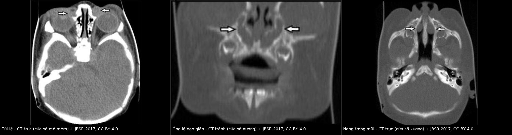
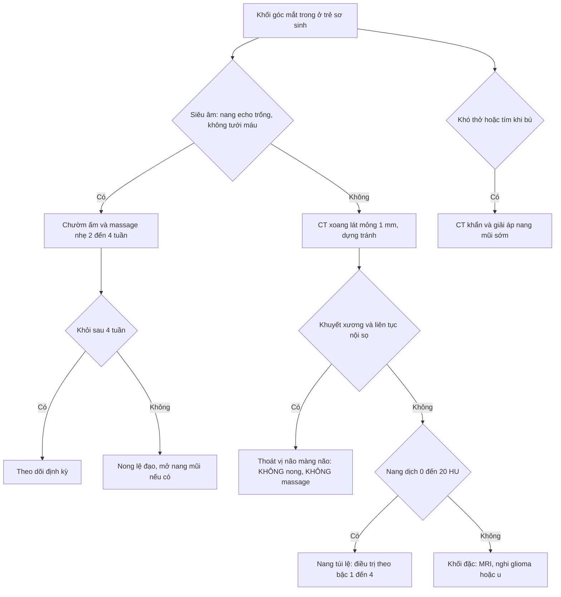
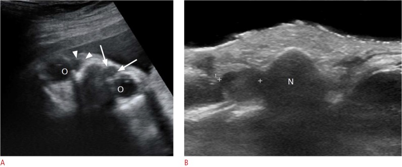
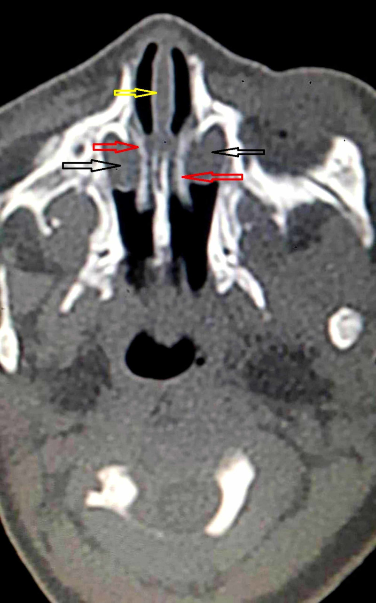
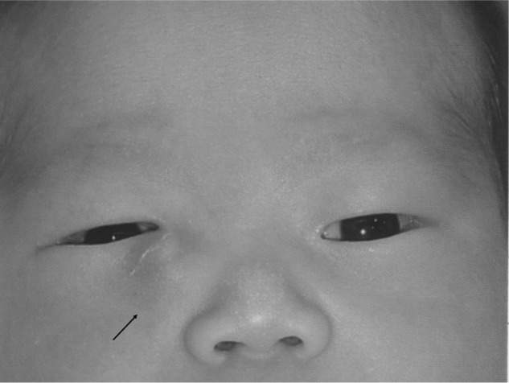

# 1483 — Nang túi lệ bẩm sinh và tắc lệ đạo ở trẻ / Congenital dacryocystocele & nasolacrimal duct obstruction

**Tags:** `pattern:nang-dich` `pattern:nang-mui` `pattern:phinh-ong-le` `vung:mat` `vung:hoc-mat` `vung:mui` `protocol:CT-xoang-lat-mong` `protocol:MRI-hoc-mat` `incidentaloma:khong`
**Mức chắc chắn (certainty):** tổng hợp y văn (literature synthesis) — bài ghép 5 nguồn mở (JBSR 2017, Ultrasonography 2015, Clin Ophthalmol 2014, Cureus 2020, Ophthalmol Ther 2026) + 2 loạt điều trị; phần lớn số liệu là của loạt đơn trung tâm, không có thử nghiệm ngẫu nhiên. Ca dùng trong quiz là ca nguyên văn của nguồn, giữ đúng mô tả gốc.

## 1. Tổng quan bệnh học – cơ chế hình ảnh

- **Phôi thai (embryology).** Hệ lệ đạo hình thành từ một **dây biểu mô (epithelial cord)** sáng lòng theo hướng **sọ → đuôi từ tháng thứ 3 đến tháng thứ 7 trong tử cung**. Đầu xa mở sau cùng: nếu không sáng lòng hết, **màng Hasner** tồn tại — gặp ở **30% trẻ sơ sinh** (JBSR 2017). Phần lớn màng rách tự nhiên trong năm đầu nhờ áp lực lòng ống tăng khi bé khóc, bú, thở.
- **Cơ chế hai van (vì sao thành nang).** Nang túi lệ bẩm sinh cần **hai chỗ tắc cùng lúc**: (1) tắc **xa** ở màng Hasner, và (2) tắc **gần mang tính chức năng** ở **van Rosenmüller** (giữa ống lệ chung và túi lệ). Hai van tạo **hiệu ứng van một chiều (ball-valve)**: nước ối, nước mắt, nhầy bị nhốt trong túi lệ → túi giãn; áp lực đẩy về phía mũi làm **đầu xa phình thành nang trong ngách mũi dưới**.
- **TẠI SAO hình ảnh như vậy (vật lý + mô học).** Nội dung nang là **dịch đơn thuần (nước ối/nhầy loãng)** nên trên CT **0–20 HU**, đồng nhất, **thành mỏng đều**, **không ngấm thuốc**, **không vôi hóa**; trên MRI **T1 tối – T2 rất sáng** (nước tự do) và **không hạn chế khuếch tán** (khác mủ đặc của áp-xe). Xương lệ chỉ **nong/mỏng đi**, **không bị phá hủy** — vì đây là quá trình giãn chậm chứ không phải tổn thương xâm lấn.
- **Vì sao khối "xanh tím".** Túi lệ giãn căng nằm ngay dưới da mi mỏng, thành nang mỏng → dịch nhìn xuyên qua da thành màu **xanh tím**; đây **không phải** máu tụ hay mạch máu. Khối nằm **dưới–trong góc mắt trong**, có thể đẩy góc mắt trong lệch lên.
- **Dịch tễ (dải số, có phản biện).** Nang túi lệ chiếm **0,1%** ca tắc lệ đạo bẩm sinh; **0,02% trẻ sơ sinh** (Mimura 2014) nhưng một ca báo khác dẫn **2/1.000 trẻ sinh sống** (Cureus 2020) — **chênh tới 10 lần**, nên chỉ nên nhớ dải **~0,02–0,2% trẻ sơ sinh**. Hai bên: **25%** (JBSR 2017) nhưng Cureus ghi **~90% một bên**; số "hai bên" phụ thuộc tiêu chuẩn chọn bệnh viện tuyến cuối.
- **Vì sao nguy hiểm ở sơ sinh.** Trẻ sơ sinh **bắt buộc thở mũi đến ít nhất 2 tháng tuổi**; nang mũi **hai bên** bít đường thở → khó thở, tím khi bú, có thể đe dọa tính mạng. Nang túi lệ là **nguyên nhân tắc mũi sơ sinh đứng thứ 2** sau teo/hẹp màng mũi (choanal atresia).
- **Nhiễm là biến chứng chính, không phải ngoại lệ.** Trong **100 trẻ/118 mắt**, nhiễm thứ phát gặp **50,85%** (95% CI **41,50–60,20%**); yếu tố độc lập: **có nang trong mũi aOR 5,07** (2,10–12,23), **tiền sử nắn/massage túi lệ aOR 3,11** (1,29–7,46), **khởi phát mùa đông–xuân aOR 2,97** (1,27–6,93). Nhóm nhiễm điều trị dài hơn: trung vị **6,0 ngày vs 1,0 ngày** và cần can thiệp xâm lấn nhiều hơn (Ophthalmol Ther 2026). Viêm túi lệ cấp gặp **37,9–74%** số mắt nang túi lệ, so với **2,9%** ở tắc lệ đạo đơn thuần trong năm đầu; **> 80%** viêm túi lệ cấp ở sơ sinh khởi phát từ nang túi lệ.
- **Diễn tiến tự nhiên.** Bảo tồn (chườm ấm + massage) làm **76% (16/21)** hết trong **2 tuần**; loạt khác **trung vị 14,5 ngày** (11–105 ngày); tựu trung **96%** tắc lệ đạo bẩm sinh khỏi trước **1 tuổi**.

## 2. Mẫu hình + chẩn đoán phân biệt theo vị trí (Gamut)

- **Mẫu hình chốt — "bộ ba chuỗi hạt" (triad).** Trên **cùng một hệ thống**: (1) nang dịch ở **góc mắt trong** (túi lệ giãn), (2) **ống lệ đạo giãn** liên tục, (3) **nang trong ngách mũi dưới**. Ba cấu trúc nối nhau thành chuỗi — thấy đủ bộ ba là chẩn đoán gần như chắc chắn. Ca hai bên chỉ là **hai chuỗi** đối xứng.
- **Gamut theo vị trí**
  - **Góc mắt trong (medial canthus):** nang túi lệ bẩm sinh · viêm/áp-xe túi lệ · thoát vị não–màng não (encephalocele) · nang bì (dermoid) · u máu nhũ nhi · u túi lệ (hiếm: SCC, lymphoma ở người lớn) · dò lệ đạo bẩm sinh.
  - **Trong hốc mũi sơ sinh (intranasal):** nang túi lệ thể nang mũi · teo/hẹp màng mũi (choanal atresia) · hẹp lỗ hình lê bẩm sinh (CNPAS) · glioma mũi · thoát vị não–màng não · nang bì · nang Thornwaldt.
  - **Sống mũi/đường giữa ngoài da:** nang bì · u máu · dò não–màng não trước (frontonasal) — nhóm này **không** có ống lệ đạo giãn, đó là mấu chốt loại trừ.
- **Gợi nhớ NANG:** **N**ang túi lệ · **A**tresia choanae · **N**ang não–màng não (encephalocele) · **G**lioma mũi — bốn nguyên nhân tắc mũi sơ sinh cần loại trừ nhau trên CT.

## 3. Bảng so sánh phân biệt (ma trận đối chiếu)

| Thực thể (entity) | Hình ảnh điển hình | Chốt vào (rule-in) | Chốt loại (rule-out) | Gợi ý xác nhận |
|---|---|---|---|---|
| **Nang túi lệ bẩm sinh** (congenital dacryocystocele) | Nang **0–20 HU** ở góc mắt trong + ống lệ đạo giãn + nang ngách mũi dưới; thành mỏng đều, không vôi hóa, không ngấm thuốc | **Đủ bộ ba + không khuyết xương + không ngấm thuốc** | Khối **đặc/ngấm thuốc**, có mỡ trong khối, có khuyết xương → không phải nang túi lệ | CT xoang **≤ 1 mm** (trục + tránh); theo dõi 2–4 tuần |
| **Viêm/áp-xe túi lệ** (dacryocystitis/abscess) | Nang + **thành/viền ngấm thuốc**, mỡ quanh viêm, có thể khí; lâm sàng đau, sốt, mủ ở điểm lệ | **Ngấm thuốc viền + viêm mô mềm quanh + sốt** | Nang thuần không ngấm thuốc, không viêm quanh = **chưa** nhiễm | Kháng sinh toàn thân; dẫn lưu nếu ổ mủ |
| **Thoát vị não–màng não** (encephalocele) | Khối dịch **đồng tỷ trọng dịch não tủy**, **liên tục với khoang nội sọ qua khuyết xương**, có thể chứa mô não | **Khuyết xương + liên tục nội sọ + CSF density** | Không khuyết xương, không liên tục → loại | CT cửa sổ xương + MRI T2; **tuyệt đối không nong/massage** |
| **Glioma mũi** (nasal glioma/heterotopia) | Khối **đặc 30–50 HU**, ngấm thuốc, thường một bên, cạnh cuốn giữa; không có nang dịch | **Khối đặc ngấm thuốc trong mũi** | Nang dịch thuần, không ngấm thuốc → loại | MRI trước mổ để tìm cuống nội sọ |
| **Nang bì** (dermoid) | Khối chứa **mỡ −40…−120 HU**, đường giữa sống mũi, có thể lỗ rò da và khuyết xương | **Mỡ trong khối + vị trí đường giữa + lỗ rò** | Không có mỡ, không ở đường giữa → loại | CT/MRI; cắt trọn cả đường rò |
| **U máu nhũ nhi** (infantile hemangioma) | Khối mô mềm **ngấm thuốc mạnh**, T2 sáng, có mạch trong khối; to lên sau sinh rồi thoái triển | **Ngấm thuốc mạnh + tín hiệu mạch** | Nang không ngấm thuốc, không có phổ Doppler → loại | Siêu âm Doppler; propranolol |
| **Teo màng mũi** (choanal atresia) | Tắc **phía sau** hốc mũi bằng màng hoặc xương; **không** có nang góc mắt, **không** giãn ống lệ đạo | **Tắc sau mũi + không nang góc mắt** | Có nang góc mắt + ống lệ đạo giãn → không phải atresia | CT lát mỏng; ống thông mũi không qua được |

*Trái sang phải: (1) CT trục cửa sổ mô mềm — nang dịch hai bên ở góc mắt trong (mũi tên); (2) CT tránh dựng lại cửa sổ xương — ống lệ đạo giãn hai bên (mũi tên); (3) CT trục cửa sổ xương — nang trong hốc mũi dưới cuốn dưới. Nguồn: JBSR 2017, PMC6032638, CC BY 4.0. Ảnh ghép letterbox giữ nguyên tỷ lệ, dải chú thích ghi nguồn.*

### Đọc bộ ba này theo thứ tự nào
- **Bước 1 — tìm nang ở góc mắt trong:** nếu có, đo đường kính và ghi mật độ; **không** thấy nang ngoài không loại trừ nang mũi (thể nang mũi đơn thuần hiếm nhưng có).
- **Bước 2 — nối nang với ống lệ đạo:** ống giãn liên tục với nang là dấu hiệu định vị mạnh nhất, phân biệt với nang bì/u máu cùng vùng.
- **Bước 3 — xuống sàn mũi:** nang nằm **dưới và ngoài cuốn mũi dưới**, đẩy cuốn vào vách mũi. Bỏ bước này là bỏ mất nguyên nhân gây suy hô hấp.

## 4. Protocol chụp + hệ phân độ/ngưỡng xử trí

- **Siêu âm đầu tay (bedside):** đầu dò **≥ 12 MHz**, nang **echo trống**, bờ rõ, thành mỏng, **không có phổ Doppler trong nang**; đo đường kính và so hai bên. Siêu âm đủ để theo dõi và đủ để loại khối đặc.
- **CT xoang – hốc mắt:** lát **≤ 1 mm** (0,6–1 mm), **cửa sổ xương + mô mềm**, dựng **tránh**; **không cản quang là đủ** cho thể điển hình. Chỉ cản quang khi nghi **áp-xe** (viền ngấm thuốc) hoặc **khối đặc**. Đây là phương thức **thấy xương và khí tốt nhất**, đồng thời nhanh — trẻ sơ sinh không cần gây mê.
- **MRI hốc mắt – xoang:** **T2 fat-sat** (dịch rất sáng) + **T1 sau tiêm fat-sat** + **DWI/ADC**; chỉ định khi **(a)** nghi thoát vị não–màng não/glioma (khuyết xương, thành phần đặc), **(b)** cần tránh bức xạ lặp lại, **(c)** khối không điển hình.
- **Trước sinh (prenatal US):** mặt cắt **ngang qua hai hốc mắt**; nang **giảm âm phía trong hốc mắt**. Loạt **11.332 thai** cho tỉ lệ **0,43%** (49 thai), phát hiện trung bình **31,2 tuần**, đỉnh **27 tuần**, đường kính trung bình **7 mm**, và **76% (35/46)** hết trước hoặc ngay lúc sinh; tuổi thai lúc sinh là yếu tố dự báo còn nang sau sinh (p = 0,045). Ngưỡng chọn trong loạt: nang **> 5 mm**.
- **Không có hệ phân độ/RADS.** Quyết định dựa trên **bộ ba hình ảnh + mức tắc mũi + dấu nhiễm**, không dựa vào kích thước đơn thuần.

**Ngưỡng xử trí (bảo tồn → can thiệp):**

| Bậc | Chỉ định | Việc làm | Bằng chứng |
|---|---|---|---|
| 1 | Nang không biến chứng, trẻ bú thở được | Chườm ấm + **massage nhẹ** hướng xuống dưới, 2–4 tuần | **76% (16/21)** hết trong 2 tuần; trung vị **14,5 ngày** (11–105) |
| 2 | Thất bại bậc 1, hoặc có viêm túi lệ | **Nong lệ đạo (probing)** ± nội soi mũi | **10 ca**, tuổi **24,9 ± 7,15 ngày** (6–85), **100%** thành công sau 1 lần; 4 ca kèm mở nang mũi |
| 3 | Nang mũi lớn gây tắc mũi, hoặc thất bại nong | **Mở nang mũi (marsupialization)** nội soi | **23 ca** gây tê tại chỗ, **83%** đã thất bại bảo tồn, **tái phát 9% (2/23)**, **0** biến chứng, nghẹt mũi tồn tại **17%** |
| 4 | Suy hô hấp do nang mũi hai bên | Giải áp nang mũi **sớm**, không chờ | Trẻ sơ sinh thở mũi bắt buộc đến **≥ 2 tháng** |

## 5. Biến thể bình thường và cạm bẫy

- **Phân biệt với teo màng mũi bằng lâm sàng, không bằng ảnh:** teo màng mũi **hai bên** gây khó thở **giảm khi khóc** (trẻ chuyển sang thở miệng), còn nang túi lệ **không giảm khi khóc**; ống thông mũi **qua được** thì loại atresia (Cureus 2020).
- **Cạm bẫy chết người: thoát vị não–màng não giả dạng nang túi lệ.** Nếu chỉ thấy "nang dịch góc mắt trong" mà không xem **cửa sổ xương** và không kiểm tra **liên tục với khoang nội sọ**, nong/massage sẽ gây **rò dịch não tủy và viêm màng não**. Trên CT, khuyết xương + dịch **đồng tỷ trọng não tủy** là chốt loại nang túi lệ.
- **Massage mạnh/nhiều lần không phải "vô hại":** tiền sử nắn túi lệ là yếu tố độc lập của nhiễm thứ phát (**aOR 3,11**), và vỡ nang vào ống lệ chung gây **chảy mủ ngược ra điểm lệ** có thể là **tiền triệu của viêm túi lệ**. Hướng dẫn phụ huynh: **nhẹ, đúng hướng xuống dưới**, ngừng và đi khám khi da nề đỏ.
- **Chỉ đọc lát trục = bỏ nang trong mũi.** Nang nằm **thấp, sát sàn mũi**, dễ ra khỏi mặt cắt; luôn dựng **tránh** và đọc xuống tận sàn mũi.
- **"Nang túi lệ" ở người lớn là bệnh khác:** thường **mắc phải** sau viêm/tắc lệ đạo hoặc sau chấn thương, cùng hình ảnh nang nhưng bối cảnh và xử trí khác — đừng gắn nhãn "bẩm sinh".
- **Biến thể bình thường:** ống lệ đạo **không thấy rõ** trên CT thường quy ở trẻ lớn; chỉ khi giãn mới thành cấu trúc dạng ống. Đừng gọi giãn khi ống **đối xứng, mảnh, không có nang**.

## 6. Tự lượng giá — Blind Quiz

**Ca 1 — Thai 32 tuần, siêu âm ngang qua hai hốc mắt: hai nang giảm âm phía trong hốc mắt, 7 mm bên phải và 8 mm bên trái. Hỏi chẩn đoán, diễn tiến, có can thiệp trước sinh không?**

- Gợi ý: thai không có bất thường khác; mẹ không bệnh lý.
- Câu hỏi: vị trí nang? Chẩn đoán? Tỉ lệ tự hết? Có chỉ định can thiệp trong tử cung?

<b>Bấm để hiện đáp án (findings + chẩn đoán)</b>

- Findings: hai nang **giảm âm, bờ rõ**, nằm **phía trong (medial)** so với hai hốc mắt, đường kính **7–8 mm** — tương ứng túi lệ/ống lệ đạo giãn.
- Chẩn đoán: **nang túi lệ bẩm sinh hai bên (bilateral congenital dacryocystocele)** phát hiện trước sinh. Không can thiệp trong tử cung.
- Diễn tiến: **76% (35/46)** hết trước hoặc ngay lúc sinh; ở ca này siêu âm sau sinh 1 ngày còn nang **7 mm** bên phải, bên trái đã hết — nghĩa là **một bên tự khỏi, một bên theo dõi**.
- Nguồn ảnh: *Ultrasonography* 2015, PMC4282226, Fig. 1, CC BY-NC 3.0.

**Ca 2 — Bé gái 2 ngày, khó thở từng cơn khi ngủ, không giảm khi khóc, chảy nước mắt và có ghèn mủ hai bên. CT không cản quang: hai khối giảm tỷ trọng trong hốc mũi, đẩy cuốn mũi dưới vào vách mũi. Hỏi 3 chẩn đoán phân biệt và bước tiếp theo?**

- Gợi ý: ống thông mũi đưa qua được hai bên; không có biến dạng sọ mặt.
- Câu hỏi: mô tả khối? Vì sao khó thở mà không giảm khi khóc? Điều trị gì?

<b>Bấm để hiện đáp án (findings + chẩn đoán)</b>

- Findings: **hai khối giảm tỷ trọng (dịch)** ở sàn mũi, **đẩy cuốn mũi dưới vào vách mũi**, **không khuyết xương**, không ngấm thuốc — tức **nang trong ngách mũi dưới** hai bên.
- Chẩn đoán: **nang túi lệ thể nang mũi hai bên**. Phân biệt: **teo màng mũi** (khó thở **giảm khi khóc**, ống thông không qua), **glioma mũi** (khối đặc ngấm thuốc), **thoát vị não–màng não** (khuyết xương, liên tục nội sọ).
- Vì sao không giảm khi khóc: tắc nằm **trong lòng mũi**, không phải tắc sau mũi — trẻ vẫn không có đường thở miệng hiệu quả vì quen thở mũi.
- Điều trị: **bảo tồn** (chườm ấm, massage nhẹ, kháng sinh nhỏ mắt) — ca gốc hết triệu chứng **ngày 5**, thông mũi **ngày 10**; can thiệp khi suy hô hấp hoặc thất bại.
- Nguồn ảnh: *Cureus* 2020, PMC7377024, Fig. 2, CC BY 3.0.

**Ca 3 — Bé trai 5 ngày, khối xanh tím dưới–trong góc mắt trong phải, đẩy góc mắt lệch lên, không đau, không sốt. Hỏi dấu hiệu, vì sao xanh, và việc KHÔNG được làm?**

- Gợi ý: không chấn thương, không sinh khó.

<b>Bấm để hiện đáp án (findings + chẩn đoán)</b>

- Findings: khối **căng, xanh tím**, ở **dưới–trong góc mắt trong**, đẩy góc mắt trong lệch lên; không nề đỏ lan → chưa có viêm mô tế bào.
- Chẩn đoán: **nang túi lệ bẩm sinh**. Màu xanh do **dịch trong túi lệ giãn nhìn xuyên qua da mi mỏng**, không phải máu tụ.
- Việc **KHÔNG** được làm: **nong lệ đạo hoặc nắn mạnh khi chưa loại trừ thoát vị não–màng não** (nguy cơ rò dịch não tủy/viêm màng não); cũng không nắn mạnh vì làm tăng nguy cơ nhiễm (aOR 3,11).
- Việc nên làm: chườm ấm + massage **nhẹ** hướng xuống dưới; kháng sinh khi có dấu nhiễm; hẹn tái khám sớm.
- Nguồn ảnh: *Clin Ophthalmol* 2014, PMC3942303, Fig. 1, CC BY-NC 3.0.

## Bài liên quan chéo
- [400 – Tổng quan Mắt & thị giác](../400-tong-quan-mat-thi-giac/lesson.md)
- [410 – Giải phẫu hốc mắt](../410-giai-phau-hoc-mat/lesson.md)
- [424 – Tuyến lệ](../424-tuyen-le/lesson.md) (khối vùng tuyến lệ và góc mắt ngoài)
- [1461 – Áp-xe dưới màng xương hốc mắt ở trẻ](../1461-ap-xe-duoi-mang-xuong-hoc-mat-o-tre/lesson.md) (khi nang túi lệ bị nhiễm lan ra hốc mắt)
- [1972 – Hẹp lỗ hình lê bẩm sinh](../1972-hep-lo-hinh-le-bam-sinh/lesson.md) (chẩn đoán phân biệt tắc mũi sơ sinh)

> Không dùng để chẩn đoán độc lập khi chưa có người hướng dẫn.
