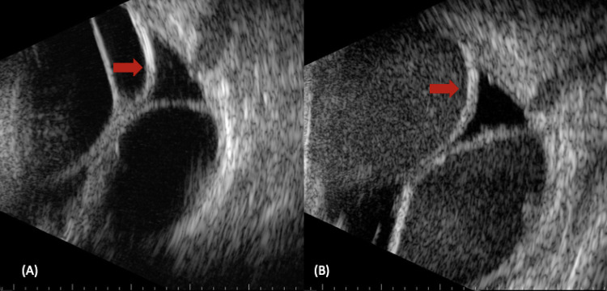
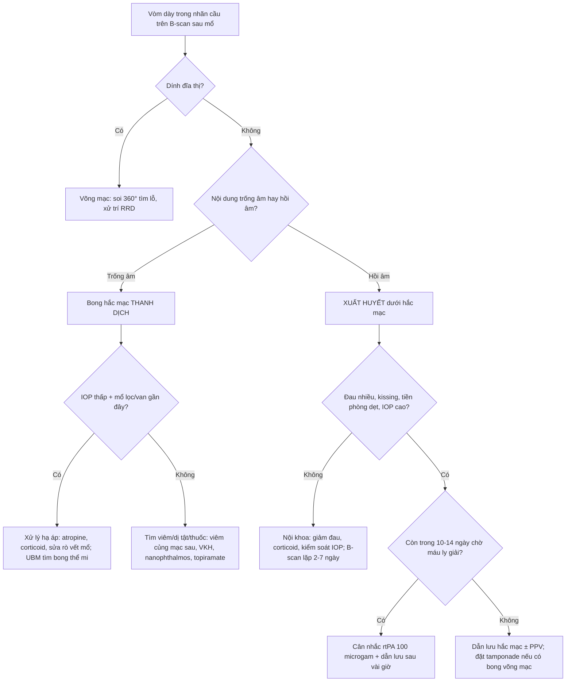
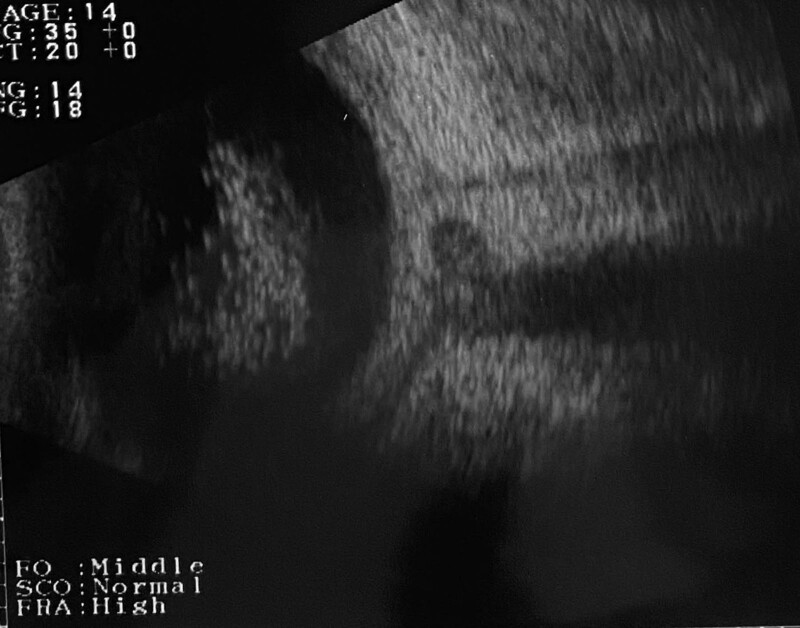
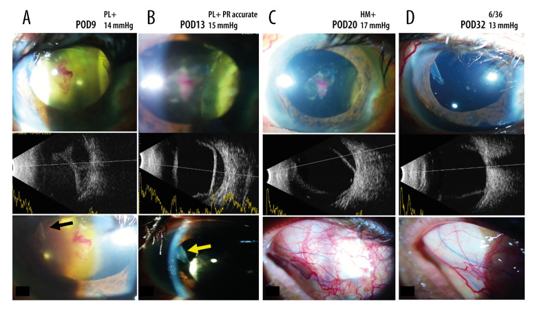
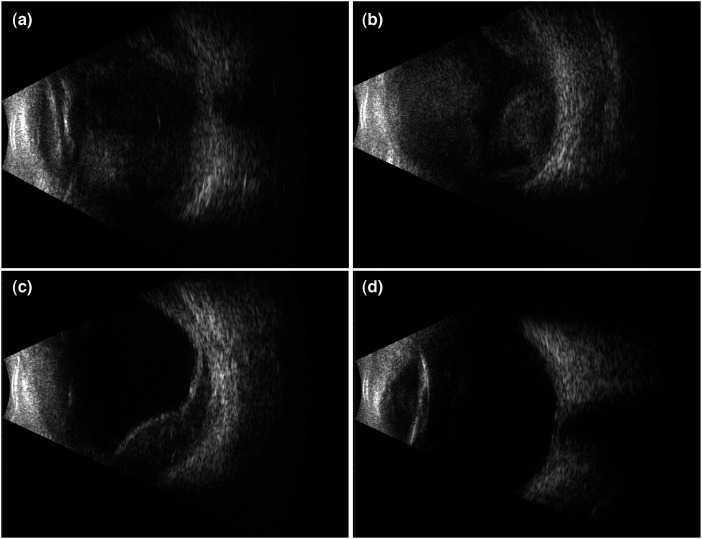
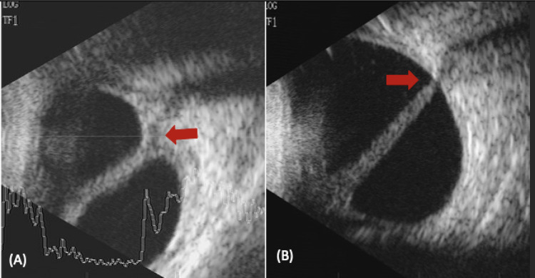

# 1484 — Bong hắc mạc thanh dịch & xuất huyết dưới hắc mạc sau mổ mắt / Choroidal detachment & suprachoroidal hemorrhage

**Tags:** `pattern:bong-hac-mac` `pattern:bong-thanh-dich` `pattern:xuat-huyet-duoi-hac-mac` `pattern:voi-day-khong-dinh-dia-thi` `pattern:kissing-choroidals` `pattern:dau-tam-giac` `pattern:sau-mo-mat` `pattern:ha-nhan-ap` `vung:mat` `vung:hac-mac` `vung:tien-phong` `protocol:sieu-am-B-scan` `protocol:UBM` `protocol:CT-hoc-mat` `protocol:MRI-hoc-mat` `incidentaloma:khong`

**Mức chắc chắn (certainty):** tổng hợp y văn (literature synthesis) — dựng từ **1 tổng quan hệ thống 38 nghiên cứu/393 mắt** (*Int J Retina Vitreous* 2024, **PMC11337774**, CC BY 4.0), **2 đoàn hệ–ca loạt** (**992 mắt** trabeculectomy, *J Glaucoma* 2026, **PMC13015807**; **21 mắt** SCH được mổ, *Indian J Ophthalmol* 2026, **PMC13056044**), **3 nghiên cứu/ca loạt có hình ảnh** (**36 mắt** dấu tam giác, *Clin Ophthalmol* 2025, **PMC11766375**; **8 mắt** bong thể mi trên UBM, *Int Ophthalmol* 2024, **PMC11208247**; **5 ca/48.725 ca** phaco, *J Int Med Res* 2025, **PMC12041713**) và **3 ca lâm sàng** (**PMC12542795** kissing choroidals với nhãn áp bình thường; **PMC13457764** dẫn lưu sớm có rtPA; **PMC9302307** viêm củng mạc sau gây bong hắc mạc). Nhóm **không có bệnh nhân của mình**; chỗ chưa đủ chắc ghi "chưa rõ". **Không ghi tên tác giả** — attribution dùng tạp chí + năm + PMCID.

> **Câu chốt:** Bong hắc mạc là **một khoang, hai chất lỏng**: **thanh dịch (nước)** thường do **nhãn áp thấp/viêm** và đa số **tự khỏi**; **xuất huyết (máu)** thường do **áp lực động mạch mi** và có thể **làm mù trong vài giờ**. Ba con số phải thuộc: **(1)** tràn dịch hắc mạc thanh dịch sau **trabeculectomy 5,4%** (54/992 mắt) và **79,9%** ca hạ áp "số" **không có di chứng** (PMC13015807); **(2)** dấu chốt trên siêu âm là **vòm dày KHÔNG dính đĩa thị** + **dấu tam giác 36/36 mắt** khi bong toàn bộ (PMC11766375); **(3)** SCH sau phaco hiện đại **0,03–0,1%** (0,01% ở loạt 48.725 ca), nhưng **BCVA cuối 2,1 logMAR** dù mổ (PMC11337774, PMC12041713, PMC13056044). Cạm bẫy hay gặp nhất: gọi **dấu T** là dấu của bong hắc mạc — **sai**, dấu T là **dịch dưới bao Tenon của viêm củng mạc sau** (PMC9302307).

## 1. Tổng quan bệnh học – cơ chế hình ảnh

### 1.1 Giải phẫu: vì sao bong hắc mạc KHÔNG bao giờ vượt qua đĩa thị

Hắc mạc **không phải lá tự do**: nó dính chắc ở **rìa thể mi (scleral spur)** phía trước và ở **quanh lỗ thị** phía sau (nơi **động mạch – thần kinh mi ngắn** xuyên củng mạc), còn ngoại vi bị **tĩnh mạch xoắn (vortex veins)** ghì lại. Khoang dưới hắc mạc vì thế là **khoang tiềm tàng (potential space)**, bình thường **gần như không tồn tại** vì hắc mạc áp sát củng mạc.

Hệ quả hình ảnh — **chốt để phân biệt với bong võng mạc**:

- Dịch/máu đẩy hắc mạc vào trong thành **vòm (dome) dày, nhẵn**, đỉnh hướng tâm, **dừng trước đĩa thị** (để lại một **tam giác dịch kính** trước đĩa — "dấu tam giác").
- Khi dịch **360°**, hai vòm gặp nhau giữa nhãn cầu = **"kissing choroidals" (hôn nhau)**.
- Võng mạc thì **chạy tới đĩa thị ở cả hai đầu** — đó là lý do **"màng dính đĩa thị" = võng mạc**, không phải hắc mạc.

### 1.2 Thanh dịch: chuỗi xoắn ốc làm hạ áp tự duy trì

1. **Mổ lọc/đặt van** làm thủy dịch thoát nhanh → **IOP tụt** (đoàn hệ 8 mắt: **26,0 ± 7,65 → 6,9 ± 2,64 mmHg** ngay ngày 1, PMC11208247).
2. **Chênh áp xuyên thành mao mạch hắc mạc tăng** (định luật Starling) → **dịch thoát ra khoang dưới hắc mạc**.
3. Thể mi cũng bong theo (**UBM: bong thể mi 100%** ca bong hắc mạc sau mổ glôcôm, 1–4 góc) → **giảm sản xuất thủy dịch** → **hạ áp sâu hơn** → **vòng xoắn tự duy trì**. Đây là lý do bong hắc mạc sau mổ glôcôm **không tự hết nhanh** như sách giáo khoa mô tả: **thời gian hết hoàn toàn 4,3 ± 5,01 tháng** (2,7 ± 2,48 khi bỏ 1 ca kéo dài), dù **không ca nào phải mổ** (PMC11208247).

Con số nền: sau **trabeculectomy**, **tràn dịch hắc mạc thanh dịch 5,4%**, **tiền phòng dẹt 2,8%**, **mổ lại vì hạ áp 3,4%**; **hạ áp "số" (IOP ≤ 5 mmHg ≥ 2 lần) 28,6%** nhưng **79,9%** trong số đó **không di chứng lâm sàng** (PMC13015807). Sau **van dẫn lưu**: **9–35,1%** (van có van) và **36,8%** (van không van); **thắt ống bằng chỉ tiêu** làm giảm ca phải can thiệp xuống **2%** (PMC12542795). **Bệnh hoàng điểm do hạ áp** gặp **tới 20%** sau khi dùng antimetabolite (PMC4675727).

### 1.3 Xuất huyết: máu vào khoang kín theo áp lực động mạch

IOP tụt **đột ngột** (mở nhãn cầu, rò vết mổ, needling bọng) → **động mạch mi dài/ngắn căng rồi rách** → máu phun vào khoang dưới hắc mạc **theo huyết áp**, đẩy **màng thể mi–mống mắt–thể thủy tinh ra trước**, IOP **tăng vọt**, đau dữ dội: thể **"expulsive" (bùng phát)** trong mổ. Thể **trễ (delayed)** xảy ra sau mổ **1–5 ngày** (có ca tới **8 tuần**), đau **1–5 ngày** sau mổ, thường sau **mổ glôcôm** (PMC11337774).

Tần suất theo loại mổ (PMC11337774; PMC13457764): **phaco 0,03–0,1%** (loạt 48.725 ca: **0,01%**), **glôcôm 0,15–6,1%** (**trabeculectomy 0,6–1,4%**, **van 1,2–2,7%**), **dịch kính–võng mạc 0,17–1,9%**, **ghép giác mạc 0,45–1,08%**. Needling bọng lọc: **xuất huyết trên hắc mạc 1,4%** (6/422, bài [1992](../1992-needling-bong-loc-sau-trabeculectomy/lesson.md)).

### 1.4 TẠI SAO hình ảnh trông như vậy (vật lý siêu âm – CT – MRI)

- **B-scan 10 MHz — vì sao nước "đen", máu đông "sáng":** siêu âm tạo ảnh bằng **hồi âm** ở **mặt phân cách trở kháng**. **Dịch trong** gần như **không có mặt phân cách** → **trống âm (anechoic)**. **Máu đông** có **lưới fibrin + tế bào** → nhiều mặt phân cách nhỏ → **hồi âm dày, không đều**. Vì vậy **cùng một vòm**, nội dung **trống âm = thanh dịch**, **hồi âm = xuất huyết** (Hình 1). Theo thời gian, **cục máu co và ly giải** → hồi âm giảm dần → **màng hắc mạc hiện rõ** (đúng diễn tiến Fig. 1 của PMC12041713).
- **Vì sao phải quét ĐỘNG (dynamic):** màng hắc mạc **cố định ở tĩnh mạch xoắn và rìa củng mạc** nên **không "vẫy"** khi đảo mắt; **màng dịch kính sau (PVD)** thì **vẫy mạnh**; **võng mạc** có **aftermovement** và **dính đĩa thị**. Quét động là **cách phân biệt rẻ nhất** mà không cần thuốc.
- **A-scan (vector):** phản hồi nội bộ **thấp** trong dịch trong, **trung bình–cao** trong máu đông/khối đặc — dùng để **loại u hắc mạc** (khối đặc có phản hồi nội bộ).
- **UBM (siêu âm sinh hiển vi, đầu dò tần số cao 35–50 MHz):** xuyên qua **thể mi – tiền phòng** mà B-scan 10 MHz không tới; đây là **chuẩn** để thấy **bong thể mi** — yếu tố giải thích **hạ áp kéo dài** (PMC11208247).
- **CT:** **không phải** modality của hắc mạc. Giá trị thật là **loại chấn thương**: xác nhận **thành nhãn cầu nguyên vẹn, không dị vật, không gãy xương hốc mắt**; nhưng ca thể thủy tinh lạc vào khoang dưới hắc mạc cho thấy **"thành mắt nguyên vẹn" trên CT KHÔNG loại trừ tổn thương bên trong** và **CT phân giải mô mềm kém** (PMC13725958). Ngưỡng **HU** của máu tụ dưới hắc mạc: **chưa rõ — cần tra** (không có trong nguồn đã đọc).
- **MRI:** **T1** thấy **bong hắc mạc + dày củng mạc** trong viêm củng mạc sau (PMC9302307); hữu ích khi **nghi viêm/u hốc mắt** hơn là khi chỉ cần xác định bong hắc mạc.

### 1.5 Ngưỡng định lượng nằm lòng

| Chỉ số | Ngưỡng / giá trị | Nguồn |
|---|---|---|
| Hạ áp "số" sau trabeculectomy | **IOP ≤ 5 mmHg** ở ≥ 2 lần khám, một lần ≥ 3 tuần sau mổ → **28,6%** (284/992) | PMC13015807 |
| Hạ áp "lâm sàng" | bong hắc mạc/giác mạc do hạ áp/bệnh hoàng điểm do hạ áp/tiền phòng dẹt hoặc phải mổ lại → **10%** (99/992) | PMC13015807 |
| Tràn dịch hắc mạc thanh dịch sau trabeculectomy | **5,4%** (54/992); **79,9%** ca hạ áp số không di chứng | PMC13015807 |
| Tràn dịch sau van dẫn lưu | **9–35,1%** (có van) · **36,8%** (không van) · **2%** phải can thiệp khi thắt ống | PMC12542795 |
| IOP trước/ngay sau mổ glôcôm có bong hắc mạc | **26,0 ± 7,65 → 6,9 ± 2,64 mmHg** (ngày 1) | PMC11208247 |
| Thời gian từ mổ tới chẩn đoán bong hắc mạc thanh dịch | **11,6 ± 5,73 ngày** | PMC11208247 |
| Thời gian hết hoàn toàn (điều trị nội khoa) | **4,3 ± 5,01 tháng** (bỏ ca kéo dài: **2,7 ± 2,48**) | PMC11208247 |
| SCH sau phaco hiện đại | **0,03–0,1%**; loạt 48.725 ca: **0,01%** (5 ca) | PMC11337774; PMC12041713 |
| SCH sau mổ glôcôm | **0,15–6,1%** (trabeculectomy **0,6–1,4%**; van **1,2–2,7%**) | PMC11337774; PMC13457764 |
| SCH trễ sau mổ | đau xuất hiện **1–5 ngày**, muộn nhất **8 tuần** | PMC11337774 |
| "Massive" SCH | **≥ 2 góc** hoặc **lan tới hoàng điểm** hoặc **kissing** | PMC13056044 |
| Thời gian từ chẩn đoán SCH tới mổ | **0–120 ngày**; đa số **7–14 ngày** (khoảng 1–32) | PMC11337774 |
| Dấu tam giác (bong hắc mạc toàn bộ) | **36/36 = 100%**; SCH **86,1%**; màng hắc mạc không thấy lúc đầu **41,7%** | PMC11766375 |
| BCVA cuối sau SCH (mổ) | **2,5 ± 0,2 → 2,1 ± 0,9 logMAR**; thành công giải phẫu **13/21** ở **16 tháng** | PMC13056044 |
| BCVA cuối theo hình thái | không áp sát **1,2** vs áp sát **1,86 logMAR** (p = 0,002); **1–2 góc 1,15** vs **3–4 góc 2,60 logMAR** (p = 0,002) | PMC11337774 |
| Dẫn lưu sớm có hỗ trợ rtPA | **rtPA 0,1 mL = 100 µg**, cách rìa **8 mm**, dẫn lưu **sau 5 giờ**, tưới **40 mmHg** → IOP **10–12 mmHg** ở **6 tháng** | PMC13457764 |
| Cửa sổ dính võng mạc–võng mạc | có thể hình thành **từ ngày 3** khi hắc mạc áp sát → lý do **không chờ đủ 10–14 ngày** ở mắt một mắt | PMC13457764 |

## 2. Mẫu hình + chẩn đoán phân biệt theo vị trí (gamut)

**Mẫu hình (pattern):** trên B-scan — **một hay nhiều vòm dày, bờ nhẵn, hướng tâm, KHÔNG dính đĩa thị**, nội dung **trống âm** hoặc **hồi âm**; **không di động** khi quét động. Bong **360°** → **kissing choroidals**; bong **toàn bộ** → **dấu tam giác** (tam giác dịch kính trước đĩa thị, hai cạnh là **bờ hắc mạc bong**). Đo **số góc tổn thương (1–4)**, **chiều cao tối đa (mm)**, **có/không kissing**, **có/không bong thể mi (UBM)**, **nội dung trống âm hay hồi âm**.

**Gamut theo cơ chế — mnemonic "HẠ – VIÊM – MÁU – TẮC – DỊ TẮT – THUỐC":**

1. **HẠ** (nhãn áp thấp): sau **trabeculectomy/van/MIGS**, **rò vết mổ**, **rách thể mi/chu kỳ lọc** ([1447](../1447-rach-the-mi-sau-migs-va-yamane/lesson.md)), **glôcôm ác tính** ([1448](../1448-glaucoma-ac-tinh-sau-mo-noi-nhan/lesson.md)).
2. **VIÊM**: **viêm củng mạc sau** (kèm **dấu T**), **VKH** ([1436](../1436-benh-vogt-koyanagi-harada/lesson.md)), viêm màng bồ đào.
3. **MÁU**: **SCH trong mổ (expulsive)**, **SCH trễ**, **chấn thương**, **tự phát** (tăng huyết áp, chống đông, bệnh mạch hắc mạc).
4. **TẮC** (ứ tĩnh mạch): tăng áp lực tĩnh mạch thượng củng mạc (nanophthalmos, Sturge–Weber, rò động–xoang hang).
5. **DỊ TẮT**: **nanophthalmos**, **hội chứng tràn dịch hắc mạc (uveal effusion syndrome)**, củng mạc dày.
6. **THUỐC**: **topiramate** (tràn dịch thể mi–hắc mạc + glôcôm góc đóng cấp), corticoid, thuốc tăng áp lực tĩnh mạch.

**Gamut theo thời điểm** (quyết định xử trí): **trong mổ** (thường là **SCH** — đóng vết mổ ngay, hạ áp có kiểm soát) · **1–5 ngày sau mổ** (SCH trễ hoặc tràn dịch thanh dịch) · **1–4 tuần** (thanh dịch do hạ áp, viêm) · **> 4 tuần** (mạn, hội chứng tràn dịch hắc mạc, bong hắc mạc do viêm/u).

## 3. Bảng so sánh phân biệt (ma trận đối chiếu)

| Thực thể (entity) | Hình ảnh điển hình (B-scan/UBM/CT-MRI) | Chốt vào (rule-in) | Chốt loại (rule-out) | Gợi ý xác nhận |
|---|---|---|---|---|
| **Bong hắc mạc thanh dịch do hạ áp** | Vòm nhẵn, **trống âm**, 1–4 góc, **không dính đĩa thị**; kèm **bong thể mi trên UBM**; tiền phòng nông | **IOP thấp + mổ lọc/van gần đây + vòm trống âm + bong thể mi** | Có **màng dính đĩa thị** → võng mạc; nội dung **hồi âm dày** → xuất huyết | B-scan + UBM; đo IOP 2 mắt; lịch OCT/B-scan 1–2 tuần |
| **Xuất huyết dưới hắc mạc (SCH) trong mổ** | "Expulsive": **mống mắt–thể thủy tinh bị đẩy ra trước**, IOP vọt, **hồi âm dày toàn nhãn cầu**; có khi **không tách được võng mạc–hắc mạc** | **Xảy ra ngay trên bàn mổ + IOP tăng + tiền phòng dẹt** | Đau kiểu **1–5 ngày sau mổ**, không có biến cố trong mổ → **SCH trễ** | Đóng vết mổ ngay; B-scan sau khi ổn định; theo dõi **ly giải cục máu** |
| **SCH trễ sau mổ** | **Đau dữ dội**, IOP cao hoặc thấp, **vòm hồi âm**, **kissing**; có khi **màng hắc mạc bị che 41,7%** | **Đau 1–5 ngày sau mổ + vòm hồi âm + dấu tam giác** | Không đau, vòm trống âm, IOP thấp → thanh dịch | B-scan lặp 2–7 ngày; đếm **số góc**, đo **chiều cao** |
| **Bong võng mạc có lỗ (RRD)** | Màng **mảnh, gấp nếp**, **dính đĩa thị**, **di động/aftermovement**; **không có dấu tam giác** | **Dính đĩa thị + thấy lỗ khi soi 360°** | Vòm dày không dính đĩa → không phải RRD | Soi đáy mắt giãn đồng tử + ấn sclera; xem [445](../445-bong-vong-mac/lesson.md), [411](../411-sieu-am-nhan-cau/lesson.md) |
| **Xuất huyết dịch kính (VH)** | Hồi âm **lấp toàn bộ** khoang dịch kính **kể cả trước đĩa thị**; **mất dấu tam giác** | **Hồi âm cả vùng trước đĩa thị** | Còn **tam giác trống âm trước đĩa thị** → bong hắc mạc | Quét động; B-scan lặp khi máu lắng |
| **Viêm củng mạc sau (posterior scleritis)** | **Dấu T**: dịch **dưới bao Tenon** lan quanh thị thần kinh + **củng mạc dày**; có thể kèm bong hắc mạc; **MRI T1** thấy dày củng mạc | **Đau mắt + dấu T + củng mạc dày + đáp ứng corticoid toàn thân** | Chỉ có vòm dưới hắc mạc, **không dày củng mạc, không dấu T** → không phải viêm củng mạc sau | B-scan + MRI hốc mắt; CRP/ESR; thử corticoid |
| **U hắc mạc (melanoma/di căn)** | **Khối đặc** (không phải dịch), **phản hồi nội bộ** trên A-scan, có thể hình nấm khi vỡ màng Bruch | **Khối đặc + phản hồi nội bộ + dày > 2 mm** | Nội dung **trống âm** và thay đổi theo nhãn áp → dịch, không phải u | A-scan + B-scan; **MRI hốc mắt**; **không sinh thiết mù** |
| **Hội chứng tràn dịch hắc mạc / nanophthalmos** | Bong hắc mạc **tái phát hai bên**, **củng mạc dày**, nhãn cầu **nhỏ (AL thấp)**, không hạ áp | **Tái phát + củng mạc dày + nhãn cầu nhỏ + không tìm được nguyên nhân** | Một lần, sau mổ, có hạ áp rõ → nguyên nhân mắc phải | AL, UBM củng mạc, MRI; cân nhắc **cắt củng mạc** |
| **Bong hắc mạc do thuốc (topiramate)** | **Tràn dịch thể mi–hắc mạc hai bên** + **glôcôm góc đóng cấp** (tiền phòng nông, IOP cao) | **Bắt đầu thuốc gần đây + hai bên + góc đóng + tiền phòng nông** | Một bên, sau mổ, IOP thấp → không phải do thuốc | Ngừng thuốc + atropine; **không mổ** khi còn nghi |

- **Ảnh ghép đối chiếu:** **không tạo composite** — 6 ảnh thuộc **6 bệnh nhân**, 3 mức giấy phép và **1 ảnh CC BY-NC-ND** (cấm phái sinh); ghép sẽ **vi phạm giấy phép** và làm mất chú giải gốc.

## 4. Protocol chụp + hệ phân độ/điểm chuẩn hóa

### 4.1 Protocol "nhìn thấy vòm là phải trả lời 5 câu"

1. **Bao nhiêu góc?** Quét **4 góc** ở **2 mặt phẳng vuông góc**, ghi **số góc (1–4)** — vì **1–2 góc** có tiên lượng **1,15 logMAR** còn **3–4 góc** là **2,60 logMAR** (p = 0,002, PMC11337774).
2. **Trống âm hay hồi âm?** Quyết định **thanh dịch vs xuất huyết**; nếu hồi âm, ghi **mức độ đặc** và **hẹn B-scan lặp 2–7 ngày** để theo dõi **ly giải**.
3. **Có kissing không?** **Kissing = tiêu chí "massive"** (PMC13056044) và là **chỉ định can thiệp** khi kèm **tiền phòng dẹt, chạm giác mạc, hoặc đau không kiểm soát**.
4. **Có dính đĩa thị không?** **Dính = võng mạc**; **không dính = hắc mạc**. Nếu **không tách được** (máu đông dày), tìm **dấu tam giác** — có mặt **100%** ca bong hắc mạc toàn bộ.
5. **Có bong thể mi không?** **UBM** khi **IOP còn thấp kéo dài**; bong thể mi giải thích **giảm sản xuất thủy dịch** và dự báo **hồi phục chậm (tháng)**.

**Thông số tối thiểu:** B-scan **10 MHz**, **gain vừa** (gain cao làm **nhiễu giả màng**), **quét động**; đo **chiều cao lớn nhất (mm)**; lưu **ảnh 4 góc**; **A-scan vector** qua vòm để loại khối đặc; **UBM 35–50 MHz** cho thể mi/góc; **CT hốc mắt** khi **chấn thương** (loại rách nhãn cầu, dị vật, gãy xương); **MRI hốc mắt** khi nghi **viêm củng mạc sau/u**.

### 4.2 Lịch theo dõi và ngưỡng quyết định

| Thời điểm | Việc làm | Ngưỡng hành động |
|---|---|---|
| Ngay sau mổ | Đo IOP, soi tiền phòng, hỏi **đau** | **Đau dữ dội + IOP vọt + tiền phòng dẹt** → nghĩ **SCH**, B-scan ngay |
| **1–3 ngày** | B-scan nếu IOP thấp/tiền phòng nông | **Kissing + tiền phòng dẹt/chạm giác mạc** → hội chẩn mổ |
| **1–2 tuần** | B-scan lặp, đo chiều cao, đếm góc | **Hồi âm không giảm** hoặc **tăng** → cân nhắc **dẫn lưu** |
| **4 tuần** | B-scan + UBM + IOP | Thanh dịch **giảm dần** → tiếp tục nội khoa (có thể **kéo dài 2,7–4,3 tháng**) |
| Sau khi hết dịch | Soi 360° + OCT hoàng điểm | Kiểm **bệnh hoàng điểm do hạ áp** (tới **20%**, PMC4675727) |

### 4.3 Chỉ định can thiệp SCH — và vì sao "chờ 10–14 ngày" không tuyệt đối

- **Chỉ định kinh điển** (PMC13056044): **bong võng mạc**, **áp sát trung tâm (kissing)**, **dịch kính sa vào vết mổ**, **xuất huyết dịch kính xuyên qua**, **IOP cao**, **mảnh thể thủy tinh sót**, **đau không kiểm soát**.
- **Quy ước chờ 10–14 ngày** cho **máu ly giải** rồi mới dẫn lưu; nhưng **dính võng mạc–võng mạc có thể hình thành từ ngày 3** → ở **mắt một mắt/kissing**, có thể **dẫn lưu sớm** với **rtPA 100 µg** vào khoang dưới hắc mạc rồi dẫn lưu **sau 5 giờ** (PMC13457764).
- **Thực tế kết cục kém**: dù mổ, BCVA cuối **2,1 ± 0,9 logMAR**; **thành công giải phẫu 13/21** ở **16 tháng**; **5/21** đạt **≥ 1 logMAR** (PMC13056044). Vì vậy **phòng bệnh** (kiểm soát IOP trong mổ, thắt ống van, đóng kín vết mổ) quan trọng hơn chọn kỹ thuật dẫn lưu.

### 4.4 Khi nào **KHÔNG** mổ

- **Thanh dịch, IOP ổn, không kissing, không tiền phòng dẹt** → **nội khoa** (corticoid ± cycloplegic): **8/8 mắt** trong nghiên cứu tiến cứu **không phải mổ** (PMC11208247).
- **Kissing choroidals thanh dịch với IOP bình thường** ở mắt đã cắt dịch kính: ca **68 tuổi** hồi phục hoàn toàn **không mổ** sau **60 ngày** (PMC12542795) → **kissing một mình không phải chỉ định tuyệt đối**; phải kèm **tiền phòng dẹt/đau/IOP không kiểm soát**.
- **Nghi do thuốc (topiramate)**: **ngừng thuốc + atropine** — mổ trong giai đoạn này là **sai hướng**.

## 5. Biến thể bình thường và cạm bẫy

- **"Dấu T = bong hắc mạc" — SAI (cạm bẫy hay gặp nhất).** **Dấu T (T-sign)** là **dịch dưới bao Tenon** lan quanh thị thần kinh, tạo hình chữ T khi bao Tenon căng — dấu của **viêm củng mạc sau**, không phải của khoang dưới hắc mạc (PMC9302307, Hình dưới). Bong hắc mạc toàn bộ có dấu riêng: **dấu tam giác** (PMC11766375).
- **"Kissing choroidals = phải mổ ngay"** — không đúng tuyệt đối: ca **IOP 10 mmHg**, tiền phòng tốt, kissing **kéo dài 9 ngày**, **hồi phục hoàn toàn ngày 60** không mổ (PMC12542795). Ngược lại, **kissing + tiền phòng dẹt + đau** là **chỉ định mổ**.
- **"Thanh dịch tự khỏi trong 1–2 tuần"** — số đo thật: **4,3 ± 5,01 tháng** (2,7 ± 2,48 khi bỏ ca kéo dài) (PMC11208247). Hẹn bệnh nhân "1–2 tuần" gây **lo lắng lặp lại và chụp lại vô ích**.
- **Hạ áp "số" không đồng nghĩa có bệnh**: **79,9%** ca **IOP ≤ 5 mmHg** không có di chứng (PMC13015807) → **điều trị theo hình ảnh + triệu chứng**, không theo con số đơn thuần.
- **SCH toàn bộ có thể KHÔNG thấy màng hắc mạc**: **41,7%** ca bị **máu đông che** lúc đầu (PMC11766375) → đừng kết luận "không phải bong hắc mạc" chỉ vì không thấy màng; tìm **dấu tam giác** và **chụp lặp**.
- **Gain cao tạo "màng giả"**: nhiễu hạt làm xuất hiện đường hồi âm giả trong dịch kính → luôn **quét động** và **giảm gain** trước khi gọi bong.
- **CT "thành mắt nguyên vẹn" không loại trừ tổn thương trong**: thể thủy tinh lạc vào **khoang dưới hắc mạc** sau chấn thương đã bị B-scan đọc thành **"bong hắc mạc hình phễu"** (PMC13725958) → mổ mới chẩn đoán được; **CT mù mô mềm hắc mạc**.
- **Satisfaction of search**: thấy vòm hắc mạc rồi dừng — **quên soi 360° tìm lỗ võng mạc** (bong phối hợp **5,6%** trong loạt bong hắc mạc toàn bộ, PMC11766375) và **quên soi đĩa thị** (dấu dính đĩa thị).
- **Bong hắc mạc + bong võng mạc cùng lúc**: nếu **hắc mạc áp sát** và có **bong võng mạc**, chỉ định mổ **sớm hơn** (không chờ 10–14 ngày) vì **dính võng mạc–võng mạc từ ngày 3** (PMC13457764).

## 6. Tự lượng giá — Blind Quiz ngay trên trang tĩnh

**Ca 1 — mờ mắt đột ngột ngày 3 sau đặt van, nhãn áp 10 mmHg**

- Gợi ý lâm sàng: nam **68 tuổi**, **một mắt**, **đã cắt dịch kính**, vừa **đặt van dẫn lưu**. Ngày 3: mờ mắt đột ngột, **IOP 10 mmHg**, tiền phòng **không dẹt**, không rò.
- Câu hỏi: (a) B-scan cho thấy gì, và vì sao đây **không** phải bong võng mạc? (b) Với **IOP bình thường** và tiền phòng tốt, có chỉ định mổ không? (c) Diễn tiến ra sao?

<b>Bấm để hiện đáp án (findings + chẩn đoán)</b>

- Dấu hiệu: B-scan (hàng giữa A–D) — **hai vòm hắc mạc dày chạm nhau giữa nhãn cầu (kissing choroidals)**, nội dung **trống âm**, **không dính đĩa thị**; các mốc: **POD 9** thị lực **PL+, IOP 14 mmHg**; **POD 13** **PL+ và định hướng đúng**, **IOP 15 mmHg**, vòm **thoái triển**; **POD 20** **đếm ngón tay, IOP 17 mmHg**; **POD 32** thị lực **6/36, IOP 13 mmHg**, chỉ còn bong hắc mạc ngoại vi.
- Chẩn đoán: **tràn dịch hắc mạc thanh dịch (serous choroidal effusion) — kissing choroidals** sau đặt van, **dù IOP không thấp** (10 mmHg) vì mắt **đã cắt dịch kính** (mất nâng đỡ đoạn sau + củng mạc kém đàn hồi).
- Vì sao không phải bong võng mạc: **không dính đĩa thị**, vòm **dày và bất động** khi quét động, nội dung **trống âm**.
- Xử trí: **nội khoa** — corticoid + cycloplegic; **không mổ**. Kissing **tồn tại 9 ngày**, hồi phục **hoàn toàn ngày 60**.
- Nguồn ảnh: *Am J Case Rep* 2025 (PMC12542795), Fig. 3, CC BY-NC-ND 4.0.

**Ca 2 — sau mổ đục thể thủy tinh, đau dữ dội, B-scan không tách được võng mạc với hắc mạc**

- Gợi ý lâm sàng: bệnh nhân trong loạt **48.725 ca** phẫu thuật đục thể thủy tinh, **SCH quanh mổ**; được **cắt dịch kính + dẫn lưu củng mạc**.
- Câu hỏi: (a) Vì sao ở **(a)** không phân biệt được võng mạc với hắc mạc? (b) Điều gì thay đổi từ **(b)** sang **(d)**? (c) Tần suất SCH sau phaco là bao nhiêu, và yếu tố nguy cơ nào được nêu?

<b>Bấm để hiện đáp án (findings + chẩn đoán)</b>

- Dấu hiệu: **(a)** ngày 1 sau mổ — **vùng hồi âm mạnh lấp khoang dịch kính**, **không tách được** bờ võng mạc và hắc mạc (máu đông + xuất huyết dịch kính). **(b)** ngày 7 — máu chưa tiêu, thấy **nhiều vòm võng mạc/hắc mạc khu trú**. **(c)** ngày 7 sau **PPV + dẫn lưu củng mạc** — máu thoát ra nhiều, dịch kính trong, còn **ổ trống âm dưới võng mạc/hắc mạc chưa tiêu hết**. **(d)** **3 tuần** — **hết hoàn toàn** tồn đọng dưới võng mạc và dưới hắc mạc.
- Chẩn đoán: **xuất huyết dưới hắc mạc (SCH) quanh phẫu thuật** — điển hình "không tách được hai lớp" vì **máu đông có hồi âm gần bằng mô**; đây là lý do phải dựa vào **dấu tam giác** và **chụp lặp**, không dựa vào "thấy màng".
- Vì sao (a)→(d) thay đổi: **cục máu co và ly giải** → hồi âm giảm → **màng hắc mạc hiện rõ**; đây cũng là cơ sở của quy ước **chờ 7–14 ngày** trước khi dẫn lưu.
- Con số: **5/48.725 = 0,01%** (y văn **0,03–0,1%**); yếu tố nguy cơ **glôcôm góc đóng, tiền sử cắt dịch kính, đặt IOL thì hai**; BCVA **2,22 → 0,6 logMAR** (p = 0,007).
- Nguồn ảnh: *J Int Med Res* 2025 (PMC12041713), Fig. 1, CC BY-NC 4.0.

**Ca 3 — siêu âm "hai bức tranh giống nhau" ở hai mắt mất thị lực nặng**

- Gợi ý lâm sàng: hai bệnh nhân **mất thị lực nặng**, đục môi trường, không soi được đáy mắt; cùng có **màng dày trong nhãn cầu**.
- Câu hỏi: (a) Ảnh nào là **bong hắc mạc toàn bộ**, ảnh nào là **bong võng mạc toàn bộ**? (b) Dấu hiệu nào quyết định? (c) Vì sao dấu này có mặt ở **100%** ca bong hắc mạc toàn bộ?

<b>Bấm để hiện đáp án (findings + chẩn đoán)</b>

- Dấu hiệu: **(A)** hai vòm dày hướng tâm để lại **tam giác trống âm trước đĩa thị** (mũi tên) = **bong hắc mạc thanh dịch toàn bộ**; **(B)** màng **dính vào đĩa thị**, **không có tam giác** (mũi tên chỉ chỗ dính) = **bong võng mạc toàn bộ**.
- Chẩn đoán: **(A) bong hắc mạc (CD)**; **(B) bong võng mạc (RD)**.
- Vì sao dấu tam giác luôn có: hắc mạc **không bám qua đĩa thị** (dính ở quanh lỗ thị) và **bị ghì ở tĩnh mạch xoắn** → khi bong 360°, **luôn còn một khoảng dịch kính hình tam giác** trước đĩa thị; võng mạc thì **liên tục qua đĩa thị** nên **không thể** có khoảng này.
- Con số: **36/36 mắt (100%)** có dấu tam giác; trong đó **86,1%** là SCH; kèm **xuất huyết dịch kính 52,8%**, **bong võng mạc 5,6%**; **41,7%** ca SCH **không thấy màng hắc mạc lúc đầu**.
- Nguồn ảnh: *Clin Ophthalmol* 2025 (PMC11766375), Fig. 5, CC BY-NC 4.0.

## Bài liên quan chéo

- [411 – Siêu âm nhãn cầu: phân biệt màng dịch kính – võng mạc – hắc mạc](../411-sieu-am-nhan-cau/lesson.md)
- [445 – Bong võng mạc: rách – co kéo – tiết dịch](../445-bong-vong-mac/lesson.md)
- [1479 – Bong võng mạc thanh dịch KHÔNG có lỗ sau tiêm/bóc màng](../1479-bong-vong-mac-thanh-dich/lesson.md)
- [1469 – Bong võng mạc có lỗ sau tiêm nội nhãn (IVARD)](../1469-bong-vong-mac-co-lo-sau-tiem-noi-nhan/lesson.md)
- [1436 – Bệnh Vogt–Koyanagi–Harada: bong thanh dịch hai bên + hắc mạc dày](../1436-benh-vogt-koyanagi-harada/lesson.md)
- [1447 – Rách thể mi sau MIGS/Yamane: hạ áp và bong hắc mạc](../1447-rach-the-mi-sau-migs-va-yamane/lesson.md)
- [1448 – Glôcôm ác tính (aqueous misdirection) sau mổ nội nhãn](../1448-glaucoma-ac-tinh-sau-mo-noi-nhan/lesson.md)
- [1992 – Needling bọng lọc sau trabeculectomy: xuất huyết trên hắc mạc 1,4%](../1992-needling-bong-loc-sau-trabeculectomy/lesson.md)
- [1993 – Thất bại needling van dẫn lưu](../1993-that-bai-needling-van-dan-luu/lesson.md)

## Ảnh

- Tên file: `1484_bong-hac-mac_<Modality>_<PMCID>.jpg`. Nguồn + giấy phép từng ảnh trong `images/CREDITS.md`.
- **6 ảnh, tất cả tải được** (CC BY 4.0 / CC BY-NC 4.0 / CC BY-NC-ND 4.0) — đều là **B-scan/UBM**, đúng modality chốt. **Không có ảnh CT/MRI** vì nguồn mở của chủ đề này chỉ có siêu âm; bài **không dùng ảnh ngoài nguồn**.
- **Không tạo composite**: có ảnh **CC BY-NC-ND** (cấm phái sinh) và 6 bệnh nhân khác nhau.

> Không dùng để chẩn đoán độc lập khi chưa có người hướng dẫn.
